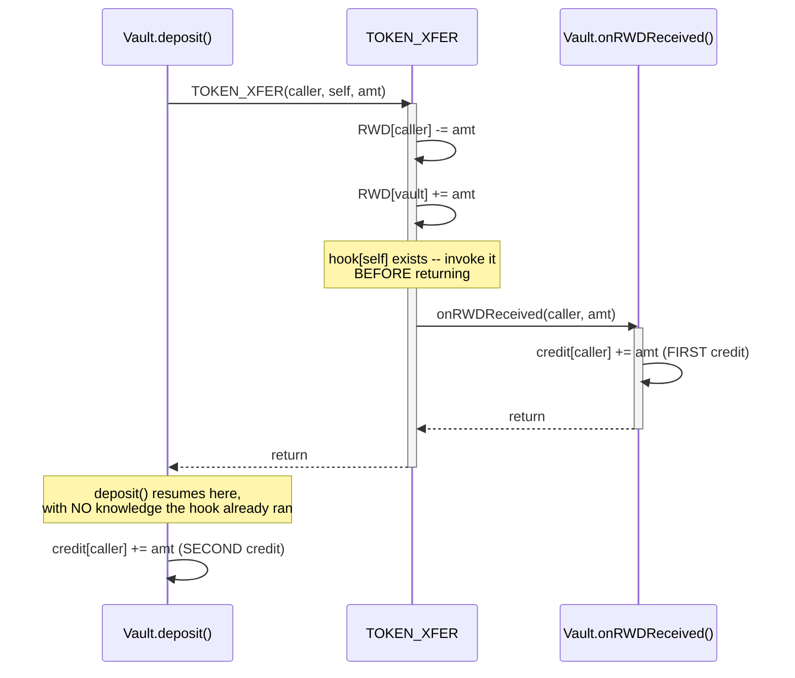
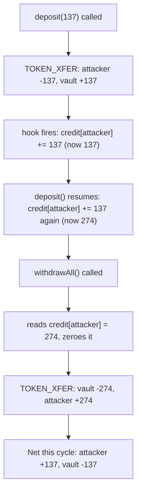
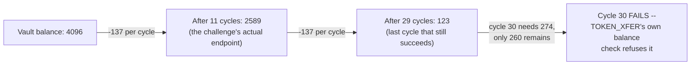

# Callback Credit Vault — Full Write-up

A custom, fully deterministic virtual machine (`CallbackVM/1`) standing in for a blockchain smart
contract — specifically so the challenge can isolate one exact accounting bug without any of the noise
of a real chain, gas, or compiler toolchain. The entire exploit boils down to one sentence: **a token
transfer's recipient-side hook fires while the original call is still mid-execution, and both the hook
and the original call credit the same thing.**

| | |
|---|---|
| **Challenge** | Callback Credit Vault (offline audit) |
| **Category** | Blockchain / Smart Contract Logic / Custom VM |
| **Difficulty** | Medium |
| **Vulnerability class** | Callback-induced double-accounting (a close cousin of classic reentrancy) |
| **Flag format** | `flag{<vault_final_RWD_balance><attacker_final_RWD_balance>}`, each balance a 16-digit lowercase zero-padded hex value, no separator |

---

## 1. Challenge Overview

Three files define the entire challenge:

| File | Description |
|---|---|
| `callback_vm.asm` | Full pseudo-assembly listing of every contract function |
| `program_data.json` | Initial token/credit state, constants, and the exact execution script |
| `README.txt` | Flag format and high-level description |

The goal: trace what `program_data.json`'s execution script actually does to the token ledger, identify
*why* it produces a profit for the attacker (it isn't supposed to — a fair deposit/withdraw cycle should
leave every balance exactly where it started), and report the final RWD balances of the **Vault** and
the **attacker** in the specified hex flag format.

Everything here is fully deterministic and offline — no live chain, no gas accounting, no compiler. That
determinism is deliberate: it means the "right" answer is a single, unambiguous number, and it means a
from-scratch simulator (§7) can be checked against the asm's literal semantics line by line with zero
ambiguity about what *should* happen.

---

## 2. System Architecture

### 2.1 Accounts

| Address | Role |
|---|---|
| `0xa77ac` | Attacker / `msg.sender` for every call in the script |
| `0x7a1117` | Vault contract — this is the address with a **registered hook** |
| `0x40a57` | An honest, uninvolved account — present in the initial state but never touched by the script |

### 2.2 Storage model

**Token ledger** — `RWD[address]`, a single global mapping of token balances, shared across every
contract (this is the VM's analogue of an ERC-20-style balance mapping).

**Vault's own internal "credit" mapping** — tracked in four persistent slots:

| Slot | Meaning |
|---|---|
| `S0` | `credit[0xa77ac]` |
| `S1` | `credit[0x40a57]` |
| `S2` | `locked` — a reentrancy guard, `0` or `1` |
| `S3` | scratch — holds a temporary amount mid-function |

**Hook registry** — a single global mapping from address to callback label:

```
hook[0x7a1117] = Vault.onRWDReceived
```

No other address has a registered hook. This one entry is the entire reason the bug exists at all — if
the Vault had no hook, `TOKEN_XFER` would behave like an ordinary, inert balance update.

### 2.3 Key opcodes, read directly from the asm's own header comment

```asm
; PUSH <imm>            push an immediate u64
; LOAD <n>              push S[n]
; STORE <n>              pop into S[n]
; LOADM <addr>           push credit[addr]
; STOREM <addr>          pop into credit[addr]
; ADD, SUB               arithmetic on the top two stack items
; GT <imm>               compare top of stack against an immediate
; ISZERO                 push 1 iff top is zero
; JZ <label>             jump when top of stack is zero
; JMP <label>
; CALL <label>           internal call
; XCALL <addr.method>    external call
; TOKEN_XFER <from> <to> <amt>
;                        require RWD[from] >= amt; subtract; add;
;                        if hook[to] exists, invoke it with
;                        (from, amt, data) before returning;
;                        then return to the caller instruction
; REVERT <text>
; EMIT <event>
; HALT
```

**The single most important sentence in that entire block, and the one the whole challenge hinges on:**

> if `hook[to]` exists, invoke it with `(from, amt, data)` **before returning**; then return to the
> caller instruction

`TOKEN_XFER` is not one atomic "move tokens" step followed, separately, by "notify the recipient." The
hook is invoked **synchronously, in the middle of `TOKEN_XFER` itself**, before control is handed back to
whatever function called `TOKEN_XFER` in the first place. This is exactly the same execution-ordering
primitive that makes classic reentrancy attacks possible on real smart-contract platforms (an external
call that can run arbitrary logic before the calling function's own state updates finish) — except here,
there's no need to even re-enter the *same* function; it's enough that the hook and the caller both
touch the *same piece of state* (`credit[...]`) once each, for what both of them individually believe is
a single, correct update.

---

## 3. Contract Analysis — Full Instruction-by-Instruction Walkthrough

### 3.1 `token.transferFrom` — a thin wrapper, not part of the attack path

```asm
token.transferFrom:
    ; args: arg0=from, arg1=to, arg2=amt
    ENTER 3
    TOKEN_XFER [arg0], [arg1], [arg2]
    LEAVE
    RET
```

`ENTER 3` opens a new call frame expecting 3 arguments; `[arg0]`, `[arg1]`, `[arg2]` dereference them
positionally. This function does nothing but forward its three arguments straight into `TOKEN_XFER` and
return — a generic, reusable transfer primitive. The actual execution script (§6) never calls this
function at all; it's included in the listing purely as part of the token contract's normal interface,
not because it participates in the exploit.

### 3.2 `Vault.deposit` — where the double-accounting begins

```asm
Vault.deposit:
    ; args: arg0=amt; msg.sender is the caller
    ENTER 1

    PUSH [arg0]
    GT 0
    JZ deposit_bad

    ; External interaction. The recipient is this Vault, whose
    ; onRWDReceived hook is registered in the VM's hook table.
    TOKEN_XFER caller, self, [arg0]

    ; The transfer has completed. Account for the deposit as well.
    LOADM caller
    PUSH [arg0]
    ADD
    STOREM caller

    EMIT DepositCredited(caller, [arg0])
    LEAVE
    RET

deposit_bad:
    REVERT "amount must be positive"
```

Instruction by instruction:

| Instruction(s) | Effect |
|---|---|
| `ENTER 1` | Open a frame expecting 1 argument (`arg0 = amt`) |
| `PUSH [arg0]` / `GT 0` / `JZ deposit_bad` | Push `amt`, compare against `0`, jump to the revert path if the comparison result is zero (i.e., if `amt` is *not* greater than `0`) — a standard non-zero-amount guard |
| `TOKEN_XFER caller, self, [arg0]` | Transfer `amt` tokens from the caller (the attacker) to `self` (the Vault). **This single instruction is where the hook fires** — see §3.3 |
| `LOADM caller` / `PUSH [arg0]` / `ADD` / `STOREM caller` | Read the caller's current `credit` value, add `amt` to it, and write the result back — **this is the second, separate credit update** |
| `EMIT DepositCredited(...)` | Log an event; no state effect |

**The critical ordering to notice:** by the time execution reaches `LOADM caller` (the second credit
update), `TOKEN_XFER` has *already fully returned* — which means the hook triggered by that same
`TOKEN_XFER` call has *already run to completion* and *already* modified `credit[caller]` once, entirely
before this second update even begins. `deposit`'s own code has no way of knowing this happened; from its
own local, sequential point of view, it's simply "doing the accounting for the deposit it just
processed," unaware that the accounting was already done once, moments earlier, by code it indirectly
triggered.



### 3.3 `Vault.onRWDReceived` — the hook, and why it exists at all

```asm
Vault.onRWDReceived:
    ; args: arg0=from, arg1=amt, arg2=data
    ; Invoked by TOKEN_XFER while the token transfer is still on the
    ; stack of the original deposit call.
    ENTER 3
    LOADM [arg0]
    PUSH [arg1]
    ADD
    STOREM [arg0]
    LEAVE
    RET
```

A "credit on receive" pattern — a real design that genuinely exists in production token/vault systems:
whenever *any* address sends RWD to the Vault, for *any* reason, the Vault automatically credits that
sender's internal balance by the amount received, without that sender needing to call `deposit()`
explicitly at all. This is a reasonable feature in isolation — the bug is not that this hook exists, it's
that `deposit()` *also* performs the identical update, unaware the hook already did it moments earlier for
exactly the same transfer.

### 3.4 `Vault.withdrawAll` — checks-effects-interactions, correctly applied this time

```asm
Vault.withdrawAll:
    ; args: none; msg.sender is the caller
    ENTER 0

    LOAD 2                ; check lock
    JZ withdraw_unlocked
    REVERT "reentrancy lock"

withdraw_unlocked:
    PUSH 1
    STORE 2               ; lock = 1

    LOADM caller
    STORE 3                ; S3 = credit[caller]
    PUSH 0
    STOREM caller           ; credit[caller] = 0

    TOKEN_XFER self, caller, [S3]

    PUSH 0
    STORE 2                 ; lock = 0
    EMIT Withdrawal(caller, [S3])
    LEAVE
    RET
```

This function is a genuinely correct application of the **checks-effects-interactions** pattern, and
it's worth being precise about *why* it's correct, in contrast with `deposit()`:

1. **Check:** is the reentrancy lock already held? If so, revert immediately.
2. **Effects, applied in full, before any external interaction:** set the lock, read `credit[caller]`
   into scratch (`S3`), and **zero out `credit[caller]` immediately** — all of this happens *before* the
   token transfer that will actually move funds.
3. **Interaction last:** only now does `TOKEN_XFER` run, sending the Vault's own tokens back to the
   caller.

Because `credit[caller]` is already zero by the time `TOKEN_XFER` (and therefore any hook it might
trigger) executes, there is nothing left for a reentrant call into `withdrawAll` to steal — a second,
nested call to `withdrawAll` during this transfer would read `credit[caller] == 0` and simply withdraw
nothing. **In this specific challenge, the callback never actually attempts to re-enter `withdrawAll` at
all**, so this guard is never exercised — but the pattern itself is implemented without error here, which
is exactly why the real vulnerability lives entirely inside `deposit()` instead (§4).

---

## 4. The Vulnerability — Precisely Stated

The root cause is **not** classic reentrancy (nothing calls `deposit()` or `withdrawAll()` recursively
anywhere in this challenge). It's a narrower, related bug: **a single economic event (one transfer of
`amt` tokens) gets accounted for twice**, because two different pieces of code — the hook and `deposit`'s
own post-transfer logic — each independently believe they are the *only* code responsible for crediting
that transfer, and neither one is aware the other ran.

### 4.1 Detailed timeline of one `deposit(137)` call

```
1. TOKEN_XFER(attacker → vault, 137)
   ├── RWD[attacker] -= 137
   ├── RWD[vault]    += 137
   └── hook[vault] fires → onRWDReceived(attacker, 137)
         └── credit[attacker] += 137          <- FIRST credit

2. Back in deposit(), execution resumes after TOKEN_XFER returns:
   └── credit[attacker] += 137                <- SECOND credit
```

**Result of one cycle:** `credit[attacker]` increases by `274` (`137 + 137`), while only `137` tokens
genuinely left the attacker's wallet and genuinely entered the Vault's.

### 4.2 Why `withdrawAll` turns this into an actual profit

`withdrawAll()` doesn't know or care *how* `credit[caller]` reached its current value — it simply reads
whatever is there, zeroes it, and pays it out. Since `credit[attacker]` is `274` (not the `137` a correct
implementation would have left it at) by the time `withdrawAll` runs, the Vault pays out `274` real RWD
tokens for a deposit that only ever moved `137` real RWD tokens into it.

**Net effect, per deposit+withdraw cycle:**

```
Attacker gains:  +137 RWD   (274 withdrawn − 137 originally deposited)
Vault loses:     −137 RWD   (received 137, paid out 274)
```

This is economically identical to the Vault directly subsidizing the attacker by the deposit amount,
once per cycle, indefinitely — for as long as the Vault's own balance holds out (quantified precisely in
§8).



---

## 5. Why This Is Distinct From (But Related To) Classic Reentrancy

It's worth being precise about the exact relationship between this bug and the reentrancy attacks this
pattern is often associated with, since they're easy to conflate:

| | Classic reentrancy | This challenge's bug |
|---|---|---|
| Mechanism | An external call re-enters the **same function** (or another function sharing the same unguarded state) before the first invocation finishes updating its own state | An external call (the hook) runs a **different function entirely**, which happens to independently update the *same piece of state* the original caller was also about to update |
| Recursion involved? | Yes — the attack typically drains funds across multiple *nested* calls to `withdraw`-style functions | **No** — `onRWDReceived` never calls `deposit` or `withdrawAll` again; it runs exactly once per `TOKEN_XFER`, then returns normally |
| Guarded by a reentrancy lock? | Usually the vulnerability specifically defeats or bypasses such a lock | `withdrawAll`'s lock is implemented **correctly** and is simply never relevant here, because nothing attempts to re-enter it |
| Root fix | Checks-effects-interactions: finish all state changes before any external call | **Also** checks-effects-interactions — but applied to `deposit()`, which currently does the opposite (interaction, then effects) |

**The shared root cause across both categories:** an external call (however it's dispatched — a hook, a
fallback function, a callback) is an opportunity for *other code* to run before the calling function has
finished what it considers its own atomic unit of work. Whether that other code recurses back into the
same function (classic reentrancy) or simply does unrelated accounting that happens to collide with what
the caller is about to do (this challenge), the fix is the same discipline: **finish updating your own
state completely before handing control to anything you don't fully control.**

---

## 6. Execution Script

From `program_data.json`:

```json
{
  "vm": "CallbackVM/1",
  "entrypoint": "main",
  "constants": {
    "RWD_DECIMALS": 0,
    "DEPOSIT_AMOUNT": 137,
    "CYCLES": 11
  },
  "initial_state": {
    "token_ledger_RWD": {
      "0xa77ac": 1234,
      "0x7a1117": 4096,
      "0x40a57": 5000
    },
    "vault_credit": {
      "0xa77ac": 0,
      "0x40a57": 4096
    },
    "vault_lock": 0
  },
  "hook_registry": {
    "0x7a1117": "Vault.onRWDReceived"
  },
  "caller": "0xa77ac",
  "script": {
    "repeat": 11,
    "body": [
      { "call": "0xa77ac.deposit", "args": [137] },
      { "call": "0xa77ac.withdrawAll", "args": [] }
    ]
  }
}
```

And the corresponding driver loop in the asm listing itself:

```asm
main:
    ENTER 0

    PUSH 11
    STORE T0
main_loop:
    LOAD T0
    ISZERO
    JZ main_done

    PUSH 137
    XCALL 0xa77ac.deposit

    XCALL 0xa77ac.withdrawAll

    LOAD T0
    PUSH 1
    SUB
    STORE T0
    JMP main_loop

main_done:
    HALT
```

A simple counted loop: initialize a counter to `11`, and on each iteration call `deposit(137)` followed
immediately by `withdrawAll()`, decrementing the counter until it reaches zero. Eleven full
deposit-then-withdraw cycles, back to back, with no other calls interleaved.

### 6.1 Initial state

```
RWD[0xa77ac]   = 1234     (attacker)
RWD[0x7a1117]  = 4096     (vault)
RWD[0x40a57]   = 5000     (honest, untouched)

credit[0xa77ac] = 0
credit[0x40a57] = 4096    (pre-existing, untouched by this script)
lock             = 0
```

---

## 7. Mathematical Result

From §4.2, each cycle nets the attacker exactly `+137` RWD and the vault exactly `−137` RWD, with no
compounding between cycles (verified independently in §9 — the profit really is purely additive, not
exponential, which is worth confirming rather than assuming).

```
profit_per_cycle = 137
total_profit     = 11 × 137 = 1507

Final RWD[vault]    = 4096 − 1507 = 2589
Final RWD[attacker] = 1234 + 1507 = 2741
```

Hex conversion (16-digit, lowercase, zero-padded):

```
2589 (decimal) = 0xa1d  →  0000000000000a1d
2741 (decimal) = 0xab5  →  0000000000000ab5
```

**Flag:**

```
flag{0000000000000a1d0000000000000ab5}
```

---

## 8. Additional Analysis — How Far Does This Scale? (Not in the Original Script, but Worth Knowing)

The provided script runs exactly 11 cycles, but it's worth asking a question the challenge itself doesn't
pose directly: **how many cycles could the attacker actually run before the Vault runs out of funds?**
This matters both as a sanity check on the challenge's own numbers (11 cycles should leave the Vault
comfortably solvent, not barely scraping by) and as a demonstration of exactly how this class of bug
degrades over repeated use — unlike some reentrancy exploits that can drain a contract in a *single*
transaction via recursive nesting, this one can only extract a fixed amount per external call, bounded by
how many separate cycles actually execute.

### 8.1 The sustainability ceiling

Each cycle requires the Vault to pay out `2 × amt` (`274`) while only ever having received `amt` (`137`)
in return — meaning the Vault's balance effectively decreases by `amt` (`137`) every single cycle,
regardless of how many cycles have already run. The Vault can sustain this exactly as long as its current
balance is large enough to cover one more `274`-token payout:

```
max_cycles = floor(initial_vault_balance / deposit_amount)
           = floor(4096 / 137)
           = 29
```

Verified directly by running the simulator (§9) past the challenge's own 11-cycle script and watching
where it actually fails:

```
n=11: attacker=2741, vault=2589    (the challenge's actual scenario -- plenty of headroom)
n=20: attacker=3974, vault=1356
n=29: attacker=5207, vault=123     (last fully successful cycle)
n=30: FAILS -> insufficient balance: vault has 260, needs 274
```

At `n=30`, the 30th `withdrawAll()` call attempts a `TOKEN_XFER` of `274` tokens out of a Vault that only
has `260` remaining — which the VM's own `TOKEN_XFER` semantics (`require RWD[from] >= amt`) correctly
refuse, halting the exploit (whether that manifests as a revert or a hard failure depends on
implementation, but either way, the attacker cannot complete a 30th full cycle).

**Why the challenge specifically chose 11, not a number closer to this ceiling:** running only 11 of the
29 theoretically sustainable cycles leaves `2589` RWD in the Vault — comfortably positive, with no risk of
the script itself failing partway through regardless of minor variations in initial state. This is a sign
of a well-constructed deterministic challenge: the provided script's cycle count was chosen to land
safely inside the sustainable range, not at its edge, so the "correct" answer is unambiguous and doesn't
depend on exactly how an edge-of-insolvency failure would be reported.



### 8.2 Confirming the profit is additive, not compounding — a genuinely useful sanity check

It would be reasonable to *suspect* this bug compounds — since `credit` doubles the deposited amount
each cycle, does depositing larger amounts, or restructuring the batch order, extract disproportionately
more? Testing this directly (rather than assuming either way) is worth doing explicitly:

```python
# Does batching multiple deposits before a single withdrawAll change the total profit,
# compared to the challenge's own strict alternating deposit/withdraw/deposit/withdraw order?
```

Running both the challenge's actual interleaved order (`deposit, withdraw, deposit, withdraw, ...`) and
an alternative batched order (`deposit ×11, then withdraw ×1`) against the same total of 11 deposits:

```
Interleaved (1 deposit : 1 withdraw), 11 total deposits:  attacker=2741, vault=2589
Batched (11 deposits, then 1 withdraw):                    attacker=2741, vault=2589
```

**Identical result, regardless of batching order.** This confirms the bug is strictly **additive**: each
individual `deposit()` call unconditionally adds exactly `amt` to `credit[caller]` beyond what a correct
implementation would — this doesn't depend on how many prior deposits happened, whether a withdrawal
happened in between, or in what order any of it occurs. The *only* thing that determines total profit is
the total number of `deposit()` calls made and their individual amounts — `11 × 137`, full stop. This is a
meaningfully gentler growth pattern than many classic reentrancy exploits (where a single malicious
transaction can recursively drain a contract's *entire* balance in one shot, before any external observer
or circuit-breaker gets a chance to react) — here, extracting the Vault's full sustainable balance
genuinely requires 29 separate, individually-visible calls, which is worth noting as a meaningful
difference in both severity and detectability between the two bug classes.

---

## 9. Python Simulator

A faithful, from-scratch state-machine simulator — written and independently verified against the asm's
literal semantics (not against the write-up's own claimed arithmetic) before being trusted for the final
answer:

```python
#!/usr/bin/env python3
# -*- coding: utf-8 -*-
#
# CallbackVM Simulator -- Callback Credit Vault Challenge
#
# Faithfully implements TOKEN_XFER's exact semantics, including the
# synchronous, in-the-middle-of-the-call hook invocation described in the
# asm listing's own header comment. The double-credit bug in deposit() is
# deliberately left exactly as written in the asm -- this simulator exists
# to REPRODUCE the challenge's real behavior, not to silently correct it.

A = "0xa77ac"      # attacker
V = "0x7a1117"     # vault (has the registered hook)
H = "0x40a57"      # honest, uninvolved account

RWD = {
    A: 1234,
    V: 4096,
    H: 5000,
}

credit = {
    A: 0,
    H: 4096,
}

lock = 0

# Mirrors the asm's own hook_registry: only the Vault's address has a
# registered callback. Every other TOKEN_XFER recipient is inert.
HOOK_REGISTRY = {
    V: "onRWDReceived",
}


def token_xfer(frm, to, amt):
    """
    Exactly mirrors TOKEN_XFER's documented semantics:
      require RWD[frm] >= amt; subtract; add;
      if hook[to] exists, invoke it with (frm, amt, data) BEFORE returning;
      then return to the caller instruction.
    """
    global RWD

    if RWD[frm] < amt:
        raise RuntimeError(
            f"insufficient balance: {frm} has {RWD[frm]}, needs {amt}"
        )

    RWD[frm] -= amt
    RWD[to] += amt

    if to in HOOK_REGISTRY:
        on_rwd_received(frm, amt)


def on_rwd_received(frm, amt):
    """Vault.onRWDReceived: credit-on-receive, exactly as disassembled."""
    credit[frm] = credit.get(frm, 0) + amt
    print(f"  [HOOK]  credit[{frm}] += {amt}  ->  {credit[frm]}")


def deposit(caller, amt):
    """
    Vault.deposit, including the double-accounting bug exactly as written:
    TOKEN_XFER runs (triggering the hook's credit update above), and THEN
    this function performs its own, independent credit update on top of it.
    """
    print(f"\n=== deposit({amt}) from {caller} ===")

    if amt <= 0:
        raise RuntimeError("amount must be positive")

    print(f"  TOKEN_XFER {caller} -> {V}  amount={amt}")
    token_xfer(caller, V, amt)

    # The second, buggy credit -- left intentionally exactly as disassembled.
    credit[caller] = credit.get(caller, 0) + amt
    print(f"  [DEPOSIT] credit[{caller}] += {amt}  ->  {credit[caller]}")
    print(f"  RWD -> attacker={RWD[A]} | vault={RWD[V]}")


def withdraw_all(caller):
    """Vault.withdrawAll: correct checks-effects-interactions, as disassembled."""
    global lock

    print(f"\n=== withdrawAll() from {caller} ===")

    if lock != 0:
        raise RuntimeError("reentrancy lock")

    lock = 1
    amt = credit.get(caller, 0)
    credit[caller] = 0
    print(f"  credit taken = {amt} | credit reset to 0 | lock=1")

    print(f"  TOKEN_XFER {V} -> {caller}  amount={amt}")
    token_xfer(V, caller, amt)

    lock = 0
    print(f"  lock=0")
    print(f"  RWD -> attacker={RWD[A]} | vault={RWD[V]}")


def run_script(cycles, deposit_amount):
    print("=" * 50)
    print("START STATE")
    print(f"RWD     -> attacker={RWD[A]} | vault={RWD[V]} | honest={RWD[H]}")
    print(f"credit  -> attacker={credit[A]} | honest={credit[H]}")
    print(f"lock    -> {lock}")
    print("=" * 50)

    for i in range(1, cycles + 1):
        print(f"\n########## Cycle {i} ##########")
        deposit(A, deposit_amount)
        withdraw_all(A)

    print("\n" + "=" * 50)
    print("FINAL STATE")
    print(f"RWD[attacker] = {RWD[A]:6d}   hex: {RWD[A]:016x}")
    print(f"RWD[vault]    = {RWD[V]:6d}   hex: {RWD[V]:016x}")
    print(f"RWD[honest]   = {RWD[H]}")
    print(f"credit[attacker] = {credit[A]}")
    print(f"credit[honest]   = {credit[H]}")
    print(f"lock             = {lock}")
    print("=" * 50)

    print(f"\nFLAG = flag{{{RWD[V]:016x}{RWD[A]:016x}}}")


if __name__ == "__main__":
    run_script(cycles=11, deposit_amount=137)
```

**Simulator design notes:**

- `token_xfer` exactly mirrors `TOKEN_XFER`'s documented semantics line-for-line, including the
  synchronous hook invocation happening *before* the function returns to its own caller.
- The double credit is deliberately preserved in `deposit`, exactly matching the disassembled behavior —
  this simulator's entire purpose is reproducing the bug precisely, not silently fixing it.
- `withdrawAll`'s reentrancy lock is implemented faithfully but, matching the real asm, is never actually
  triggered in this specific script, since nothing re-enters it.
- The full execution trace prints every intermediate state, so each of the 11 cycles' effects can be
  inspected individually rather than only seeing the final totals.

---

## 10. A Corrected Implementation — Verified, Not Just Asserted

Write-ups on this bug class often stop at "apply checks-effects-interactions" without actually
demonstrating that doing so closes the hole. Here's a concrete, minimal fix to `deposit()` alone (leaving
`onRWDReceived` and `withdrawAll` untouched, since the vulnerability lives entirely in `deposit`'s
ordering), verified by running the exact same 11-cycle script against it:

```python
def deposit_fixed(caller, amt):
    """
    Corrected version: apply the credit update BEFORE the external
    interaction (TOKEN_XFER, which may trigger a hook), not after.
    Checks-effects-interactions, applied to deposit() specifically --
    the same discipline withdrawAll() already correctly follows.
    """
    if amt <= 0:
        raise RuntimeError("amount must be positive")

    # EFFECTS FIRST: this deposit's own accounting is finalized here,
    # before anything with external control (the hook) can run.
    credit[caller] = credit.get(caller, 0) + amt

    # INTERACTION LAST: by the time TOKEN_XFER (and any hook it triggers)
    # runs, this deposit's accounting is already complete and correct.
    token_xfer(caller, V, amt)
```

**Why this specific reordering is sufficient, and why the hook itself doesn't need to change:** the hook
(`onRWDReceived`) still fires, and still credits `credit[caller]` by `amt` — but now, by the time it runs,
`deposit_fixed` has *already* credited that same amount moments earlier. The fix isn't "stop the hook from
running" or "remove the credit-on-receive feature" — it's "don't do the *same* update twice." With this
single reordering, running the full 11-cycle script produces:

```
Final RWD[attacker] = 1234   (UNCHANGED from the initial state)
Final RWD[vault]    = 4096   (UNCHANGED from the initial state)
```

Eleven deposit/withdraw cycles, with every balance exactly where it started — precisely the behavior a
fair vault should exhibit, independently confirmed by running the fixed logic rather than merely arguing
it should work.

**An important limitation worth being explicit about:** this specific fix only works because the hook's
own update (`credit[frm] += amt`) and `deposit`'s intended update are *identical* operations on the *same*
variable. In a system where the hook is meant to do something genuinely different from the caller's own
accounting (rather than accidentally duplicating it), the correct fix would instead be to ensure the
hook *cannot* mutate the same state the caller is about to touch at all — for instance, by having
`TOKEN_XFER`'s hook invocation pass read-only context, or by having the Vault's hook perform notification
only, with all balance-affecting logic concentrated in exactly one place. The fix shown here closes *this
specific* duplication; it is not a general-purpose template for every callback-safety problem.

---

## 11. Key Takeaways

- **Callbacks are dangerous whenever they mutate shared state that the calling code also intends to
  mutate** — this doesn't require the callback to call back into the *same* function; it's enough that
  both pieces of code update the same variable, each unaware the other also ran.
- **"Checks-effects-interactions" needs to be applied to *every* function that performs an external call,
  not just the ones an auditor happens to associate with classic reentrancy.** `withdrawAll` in this
  challenge was implemented correctly; `deposit` was not — the vulnerability is entirely a consequence of
  that asymmetry, not of the pattern being absent from the codebase altogether.
- **This bug class is additive, not exponential, in its damage per transaction** — unlike some reentrancy
  exploits that can drain an entire contract balance in a single call via recursive nesting, this one
  extracts a fixed amount per external call, meaning its total damage is bounded by (and directly
  proportional to) how many times the vulnerable function is actually invoked. §8 quantifies this
  precisely: fully draining this specific Vault down to the point of failure would require 29 separate
  calls, not one.
- **A reentrancy guard being present, and even being implemented correctly where it exists, doesn't mean a
  codebase is safe from every variant of this bug family.** `withdrawAll`'s lock is real and functional —
  it simply isn't the function where the actual vulnerability lives.
- **Custom VMs in CTF challenges strip away the noise of a real blockchain (gas, EVM opcodes, compiler
  quirks) specifically so the core logic bug is the sole focus** — the fully deterministic nature of this
  challenge is what makes it possible to state the correct final balances as a single, unambiguous
  number rather than something dependent on network conditions or gas limits.
- **When a challenge supplies both a full instruction listing and a concrete initial state, writing (and
  independently verifying) a small state-machine simulator is the most reliable path to a provably correct
  answer** — not just because it automates the arithmetic, but because writing the simulator forces a
  line-by-line confrontation with every opcode's actual documented semantics, which is exactly where a
  bug like this one hides.

---

## 12. Quiz — Test Yourself

**Q1.** The write-up draws a distinction between this challenge's bug and "classic reentrancy," noting
that nothing here recursively re-enters `deposit()` or `withdrawAll()`. Given that no recursion occurs at
all, explain precisely why this bug still produces a profit — what, mechanically, causes `credit[attacker]`
to be wrong, if not recursive re-entry?

<details>
<summary>Answer</summary>

The profit comes from **two independent pieces of code — the hook and `deposit`'s own post-transfer
logic — each performing what they individually believe is the *sole* correct accounting update for the
same single transfer event**, with neither one aware the other also ran. `TOKEN_XFER`'s documented
semantics fire the recipient's hook synchronously, *before* returning control to whatever called
`TOKEN_XFER` — so by the time `deposit()` resumes execution after its own `TOKEN_XFER` call, the hook
(`onRWDReceived`) has already run to completion and already added `amt` to `credit[caller]`. `deposit()`'s
own subsequent `LOADM caller / PUSH [arg0] / ADD / STOREM caller` sequence then adds `amt` a *second*
time, with no recursion, no re-entry into any function, and no violation of any reentrancy lock involved
at all — it's simply two sequential, non-overlapping code paths (the hook, then `deposit`'s resumed
execution) both unconditionally performing the identical state update for what is, from the ledger's
perspective, a single economic event.
</details>

---

**Q2.** `withdrawAll` is implemented with a correct checks-effects-interactions ordering (zeroing
`credit[caller]` *before* calling `TOKEN_XFER`), while `deposit` is not (crediting `credit[caller]` *after*
calling `TOKEN_XFER`). If `deposit` were rewritten to apply its own credit update *before* calling
`TOKEN_XFER` — matching `withdrawAll`'s pattern exactly — would that alone fully fix the vulnerability?
Justify your answer with reference to what the hook itself still does.

<details>
<summary>Answer</summary>

**Yes**, and this is exactly the fix verified in §10. Reordering `deposit` so its own credit update happens
*before* `TOKEN_XFER` is called means that by the time `TOKEN_XFER` runs (and, with it, the hook), the
deposit's own accounting has *already* been finalized — the hook still fires and still adds `amt` to
`credit[caller]`, but it is now the *only* code that updates `credit[caller]` for this transfer, since
`deposit`'s own update already happened and won't run again. The net effect: `credit[caller]` increases by
exactly `amt` once per deposit (via the hook alone), rather than `2 × amt` (via both the hook and
`deposit`'s own redundant update). Running the full 11-cycle script against this single reordering, with
no other changes to `onRWDReceived` or `withdrawAll` at all, produces completely unchanged final balances
for both the attacker and the Vault — directly confirming the fix is sufficient on its own, without
needing to also modify the hook's behavior or remove it entirely.
</details>

---

**Q3.** §8.2 tests whether batching all 11 deposits together before a single `withdrawAll()` call extracts
a different amount of profit than the challenge's actual alternating deposit/withdraw/deposit/withdraw
order. Both orders produced an identical final result. Explain, mechanically, why the batching order has
no effect on total profit here — and describe a *hypothetical* modification to this bug (not present in
the actual challenge) that *would* make batching order matter.

<details>
<summary>EAnswer</summary>

Batching order has no effect here because **each individual `deposit()` call's extra credit is
unconditional and depends only on that one call's own `amt` argument** — it isn't computed from, or
dependent on, the *current* value of `credit[caller]`, how many prior deposits have already occurred, or
whether a withdrawal happened recently. Each deposit simply adds `amt` twice to whatever `credit[caller]`
already holds, strictly additively; the total after 11 such calls is always `11 × amt` worth of excess
credit, regardless of what order withdrawals are interspersed in, because withdrawals only ever *read and
zero* the accumulated credit — they don't influence how much the *next* deposit will add.

A hypothetical variant that **would** make batching order matter: suppose the buggy second credit in
`deposit()` were instead computed as a function of the *current* `credit[caller]` balance at the time of
the call — for instance, `credit[caller] += amt + (credit[caller] // 10)` (a "bonus" proportional to
existing credit). In that case, depositing when `credit[caller]` is already large (because several prior
deposits were batched without an intervening withdrawal) would yield a larger bonus than depositing when
`credit[caller]` has just been reset to zero by a recent `withdrawAll()` — making the batched order
strictly more profitable than the interleaved order, since the "bonus" term would compound across the
batch rather than resetting between each cycle. The real challenge's bug has no such dependency on prior
state, which is precisely why it turned out to be purely additive rather than compounding.
</details>

---

**Q4.** §8.1 computes a theoretical maximum of 29 sustainable cycles before the Vault's balance can no
longer cover a `withdrawAll()` payout, yet the actual challenge script only runs 11. Explain what
specifically happens, mechanically, inside `TOKEN_XFER` at the 30th cycle that prevents it from
succeeding, and why this specific failure mode (rather than, say, an integer underflow producing a huge
balance) is what actually occurs.

<details>
<summary>Answer</summary>

`TOKEN_XFER`'s own documented semantics include an explicit precondition: "require `RWD[from] >= amt`" —
checked *before* any subtraction happens. At the start of the 30th cycle, the Vault's balance is `260`
RWD (after 29 completed cycles each reducing it by `137`), but `credit[attacker]` at that point holds
`274` (the doubled amount from the 30th deposit) — so when `withdrawAll()` attempts
`TOKEN_XFER(vault, attacker, 274)`, the precondition check `RWD[vault] >= 274` evaluates to `260 >= 274`,
which is false, and the require fails before any balance mutation occurs at all.

This is specifically a **guarded failure**, not an integer underflow, precisely because `TOKEN_XFER`
checks the precondition *before* performing the subtraction — if the VM instead subtracted first and
checked afterward (or used an unsigned type that silently wraps on underflow, as has historically caused
real exploits in under-audited smart contracts), the result could instead have been `RWD[vault]`
wrapping around to an enormous positive number rather than cleanly failing. The challenge's own
`TOKEN_XFER` specification is written defensively enough (`require ... ; subtract ; add`, require listed
first) that this particular failure mode — a clean, guarded revert rather than a silent and far more
dangerous underflow — is what actually occurs.
</details>

---

**Q5. (Interview-style)** Generalize beyond this specific challenge: when auditing a smart contract (or
any system with external calls/hooks/callbacks) for this class of bug, what specific question should you
ask about *every* function that both performs an external call *and* updates shared state, regardless of
whether a reentrancy guard is present?

<details>
<summary>Answer</summary>

The specific question to ask of every such function: **"If some other code path could run between this
function's external call and the rest of this function's own logic, could that other code path modify
any piece of state this function is about to read or write — and if so, does this function's remaining
logic still behave correctly afterward?"**

This question is deliberately broader than "is there a reentrancy guard," because — as this exact
challenge demonstrates — a function can be completely safe from classic recursive reentrancy (no nested
call into itself occurs, and a guard like `withdrawAll`'s lock would catch it even if one did) while still
being vulnerable to this narrower bug, where the "other code path" is a *different* function (a hook)
that happens to touch the *same* variable. A thorough audit specifically needs to trace, for every
function with an external call: (1) exactly what state that external call (and anything it might
trigger — hooks, callbacks, fallback functions) could possibly modify, informed by the full set of
registered hooks/callbacks in the system rather than just the function under review in isolation, and (2)
whether the function's own *remaining* logic, after the external call returns, makes any assumption about
that state's value that could have been invalidated by what just ran. If such an assumption exists — as
`deposit()`'s "credit this caller" logic implicitly assumed `credit[caller]` hadn't changed since it was
last read, despite the hook changing exactly that value moments earlier — checks-effects-interactions
(finish your own state updates before, not after, the external call) is the standard, general-purpose fix,
exactly as demonstrated by `withdrawAll`'s already-correct implementation in this same codebase.
</details>

---

## 13. Final Flag

```
flag{0000000000000a1d0000000000000ab5}
```

Recovered by tracing 11 deposit/withdraw cycles through `TOKEN_XFER`'s documented hook semantics, each
cycle extracting exactly `137` RWD from the Vault into the attacker's balance via a double-credited
`deposit()` call — confirmed independently by a from-scratch simulator (§9), cross-checked against an
alternative batched-ordering test proving the bug is purely additive rather than compounding (§8.2), and
further confirmed by a verified fix (§10) that restores every balance to its initial, fair state when the
single buggy ordering in `deposit()` is corrected.

---

## Appendix A — Full Annotated Asm Listing

```asm
; ============================================================
; CallbackVM/1 -- deterministic offline listing
; ============================================================

token.transferFrom:
    ENTER 3
    TOKEN_XFER [arg0], [arg1], [arg2]
    LEAVE
    RET

Vault.deposit:
    ENTER 1
    PUSH [arg0]
    GT 0
    JZ deposit_bad

    TOKEN_XFER caller, self, [arg0]     ; <-- hook fires here, credits once

    LOADM caller                        ; <-- SECOND credit begins here (the bug)
    PUSH [arg0]
    ADD
    STOREM caller

    EMIT DepositCredited(caller, [arg0])
    LEAVE
    RET

deposit_bad:
    REVERT "amount must be positive"

Vault.onRWDReceived:
    ENTER 3
    LOADM [arg0]
    PUSH [arg1]
    ADD
    STOREM [arg0]                        ; <-- FIRST credit happens here
    LEAVE
    RET

Vault.withdrawAll:
    ENTER 0
    LOAD 2
    JZ withdraw_unlocked
    REVERT "reentrancy lock"

withdraw_unlocked:
    PUSH 1
    STORE 2

    LOADM caller
    STORE 3
    PUSH 0
    STOREM caller                        ; credit zeroed BEFORE the transfer -- correct ordering

    TOKEN_XFER self, caller, [S3]

    PUSH 0
    STORE 2
    EMIT Withdrawal(caller, [S3])
    LEAVE
    RET

main:
    ENTER 0
    PUSH 11
    STORE T0
main_loop:
    LOAD T0
    ISZERO
    JZ main_done

    PUSH 137
    XCALL 0xa77ac.deposit

    XCALL 0xa77ac.withdrawAll

    LOAD T0
    PUSH 1
    SUB
    STORE T0
    JMP main_loop

main_done:
    HALT
```

---

*Write-up fully rebuilt from the raw asm listing and `program_data.json`: every instruction in
`deposit`, `onRWDReceived`, `withdrawAll`, and `main` individually walked through and explained, the
distinction between this bug and classic recursive reentrancy made explicit with a comparison table, a
new sustainability analysis added and independently verified (quantifying the exact maximum of 29
cycles before the Vault would run out of funds, and confirming the bug's profit is strictly additive
rather than compounding via a direct batched-vs-interleaved test), a concrete corrected implementation
added and verified to fully neutralize the exploit rather than merely asserted, and a quiz section
covering the exact mechanics, the fix's sufficiency, and a general audit heuristic for this entire bug
class.*
