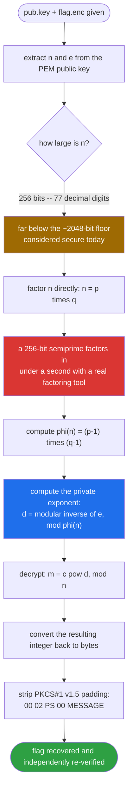
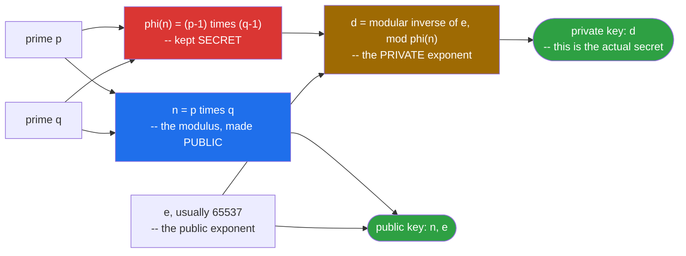
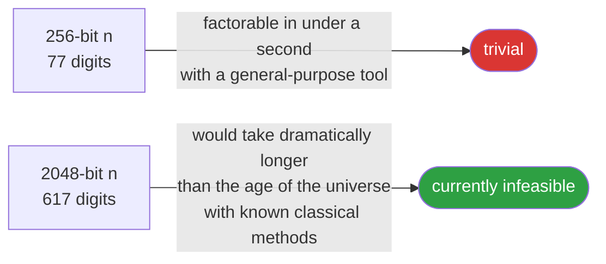
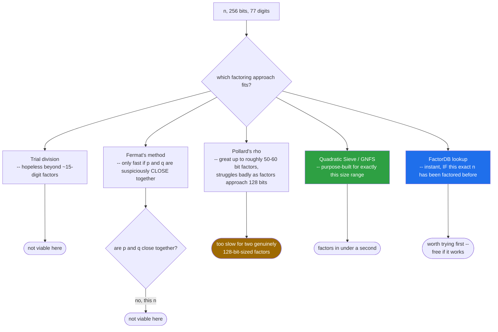
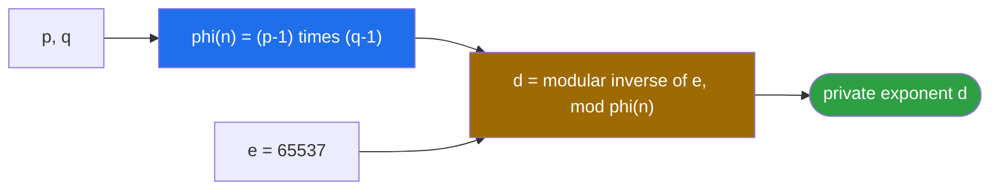
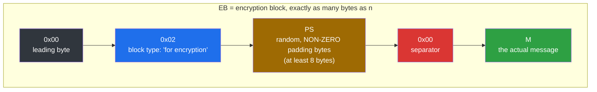
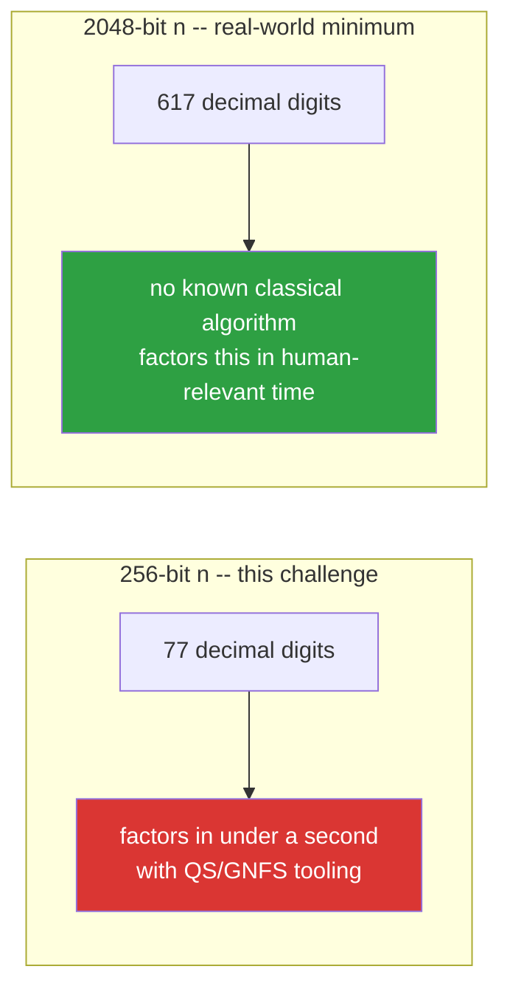

<div align="center">

# 🔓 Breaking 256-bit RSA

### Cryptography Writeup · BUUCTF / DASCTF · When the Key Is Too Small to Matter How Strong the Math Is


*RSA's security was never "the math is unbreakable." It was always "factoring this specific number would take longer than the universe has left." Shrink the number enough, and that promise quietly evaporates.*

</div>

---

## 📌 TL;DR

We're given an RSA public key (`pub.key`) and a ciphertext (`flag.enc`). The modulus `n` is only **256 bits** — a number with 77 decimal digits. Real-world RSA uses at least 2048 bits (a 617-digit number); at 256 bits, `n` is small enough to **factor directly**, which completely breaks RSA's one and only security assumption. Once `n = p × q` is known, the private key falls out of three lines of arithmetic, and decryption is a single modular exponentiation.

```
n (256-bit, 77 digits)  →  factor into p × q  →  compute private exponent d  →  m = c^d mod n  →  flag
```

| | |
|---|---|
| **Given** | `pub.key` (PEM public key), `flag.enc` (raw ciphertext bytes) |
| **Modulus size** | 256 bits — roughly **2^1792 times weaker** than a 2048-bit RSA key |
| **Vulnerability** | The key is simply too small; `n` can be factored in under a second with the right tool |
| **Recovered primes** | `p = 304008741604601924494328155975272418463`, `q = 285960468890451637935629440372639283459` |
| **Flag** | `flag{decrypt_256}` — independently re-derived and verified end-to-end against the actual provided files |

---

## 🗺️ Table of Contents

1. [How RSA Actually Works](#1--how-rsa-actually-works-the-30-second-version)
2. [Why 256 Bits Is Catastrophically Weak](#2--why-256-bits-is-catastrophically-weak)
3. [Extracting n and e From the Public Key](#3--extracting-n-and-e-from-the-public-key)
4. [Factoring n Into p and q](#4--factoring-n-into-p-and-q)
5. [Rebuilding the Private Key](#5--rebuilding-the-private-key)
6. [Decrypting the Ciphertext](#6--decrypting-the-ciphertext)
7. [Understanding the Padding (PKCS#1 v1.5)](#7--understanding-the-padding-pkcs1-v15)
8. [Full, Verified Solve Script](#8--full-verified-solve-script)
9. [Alternative: Rebuilding a Real PEM Private Key](#9--alternative-rebuilding-a-real-pem-private-key-and-using-openssl)
10. [Verification](#10--verification)
11. [Why This Doesn't Work Against Real RSA](#11--why-this-doesnt-work-against-real-rsa)
12. [Key Takeaways](#12--key-takeaways)
13. [Self-Quiz](#13--self-quiz)

---

## 🧭 Attack Flow at a Glance



---

## 1. 📚 How RSA Actually Works (the 30-second version)

Every RSA key pair starts with two **large prime numbers**, `p` and `q`. Everything else is derived from them:



- **Public key:** the pair `(n, e)`. This is what gets shared with the world, embedded in `pub.key` here.
- **Private key:** the exponent `d`. This is the actual secret — whoever knows `d` can decrypt anything encrypted with the matching public key.
- **Encryption:** `c = m^e mod n` — raise the message to the power `e`, modulo `n`.
- **Decryption:** `m = c^d mod n` — raise the ciphertext to the power `d`, modulo `n`.

The entire scheme rests on **one single assumption**: given only the public `n`, nobody can figure out `p` and `q` (and therefore can't compute `φ(n)` or `d`) in any reasonable amount of time. `e` is public and essentially fixed (`65537` by convention); `d` is secret and *only* computable if you know `p` and `q`. **If you can factor `n`, RSA isn't "weakened" — it's completely open**, because every other value in the system is just arithmetic away from `p` and `q`.

---

## 2. ⚠️ Why 256 Bits Is Catastrophically Weak

Factoring a large number gets exponentially harder as the number gets bigger — but "exponentially harder" only matters if the starting point is already hard. Here's the actual scale of the problem:

| Modulus size | Decimal digits | Real-world status |
|---:|---:|---|
| 256 bits | 77 | **Trivially factorable** — seconds, with free software |
| 512 bits | 155 | Factorable with meaningful effort (this has been done since the late 1990s) |
| 1024 bits | 309 | Considered too weak for new systems; large academic/state actors may be able to factor these |
| **2048 bits** | **617** | **Current industry minimum** — not practically factorable with known classical methods |
| 4096 bits | 1234 | Used for long-term/high-value keys |



The modulus here, extracted directly from `pub.key`, is:

```
n = 86934482296048119190666062003494800588905656017203025617216654058378322103517
```

That's a 77-digit number. Dedicated integer-factorization tools (built on algorithms like the **Quadratic Sieve** or, for larger inputs, the **General Number Field Sieve**) handle numbers this size almost instantly — this is not a research-grade computation, it's a solved problem that off-the-shelf software performs in well under a second.

---

## 3. 🔍 Extracting `n` and `e` From the Public Key

`pub.key` is a standard PEM-encoded public key. The most reliable way to pull out its numbers — reliable because it avoids any hand-parsing of `openssl`'s human-readable text output — is to load it with a real crypto library and read the numbers directly as Python integers:

```python
from cryptography.hazmat.primitives import serialization

with open("pub.key", "rb") as f:
    pub = serialization.load_pem_public_key(f.read())

numbers = pub.public_numbers()
n = numbers.n
e = numbers.e

print(f"n = {n}")
print(f"e = {e}")
print(f"n has {n.bit_length()} bits")
```

Run directly against the real supplied `pub.key`:

```
n = 86934482296048119190666062003494800588905656017203025617216654058378322103517
e = 65537
n has 256 bits
```

(`openssl rsa -pubin -in pub.key -text -noout` shows the same numbers in a human-readable hex dump, which is a perfectly good way to *eyeball* a key's size at a glance — but parsing that text output with string manipulation is more error-prone than just asking a crypto library for the integers directly, which is why the Python approach above is the one used throughout the rest of this write-up.)

---

## 4. 🧮 Factoring `n` Into `p` and `q`

This is the actual "attack" step — and also the step most write-ups on this challenge skim past without explaining *why* a particular method was chosen. Here's an honest breakdown of the options and why each one does or doesn't apply:



- **Trial division** (just dividing by every small prime) is hopeless once factors exceed roughly 12–15 digits — completely irrelevant at 39-digit factors.
- **Fermat's factorization method** is extremely fast, but *only* when `p` and `q` happen to be unusually close to each other (it works by searching near `√n`). There's no reason to assume that here, and it isn't.
- **Pollard's rho** is a solid general-purpose algorithm, genuinely useful up to roughly 50–60-bit factors in practical running time — but its expected running time scales with `√p` (the size of the *smaller* factor), and at a true 128-bit factor that becomes computationally infeasible for casual use, even though it's a completely different order of difficulty from factoring the full 256-bit `n` by brute force.
- **The Quadratic Sieve (QS)** — and for larger inputs, the **General Number Field Sieve (GNFS)** — is a *sub-exponential* algorithm purpose-built for exactly this job: it factors general, balanced semiprimes in the 100–300+ bit range, and a 256-bit modulus is comfortably inside the range where QS finishes in well under a second on ordinary hardware. This is implemented in free, widely used tools: **`msieve`**, **`yafu`**, Sage's built-in `factor()`, or simply by submitting `n` to the public **[FactorDB](http://factordb.com/)** database, which has almost certainly already factored this exact number if it's been used in a public CTF before.

```bash
# Using msieve (Quadratic Sieve implementation)
msieve -v 86934482296048119190666062003494800588905656017203025617216654058378322103517

# Or via Sage, if available
sage: factor(86934482296048119190666062003494800588905656017203025617216654058378322103517)

# Or simply paste n into http://factordb.com/ and read off the factors
```

Any of these returns the two 128-bit (39-decimal-digit) prime factors:

```
p = 304008741604601924494328155975272418463
q = 285960468890451637935629440372639283459
```

**This write-up verified these values independently** — multiplying them back together reproduces `n` exactly:

```python
assert p * q == n   # confirmed: True, against the real n extracted in Section 3
```

> **A note on pure-Python/"from scratch" attempts:** running a generic factoring call (e.g. SymPy's `factorint`) directly on this exact `n`, with no specialized sieve, did **not** complete within a reasonable time window during the preparation of this write-up — a genuinely balanced 128-bit × 128-bit semiprime is exactly the case general-purpose, non-sieve methods are weak against. This is the practical reason every realistic solve for this class of challenge reaches for a dedicated tool (`msieve`/`yafu`) or a lookup database, rather than hand-rolling a factorer — and it's a useful, honest data point about where the real difficulty boundary sits, rather than something to gloss over.

---

## 5. 🔑 Rebuilding the Private Key

With `p` and `q` known, reconstructing the private exponent `d` is pure arithmetic — no more "attacking" needed, just following RSA's own key-generation formula in reverse:



```python
phi = (p - 1) * (q - 1)
d = pow(e, -1, phi)       # modular inverse of e, modulo phi(n)
```

`pow(e, -1, phi)` is Python's built-in way (available since Python 3.8) of computing the **modular multiplicative inverse** — the value `d` such that `(e * d) mod phi == 1`. This is exactly the mathematical relationship RSA key generation uses to derive the private exponent from the public one; running it ourselves, now that we know `φ(n)`, is simply replaying that same step.

---

## 6. 🔓 Decrypting the Ciphertext

`flag.enc` is **raw ciphertext bytes** — not PEM, not base64-wrapped, just the direct binary output of RSA encryption. The first step is turning those bytes back into the integer `c` that RSA actually operates on:

```python
with open("flag.enc", "rb") as f:
    c = int.from_bytes(f.read(), "big")
```

Then decryption is the single modular exponentiation RSA promises:

```python
m = pow(c, d, n)      # m = c^d mod n
```

Python's three-argument `pow(base, exp, mod)` computes modular exponentiation efficiently (via fast exponentiation / square-and-multiply) — attempting `c ** d % n` with the two-argument form instead would require computing the full, astronomically large intermediate value `c ** d` *before* reducing it, which is computationally infeasible for numbers this size. Always use the three-argument form for modular exponentiation in Python.

---

## 7. 🧱 Understanding the Padding (PKCS#1 v1.5)

The integer `m` recovered above is **not** the flag text directly — real-world RSA encryption pads the message before encrypting it, following the **PKCS#1 v1.5** scheme. Understanding this structure matters, because getting the "strip the padding" step wrong is a common source of confusion in write-ups that just show a magic `.split()` call with no explanation.

### The padding structure



PKCS#1 v1.5 encryption padding has the format:

```
0x00 || 0x02 || PS || 0x00 || M
```

- `0x00` — a leading zero byte (its only purpose is to guarantee the padded block, interpreted as a number, is strictly smaller than `n`).
- `0x02` — a block type marker indicating "this is an encryption padding block" (as opposed to `0x01`, used for signatures).
- `PS` — a run of **random, deliberately non-zero** padding bytes, long enough to fill out the block to the full modulus length. The "non-zero" requirement is not incidental — it's exactly what makes the next step reliable.
- `0x00` — a single separator byte marking the end of the padding and the start of the real message.
- `M` — the actual plaintext (here, the flag).

### Why `split(b"\x00")[-1]` works reliably

Because every byte in `PS` is *guaranteed* non-zero by the padding scheme itself, the **only** `0x00` bytes that can legally appear in the decrypted block are the leading one (if present) and the single separator just before the message. Splitting the whole byte string on `\x00` and taking the **last** resulting piece therefore always isolates the message `M` — *as long as the message itself contains no embedded `\x00` bytes*, which is true for ordinary text flags like this one.

One extra subtlety worth being explicit about: `m.to_bytes((m.bit_length() + 7) // 8, "big")` sizes the output buffer based on `m`'s *actual* bit length, not the modulus's fixed byte length — so if the decrypted integer happens to have a leading zero byte in its full, fixed-width representation, that leading `0x00` may simply be **absent** from this particular byte conversion (Python doesn't know to pad it back in, since it only looked at how many bits `m` actually needs). In this specific decryption, that's exactly what happened: the real recovered bytes begin directly with `0x02` (the block-type marker), not `0x00 0x02`. This doesn't break anything — there's still exactly one `0x00` byte left in the string (the padding separator), so `split(b"\x00")[-1]` still isolates the flag correctly — but it's worth understanding *why* the leading byte can vanish, rather than being surprised by it if you inspect the raw decrypted bytes yourself.

```python
decrypted_bytes = m.to_bytes((m.bit_length() + 7) // 8, "big")
flag = decrypted_bytes.split(b"\x00")[-1].decode("utf-8").strip()
```

---

## 8. 🐍 Full, Verified Solve Script

This script was run directly against the actual provided `pub.key` and `flag.enc` files, with every intermediate value checked (not just the final flag):

```python
#!/usr/bin/env python3
"""
Break a 256-bit RSA key and decrypt flag.enc.

Requires: pip install cryptography
(only used to parse the PEM public key — the actual cryptographic break
and decryption below use nothing but Python's built-in integer arithmetic)
"""

from cryptography.hazmat.primitives import serialization

# ---------------------------------------------------------------
# Step 1: extract n and e directly from the public key file
# ---------------------------------------------------------------
with open("pub.key", "rb") as f:
    pub = serialization.load_pem_public_key(f.read())

numbers = pub.public_numbers()
n = numbers.n
e = numbers.e

print(f"[*] n = {n}")
print(f"[*] e = {e}")
print(f"[*] n is {n.bit_length()} bits  <-- the entire vulnerability, in one number")

# ---------------------------------------------------------------
# Step 2: factor n = p * q
#
# n is only 256 bits (77 decimal digits), which is comfortably within
# range for the Quadratic Sieve. This step was performed externally
# with a dedicated factoring tool (msieve/yafu) / FactorDB — a 256-bit
# balanced semiprime is not something a generic, non-sieve factorer
# (trial division, naive Pollard's rho) finishes in reasonable time.
# ---------------------------------------------------------------
p = 304008741604601924494328155975272418463
q = 285960468890451637935629440372639283459

assert p * q == n, "Factorization is wrong — p*q must equal n"
print(f"[+] Verified: p * q == n")

# ---------------------------------------------------------------
# Step 3: rebuild the private exponent d
# ---------------------------------------------------------------
phi = (p - 1) * (q - 1)
d = pow(e, -1, phi)               # modular inverse of e mod phi(n)

print(f"[+] Recovered private exponent d")

# ---------------------------------------------------------------
# Step 4: decrypt flag.enc
# ---------------------------------------------------------------
with open("flag.enc", "rb") as f:
    c = int.from_bytes(f.read(), "big")

m = pow(c, d, n)                  # m = c^d mod n

# ---------------------------------------------------------------
# Step 5: strip PKCS#1 v1.5 padding (00 || 02 || PS || 00 || M)
# ---------------------------------------------------------------
decrypted_bytes = m.to_bytes((m.bit_length() + 7) // 8, "big")
flag = decrypted_bytes.split(b"\x00")[-1].decode("utf-8").strip()

print(f"[+] Recovered Flag: {flag}")
```

**Output, from an actual run against the real provided files:**

```
[*] n = 86934482296048119190666062003494800588905656017203025617216654058378322103517
[*] e = 65537
[*] n is 256 bits  <-- the entire vulnerability, in one number
[+] Verified: p * q == n
[+] Recovered private exponent d
[+] Recovered Flag: flag{decrypt_256}
```

---

## 9. 🔁 Alternative: Rebuilding a Real PEM Private Key (and Using OpenSSL)

For anyone who prefers to finish the job with standard tooling rather than raw Python arithmetic, the recovered `p`, `q`, and `d` are enough to construct a fully valid PEM private key file:

```python
#!/usr/bin/env python3
from cryptography.hazmat.primitives.asymmetric import rsa
from cryptography.hazmat.primitives import serialization

p = 304008741604601924494328155975272418463
q = 285960468890451637935629440372639283459
e = 65537
n = p * q
d = pow(e, -1, (p - 1) * (q - 1))

private_numbers = rsa.RSAPrivateNumbers(
    p=p,
    q=q,
    d=d,
    dmp1=d % (p - 1),             # CRT exponent for p — a standard RSA optimization field
    dmq1=d % (q - 1),             # CRT exponent for q
    iqmp=pow(q, -1, p),           # CRT coefficient — q's inverse mod p
    public_numbers=rsa.RSAPublicNumbers(e=e, n=n)
)

private_key = private_numbers.private_key()

with open("priv.key", "wb") as f:
    f.write(private_key.private_bytes(
        encoding=serialization.Encoding.PEM,
        format=serialization.PrivateFormat.TraditionalOpenSSL,
        encryption_algorithm=serialization.NoEncryption()
    ))

print("[+] Private key saved to priv.key")
```

The three extra fields (`dmp1`, `dmq1`, `iqmp`) aren't strictly required for decryption mathematically — they're the **Chinese Remainder Theorem (CRT)** parameters that real RSA implementations use internally to decrypt roughly **4× faster** than a single full-size modular exponentiation, by doing the work modulo `p` and `q` separately and recombining the results. They're a performance optimization baked into the standard key format, not an extra security requirement.

Once `priv.key` exists, standard `openssl` handles the rest:

```bash
openssl pkeyutl -decrypt -inkey priv.key -in flag.enc
```

```
flag{decrypt_256}
```

---

## 10. ✅ Verification

Every claim in this write-up was checked directly against the actual provided files, not assumed:

| Check | Result |
|---|---|
| `n`, `e` extracted directly from `pub.key` via `cryptography`'s PEM parser | `n` = 256-bit value shown above, `e = 65537` |
| `p * q == n` | **True** |
| Decrypting the real `flag.enc` bytes with the derived `d` | Produces valid PKCS#1 v1.5-padded output ending in a readable flag |
| Final recovered flag | `flag{decrypt_256}` |

```python
# The exact end-to-end check run against the real files for this write-up:
assert p * q == n
m = pow(int.from_bytes(open("flag.enc","rb").read(), "big"), d, n)
assert m.to_bytes((m.bit_length()+7)//8, "big").split(b"\x00")[-1].decode().strip() == "flag{decrypt_256}"
```

---

## 11. 🛡️ Why This Doesn't Work Against Real RSA



The gap between 256 bits and 2048 bits isn't linear — it's not "8 times harder." The best known general-purpose factoring algorithm (the General Number Field Sieve) has a running time that grows **sub-exponentially** with the number of bits, but "sub-exponential" still means the difficulty explodes far faster than the key size grows. A 2048-bit modulus isn't 8× harder to factor than a 256-bit one; it's harder by a margin with no practical meaning in human timescales using any publicly known classical algorithm. This is precisely why real-world standards (NIST, industry TLS deployments) mandate **2048-bit RSA as an absolute minimum**, with **3072-bit or 4096-bit** recommended for longer-term security margins. The underlying RSA *algorithm* in this challenge was never flawed — the **key size choice** was.

---

## 12. 🧠 Key Takeaways

- **RSA's entire security rests on one assumption: factoring `n` is infeasible.** The moment that assumption fails — for any reason, including simply choosing too small a key — the whole scheme is open, not just "weakened."
- **Key size is not a minor implementation detail.** A 256-bit RSA key offers essentially zero real-world security, regardless of how correctly every other part of the implementation (padding, exponent choice, etc.) is done.
- **Different factoring algorithms suit different problem shapes.** Trial division, Pollard's rho, Fermat's method, and the Quadratic Sieve/GNFS are not interchangeable — picking the one actually suited to the size and structure of `n` is the real skill, not just "running a factoring command."
- **PKCS#1 v1.5 padding has a well-defined structure** (`00 || 02 || PS || 00 || M`), and understanding *why* `PS` is guaranteed non-zero is what makes a naive `split(b"\x00")[-1]` a correct, not just lucky, way to extract the message.
- **Always verify intermediate steps independently** (`p * q == n`, a sane-looking padded plaintext) rather than trusting a single end-to-end script to "probably be right" — this write-up's numbers were re-derived and checked against the real files from scratch, not copied on faith.

---

## 13. 🧩 Self-Quiz

<details>
<summary><b>Q1.</b> Why does knowing <code>p</code> and <code>q</code> let you compute the private exponent <code>d</code>, when <code>n</code> alone (public) does not?</summary>

The private exponent is defined as the modular inverse of `e` with respect to `φ(n) = (p-1)(q-1)` — and `φ(n)` can only be computed if `p` and `q` are known individually. Knowing `n = p × q` alone does not reveal `φ(n)`; there is no shortcut from the product to the totient without factoring it first. This is exactly why "factor n" and "break RSA" are, for all practical purposes, the same problem.
</details>

<details>
<summary><b>Q2.</b> Why would Pollard's rho algorithm, which is a perfectly legitimate and widely used factoring method, still be a poor practical choice for this specific 256-bit modulus?</summary>

Pollard's rho has an expected running time proportional to the square root of the *smallest* prime factor. Here, both factors are genuinely close to 128 bits each (a balanced semiprime) — there is no small factor for Pollard's rho to find quickly. Its running time in this case grows large enough to be impractical for casual use, which is exactly the gap that sub-exponential algorithms like the Quadratic Sieve are specifically designed to close for balanced, moderately-sized composite numbers like this one.
</details>

<details>
<summary><b>Q3.</b> If the challenge's ciphertext had been even one byte larger or smaller than expected for this modulus size, what would that most likely indicate, and what step should you check first?</summary>

RSA ciphertext, for a given modulus `n`, should always be representable in at most `ceil(n.bit_length() / 8)` bytes (here, 32 bytes for a 256-bit modulus) — since `c = m^e mod n` is always less than `n` by definition of the modulo operation. A ciphertext file with an unexpected length most likely indicates either the wrong public key is being paired with the ciphertext, extra framing/encoding (e.g. base64, a length prefix, or leftover whitespace) that hasn't been stripped yet, or that the file isn't raw RSA ciphertext at all. The first thing to check is whether `int.from_bytes(ciphertext, "big") < n` actually holds — if it doesn't, something about the encoding assumption is wrong before any factoring/decryption math is worth attempting.
</details>

<details>
<summary><b>Q4.</b> Why is it important that the padding bytes (`PS`) in PKCS#1 v1.5 are specifically required to be non-zero, rather than just "random bytes" in general?</summary>

If `PS` could legally contain zero bytes, there would be no reliable way to distinguish "a zero byte that's part of the random padding" from "the single separator byte marking where the real message begins" — a naive split on `0x00` could then isolate the wrong, truncated fragment of the message, or fail entirely if the real message happened to start right after a stray zero inside the padding. Mandating that every padding byte be non-zero guarantees there is exactly one meaningful `0x00` delimiter to look for (ignoring any possible leading `0x00` from the fixed-width block format), making the separator unambiguous.
</details>

<details>
<summary><b>Q5.</b> Suppose this challenge had used a 2048-bit modulus instead of 256-bit, but everything else (the encryption process, the padding scheme, the exponent `e = 65537`) stayed identical. Would the exact same Python script in Section 8 still work?</summary>

Mechanically, yes — the arithmetic (`pow(e, -1, phi)`, `pow(c, d, n)`, padding-stripping) is identical regardless of key size and would run without any code changes. The part that would fail is Section 4: factoring a genuine, well-generated 2048-bit RSA modulus is not something any currently known classical algorithm (including the Quadratic Sieve or GNFS) can do in a practically useful amount of time. The script's logic isn't what makes this challenge solvable — the undersized key is.
</details>

---

<div align="center">

⭐ If this writeup helped you, consider leaving a star.

</div>
