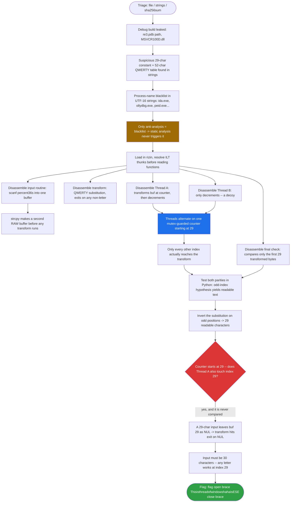
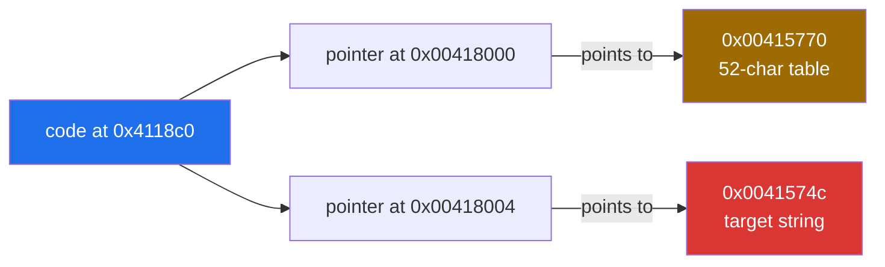
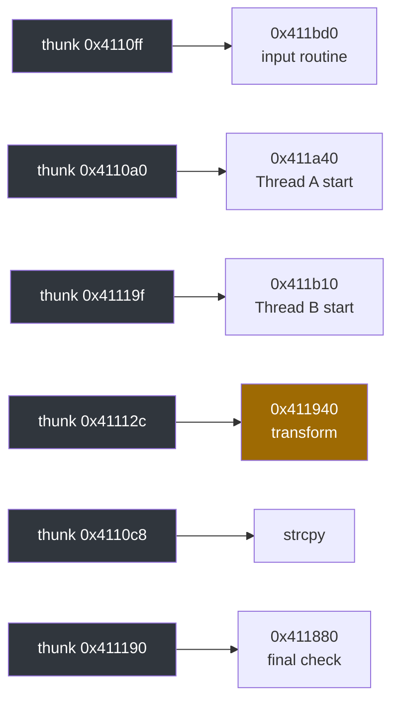
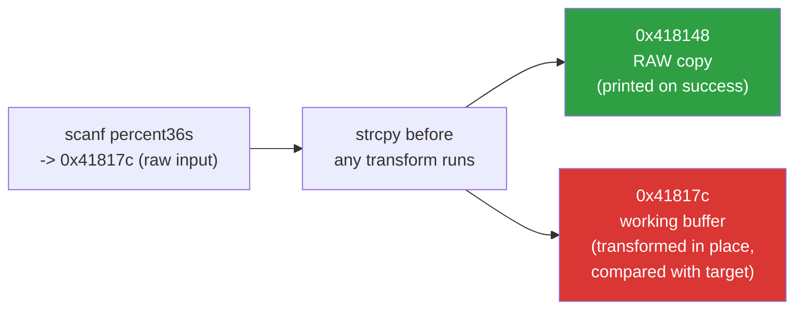
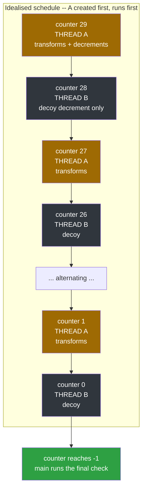
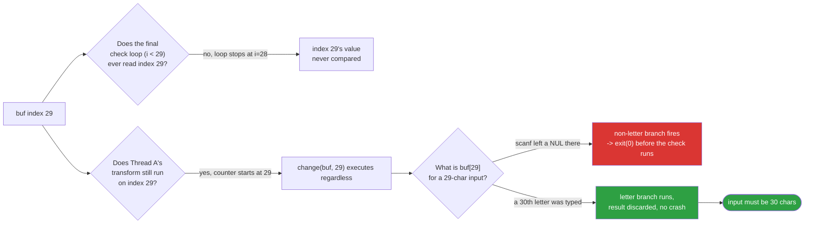
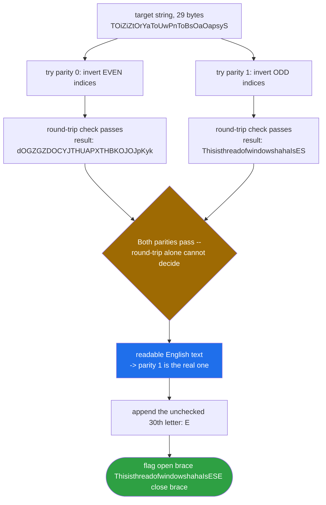

<div align="center">

# 🏁 Youngter-drive

### Reverse Engineering Writeup · Windows PE32 (MSVC 2010 Debug) · Thread-Race Substitution Cipher


*Two threads race for the same counter. One of them encrypts. Only every other letter was ever really checked.*

</div>

---

## 📌 TL;DR

The program reads up to 36 characters, then spins up **two threads** that fight over a shared, mutex-guarded countdown counter starting at **29**. **Thread A** runs a QWERTY substitution on `buf[counter]` and decrements; **Thread B** only decrements — a decoy. Because the threads alternate, only every other index actually gets encrypted: **odd indices encrypted, even indices raw**. A final loop compares the first **29** transformed bytes against a hardcoded string. Inverting the substitution on odd positions gives readable text — but the counter starts at 29, so Thread A *also* transforms `buf[29]`, a byte the comparison loop never checks. If that byte is the NUL terminator, the transform's non-letter branch fires and the program exits before the check even runs. The input therefore needs a silent **30th letter**.

| | |
|---|---|
| **Target** | `Youngter-drive.exe` — PE32 console, x86, MSVC 2010 **Debug** build |
| **Tools** | `file`, `strings`, `sha256sum`, rizin, Python 3 |
| **Technique** | Static analysis, thunk (ILT) tracing, thread-race reasoning, substitution-cipher inversion |
| **Bug class** | Off-by-one: 29 bytes compared, 30 bytes actually processed |
| **Flag** | `flag{ThisisthreadofwindowshahaIsESE}` |

> **Scope note:** everything below comes from **static analysis**. The binary was never executed (it needs the Debug CRT — see [§9](#9--notes-mistakes-and-limits)). Claims that could not be proven statically are labelled as such.

---

## 🗺️ Table of Contents

1. [Triage](#1--triage)
2. [Binary Layout and Compiler Noise](#2--binary-layout-and-compiler-noise)
3. [Reversing the Logic](#3--reversing-the-logic)
4. [The Thread Race](#4--the-thread-race)
5. [Reconstructed C Source](#5--reconstructed-c-source)
6. [Solving](#6--solving)
7. [Bypassing the Anti-Debug Check](#7--bypassing-the-anti-debug-check)
8. [Notes, Mistakes and Limits](#8--notes-mistakes-and-limits)
9. [Takeaways](#9--takeaways)
10. [Tooling Cheat Sheet](#-tooling-cheat-sheet)

---

## 🧭 Analysis Flow at a Glance



---

## 1. 🔎 Triage

```bash
file Youngter-drive.exe
# PE32 executable (console) Intel 80386, for MS Windows
sha256sum Youngter-drive.exe
# 46c57fa5a51d49fd0d92c47a4b95205587121bfe4b87da3712230c644a28bfe7
strings -a -n 6  Youngter-drive.exe     # ASCII
strings -a -el   Youngter-drive.exe     # UTF-16LE (very common in Windows binaries)
```

What the strings give away:

| Observation | Meaning |
|---|---|
| `C:\Users\...\re3\Debug\re3.pdb` | **Debug** build, leaked PDB path |
| `MSVCR100D.dll` (the `D`) | Debug C runtime, **not** in the normal VC++ redistributable |
| `TOiZiZtOrYaToUwPnToBsOaOapsyS` (29 chars) | Suspicious constant, likely the expected ciphertext |
| `QWERTYUIOPASDFGHJKLZXCVBNMqwertyuiopasdfghjklzxcvbnm` (52 chars) | Substitution table |
| `%36s`, `input flag:`, `flag{%s}` | Input is up to 36 chars; success prints `flag{...}` |
| UTF-16: `idaq.exe`, `ida.exe`, `peid.exe`, `ollydbg.exe`, `ollyice.exe` | Process-name blacklist (anti-analysis) |
| `CreateThread`, `CreateMutexW`, `WaitForSingleObject`, `ReleaseMutex`, `Sleep` | Multi-threaded with a mutex |
| `CreateToolhelp32Snapshot`, `Process32FirstW/NextW` | Process enumeration, matches the blacklist |
| `IsDebuggerPresent` | Imported (a second anti-debug primitive) |
| Section names `.text .rdata .data .idata .reloc` | **Not packed** in the sample analysed |

Because the only anti-analysis found is a process-name blacklist, **static analysis never triggers it**.

---

## 2. 🧩 Binary Layout and Compiler Noise

Load the binary and run auto-analysis:

```bash
rizin -A Youngter-drive.exe
[0x00411140]> afl            # functions
[0x00411140]> iz             # strings in data sections, with addresses
[0x00411140]> ii~scanf       # imports
[0x00411140]> axt @ sym.imp.MSVCR100D.dll_scanf   # xrefs to an import
```

Useful `iz` results (virtual addresses):

| Address | Content |
|---|---|
| `0x0041574c` | `TOiZiZtOrYaToUwPnToBsOaOapsyS` (target) |
| `0x00415770` | the 52-char table |
| `0x00415868` | `\nflag{%s}\n\n` |
| `0x00415878` | `%36s` |
| `0x00415880` | `input flag:\n` |

### ⚠️ Gotcha 1 — `axt <addr>` finds nothing for strings

In rizin, `axt` takes **no positional argument** — it uses the current seek. Use `axt @ addr` or `s addr; axt`. Even then, xrefs to these strings were missed because the code reads them through **pointers stored in `.data`**:



A raw byte search for the little-endian pointer finds the data cell, and rizin's annotations then list the code that reads it:

```
[0x00415770]> /x 4c574100          # 0x0041574c little-endian
0x00418004 4 hit.bytes.0
[0x00415770]> pd 30 @ 0x00418004   # shows: "DATA XREF from fcn.00411880 @ 0x4118c0"
```

### ⚠️ Gotcha 2 — The ILT thunk table (`0x411005 .. 0x411226`)

Incremental linking in MSVC Debug builds creates a table of 5-byte `jmp rel32` stubs. A `call` into the thunk table is really a call to the function it jumps to, so most "functions" in `afl` at `0x4110xx`/`0x4111xx` are just stubs:



This also explains why `pdf @ 0x4110aa` showed only `jmp ...terminate`: that address is an unrelated stub. **Always resolve the stub before reading a function.** If rizin complains `Linear size differs too much from the bbsum`, use `pdr` or `pd N` instead of `pdf`.

### ⚠️ Gotcha 3 — Noise you can safely ignore

- `0xcccccccc` filled with `rep stosd` in every prologue = MSVC `/RTC` stack-fill.
- `call fcn.0041116d` after every call = `_RTC_CheckEsp`.
- `cmp esi, esp` before it = ESP-balance check.
- `mov edi, edi` at function starts = hot-patch padding.

---

## 3. 🔬 Reversing the Logic

### 3.1 Input routine, `0x411bd0`

```asm
push str.input_flag:            ; "input flag:\n"
call printf
push data.0041817c              ; destination buffer
push str.36s                    ; "%36s"
call scanf
```

Input goes to `0x41817c`. `main` (`0x411c70`) then copies it before any modification:

```asm
push data.0041817c              ; src
push data.00418148              ; dst
call fcn.004110c8               ; strcpy(0x418148, 0x41817c)
```



So there are **two buffers**: `0x418148` (raw copy, printed on success) and `0x41817c` (transformed in place, compared with the target). This is why the program prints the *original* input in `flag{%s}`, not the transformed bytes.

### 3.2 Per-character transform, `0x411940` (`change(buf, idx)`)

```asm
mov  eax, [arg_4h]              ; buf
add  eax, [arg_8h]              ; + idx
mov  cl, [eax]
mov  [var_9h], cl               ; c = buf[idx]
...
cmp  eax, 0x61 / 0x7a           ; 'a'..'z'
cmp  eax, 0x41 / 0x5a           ; 'A'..'Z'
...
mov  eax, [section..data]       ; 0x418000 -> table
mov  cl, [eax+ecx-0x60]         ; lowercase: table[c - 0x60]
mov  [edx], cl
...
mov  cl, [eax+ecx-0x26]         ; uppercase: table[c - 0x26]
mov  [edx], cl
...
call exit                       ; any non-letter (incl. NUL)
```

(The odd `push eax / xor eax,eax / jz / add esp,8 / pop eax` sequence is a no-op: it always jumps over the `add`.)

Table indexing (`Q0 W1 E2 R3 T4 Y5 U6 I7 O8 P9 A10 ... M25 q26 w27 ... m51`):

| Input | Formula | Table slots |
|---|---|---|
| `a`..`z` | `table[c - 0x60]` | `1 .. 26` |
| `A`..`Z` | `table[c - 0x26]` | `27 .. 52` |

Worked examples:

- `'h'` = `0x68` → `table[8]` = `'O'`
- `'s'` = `0x73` → `table[19]` = `'Z'`
- `'I'` = `0x49` → `0x49-0x26 = 35` → `'p'`
- `'E'` = `0x45` → `0x45-0x26 = 31` → `'y'`
- `'Z'` = `0x5a` → `52` → the table's **NUL terminator** (index 52 of a 52-char C string). Python raises `IndexError` here, so a script must special-case it.

The map is **injective** (each of the 52 letters lands on a distinct table char), so it is invertible.

### 3.3 Final check, `0x411880`

```asm
mov  dword [i], 0
...
cmp  dword [i], 0x1d                 ; i < 29
movsx ecx, byte [i + 0x41817c]       ; transformed buffer
mov  edx, [0x418004]                 ; pointer to target
add  edx, [i]
movsx eax, byte [edx]                ; target[i]
cmp  ecx, eax
jz   next
call exit                            ; mismatch -> exit(0)
...
push data.00418148                   ; RAW copy
push str.flag__s                     ; "\nflag{%s}\n\n"
call printf
```

Only **29** bytes (`0x1d`) are compared, but `printf` prints the **whole** raw input. That mismatch (29 compared, 30 needed) is the trap of this challenge.

### 3.4 Process blacklist, `0x411460`

```asm
mov  [var_238h], 0x22c               ; sizeof(PROCESSENTRY32W) = 556
push 0 ; push 2 ; call fcn.00411028  ; CreateToolhelp32Snapshot(TH32CS_SNAPPROCESS, 0)
call fcn.00411181                    ; Process32FirstW
loop:
  call wcslen / _wcslwr_s            ; lowercase the exe name
  wcscmp(name, L"ollyice.exe") -> printf("///////WARNING///////\n"); exit(0)
  wcscmp(name, L"ollydbg.exe") -> printf warning; exit(0)
  wcscmp(name, L"peid.exe")    -> ...
  wcscmp(name, L"ida.exe")     -> ...
  wcscmp(name, L"idaq.exe")    -> ...
  call fcn.00411055                  ; Process32NextW
  jmp loop
```

Names are lowercased first, so renaming `x64dbg.exe` or `Ghidra` is unnecessary (they are not on the list), but renaming a blacklisted tool to anything else defeats the check. The caller of this function was not identified (see [§8](#8--notes-mistakes-and-limits)).

---

## 4. 🏃 The Thread Race

`main` (`0x411c70`) creates a mutex (`0x4181b0`), then two threads via the thunks `0x4110a0` and `0x41119f`, then spins until the shared counter `0x418008` (initial value **29**) reaches `-1`, and then runs the check.

**Thread A, `0x411a40`:**

```asm
loop:
  WaitForSingleObject(hMutex, INFINITE)
  cmp  [0x418008], -1
  jle  skip
  push [0x418008]                    ; idx
  push 0x41817c                      ; buf
  call fcn.0041112c                  ; -> thunk to 0x411940 (transform)
  dec  [0x418008]
  Sleep(100)
skip:
  ReleaseMutex(hMutex)
  jmp  loop
```

**Thread B, `0x411b10`:**

```asm
loop:
  WaitForSingleObject(hMutex, INFINITE)
  cmp  [0x418008], -1
  jle  skip
  Sleep(100)
  dec  [0x418008]                    ; NO transform call
skip:
  ReleaseMutex(hMutex)
  jmp  loop
```

Whenever B wins the mutex it consumes an index **without** encrypting it. With the two alternating, exactly half of the indices reach `transform`.



So **A encrypts odd indices (29, 27, ..., 1)** and **B burns even indices (28, ..., 0)**. Consequences:

- Even positions of the input stay raw and must equal `target[i]` directly.
- Odd positions are encrypted and must satisfy `transform(input[i]) == target[i]`.
- **Index 29 is processed by A.** It is beyond the 29 compared bytes, but `transform` still runs on it.



With a 29-char input, `buf[29]` is the NUL from `scanf`, the non-letter branch fires, and the program exits before the check. So the input must be **30 characters**, with a letter at index 29.

> **Honesty note:** the alternation is a real race (Windows mutexes are not fair and `Sleep(100)` is inside the lock), so "A takes the odd indices" is **not proven** by the disassembly alone. The parity was confirmed by testing both options: the odd option yields readable text and was accepted by the platform; the even option yields garbage (`dOGZGZDOCYJTHUAPXTHBKOJOJpKyk`).

---

## 5. 🧱 Reconstructed C Source

Names are mine; logic and addresses come from the disassembly. Not the author's original.

```c
#include <stdio.h>
#include <stdlib.h>
#include <string.h>
#include <windows.h>
#include <tlhelp32.h>

char *flag = "TOiZiZtOrYaToUwPnToBsOaOapsyS";                          // .data 0x418004 -> 0x41574c
char *str  = "QWERTYUIOPASDFGHJKLZXCVBNMqwertyuiopasdfghjklzxcvbnm";  // .data 0x418000 -> 0x415770
int   top  = 29;                                                       // 0x418008, shared counter
char  output[52];                                                      // 0x418148, raw copy
char  input[52];                                                       // 0x41817c, transformed in place
HANDLE hMutex;                                                         // 0x4181b0

// 0x411460: process blacklist (caller not identified)
void anti_debug(void) {
    PROCESSENTRY32W pe;
    pe.dwSize = sizeof(pe);                                            // 0x22c
    HANDLE h = CreateToolhelp32Snapshot(TH32CS_SNAPPROCESS, 0);
    BOOL ok = Process32FirstW(h, &pe);
    while (ok) {
        _wcslwr_s(pe.szExeFile, wcslen(pe.szExeFile) + 1);
        if (!wcscmp(pe.szExeFile, L"ollyice.exe")) { printf("///////WARNING///////\n");        exit(0); }
        if (!wcscmp(pe.szExeFile, L"ollydbg.exe")) { printf("///////\nWARNING\n///////\n");   exit(0); }
        if (!wcscmp(pe.szExeFile, L"peid.exe"))    { printf("///////\nWARNING\n///////\n");   exit(0); }
        if (!wcscmp(pe.szExeFile, L"ida.exe"))     { printf("///////\nWARNING\n///////\n");   exit(0); }
        if (!wcscmp(pe.szExeFile, L"idaq.exe"))    { printf("///////\nWARNING\n///////\n");   exit(0); }
        ok = Process32NextW(h, &pe);
    }
    CloseHandle(h);
}

// 0x411bd0
void get_input(void) {
    printf("1111...\n****...banner...\n");
    printf("input flag:\n");
    scanf("%36s", input);
}

// 0x411940
void change(char *a, int idx) {
    char c = a[idx];
    if ((c >= 'a' && c <= 'z') || (c >= 'A' && c <= 'Z')) {
        if (c >= 'a' && c <= 'z') a[idx] = str[c - 0x60];
        else                      a[idx] = str[c - 0x26];
    } else {
        exit(0);                        // non-letter, including NUL
    }
}

// 0x411a40: thread A
DWORD WINAPI ThreadA(LPVOID p) {
    while (1) {
        WaitForSingleObject(hMutex, INFINITE);
        if (top > -1) {
            change(input, top);
            top--;
            Sleep(100);
        }
        ReleaseMutex(hMutex);
    }
    return 0;
}

// 0x411b10: thread B (decoy)
DWORD WINAPI ThreadB(LPVOID p) {
    while (1) {
        WaitForSingleObject(hMutex, INFINITE);
        if (top > -1) {
            Sleep(100);
            top--;
        }
        ReleaseMutex(hMutex);
    }
    return 0;
}

// 0x411880
void check(void) {
    for (int i = 0; i < 29; i++)
        if (input[i] != flag[i]) exit(0);
    printf("\nflag{%s}\n\n", output);     // prints the RAW copy
}

// 0x411c70 (as disassembled: input first, then strcpy, then threads)
int main(void) {
    get_input();
    hMutex = CreateMutexW(NULL, FALSE, NULL);
    strcpy(output, input);
    CloseHandle(CreateThread(NULL, 0, ThreadA, NULL, 0, NULL));
    CloseHandle(CreateThread(NULL, 0, ThreadB, NULL, 0, NULL));
    while (1) {
        if (top == -1) {                // both threads finished the countdown
            check();
            CloseHandle(hMutex);
            return 0;
        }
    }
}
```

---

## 6. 🐍 Solving

### 6.1 Solver

```python
#!/usr/bin/env python3
table  = "QWERTYUIOPASDFGHJKLZXCVBNMqwertyuiopasdfghjklzxcvbnm"
target = "TOiZiZtOrYaToUwPnToBsOaOapsyS"          # 29 bytes
LETTERS = ("abcdefghijklmnopqrstuvwxyz"
           "ABCDEFGHIJKLMNOPQRSTUVWXYZ")

def enc(c: str) -> str:
    """Python port of 0x411940."""
    if 'a' <= c <= 'z':
        return table[ord(c) - 0x60]
    if 'A' <= c <= 'Z':
        i = ord(c) - 0x26
        return table[i] if i < len(table) else '\0'   # 'Z' -> C NUL terminator
    raise SystemExit("exit(0): non-letter reached transform")

inv = {enc(c): c for c in LETTERS}
assert len(inv) == 52                              # the map is injective

def solve(parity: int) -> str:
    return "".join(inv.get(ch, ch) if i % 2 == parity else ch
                   for i, ch in enumerate(target))

for parity in (0, 1):
    cand = solve(parity)
    # round-trip holds for BOTH parities, so it does not select the right one
    fwd = "".join(enc(c) if i % 2 == parity else c for i, c in enumerate(cand))
    print(parity, cand, fwd == target)

head = solve(1)                                    # odd indices encrypted
flag = head + "E"                                  # 30th letter: needed, unchecked
print(f"flag{{{flag}}}")
```

**Output** (independently re-run and confirmed for this writeup):

```text
0 dOGZGZDOCYJTHUAPXTHBKOJOJpKyk True
1 ThisisthreadofwindowshahaIsES True

```



Both parities pass the round trip, which is why the round trip proves nothing about parity on its own. The disambiguation comes from the thread analysis (odd indices), plus the readable plaintext, plus the platform's acceptance of the result.

### 6.2 Simulating the Program in Python

This models the *idealised* alternation (A first) and also shows why the 30th byte matters:

```python
def run(user_input: str, a_first: bool = True) -> str:
    buf = list(user_input.ljust(36, '\0'))        # scanf leaves NULs after the string
    counter, turn_a = 29, a_first
    while counter > -1:
        if turn_a:
            buf[counter] = enc(buf[counter])      # may raise SystemExit (NUL, digits...)
        counter -= 1
        turn_a = not turn_a
    for i in range(29):                           # final check
        if buf[i] != target[i]:
            raise SystemExit("exit(0): mismatch at %d" % i)
    return "flag{%s}" % user_input                # raw copy

print(run("ThisisthreadofwindowshahaIsESE"))      # ok
try:
    run("ThisisthreadofwindowshahaIsES")          # 29 chars -> buf[29] == NUL
except SystemExit as e:
    print(e)                                      # exit(0): non-letter reached transform
```

---

## 7. 🩹 Bypassing the Anti-Debug Check

Not required for the static solve, but useful for dynamic work (for example to attach IDA or x64dbg-based tooling while the blacklist is still present):

1. **Rename the tool.** Any process name not on the list passes. Names are lowercased before comparison.
2. **Patch the five `jnz` branches** in `0x411460`. Each `jnz` is `0F 85 rel32` (6 bytes), for example at `0x41151d`. Replace the opcode pair with `90 E9` (`nop; jmp rel32`). The displacement stays valid because the instruction end is unchanged, so the "not equal" path is always taken:
   ```bash
   cp Youngter-drive.exe patched.exe
   rizin -w patched.exe
   [0x00411140]> wx 90e9 @ 0x0041151d     # repeat for 0x411567, 0x4115b1, 0x4115fb, 0x411645
   ```
3. **Patch the caller** of `anti_debug` (not located in this analysis; look for a call to the thunk at `0x411226`).

To make the Debug binary start on a clean machine, supply the **x86** `MSVCR100D.dll` from a Visual Studio 2010 install (`VC\redist\Debug_NonRedist\x86`), next to the exe. Do **not** download DLLs from random sites.

---

## 8. 📋 Notes, Mistakes and Limits

**What went wrong the first time (kept deliberately):**

- The first submission, `flag{ThisisthreadofwindowshahaIsES}`, was **rejected**. The analysis stopped at the 29 compared bytes and under-weighted the fact that the counter starts at 29, so Thread A also transforms index 29. The correct flag has the extra letter.
- The answer was initially stated with more confidence than the evidence supported. Lesson: verify loop bounds on **every** thread, not only on the comparison loop, and never treat "readable plaintext" as proof.

**What is proven vs. inferred:**

| Claim | Status |
|---|---|
| Transform formulas, table, target string, 29-byte compare | Read directly from disassembly |
| A transforms, B only decrements | Read directly from disassembly |
| Counter starts at 29 and A processes index 29 | Read directly from disassembly |
| Odd indices go to A (alternation order) | **Inferred** (race), consistent with the accepted flag |
| Any letter works at index 30 | Consistent with the code (never compared); `E` is the accepted value |

**Limits:**

- The binary was **not executed**. The Debug CRT (`MSVCR100D.dll`) was missing on the analysis VM (exit code `-1073741515` = `0xC0000135`, `STATUS_DLL_NOT_FOUND`). An import-name patch to `MSVCR100.dll` was also tried, but it is **unverified**: the Release CRT may not export Debug-only functions such as `_CrtDbgReportW`, which would give `0xC0000139`.
- The sample analysed was **not UPX-packed**. A public write-up of the same challenge describes a UPX-packed original (`upx -d` restores it); the addresses match.
- The caller of the process-blacklist function (`0x411460`) was not identified.

---

## 9. 🧠 Takeaways

- **Race conditions can be a puzzle element.** Which thread consumes which index defines the cipher's shape.
- **Off-by-one traps:** the compare length (29) differs from the processed range (30). Audit every loop bound, not just the one that looks like "the check."
- **Debug builds are noisy but predictable:** `0xcccccccc` fills, `_RTC_CheckEsp` after calls, and an ILT thunk table. Learn to filter them out.
- **Resolve thunks first**, then read functions. Many "missing xrefs" are just pointers in `.data` or stubs.
- **A process-name blacklist** does nothing against static analysis and is trivial to bypass dynamically.
- **A round-trip assertion is not proof** when the transform is invertible for several hypotheses; use independent evidence (readable plaintext, platform acceptance, disassembly of the race itself) to pick one.

---

## 🧰 Tooling Cheat Sheet

```text
rizin -A bin.exe        analyse on load
afl / iz / ii           functions / strings / imports
s <addr>; axt           xrefs to current seek
axt @ <addr>            same, with a temporary seek
/x <bytes>              byte search (little-endian for pointers)
pdf / pdr / pd N        disassemble function / by recursion / N instructions
af @ <addr>             define a function at an address
wx <hex> @ <addr>       patch bytes (open with -w)
```

---

<div align="center">

⭐ If this writeup helped you, consider leaving a star.

</div>
