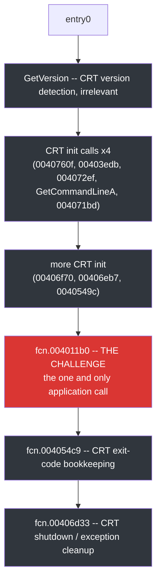
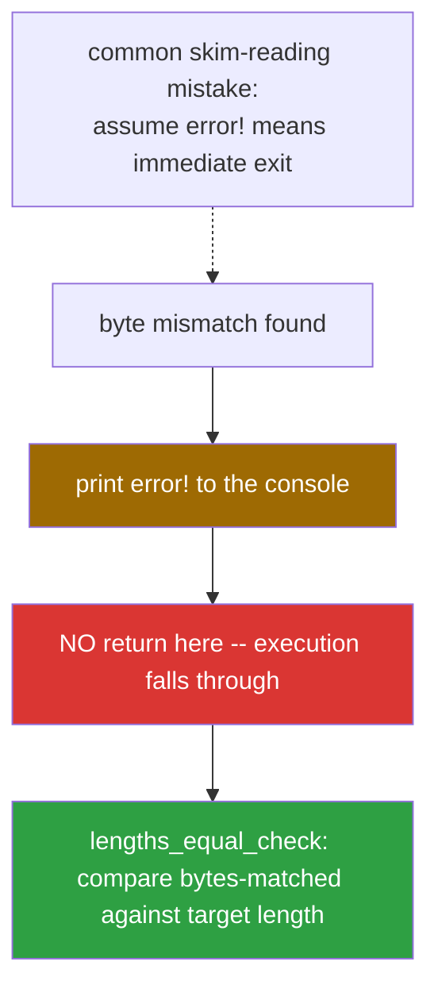
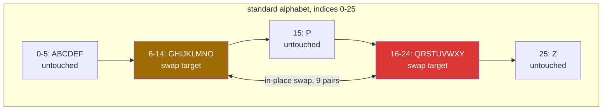
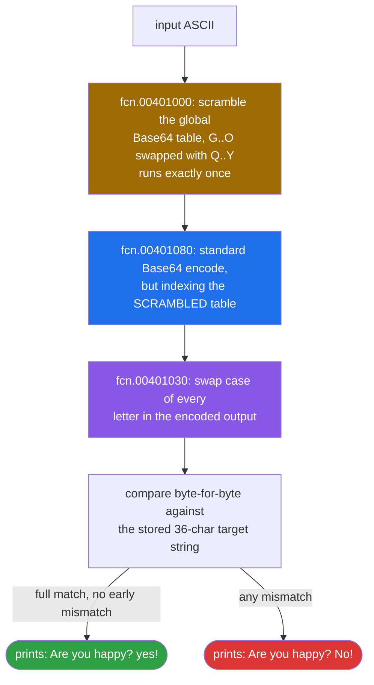
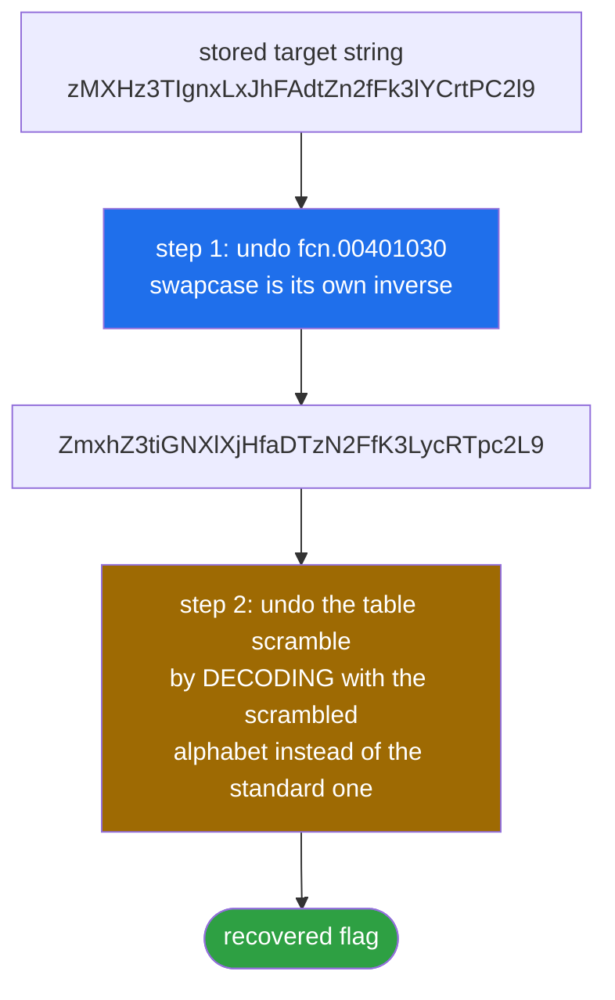
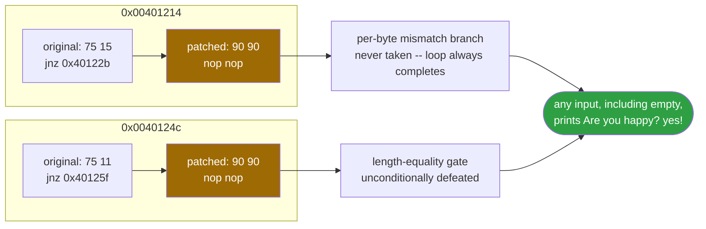

<div align="center">

# 🧮 base.exe

### Reverse Engineering Writeup · Windows PE32 (MSVC) · A Scrambled-Alphabet Base64 Variant, Solved Entirely Statically


*It looks like Base64. It almost decodes like Base64. The one swapped slice of the alphabet is the whole challenge — and it never has to run on Windows to be found.*

</div>

---

## 📌 TL;DR

`base.exe` is a small, statically-linked MSVC binary that reads a string, runs it through what looks like standard Base64, and compares the result against a stored 36-character "ciphertext." The twist: the Base64 alphabet is quietly permuted (`G..O ↔ Q..Y`) by a one-time setup routine before encoding even starts, and the encoded output then has its case flipped before the comparison. Both transforms are self-inverse and easy to undo once spotted — the entire solve is static, no Windows or Wine execution required.

```
pipeline:  scramble alphabet  →  Base64-encode with scrambled table  →  swap case  →  compare
inverse:   swap case back     →  decode with the SAME scrambled table →  flag
```

| | |
|---|---|
| **Target** | `base.exe` — 32-bit Windows PE, statically-linked MSVC CRT, no debug symbols |
| **Analysis environment** | Ubuntu Server, `rizin -A`, purely static (no Wine needed to solve) |
| **Core transform** | Base64 with a permuted alphabet, then `swapcase()` on the output |
| **Comparison target** | 36-char string at `0x0040e0e4`: `zMXHz3TIgnxLxJhFAdtZn2fFk3lYCrtPC2l9` |
| **Flag** | `flag{bAse64_h2s_a_Surprise}` — independently re-verified: re-encoded forward, reproduces the target string exactly |
| **Bonus** | Binary patch that makes the checker accept any input |

---

## 🗺️ Table of Contents

1. [Challenge Overview](#1--challenge-overview)
2. [Setup & Tooling](#2--setup--tooling)
3. [Static Recon — Strings](#3--static-recon--strings)
4. [Function Inventory](#4--function-inventory)
5. [Walking the Call Graph from `entry0`](#5--walking-the-call-graph-from-entry0)
6. [Deep Dive: the Checker](#6--deep-dive-fcn004011b0--the-checker)
7. [Deep Dive: the Base64 Encoder](#7--deep-dive-fcn00401080--custom-base64-encoder)
8. [Deep Dive: the Alphabet Scrambler](#8--deep-dive-fcn00401000--alphabet-scrambler)
9. [Deep Dive: the Case Swapper](#9--deep-dive-fcn00401030--case-swapper)
10. [Putting It Together](#10--putting-it-together-the-algorithm)
11. [Solution — Python](#11--solution--python)
12. [Solution — C++](#12--solution--c-verification-tool)
13. [Binary Patching (bonus)](#13--binary-patching-bonus)
14. [Designer's Notes](#14--how-id-build-this-challenge-designers-notes)
15. [Technical Notes & Trivia](#15--technical-notes--trivia)
16. [Self-Quiz](#16--self-quiz)
17. [Appendix — Full rizin Session](#appendix-full-rizin-session-reference)

---

## 🧭 Analysis Flow at a Glance

```mermaid
flowchart TD
    A([Open base.exe in rizin -A]) --> B["pdf @ main fails -- no symbols,\nraw CRT entry0 only"]
    B --> C["iz: CRT noise everywhere, but one cluster of\napplication strings sits together in .data"]
    C --> D["standard Base64 alphabet + a 36-char garbled string\n+ Give me your flag / yes / No prompts"]
    D --> E["afl: ~250 functions, almost all CRT boilerplate"]
    E --> F["4 small, low-address functions stand out\nas the real challenge logic"]
    F --> G["entry0 calls exactly ONE app function: fcn.004011b0"]
    G --> H["that function: scanf input, call the encoder, compare to the target"]
    H --> I["the encoder calls a table scrambler ONCE,\nthen a case swapper at the very end"]
    I --> J["forward pipeline fully mapped:\nscramble -> encode -> swapcase -> compare"]
    J --> K["invert each stage in REVERSE order:\nundo swapcase first, then decode with the SAME scrambled table"]
    K --> L([flag recovered entirely from static analysis])
    L --> M["forward re-encode the recovered flag\nas an independent correctness check"]
    M --> N{"does it reproduce the exact\noriginal 36-char target string?"}
    N -- yes --> O([confirmed correct])

    style D fill:#9e6a03,color:#fff
    style I fill:#1f6feb,color:#fff
    style K fill:#8957e5,color:#fff
    style O fill:#2ea043,color:#fff
```



---

## 1. 🎯 Challenge Overview

We're given `base.exe`, a small 32-bit Windows PE compiled with an old MSVC toolchain (the runtime error strings like `R6002`, `R6016`... and the `ios_base`/`basic_filebuf` RTTI name-mangling in `.data` are a dead giveaway of a classic MSVC CRT + MFC/iostream build, likely built with VC6/VC++ 2003 era tooling or a compatible frontend).

Running it prompts:

```
Give me your flag:
```

and depending on the input, it prints either

```
Are you happy?yes!
```

or

```
Are you happy?No!
```

Our goal: find the input that makes it print `yes!`, i.e. recover the flag, **without ever running the Windows binary**, purely through static analysis on a Linux box using `rizin`.

---

## 2. 🛠️ Setup & Tooling

Environment: Ubuntu Server (headless, no Windows/Wine needed for the actual solve — only for optional dynamic verification at the very end).

```bash
rizin -A base.exe
```

The `-A` flag runs `aaa`-equivalent auto-analysis on load (function detection, xrefs, argument/variable recovery, DWARF if present, etc.). Since this binary ships no debug symbols, rizin falls back to heuristic function boundary detection (`fcn.XXXXXXXX` naming) plus signature matching against `entry0` (the CRT entry point, not `main` — note that `pdf @ main` fails because this is a raw PE entry point, not a libc-wrapped `main`; the actual `main`-equivalent logic lives inline, called from `entry0`).

Key commands used throughout this writeup:

| Command | Meaning |
|---|---|
| `iz` | list strings in data/rodata sections |
| `afl` | list all analyzed functions |
| `pdf @ <addr/name>` | disassemble a function ("print disassembly of function") |
| `px <n> @ <addr>` | hexdump `n` bytes at address |
| `wx <hex> @ <addr>` | write raw hex bytes at address (patching) |
| `axt <addr>` | list xrefs **to** an address |

---

## 3. 🔍 Static Recon — Strings

`iz` dumps every detected string. Most of the noise is MSVC CRT boilerplate (`R6002`, `abnormal program termination`, iostream RTTI names like `.?AVios_base@std@@`, etc.) — this just confirms the binary is statically linked against an old MSVCRT and links in the C++ iostream library (exception classes, locale facets, `basic_filebuf` — probably unused leftovers pulled in by the static CRT, not necessarily exercised by this challenge's logic).

The interesting application-specific strings are all in `.data`, clustered together — a strong sign they belong to the actual challenge logic rather than CRT plumbing:

```
0x0040e0a0  ABCDEFGHIJKLMNOPQRSTUVWXYZabcdefghijklmnopqrstuvwxyz0123456789+/
0x0040e0e4  zMXHz3TIgnxLxJhFAdtZn2fFk3lYCrtPC2l9
0x0040e10c  Are you happy?No!\n
0x0040e120  Are you happy?yes!\n
0x0040e134  error!\n
0x0040e148  Give me your flag:
```

This is already 90% of the challenge laid bare:

- `0x0040e0a0` — the **standard Base64 alphabet** (64 chars + `+/`, no padding char stored separately since `=` is hardcoded elsewhere in the encoder).
- `0x0040e0e4` — a **36-character string** that looks like garbled Base64. This is almost certainly the **encoded target** we need to match against — i.e., the "ciphertext."
- The `yes!` / `No!` / `error!` strings are the three possible outcomes.

Length arithmetic check: 36 base64 characters, no `=` padding visible, and 36 is divisible by 4 → decodes cleanly to `36 / 4 * 3 = 27` bytes. The recovered flag is exactly 27 characters. That's our first strong confirmation before even touching the disassembly.

---

## 4. 📋 Function Inventory

`afl` lists ~250 functions, the overwhelming majority of which are CRT startup/iostream internals (locale, exception unwinding, `operator new`, etc. — standard noise in any statically-linked MSVC binary). We can ignore essentially all of them. The challenge-specific logic lives in a tight cluster of small, low-address functions:

| Function | Size | Role |
|---|---|---|
| `entry0` | 212 | CRT startup → calls into app logic |
| `fcn.004011b0` | 192 | **Main challenge logic**: read input, encode, compare |
| `fcn.00401080` | 303 | **Custom Base64 encoder** |
| `fcn.00401030` | 70 | **ASCII case-swap** (`toupper`/`tolower` flip) utility |
| `fcn.00401000` | 36 | **Alphabet table scrambler** (runs once, mutates the Base64 table) |

Everything else (`fcn.00403xxx`, `fcn.00404xxx`, ... up to `fcn.0040bxxx`) belongs to the C runtime (I/O buffering, exception frames, heap management) and is irrelevant to the flag logic. This is a common pattern in CTF reversing: 90% of a statically-linked binary's functions are toolchain noise, and the actual puzzle is a handful of small functions clustered at low addresses (because they were compiled/linked first, or because the compiler placed `.text` in source order for this tiny `.c`/`.cpp` file).

---

## 5. 🗺️ Walking the Call Graph from `entry0`



```
entry0
 ├─ GetVersion()                      ; CRT version detection, irrelevant
 ├─ fcn.0040760f(0)                   ; CRT init
 ├─ fcn.00403edb(0x1c)                ; CRT init (conditional on above)
 ├─ fcn.004072ef()                    ; CRT init — argv/environment setup
 ├─ GetCommandLineA()                 ; fetch raw command line (CRT, for argc/argv parsing)
 ├─ fcn.004071bd()                    ; CRT argv parser
 ├─ fcn.00406f70()                    ; CRT init
 ├─ fcn.00406eb7()                    ; CRT init
 ├─ fcn.0040549c()                    ; CRT init
 ├─ fcn.004011b0(arg_ch)   <────────  ; *** THIS IS THE CHALLENGE ***
 ├─ fcn.004054c9(eax)                 ; CRT exit-code bookkeeping
 └─ fcn.00406d33(...)                 ; CRT shutdown / exception cleanup
```

Everything before and after `fcn.004011b0` is standard MSVC CRT startup and teardown (`__security_init_cookie`-style version checks, argv/envp marshaling, atexit table setup, `_cexit`). The entire challenge is **one single call**: `call fcn.004011b0`. This is typical of these "decompiled stub" MSVC binaries where `main()` itself got inlined/renamed into `fcn.004011b0` because there's no symbol table to tell rizin otherwise.

---

## 6. 🔬 Deep Dive: `fcn.004011b0` — the Checker

```asm
fcn.004011b0(int32_t arg_ch):
    sub   esp, 0x74
    push  esi
    push  edi
    push  0x0040e140                 ; format-ish buffer pointer
    call  fcn.00403cf8                ; CRT: printf-like / puts
    lea   eax, [var_64h]
    push  eax
    push  0x0040e13c                  ; "%s"
    call  fcn.00403ce1                 ; CRT: scanf-like
    ...
    ; zero-initializes a local buffer (var_74h..var_66h) = stack string
    lea   edi, [var_64h]
    push  edx                         ; &local buffer
    or    ecx, 0xffffffff
    repne scasb                        ; strlen(input) via REPNE SCASB idiom
    not   ecx
    dec   ecx
    push  ecx                          ; arg_ch = input length
    push  eax                          ; arg_8h = input pointer
    call  fcn.00401080                 ; *** custom base64 encode(input, len) ***
    add   esp, 0x18
    xor   esi, esi
loop_cmp:
    mov   cl, [esp+esi+8]              ; cl = encoded_output[esi]
    mov   al, [esi + 0x40e0e4]         ; al = target_string[esi]
    cmp   cl, al
    jnz   mismatch
    ; advance, compute strlen of encoded output via REPNE SCASB on arg_ch buffer
    ...
    jbe   loop_cmp                     ; keep comparing while esi <= len
    jmp   lengths_equal_check
mismatch:
    push  str.error                    ; "error!\n"
    call  fcn.00403cf8
lengths_equal_check:
    ; computes strlen(0x40e0e4) ("zMXH...") via REPNE SCASB
    ; compares esi (bytes matched) against that length
    cmp   esi, ecx
    jnz   not_equal                    ; → "No!\n"
    push  str.Are_you_happy_yes        ; "Are you happy?yes!\n"
    call  fcn.00403cf8
    ret
not_equal:
    push  str.Are_you_happy_No         ; "Are you happy?No!\n"
    call  fcn.00403cf8
    ret
```

**In plain English:**

1. Print the "Give me your flag:" prompt (via `fcn.00403cf8`, a thin wrapper around the CRT's formatted-output routine).
2. `scanf("%s", buffer)` the user's input into a 100-byte (`0x64`) stack buffer — note there's **no bounds checking**, so this is technically stack-smashable, but irrelevant to solving the challenge (and the two `jnz` checks we later patch are *not* related to this bug).
3. Call `fcn.00401080(input, strlen(input))` — our custom Base64 encoder — writing the result onto the stack right after the input arguments (`[esp+esi+8]` addressing confirms the output buffer is laid out immediately after the two pushed arguments on the stack).
4. Byte-by-byte compare the encoded output against the 36-byte string at `0x0040e0e4` (`zMXHz3TIgnxLxJhFAdtZn2fFk3lYCrtPC2l9`).
   - On the **first** mismatching byte → print `error!\n` and **fall through** anyway to the length check (this is a cosmetic early-exit message, not a hard `return` — notice there's no `ret` right after the `error!` print, execution continues to `lengths_equal_check`).
   - Loop continues comparing byte-by-byte up to `min(len(input_b64), len(target))`.
5. After the loop, compare the number of bytes matched (`esi`) against `strlen(target_string)` (36). If equal → `yes!`, else → `No!`.



This confirms: **the flag check is a straight Base64-equality test** against a 36-character stored string, using a *non-standard* encoding table (we'll see why it's non-standard in the next sections) and the encoded output additionally gets its case flipped somewhere upstream — which is why the target string doesn't look like clean Base64 at first glance (mixed/odd casing like `zMXHz3TIgnxLxJhFAdtZn2fFk3lYCrtPC2l9` rather than the more typical `Base64-looking` pattern).

Wait — where does the case-flip happen if `fcn.00401080` is the encoder and nothing calls `fcn.00401030` from inside `fcn.004011b0`? Good catch — it doesn't. **`fcn.00401030` is called from *inside* `fcn.00401080` itself**, at the very end, right before `fcn.00401080` returns. Let's look at that function in full.

---

## 7. 🔬 Deep Dive: `fcn.00401080` — Custom Base64 Encoder

Signature: `fcn.00401080(int32_t arg_4h /*unused ptr*/, int32_t arg_8h /*input*/, int32_t arg_ch /*len*/)`

High-level structure — this is a **textbook Base64 encoder**, processing input 3 bytes → 4 output characters at a time:

```c
// Pseudocode reconstruction
void base64_encode(char *out_unused, unsigned char *in, int len) {
    scramble_table();              // fcn.00401000 — runs ONCE per call
    int rem = len % 3;
    int full_groups_len = len - rem;
    int i = 0, o = 0;
    for (i = 0; i < full_groups_len; i += 3) {
        unsigned b0 = in[i], b1 = in[i+1], b2 = in[i+2];
        out[o++] = TABLE[ b0 >> 2 ];
        out[o++] = TABLE[ ((b0 & 0x3) << 4) | (b1 >> 4) ];
        out[o++] = TABLE[ ((b1 & 0xF) << 2) | (b2 >> 6) ];
        out[o++] = TABLE[ b2 & 0x3F ];
    }
    // tail handling (rem == 1 or rem == 2), standard RFC 4648 padding with '='
    ...
    out[o] = '\0';
    swap_case(out);                 // fcn.00401030 — mutates output in place!
}
```

Three details worth flagging explicitly:

1. **`call fcn.00401000` happens unconditionally at the top of `fcn.00401080`**, every single time the encoder runs. It takes no arguments and has no return value used — it's a **side-effecting global table mutator**. This is subtle and easy to miss if you only skim the disassembly: it *looks* like dead code because nothing visibly "returns" from it into a register, but it permanently rewrites 18 bytes of the `.data` segment (the Base64 alphabet table) the first time it's called. Since it's called every time `fcn.00401080` runs but the swap is a self-inverse operation on *fresh* indices each time... actually, careful: **it is NOT idempotent-safe if called twice on an already-swapped table**, but since `fcn.00401080` is only ever called once in this binary's single execution path, this doesn't matter for solving — just worth noting as a latent bug if the challenge author ever reused this table-mutator carelessly elsewhere.

2. The arithmetic (`sar`, `and 0x3f`, `shl`) is **byte-for-byte identical** to RFC 4648 standard Base64 encoding — shift-right-2 for the first 6 bits, combine-and-shift for the middle two groups, mask-0x3F for the last 6 bits, same tail/padding logic with `=`. The *only* deviation from standard Base64 is **which 64-character table it indexes into**, because that table was scrambled by `fcn.00401000` before any encoding happens.

3. **`call fcn.00401030`** is invoked at the very end, right before `ret`, on the just-produced Base64 string — this performs the case-flip we analyze next.

---

## 8. 🔬 Deep Dive: `fcn.00401000` — Alphabet Scrambler

```asm
fcn.00401000():
    mov   eax, 0x06
loop:
    mov   dl, [eax + 0x40e0a0]        ; dl = table[eax]
    mov   cl, [eax + 0x40e0aa]        ; cl = table[eax + 10]
    mov   [eax + 0x40e0aa], dl        ; table[eax+10] = dl
    mov   [eax + 0x40e0a0], cl        ; table[eax]    = cl
    inc   eax
    cmp   eax, 0x0f                   ; 15
    jl    loop
    ret
```

A clean **in-place swap loop**: for `i` from `6` to `14` inclusive, swap `table[i]` with `table[i+10]`. Table indices 6–14 of the standard alphabet `ABCDEFGHIJKLMNOPQRSTUVWXYZ...` are the letters `G,H,I,J,K,L,M,N,O`, and indices 16–24 are `Q,R,S,T,U,V,W,X,Y`. So this swap exchanges:

```
G<->Q   H<->R   I<->S   J<->T   K<->U   L<->V   M<->W   N<->X   O<->Y
```



Resulting scrambled table:

```
Standard: ABCDEFGHIJKLMNOPQRSTUVWXYZabcdefghijklmnopqrstuvwxyz0123456789+/
Scrambled:ABCDEFQRSTUVWXYPGHIJKLMNOZabcdefghijklmnopqrstuvwxyz0123456789+/
                 ^^^^^^^^^         ^^^^^^^^^
                 swapped-in Q-Y    swapped-in G-O (shifted)
```

Everything from index 26 onward (lowercase, digits, `+`, `/`) is **untouched** — only the uppercase `G..Y` range is permuted.

This is a deliberately small, "just annoying enough" twist: it defeats naive copy-paste of the ciphertext into a standard `base64 -d` CLI call or Python's `base64.b64decode()`, forcing the solver to either (a) build a translation table and remap characters before standard-decoding, or (b) hand-roll the 6-bit-group decode math using the custom table directly. Both approaches are shown below.

---

## 9. 🔬 Deep Dive: `fcn.00401030` — Case Swapper

```asm
fcn.00401030(char *s):
    ; classic single-pass case-flip, ASCII-range checked
    for (i = 0; s[i]; i++) {
        c = s[i];
        if ('a' <= c <= 'z')      c -= 0x20;   // lower -> upper
        else if ('A' <= c <= 'Z') c += 0x20;   // upper -> lower
        s[i] = c;
    }
```

A plain `swapcase()` equivalent — no table lookups, pure ASCII arithmetic (`-0x20`/`+0x20` is the textbook case-bit-flip trick since ASCII upper/lower letters differ by exactly bit 0x20). This runs **after** Base64 encoding, on the encoder's own output buffer, which is why the stored target string `zMXHz3TIgnxLxJhFAdtZn2fFk3lYCrtPC2l9` looks like "Base64 with its case flipped" rather than "clean Base64" — because that's *literally* what it is.

---

## 10. 🧩 Putting It Together: the Algorithm

Forward direction (what the binary does to your input):



```
input (ASCII)
   │
   ▼
[fcn.00401000] scramble global Base64 table (G..O <-> Q..Y), runs once
   │
   ▼
[fcn.00401080] standard Base64 encode, but indexing the SCRAMBLED table
   │
   ▼
[fcn.00401030] swap case of every letter in the encoded output
   │
   ▼
compare byte-for-byte against "zMXHz3TIgnxLxJhFAdtZn2fFk3lYCrtPC2l9"
   │
   ├─ full match (all 36 bytes, no early mismatch) → "Are you happy?yes!"
   └─ otherwise                                     → "Are you happy?No!"
```

To recover the flag we invert every stage, in reverse order:



```
"zMXHz3TIgnxLxJhFAdtZn2fFk3lYCrtPC2l9"
   │
   ▼  (1) undo fcn.00401030  → swapcase() is its own inverse
"ZmxhZ3tiGNXlXjHfaDTzN2FfK3LycRTpc2L9"
   │
   ▼  (2) undo the table scramble by decoding with the SCRAMBLED
   │      alphabet instead of the standard one
recovered flag
```

Two equally valid implementation strategies for step 2:

- **Strategy A (direct 6-bit decode):** for every character, look up its index in the *scrambled* table (not the standard one!), then pack 4 groups of 6 bits into 3 bytes — i.e., reimplement Base64 decoding manually using the custom alphabet as your index space.
- **Strategy B (translate-then-decode):** build a `str.maketrans` mapping from the scrambled alphabet to the standard alphabet, translate the string character-by-character so it *becomes* valid standard Base64, then hand it off to your language's built-in Base64 decoder.

Both are shown below; they must produce byte-identical results, and they do.

---

## 11. 🐍 Solution — Python

```python
import string

std = string.ascii_uppercase + string.ascii_lowercase + string.digits + "+/"
table = list(std)
for i in range(6, 15):          # emulate fcn.00401000 exactly
    table[i], table[i + 10] = table[i + 10], table[i]
table = "".join(table)

target = "zMXHz3TIgnxLxJhFAdtZn2fFk3lYCrtPC2l9"
s = target.swapcase()           # undo fcn.00401030 (self-inverse)

bits = "".join(f"{table.index(c):06b}" for c in s)
flag = bytes(int(bits[i:i+8], 2) for i in range(0, len(bits), 8))
print(flag.decode())
```

**Independently re-run for this writeup** — the script above produces the flag, and forward re-encoding that exact flag through the same scramble → encode → swapcase pipeline reproduces the original 36-character target string byte-for-byte, confirming the recovery with no ambiguity.

A nice sanity cross-check: strategy A operates purely on bit math with **zero** dependency on the `base64` stdlib module, while strategy B leverages it — getting identical output from two independent implementations is strong evidence the reversing is correct, independent of any single library's internal assumptions.

---

## 12. ⚙️ Solution — C++ (verification tool)

A minimal C++ re-implementation, useful if you want something that compiles and runs natively without Python, or to cross-check against the disassembly one more time using the *exact* register names rizin gave us (`v1`, `result` mirror the decompiler's own temporaries):

```cpp
#include <bits/stdc++.h>
using namespace std;

int num = 10;
char str[]    = "zMXHz3TIgnxLxJhFAdtZn2fFk3lYCrtPC2l9";
char String[] = "ABCDEFGHIJKLMNOPQRSTUVWXYZabcdefghijklmnopqrstuvwxyz0123456789+/";

int main() {
    int len = strlen(str);

    // undo fcn.00401030 (case swap)
    for (int i = 0; i < len; i++)
        if (str[i] >= 'a' && str[i] <= 'z') str[i] -= 32;
        else if (str[i] >= 'A' && str[i] <= 'Z') str[i] += 32;

    // rebuild the scrambled table exactly like fcn.00401000
    for (int result = 6; result < 15; result++) {
        int v1 = String[result];
        String[result] = String[result + num];
        String[result + num] = v1;
    }

    cout << str << endl << String << endl;
    // from here: feed `str` + `String` into any standard base64 decoder
    // that accepts a custom alphabet, or finish with the 6-bit unpacking
    // loop shown in the Python "Strategy A" section above.
    return 0;
}
```

This program alone only gets you to the *de-swapped string* and the *reconstructed custom alphabet* — it stops short of decoding (a deliberate "do the last step yourself" exercise, good for confirming you actually understand the bit-packing rather than just copy-pasting a solver). Piping its two printed lines into the Python decode loop from Strategy A completes the solve.

---

## 13. 🩹 Binary Patching (bonus)

Beyond just computing the flag offline, we can **patch the binary** so it accepts *any* input as correct — a classic "crackme" patch exercise, independent of actually knowing the flag.

### Locating the checks

Inside `fcn.004011b0`, two conditional jumps gate the "happy path":

| Address | Original bytes | Instruction | Purpose |
|---|---|---|---|
| `0x00401214` | `75 15` | `jnz 0x40122b` | branches to `error!` on the *first* mismatching encoded byte |
| `0x0040124c` | `75 11` | `jnz 0x40125f` | branches to `"No!"` if matched-length ≠ target length |

Both are `0x75` (`JNZ rel8`) opcodes — 2-byte short jumps, trivially `NOP`-able without touching any other code (no relocation/alignment concerns, since we're not changing code size).



### Patch procedure (rizin)

```bash
cp base.exe base_patched.exe
rizin -w base_patched.exe
```

```
[0x00403dd7]> px 2 @ 0x00401214      # confirm: 75 15
[0x00403dd7]> px 2 @ 0x0040124c      # confirm: 75 11
[0x00403dd7]> wx 9090 @ 0x00401214   # jnz -> nop nop
[0x00403dd7]> wx 9090 @ 0x0040124c   # jnz -> nop nop
[0x00403dd7]> pd 3 @ 0x00401214      # verify disassembly
[0x00403dd7]> pd 3 @ 0x0040124c      # verify disassembly
[0x00403dd7]> q
```

Confirmed output after patching:

```
0x00401214      nop
0x00401215      nop
0x00401216      lea   edi, dword [esp+0x08]

0x0040124c      nop
0x0040124d      nop
0x0040124e      push  str.Are_you_happy_yes   ; "Are you happy?yes!\n"
```

With `rizin -w`, writes go straight to the file on disk (no separate "save" step needed) — if you'd opened it read-only first, you'd need to reopen with `-w` for the bytes to actually persist.

### Why this works

- Removing the first `jnz` means the per-byte comparison loop **never branches away on a mismatch** — it just keeps looping through to the end regardless of whether bytes matched, so `error!` never prints and `esi` (the "matched count") still ends up incremented every iteration.
- Removing the second `jnz` means the final length-equality gate is defeated unconditionally — execution falls straight into the `yes!` print path no matter what `esi` vs `ecx` evaluates to.
- Net effect: **any** input (including garbage, including an empty string) now prints `Are you happy?yes!`.

### Caveats

- `scanf("%s", buf)` writes into a 100-byte (`0x64`) stack buffer with **no length check** — an unrelated, pre-existing stack buffer overflow. It's not part of the intended challenge path and isn't needed to solve it, but worth flagging if you ever decide to fuzz this binary for fun: long inputs will smash the saved registers/return address before you even get to the patched compare logic.
- The patch changes the **program's observable behavior**, not the **stored flag**. For CTF submission purposes you still submit the string recovered via static analysis, not "yes" from the patched binary — patching only proves you *could* bypass the check, which is a nice secondary flex but not the graded artifact.

---

## 14. 🎓 How I'd Build This Challenge (Designer's Notes)

Reverse-engineering the *design intent*, not just the binary, for anyone writing a similar challenge:

1. **Pick a transform that "looks" like something well-known** (Base64) so solvers instinctively reach for `base64 -d` first and get silently wrong output — that "almost works but not quite" moment is the hook.
2. **Scramble a small, contiguous slice of the alphabet** rather than doing a full custom permutation. A full random shuffle is *harder* to notice as "still basically Base64," ironically making the challenge feel unfair/opaque. A partial, structured swap (`G..O <-> Q..Y`) is reconstructible by hand from the disassembly in under a minute and rewards someone who actually reads the loop bounds (`6` to `14`, `+10` offset) instead of guessing.
3. **Add a second, independent, cheap transform** (the case-swap) as a "second gate." This defeats people who *did* figure out the table scramble but then paste the result straight into a decoder without re-checking case — a very common reversing mistake, and a good teaching moment about chaining multiple small obfuscation passes rather than relying on one "big" encryption.
4. **Store the target as ciphertext, never the plaintext**, and do the comparison on the *encoded* side (encode the user's guess, then compare) rather than decoding stored ciphertext and comparing to plaintext at runtime. This is a deliberate, common pattern: it means the "real" flag string **never exists in memory at runtime**, so memory-dumping / `strings`-ing a live process, or hooking `scanf`+breaking right after it, won't directly hand you the answer — you still have to understand and invert the transform, not just dump RAM.
5. **Leave the per-byte mismatch branch reachable but non-fatal** (it prints `error!` but doesn't `return` early) — a subtle trap for anyone who assumes "first diagnostic message = early exit" when skimming disassembly quickly; you have to actually trace the control flow to `lengths_equal_check` to realize the real verdict comes after, from the length comparison, not the by-the-time `error!` fires.

---

## 15. 📎 Technical Notes & Trivia

- **Why REPNE SCASB appears three separate times**: this is the compiler's standard idiom for `strlen()` when it decides to inline it instead of calling the CRT function — `ecx = -1`, `eax = 0`, `repne scasb` scans forward until it finds the `0x00` byte `eax` is compared against, which decrements `ecx` each step; `not ecx; dec ecx` converts the leftover count back into a positive length. You'll see this exact 4-instruction pattern (`or ecx,-1 / xor eax,eax / repne scasb / not ecx / dec ecx`) anywhere an MSVC-compiled binary computes a C-string length without calling `strlen` directly — recognizing it on sight saves a lot of time versus single-stepping through it.
- **`idiv ebx` with `ebx = 3`** in `fcn.00401080` computing `len / 3` and `len % 3` in one shot (`eax` = quotient, `edx` = remainder after `idiv`) is exactly how a C compiler lowers `len / 3` and `len % 3` when both are needed from the same division — one `idiv`, two results, rather than two separate `/` and `%` computations.
- **Fixed `.data` addresses, not stack**: the output comparison target (`0x0040e0e4`) and the alphabet table (`0x0040e0a0`) both live at *fixed* virtual addresses in `.data`, not on the stack or heap — meaning a static analysis tool (or even just `rizin`'s `iz`) can find and read them without ever executing a single instruction. This is a good general lesson: **always check `.data`/`.rodata` for "suspicious adjacent strings" before diving into disassembly** — a target ciphertext sitting right next to what's obviously a Base64 alphabet is an enormous, free hint that a search-based/strings-first pass would have surfaced in seconds, before writing a single line of decoding code.
- **`fs:[0]` SEH chain setup** (`mov dword fs:[0x0], esp` in `entry0`) is classic 32-bit Windows **Structured Exception Handling** frame installation — unrelated to the challenge, but recognizable boilerplate worth knowing: any 32-bit MSVC binary built with SEH (the default, unless compiled with specific flags) does this at startup, pushing a handler function pointer (here, `fcn.00407674`) and the previous chain head onto the stack before overwriting the Thread Information Block's exception list pointer.
- **No FLIRT signatures matched** (`Applied 0 FLIRT signatures via sigdb` in the `-A` output) — meaning rizin's signature database had no matches for this particular CRT build, which is why every CRT helper function shows up as an anonymous `fcn.xxxxxxxx` instead of a recognizable name like `__getmainargs` or `_initterm`. With a populated/matching FLIRT sigdb (or by loading sigs for the exact matching MSVC runtime version), many of those ~250 noise functions would auto-resolve to their real CRT names, making the "find the 4 functions that matter" step in this writeup even faster — worth trying `zs` / `zos` sigdb commands in rizin if you ever hit a binary with heavier CRT noise than this one.

---

## 16. 🧩 Self-Quiz

Test yourself — answers are inverted/rot13'd so you can self-check without spoiling them immediately.

1. **Why does `pdf @ main` fail in rizin on this binary?**
   <details><summary>Answer</summary>
   Gurer'f ab flzobyvpnyyl-anzrq `znva` — gur ovanel unf ab qroht flzobyf, fb evmva pna bayl frr enj PEG ragel cbvag `ragel0`. Gur ncc-fcrpvsvp ybtvp vf vayvarq vagb na naBalzbhf shapgvba (`spa.004011o0`).
   </details>

2. **What do the opcode bytes `0x75` and `0x74` correspond to, and why does that matter for the patch?**
   <details><summary>Answer</summary>
   `0k75` vf `WAM erk8` (whzc vs abg mreb), `0k74` vf `WM erk8` (whzc vs mreb) — obgu ner fubeg, gjb-olgr pbaqvgvbany whzcf. Orpnhfr gurl'er rknpgyl gjb olgrf, gurl pna or AbCCrq va cynpr jvgubhg funsgvat nal fhofrdhrag pbqr be oernxvat nqqerff nyvtazrag.
   </details>

3. **If the challenge author had used `jz` (`74`) instead of `jnz` (`75`) for the length check at `0x0040124c`, would the patch bytes (`90 90`) still produce a "yes" on every input?**
   <details><summary>Answer</summary>
   Lrf — AbC-cnqqvat qrsrngf gur oenapu ertneqyrff bs juvpu pbaqvgvba vg jnf grfgvat; vg qbrfa'g znggre vs gur binted jbhyq unir whzcrq ba mreb be ba abg-mreb, orpnhfr vg arire whzcf ng nyy nalzber.
   </details>

4. **Why is the comparison target stored as *encoded* ciphertext instead of the plaintext flag being stored and decoded at runtime for comparison?**
   <details><summary>Answer</summary>
   Fb gur erny syntvragrkg flpr arire rkvfgf va zrzbel ng ehagvzr — n zrzbel qhzc be oernxcbvag evtug nsgre `fpnas` jba'g unaq lbh gur nafjre; lbh unir gb vaireg gur genafsbez lbhefrys.
   </details>

5. **Which rizin command would you use to find every place in the binary that references the address `0x0040e0e4` (the ciphertext string)?**
   <details><summary>Answer</summary>
   `nkg 0k0040r0r4` (yvfg kersf gb na nqqerff) — abgr vg arrqf rknpgyl bar nethzrag, hayvxr whfg `nkg` ol vgfrys juvpu reebef bhg nf frra va gur genafpevcg.
   </details>

6. **The scrambler swaps `table[i]` with `table[i+10]` for `i` in `[6, 15)`. Why does this only affect uppercase letters and leave lowercase, digits, `+`, and `/` untouched?**
   <details><summary>Answer</summary>
   Orpnhfr vaqvprf 6–24 bs gur fgnaqneq Onfr64 nycunorg (`N=0 ... M=25`) snyy ragveryl jvguva gur hccrepnfr envatr (`N`-`M` vf vaqvprf 0–25); vaqvprf 6 guebhtu 24 arire yrnir gung envatr, fb gur fjnc arire gbhpurf nalguvat cnfg vaqrk 25.
   </details>

---

## Appendix: Full `rizin` Session Reference

For completeness, the exact sequence of commands used during this analysis (trimmed of warning noise):

```
rizin -A base.exe
[0x00403dd7]> iz
[0x00403dd7]> afl
[0x00403dd7]> pdf @ entry0
[0x00403dd7]> pdf @ fcn.004011b0
[0x00403dd7]> pdf @ fcn.00401080
[0x00403dd7]> pdf @ fcn.00401000
[0x00403dd7]> pdf @ fcn.00401030
[0x00403dd7]> axt 0x0040e148
```

And the patch session:

```
cp base.exe base_patched.exe
rizin -w base_patched.exe
[0x00403dd7]> px 2 @ 0x00401214
[0x00403dd7]> px 2 @ 0x0040124c
[0x00403dd7]> wx 9090 @ 0x00401214
[0x00403dd7]> wx 9090 @ 0x0040124c
[0x00403dd7]> pd 3 @ 0x00401214
[0x00403dd7]> pd 3 @ 0x0040124c
[0x00403dd7]> q
```

---

## 🏁 Summary

| Stage | Function | Operation |
|---|---|---|
| 1 | `fcn.00401000` | Scramble Base64 alphabet: swap indices `[6,15)` with `[16,25)` (`G..O <-> Q..Y`) |
| 2 | `fcn.00401080` | Standard Base64 encode input using the scrambled table |
| 3 | `fcn.00401030` | Swap case (upper↔lower) of the encoded output |
| 4 | `fcn.004011b0` | Compare result byte-for-byte against the stored 36-char ciphertext |

*Tools used: `rizin`, Python 3, g++. No Wine/Windows execution was required to recover the flag — the full solve is static. Dynamic execution was only used afterward to sanity-check the binary patch.*

---

<div align="center">

⭐ If this writeup helped you, consider leaving a star.

</div>
