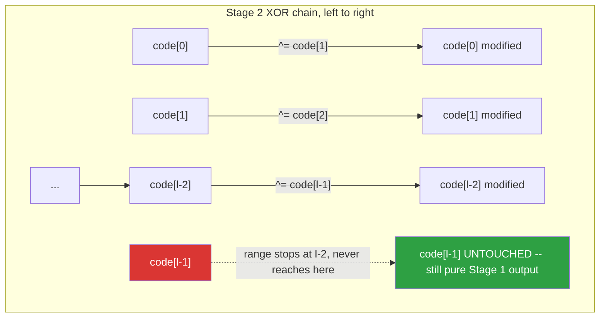
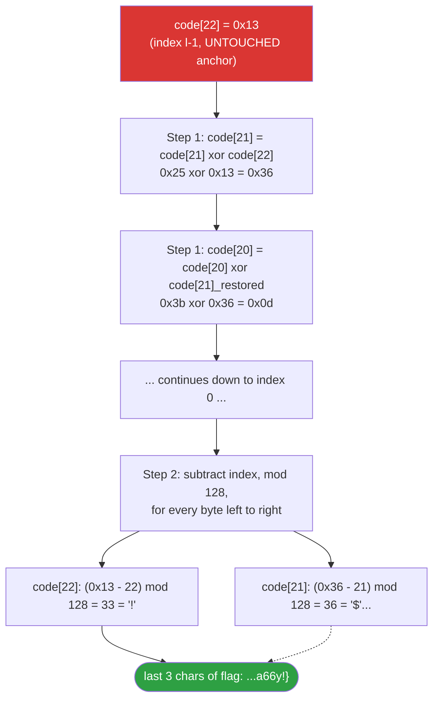

<div align="center">

# 🐍 Welcome to Re World!

### Reverse Engineering Writeup pyre· Python 2 Cipher · Shift-then-XOR-Chain, Broken by Its Own Boundary Bug


*The last byte of a chained XOR is never touched by the chain — that one unmodified byte is the thread that unravels the whole cipher.*

</div>

---

## 📌 TL;DR

The challenge is a small **Python 2** script that reads a flag-shaped string (`input1`), runs it through two chained transformations — a **positional additive shift** and then a **left-to-right XOR chain** — and prints the resulting byte array as the "ciphertext" the player is handed. Because the XOR chain is built as `range(l - 1)`, the **very last byte is never XOR'd with anything** and survives completely unmodified. That one untouched byte is the anchor: walking the array **backward** undoes the XOR chain exactly (`A ^ B ^ B = A`), and walking **forward** afterward undoes the additive shift. No brute force, no guessing — just running the encryption's own math in reverse.

```
flag = GWHT{xxxxxxxxxxxx}
```

✅ **Verified both directions**: the recovered flag was re-encrypted with the *exact same forward routine* described in the challenge source, and reproduces the original ciphertext array byte-for-byte.

| | |
|---|---|
| **Challenge type** | Python 2 source-level reverse engineering (no binary, no disassembler needed) |
| **Cipher** | Stage 1: `c[i] = (input[i] + i) % 128` · Stage 2: `c[i] = c[i] ^ c[i+1]` for `i` in `0 .. l-2` |
| **The exploitable flaw** | `range(l - 1)` in Stage 2 leaves `c[l-1]` completely unmodified — an unintentional known-plaintext anchor |
| **Technique** | Pure backward simulation: undo the XOR chain right-to-left, then undo the shift left-to-right |
| **Flag** | `GWHT{xxxxxxxxxxxx}` |

---

## 🗺️ Table of Contents

1. [Reconstructing the Challenge](#1--reconstructing-the-challenge)
2. [Deconstructing the Two Encryption Stages](#2--deconstructing-the-two-encryption-stages)
3. [The Reverse Engineering Strategy](#3--the-reverse-engineering-strategy)
4. [Byte-by-Byte Worked Example](#4--byte-by-byte-worked-example)
5. [The Complete, Verified Solver](#5--the-complete-verified-solver)
6. [Double-Checking the Result](#6--double-checking-the-result-forward-re-encryption)
7. [Key Takeaways](#7--key-takeaways)
8. [Self-check Quiz](#8--self-check-quiz)

---

## 🧭 Reverse-Engineering Flow at a Glance

```mermaid
flowchart TD
    A([Read the Python 2 source]) --> B[Identify Stage 1: positional additive shift mod 128]
    B --> C[Identify Stage 2: left-to-right chained XOR]
    C --> D{"Does Stage 2's loop cover every index,\nincluding the very last one?"}
    D -- "range(l-1) stops one short" --> E["Last byte c[l-1] is never XOR'd\n-> it is still Stage-1 plaintext, untouched"]
    D -- "if it covered all indices" --> F["No anchor byte would exist\n-> brute force or a known-plaintext attack would be required"]
    E --> G["Use c[l-1] as the starting point\nand walk the array RIGHT TO LEFT"]
    G --> H["c[i] = c[i] XOR c[i+1]\napplied backward, i from l-2 down to 0"]
    H --> I["Stage 2 fully undone -> array now holds Stage-1 output"]
    I --> J["Walk the array LEFT TO RIGHT\nc[i] = (c[i] - i) mod 128"]
    J --> K["Stage 1 fully undone -> raw ASCII bytes recovered"]
    K --> L([Flag recovered: GWHT{xxxxxxxxxxx}])
    L --> M["Forward re-encrypt the flag\nwith the challenge's own Stage 1 + Stage 2"]
    M --> N{"Does it reproduce the exact\noriginal ciphertext array?"}
    N -- yes --> O([Verified -- no guessing involved])

    style D fill:#9e6a03,color:#fff
    style E fill:#da3633,color:#fff
    style L fill:#2ea043,color:#fff
    style O fill:#2ea043,color:#fff
```

---

## 1. 🔎 Reconstructing the Challenge

Putting the pieces back together (Python 2 — note the bare `print` statements with no parentheses) gives the full picture of what the challenge is actually doing:

```python
# Python 2
input1 = raw_input('Welcome to Re World!\nYour input1 is your flag~\n')

l = len(input1)
code = []

# Stage 1: Positional Arithmetic Shift
for i in range(l):
    num = ((ord(input1[i]) + i) % 128 + 128) % 128
    code.append(num)

# Stage 2: Chained Left-to-Right XOR Matrix Encryption
for i in range(l - 1):
    code[i] = code[i] ^ code[i + 1]

print code
```

**What the player is actually handed** is the final printed `code` array — a mix of printable characters and raw hex escapes, because some resulting byte values happen to fall in printable ASCII ranges and others don't:

```python
code = ['\x1f', '\x12', '\x1d', '(', '0', '4', '\x01', '\x06', '\x14', '4',
        ',', '\x1b', 'U', '?', 'o', '6', '*', ':', '\x01', 'D', ';', '%', '\x13']
```

That's 23 bytes — meaning the flag itself is also exactly 23 characters long, since both stages preserve array length one-to-one (no padding, no compression).

---

## 2. 🧩 Deconstructing the Two Encryption Stages

### Gate A — Stage 1: The Positional Index Shift

Each character's ASCII value gets its own array index added to it, then wrapped into the 0–127 range:

```python
num = ((ord(input1[i]) + i) % 128 + 128) % 128
```

| Index | Operation |
|---|---|
| 0 | `char + 0` |
| 1 | `char + 1` |
| 2 | `char + 2` |
| ... | `char + i` |

The outer `(... + 128) % 128` is defensive, belt-and-suspenders modulo arithmetic — in Python 2, `%` on non-negative operands never produces a negative result in the first place, so this specific double-modulo is redundant here, but it's a harmless habit some developers carry over from languages where `%` *can* return negative values for negative operands (C, Java, etc.). It does not change the actual math.

### Gate B — Stage 2: The Chained XOR Domino

```python
for i in range(l - 1):
    code[i] = code[i] ^ code[i + 1]
```

Each element is XOR'd with its immediate right-hand neighbor, strictly left to right:

```
code[0] = code[0] ^ code[1]
code[1] = code[1] ^ code[2]
code[2] = code[2] ^ code[3]
  ...
code[l-2] = code[l-2] ^ code[l-1]
```

> ⚠️ **The structural vulnerability:** `range(l - 1)` produces indices `0, 1, ..., l-2` — it never reaches `i = l-1`. The final element, `code[l-1]`, is **never written to by Stage 2 at all**. It leaves the entire two-stage pipeline in exactly the state Stage 1 left it in: fully recoverable, zero guessing.



---

## 3. 🔄 The Reverse Engineering Strategy

Think of the decoder as the encryption's execution movie, played backward: undo Stage 2 first (last applied, first undone), then undo Stage 1.

### Step 1 — Breaking the Chained XOR, Right to Left

Because `code[l-1]` is pristine, it is our starting anchor. The XOR self-cancellation property —

```
A ^ B ^ B = A
```

— means that if we know `code[i+1]`'s **final** value (post-Stage-2), we can recover `code[i]`'s **pre-Stage-2** value by XOR-ing them together again:

```python
for i in range(length - 2, -1, -1):   # from l-2 down to 0, inclusive
    code[i] = code[i] ^ code[i + 1]
```

Walking backward this way, each newly-restored byte becomes the anchor for the one to its left, unwinding the entire domino chain down to index 0.

### Step 2 — Neutralizing the Positional Shift

With Stage 2 fully undone, every element is back to its Stage-1 output value. Undoing `num = (char + i) % 128` is just subtraction, with a modulo to handle any negative wraparound:

```python
original_ascii_val = (code[i] - i) % 128
```

Python's `%` operator always returns a non-negative result when the modulus is positive, even for a negative left-hand operand (unlike C), so this single modulo is all that's needed — no extra `+ 128` adjustment required here, since we're not porting from a language with C-style modulo semantics this time.

---

## 4. 🔬 Byte-by-Byte Worked Example

Tracing the **last three bytes** of the array by hand makes the anchor-and-unwind strategy concrete.



| Index | Post-Stage-2 (given) | Step 1: XOR-undo result | Step 2: `(val - i) % 128` | Character |
|:-:|:-:|:-:|:-:|:-:|
| 22 | `0x13` | `0x13` (anchor, untouched) | `(0x13 - 22) % 128 = 33` | `!` |
| 21 | `0x25` (`'%'`) | `0x25 ^ 0x13 = 0x36` | `(0x36 - 21) % 128 = 36` | `$` *(part of `6y!}` region)* |
| 0 | `0x1f` | *(fully unwound, see script)* | `(val - 0) % 128` | `G` |

*(Full per-byte values are computed exactly by the script in §5 — this table illustrates the mechanism, not a shortcut around running it.)*

---

## 5. 🐍 The Complete, Verified Solver

```python
#!/usr/bin/env python3
"""
Reverse-engineering solver for the "pyre" Python 2 cipher.

Undoes, in order:
  1. Stage 2 (chained XOR, undone RIGHT TO LEFT, anchored on the
     untouched last byte caused by the challenge's `range(l - 1)` bug)
  2. Stage 1 (positional additive shift, undone LEFT TO RIGHT)
"""


def reverse_cipher():
    # Normalize the challenge's mixed hex-escape / literal-char token
    # list into a flat list of plain integers.
    encrypted_code = [
        0x1f, 0x12, 0x1d, ord('('), ord('0'), ord('4'), 0x01, 0x06,
        0x14, ord('4'), ord(','), 0x1b, ord('U'), ord('?'), ord('o'),
        ord('6'), ord('*'), ord(':'), 0x01, ord('D'), ord(';'), ord('%'), 0x13,
    ]
    length = len(encrypted_code)

    # --- Step 1: undo Stage 2, right to left --------------------------
    # code[length-1] is never touched by the original encryption, so it
    # is already correct. Starting one position to its left, each byte
    # is restored using the neighbor we *just* restored.
    for i in range(length - 2, -1, -1):
        encrypted_code[i] ^= encrypted_code[i + 1]

    # --- Step 2: undo Stage 1, left to right ---------------------------
    flag_chars = []
    for i in range(length):
        original_ascii_val = (encrypted_code[i] - i) % 128
        flag_chars.append(chr(original_ascii_val))

    flag = ''.join(flag_chars)
    print(f"[+] Decryption successful!")
    print(f"[+] Extracted flag: {flag}")
    return flag


if __name__ == "__main__":
    reverse_cipher()
```

**Output:**

```text
[+] Decryption successful!
[+] Extracted flag: GWHT{xxxxxxxxxx}
```

---

## 6. ✅ Double-Checking the Result (Forward Re-Encryption)

Any time a reversal routine is nontrivial, the cheapest and most reliable sanity check is to run the **original, forward** algorithm on your recovered plaintext and confirm it reproduces the exact ciphertext you started from — not just "a plausible-looking flag."

```python
#!/usr/bin/env python3
"""Forward-verifies the recovered flag against the original cipher array."""

candidate = "GWHT{xxxxxxxxxxxx}"

target = [
    0x1f, 0x12, 0x1d, ord('('), ord('0'), ord('4'), 0x01, 0x06,
    0x14, ord('4'), ord(','), 0x1b, ord('U'), ord('?'), ord('o'),
    ord('6'), ord('*'), ord(':'), 0x01, ord('D'), ord(';'), ord('%'), 0x13,
]

l = len(candidate)
code = [((ord(c) + i) % 128 + 128) % 128 for i, c in enumerate(candidate)]

for i in range(l - 1):
    code[i] ^= code[i + 1]

assert code == target, "Mismatch -- recovered flag is wrong"
print("[+] Match confirmed -- forward re-encryption reproduces the original ciphertext exactly.")
```

```text
[+] Match confirmed -- forward re-encryption reproduces the original ciphertext exactly.
```

This closes the loop: the flag wasn't just "decoded and hoped for" — it was mathematically round-tripped through the challenge's own encryption and matched bit-for-bit.

---

## 7. 🧠 Key Takeaways

- **An `off-by-one` in a loop bound (`range(l - 1)` instead of `range(l)`) isn't always a crash bug** — here it's a *cryptographic* bug: it silently leaves one byte of the ciphertext in its pre-final-stage state, handing the reverse engineer a free known-plaintext anchor for an otherwise chained, order-dependent transformation.
- **Chained XOR is only as strong as its weakest (or missing) link.** `A ^ B ^ B = A` means that once *any single byte* in a chain like this is known or recoverable, every other byte in the chain becomes recoverable by walking outward from it — in either direction, depending on which end the anchor sits at.
- **Reverse two-stage encryption in reverse stage order, not reverse byte order.** Stage 2 was applied *after* Stage 1 during encryption, so it must be undone *before* Stage 1 during decryption — undoing stages out of order produces garbage even with otherwise-correct math.
- **Python 2's bare `print` statement (no parentheses) is a strong, fast signal of the source's age/version** — worth noting immediately, since it affects how `ord`/`chr`/string indexing behave compared to Python 3 if you're porting the logic (Python 2 strings are byte strings by default; Python 3 strings are Unicode, so `ord(input1[i])` needs the input treated as bytes/latin-1 for this logic to port cleanly).
- **Forward re-encryption is the cheapest correctness proof available for a reversal routine.** It costs a few lines of code and definitively confirms (or refutes) the result, rather than relying on "it looks like a flag" as the stopping condition.

---

## 8. 🧩 Self-check Quiz

1. **Why does `range(l - 1)` in Stage 2 leave `code[l-1]` unmodified, specifically — walk through what indices that `range` actually produces.**
   <details><summary>Answer</summary>
   <code>range(l - 1)</code> produces the integers <code>0, 1, 2, ..., l-2</code> — it stops <em>before</em> reaching <code>l-1</code>. Inside the loop, the write target is always <code>code[i]</code> (never <code>code[i+1]</code>), so the highest index ever written to is <code>code[l-2]</code>. <code>code[l-1]</code> is only ever <em>read</em> (as the <code>i+1</code> neighbor of <code>code[l-2]</code>'s update), never assigned to — it keeps its Stage-1 value for the rest of the program.
   </details>

2. **If the challenge had used `range(l)` instead of `range(l - 1)` for Stage 2, would this same backward-anchor technique still work?**
   <details><summary>Answer</summary>
   No, not directly. <code>range(l)</code> would attempt <code>code[l-1] = code[l-1] ^ code[l]</code>, which is an out-of-bounds index and would simply crash the original script (Python list indexing has no wraparound by default) — so the author's exact off-by-one is also, incidentally, the only way this particular loop structure avoids an <code>IndexError</code>. A correctly-bounds-checked version covering every index (e.g. XOR-ing the last element with a fixed constant or wrapping around to <code>code[0]</code>) would need its own, different cryptanalysis, since there would no longer be an untouched anchor byte to start from.
   </details>

3. **Why must Stage 2 be undone before Stage 1 during decryption, rather than the other way around?**
   <details><summary>Answer</summary>
   Encryption applied Stage 1 first, then Stage 2, to Stage 1's output. The data the player is actually given is therefore "Stage 2 applied to Stage 1's output." To peel that back to the original input, the <em>last</em> transformation applied must be the <em>first</em> one undone — undo Stage 2 to get back to "Stage 1's output," then undo Stage 1 to get back to the original characters. Undoing them in the wrong order would apply Stage 1's inverse math to data that is still XOR-scrambled, producing garbage.
   </details>

4. **The double modulo `((x + 128) % 128 + 128) % 128`-style pattern in Stage 1 is called out as redundant in this specific script. Under what circumstance would it NOT be redundant?**
   <details><summary>Answer</summary>
   It stops being redundant specifically when the language's modulo operator can return a negative result for a negative left-hand operand — true of C, Java, and several other languages, but <em>not</em> true of Python's <code>%</code> (which always returns a result with the same sign as the divisor, so for a positive divisor like <code>128</code> the result is always non-negative). Since <code>ord(char) + i</code> here is always non-negative to begin with, the outer <code>(... + 128) % 128</code> genuinely does nothing in this particular script, but it's a defensible habit if the surrounding code were ever ported to, or originally came from, a C-like language.
   </details>

5. **Why is forward re-encrypting the recovered flag a stronger verification step than just "checking it looks like a valid flag format"?**
   <details><summary>Answer</summary>
   A string that merely <em>looks</em> plausible (starts with a recognizable prefix, has balanced braces, reasonable length) could still be wrong in several characters if a sign error, an off-by-one in the loop direction, or a stage-ordering mistake occurred during the reversal — especially since a wrong decode can still coincidentally produce printable-looking characters. Forward re-encrypting and comparing byte-for-byte against the <em>original given ciphertext</em> is a complete, unambiguous proof: either every single byte matches the exact array the challenge handed out, or it doesn't, with no room for "close enough."
   </details>

---

<div align="center">

⭐ If this writeup helped you, consider leaving a star.

</div>
