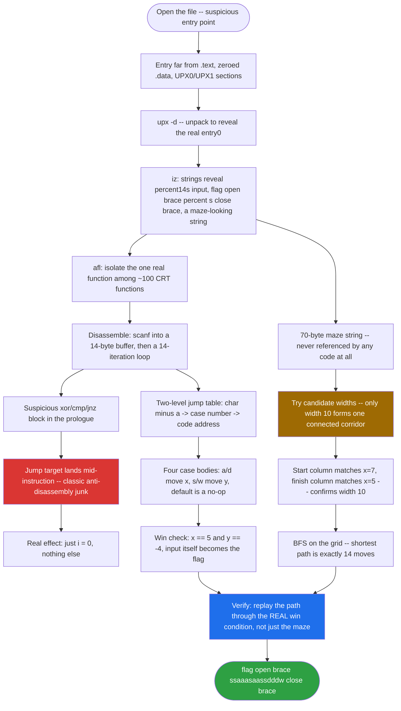
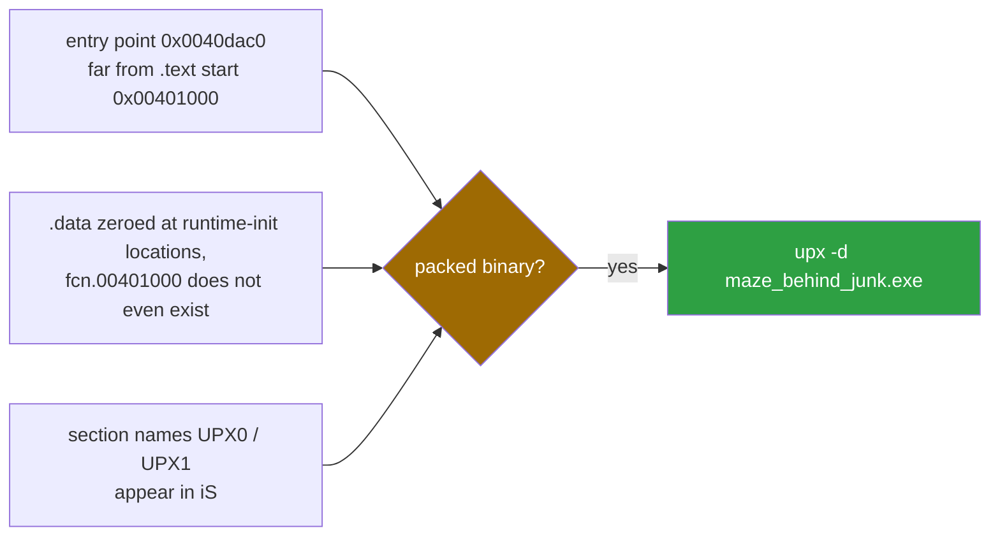
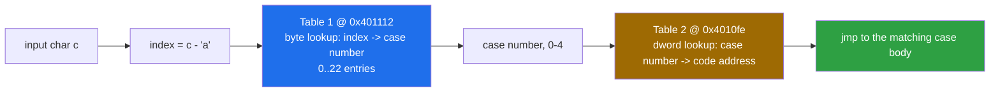
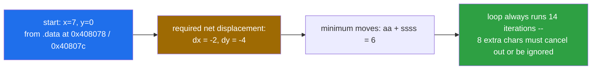
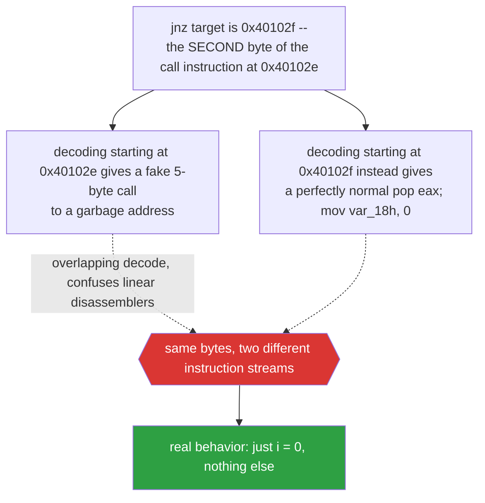
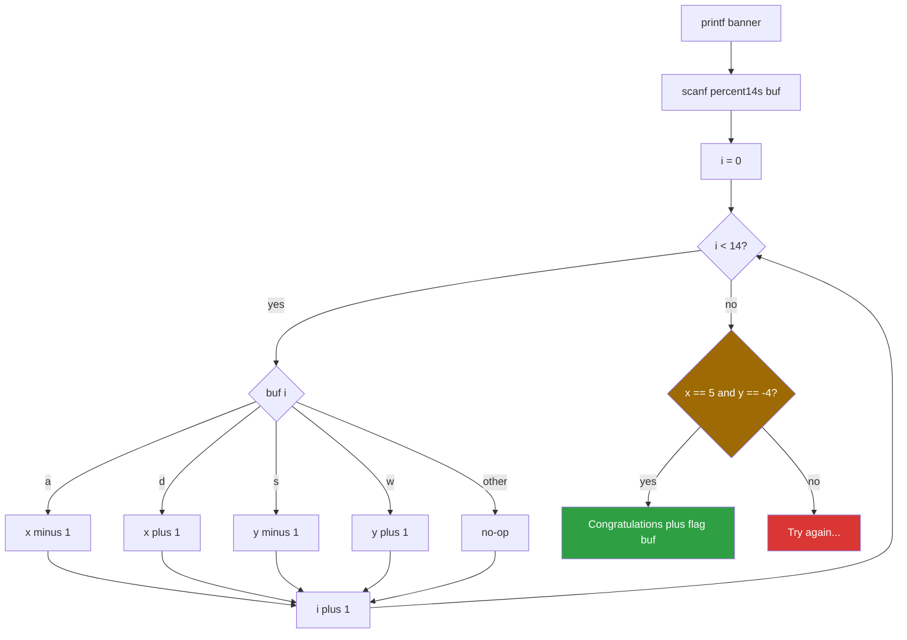
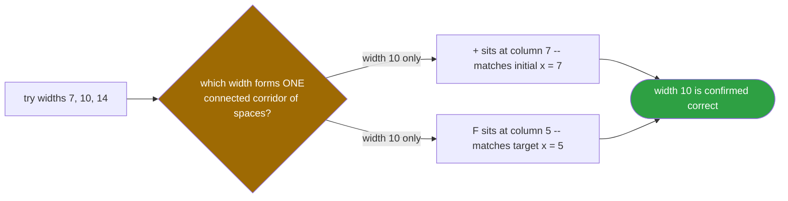

<div align="center">

# 🧩 maze_behind_junk

### Reverse Engineering Writeup · Windows PE32 · A Decoy Maze, Anti-Disassembly Junk, and a Two-Variable State Machine


*A pretty ASCII maze is a decoy, an overlapping-instruction trick hides in the prologue, and the real logic is just two integers and a switch statement.*

</div>

---

## 📌 TL;DR

- The program reads **14 characters** with `scanf("%14s")` and treats each one as a move: `w`/`a`/`s`/`d`.
- Two global integers track the position: `x` (starts at **7**) and `y` (starts at **0**).
- You win if, after all 14 moves, **`x == 5` and `y == -4`**. The input itself is printed as the flag.
- The ASCII maze stored in `.data` is **never read by the code**. It is the intended path, not an enforced rule.
- The shortest valid path through the maze (found with BFS) is exactly 14 moves long, so it is the intended solution:

```
ssaaasaassdddw
```

```

```

| | |
|---|---|
| **Category** | Reverse Engineering |
| **Platform** | Windows PE32 (x86), packed with UPX |
| **Analysis environment** | Ubuntu Server (static analysis only, the binary was never executed) |
| **Tools** | `upx`, `rizin`, `rz-ghidra` (`pdg`), Python 3 |
| **Flag format** | `flag{...}` |
| **Flag** | `flag{xxxxxxxxxx}` — independently re-verified: BFS path recomputed and the win condition round-tripped to `x=5, y=-4` |

---

## 🗺️ Table of Contents

1. [Environment setup](#2--environment-setup)
2. [Step 0: the binary was UPX-packed](#3--step-0-the-binary-was-upx-packed)
3. [Step 1: strings and function overview](#4--step-1-strings-and-function-overview)
4. [Step 2: disassembling the main logic](#5--step-2-disassembling-the-main-logic)
5. [Step 3: the jump tables](#6--step-3-the-jump-tables)
6. [Step 4: the win condition and initial state](#7--step-4-the-win-condition-and-initial-state)
7. [Step 5: the junk code (anti-disassembly)](#8--step-5-the-junk-code-anti-disassembly)
8. [Step 6: confirming with Ghidra](#9--step-6-confirming-with-the-ghidra-decompiler)
9. [Reconstructed C source](#10--reconstructed-c-source)
10. [Step 7: recovering the maze](#11--step-7-recovering-the-maze)
11. [Step 8: solving with BFS](#12--step-8-solving-with-bfs)
12. [Verification](#13--verification)
13. [Patching the binary](#14--patching-the-binary)
14. [Pitfalls and lessons learned](#15--pitfalls-and-lessons-learned)
15. [Command cheat sheet](#16--command-cheat-sheet)

---

## 🧭 Analysis Flow at a Glance



---

## 2. 🛠️ Environment setup

Everything here was done on an Ubuntu server. Since the target is a Windows x86 executable, **no execution was needed**; static analysis with Rizin is enough.

```bash
# Rizin (reverse engineering framework)
sudo apt install rizin            # or build from source

# UPX (to unpack)
sudo apt install upx-ucl

# rz-ghidra decompiler plugin
rz-pm init && rz-pm update
rz-pm install rz-ghidra
sudo apt install build-essential cmake git pkg-config   # needed by rz-pm builds

# Python 3 is used for the maze solver
python3 --version
```

> **Note:** Rizin prints `WARNING: '14h' uses a deprecated trailing base suffix` many times. It is harmless; it only concerns how Rizin prints stack variable names (`var_14h`).

---

## 3. 📦 Step 0: the binary was UPX-packed

Opening the file the first time gave a suspicious entry point and an almost empty `.data` section:

```
[0x0040dac0]> px 16 @ 0x00408070
0x00408070  0000 0000 0000 0000 0000 0000 0000 0000  ................
```

Symptoms of a packed binary:



- Entry point (`0x0040dac0`) is far from `.text` start (`0x00401000`).
- `.data` is zeroed at runtime-initialized locations; `fcn.00401000` does not exist.
- Section names like `UPX0` / `UPX1` appear in `iS`.

Triage commands:

```bash
sha256sum maze_behind_junk.exe
rizin -A maze_behind_junk.exe
```

```
[0x...]> iI~arch,bits,baddr,pack     # architecture, bitness, image base, packer
[0x...]> iS                          # list sections (look for UPX0/UPX1)
[0x...]> ie                          # entry points
```

Unpack:

```bash
upx -d maze_behind_junk.exe
```

After unpacking, the real entry point is `entry0 = 0x00401171` and the real data shows up:

```
[0x00401171]> px 16 @ 0x00408070
0x00408070  2a2a 2a2a 2a2a 0000 0700 0000 0000 0000  ******..........
```

The `07 00 00 00` at `0x408078` is going to matter (it is the initial `x`).

---

## 4. 🔎 Step 1: strings and function overview

```
rizin -A maze_behind_junk.exe
[0x00401171]> iz          # strings in data sections
[0x00401171]> afl         # list analyzed functions
```

Interesting strings from `iz`:

| Address | String |
|---|---|
| `0x00408030` | `*******+********* ******    ****   ******* **F******    **************` (70 bytes) |
| `0x00408080` | `Go through the maze to get the flag!\n` |
| `0x004080a8` | `%14s` |
| `0x004080b0` | `Congratulations!\n` |
| `0x004080c4` | `Here is the flag:flag{%s}\n` |
| `0x004080e0` | `Try again...\n` |

Just from strings we can already infer:

- Input is up to **14 characters** (`%14s`).
- The **input itself** is the flag (`flag{%s}`).
- There is a maze-looking string with a `+` (start) and an `F` (finish).

`afl` listed ~100 functions, but most are the MSVC C runtime. The interesting ones are:

| Function | Role |
|---|---|
| `fcn.00401000` | The program's `main` logic (small, 254 bytes) |
| `fcn.00401129` | `scanf`-like wrapper |
| `fcn.00401140` | `printf`-like wrapper |
| `entry0` (`0x00401171`) | CRT startup, calls `fcn.00401000` at `0x401220` |

---

## 5. 🧩 Step 2: disassembling the main logic

```
[0x00401171]> pdf @ fcn.00401000
```

### 5.1 Prologue and input

```asm
0x00401000  push  ebp
0x00401001  mov   ebp, esp
0x00401003  sub   esp, 0x18
...
0x00401009  push  str.Go_through_the_maze_to_get_the_flag   ; "Go through the maze..."
0x0040100e  call  fcn.00401140                               ; printf
0x00401016  lea   eax, dword [var_14h]                       ; &buffer
0x00401019  push  eax
0x0040101a  push  str.14s                                    ; "%14s"
0x0040101f  call  fcn.00401129                               ; scanf
```

`var_14h` (`ebp-0x14`) is the **input buffer**.

### 5.2 The loop

```asm
0x00401030  mov   dword [var_18h], 0x00     ; i = 0
0x00401037  jmp   0x401042
; ... loop body ...
0x00401042  cmp   dword [var_18h], 0x0d     ; i <= 13 ?  (14 iterations)
0x0040104b  movsx eax, byte [var_14h + i]   ; c = buf[i]
0x00401056  sub   ecx, 0x61                 ; c - 'a'
0x0040105c  cmp   dword [var_1ch], 0x16     ; > 22 ('w' - 'a') ? -> default
0x00401060  jnbe  case.switch.0x0040106d.4
```

Equivalent to:

```c
for (i = 0; i < 14; i++) {
    c = buf[i] - 'a';
    if (c > 22) continue;        // outside 'a'..'w' => no effect
    ...
}
```

### 5.3 The switch dispatch

```asm
0x00401062  mov   eax, dword [var_1ch]
0x00401065  xor   edx, edx
0x00401067  mov   dl, byte [eax+0x401112]           ; table 1: char index -> case number
0x0040106d  jmp   dword [edx*4+data.004010fe]       ; table 2: case number -> code address
```

This is the classic **two-level jump table** compilers emit for sparse `switch` statements.



### 5.4 The case bodies

```
[0x00401171]> pd 30 @ 0x00401085
```

| Case | Code | Effect |
|---|---|---|
| 0 | `sub [0x408078], 1` | `x--` |
| 1 | `add [0x408078], 1` | `x++` |
| 2 | `sub [0x40807c], 1` | `y--` |
| 3 | `add [0x40807c], 1` | `y++` |
| 4 (default) | `jmp 0x401039` | nothing |

Every case jumps back to the loop increment at `0x401039`.

---

## 6. 🔢 Step 3: the jump tables

### Table 1: byte lookup at `0x00401112`

```
[0x00401171]> px 100 @ 0x00401112
0x00401112  0004 0401 0404 0404 0404 0404 0404 0404
0x00401122  0404 0204 0404 038d ...
```

The table has 23 entries (`'a'`..`'w'`). Extracting them:

```
idx: 0  1  2  3  4  5  6  7  8  9 10 11 12 13 14 15 16 17 18 19 20 21 22
val: 00 04 04 01 04 04 04 04 04 04 04 04 04 04 04 04 04 04 02 04 04 04 03
chr: a                 d                                   s           w
```

| Char | Index (`c - 'a'`) | Case |
|---|---|---|
| `a` | 0 | 0 |
| `d` | 3 | 1 |
| `s` | 18 | 2 |
| `w` | 22 | 3 |
| everything else | | 4 (default, no-op) |

### Table 2: address table at `0x004010fe`

Rizin annotated it as `switch table (5 cases) at 0x4010fe`. It maps case numbers 0..4 to the code blocks at `0x401096`, `0x4010a5`, `0x401085`, `0x401074` and the default target.

So the effective mapping is:

| Key | Action |
|---|---|
| `a` | `x -= 1` |
| `d` | `x += 1` |
| `s` | `y -= 1` |
| `w` | `y += 1` |

That is plain WASD, with `y` increasing when you press `w`.

---

## 7. 🎯 Step 4: the win condition and initial state

```asm
0x004010b6  cmp   dword [data.00408078], 0x05        ; x == 5 ?
0x004010bd  jnz   0x4010e8
0x004010bf  cmp   dword [data.0040807c], 0xfffffffc  ; y == -4 ?
0x004010c6  jnz   0x4010e8
0x004010c8  push  str.Congratulations                 ; success
...
0x004010de  call  fcn.00401140                       ; printf("Here is the flag:flag{%s}\n", buf)
```

`0xfffffffc` is `-4` in two's complement.

Initial values come from `.data`:

```
[0x00401171]> px 16 @ 0x00408070
0x00408070  2a2a 2a2a 2a2a 0000 0700 0000 0000 0000
                              ^^^^^^^^^ ^^^^^^^^^
                              x = 7     y = 0       (little-endian dwords at 0x408078 / 0x40807c)
```

**Start `(7, 0)` → target `(5, -4)`.**



Required net displacement: **`dx = -2`, `dy = -4`**, so at minimum `aa` + `ssss`. But the loop *always* runs 14 iterations, so the other 8 characters must cancel out (or be non-WASD letters, which are ignored).

---

## 8. 🪤 Step 5: the junk code (anti-disassembly)

The prologue contains a suspicious block that does not look like normal compiler output:

```asm
0x00401027  push  eax
0x00401028  xor   eax, ecx
0x0040102a  cmp   eax, ecx
0x0040102c  jnz   0x40102f
0x0040102e  call  0xffffffffec85d78b      ; <- garbage
0x0040102f  pop   eax
0x00401030  mov   dword [var_18h], 0x00
```

Two details give it away:



1. **The jump target lands in the middle of an instruction.** `0x40102f` is the second byte of the `call` that the linear disassembler shows at `0x40102e`. The first byte (`e8`) is just a decoy opcode that gets skipped over. When you start decoding at `0x40102f` you get a perfectly normal `pop eax` followed by `mov [var_18h], 0`.
2. **The `xor eax, ecx` / `cmp eax, ecx` pair** is a pointless data-dependent comparison. It only exists to give the `jnz` something to hang off. The result has no effect on the program's logic.

Both are classic **anti-disassembly / junk-code** tricks, and they are what the challenge name (`maze_behind_junk`) is hinting at. Rizin warns about the overlap and Ghidra emits:

```
// WARNING: Instruction at (ram,0x0040102f) overlaps instruction at (ram,0x0040102e)
```

The effect on the decompilation is a fake `if/else` with nonsense pointer writes (see next section). The real behavior of the function is simply "set `i = 0` and continue".

---

## 9. 🔬 Step 6: confirming with the Ghidra decompiler

```
[0x00401171]> pdg @ 0x00401000
```

```c
undefined4 fcn.00401000(void)
{
    uint32_t uVar1;
    char *pcVar2;
    uint32_t extraout_ECX;
    int32_t unaff_EDI;
    uint_least32_t var_1ch;
    int32_t var_18h;
    int32_t var_14h;

    fcn.00401140(0x408080, unaff_EDI);                       // printf("Go through the maze...")
    uVar1 = fcn.00401129(0x4080a8, (int32_t)&var_14h);       // scanf("%14s", buf)
    if ((uVar1 ^ extraout_ECX) == extraout_ECX) {
        pcVar2 = (char *)func_0xec85d78b(uVar1);             // <-- junk (decoy call)
        *pcVar2 = *pcVar2 + (char)pcVar2;
        *pcVar2 = *pcVar2 + (char)pcVar2;
    } else {
        var_18h = 0;
    }
    for (; var_18h < 0xe; var_18h = var_18h + 1) {
        switch(*(undefined *)((int32_t)&var_14h + var_18h)) {
        case 0x61: _data.00408078 = _data.00408078 + -1; break;   // 'a'
        case 100:  _data.00408078 = _data.00408078 + 1;  break;   // 'd'
        case 0x73: _data.0040807c = _data.0040807c + -1; break;   // 's'
        case 0x77: _data.0040807c = _data.0040807c + 1;           // 'w'
        }
    }
    if ((_data.00408078 == 5) && (_data.0040807c == -4)) {
        fcn.00401140(0x4080b0, unaff_EDI);                   // "Congratulations!"
        fcn.00401140(0x4080c4, (int32_t)&var_14h);           // "Here is the flag:flag{%s}"
    } else {
        fcn.00401140(0x4080e0, unaff_EDI);                   // "Try again..."
    }
    return 0;
}
```

What this confirms (matching our manual assembly analysis):

- Case ↔ key mapping: `0x61 'a'`, `100 'd'`, `0x73 's'`, `0x77 'w'`.
- Loop bound `< 0xe` = 14 iterations.
- Win condition `x == 5 && y == -4`.
- The odd `if` with `func_0xec85d78b` is the decompiler's misreading of the overlapping-instruction junk.

### Making the decompiler output nicer

```
[0x00401171]> afn main @ 0x00401000        # rename the function
[0x00401171]> afn printf @ 0x00401140
[0x00401171]> afn scanf  @ 0x00401129
[0x00401171]> pdg @ main
```

---

## 10. 🧱 Reconstructed C source

```c
#include <stdio.h>

int x = 7;                       // 0x408078
int y = 0;                       // 0x40807c

// 0x408030 - never referenced by any code
char maze[] =
    "*******+*********"
    " ******    ****   "
    "******* **F******"
    "    **************";

int main(void) {
    char buf[15];
    int i;

    printf("Go through the maze to get the flag!\n");
    scanf("%14s", buf);

    for (i = 0; i < 14; i++) {
        switch (buf[i]) {
            case 'a': x--; break;
            case 'd': x++; break;
            case 's': y--; break;
            case 'w': y++; break;
        }
    }

    if (x == 5 && y == -4) {
        printf("Congratulations!\n");
        printf("Here is the flag:flag{%s}\n", buf);
    } else {
        printf("Try again...\n");
    }
    return 0;
}
```

*(The junk-code block in the prologue is not part of the original logic and is omitted.)*



---

## 11. 🗺️ Step 7: recovering the maze

The 70-byte string at `0x408030` only makes sense as a grid. We do not know the width up front, so try several:

```python
# print_maze.py
s = "*******+********* ******    ****   ******* **F******    **************"
print(len(s))
for w in (7, 10, 14):
    print("width", w)
    for i in range(0, len(s), w):
        print(s[i:i+w])
    print()
```

Only **width 10** produces a sensible corridor:

```
      0123456789
r0    *******+**
r1    ******* **
r2    ****    **
r3    **   *****
r4    ** **F****
r5    **    ****
r6    **********
```



Why width 10 is the right one:

- `+` (start) sits at **column 7**, matching the initial `x = 7`.
- `F` (finish) sits at **column 5**, matching the target `x = 5`.
- It is the only width in which the open cells (spaces) form one connected corridor.

Direction convention used by the program: `s` moves **down** one row (`y--`), `w` moves **up** (`y++`), `a` moves left, `d` moves right.

> Remember: the program never reads this string. It is purely the "story" of the challenge.

---

## 12. 🐍 Step 8: solving with BFS

```python
# solve.py
from collections import deque

s = "*******+********* ******    ****   ******* **F******    **************"
W = 10
grid = [s[i:i+W] for i in range(0, len(s), W)]
R = len(grid)

for r in range(R):
    for c in range(len(grid[r])):
        if grid[r][c] == '+': start = (r, c)
        if grid[r][c] == 'F': goal = (r, c)

print("start", start, "goal", goal)

moves = {'w': (-1, 0), 's': (1, 0), 'a': (0, -1), 'd': (0, 1)}
q = deque([(start, "")])
seen = {start}
while q:
    (r, c), path = q.popleft()
    if (r, c) == goal:
        print(path, len(path))
        break
    for k, (dr, dc) in moves.items():
        nr, nc = r + dr, c + dc
        if (0 <= nr < R and 0 <= nc < len(grid[nr])
                and grid[nr][nc] != '*' and (nr, nc) not in seen):
            seen.add((nr, nc))
            q.append(((nr, nc), path + k))
```

Output (independently re-run for this writeup):

```
start (0, 7) goal (4, 5)
ssaaasaassdddw 14
```

Walking the path by hand:

| Moves | Result position (row, col) |
|---|---|
| `ss` | (2, 7) |
| `aaa` | (2, 4) |
| `s` | (3, 4) |
| `aa` | (3, 2) |
| `ss` | (5, 2) |
| `ddd` | (5, 5) |
| `w` | (4, 5) = **F** |

Total: **14 moves**, matching the `%14s` buffer exactly.

---

## 13. ✅ Verification

Check the path against the program's *real* win condition:

```python
# verify.py
x, y = 7, 0
for c in "ssaaasaassdddw":
    x += (c == 'd') - (c == 'a')
    y += (c == 'w') - (c == 's')
print(x, y)    # -> 5 -4
```

Count check:

- `a` ×5, `d` ×3 → `x = 7 - 5 + 3 = 5` ✅
- `s` ×5, `w` ×1 → `y = 0 - 5 + 1 = -4` ✅

The flag was accepted by the challenge platform:

```
flag{ssaaasaassdddw}
```

### A note on uniqueness

Because the binary only checks the final `(x, y)`, many other 14-character inputs also print "Congratulations" (for example any string with net `-2` on x and `-4` on y, padded with canceling pairs such as `wsws` or with ignored characters). The **intended** answer is the maze path, which is the only one that is also a legal walk through the drawn maze.

---

## 14. 🩹 Patching the binary

Patching is not needed for the CTF, but it is a nice exercise. Always patch the **unpacked** file (after `upx -d`) and work on a copy.

```bash
cp maze_behind_junk.exe patched.exe
rizin -w patched.exe
```

### Option A: always take the success branch

Both win-condition checks are 2-byte `jnz` instructions:

```
0x004010bd  75 29   jnz 0x4010e8
0x004010c6  75 20   jnz 0x4010e8
```

NOP them out:

```
[0x00401171]> wx 9090 @ 0x004010bd
[0x00401171]> wx 9090 @ 0x004010c6
[0x00401171]> pd 8 @ 0x004010b6        # verify
```

Any input now prints "Congratulations" and echoes your input in `flag{...}`.

### Option B: change the target coordinates

Edit the immediates in the two `cmp` instructions to the *starting* values (`x == 7`, `y == 0`), so the do-nothing input wins. Use `pd` to see the exact bytes first, then:

```
[0x00401171]> s 0x004010b6
[0x00401171]> wa cmp dword [0x408078], 7
```

### Option C: remove the junk block

Replace the decoy `e8` byte with a NOP so disassemblers stop being confused:

```
[0x00401171]> wx 90 @ 0x0040102e
[0x00401171]> aa
[0x00401171]> pdg @ 0x00401000         # the fake if/else disappears
```

*(Only do this if you have checked with `pd` that the bytes now decode cleanly; the `jnz` at `0x40102c` still targets `0x40102f`.)*

> In a real CTF the flag is checked on the server with your input, so patching does not help. Patching is useful for learning, or when the program itself is the target.

---

## 15. 📋 Pitfalls and lessons learned

- **Check for packers first.** The odd entry point (`0x0040dac0`), the zeroed `.data`, and a missing `fcn.00401000` all pointed to UPX. Always run `iI`, `iS`, `ie` before deep analysis.
- **Don't trust the first maze width.** Width 7 looked plausible but was wrong. Use known constraints (start column `x = 7`, target column `x = 5`) to pick the right one.
- **Validate the full path, not only the endpoint.** A script that only checks the final `(x, y)` confirms the program's condition but not that the path is a legal walk through the maze. BFS on the actual grid closes that gap.
- **Do not assume case numbers map to keys.** Case 3 = `w` etc. came from reading the lookup table and was later confirmed by `pdg`. Always cross-check the byte table (`0x401112`) with the address table (`0x4010fe`).
- **Rizin command gotchas:**
  - `ps` takes an *encoding*, not a length (`ps 300` fails). Use `px` for raw bytes.
  - `psz` does not exist in Rizin.
  - Running `pdf @ fcn.XXXX` before `aa` fails with `Invalid address`.
  - Python code (`def`, `for`, `print`) cannot be typed inside Rizin. Run it separately with `python3`.
- **Decoys everywhere.** The maze string, the opaque `xor/cmp/jnz`, and the overlapping `call` all exist to waste your time. The real logic is about 20 instructions.
- **Decompilers get fooled by overlapping instructions.** Ghidra produced a fake branch with garbage pointer writes. Always compare with the raw disassembly.

---

## 16. 🧰 Command cheat sheet

### Rizin

| Command | Purpose |
|---|---|
| `rizin -A file.exe` | Open and auto-analyze |
| `rizin -w file.exe` | Open in write mode (for patching) |
| `iI` | Binary info (arch, bits, packer hints) |
| `iS` | Sections |
| `ie` | Entry points |
| `iz` | Strings in data sections |
| `aa` | Analyze all |
| `afl` | List functions |
| `afn name @ addr` | Rename a function |
| `pdf @ fcn.00401000` | Disassemble a whole function |
| `pd N @ addr` | Disassemble N instructions at address |
| `px N @ addr` | Hex dump N bytes |
| `pdg @ addr` | Decompile with rz-ghidra |
| `wx HEX @ addr` | Write raw bytes (patch) |
| `wa asm @ addr` | Write assembled instruction |
| `s addr` | Seek |

### Other tools

| Command | Purpose |
|---|---|
| `upx -d file.exe` | Unpack UPX |
| `sha256sum file.exe` | Hash for tracking versions |
| `python3 solve.py` | Run the BFS solver |

---

## 🏁 Final answer

```
Input : ssaaasaassdddw

```

*Analysis performed entirely on Ubuntu with Rizin, rz-ghidra and Python.*

---

<div align="center">

⭐ If this writeup helped you, consider leaving a star.

</div>
