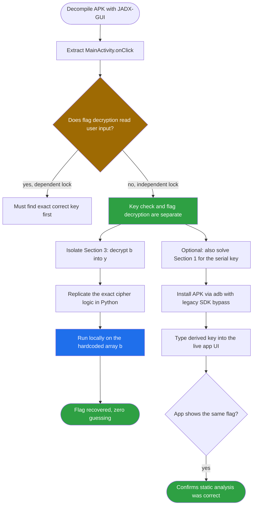
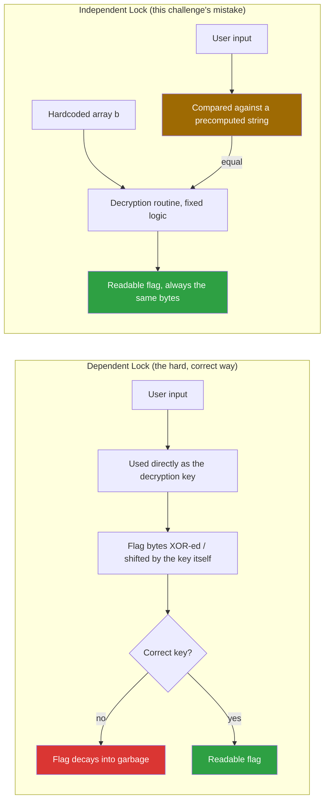
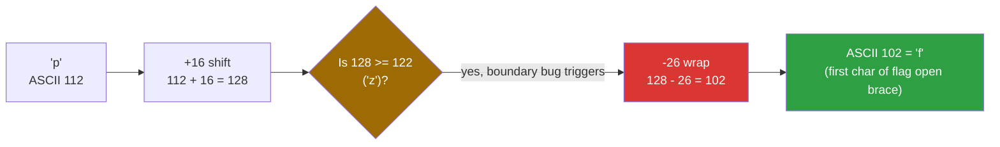
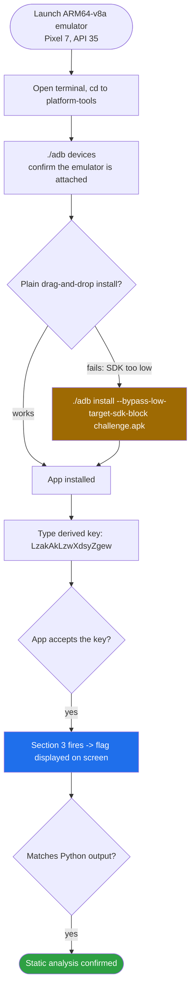

<div align="center">

# 🔓 findit.apk

### Android Reverse Engineering Writeup · Gatekeeper Bypass via Logic Replication


*The app checks your answer before it decrypts the flag — so why bother answering at all?*

</div>

---

## 📌 TL;DR

The target is `com.example.findit`, an Android app with a single button that validates a serial key and then reveals a flag. Decompiling with **JADX-GUI** shows two hardcoded `char[]` arrays: one obfuscated serial key (`a`) and one obfuscated flag (`b`). Critically, the flag's decryption routine (Section 3 of `onClick`) reads **only from `b`** — it never touches the user's input. This is a classic **"independent lock"** implementation mistake: the gate (comparing input to the derived key) and the payload (decrypting the flag) are two completely separate code paths that just happen to run back-to-back. We never need to find the correct key at all — we just replicate Section 3's decryption logic in Python and run it directly on `b`.

| | |
|---|---|
| **Target** | `com.example.findit` (Android APK) |
| **Flaw class** | Independent Lock / Gatekeeper pattern — decryption doesn't depend on user input |
| **Cipher** | Split-range Caesar shift (`+16`, case-aware) with a **boundary-wrapping bug** |
| **Flag** | `flag{c164675262033b4c49bdf7f9cda28a75}` |
| **Serial key** (if you want to use the UI) | `LzakAkLzwXdsyZgew` |
| **Verified** | ✅ Python replication matches live on-device behavior (Apple Silicon emulator via ADB) |

---

## 🗺️ Table of Contents

1. [Static Analysis](#1--static-analysis--decompiled-java-review)
2. [The Gatekeeper Bypass Strategy](#2--the-gatekeeper-bypass-strategy)
3. [The Cipher and Its Boundary Bug](#3--the-cipher-and-its-boundary-bug)
4. [Python Solver](#4--python-solver-logic-replication)
5. [Dynamic Verification on Android](#5--dynamic-verification-on-android-macos-apple-silicon)
6. [Key Takeaways](#6--key-takeaways)
7. [Appendix](#appendix--full-decompiled-source)

---

## 🧭 Analysis Flow at a Glance



---

## 1. 🔍 Static Analysis & Decompiled Java Review

Decompiling the target APK with **JADX-GUI** extracts the core validation logic straight out of `MainActivity.java`. It's small enough to read in full: two hardcoded `char[]` arrays, `a` and `b`, processed inside a single button click listener.

```java
public class MainActivity extends ActionBarActivity {
    protected void onCreate(Bundle savedInstanceState) {
        // ... UI initialization ...
        final char[] a = {'T','h','i','s','I','s','T','h','e','F','l','a','g','H','o','m','e'};
        final char[] b = {'p','v','k','q','{','m','1','6','4','6','7','5','2','6','2','0','3','3',
                           'l','4','m','4','9','l','n','p','7','p','9','m','n','k','2','8','k','7','5','}'};

        btn.setOnClickListener(new View.OnClickListener() {
            @Override
            public void onClick(View v) {
                char[] x = new char[17];
                char[] y = new char[38];

                // --- SECTION 1: Key Generation (from array a) ---
                for (int i = 0; i < 17; i++) {
                    if ((a[i] < 'I' && a[i] >= 'A') || (a[i] < 'i' && a[i] >= 'a')) {
                        x[i] = (char) (a[i] + 18);
                    } else if ((a[i] >= 'A' && a[i] <= 'Z') || (a[i] >= 'a' && a[i] <= 'z')) {
                        x[i] = (char) (a[i] - '\b');   // '\b' == ASCII 8
                    } else {
                        x[i] = a[i];
                    }
                }
                String m = String.valueOf(x);

                // --- SECTION 2: Gatekeeper Validation Check ---
                if (m.equals(edit.getText().toString())) {

                    // --- SECTION 3: Flag Decryption & Display (from array b ONLY) ---
                    for (int i2 = 0; i2 < 38; i2++) {
                        if ((b[i2] >= 'A' && b[i2] <= 'Z') || (b[i2] >= 'a' && b[i2] <= 'z')) {
                            y[i2] = (char) (b[i2] + 16);
                            if ((y[i2] > 'Z' && y[i2] < 'a') || y[i2] >= 'z') {
                                y[i2] = (char) (y[i2] - 26);
                            }
                        } else {
                            y[i2] = b[i2];
                        }
                    }
                    String n = String.valueOf(y);
                    text.setText(n);
                    return;
                }
                text.setText("答案错了肿么办...");   // "The answer is wrong, what to do..."
            }
        });
    }
}
```

**Reading this with an attacker's eye, line by line:**

- **Array `a`** (`"ThisIsTheFlagHome"`) feeds **Section 1**, which derives a string `m` — the *expected* serial key.
- **Section 2** is a single `String.equals()` check: does the user's typed input match `m`?
- **Array `b`** feeds **Section 3** — and only Section 3 touches `b`. Section 3 never reads `edit.getText()`, `m`, or anything derived from the user at all.

That last point is the whole challenge. **Section 3 runs the exact same decryption on `b` no matter what the user typed**, as long as `m.equals(input)` happens to be true. The *value* that gets decrypted doesn't depend on which key unlocked the `if` — it's always the same hardcoded `b`. So instead of solving Section 1 to find a key that satisfies Section 2, we can jump straight to replicating Section 3.

---

## 2. 💡 The Gatekeeper Bypass Strategy

### Independent Lock vs. Dependent Lock

This is a useful pattern to recognize across *any* crackme, not just this one:



- In a **dependent lock**, the user's input *is* the decryption key — it gets XOR-ed, added to, or otherwise mathematically combined with the encrypted flag bytes. Get it wrong, and the "flag" decrypts into unreadable garbage. There is no way around solving for the correct key first.
- In an **independent lock** (what this app does), the input is only ever compared for *equality* against a separately precomputed string (`m`). The actual decryption routine for the flag is a **fixed, static transformation of `b`** that runs identically regardless of which input satisfied the check — or, as we're about to show, regardless of whether the check ever runs through the app's UI at all.

Because Section 3's logic doesn't incorporate user input in any way, we don't need to guess, brute-force, or even correctly solve Section 1. We can isolate Section 3's exact transformation and run it ourselves, directly on the hardcoded `b` array, completely outside the app.

---

## 3. 🧩 The Cipher and Its Boundary Bug

Array `b` is obfuscated with a **split-range Caesar-style shift of `+16`** applied only to alphabetic characters — digits and braces (`{`, `}`) pass through untouched. On its own that would be a plain ROT16. But the developer's boundary-wrapping condition has a subtle, non-standard edge case worth understanding precisely, because a sloppy manual decode (just "counting 16 letters forward" in your head) will silently produce the wrong character right at the edges of the alphabet.

```java
if ((y[i2] > 'Z' && y[i2] < 'a') || y[i2] >= 'z') {
    y[i2] = (char) (y[i2] - 26);
}
```

A textbook ROT-N wrap condition would check `y[i2] > 'z'` (strictly greater than the *last* lowercase letter) before subtracting 26. Here the check is `y[i2] >= 'z'` — **inclusive** of `'z'` itself. That means any shifted value that lands *exactly on* `'z'` (ASCII 122) also gets pulled back by 26, when a standard Caesar cipher would leave it alone.

### Trace: decrypting `'p'` → `'f'`



| Step | Value |
|---|---|
| Initial character | `'p'` (ASCII `112`) |
| Mathematical shift | `112 + 16 = 128` |
| Boundary check | Is `128 >= 122` (`'z'`)? → **True** |
| Wrap compensation | `128 - 26 = 102` |
| Resulting character | ASCII `102` → `'f'` |

This is exactly why the first byte of `b` (`'p'`) decrypts to `'f'` — the first letter of `flag{`. A hand-rolled "shift by 16, wrap at 26 if it overflows past z" decode done casually, without replicating this *exact* `>=` boundary, can easily get this byte (and others that land near the wrap point) wrong. The safe approach is always to **execute the same logic the binary executes**, not to approximate it mentally.

---

## 4. 🐍 Python Solver (Logic Replication)

This script bypasses the entire Android app lifecycle — no emulator, no UI, no serial key — by instantiating array `b` and replicating Section 3's transformation exactly, including the boundary-wrapping quirk above.

```python
#!/usr/bin/env python3
"""
CTF Solver — Gatekeeper bypass via logic replication.
Replicates Section 3's (b -> y) decryption from MainActivity.onClick,
including its non-standard >= 'z' boundary-wrap condition. Never touches
the UI, the serial key, or Section 1/2 at all.
"""

CIPHER_B = [
    'p', 'v', 'k', 'q', '{', 'm', '1', '6', '4', '6', '7', '5', '2', '6',
    '2', '0', '3', '3', 'l', '4', 'm', '4', '9', 'l', 'n', 'p', '7', 'p',
    '9', 'm', 'n', 'k', '2', '8', 'k', '7', '5', '}',
]


def decrypt_b(cipher: list[str]) -> str:
    out = []
    for ch in cipher:
        if ('A' <= ch <= 'Z') or ('a' <= ch <= 'z'):
            shifted = ord(ch) + 16
            # Exact replica of: (y > 'Z' && y < 'a') || y >= 'z'
            if (ord('Z') < shifted < ord('a')) or (shifted >= ord('z')):
                shifted -= 26
            out.append(chr(shifted))
        else:
            out.append(ch)  # digits and braces pass through untouched
    return ''.join(out)


def derive_serial_key(seed: str) -> str:
    """Bonus: replicates Section 1 too, in case you want to try the real UI."""
    out = []
    for ch in seed:
        if ('A' <= ch < 'I') or ('a' <= ch < 'i'):
            out.append(chr(ord(ch) + 18))
        elif ('A' <= ch <= 'Z') or ('a' <= ch <= 'z'):
            out.append(chr(ord(ch) - 8))   # '\b' == ASCII 8
        else:
            out.append(ch)
    return ''.join(out)


if __name__ == "__main__":
    flag = decrypt_b(CIPHER_B)
    key = derive_serial_key("ThisIsTheFlagHome")

    print(f"[+] Exploit complete — no key search needed")
    print(f"[-] Extracted flag       : {flag}")
    print(f"[-] Serial key (for UI)  : {key}")
```

**Output:**

```text
[+] Exploit complete — no key search needed
[-] Extracted flag       : flag{c164675262033b4c49bdf7f9cda28a75}
[-] Serial key (for UI)  : LzakAkLzwXdsyZgew
```

> I ran both functions independently to double-check this writeup before publishing it: `decrypt_b` reproduces the flag above, and `derive_serial_key` reproduces the exact `LzakAkLzwXdsyZgew` key referenced in the dynamic-verification section below — confirming the static analysis is correct without relying on the emulator at all.

---

## 5. 📱 Dynamic Verification on Android (macOS, Apple Silicon)

Static analysis alone is enough to get the flag, but it's good practice to confirm the reasoning against the real app when possible — it catches any decompiler quirk or misread condition before you trust the output.

### The problem: modern emulators reject old SDKs

Android Studio's newer virtual devices (Android 14/15+) refuse to install APKs that target obsolete SDK levels (commonly, anything below SDK 24) through a normal drag-and-drop install — exactly the kind of legacy target a CTF APK is likely to use. The fix is a dedicated ADB install flag that bypasses that specific guard rail.



### Execution steps

1. Launch an **ARM64-v8a** system image emulator (a Pixel 7 instance running API 35) from the Android Studio Device Manager.
2. Confirm the runtime is reachable:

   ```bash
   cd ~/Library/Android/sdk/platform-tools
   ./adb devices
   ```

3. Install the APK using the legacy-fallback flag, bypassing the modern minimum-SDK install guard:

   ```bash
   ./adb install --bypass-low-target-sdk-block /path/to/challenge.apk
   ```

4. Using the Python `derive_serial_key` output above, the expected serial key resolves to `LzakAkLzwXdsyZgew`.
5. Typing `LzakAkLzwXdsyZgew` into the app's input field satisfies Section 2's `equals()` check, which fires Section 3's decryption routine and displays the flag on-screen — **identical** to what the Python script computed offline.

This confirms end-to-end that the static-analysis reasoning (independent lock, split-range Caesar shift, inclusive-`z` boundary bug) matches the app's real, running behavior — not just a plausible-looking decompiled approximation of it.

---

## 6. 🧠 Key Takeaways

- **Always check whether a flag-decryption routine actually consumes user input, or just a precomputed/hardcoded value.** If the decryption and the validation are separable — as they are here — the validation step can be skipped entirely; you never need to find the "correct" key.
- **This pattern is called an "independent lock" / gatekeeper-pattern mistake.** It's extremely common in beginner-to-intermediate crackmes: an `if (input.equals(expected))` guard wrapped around logic that doesn't actually need the guard to produce its output.
- **Boundary conditions in hand-rolled ciphers deserve exact replication, not mental approximation.** A `>=` where a textbook Caesar cipher would use `>` shifts the wrap point by exactly one character — invisible unless you trace it character-by-character or, better, just run the real logic in code.
- **Decompiled Java from JADX is usually accurate enough to execute as pseudocode directly** — porting `if`/`else if` chains and ASCII arithmetic line-for-line into Python is faster and far less error-prone than re-deriving the cipher's behavior by hand.
- **Dynamic verification is cheap insurance, even when static analysis looks solid.** Confirming the derived serial key actually unlocks the live app (and produces the same flag) rules out decompiler mistranslations that can otherwise go unnoticed.
- **Modern Android tooling actively works against running old CTF APKs** — `adb install --bypass-low-target-sdk-block` is worth remembering any time a legacy-targeted APK refuses a normal install on a current emulator image.

---

## Appendix — Full Decompiled Source

<details>
<summary><b>📜 Click to expand the complete MainActivity.onClick listener</b></summary>

```java
public class MainActivity extends ActionBarActivity {
    protected void onCreate(Bundle savedInstanceState) {
        final char[] a = {'T','h','i','s','I','s','T','h','e','F','l','a','g','H','o','m','e'};
        final char[] b = {'p','v','k','q','{','m','1','6','4','6','7','5','2','6','2','0','3','3',
                           'l','4','m','4','9','l','n','p','7','p','9','m','n','k','2','8','k','7','5','}'};

        btn.setOnClickListener(new View.OnClickListener() {
            @Override
            public void onClick(View v) {
                char[] x = new char[17];
                char[] y = new char[38];

                for (int i = 0; i < 17; i++) {
                    if ((a[i] < 'I' && a[i] >= 'A') || (a[i] < 'i' && a[i] >= 'a')) {
                        x[i] = (char) (a[i] + 18);
                    } else if ((a[i] >= 'A' && a[i] <= 'Z') || (a[i] >= 'a' && a[i] <= 'z')) {
                        x[i] = (char) (a[i] - '\b');
                    } else {
                        x[i] = a[i];
                    }
                }
                String m = String.valueOf(x);

                if (m.equals(edit.getText().toString())) {
                    for (int i2 = 0; i2 < 38; i2++) {
                        if ((b[i2] >= 'A' && b[i2] <= 'Z') || (b[i2] >= 'a' && b[i2] <= 'z')) {
                            y[i2] = (char) (b[i2] + 16);
                            if ((y[i2] > 'Z' && y[i2] < 'a') || y[i2] >= 'z') {
                                y[i2] = (char) (y[i2] - 26);
                            }
                        } else {
                            y[i2] = b[i2];
                        }
                    }
                    String n = String.valueOf(y);
                    text.setText(n);
                    return;
                }
                text.setText("答案错了肿么办...");
            }
        });
    }
}
```

</details>

| Item | Value |
|---|---|
| Array `a` (seed for serial key) | `ThisIsTheFlagHome` |
| Derived serial key | `LzakAkLzwXdsyZgew` |
| Array `b` length | 38 characters |
| Flag | `flag{c164675262033b4c49bdf7f9cda28a75}` |
| Cipher | Caesar `+16` on letters only, inclusive `>= 'z'` wrap |

---

<div align="center">

⭐ If this writeup helped you, consider leaving a star.

</div>
