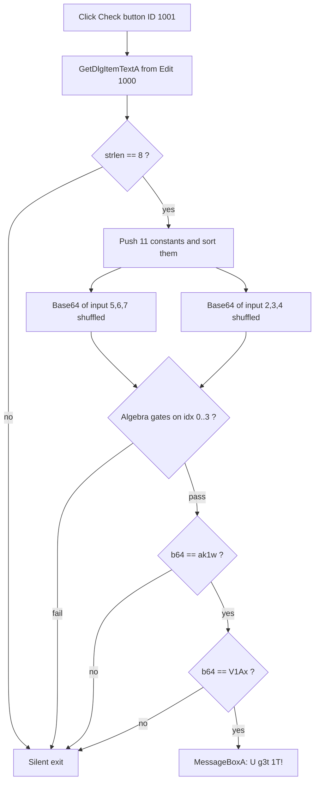

<div align="center">

# 🎟️ Scratch and Win (刮开有奖)

### Reverse Engineering Writeup · BUUCTF · Win32 GUI Crackme
**Author:** Gantosay


*No strings. No hints. Just an 8-character key hiding behind sorting, algebra and Base64.*

</div>

---

## 📌 TL;DR

| | |
|---|---|
| **Target** | `Win.exe` (32-bit Win32 dialog application) |
| **Goal** | Find the 8-character key that triggers the `U g3t 1T!` message box |
| **Key** | `xxxxxxxxxxxx` |
| **Core tricks** | Stack constants sorted at runtime, linear equations on single bytes, overlapping Base64 checks |

---

## 🗺️ Table of Contents

1. [Recon & Entry Point](#1--recon--entry-point)
2. [The Dialog Procedure](#2--the-dialog-procedure)
3. [Gate 0: Length Check](#3--gate-0-length-check)
4. [Gate 1: Runtime-Sorted Constants](#4--gate-1-runtime-sorted-constants)
5. [Gate 2: Byte Algebra](#5--gate-2-byte-algebra)
6. [Gate 3: Overlapping Base64](#6--gate-3-overlapping-base64)
7. [Solver](#7--solver)
8. [Decompiled Reconstruction (C)](#8--decompiled-reconstruction-c)
9. [Why Patching Fails](#9--why-patching-fails)
10. [Final Result](#10--final-result)

---

## 🔬 Validation Flow at a Glance



---

## 1. 🔎 Recon & Entry Point

Dumping strings from `Win.exe` gives nothing useful: no `flag`, no `correct`, no `wrong`. The UI text is not sitting around in plaintext, so we go straight for the code.

```text
[0x004019df]> afl~main
0x00401180    1 30           main
```

### `main` @ `0x00401180`

```assembly
0x00401180  push  ebp
0x00401181  mov   ebp, esp
0x00401183  mov   eax, dword [hInstance]
0x00401186  push  0x00                 ; dwInitParam
0x00401188  push  0x004011a0           ; lpDialogFunc   <-- the real logic lives here
0x0040118d  push  0x00                 ; hWndParent
0x0040118f  push  0x67                 ; lpTemplateName (resource 103)
0x00401191  push  eax                  ; hInstance
0x00401192  call  DialogBoxParamA
0x00401198  xor   eax, eax
0x0040119a  pop   ebp
0x0040119b  ret   0x10
```

`main` does nothing except create a dialog from resource `0x67` and hand control to the callback at **`0x004011a0`**. Everything interesting happens there.

---

## 2. 🧩 The Dialog Procedure

Rizin does not auto-detect `0x004011a0` as a function because it is only referenced as a data pointer, so we define it manually:

```text
[0x00401180]> s 0x004011a0
[0x004011a0]> af sym.dialog_callback 0x004011a0
[0x004011a0]> pdf
```

The handler compares the message with `WM_COMMAND` (`0x111`) and the control ID with **`0x3e9` (1001)**, which is the *Check* button. The input comes from edit control **`0x3e8` (1000)**.

<details>
<summary><b>📜 Click to expand the key parts of the disassembly</b></summary>

```assembly
; --- read the input ---------------------------------------------------
0x004011d5  mov   ecx, 0x3e9                 ; button 1001
0x004011da  cmp   ax, cx
0x004011f1  call  fcn.00403ed0              ; memset(buf, 0, 0xffff)
0x0040120b  call  GetDlgItemTextA            ; edit control 1000

; --- strlen(input) == 8 ----------------------------------------------
0x00401229  cmp   eax, 0x08
0x0040122c  jnz   0x40146d                   ; silent exit

; --- 11 constants pushed on the stack, then sorted --------------------
0x0040123d  mov   dword [var_20034h], 0x5a   ; 'Z'
0x00401247  mov   dword [var_20030h], 0x4a   ; 'J'
0x00401251  mov   dword [var_2002ch], 0x53   ; 'S'
0x0040125b  mov   dword [var_20028h], 0x45   ; 'E'
0x00401265  mov   dword [var_20024h], 0x43   ; 'C'
0x0040126f  mov   dword [var_20020h], 0x61   ; 'a'
0x00401279  mov   dword [var_2001ch], 0x4e   ; 'N'
0x00401283  mov   dword [var_20018h], 0x48   ; 'H'
0x0040128d  mov   dword [var_20014h], 0x33   ; '3'
0x00401297  mov   dword [var_20010h], 0x6e   ; 'n'
0x004012a1  mov   dword [var_2000ch], 0x67   ; 'g'
0x004012ab  call  fcn.004010f0               ; sort(arr, 0, 10)

; --- Base64 #1 : input[5], input[6], input[7] (order shuffled) --------
0x004012c3  mov   al, byte [var_20003h]      ; input[5]
0x004012c9  mov   dl, byte [var_20001h]      ; input[7]
0x004012cf  mov   cl, byte [var_20002h]      ; input[6]
0x00401304  call  fcn.00401000               ; base64 -> esi

; --- Base64 #2 : input[2], input[3], input[4] (order shuffled) --------
0x0040131e  mov   al, byte [var_20005h]      ; input[3]
0x00401324  mov   dl, byte [var_20006h]      ; input[2]
0x0040132a  mov   cl, byte [var_20004h]      ; input[4]
0x00401361  call  fcn.00401000               ; base64 -> edi

; --- algebra gates ----------------------------------------------------
0x00401375  add   eax, 0x22                  ; input[0] == arr[0] + 34
0x0040138a  cmp   edx, [var_20024h]          ; input[1] == arr[4]
0x0040139d  lea   ecx, [eax*4-0x8d]          ; 4*input[2] - 141
0x004013aa  lea   edx, [eax+eax*2]           ; 3*arr[2]
0x004013c2  sar   eax, 0x02                  ; input[3] / 4
0x004013cb  mov   eax, 0x38e38e39            ; magic number = arr[7] / 9

; --- string compares --------------------------------------------------
0x004013ed  mov   ecx, str.ak1w              ; esi  (input[5..7])
0x0040141d  mov   ecx, str.V1Ax              ; edi  (input[2..4])

; --- victory ----------------------------------------------------------
0x00401453  push  str.U_g3t_1T               ; "U g3t 1T!"
0x00401459  call  MessageBoxA
```

</details>

---

## 3. 📏 Gate 0: Length Check

```assembly
0x00401229  cmp   eax, 0x08
0x0040122c  jnz   0x40146d
```

The key must be **exactly 8 characters**. Anything else jumps to the exit path at `0x40146d`, with no message and no feedback.

---

## 4. 🔀 Gate 1: Runtime-Sorted Constants

The function stores 11 integers on the stack and passes them to `fcn.004010f0` (IDA: `sub_4010F0`), an ascending sort:

```text
Before : 90  74  83  69  67  97  78  72  51  110 103     (Z J S E C a N H 3 n g)
After  : 51  67  69  72  74  78  83  90  97  103 110     (3 C E H J N S Z a g  n)
```

This is the trap. If you read the constants in the order they are written, every later check gives garbage. The values actually used by the checks are the ones **after sorting**:

| Sorted index | Stack slot | Value | Char | Used by |
|:-:|:-:|:-:|:-:|---|
| `arr[0]` | `var_20034h` | 51 | `3` | index 0 check |
| `arr[2]` | `var_2002ch` | 69 | `E` | index 2 check |
| `arr[4]` | `var_20024h` | 74 | `J` | index 1 check |
| `arr[7]` | `var_20018h` | 90 | `Z` | index 3 check |

---

## 5. ➗ Gate 2: Byte Algebra

Four simple equations pin down the first characters:

| Idx | Condition | Math | Result |
|:-:|---|---|:-:|
| 0 | `in[0] == arr[0] + 34` | 51 + 34 = 85 | **`U`** |
| 1 | `in[1] == arr[4]` | 74 | **`J`** |
| 2 | `4*in[2] - 141 == 3*arr[2]` | (207 + 141) / 4 = 87 | **`W`** |
| 3 | `in[3] / 4 == 2*(arr[7] / 9)` | 2 * 10 = 20, so `in[3]` is in 80..83 | **`P`**, `Q`, `R` or `S` |

> 💡 **Heads-up:** the check on index 3 uses **integer division**, so the algebra alone accepts four characters (`P Q R S`). It is the Base64 gate below that decides which one is real.

---

## 6. 🔐 Gate 3: Overlapping Base64

`fcn.00401000` (IDA: `sub_401000`) takes 3 bytes and emits 4 characters from the standard table `ABC...xyz0123456789+/`. That is plain Base64.

The program builds two 3-byte blocks, **in shuffled order**, and encodes them:

| Block | Source bytes | Compared with | Decodes to |
|:-:|---|:-:|:-:|
| #1 | `in[5]`, `in[6]`, `in[7]` | `"ak1w"` | `jMp` |
| #2 | `in[2]`, `in[3]`, `in[4]` | `"V1Ax"` | `WP1` |

Decoding by hand for `V1Ax`:

```text
V=21  1=53  A=0  x=49
010101 110101 000000 110001  ->  01010111 01010000 00110001  ->  'W' 'P' '1'
```

So `in[2]='W'` (agrees with the algebra), **`in[3]='P'`** (resolves the `P/Q/R/S` ambiguity) and `in[4]='1'`.
The second block gives `in[5..7] = "jMp"`.

---

## 7. 🐍 Solver

```python
#!/usr/bin/env python3
"""Solver for BUUCTF "Scratch and Win" (刮开有奖)Gantosay."""
import base64

# 1) Constants the binary pushes on the stack, then sorts with fcn.004010f0
RAW = [90, 74, 83, 69, 67, 97, 78, 72, 51, 110, 103]   # Z J S E C a N H 3 n g
s = sorted(RAW)                                         # ascending, like the binary

# stack slots actually referenced by the checks
a0, a2, a4, a7 = s[0], s[2], s[4], s[7]                 # 51, 69, 74, 90

# 2) Algebraic gates
c0 = chr(a0 + 34)                                       # 'U'
c1 = chr(a4)                                            # 'J'
c2 = chr((3 * a2 + 141) // 4)                           # 'W'
c3_candidates = [chr(x) for x in range(256) if x // 4 == 2 * (a7 // 9)]  # 'P'..'S'

# 3) Base64 gates
idx_234 = base64.b64decode("V1Ax").decode()             # "WP1" -> input[2:5]
idx_567 = base64.b64decode("ak1w").decode()             # "jMp" -> input[5:8]

# 4) Cross-check: Base64 pins down the ambiguous index 3
assert idx_234[0] == c2, "index 2 mismatch"
assert idx_234[1] in c3_candidates, "index 3 not allowed by the algebra"

flag = c0 + c1 + idx_234 + idx_567
print(f"[+] algebra allows index 3 in : {''.join(c3_candidates)}")
print(f"[+] base64 pins index 3 to    : {idx_234[1]}")
print(f"[+] key  : {flag}")
print(f"[+] flag : flag{{{flag}}}")
```

Output:

```text
[+] algebra allows index 3 in : PQRS
[+] base64 pins index 3 to    : P
[+] key  : xxxxxxxxxx
[+] flag : flag{xxxxxxxxxxx}
```

---

## 8. 🛠️ Decompiled Reconstruction (C)

A cleaned-up reconstruction of the dialog procedure, matching the disassembly above:

```c
#include <windows.h>
#include <stdlib.h>
#include <string.h>

static const char B64[] =
    "ABCDEFGHIJKLMNOPQRSTUVWXYZabcdefghijklmnopqrstuvwxyz0123456789+/";

static void b64_block(const unsigned char in[3], char out[5]) {
    unsigned v = (in[0] << 16) | (in[1] << 8) | in[2];
    out[0] = B64[(v >> 18) & 0x3F];
    out[1] = B64[(v >> 12) & 0x3F];
    out[2] = B64[(v >>  6) & 0x3F];
    out[3] = B64[ v        & 0x3F];
    out[4] = '\0';
}

static int cmp_int(const void *a, const void *b) {
    return *(const int *)a - *(const int *)b;
}

INT_PTR CALLBACK DialogProc(HWND hDlg, UINT msg, WPARAM wParam, LPARAM lParam) {
    if (msg != WM_COMMAND) return FALSE;

    switch (LOWORD(wParam)) {
    case IDOK:
    case IDCANCEL:
        EndDialog(hDlg, LOWORD(wParam));
        return TRUE;

    case 1001: {                                     /* "Check" button */
        char in[0xFFFF] = {0};
        GetDlgItemTextA(hDlg, 1000, in, sizeof(in));
        if (strlen(in) != 8) return FALSE;           /* Gate 0 */

        int a[11] = {90, 74, 83, 69, 67, 97, 78, 72, 51, 110, 103};
        qsort(a, 11, sizeof(int), cmp_int);          /* Gate 1: sub_4010F0 */

        unsigned char blk[3];
        char r1[5], r2[5];

        blk[0] = in[5]; blk[1] = in[6]; blk[2] = in[7];
        b64_block(blk, r1);                          /* compared with "ak1w" */

        blk[0] = in[2]; blk[1] = in[3]; blk[2] = in[4];
        b64_block(blk, r2);                          /* compared with "V1Ax" */

        if (in[0] == a[0] + 34            &&         /* Gate 2: algebra */
            in[1] == a[4]                 &&
            4 * in[2] - 141 == 3 * a[2]   &&
            in[3] / 4 == 2 * (a[7] / 9)   &&
            !strcmp(r1, "ak1w")           &&         /* Gate 3: base64 */
            !strcmp(r2, "V1Ax"))
        {
            MessageBoxA(hDlg, "U g3t 1T!", "@_@", MB_OK);
        }
        return FALSE;
    }
    }
    return FALSE;
}

int WINAPI WinMain(HINSTANCE h, HINSTANCE p, LPSTR cmd, int show) {
    DialogBoxParamA(h, MAKEINTRESOURCEA(103), NULL, DialogProc, 0);
    return 0;
}
```

---
---

## 9. 🏁 Final Result

| Index | 0 | 1 | 2 | 3 | 4 | 5 | 6 | 7 |
|:-:|:-:|:-:|:-:|:-:|:-:|:-:|:-:|:-:|
| **Gate** | Algebra | Algebra | Algebra + B64 | Algebra + B64 | B64 | B64 | B64 | B64 |
| **Char** | **U** | **J** | **W** | **P** | **1** | **j** | **M** | **p** |

```text
Key  : xxxxxxxxxxx
Flag : flag{xxxxxxxxxxx}
```

---

## 🧰 Tools & Takeaways

- **Rizin**: locating `main`, defining the callback manually, raw disassembly with `pd`.
- **IDA Pro**: Hex-Rays pseudo-code to confirm the shuffled Base64 inputs and the sort.
- **Python**: solving and cross-checking every gate.

**Lessons learned**

1. `DialogBoxParamA` programs hide their logic in the callback, not in `main`.
2. Values that get sorted or mutated at runtime must be taken *after* the transformation.
3. Integer division can make a constraint ambiguous. Use the next gate to disambiguate.


---

<div align="center">

⭐ If this writeup helped you, consider leaving a star.

</div>
