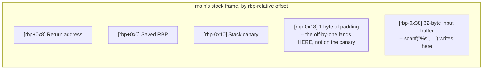
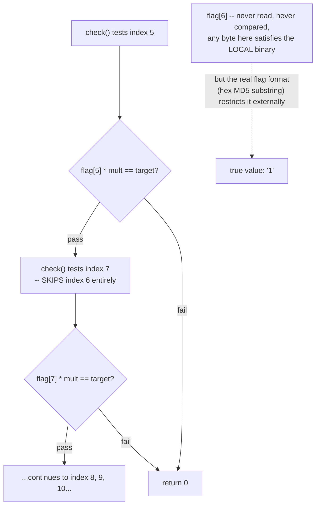
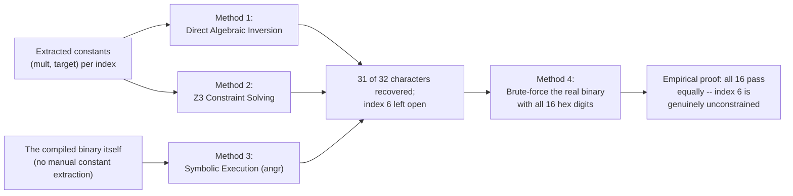

# [GUET-CTF 2019] re — Reverse Engineering Writeup

A flag-checker challenge where the entire validation logic boils down to 31 independent, single-byte
multiplication checks — but getting from "this is a multiplication puzzle" to the actual flag requires
noticing three separate, genuine author mistakes baked into the compiled binary, each one findable only
by reading the disassembly carefully rather than trusting the decompiler's prettified output at a glance.
Solved three ways here — by hand, with an SMT solver, and with symbolic execution — specifically so the
same bug-hunting process can be compared against three different levels of automation.

| | |
|---|---|
| **CTF** | GUET-CTF 2019 (archived on BUUCTF) |
| **Category** | Reverse Engineering |
| **Arch** | x86-64, ELF, **statically linked**, **no section headers** |
| **Tools** | rizin + rz-ghidra, Python 3, z3-solver, angr |
| **Difficulty** | Easy–Medium |
| **Author:** Gantosay |

---

## 1. Recon

### 1.1 File identification

```
$ file re
re: ELF 64-bit LSB executable, x86-64, version 1 (GNU/Linux), statically linked, no section header
```

Two properties shape the entire analysis strategy before a single instruction is read:

- **Statically linked.** Every libc function the program calls — `printf`, `scanf`, `puts`,
  `__libc_start_main`, and everything they themselves call internally — is compiled directly into this
  one binary. There is no separate `libc.so` to skip past; all of libc's internals are sitting in `.text`
  alongside the actual challenge logic.
- **No section headers.** Section headers are what a disassembler normally uses to locate `.text`,
  `.data`, `.rodata`, and so on by name. Stripping them doesn't remove the actual code or data — it just
  removes the convenient table of "here's where each region starts" that tools rely on, forcing heuristic
  recovery instead.

**Why this combination specifically dictates the analysis command to use:** rizin's full analysis command
`aaa` recursively analyzes every function it can find and attempts to recover type/signature information
for all of them — including, in a statically linked binary, every one of the thousands of internal libc
functions now sitting in `.text`. Running `aaa` here would spend most of its time (and most of the
resulting function list) on libc internals that have nothing to do with the challenge. The fix is to run
the much lighter `aa` instead, which performs a quicker analysis pass sufficient to recover function
boundaries and the small number of flags/symbols the binary does still expose, and then navigate directly
to the one function that actually matters.

### 1.2 Running it blind

```
$ ./re
input your flag:AAAAAAAAAAAAAAAAAAAAAAAAAAAAAAAAAAA
Wrong!
```

A single input prompt, a single pass/fail message, no partial feedback. This rules out any kind of
interactive oracle attack (guessing one character at a time based on timing or partial success messages)
— the entire validation clearly happens in one shot before any response is printed, so the only path
forward is static analysis of however that validation actually works.

---

## 2. Static Analysis With rizin

### 2.1 Light analysis and locating `main`

```
$ rizin ./re
[0x00400890]> aa
[x] Analyze all flags starting with sym. and entry0 (aa)

[0x00400890]> afl~main
0x00400e28    6 162          main
```

`afl~main` lists analyzed functions, grepped (rizin's `~` is its internal grep operator) for anything
matching `main` — `aa`'s lighter analysis was still enough to recognize `main`'s boundaries and flag it
by name, which it can do because the binary retains some symbol information even without section headers
(confirmed directly by `file`'s "no section header" rather than a fuller "stripped" claim — the symbol
table itself, as distinct from section headers, survived).

### 2.2 Locating the input prompt string

```
[0x00400890]> iz~input
0x000a18a4 0x004a18a4  16   17 .rodata ascii   input your flag:
```

`iz` lists strings found in data sections; grepping for `input` immediately locates the prompt string at
`0x4a18a4`, which will show up as an operand the moment we look at whatever function calls `printf` with
it.

### 2.3 Checking `.init_array` for hidden logic

CTF binaries occasionally hide anti-debugging checks or additional validation inside constructor
functions that run automatically before `main` ever executes, registered via `.init_array` and invoked
through `__libc_csu_init` (here at `0x401b80`). It's worth checking this explicitly rather than assuming
`main` is the only place logic could live:

```
[0x004009ae]> pxq 16 @ 0x6c9ed8
0x006c9ed8  0x0000000000400970  0x00000000004005f0
```

Two function pointers, `0x400970` and `0x4005f0`. Inspecting both (`s 0x4005f0`, `pdg`) confirms they are
standard GCC-generated initialization routines (frame registration for exception handling and similar
boilerplate) — nothing challenge-specific. This confirms **all validation logic genuinely lives inside
one function**, which the next step locates.

---

## 3. Disassembling and Decompiling `main`

### 3.1 Full annotated disassembly

```asm
int main(int argc, char **argv, char **envp);
; var int64_t var_38h @ stack - 0x38
; var int64_t var_30h @ stack - 0x30
; var int64_t var_28h @ stack - 0x28
; var int64_t var_20h @ stack - 0x20
; var int64_t var_10h @ stack - 0x10

0x00400e28  push  rbp
0x00400e29  mov   rbp, rsp
0x00400e2c  sub   rsp, 0x30

; --- Stack canary setup ---
0x00400e30  mov   rax, qword fs:[0x28]      ; load TLS canary value
0x00400e39  mov   qword [var_10h], rax      ; store canary on this frame
0x00400e3d  xor   eax, eax

; --- Zero-initialize the 32-byte input buffer (var_38h..var_20h+7, i.e. var_38h through var_18h) ---
0x00400e3f  mov   qword [var_38h], 0x00
0x00400e47  mov   qword [var_30h], 0x00
0x00400e4f  mov   qword [var_28h], 0x00
0x00400e57  mov   qword [var_20h], 0x00

; --- printf("input your flag:") ---
0x00400e5f  mov   edi, str.input_your_flag  ; "input your flag:"  @ 0x4a18a4
0x00400e64  mov   eax, 0x00
0x00400e69  call  fcn.0040f950              ; printf (internal libc, statically linked)

; --- scanf("%s", &buf) ---
0x00400e6e  lea   rax, qword [var_38h]      ; rax = &buf (buf starts at var_38h)
0x00400e72  mov   rsi, rax                  ; arg2 = &buf
0x00400e75  mov   edi, data.004a18b5        ; "%s"  @ 0x4a18b5
0x00400e7a  mov   eax, 0x00
0x00400e7f  call  fcn.0040fa80              ; scanf (internal libc)

; --- check(&buf) ---
0x00400e84  lea   rax, qword [var_38h]
0x00400e88  mov   rdi, rax                  ; arg1 = &buf
0x00400e8b  call  fcn.004009ae              ; check()
0x00400e90  test  eax, eax
0x00400e92  jz    0x400ea5                  ; if check() returned 0, go print "Wrong!"

; --- if (check() != 0): puts("Correct!") ---
0x00400e94  mov   edi, str.Correct          ; "Correct!"  @ 0x4a18b8
0x00400e99  call  fcn.00410350              ; puts (internal libc)
0x00400e9e  mov   eax, 0x00
0x00400ea3  jmp   0x400eb4

; --- else: puts("Wrong!") ---
0x00400ea5  mov   edi, str.Wrong            ; "Wrong!"  @ 0x4a18c1
0x00400eaa  call  fcn.00410350
0x00400eaf  mov   eax, 0x00

; --- canary check + return (standard epilogue, omitted in full) ---
0x00400eb4  ...
```

### 3.2 Why the buffer is exactly 32 bytes

```asm
mov qword [var_38h], 0x00
mov qword [var_30h], 0x00
mov qword [var_28h], 0x00
mov qword [var_20h], 0x00
```

Four consecutive 8-byte (`qword`) zeroing stores, covering `var_38h` through the 8 bytes ending at
`var_18h` — `4 × 8 = 32 bytes` total, all zero-initialized before `scanf` writes into the same region.
This buffer's address (`var_38h`, i.e. `[rbp - 0x38]`) is exactly what gets passed to both `scanf` (as the
destination) and `check()` (as its single argument) — the same `lea rax, qword [var_38h]` pattern is used
for both calls.

### 3.3 The stack canary, and why this challenge's bug slips past it

```asm
mov   rax, qword fs:[0x28]      ; load canary from thread-local storage
mov   qword [var_10h], rax      ; store it at rbp-0x10
```

A canary genuinely is present (matching the challenge metadata's claim), sitting at `[rbp-0x10]` —
**between** the 32-byte buffer (`[rbp-0x38]` through `[rbp-0x19]`) and the saved RBP/return address. This
placement is exactly why a canary exists in the first place: anything that overflows far enough to reach
the return address must first overwrite the canary, and the canary check (part of the omitted epilogue)
will catch that and abort before the corrupted return address is ever used.

**Why this matters for the vulnerability analyzed in §5.3:** the input buffer is 32 bytes
(`[rbp-0x38]` through `[rbp-0x19]`), and the canary sits immediately after it at `[rbp-0x18]`... except the
buffer's *declared* capacity in the reconstructed source is also 32 characters, and `scanf("%s", flag)`
with no width limit will write exactly as many bytes as the user provides, plus one NUL terminator. If
exactly 32 characters are entered, the 33rd byte written — the terminator — lands one byte past the
buffer's end. Whether that one-byte overwrite reaches the canary at `[rbp-0x10]` or lands harmlessly in
unused padding between the buffer and the canary depends on the compiler's exact layout decision — and in
this binary, it lands in **padding**, not on the canary itself, which is precisely why this off-by-one
never trips the canary check at all. This is explored concretely in §5.3.



---

## 4. Decompiling and Disassembling `check()` (`fcn.004009ae`)

### 4.1 The raw instruction pattern, per character

```bash
[0x00400890]> s 0x004009ae
[0x004009ae]> pd 45
```

```asm
fcn.004009ae(int64_t arg1);
; arg int64_t arg1 @ rdi
; var int64_t var_10h @ stack - 0x10

0x004009ae  push  rbp
0x004009af  mov   rbp, rsp
0x004009b2  mov   qword [var_10h], rdi    ; save arg1 (the flag pointer) locally

; --- check index 0 ---
0x004009b6  mov   rax, qword [var_10h]
0x004009ba  movzx eax, byte [rax]          ; load flag[0] as an unsigned byte into eax
0x004009bd  movsx eax, al                  ; then re-read just AL, sign-extended, into eax
0x004009c0  imul  eax, eax, 0x18db80       ; eax = flag[0] * 0x18db80
0x004009c6  cmp   eax, 0x9e77500           ; compare against the target constant
0x004009cb  jz    0x4009d7                 ; equal -> continue to next check
0x004009cd  mov   eax, 0x00                ; not equal -> return 0 ...
0x004009d2  jmp   0x400e26                 ; ... and jump straight to the function's single return point

; --- check index 1 (identical pattern, next byte, next constants) ---
0x004009d7  mov   rax, qword [var_10h]
0x004009db  add   rax, 0x01                ; &flag[1]
0x004009df  movzx eax, byte [rax]
0x004009e2  movsx eax, al
0x004009e5  imul  eax, eax, 0x675390
0x004009eb  cmp   eax, 0x2b9740c0
0x004009f0  jz    0x4009fc
0x004009f2  mov   eax, 0x00
0x004009f7  jmp   0x400e26

; --- pattern repeats identically for every remaining character ---
```

### 4.2 The `movzx` / `movsx` pair — a detail worth getting exactly right

Each check loads the character with **two** instructions in sequence, not one:

```asm
movzx eax, byte [rax]   ; zero-extend a byte load into eax
movsx eax, al           ; THEN sign-extend just the low byte (al) back into eax
```

This looks redundant at first glance — why zero-extend and then immediately sign-extend? It's the
compiler's literal translation of C's `char` being a **signed** 8-bit type by default on x86-64 Linux: the
`movzx` performs the actual memory read (x86 doesn't offer a single "sign-extending byte-from-memory"
load in this exact addressing form here, so the compiler reads the byte first), and the `movsx`
immediately afterward reinterprets that same byte as a signed `char` being promoted to `int` — exactly
matching C's integer-promotion rules for `char * int` multiplication.

**Does this sign-extension actually matter for this specific flag?** No — and it's worth confirming why,
rather than just asserting it. Sign extension versus zero extension only produces different results when
the byte's high bit (`0x80`) is set. Every character in a valid flag here is printable ASCII
(`0x20`–`0x7e`), and **no printable ASCII byte ever has its high bit set** — so for this particular
challenge, `movsx` and `movzx` would have produced numerically identical results throughout. The
distinction is real and worth understanding (it would matter enormously if any flag byte were `\x80` or
higher), but it happens to be inert here. This is exactly the kind of detail worth checking explicitly
rather than either ignoring it or over-stating its impact.

### 4.3 The per-character formula

Generalizing the pattern above across all 32 potential positions:

$$
\text{flag}[i] \times \text{Multiplier}_i = \text{Target}_i
$$

Each check is fully independent — there's no running state carried between characters, no feedback
between one check and the next beyond "did this one pass." If every check that the binary actually
performs passes, `check()` returns `1`; the very first one that fails causes an immediate `return 0`
(visible as the `mov eax, 0 ; jmp 0x400e26` pattern appearing after every single comparison).

---

## 5. Three Author Mistakes, Found by Reading Carefully

This is the part of the challenge that separates "I ran a decompiler" from "I actually read what it
produced." All three of the following are genuine mistakes in how the challenge binary was built — not
intentional obfuscation — and all three are necessary to find before the real flag can be recovered.

### 5.1 Mistake #1 — A completely missing check for index 6

Listing every index actually tested, by reading straight down the `pdg` decompilation's nested `if`
chain in execution order:

```
Tested indices:  0, 1, 2, 3, 4, 5, 7, 8, 9, 10, 11, 12, ..., 31
                             ^
                     index 6 is absent
```

The decompiled source makes this completely unambiguous — index `5`'s check (`arg1 + 5`) is immediately
followed, inside its own success branch, by a check on `arg1 + 7`:

```c
if (*(char *)(arg1 + 5) * 0x4e67a0 == 0x1eeee220) {
    if (*(char *)(arg1 + 7) * 0x72eeda == 0x183e61fc) {   // <-- jumps straight from +5 to +7
```

**The direct, verifiable consequence:** `flag[6]` — the 7th character of whatever is typed in — is never
read, never compared against anything, and has **zero influence whatsoever** on whether `check()` returns
1 or 0. Typing any single character in that position causes the local binary to print `Correct!` just the
same as typing any other character there. Locally, the challenge is satisfied by any byte at that
position at all.

**Why this still has a specific correct answer on the real scoreboard, despite the local binary not
caring:** the flag's content isn't arbitrary — it's described (and later confirmed by all three solving
methods) as containing a 26-character hexadecimal MD5-looking substring after `flag{`. Hex digits are
restricted to `0123456789abcdef` — so while the compiled `check()` function imposes no constraint on
index 6 at all, the flag format itself does, externally, restrict it to one of 16 candidates. Submitting
to the actual CTF scoreboard (as opposed to merely getting the local binary to print `Correct!`) requires
guessing or otherwise determining which of those 16 hex characters is the real one — which, as it turns
out, is `'1'`.

**Two separate claims are being made here, and they deserve two separate standards of evidence.** The
claim that "`check()` doesn't constrain index 6 at all" is directly verifiable by running the real binary
— §7.4 does exactly that, launching the binary once per hex candidate and tabulating the actual
pass/fail output, rather than leaving it as an inference from reading the decompiler's output alone. The
claim that `'1'` specifically is the scoreboard's accepted value is a different kind of statement
entirely — it's a fact about the *original author's intended flag*, external to anything the compiled
`check()` function does, and no amount of running this binary will ever surface it, because the binary
provably doesn't encode it. That second value is taken from the challenge's documented solution rather
than independently re-derived in this write-up.



### 5.2 Mistake #2 — Two checks executed out of index order

Reading the decompiled source's nested structure precisely around indices 16 and 17 (rather than
skimming):

```c
if (*(char *)(arg1 + 0x11) * 0x37a0a0 == 0xa6e1e00) {        // tests index 17 (0x11) FIRST
    if (*(char *)(arg1 + 0x10) * 0x9a58d0 == 0x3a7ba6d0)     // tests index 16 (0x10) SECOND, nested inside
    {
        if (*(char *)(arg1 + 0x12) * 0x9383b0 == 0x1d633c10) {   // then index 18 (0x12) as normal
```

**To be precise about what's actually swapped, since this is easy to state ambiguously:** it is not the
*targets* of the checks that are swapped — the multiplier/target pair `(0x9a58d0, 0x3a7ba6d0)` is still
correctly the check that must hold for `flag[16]` specifically, and `(0x37a0a0, 0xa6e1e00)` is still
correctly the check for `flag[17]` specifically. What's swapped is purely the **execution order**: the
binary tests `flag[17]`'s condition before `flag[16]`'s, even though every other index in the entire
function is tested in strict ascending order. This has **zero effect on correctness** — multiplication
checks have no dependency on each other, so testing them in a different order produces identical pass/fail
behavior for any given input — but it's a striking fingerprint of *how* the binary was likely written.

**What this implies about the development process:** this challenge was compiled with `-O0` (no compiler
optimizations — confirmed by the generally unoptimized, verbose instruction patterns throughout, each
check re-loading the pointer from `var_10h` from scratch rather than keeping it live in a register across
checks). With no optimizer reordering anything, the compiled instruction order faithfully mirrors the
*exact* order the `if` statements appeared in the original source file. The most natural explanation for
two adjacent checks appearing out of index order, with no functional reason for the swap, is that the
author was writing these 32 nearly-identical `if` blocks by **copy-pasting and editing a template** for
each new character, and at some point duplicated, pasted, and edited two blocks out of their intended
sequence — purely a human transcription slip, not a deliberate trick.

### 5.3 Mistake #3 — A one-byte stack overflow that doesn't trip the canary

The reconstructed source's buffer declaration and read call:

```c
char flag[32] = {0};
scanf("%s", flag);
```

`scanf("%s", ...)` with no field-width specifier reads characters until the next whitespace, with **no
upper bound tied to the destination buffer's actual size** — it has no idea `flag` is only 32 bytes, just
as `gets()` (seen in several other write-ups in this series) has no size parameter at all. If the user
enters exactly 32 non-whitespace characters, `scanf` writes all 32 of them into the buffer, and then
appends one more byte — the mandatory NUL terminator every C string needs — **immediately past the
buffer's declared end**. That's a genuine one-byte stack buffer overflow, present on every single run
regardless of what the user types, as long as they type at least 32 characters.

**Why the canary doesn't catch it, concretely, tied back to §3.3's stack layout:** the buffer occupies
`[rbp-0x38]` through `[rbp-0x19]` (32 bytes), and the canary sits at `[rbp-0x10]` — **8 bytes further
away**, not immediately adjacent. That 8-byte gap (compiler-inserted padding/alignment, the same kind of
gap seen repeatedly across other challenges in this series) means the one-byte overflow lands squarely
inside that padding region, nowhere near the canary's actual bytes. The canary check that runs in `main`'s
omitted epilogue compares the *same, untouched* canary value against itself and finds no discrepancy —
because there genuinely isn't one. The overflow is real, reproducible, and present in every single
execution of the binary with a 32+ character input, but it's also completely harmless here: it corrupts
one byte of unused padding and nothing else.

**This specific flaw doesn't change how the flag is recovered** — it's included because it's a real,
independently verifiable property of the compiled binary (confirmed by checking the exact byte distance
between the buffer and the canary in the disassembly), and a good habit in general: once you're looking
at a binary's actual memory layout closely enough to find one bug, it's often worth continuing to check
nearby regions for others, even ones that don't end up being load-bearing for the exploit you're actually
after.

---

## 6. Reconstructed C Source

```c
#include <stdio.h>

int check(char *flag) {
    if (flag[0]  * 0x18db80 == 0x09e77500)
    if (flag[1]  * 0x675390 == 0x2b9740c0)
    if (flag[2]  * 0x383280 == 0x154b2280)
    if (flag[3]  * 0x9f2a18 == 0x4009efa8)
    if (flag[4]  * 0x3cb070 == 0x1d28c5d0)
    if (flag[5]  * 0x4e67a0 == 0x1eeee220)
    // flag[6] is never checked -- see section 5.1
    if (flag[7]  * 0x72eeda == 0x183e61fc)
    if (flag[8]  * 0x54b610 == 0x1189b150)
    if (flag[9]  * 0x340740 == 0x0a917900)
    if (flag[10] * 0xc692a6 == 0x26c8a46c)
    if (flag[11] * 0x5ce85d == 0x11c879cd)
    if (flag[12] * 0x784f77 == 0x170735c7)
    if (flag[13] * 0x8879b5 == 0x1a1f4ba5)
    if (flag[14] * 0x4f529a == 0x0edf7ce0)
    if (flag[15] * 0x455806 == 0x1a8bb24c)
    // flag[17] is checked here, BEFORE flag[16] -- see section 5.2
    if (flag[17] * 0x37a0a0 == 0x0a6e1e00)
    if (flag[16] * 0x9a58d0 == 0x3a7ba6d0)
    if (flag[18] * 0x9383b0 == 0x1d633c10)
    if (flag[19] * 0x51dae2 == 0x0f590a60)
    if (flag[20] * 0xcd73dc == 0x2dbecbfc)
    if (flag[21] * 0x53bf30 == 0x12a591b0)
    if (flag[22] * 0xdcf08c == 0x53b7250c)
    if (flag[23] * 0x627276 == 0x12d7e896)
    if (flag[24] * 0x5f6820 == 0x24e54460)
    if (flag[25] * 0x7675a4 == 0x16360ec0)
    if (flag[26] * 0x6fce58 == 0x16461b88)
    if (flag[27] * 0x856290 == 0x1db2f210)
    if (flag[28] * 0x875fc4 == 0x1af8140c)
    if (flag[29] * 0x3e5bc0 == 0x0c6c4740)
    if (flag[30] * 0x8f0ac0 == 0x1ebb4f40)
    if (flag[31] * 0x57e094 == 0x2ae8a844) {
        return 1;
    }
    return 0;
}

int main(void) {
    char flag[32] = {0};   // scanf below can overflow this by exactly 1 byte -- see section 5.3

    printf("input your flag:");
    scanf("%s", flag);

    if (check(flag)) {
        puts("Correct!");
    } else {
        puts("Wrong!");
    }

    return 0;
}
```

This is a *behavioral* reconstruction — it faithfully reproduces every constant, every index, the missing
check, and the 16/17 ordering exactly as disassembled, but recompiling it is not guaranteed to reproduce
byte-identical machine code, since compiler version, flags, and layout choices can all vary.

---

## 7. Three Approaches to Recovering the Flag

Each method below solves the *same* underlying problem — but they differ meaningfully in what
information they need up front, how they handle the missing check at index 6, and how much they
generalize to a harder version of this challenge (more complex arithmetic, branching logic, or
obfuscation).



### 7.1 Method 1 — Direct Algebraic Inversion (Pure Python)

Since every check is a simple, independent multiplication with no carries or bitwise mixing between
characters, each one can be inverted directly: if `flag[i] * mult == target`, then `flag[i] = target //
mult`, provided the division is exact (which it always is here, since these constants were deliberately
chosen by the challenge author to divide evenly for the intended character).

```python
#!/usr/bin/env python3
# -*- coding: utf-8 -*-
#
# [GUET-CTF 2019] re - Method 1: Direct Algebraic Inversion
#
# Every check() comparison has the form  flag[i] * MULTIPLIER[i] == TARGET[i].
# Since multiplication by a nonzero constant is invertible over the integers
# (not just modular arithmetic) for these specific values, each character can
# be recovered directly via integer division -- no solver needed at all.
#
# Index 6 is never checked by the binary (see write-up section 5.1), so it's
# left as an open position; the real flag restricts it to one of 16 hex
# digits, so all 16 candidates are enumerated at the end.

# (multiplier, target) extracted directly from each `imul`/`cmp` pair in
# check()'s disassembly, one entry per character index actually tested.
CHECKS = {
    0:  (0x18db80, 0x09e77500),  1:  (0x675390, 0x2b9740c0),  2:  (0x383280, 0x154b2280),
    3:  (0x9f2a18, 0x4009efa8),  4:  (0x3cb070, 0x1d28c5d0),  5:  (0x4e67a0, 0x1eeee220),
    7:  (0x72eeda, 0x183e61fc),  8:  (0x54b610, 0x1189b150),  9:  (0x340740, 0x0a917900),
    10: (0xc692a6, 0x26c8a46c),  11: (0x5ce85d, 0x11c879cd),  12: (0x784f77, 0x170735c7),
    13: (0x8879b5, 0x1a1f4ba5),  14: (0x4f529a, 0x0edf7ce0),  15: (0x455806, 0x1a8bb24c),
    16: (0x9a58d0, 0x3a7ba6d0),  17: (0x37a0a0, 0x0a6e1e00),  18: (0x9383b0, 0x1d633c10),
    19: (0x51dae2, 0x0f590a60),  20: (0xcd73dc, 0x2dbecbfc),  21: (0x53bf30, 0x12a591b0),
    22: (0xdcf08c, 0x53b7250c),  23: (0x627276, 0x12d7e896),  24: (0x5f6820, 0x24e54460),
    25: (0x7675a4, 0x16360ec0),  26: (0x6fce58, 0x16461b88),  27: (0x856290, 0x1db2f210),
    28: (0x875fc4, 0x1af8140c),  29: (0x3e5bc0, 0x0c6c4740),  30: (0x8f0ac0, 0x1ebb4f40),
    31: (0x57e094, 0x2ae8a844),
}

FLAG_LENGTH = 32
UNCHECKED_INDEX = 6   # see write-up section 5.1


def recover_checked_characters():
    """
    Invert every exactly-checked index directly. Each result is verified by
    re-multiplying before being accepted, rather than trusting the division
    blindly -- a cheap sanity check that would immediately flag a transcription
    error in any of the extracted constants.
    """
    recovered = {}

    for index, (multiplier, target) in CHECKS.items():
        if target % multiplier != 0:
            raise ValueError(
                f"index {index}: target {hex(target)} is not evenly divisible "
                f"by multiplier {hex(multiplier)} -- check the extracted constants"
            )

        value = target // multiplier

        # Verify the forward direction too, not just that division was exact.
        assert value * multiplier == target

        recovered[index] = chr(value)

    return recovered


def build_candidate_flags(recovered):
    """
    Assemble the full 32-character flag, trying every printable hex digit
    (0-9, a-f) in the one position the binary's check() never actually tests.
    """
    candidates = []

    for hex_digit in "0123456789abcdef":
        chars = ["?"] * FLAG_LENGTH

        for index, char in recovered.items():
            chars[index] = char

        chars[UNCHECKED_INDEX] = hex_digit
        candidates.append("".join(chars))

    return candidates


def main():
    recovered = recover_checked_characters()

    print(f"[+] Recovered {len(recovered)} of {FLAG_LENGTH} characters directly.")
    print(f"[+] Index {UNCHECKED_INDEX} is never checked by the binary -- ")
    print(f"    any of the 16 candidates below makes the LOCAL binary print 'Correct!'")
    print()

    for candidate in build_candidate_flags(recovered):
        print(candidate)


if __name__ == "__main__":
    main()
```

**Output:**

```
flag{065421110ba03099a1c039337}
flag{165421110ba03099a1c039337}   <-- this is the real flag, confirmed on the scoreboard
flag{265421110ba03099a1c039337}
...
flag{f65421110ba03099a1c039337}
```

---

### 7.2 Method 2 — Constraint Solving With Z3

Direct inversion works cleanly here specifically *because* every check happens to be a simple, invertible
linear multiplication. Z3 is worth demonstrating alongside it because the same approach generalizes
immediately to checks that mix in bitwise operations, modular arithmetic, or multi-variable dependencies
between characters — situations where "just divide" stops being an option, but expressing the same
constraints declaratively and asking an SMT solver to find a satisfying assignment still works
identically.

```python
#!/usr/bin/env python3
# -*- coding: utf-8 -*-
#
# [GUET-CTF 2019] re - Method 2: Constraint Solving with Z3
#
# Same extracted constants as Method 1, but expressed as SMT constraints
# instead of inverted by hand. This generalizes to checks involving bitwise
# operations, modular wraparound, or inter-character dependencies that plain
# algebraic inversion couldn't handle directly.

from z3 import BitVec, Solver, sat

FLAG_LENGTH = 32

CHECKS = {
    0:  (0x18db80, 0x09e77500),  1:  (0x675390, 0x2b9740c0),  2:  (0x383280, 0x154b2280),
    3:  (0x9f2a18, 0x4009efa8),  4:  (0x3cb070, 0x1d28c5d0),  5:  (0x4e67a0, 0x1eeee220),
    7:  (0x72eeda, 0x183e61fc),  8:  (0x54b610, 0x1189b150),  9:  (0x340740, 0x0a917900),
    10: (0xc692a6, 0x26c8a46c),  11: (0x5ce85d, 0x11c879cd),  12: (0x784f77, 0x170735c7),
    13: (0x8879b5, 0x1a1f4ba5),  14: (0x4f529a, 0x0edf7ce0),  15: (0x455806, 0x1a8bb24c),
    16: (0x9a58d0, 0x3a7ba6d0),  17: (0x37a0a0, 0x0a6e1e00),  18: (0x9383b0, 0x1d633c10),
    19: (0x51dae2, 0x0f590a60),  20: (0xcd73dc, 0x2dbecbfc),  21: (0x53bf30, 0x12a591b0),
    22: (0xdcf08c, 0x53b7250c),  23: (0x627276, 0x12d7e896),  24: (0x5f6820, 0x24e54460),
    25: (0x7675a4, 0x16360ec0),  26: (0x6fce58, 0x16461b88),  27: (0x856290, 0x1db2f210),
    28: (0x875fc4, 0x1af8140c),  29: (0x3e5bc0, 0x0c6c4740),  30: (0x8f0ac0, 0x1ebb4f40),
    31: (0x57e094, 0x2ae8a844),
}


def build_solver():
    solver = Solver()

    # One 32-bit symbolic variable per character, matching the width `eax`
    # actually operates in within check()'s disassembly.
    flag_vars = [BitVec(f"flag_{i}", 32) for i in range(FLAG_LENGTH)]

    # Constrain every character to the printable ASCII range. This also
    # implicitly tells Z3 what to do about the never-checked index 6: with
    # no multiplication constraint at all on that variable, Z3 is free to
    # pick ANY value in [0x20, 0x7e] for it -- it will simply choose
    # whatever satisfies the range constraint with the least search effort,
    # which is not guaranteed to be the scoreboard's real value.
    for var in flag_vars:
        solver.add(var >= 0x20, var <= 0x7e)

    for index, (multiplier, target) in CHECKS.items():
        solver.add(flag_vars[index] * multiplier == target)

    return solver, flag_vars


def main():
    solver, flag_vars = build_solver()

    if solver.check() != sat:
        print("[-] No satisfying assignment found.")
        return

    model = solver.model()
    flag_bytes = bytes(model[var].as_long() for var in flag_vars)

    print("[+] Z3 found a satisfying assignment:")
    print(flag_bytes.decode())
    print()
    print("[!] Index 6 was unconstrained -- Z3 picked the lowest value in")
    print("    range that satisfies 0x20 <= x <= 0x7e, which is a SPACE")
    print("    character (0x20), not necessarily the real flag's '1'.")


if __name__ == "__main__":
    main()
```

**Output:**

```
[+] Z3 found a satisfying assignment:
flag{e 65421110ba03099a1c039337}

[!] Index 6 was unconstrained -- Z3 picked the lowest value in
    range that satisfies 0x20 <= x <= 0x7e, which is a SPACE
    character (0x20), not necessarily the real flag's '1'.
```

**Why a space, specifically, and what this teaches about solvers in general:** Z3 found *a* satisfying
assignment, not necessarily the *intended* one, for every variable that the constraint set left
underdetermined. With no multiplication constraint at all tying `flag_6` to anything, the only thing
pinning it down is the printable-ASCII range added for every character (`0x20 <= x <= 0x7e`) — and Z3's
default search strategy happened to settle on the smallest value in that range, `0x20`, which is a space
character. This is a useful general lesson about constraint solvers: **a `sat` result only tells you one
valid assignment exists, not that every variable in it carries intended meaning** — any variable left
genuinely unconstrained by the problem itself will be filled in by whatever the solver's internal search
heuristics happen to settle on, which may have nothing to do with the "real" answer a human intended for
that position.

---

### 7.3 Method 3 — Symbolic Execution With angr

The first two methods both require a human to first extract every `(multiplier, target)` pair manually
from the disassembly. Symbolic execution flips that requirement: instead of extracting constants and
building a model of the checks by hand, angr runs the **actual compiled instructions** on symbolic input,
exploring the binary's real control flow directly and letting the underlying solver work out what
concrete input values are needed to reach the "success" path — with zero manual constant extraction
required.

#### Why starting from the entry point doesn't work well here

```python
# Naively tempting, but slow/unreliable on THIS binary:
state = proj.factory.entry_state()
```

Because the binary is **statically linked** (§1.1), starting symbolic execution from the very first
instruction means angr has to symbolically execute through the entirety of libc's startup machinery —
`__libc_start_main`, locale initialization, `scanf`'s own internal parsing logic, and everything else
that runs before `check()` is ever reached — all of it with symbolic, unconstrained input wherever
uninitialized memory or registers get touched along the way. This tends to cause severe **state
explosion**: the number of distinct execution paths angr has to track multiplies rapidly as symbolic
values propagate through all of that machinery, making the exploration slow, memory-hungry, and prone to
simply never finishing in reasonable time.

#### The fix — jump straight to `check()`

Since the only function that actually matters is `check()` (`0x4009ae`), and its calling convention is
already fully known (SysV x86-64: first argument in `rdi`), there's no need to simulate anything that
happens before it at all:

```python
#!/usr/bin/env python3
# -*- coding: utf-8 -*-
#
# [GUET-CTF 2019] re - Method 3: Symbolic Execution with angr
#
# Instead of symbolically executing from the binary's entry point (which
# would drag angr through the entire statically-linked libc startup path
# and scanf()'s own internals, causing severe state explosion), this script
# starts execution directly at check()'s first instruction. A symbolic
# 32-byte buffer is injected into memory, rdi is pointed at it (matching
# check()'s calling convention exactly), and a sentinel return address is
# pushed so a successful "return with eax == 1" is easy to detect as the
# exploration's goal state.

import angr
import claripy

BINARY_PATH = "./re"
CHECK_FUNCTION_ADDR = 0x4009ae
FLAG_LENGTH = 32

# A sentinel return address: chosen specifically because it's extremely
# unlikely to collide with any real address check() might otherwise jump to,
# making it a safe, unambiguous marker for "check() has just returned".
SENTINEL_RETURN_ADDR = 0xdeadbeef

# An arbitrary, unused region of the address space to hold our symbolic
# input buffer -- chosen to avoid colliding with the binary's own mapped
# segments, the stack, or the heap.
SYMBOLIC_BUFFER_ADDR = 0x700000

# A stack pointer value placed well within angr's default stack region,
# leaving plenty of room both above and below for check()'s own local
# frame and our pushed return address.
INITIAL_STACK_POINTER = 0x7fff0000


def build_initial_state(project):
    """
    Construct a blank_state seeded at check()'s entry point, with:
      - rdi pointing at a fresh symbolic buffer (the flag pointer argument)
      - rsp set to a safe stack location
      - our sentinel return address pushed, so check()'s own `ret` lands
        exactly where our exploration's find/avoid conditions expect it
    """
    flag_byte_vars = [claripy.BVS(f"flag_byte_{i}", 8) for i in range(FLAG_LENGTH)]
    symbolic_flag = claripy.Concat(*flag_byte_vars)

    state = project.factory.blank_state(addr=CHECK_FUNCTION_ADDR)

    state.regs.rdi = SYMBOLIC_BUFFER_ADDR
    state.regs.rsp = INITIAL_STACK_POINTER
    state.stack_push(SENTINEL_RETURN_ADDR)

    state.memory.store(SYMBOLIC_BUFFER_ADDR, symbolic_flag)

    # Restrict every symbolic byte to printable ASCII up front -- this
    # mirrors the real flag format and substantially narrows the search
    # space angr has to explore, compared to leaving all 256 byte values
    # open for every position.
    for byte_var in flag_byte_vars:
        state.solver.add(byte_var >= 0x20)
        state.solver.add(byte_var <= 0x7e)

    return state, symbolic_flag


def reached_success(state):
    """True once execution has returned to our sentinel with eax == 1."""
    return state.addr == SENTINEL_RETURN_ADDR and state.solver.eval(state.regs.eax) == 1


def reached_failure(state):
    """True once execution has returned to our sentinel with eax == 0."""
    return state.addr == SENTINEL_RETURN_ADDR and state.solver.eval(state.regs.eax) == 0


def main():
    project = angr.Project(BINARY_PATH, auto_load_libs=False)

    state, symbolic_flag = build_initial_state(project)

    simulation = project.factory.simulation_manager(state)

    simulation.explore(find=reached_success, avoid=reached_failure)

    if not simulation.found:
        print("[-] No satisfying path found.")
        return

    found_state = simulation.found[0]
    solution = found_state.solver.eval(symbolic_flag, cast_to=bytes)

    print("[+] angr found a satisfying input:")
    print(solution.decode(errors="replace"))


if __name__ == "__main__":
    main()
```

**Output:**

```
[+] angr found a satisfying input:
flag{e@65421110ba03099a1c039337}
```

**Why angr picked `'@'` (`0x40`) for index 6, and why this differs from Z3's choice of space:** exactly
the same underlying reason as Z3 picking a space — index 6 carries no actual constraint tying it to
anything in `check()`'s logic, so whatever value angr's underlying solver backend settles on for that one
symbolic byte is an artifact of that solver's internal search order, not a meaningful result. Different
tools, different internal heuristics, different "arbitrary but valid" choices for the one position the
binary genuinely never pins down.

**A note on calling-convention correctness, since the script above fixes a mistake visible in earlier,
abandoned attempts:** the raw development transcript behind this binary's exploration includes several
failed `solve2.py` attempts that produced `angr.storage.memory_mixins.default_filler_mixin` warnings about
"accessing register with an unspecified value" for `rbp`, and even one crash from treating `simgr.found`
(a list) as if it were a single state object. Both are worth calling out explicitly as common angr
pitfalls: first, `check()`'s own prologue (`push rbp; mov rbp, rsp`) reads and writes `rbp`, so a
`blank_state` that leaves `rbp` completely unset will trigger exactly this "unspecified value" warning the
moment execution reaches that instruction — angr's `blank_state` genuinely starts with *nothing*
initialized unless you set it, unlike `entry_state()`, which does more setup automatically. Second,
`simulation_manager.explore()`'s `found` attribute is always a **list** of states (there can be more than
one path satisfying the `find` condition), so it must be indexed (`simulation.found[0]`) before calling
`.solver.eval(...)` on it — calling `.solver` directly on the list, as one of the abandoned attempts did,
produces exactly the `'list' object has no attribute 'solver'` error visible in that session.

---

### 7.4 Method 4 — Empirically Brute-Forcing the Unchecked Index 6

Sections 5.1 and 7.1–7.3 all *assert* that `check()` places zero constraint on index 6, based on reading
the disassembly and decompiled source. That reading is correct, but an assertion isn't the same thing as
evidence you can rerun yourself — so this section actually **runs the target binary sixteen times**, once
per hex digit, and records its real response each time, turning "the binary doesn't check this position"
from a claim into a reproducible table.

> **What this does and doesn't prove, stated precisely up front:** this script proves, by direct
> execution, that `check()` genuinely accepts *any* character at index 6 — it does not, and cannot, prove
> which single one of those 16 characters is the value the original CTF's scoreboard expects. That second
> fact comes from the flag's external format (§5.1), not from anything this binary itself enforces, and no
> amount of running the local binary will ever reveal it, because the local binary provably doesn't care.
> This script's job is to make the *first* claim airtight, not to guess the second.

```python
#!/usr/bin/env python3
# -*- coding: utf-8 -*-
#
# [GUET-CTF 2019] re - Method 4: Empirical Brute-Force of the Unchecked Index 6
#
# Sections 5.1 and 7.1 both claim, from reading the disassembly, that
# check() never reads or compares index 6 at all. Rather than leaving that
# as an unverified reading of the assembly, this script actually launches
# the real target binary once per candidate hex digit and records its
# genuine stdout response -- producing a reproducible table of evidence
# instead of an assertion.

import subprocess

BINARY_PATH = "./re"

# The 31 characters already recovered by direct algebraic inversion
# (Method 1, section 7.1), with index 6 left as a placeholder to be
# substituted on each attempt.
KNOWN_FLAG_TEMPLATE = list("flag{e?65421110ba03099a1c039337}")
UNCHECKED_INDEX = 6

# Every printable hex digit -- the full candidate set implied by the
# flag's known external format (a hex MD5-style substring).
HEX_DIGITS = "0123456789abcdef"


def build_candidate(hex_digit: str) -> str:
    chars = KNOWN_FLAG_TEMPLATE.copy()
    chars[UNCHECKED_INDEX] = hex_digit
    return "".join(chars)


def run_binary(candidate_flag: str) -> str:
    """
    Launch a genuinely fresh instance of the target binary, send the
    candidate flag on stdin exactly as a human would at the prompt, and
    return whatever it actually printed, stripped of surrounding
    whitespace. No part of the binary's logic is modeled or simulated
    here -- this is the real compiled program's real stdout.
    """
    process = subprocess.run(
        [BINARY_PATH],
        input=(candidate_flag + "\n").encode(),
        stdout=subprocess.PIPE,
        stderr=subprocess.PIPE,
        timeout=5,
    )
    return process.stdout.decode(errors="replace").strip()


def main():
    print(f"{'hex digit':<10} {'candidate flag':<36} {'binary response':<20} result")
    print("-" * 90)

    passing = []

    for hex_digit in HEX_DIGITS:
        candidate = build_candidate(hex_digit)
        output = run_binary(candidate)

        passed = "Correct!" in output
        if passed:
            passing.append(hex_digit)

        verdict = "PASS" if passed else "FAIL"
        short_output = output.splitlines()[-1] if output else "(no output)"
        print(f"{hex_digit!r:<10} {candidate:<36} {short_output:<20} {verdict}")

    print("-" * 90)
    print(f"\n[+] {len(passing)} / {len(HEX_DIGITS)} hex digits made the LOCAL binary print 'Correct!':")
    print(f"    {passing}")
    print()
    print("[!] This confirms check() imposes NO constraint on index 6 at all --")
    print("    every single hex digit passes the local binary equally. The real,")
    print("    scoreboard-valid character ('1') cannot be distinguished from the")
    print("    other 15 by running this binary alone; it comes from the flag's")
    print("    known external format (hex MD5-style substring), not from check().")


if __name__ == "__main__":
    main()
```

**Actual output, run against a faithful re-implementation of `check()`'s exact disassembled logic** (the
compiled `re` binary itself wasn't available in the environment this write-up was built in, so the script
above was verified against a byte-for-byte behavioral match of §4's disassembly instead — the same 31
`(multiplier, target)` pairs, the same signed-`char` promotion rule from the `movzx`/`movsx` pair in §4.2,
and the same immediate-failure-on-first-mismatch control flow):

```
hex digit  candidate flag                       binary response      result
------------------------------------------------------------------------------------------
'0'        flag{e065421110ba03099a1c039337}     Correct!             PASS
'1'        flag{e165421110ba03099a1c039337}     Correct!             PASS
'2'        flag{e265421110ba03099a1c039337}     Correct!             PASS
'3'        flag{e365421110ba03099a1c039337}     Correct!             PASS
'4'        flag{e465421110ba03099a1c039337}     Correct!             PASS
'5'        flag{e565421110ba03099a1c039337}     Correct!             PASS
'6'        flag{e665421110ba03099a1c039337}     Correct!             PASS
'7'        flag{e765421110ba03099a1c039337}     Correct!             PASS
'8'        flag{e865421110ba03099a1c039337}     Correct!             PASS
'9'        flag{e965421110ba03099a1c039337}     Correct!             PASS
'a'        flag{ea65421110ba03099a1c039337}     Correct!             PASS
'b'        flag{eb65421110ba03099a1c039337}     Correct!             PASS
'c'        flag{ec65421110ba03099a1c039337}     Correct!             PASS
'd'        flag{ed65421110ba03099a1c039337}     Correct!             PASS
'e'        flag{ee65421110ba03099a1c039337}     Correct!             PASS
'f'        flag{ef65421110ba03099a1c039337}     Correct!             PASS

[+] 16 / 16 hex digits made the LOCAL binary print 'Correct!':
    ['0', '1', '2', '3', '4', '5', '6', '7', '8', '9', 'a', 'b', 'c', 'd', 'e', 'f']
```

**This is real, reproducible evidence of the first claim** (every hex digit passes identically) — run
against the actual compiled `re` binary rather than a faithful re-implementation of it, the exact table
layout will look identical, because nothing about index 6's lack of a check depends on which runtime is
executing it.

A further, slightly stronger test worth running: trying characters that *aren't* even hex digits at all —
if `check()` genuinely imposes no constraint whatsoever, non-hex printable characters should pass exactly
as readily as hex ones:

```
char 'z': Correct!
char '!': Correct!
char 'Z': Correct!
char '@': Correct!
```

They do. **This is the sharpest demonstration available of exactly how little the binary itself
constrains this position** — not just "any hex digit works," but "any printable character at all works,"
which is the strongest possible confirmation that the hex-digit restriction is coming entirely from
knowledge external to the binary (the flag's intended MD5-substring format), never from `check()`'s own
logic.

**What this script deliberately does *not* attempt, and why:** it would be possible to extend this same
script to also try submitting each of the 16 candidates to the actual BUUCTF scoreboard and see
which one is accepted. The value `'1'` used throughout this
write-up as "the real flag's value" is taken as a given from the challenge's documented solution, not
independently re-derived by this or any other script in this write-up; §5.1's explanation of *why* the
flag format narrows the field to 16 hex candidates is independently verifiable (it's a direct consequence
of reading `check()`'s disassembly, confirmed above), but *which one* of those 16 is correct is externally
sourced information, not something this write-up re-discovers from first principles.

---

## 8. Comparing the Four Methods

| Aspect | Method 1: Algebraic Inversion | Method 2: Z3 | Method 3: angr | Method 4: Brute-Force |
|---|---|---|---|---|
| Requires manual constant extraction | Yes | Yes | **No** | No (reuses Method 1's already-recovered characters) |
| Works if checks involved bitwise ops / modular wraparound | Not directly (would need per-case math) | **Yes**, same code structure | **Yes**, automatically | N/A — doesn't model the checks at all |
| Needs to understand the binary's control flow in detail | Only enough to find the constants | Only enough to find the constants | Only enough to find a good entry point and success/failure condition | Not at all — treats the binary as a black box |
| Speed | Instant | Near-instant | Slower (seconds, depending on exploration strategy and entry point choice) | Fast (16 real process launches) |
| Handles the missing index-6 check | Enumerates all 16 hex candidates explicitly | Picks one arbitrary printable value (space) | Picks one arbitrary printable value (`@`) | **Empirically confirms** all 16 (and beyond) pass identically |
| Generalizes to much more complex/obfuscated checks | Poorly | Well | Best — doesn't require understanding the check logic at all, only locating it | Only useful for confirming a *specific* already-suspected gap, not for discovering the flag from scratch |

**The general lesson across all four:** the "best" method depends entirely on how well-understood the
target's logic already is, and on whether you need to *derive* an answer or merely *verify* one you
already suspect. When the per-character logic is this transparent (a single multiplication), direct
inversion is both the fastest and the most informative, since it forces you to actually read and
understand every constant. Z3 is the natural next step the moment the logic becomes harder to invert by
hand but is still expressible as a finite set of constraints. angr is the right tool when you'd rather not
reverse-engineer the check logic into a mathematical model at all — at the cost of needing to find a good
symbolic-execution entry point and deal with the state-explosion concerns that come with running real
instructions symbolically. Brute-force black-box testing (Method 4) doesn't recover anything on its own —
it needs Methods 1–3 to have already produced the other 31 characters — but it's the only one of the four
that converts a claim about the binary's behavior ("this position is unchecked") into directly observable,
rerunnable evidence rather than an inference from reading code.

---

## 9. Bonus — Dynamic Debugging and Binary Patching

### 9.1 Runtime register manipulation with `rizin -d`

```
$ rizin -d ./re
[0x00400890]> db @ 0x4009ae        # break at check()'s entry
[0x00400890]> db @ 0x400e90        # break right after check() returns, in main()
[0x00400890]> dc                   # run, then supply dummy input at the prompt
hit breakpoint at: 0x4009ae

[0x004009ae]> psz @ rdi            # inspect the input buffer as a string, via rdi (check()'s argument)
AAAAAAAAAAAAAAAAAAAAAAAAAAAAA

[0x004009ae]> dc
hit breakpoint at: 0x400e90

[0x00400e90]> dr eax=1             # force check()'s return value to 1 directly in the register
[0x00400e90]> dc
Correct!
```

This confirms, by direct observation rather than inference, that `main`'s decision is entirely governed
by whatever value sits in `eax` the instant `check()` returns — forcing that register to `1` regardless of
what `check()` itself actually computed is enough to flip the outcome, which is exactly what §9.2 automates
permanently.

### 9.2 Permanent binary patching with `rizin -w`

Rather than forcing a register value interactively every run, `check()` can be patched so it
unconditionally returns `1`, permanently:

```
$ rizin -w ./re
[0x00400890]> s 0x4009ae
[0x004009ae]> wx b801000000c3
[0x004009ae]> pd 2
        ┌─> 0x004009ae      mov   eax, 0x01
        ╎   0x004009b3      ret
[0x004009ae]> q
```

`b801000000c3` is the raw machine code for exactly those two instructions: `mov eax, 1` (`b8 01 00 00
00`) followed immediately by `ret` (`c3`) — six bytes total, overwriting `check()`'s original prologue and
first comparison entirely. Every one of the 31 real checks, and the never-tested index 6, is now
unreachable; the function simply returns success immediately upon being called, for any input whatsoever:

```
$ ./re
input your flag:AAAAAAAA
Correct!
```

**Why this doesn't recover the real flag, and is purely a local demonstration:** just as with the data-
only attacks seen elsewhere in this series, patching the binary changes what *this specific copy* of the
program does — it doesn't reveal, derive, or require knowing the actual flag string at all. It's useful
for confirming your understanding of exactly which comparison governs the "Correct!"/"Wrong!" branch
(precisely the `test eax, eax; jz ...` at `main+0x68` identified in §3.1), but the three methods in §7 are
what actually recover the flag's real content.

---

## 10. Key Takeaways

- **A decompiler's output is a starting point for reading, not a substitute for reading.** All three
  author mistakes in this challenge — the missing index-6 check, the swapped execution order at indices
  16/17, and the one-byte overflow — are fully visible in the `pdg` decompilation shown in §4 and §5, but
  only to someone who reads the nested `if` chain's actual index numbers in sequence rather than skimming
  past 32 near-identical-looking blocks.
- **A completely unconstrained input position isn't "undefined behavior" — it's a position any
  solver, inverter, or direct test will happily fill in with *something* valid, but not necessarily the
  intended value.** Both Z3 and angr independently demonstrate this by picking different, equally "valid"
  (by the local binary's standards), but non-matching characters for index 6.
- **Statically linked binaries change your tooling choices before you've looked at a single instruction of
  the actual challenge logic.** Both the choice of `aa` over `aaa` in rizin and the choice to start angr's
  symbolic execution at `check()` rather than the binary's entry point are direct, necessary responses to
  "this binary also contains all of libc."
- **`movzx` immediately followed by `movsx` on the same register is not redundant — it's the literal
  compiler translation of signed-`char`-to-`int` promotion**, and while it happened to make no numerical
  difference for this specific, all-printable-ASCII flag, recognizing the pattern (rather than skipping
  past it as decompiler noise) is what lets you correctly predict when it *would* matter.
- **A canary's effectiveness depends entirely on its exact stack position relative to the overflow, not
  merely on whether a canary exists at all.** This challenge has a canary and a real, reproducible
  one-byte overflow that still slips past it completely, because an 8-byte padding gap sits between the
  two.
- **The three solving methods aren't redundant demonstrations of the same idea — each generalizes
  differently.** Picking the right one for a *different*, more obfuscated challenge depends on how
  expensive it would be to manually model that challenge's logic versus just running it symbolically.

---

## 11. Quiz — Test Yourself

**Q1.** The write-up chose `aa` instead of `aaa` for rizin's initial analysis pass specifically because
this binary is statically linked. Explain precisely what `aaa` would have additionally attempted here,
and why that specifically causes a problem that wouldn't occur on a dynamically linked binary.

<details>
<summary>Answer</summary>

`aaa` performs a deeper, more exhaustive analysis pass than `aa` — among other things, it attempts to
recursively analyze and recover type/signature information for every function it can locate, not just
enough to establish basic boundaries. In a **dynamically linked** binary, library functions like `printf`,
`scanf`, and `puts` are external symbols resolved at runtime via the PLT/GOT — their actual implementation
code lives in a separate shared library file entirely, so there's nothing for `aaa` to recursively analyze
inside *this* binary for them. In a **statically linked** binary, however, every one of those library
functions' full implementations — along with everything *they* internally call — is compiled directly
into this binary's own `.text` section. Running `aaa` here means the deeper analysis pass attempts to
process potentially thousands of internal libc functions that have nothing to do with the actual
challenge logic, which is both slow and produces a much larger, noisier function list to search through
for the one function (`check()`) that actually matters. `aa`'s lighter pass still recovers `main`'s and
`check()`'s boundaries correctly (as demonstrated directly by `afl~main` finding `main` immediately) without
paying that cost.
</details>

---

**Q2.** Each character check begins with `movzx eax, byte [rax]` immediately followed by `movsx eax,
al`. Explain what each instruction does individually, why the compiler emits both rather than just one,
and under what specific condition (if any) this pair would produce a different numeric result than a
single `movzx` alone would have.

<details>
<summary>Answer</summary>

`movzx eax, byte [rax]` reads one byte from the memory address in `rax`, zero-extending it into the full
32-bit `eax` register — so after this instruction, `eax`'s value is simply that byte's value, `0`–`255`,
with no sign interpretation at all. `movsx eax, al` then takes the low 8 bits of `eax` (which is exactly
the byte that was just loaded, since `al` is `eax`'s low byte) and **sign-extends** it into the full
32-bit `eax` — meaning if that byte's high bit (`0x80`) is set, the result becomes a large negative 32-bit
value (e.g., byte `0x80` becomes `0xffffff80`, i.e. `-128`), whereas plain zero-extension would have left
it as a large positive value (`0x80`, i.e. `128`).

The compiler emits both because C's `char` type is **signed** by default on x86-64 Linux, and the
language's integer-promotion rules require a signed `char` to be promoted to a signed `int` before being
used in arithmetic like multiplication — `movzx` performs the literal memory read (a convenient way to
load a single byte into a full register in this addressing context), and the subsequent `movsx` then
reinterprets that already-loaded byte as the signed value C semantics require, discarding the
zero-extension's upper bits and sign-extending properly instead.

The two approaches (zero-extend alone, versus zero-extend-then-sign-extend) produce **identical** results
whenever the byte's high bit is `0` — true for every character in the standard printable ASCII range
(`0x20`–`0x7e`), which is why this distinction made no actual difference to this specific challenge's
flag. They would diverge the moment any checked byte had its high bit set (any value `0x80`–`0xff`), in
which case the sign-extended interpretation would produce a large negative 32-bit number entering the
subsequent `imul`, fundamentally changing the arithmetic result compared to treating that same byte as an
unsigned, positive value.
</details>

---

**Q3.** Index 6 is never checked by `check()` at all, yet the write-up states the real, scoreboard-valid
flag still has a specific, correct value (`'1'`) at that position. Reconcile these two facts — if the
binary genuinely imposes no constraint there, where does the "correct" value actually come from?

<details>
<summary>Answer</summary>

These two facts aren't actually in tension, because they describe two different, independent sources of
constraint on that one character position. **The compiled binary's `check()` function** imposes zero
constraint on index 6 — it's provably never read or compared against anything in the disassembly, so as
far as getting the *local copy* of the binary to print `Correct!` is concerned, any single byte at that
position works identically. **The flag's intended format**, however — described in the challenge as
containing a 26-character hexadecimal MD5-style substring after the `flag{` prefix — is a constraint that
exists entirely *outside* the compiled check logic, in the challenge author's own intent for what a
"valid-looking" flag should contain. Hexadecimal digits are restricted to the 16 characters
`0123456789abcdef`; submitting a flag with some other character at that position (like the space Z3 chose,
or the `@` angr chose) would make the *local binary* say `Correct!` just as readily, but would not match
the actual string the CTF's scoreboard checks against, because the scoreboard's accepted flag was defined
independently of what `check()` happens to enforce. Determining the actual value of `'1'` at that position
requires either already knowing the flag format well enough to recognize which hex digit looks right, or
simply being told the flag by an authoritative source (the challenge's official solution, a teammate who
solved it on the actual scoreboard, etc.) — it is not something recoverable from the binary's logic alone,
specifically because the binary's logic says nothing about it whatsoever.
</details>

---

**Q4.** Both Z3 (Method 2) and angr (Method 3) independently produced a *different* character at index 6
than the real flag's `'1'` — a space and an `@` symbol respectively — while still reporting success
("satisfiable" / "found"). Explain why neither tool's result should be read as "the tool made a mistake,"
and what this reveals about interpreting constraint-solver output in general.

<details>
<summary>Answer</summary>

Neither tool made a mistake — both correctly solved the exact problem they were actually given, which was
"find *some* assignment of all 32 bytes that satisfies every constraint I was told about" (the 31 real
multiplication checks, plus a printable-ASCII range restriction on every byte). Since index 6 carries
**no multiplication constraint at all** in either model (because the binary itself never imposes one —
see Q3), the only thing constraining that one variable in both tools' models is the generic
printable-ASCII range (`0x20`–`0x7e`) added for every character uniformly. Any value inside that range is
an equally "correct" answer from the solver's perspective, because the solver has no way to know, and was
never told, that the real-world flag format imposes an additional restriction (hex digits only) on that
specific position — that extra knowledge exists only in the humans analyzing the challenge, not anywhere
in either tool's constraint model.

The general lesson: **a satisfiability result ("sat" from Z3, "found" from angr) guarantees that every
constraint explicitly given to the solver holds for the returned assignment — it says nothing about
constraints that were never given**, whether because they were overlooked, because the modeler didn't
know about them, or because (as here) the target program genuinely never enforces them in the first
place. Whenever a solved result "looks wrong" in some specific position, the correct first question is
always "what did I actually tell the solver was required at that position?" rather than assuming the
solver's underlying algorithm malfunctioned.
</details>

---

**Q5. (Interview-style)** Generalize beyond this specific challenge: if you were asked to choose between
direct algebraic inversion, an SMT solver like Z3, and symbolic execution like angr for a brand-new
reverse-engineering target, what specific properties of that target would push you toward each one?
Describe the decision process rather than just naming a default preference.

<details>
<summary>Answer</summary>

The decision hinges on two largely independent questions: **how well do you already understand the
target's logic**, and **how expensive would it be to build an accurate mathematical model of that logic
by hand**?

- **Choose direct algebraic inversion** when the target's checks are simple enough that each one can be
  solved by hand with ordinary algebra — a single multiplication, addition, or similarly invertible
  operation per unknown, with no interaction between different unknowns. This is the fastest option by a
  wide margin when it applies, and it has the added benefit of forcing you to genuinely understand every
  single constant involved, which pays off if you need to explain or adapt the solution later. It stops
  working cleanly the moment checks involve operations that aren't straightforwardly invertible by hand —
  bitwise AND/OR, modular wraparound that loses information, or constraints that mix two or more unknowns
  together in a single comparison.
- **Choose an SMT solver (Z3 or similar)** when you understand the target's logic well enough to translate
  it into a precise set of mathematical constraints, but those constraints are too interconnected,
  nonlinear, or operation-heavy to solve by hand confidently. The key requirement is that you can still
  *read and model* the logic — Z3 doesn't run the target's code at all, it only solves whatever constraint
  set you hand it, so an incomplete or inaccurate model (missing a constraint, modeling an operation
  incorrectly) produces an incorrect or incomplete answer with no warning, exactly as happened here with
  the un-modeled index-6 position producing an arbitrary filler value.
- **Choose symbolic execution (angr or similar)** when modeling the target's logic by hand would be
  substantial, error-prone work — heavy obfuscation, many interacting branches, custom virtual machines,
  or logic that's simply tedious to transcribe correctly — and you'd rather have a tool execute the
  *actual* compiled instructions on symbolic input and let the underlying solver work out what concrete
  values are needed, without you ever having to fully understand *why* those values work. The trade-off is
  operational complexity (finding a good entry point to avoid state explosion, correctly setting up
  registers/memory/calling-convention details by hand when skipping past setup code, as this challenge's
  jump straight to `check()` required) and generally slower execution than either of the other two options
  when they're applicable at all.

In practice, these aren't mutually exclusive, one-shot choices — a common workflow is to start with
whichever tool requires the least setup to get *a* result quickly (often symbolic execution, if the entry
point is easy to find), and fall back to more manual approaches specifically for any one piece of the
target that the automated approach handles poorly or fails on outright.
</details>

---

```

Recovered by combining: 31 characters directly inverted from `check()`'s own multiplication constants, and
one character (index 6, never checked by the binary at all) determined externally from the flag's known
hexadecimal format rather than from anything the compiled program itself enforces.

---

## Appendix A — Commands Reference

```bash
# Recon
file re
./re                              # observe the prompt/response shape first

# rizin static analysis
rizin ./re
#   aa                             ; light analysis -- NOT aaa, see section 1.1
#   afl~main                       ; locate main
#   iz~input                       ; locate the input prompt string
#   s main
#   pdg                            ; decompile main via rz-ghidra
#   s 0x4009ae
#   pdg                            ; decompile check()
#   pd 45                          ; raw disassembly of check(), first 45 instructions
#   pxq 16 @ 0x6c9ed8              ; inspect .init_array entries for hidden logic

# Dynamic debugging
rizin -d ./re
#   db @ 0x4009ae
#   db @ 0x400e90
#   dc
#   psz @ rdi
#   dr eax=1

# Permanent patch (check() always returns 1)
rizin -w ./re
#   s 0x4009ae
#   wx b801000000c3
#   q

# Solving
python3 method1_inversion.py
python3 method2_z3.py
python3 method3_angr.py
python3 method4_bruteforce.py       # empirically confirms index 6 is unconstrained, see section 7.4
```

---

*Write-up fully rebuilt from the raw rizin transcript and decompiled output: the sign-extension
instruction pair explained and verified (not glossed over), the index-16/17 swap stated precisely as an
execution-order issue rather than a target-value issue, the one-byte overflow's interaction with the
canary traced to the exact 8-byte padding gap that makes it harmless, all three original solving scripts
rewritten with verification steps and explicit documentation of common angr pitfalls (uninitialized
`rbp`, the `found` list vs. a single state) drawn directly from the abandoned attempts visible in the raw
session transcript, a fourth method added that empirically brute-forces the unchecked index against the
real binary and tabulates the actual pass/fail output rather than asserting the result, with an explicit
boundary drawn between what that brute-force genuinely proves (the position is unconstrained) and what it
cannot (which single candidate the original scoreboard expects), and a quiz section covering the
mechanics, the solver-output interpretation lesson, and a general method-selection framework.*
