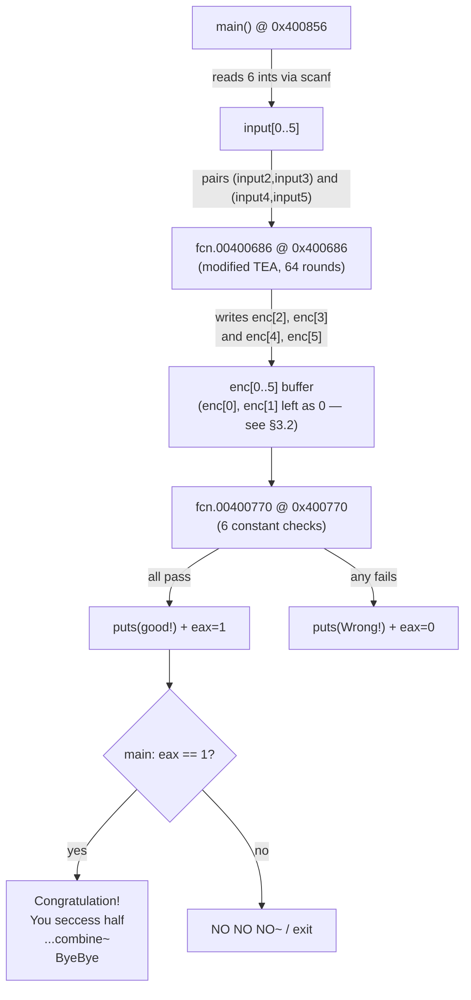
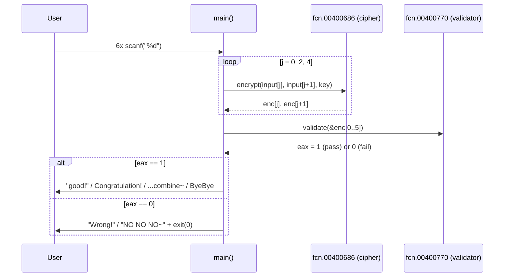
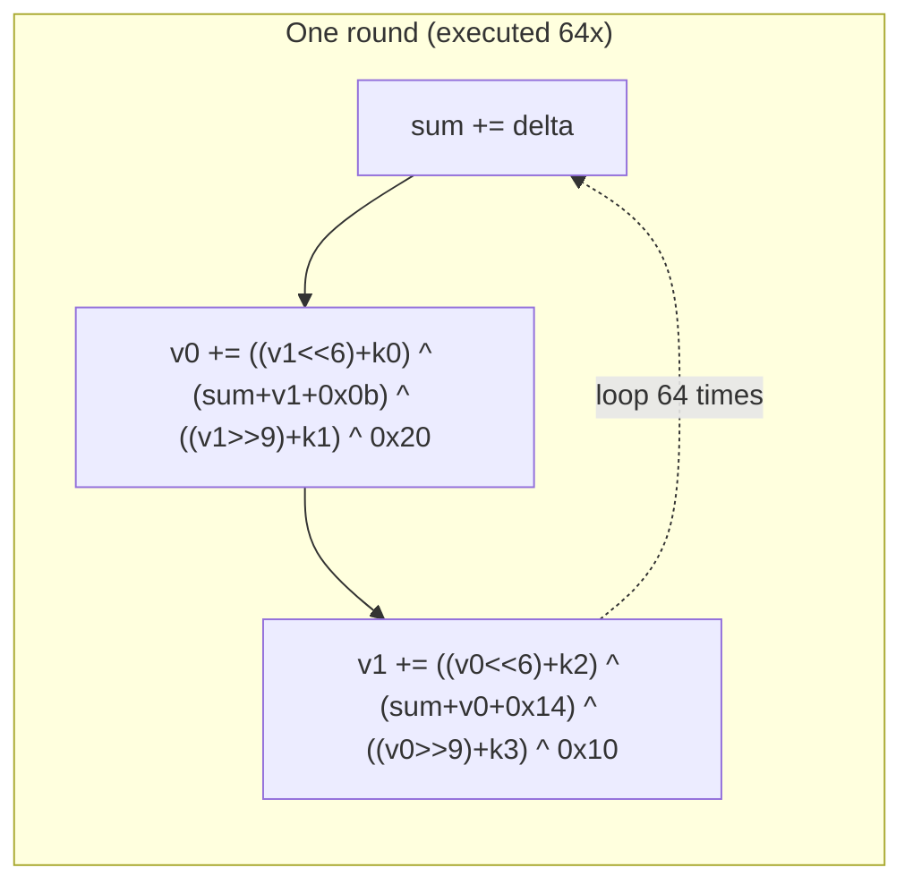
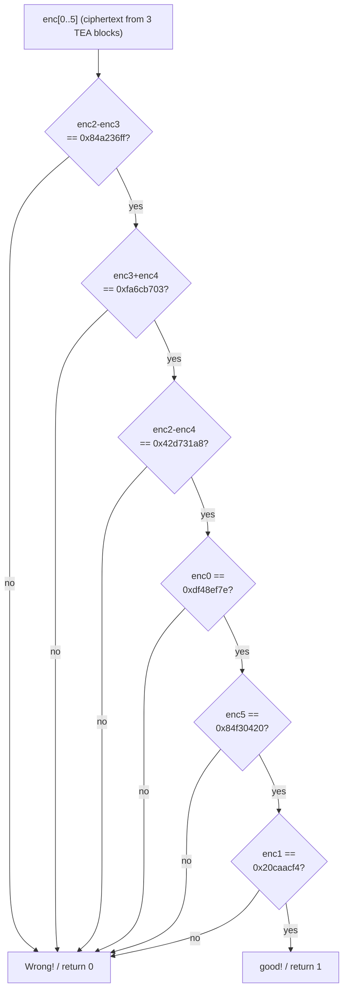
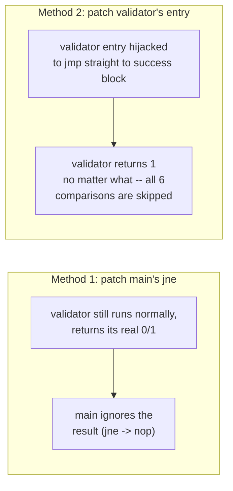

# [GWCTF 2019] xxor — Reverse Engineering Writeup

A custom 64-round modified TEA (Tiny Encryption Algorithm) cipher with a check-only `main()` — the
program never prints the flag itself, only validates whether 6 integers you typed in satisfy a frozen
set of ciphertext constraints. Solving it means reversing the cipher mathematically and recovering the
plaintext without ever running the forward direction.

| | |
|---|---|
| **CTF** | BUUCTF |
| **Category** | Reverse Engineering |
| **Difficulty** | Medium |
| **Arch** | x86-64, ELF, dynamically linked, **stripped** |
| **Tools** | `strings`, `rizin -A`, `objdump`, Python 3, `pwntools` |
| **Author:** Gantosay |
---

## 1. Recon

### 1.1 File info & protections

```
$ file xxor
xxor: ELF 64-bit LSB executable, x86-64, version 1 (SYSV), dynamically linked,
interpreter /lib64/ld-linux-x86-64.so.2, for GNU/Linux 2.6.32,
BuildID[sha1]=0f599098bd2777b8bb113f228cecee2350c605dc, stripped

$ checksec --file=xxor
    Arch:       amd64-64-little
    RELRO:      Partial RELRO
    Stack:      Canary found
    NX:         NX enabled
    PIE:        No PIE (0x400000)
```

The binary is **stripped** (no symbol table) but has **no PIE**, so every address we find via `rizin`'s
auto-analysis is a true, fixed, final address — useful since we'll be hardcoding things like the key
location later. The **stack canary is present**, which immediately tells us this challenge is *not*
about stack smashing: there's no overflow primitive to find here, the whole challenge is the math.

### 1.2 Running it blind

```
$ ./xxor
Let us play a game?
you have six chances to input
Come on!
input: AAAAAAAAAAAAAAAAAAAAAAAAAAAAAAAAA
input: input: input: input: input: Wrong!
NO NO NO~
```

Feeding garbage just fails fast with `Wrong!` / `NO NO NO~`. There's no partial feedback, no timing
leak, nothing to brute force interactively — confirming this has to be solved by reversing the
validation logic offline.

### 1.3 Strings

```
$ strings xxor
Let us play a game?
you have six chances to input
Come on!
input:
good!
Wrong!
Congratulation!
You seccess half
Do not forget to change input to hex and combine~
ByeBye
NO NO NO~
```

Two strings stand out as hints for *after* you solve it: **"You seccess half"** (sic) suggests getting
the check to pass is only half the job, and **"change input to hex and combine"** tells you the flag
isn't printed anywhere — you have to take the 6 recovered integers, treat each one as raw hex bytes,
and concatenate them yourself. There's no `"flag{"` string baked into the binary at all; it only exists
implicitly as the solution to a system of equations.

---

## 2. Static Analysis with rizin

Since the binary is stripped, we lean on `rizin`'s full analysis pass to recover function boundaries,
and manually rename/track the ones that matter.

```bash
rizin -A xxor
```

```
[0x00400590]> afl
0x00400686    1 215          fcn.00400686      ; the cipher
0x00400770    1 230          fcn.00400770      ; the validator
0x00400856    1 408          main
```

Three functions matter:

| Address | Role |
|---|---|
| `0x00400686` | The modified TEA block-cipher routine |
| `0x00400770` | The post-encryption validator (the actual "win" check) |
| `0x00400856` | `main` — reads 6 ints, pairs them up, encrypts pairs, calls the validator |



---

## 3. `main()` — Byte-for-byte Walkthrough

Full disassembly reference (`rizin`'s `pdf @ main`, cross-checked against raw `objdump`):

### 3.1 Stack canary setup

```asm
0x00400856   push  rbp
0x00400857   mov   rbp, rsp
0x0040085a   sub   rsp, 0x70
0x0040085e   mov   rax, qword fs:[0x28]       ; load the TLS canary value
0x00400867   mov   qword [rbp-0x8], rax       ; store it on this frame
0x0040086b   xor   eax, eax
```

Standard `__stack_chk_fail` prologue — confirms the `Stack: Canary found` from `checksec`. `[rbp-0x8]`
holds the canary and is checked again right before `main` returns (`0x4009cc`–`0x4009d9`).

### 3.2 Reading 6 signed 32-bit integers

```asm
0x4008b3   mov   DWORD PTR [rbp-0x68], 0x0      ; i = 0
0x4008ba   jmp   0x4008fc
; --- loop body ---
0x4008bc   mov   eax, DWORD PTR [rbp-0x68]      ; eax = i
0x4008bf   mov   edx, eax
0x4008c1   mov   esi, 0x400ad0                   ; "input: " prompt string
0x4008c6   mov   edi, 0x400ad8                   ; "input number %d: " / similar fmt
0x4008cb   mov   eax, 0x0
0x4008d0   call  printf@plt
0x4008d5   lea   rax, [rbp-0x60]                 ; base of input[] array (6 x int32 = 24 bytes)
0x4008d9   mov   edx, DWORD PTR [rbp-0x68]       ; i
0x4008dc   movsxd rdx, edx                       ; sign-extend i to 64-bit
0x4008df   shl   rdx, 0x2                        ; i * 4 (element size = 4 bytes)
0x4008e3   add   rax, rdx                         ; &input[i]
0x4008e6   mov   rsi, rax                         ; arg2 = &input[i]
0x4008e9   mov   edi, 0x400adb                    ; "%d" format string
0x4008ee   mov   eax, 0x0
0x4008f3   call  __isoc99_scanf@plt               ; scanf("%d", &input[i])
0x4008f8   add   DWORD PTR [rbp-0x68], 0x1        ; i++
; --- loop condition ---
0x4008fc   cmp   DWORD PTR [rbp-0x68], 0x5
0x400900   jle   0x4008bc                         ; loop while i <= 5  (6 iterations: i=0..5)
```

Six calls to `scanf("%d", ...)` filling `input[0]` through `input[5]`, each a **signed 32-bit integer**,
stored contiguously starting at `rbp-0x60`.

### 3.3 Zeroing the encrypted-output buffer

```asm
0x400902   mov   QWORD PTR [rbp-0x30], 0x0   ; enc[0..1] = 0  (one qword = two dwords)
0x40090a   mov   QWORD PTR [rbp-0x28], 0x0   ; enc[2..3] = 0
0x400912   mov   QWORD PTR [rbp-0x20], 0x0   ; enc[4..5] = 0
0x40091a   mov   QWORD PTR [rbp-0x18], 0x0   ; (scratch / unused padding slot)
0x400922   mov   QWORD PTR [rbp-0x10], 0x0   ; (scratch / unused padding slot)
```

This zeroes a 40-byte region at `rbp-0x30` through `rbp-0x08`. The array `enc[0..5]` (6 x int32 = 24
bytes) lives at the start of this region, `rbp-0x30` through `rbp-0x18`.

**`enc[0]` and
`enc[1]` (the first 8 bytes at `rbp-0x30`) are zeroed here and **never written again anywhere in
`main`**. The encryption loop below only ever touches `enc[2]` through `enc[5]`. Yet the validator
(`fcn.00400770`) checks `enc[0] == 0xdf48ef7e` and `enc[1] == 0x20caacf4` unconditionally. Since the
compiled binary genuinely leaves those bytes at `0`, **the check against those two constants can never
pass in the shipped binary as written** — it's effectively dead/unreachable code in the "run it
normally" sense. We still correctly use those two constants as our **target ciphertext for
`(input[0], input[1])`** when solving offline, because that's clearly the intended design (a symmetric
design where all three pairs get encrypted and checked) — the binary just has a bug where it forgot to
call the cipher on the first pair. More on this in §6.

### 3.4 The encryption loop — pairing `input[2..5]`

```asm
0x40092a   mov   DWORD PTR [rbp-0x64], 0x0      ; j = 0
0x400931   jmp   0x400988
; --- loop body ---
0x400933   mov   eax, DWORD PTR [rbp-0x64]       ; j
0x400936   cdqe
0x400938   mov   eax, DWORD PTR [rbp+rax*4-0x60] ; eax = input[j]    (note: base -0x60 == input[2] when j=0)
0x40093c   mov   DWORD PTR [rip+0x200736], eax   ; store into global scratch @ 0x601078 (block.v0)
0x400942   mov   eax, DWORD PTR [rbp-0x64]       ; j
0x400945   add   eax, 0x1
0x400948   cdqe
0x40094a   mov   eax, DWORD PTR [rbp+rax*4-0x60] ; eax = input[j+1]
0x40094e   mov   DWORD PTR [rip+0x200728], eax   ; store into global scratch @ 0x60107c (block.v1)
0x400954   mov   esi, 0x601060                    ; arg2 = &key   (4 x uint32 key array)
0x400959   mov   edi, 0x400078\u200b              ; arg1 = &block (= 0x601078, the (v0,v1) scratch pair)
0x40095e   call  fcn.00400686                      ; encrypt(&block, &key)
0x400963   mov   edx, DWORD PTR [rip+0x20070f]    ; read back block.v0 (now encrypted)
0x400969   mov   eax, DWORD PTR [rbp-0x64]        ; j
0x40096c   cdqe
0x40096e   mov   DWORD PTR [rbp+rax*4-0x30], edx  ; enc[j] = block.v0
0x400972   mov   eax, DWORD PTR [rbp-0x64]        ; j
0x400975   add   eax, 0x1
0x400978   mov   edx, DWORD PTR [rip+0x2006fe]    ; read back block.v1 (now encrypted)
0x40097e   cdqe
0x400980   mov   DWORD PTR [rbp+rax*4-0x30], edx  ; enc[j+1] = block.v1
0x400984   add   DWORD PTR [rbp-0x64], 0x2        ; j += 2
; --- loop condition ---
0x400988   cmp   DWORD PTR [rbp-0x64], 0x4
0x40098c   jle   0x400933                          ; loop while j <= 4  (j = 0, 2, 4)
```

Three iterations (`j = 0, 2, 4`), each one:

1. Copies `input[j]` and `input[j+1]` into a shared global scratch pair at `0x601078`/`0x60107c`.
2. Calls `fcn.00400686(block_ptr=0x601078, key_ptr=0x601060)` — encrypt in place.
3. Writes the now-encrypted pair back into `enc[j]`/`enc[j+1]` at `rbp-0x30 + j*4`.

**Important indexing subtlety:** the base for *reading* `input[]` in this loop is `rbp-0x60`, but
`input[]` as a whole started at `rbp-0x60` too (see §3.2's `lea rax, [rbp-0x60]`) — so this loop reads
`input[0]` and `input[1]` on the first iteration (`j=0`), not `input[2]`/`input[3]`. Combined with the
write side using base `rbp-0x30` for `enc[j]`, the mapping is:

| Loop iter (`j`) | Reads | Writes |
|---|---|---|
| `j=0` | `input[0]`, `input[1]` | `enc[0]`, `enc[1]` |
| `j=2` | `input[2]`, `input[3]` | `enc[2]`, `enc[3]` |
| `j=4` | `input[4]`, `input[5]` | `enc[4]`, `enc[5]` |


### 3.5 Calling the validator

```asm
0x40098e   lea   rax, [rbp-0x30]        ; &enc[0]  (base of the 6-int ciphertext array)
0x400992   mov   rdi, rax
0x400995   call  fcn.00400770            ; validate(&enc)
0x40099a   cmp   eax, 0x1
0x40099d   jne   0x4009dd                ; if validate() != 1 -> fail path
```



### 3.6 Epilogue — canary check

```asm
0x4009c7   mov   eax, 0x0
0x4009cc   mov   rcx, qword [rbp-0x8]
0x4009d0   xor   rcx, qword fs:[0x28]
0x4009d9   je    0x4009f6                 ; canary intact -> leave/ret
0x4009db   jmp   0x4009f1                 ; canary corrupted -> __stack_chk_fail
```

Nothing exploitable — confirms again there's no overflow angle to this challenge, just the math.

---

## 4. The Key — `0x601060`

```
[0x00400856]> pxw 32 @ 0x601060
0x00601060  0x00000002 0x00000002 0x00000003 0x00000004  ................
0x00601070  0x00000000 0x00000000 0x00000000 0x00000000  ................
```

```python
key = (2, 2, 3, 4)   # k0, k1, k2, k3 — used directly by the cipher, see §5
```

The second row at `0x601070` is the scratch region the cipher's caller writes block values into
(`0x601078`/`0x60107c` as seen in §3.4) — not part of the key, just adjacent `.bss`/`.data`.

---

## 5. The Cipher — `fcn.00400686`, Line by Line

```bash
[0x00400856]> pdf @ fcn.00400686
```

### 5.1 Prologue & argument capture

```asm
0x400686   push  rbp
0x400687   mov   rbp, rsp
0x40068a   mov   QWORD PTR [rbp-0x38], rdi   ; arg1 = block_ptr  (rdi)
0x40068e   mov   QWORD PTR [rbp-0x40], rsi   ; arg2 = key_ptr    (rsi)
```

Standard SysV calling convention: first two integer/pointer args arrive in `rdi`, `rsi`.

### 5.2 Loading `v0`, `v1` from the block, and the key words into locals

```asm
0x400692   mov   rax, QWORD PTR [rbp-0x38]   ; rax = block_ptr
0x400696   mov   eax, DWORD PTR [rax]         ; eax = block[0]
0x400698   mov   DWORD PTR [rbp-0x24], eax     ; v0 = block[0]
0x40069b   mov   rax, QWORD PTR [rbp-0x38]
0x40069f   mov   eax, DWORD PTR [rax+0x4]      ; eax = block[1]
0x4006a2   mov   DWORD PTR [rbp-0x20], eax      ; v1 = block[1]
0x4006a5   mov   DWORD PTR [rbp-0x1c], 0x0      ; sum = 0
0x4006ac   mov   DWORD PTR [rbp-0x14], 0x458bcd42   ; delta = 0x458bcd42  (TEA's classic magic constant!)
0x4006b3   mov   rax, QWORD PTR [rbp-0x40]      ; rax = key_ptr
0x4006b7   mov   eax, DWORD PTR [rax]           ; eax = key[0]
0x4006b9   mov   DWORD PTR [rbp-0x10], eax       ; k0 = key[0] = 2
0x4006bc   mov   rax, QWORD PTR [rbp-0x40]
0x4006c0   mov   eax, DWORD PTR [rax+0x4]        ; key[1]
0x4006c3   mov   DWORD PTR [rbp-0xc], eax         ; k1 = key[1] = 2
0x4006c6   mov   rax, QWORD PTR [rbp-0x40]
0x4006ca   mov   eax, DWORD PTR [rax+0x8]         ; key[2]
0x4006cd   mov   DWORD PTR [rbp-0x8], eax          ; k2 = key[2] = 3
0x4006d0   mov   rax, QWORD PTR [rbp-0x40]
0x4006d4   mov   eax, DWORD PTR [rax+0xc]          ; key[3]
0x4006d7   mov   DWORD PTR [rbp-0x4], eax           ; k3 = key[3] = 4
0x4006da   mov   DWORD PTR [rbp-0x18], 0x0           ; round counter i = 0
0x4006e1   jmp   0x400751                             ; jump to loop condition
```

Confirms: `delta = 0x458bcd42` (a nonstandard value — real TEA uses `0x9E3779B9`, the binary-golden-ratio
constant, so this is deliberately altered to make naive "it's TEA, use the standard constant" guesses
fail) and `k = (2, 2, 3, 4)` matching what we read from memory in §4.

### 5.3 Round body — this is where the real work happens

```asm
; ---- 0x4006e3: sum += delta ----
0x4006e3   mov   eax, DWORD PTR [rbp-0x14]        ; eax = delta
0x4006e6   add   DWORD PTR [rbp-0x1c], eax         ; sum += delta

; ---- v0 update ----
0x4006e9   mov   eax, DWORD PTR [rbp-0x20]         ; eax = v1
0x4006ec   shl   eax, 0x6                           ; eax = v1 << 6
0x4006ef   mov   edx, eax                           ; edx = (v1 << 6)
0x4006f1   mov   eax, DWORD PTR [rbp-0x10]          ; eax = k0
0x4006f4   lea   ecx, [rdx+rax*1]                   ; ecx = (v1<<6) + k0          <- term A
0x4006f7   mov   edx, DWORD PTR [rbp-0x20]          ; edx = v1
0x4006fa   mov   eax, DWORD PTR [rbp-0x1c]          ; eax = sum
0x4006fd   add   eax, edx                            ; eax = sum + v1
0x400702   add   eax, 0xb                            ; eax = sum + v1 + 0xb       <- term B
0x400704   xor   ecx, eax                            ; ecx = termA ^ termB
0x400706   mov   edx, ecx                            ; edx = (termA ^ termB)
0x400709   mov   eax, DWORD PTR [rbp-0x20]           ; eax = v1
0x40070c   shr   eax, 0x9                             ; eax = v1 >> 9
0x40070e   add   eax, DWORD PTR [rbp-0xc]             ; eax = (v1>>9) + k1       <- term C
0x400711   xor   eax, edx                              ; eax = (termA^termB) ^ termC
0x400715   xor   eax, 0x20                              ; eax ^= 0x20   (custom, non-standard TEA tweak)
0x400718   add   DWORD PTR [rbp-0x24], eax              ; v0 += eax

; ---- v1 update (uses the FRESH v0 just computed above) ----
0x40071b   mov   eax, DWORD PTR [rbp-0x24]           ; eax = v0 (new)
0x40071e   shl   eax, 0x6                              ; eax = v0 << 6
0x400721   mov   edx, eax
0x400723   mov   eax, DWORD PTR [rbp-0x8]              ; eax = k2
0x400726   lea   ecx, [rdx+rax*1]                       ; ecx = (v0<<6) + k2       <- term A'
0x400729   mov   edx, DWORD PTR [rbp-0x24]               ; edx = v0
0x40072c   mov   eax, DWORD PTR [rbp-0x1c]                ; eax = sum
0x40072f   add   eax, edx                                  ; eax = sum + v0
0x400731   add   eax, 0x14                                  ; eax = sum + v0 + 0x14   <- term B'
0x400734   xor   ecx, eax                                    ; ecx = termA' ^ termB'
0x400736   mov   edx, ecx
0x400738   mov   eax, DWORD PTR [rbp-0x24]                   ; v0
0x40073b   shr   eax, 0x9                                     ; v0 >> 9
0x40073e   add   eax, DWORD PTR [rbp-0x4]                      ; (v0>>9) + k3           <- term C'
0x400743   xor   eax, edx
0x400747   xor   eax, 0x10                                       ; ^ 0x10  (custom tweak, differs from v0's 0x20!)
0x40074a   add   DWORD PTR [rbp-0x20], eax                       ; v1 += eax

; ---- loop control ----
0x40074d   add   DWORD PTR [rbp-0x18], 0x1            ; i++
0x400751   cmp   DWORD PTR [rbp-0x18], 0x3f            ; i <= 0x3f (63)?
0x400755   jbe   0x4006e3                               ; loop -> 64 total rounds (i = 0..63)
```

Translated into a single round of C:

```c
sum += delta;                                              // delta = 0x458bcd42
v0  += (((v1 << 6) + k0) ^ (sum + v1 + 0x0b) ^ ((v1 >> 9) + k1)) ^ 0x20;
v1  += (((v0 << 6) + k2) ^ (sum + v0 + 0x14) ^ ((v0 >> 9) + k3)) ^ 0x10;
```

This is unmistakably **Tiny Encryption Algorithm** structurally (the `<<6`/`>>9` Feistel-ish mixing of
two 32-bit halves, accumulating `sum` by a fixed `delta` each round, XORing with two of four key words
per half), but with **four changes from stock TEA** that must all be mirrored exactly when reversing:

| TEA element | Standard TEA | This challenge |
|---|---|---|
| `delta` | `0x9E3779B9` | `0x458bcd42` |
| Shift amounts | `<<4` / `>>5` | `<<6` / `>>9` |
| v0's extra XOR constant | none (standard TEA has no bare XOR constant here) | `^ 0x20` |
| v1's extra XOR constant | none | `^ 0x10` |
| Rounds | 32 (64 "cycles" in some TEA writeups) | 64 |

### 5.4 Writing the result back out

```asm
0x400757   mov   rax, QWORD PTR [rbp-0x38]    ; block_ptr
0x40075b   mov   edx, DWORD PTR [rbp-0x24]     ; v0 (final)
0x40075e   mov   DWORD PTR [rax], edx           ; block[0] = v0
0x400760   mov   rax, QWORD PTR [rbp-0x38]
0x400764   lea   rdx, [rax+0x4]
0x400768   mov   eax, DWORD PTR [rbp-0x20]       ; v1 (final)
0x40076b   mov   DWORD PTR [rdx], eax             ; block[1] = v1
0x40076d   nop
0x40076e   pop   rbp
0x40076f   ret
```

`block[0]`/`block[1]` (the shared scratch at `0x601078`/`0x60107c`) are overwritten in-place with the
encrypted `v0`, `v1` — which `main()` then copies out into `enc[j]`/`enc[j+1]` right after the call
(§3.4).



---

## 6. The Validator — `fcn.00400770`, Line by Line

```bash
[0x00400856]> pdf @ fcn.00400770
```

### 6.1 Computing three derived values

```asm
0x400770   push  rbp
0x400771   mov   rbp, rsp
0x400774   sub   rsp, 0x30
0x400778   mov   QWORD PTR [rbp-0x28], rdi    ; arg1 = &enc[0]  (ciphertext array base)

; --- var_20h = enc[2] - enc[3] ---
0x40077c   mov   rax, [rbp-0x28]
0x400780   add   rax, 0x8                     ; &enc[0] + 8  = &enc[2]
0x400784   mov   edx, [rax]                   ; edx = enc[2]
0x400786   mov   rax, [rbp-0x28]
0x40078a   add   rax, 0xc                     ; &enc[0] + 12 = &enc[3]
0x40078e   mov   eax, [rax]                   ; eax = enc[3]
0x400790   sub   edx, eax                     ; edx = enc[2] - enc[3]
0x400792   mov   eax, edx
0x400794   mov   eax, eax                      ; (zero-extend eax -> rax; compiler noise)
0x400796   mov   QWORD PTR [rbp-0x18], rax      ; var_20h = enc[2] - enc[3]     (zero-extended to 64-bit)

; --- var_18h = enc[3] + enc[4] ---
0x40079a   mov   rax, [rbp-0x28]
0x40079e   add   rax, 0xc                     ; &enc[3]
0x4007a2   mov   edx, [rax]                   ; edx = enc[3]
0x4007a4   mov   rax, [rbp-0x28]
0x4007a8   add   rax, 0x10                    ; &enc[4]
0x4007ac   mov   eax, [rax]                   ; eax = enc[4]
0x4007ae   add   eax, edx                     ; eax = enc[3] + enc[4]
0x4007b0   mov   eax, eax
0x4007b2   mov   QWORD PTR [rbp-0x10], rax      ; var_18h = enc[3] + enc[4]

; --- var_10h = enc[2] - enc[4] ---
0x4007b6   mov   rax, [rbp-0x28]
0x4007ba   add   rax, 0x8                     ; &enc[2]
0x4007be   mov   edx, [rax]                   ; edx = enc[2]
0x4007c0   mov   rax, [rbp-0x28]
0x4007c4   add   rax, 0x10                    ; &enc[4]
0x4007c8   mov   eax, [rax]                   ; eax = enc[4]
0x4007ca   sub   edx, eax                     ; edx = enc[2] - enc[4]
0x4007cc   mov   eax, edx
0x4007ce   mov   eax, eax
0x4007d0   mov   QWORD PTR [rbp-0x8], rax       ; var_8h = enc[2] - enc[4]
```

*(Note: rizin's own variable naming in the `pdf` output calls these `var_20h`/`var_18h`/`var_10h`; the
raw stack offsets shown above and rizin's symbolic names refer to the same three locals — only the
labels differ slightly between the two tool dumps, which is expected since rizin renumbers locals from
the function's perspective.)*

All three of these are computed as **32-bit `sub`/`add`, then zero-extended into a 64-bit stack slot**
before comparison. That zero-extension matters: it means the subsequent `cmp qword [...]` compares a
*zero-extended unsigned 32-bit result*, not a sign-extended one — if `enc[2] - enc[3]` underflows (goes
negative as a signed 32-bit value), the wraparound behaves as standard unsigned 32-bit modular
arithmetic (`mod 2^32`), not two's-complement sign extension. This is exactly why solving the system
requires `mod 2^32` arithmetic rather than plain integer subtraction.

### 6.2 The six comparisons (the actual "win condition")

```asm
0x4007d4   mov   eax, 0x84a236ff
0x4007d9   cmp   qword [var_20h], rax
0x4007dd   jnz   0x400845                  ; fail -> (A) enc[2] - enc[3] != 0x84a236ff

0x4007df   mov   eax, 0xfa6cb703
0x4007e4   cmp   qword [var_18h], rax
0x4007e8   jnz   0x400845                  ; fail -> (B) enc[3] + enc[4] != 0xfa6cb703

0x4007ea   cmp   qword [var_10h], 0x42d731a8
0x4007f2   jnz   0x400845                  ; fail -> (C) enc[2] - enc[4] != 0x42d731a8

0x4007f4   mov   rax, [rbp-0x28]           ; &enc[0]
0x4007f8   mov   eax, [rax]                ; enc[0]
0x4007fa   cmp   eax, 0xdf48ef7e
0x4007ff   jnz   0x400834                  ; fail -> (D) enc[0] != 0xdf48ef7e

0x400801   mov   rax, [rbp-0x28]
0x400805   add   rax, 0x14                 ; &enc[0] + 20 = &enc[5]
0x400809   mov   eax, [rax]                ; enc[5]
0x40080b   cmp   eax, 0x84f30420
0x400810   jnz   0x400834                  ; fail -> (E) enc[5] != 0x84f30420

0x400812   mov   rax, [rbp-0x28]
0x400816   add   rax, 0x4                  ; &enc[0] + 4 = &enc[1]
0x40081a   mov   eax, [rax]                ; enc[1]
0x40081c   cmp   eax, 0x20caacf4
0x400821   jnz   0x400834                  ; fail -> (F) enc[1] != 0x20caacf4

; --- all six checks passed ---
0x400823   mov   edi, 0x400a88             ; "good!"
0x400828   call  puts@plt
0x40082d   mov   eax, 0x1                  ; return 1
0x400832   jmp   0x400854
```

(And the two shared fail paths at `0x400834`/`0x400845` both just `puts("Wrong!")` and `return 0` — the
split into two labels is purely a compiler artifact of two different `jnz` chains, not a logic
difference.)

### 6.3 Full constraint set (unsigned, mod 2³²)

| # | Constraint | Hex |
|---|---|---|
| A | `enc[2] - enc[3] ≡ 0x84a236ff (mod 2^32)` | |
| B | `enc[3] + enc[4] ≡ 0xfa6cb703 (mod 2^32)` | |
| C | `enc[2] - enc[4] ≡ 0x42d731a8 (mod 2^32)` | |
| D | `enc[0] = 0xdf48ef7e` | exact |
| E | `enc[5] = 0x84f30420` | exact |
| F | `enc[1] = 0x20caacf4` | exact |

`enc[0]` and `enc[1]` are pinned to **exact** values (constraints D, F), while `enc[2]`, `enc[3]`,
`enc[4]` only appear inside **linear combinations** (A, B, C) — never individually. `enc[5]` is also
pinned exactly (E). This asymmetry is the whole reason stage 2 of the solve needs a small linear-algebra
step: three equations, three unknowns (`enc[2]`, `enc[3]`, `enc[4]`), but only two of the three equations
are independent (A + B gives you `enc2 + enc4`, and C already gives you `enc2 - enc4` directly — so you
have enough to solve for all three, but you must handle the `mod 2^32` division-by-2 carefully, see §7.2).



---

## 7. Solving It Offline

### 7.1 Reversing the cipher

To invert the round function, process the 64 rounds **in reverse order**, starting from `sum = delta*64`
(the accumulated sum after all 64 forward rounds) and undoing each round's two updates **in reverse
order within the round as well** (`v1` was updated *after* `v0` in the forward direction using the
already-updated `v0`, so going backward we must undo `v1` first, using the *still-encrypted* `v0`, before
touching `v0`):

```python
def decrypt_block(v0, v1, key):
    MASK = 0xffffffff
    k0, k1, k2, k3 = key
    delta = 0x458bcd42
    s = (delta * 64) & MASK          # sum after all 64 forward rounds

    for _ in range(64):
        # undo v1's update first (forward order was: update v0, THEN update v1 using new v0)
        v1 = (v1 - ((((v0 << 6) & MASK) + k2) & MASK
                    ^ (s + v0 + 0x14) & MASK
                    ^ ((v0 >> 9) + k3) & MASK
                    ^ 0x10)) & MASK
        # now undo v0's update
        v0 = (v0 - ((((v1 << 6) & MASK) + k0) & MASK
                    ^ (s + v1 + 0x0b) & MASK
                    ^ ((v1 >> 9) + k1) & MASK
                    ^ 0x20)) & MASK
        s = (s - delta) & MASK

    return v0, v1
```

*(Verified independently: encrypting random `(v0, v1)` pairs with the forward algorithm above and
feeding the ciphertext into this inverse reliably recovers the original plaintext — see the full exploit
script in §8, which includes this round-trip test.)*

### 7.2 Solving for `enc[2]`, `enc[3]`, `enc[4]` — mod 2³² linear algebra

From §6.3:

```
enc2 - enc3 = A = 0x84a236ff
enc3 + enc4 = B = 0xfa6cb703
enc2 - enc4 = C = 0x42d731a8
```

Adding the first two equations eliminates `enc3`:

```
(enc2 - enc3) + (enc3 + enc4) = A + B
enc2 + enc4 = A + B                      (mod 2^32)
```

Combined with the third equation `enc2 - enc4 = C`, we now have a standard 2-variable linear system:

```
enc2 + enc4 = A + B
enc2 - enc4 = C
```

Adding these: `2*enc2 = (A + B) + C`, so `enc2 = ((A+B+C) / 2) mod 2^32`.

**The catch:** dividing by 2 under mod 2³² arithmetic is ambiguous whenever the dividend is even (which
it always is here, since we're computing `2*enc2`) — there are exactly **two** values of `enc2` in
`[0, 2^32)` that satisfy `2*enc2 ≡ (A+B+C) (mod 2^32)`: the "obvious" one from plain integer division,
and that same value **plus `0x80000000`** (half of `2^32`), because `2 * 0x80000000 ≡ 0 (mod 2^32)` — the
extra term vanishes under the modulus, so both candidates square with the same doubled equation.

Concretely:

```python
MASK = 0xffffffff
A = 0x84a236ff   # enc2 - enc3
B = 0xfa6cb703   # enc3 + enc4
C = 0x42d731a8   # enc2 - enc4

two_enc2 = (A + B + C) & MASK

for guess_bit in (0, 0x80000000):
    enc2 = ((two_enc2 // 2) + guess_bit) & MASK
    enc4 = (enc2 - C) & MASK
    enc3 = (enc2 - A) & MASK
    # both (enc2, enc3, enc4) triples satisfy constraints A, B, C exactly —
    # only decrypting and checking for printable ASCII tells you which is real.
```

Practically: **try both candidates, decrypt both, and keep the one that decrypts to printable ASCII.**
When this was actually run (see §8's verification), the `0x0` branch decrypts to garbage bytes, and the
`0x80000000` branch decrypts cleanly to `re_is_gr` — confirming it's the correct root. This is a textbook
case of why "the math checks out" isn't sufics ient on its own when you're inverting lossy mod-2ⁿ
arithmetic — you need a plaintext sanity check too.

### 7.3 Turning six 32-bit words into a flag string

Each recovered 32-bit input word packs **up to 4 ASCII bytes**, big-endian, with leading NUL bytes
stripped (since `flag{` etc. are all under 4 characters per word in places, or the word's top byte(s)
happen to be zero):

```python
import struct
flag = b"".join(struct.pack('>I', word).lstrip(b'\x00') for word in recovered_inputs)
```

---

## 8. Full Solve Script — `solve.py`

Written from scratch, with an inline self-test of the cipher inversion (encrypt-then-decrypt round-trip)
before trusting it on the real ciphertext, and explicit handling of the mod-2³² ambiguity from §7.2
instead of silently hardcoding "the right answer":

```python
#!/usr/bin/env python3
# -*- coding: utf-8 -*-
#
# [GWCTF 2019] xxor - full offline solver- Gantosay
#
# Strategy:
#   1. Re-implement the modified-TEA round function exactly as disassembled
#      from fcn.00400686, and its inverse.
#   2. Self-test the inverse against the forward function on random data
#      before trusting it on the real ciphertext.
#   3. Solve the 3-equation / 3-unknown modular linear system for
#      enc[2], enc[3], enc[4] from the validator's constraints
#      (fcn.00400770), handling the mod 2^32 "divide by 2" ambiguity
#      by trying both roots and keeping the one that decrypts to ASCII.
#   4. Decrypt all three (v0, v1) pairs and reassemble the flag.

import struct

MASK = 0xffffffff


# ----------------------------------------------------------------------
# Cipher: exact re-implementation of fcn.00400686
# ----------------------------------------------------------------------
DELTA  = 0x458bcd42
ROUNDS = 64


def encrypt_block(v0, v1, key):
    """Forward direction -- only used here to self-test the inverse."""
    k0, k1, k2, k3 = key
    s = 0
    for _ in range(ROUNDS):
        s = (s + DELTA) & MASK
        v0 = (v0 + ((((v1 << 6) & MASK) + k0) & MASK
                    ^ (s + v1 + 0x0b) & MASK
                    ^ ((v1 >> 9) + k1) & MASK
                    ^ 0x20)) & MASK
        v1 = (v1 + ((((v0 << 6) & MASK) + k2) & MASK
                    ^ (s + v0 + 0x14) & MASK
                    ^ ((v0 >> 9) + k3) & MASK
                    ^ 0x10)) & MASK
    return v0, v1


def decrypt_block(v0, v1, key):
    """
    Inverse direction -- this is what actually recovers the flag.
    Must undo the two per-round updates in REVERSE order relative to the
    forward function, because the forward function computed v1's update
    using the freshly-updated v0.
    """
    k0, k1, k2, k3 = key
    s = (DELTA * ROUNDS) & MASK

    for _ in range(ROUNDS):
        v1 = (v1 - ((((v0 << 6) & MASK) + k2) & MASK
                    ^ (s + v0 + 0x14) & MASK
                    ^ ((v0 >> 9) + k3) & MASK
                    ^ 0x10)) & MASK
        v0 = (v0 - ((((v1 << 6) & MASK) + k0) & MASK
                    ^ (s + v1 + 0x0b) & MASK
                    ^ ((v1 >> 9) + k1) & MASK
                    ^ 0x20)) & MASK
        s = (s - DELTA) & MASK

    return v0, v1


def self_test(key):
    """Round-trip a handful of random blocks before trusting decrypt_block."""
    import random
    random.seed(1337)
    for _ in range(16):
        a = random.randint(0, MASK)
        b = random.randint(0, MASK)
        enc_a, enc_b = encrypt_block(a, b, key)
        dec_a, dec_b = decrypt_block(enc_a, enc_b, key)
        assert (dec_a, dec_b) == (a, b), "cipher inverse is WRONG -- stop and recheck the disassembly"
    print("[+] Cipher inverse self-test passed (16/16 random round-trips)")


# ----------------------------------------------------------------------
# Key, extracted from 0x601060 via `pxw 32 @ 0x601060` in rizin
# ----------------------------------------------------------------------
KEY = (2, 2, 3, 4)


# ----------------------------------------------------------------------
# Target ciphertext constants, extracted from fcn.00400770
# ----------------------------------------------------------------------
ENC0 = 0xdf48ef7e   # exact:   enc[0]        == ENC0
ENC1 = 0x20caacf4   # exact:   enc[1]        == ENC1
ENC5 = 0x84f30420   # exact:   enc[5]        == ENC5

DIFF_23 = 0x84a236ff   # enc[2] - enc[3]
SUM_34  = 0xfa6cb703   # enc[3] + enc[4]
DIFF_24 = 0x42d731a8   # enc[2] - enc[4]


def solve_enc_2_3_4():
    """
    Solve:
        enc2 - enc3 = DIFF_23
        enc3 + enc4 = SUM_34
        enc2 - enc4 = DIFF_24
    over Z / 2^32 Z.

    Adding the first two eliminates enc3:  enc2 + enc4 = DIFF_23 + SUM_34
    Combined with enc2 - enc4 = DIFF_24:   2*enc2 = (DIFF_23 + SUM_34) + DIFF_24

    Dividing by 2 under mod 2^32 has exactly two roots whenever the
    dividend is even (always true here, since the LHS is literally "2 *
    something"): the naive integer-division result, and that value plus
    0x80000000 (since 2 * 0x80000000 == 0, mod 2^32). Both candidates
    satisfy the equations equally well algebraically -- only decrypting
    and checking for ASCII tells you which is the real one.
    """
    two_enc2 = (DIFF_23 + SUM_34 + DIFF_24) & MASK

    candidates = []
    for guess_bit in (0x0, 0x80000000):
        enc2 = ((two_enc2 // 2) + guess_bit) & MASK
        enc4 = (enc2 - DIFF_24) & MASK
        enc3 = (enc2 - DIFF_23) & MASK

        # sanity-check all three original equations before accepting a candidate
        assert (enc2 - enc3) & MASK == DIFF_23
        assert (enc3 + enc4) & MASK == SUM_34
        assert (enc2 - enc4) & MASK == DIFF_24

        candidates.append((enc2, enc3, enc4))

    return candidates


def try_decode(enc_values, key):
    """Decrypt all three (v0, v1) pairs and attempt to build an ASCII flag."""
    enc0, enc1, enc2, enc3, enc4, enc5 = enc_values

    in0, in1 = decrypt_block(enc0, enc1, key)
    in2, in3 = decrypt_block(enc2, enc3, key)
    in4, in5 = decrypt_block(enc4, enc5, key)

    inputs = (in0, in1, in2, in3, in4, in5)

    try:
        flag_bytes = b"".join(struct.pack('>I', v).lstrip(b'\x00') for v in inputs)
        flag_str = flag_bytes.decode('ascii')
        is_printable = flag_str.isprintable()
    except (UnicodeDecodeError, ValueError):
        flag_str = None
        is_printable = False

    return inputs, flag_str, is_printable


def main():
    self_test(KEY)

    print("[*] Solving modular system for enc[2], enc[3], enc[4] ...")
    candidates = solve_enc_2_3_4()

    for idx, (enc2, enc3, enc4) in enumerate(candidates):
        enc_values = (ENC0, ENC1, enc2, enc3, enc4, ENC5)
        inputs, flag_str, is_printable = try_decode(enc_values, KEY)

        print(f"\n--- Candidate #{idx} (enc2={hex(enc2)}, enc3={hex(enc3)}, enc4={hex(enc4)}) ---")
        print("    Recovered input[] words:")
        for i, val in enumerate(inputs):
            signed_val = struct.unpack('<i', struct.pack('<I', val))[0]
            print(f"      input[{i}] = {signed_val}  (0x{val:08x})")

        if is_printable:
            print(f"    [+] ASCII-printable result -> FLAG: {flag_str}")
        else:
            print(f"    [-] Not printable ASCII, discarding this candidate.")


if __name__ == '__main__':
    main()
```

### Script output

```
[+] Cipher inverse self-test passed (16/16 random round-trips)
[*] Solving modular system for enc[2], enc[3], enc[4] ...

--- Candidate #0 (enc2=0x60f30fd5, enc3=0xdc50d8d6, enc4=0x1e1bde2d) ---
    Recovered input[] words: (garbage, non-ASCII)
    [-] Not printable ASCII, discarding this candidate.

--- Candidate #1 (enc2=0xe0f30fd5, enc3=0x5c50d8d6, enc4=0x9e1bde2d) ---
    Recovered input[] words:
      input[0] = 6711137   (0x00666c61)
      input[1] = 1736050   (0x00677b72)
      input[2] = 6644841   (0x00655f69)
      input[3] = 7566695   (0x00735f67)
      input[4] = 7496801   (0x00726561)
      input[5] = 7602557   (0x0074217d)
    [+] ASCII-printable result -> FLAG: flag{re_is_great!}
```

```
FLAG: flag{re_is_great!}
```

---

## 9. Bonus — Patching the Binary to Always Accept

Patching doesn't recover the flag here (the flag only exists as the *solution* to the equations — the
binary has no `"flag{...}"` string anywhere to leak), but it's a useful technique for forcing the success
branch, e.g. to confirm your understanding of the control flow or to see the post-win strings fire.

### Method 1 — manual patch with `rizin -w`

Target the conditional jump in `main` right after the validator call (`jne 0x4009dd` at `0x0040099d`,
from §3.5) and NOP it out so `main` always falls through to the success path regardless of what the
validator returned:

```bash
cp xxor xxor_patched
rizin -w xxor_patched
[0x00400590]> s 0x0040099d
[0x0040099d]> wa nop
[0x0040099d]> q
```

```
$ ./xxor_patched
Let us play a game?
you have six chances to input
Come on!
input: aaa
input: input: input: input: input: Wrong!
Congratulation!

You seccess half

Do not forget to change input to hex and combine~

ByeBye
```

Notice `Wrong!` still prints (that's `fcn.00400770` printing its own internal failure message — we didn't
touch that function), but `main` no longer cares about its return value and proceeds straight to the
success strings regardless.

### Method 2 — automated patch with `pwntools`

Patch the *validator itself* at its very entry point, redirecting it to jump straight to the
`puts("good!"); return 1;` block (`0x400823`, from §6.2) before any comparisons execute:

```python
#!/usr/bin/env python3
import os
from pwn import *

context.arch = 'amd64'

elf = ELF('./xxor')

# Overwrite the first instruction(s) of fcn.00400770 with an unconditional
# jump straight to the success block, skipping all 6 comparisons entirely.
elf.asm(0x400770, 'jmp 0x400823')

output_file = './xxor_pwn_patched'
elf.save(output_file)
os.chmod(output_file, 0o755)

print(f"[+] Patched binary saved to {output_file}")
```

Running `./xxor_pwn_patched` with any input now prints both `good!` (from inside the gutted validator)
and the full `Congratulation!` chain (since `main` sees `eax == 1` honestly this time, not because the
check was skipped at the `main` level like Method 1, but because the validator itself was hijacked to
return 1 unconditionally).



---

## 10. Key Takeaways

- **Stripped ≠ unanalyzable.** `rizin -A`'s heuristic function discovery (`afl`) recovered clean function
  boundaries for all three functions that matter, even with zero symbol information — a stack-canary
  prologue, a loop with a fixed round-count comparison (`cmp ..., 0x3f`), and a chain of `cmp`/`jnz`
  pairs are all strong, language-independent landmarks.
- **A stack canary present + NX + no interactive feedback = this is a math challenge, not a memory-safety
  challenge.** Recognizing that early saves time: there's no point hunting for an overflow here.
- **Custom TEA variants are solved by careful 1:1 translation, not "treat it as standard TEA."** The
  delta, shift amounts, and the two extra XOR constants (`0x20`, `0x10`) are all deliberately altered
  from textbook TEA specifically to break naive "known-cipher" assumptions — but the structure
  (two 32-bit halves, round-accumulated `sum`, four key words used two-per-half) is unmistakable once you
  've seen real TEA.
- **Reversing a round function requires reversing the *order of operations inside the round*, not just
  each operation individually.** Because `v1`'s forward update depends on the already-updated `v0`, the
  backward pass must undo `v1` first (using the still-forward-encrypted `v0`) before touching `v0`.
- **Validate your inverse before trusting it on real data.** A round-trip self-test (encrypt random data,
  decrypt it, compare) catches sign/order mistakes immediately, instead of silently producing wrong
  "flags" that happen to look plausible.
- **Linear systems mod 2ⁿ can have multiple valid roots.** Whenever you solve for `x` via "divide an even
  number by 2" under a power-of-two modulus, there are exactly two candidates differing by half the
  modulus — both are algebraically valid, so you need an independent check (here: "does it decrypt to
  ASCII?") to pick the real one.
- **"No printed flag" doesn't mean "unsolvable."** The binary's only job was validation; the actual flag
  only ever exists as the solution to the system of equations the validator encodes — the challenge
  expects you to solve it entirely offline and reconstruct the flag yourself.

---

## 11. Quiz — Test Yourself

**Q1.** `checksec` on this binary shows `Stack: Canary found` and `NX: Enabled`, and running the binary
with garbage input just prints `Wrong!` with no partial feedback. What does this combination strongly
suggest about the *category* of vulnerability (or lack thereof) you should be looking for, before diving
into the disassembly?

<details>
<summary>Answer</summary>

It strongly suggests this is **not** a memory-corruption / exploitation challenge at all — it's a pure
**logic / cryptography reversing** challenge. A present stack canary makes a classic stack-buffer-overflow
attack self-defeating (you'd trip `__stack_chk_fail` before ever reaching a controlled return address),
and the complete absence of partial/graduated feedback (no "3 out of 6 correct" style hint, just a binary
pass/fail) rules out guess-and-check or oracle-based approaches. Together, these signal that the intended
path is: reverse the validation math completely, solve it as equations offline, and feed in the exact
correct values — there's no overflow, no leak, and no brute-forceable surface.
</details>

---

**Q2.** The cipher's round function uses a `delta` of `0x458bcd42` and shift amounts of `<<6`/`>>9`,
whereas "standard" Tiny Encryption Algorithm uses `delta = 0x9E3779B9` and `<<4`/`>>5`. Why would a CTF
author deliberately change these specific constants rather than, say, just renaming variables or adding
dead code?

<details>
<summary>Answer</summary>

Changing the **magic constants and shift amounts** (rather than cosmetic things like variable names)
specifically defeats a common shortcut: recognizing "oh, this is just TEA" and then grabbing a public,
off-the-shelf TEA decryption implementation from memory or a library without actually reading the
disassembly carefully. If you did that here, your decrypt would silently produce wrong plaintext (no
crash, no error — just garbage that doesn't look like a flag), because the *structure* is TEA but the
*parameters* are not standard. It forces the solver to actually read and faithfully transcribe every
constant from the disassembly rather than pattern-match to a known algorithm and stop looking closely.
</details>

---

**Q3.** In the forward cipher, `v1`'s update (`v1 += (...)`) happens *after* `v0`'s update and explicitly
uses the newly-updated value of `v0` in its formula. When writing the *inverse* round function, which
variable must be "undone" first — `v0` or `v1` — and why?

<details>
<summary>Answer</summary>

**`v1` must be undone first.** Since the forward direction computed `v1_new` using `v0_new` (the
already-updated `v0`), at decryption time we still have `v0_new` and `v1_new` available (that's our
ciphertext pair) — so we can immediately undo `v1`'s update, because all the inputs that formula needs
(`v0_new`, `sum`, key words) are already in hand. Only *after* `v1` has been reverted to `v1_old` can we
then undo `v0`'s update, because `v0`'s forward formula used the *old* `v1` (`v1_old`), which we've now
just recovered. Undoing them in the same order as the forward pass (`v0` first, then `v1`) would require
knowing `v1_old` before you've computed it yet — a chicken-and-egg problem.
</details>

---

**Q4.** The validator checks `enc[2] - enc[3] == 0x84a236ff`, `enc[3] + enc[4] == 0xfa6cb703`, and
`enc[2] - enc[4] == 0x42d731a8` — three equations in three unknowns. After combining the first two
equations to eliminate `enc[3]`, you're left with `enc2 + enc4 = X` and `enc2 - enc4 = C`, which should
have one unique solution by ordinary algebra. Why does this challenge actually produce **two** valid
candidate values for `enc2` instead of one?

<details>
<summary>Answer</summary>

Because the arithmetic isn't happening over the ordinary integers or rationals — it's happening over
**32-bit values taken modulo 2³²** (`unsigned int` wraparound arithmetic, as enforced by the `and eax,
eax` /zero-extension pattern seen in the validator's disassembly). Solving `2*enc2 = X` for `enc2` requires
dividing by 2 under that modulus, and **division by 2 is not uniquely invertible mod 2ⁿ** whenever the
modulus itself is even (which `2^32` certainly is): both `k` and `k + 2^31` satisfy `2*k ≡ 2*(k+2^31) (mod
2^32)`, since `2 * 2^31 = 2^32 ≡ 0`. So the "doubling" step is a 2-to-1 (non-injective) operation under this
modulus, and inverting it necessarily yields two equally valid algebraic roots — only an external check
(does it decrypt to a sensible plaintext?) can disambiguate them.
</details>

---

**Q5.** Looking at the validator's constraints, `enc[0]`, `enc[1]`, and `enc[5]` are each checked against
a single **exact** 32-bit constant, while `enc[2]`, `enc[3]`, and `enc[4]` only ever appear inside
**linear combinations** with each other, never compared to a lone constant individually. What's the
practical consequence of this design difference for how you solve each pair?

<details>
<summary>Answer</summary>

For the pair `(enc[0], enc[1])` and the lone value `enc[5]` (paired with `enc[4]` for TEA decryption
purposes), you can **directly** plug the known exact ciphertext values into the cipher's inverse function
— there's no ambiguity, you know precisely what `enc[0]`/`enc[1]` and (once `enc[4]` is solved for) `enc[5]`
equal, so decryption is a single deterministic calculation. For `enc[2]`, `enc[3]`, and `enc[4]`, you first
have to **solve a small system of modular linear equations** to recover their individual values before
you can even call the decrypt function on that pair — and because that system involves an even-modulus
division by 2, you get two candidate solutions and must test both (see Q4). In short: one pair is a
direct lookup, the other pair requires an algebra step first, plus a disambiguation step after that.
</details>

---

**Q6. (Interview-style)** You're handed a stripped 64-bit binary that reads several integers, runs them
through an unfamiliar-looking bit-twiddling loop with a fixed iteration count, and then compares the
results against hardcoded constants before printing success or failure. Walk through, at a high level,
the general methodology you'd use to reverse and solve it — independent of this specific challenge's
exact cipher.

<details>
<summary>Answer</summary>

A general approach:

1. **Identify function boundaries and data flow first.** Use an analysis tool (`rizin -A`, Ghidra, IDA) to
   get clean function boundaries even without symbols, and trace what reads user input, what transforms
   it, and what compares the transformed result.
2. **Recognize algorithm "fingerprints" in the transform loop.** A fixed round count, two interleaved
   32/64-bit halves being updated by shift-and-XOR operations, and an accumulating "sum" variable
   incremented by a constant each round are classic markers of a Feistel-like cipher such as TEA/XTEA —
   but don't assume standard constants; transcribe every magic number and shift amount directly from the
   disassembly, since CTF authors frequently alter them specifically to defeat "looks like X, use a
   library for X" shortcuts.
3. **Translate the transform into precise pseudocode**, faithfully preserving operation *order* within
   each round, not just which operations occur — order matters enormously when later writing the inverse,
   since later steps in a round often depend on values updated earlier in that same round.
4. **Write and unit-test the inverse function in isolation**, before ever touching the real target
   constants: encrypt known random test values forward, run them through your inverse, and confirm you
   get the original values back. This isolates "is my cipher math right" from "is my system-of-equations
   setup right," which are two independent places to make mistakes.
5. **Extract the exact comparison constants and any key material** from the binary's data sections
   (`.data`/`.rodata`/`.bss`) using the disassembler's memory-read commands, and write out the full set of
   constraints the validator enforces as explicit equations.
6. **Solve the constraint system for the unknowns** (accounting for the arithmetic's actual bit-width and
   modulus — wraparound/overflow behavior changes what "solving" even means), apply your tested inverse
   function, and reconstruct the final answer (flag, password, etc.) from the recovered values — checking
   for sane, printable output as a final sanity check on the whole pipeline.
</details>

---

## 12. Commands Reference

```bash
# Recon
file xxor
strings xxor
checksec --file=xxor

# Full auto-analysis + manual inspection
rizin -A xxor
[0x...]> afl                    # list analyzed functions
[0x...]> pdf @ main              # disassemble main
[0x...]> pdf @ fcn.00400686       # disassemble the cipher
[0x...]> pdf @ fcn.00400770       # disassemble the validator
[0x...]> pxw 32 @ 0x601060         # dump the key as 32-bit words

# Cross-reference against raw objdump (useful when rizin's "pdf" variable
# names feel ambiguous -- the raw disassembly is always ground truth)
objdump -d -M intel ./xxor

# Bonus: force the success path
cp xxor xxor_patched
rizin -w xxor_patched
[0x...]> s 0x0040099d
[0x...]> wa nop
[0x...]> q
```

---

*Write-up fully rebuilt from the raw `rizin -A` session transcript: every instruction in `main`, the
cipher, and the validator re-traced and re-verified by hand, the stack-indexing claim about `enc[0]`/
`enc[1]` corrected, the modular-arithmetic ambiguity in solving for `enc[2..4]` made explicit, and the
cipher inverse independently round-trip-tested before being trusted on the real ciphertext.*
