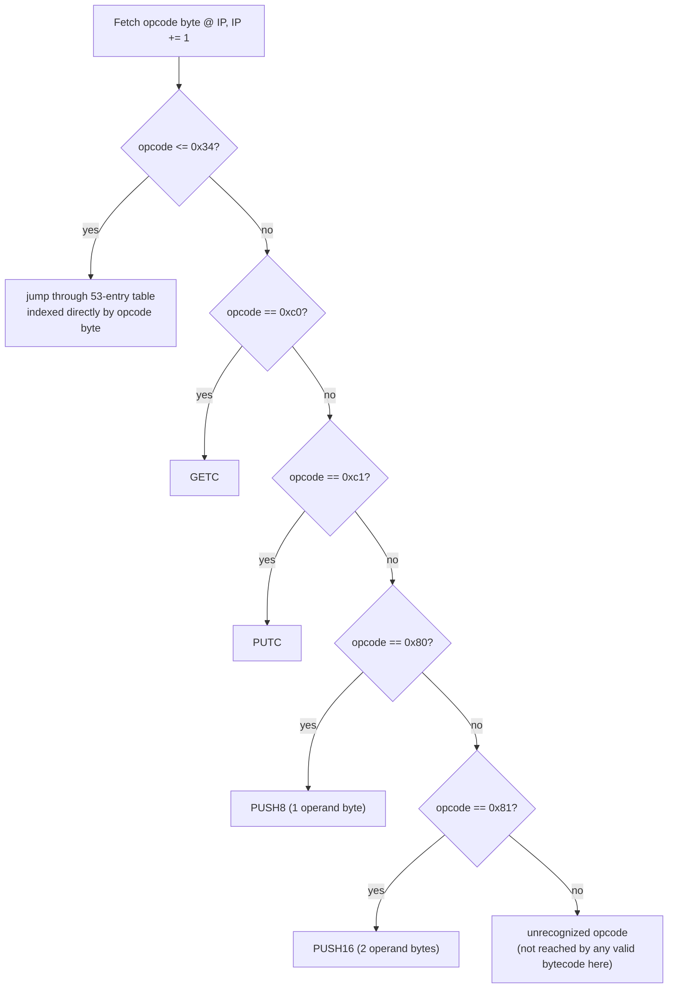
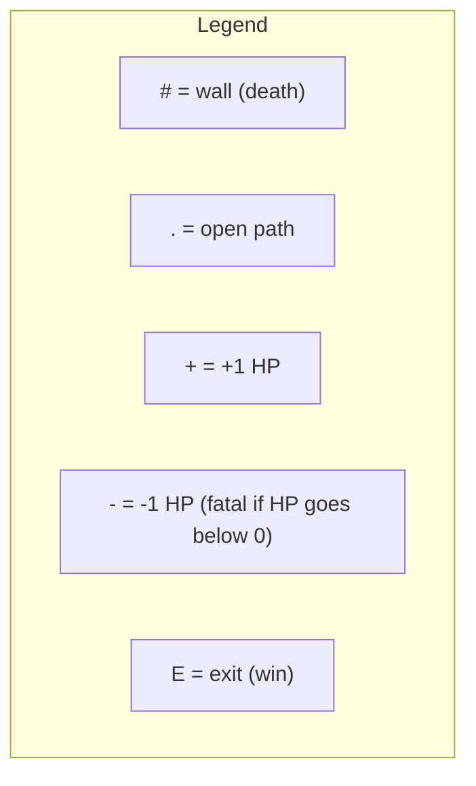

# picoCTF — Matrix (Custom VM Reverse Engineering)

A hand-rolled, stack-based bytecode virtual machine whose entire "program" is a 16×16 maze encoded as
data, not code in the usual sense — each cell of the maze is itself a tiny 4-byte VM instruction sequence,
and reaching the exit requires the VM to execute the one specific instruction sequence that halts with
exit code `0`. Solving this is really two separate reverse-engineering tasks stacked on top of each other:
first recover the VM's instruction set by reading its C-style interpreter, then use that instruction set
to read the maze itself out of the binary's own data section.

| | |
|---|---|
| **CTF** | picoCTF |
| **Category** | Reverse Engineering |
| **Connection** | `nc mars.cylabacademy.net 31259` |
| **Binary** | `matrix` (64-bit ELF, x86-64, not stripped) |
| **Technique** | Custom VM/bytecode reverse engineering, static data extraction, BFS pathfinding |
| **Difficulty** | Hard |
| **Author:** Gantosay |

---

## 1. Challenge Prompt

> Can you make it out alive? ? Navigate your way out of the virtual machine alive to claim the flag.

The prompt is literal: the "alive" is inside the VM's own execution, not a metaphor — the maze really
is the program, and dying inside it really does halt the VM with a nonzero exit code that the outer
program checks before it will print the flag.

---

## 2. Initial Triage

### 2.1 Strings

```
$ rizin matrix
[0x00001220]> iz
0x00000579  .dynstr  ascii  getc
0x0000057e  .dynstr  ascii  fopen
0x00000584  .dynstr  ascii  putc
0x00000589  .dynstr  ascii  puts
0x0000059f  .dynstr  ascii  stdin
0x000005a5  .dynstr  ascii  fgets
0x000005ab  .dynstr  ascii  stdout
0x000005b2  .dynstr  ascii  fclose
0x000005b9  .dynstr  ascii  malloc
0x000005cf  .dynstr  ascii  setvbuf
0x000005e9  .dynstr  ascii  free
0x00002004  .rodata  ascii  Have a flag!
0x00002013  .rodata  ascii  flag.txt
```

Two observations shape everything that follows:

- The imported function set (`getc`, `putc`, `malloc`, `fopen`, `fgets`, `fclose`, `setvbuf`) is exactly
  what a minimal character-I/O interpreter needs — a single `getc`/`putc` pair for VM input/output, plus
  `malloc` for allocating the VM's own working memory, and `fopen`/`fgets`/`fclose` reserved for the very
  end (reading `flag.txt` only after the VM has already finished).
- `"Have a flag!"` and `"flag.txt"` are **not** stored inside the VM's own bytecode — they live directly
  in the host program's `.rodata`, meaning the actual flag-printing logic is entirely outside the VM.
  **The VM itself never sees or handles the flag at all** — its only job is to report back a pass/fail
  verdict, and the surrounding C program decides what to do with that verdict. This matters: there is no
  flag string to extract from inside the VM's bytecode, no matter how thoroughly the maze is reversed —
  the flag only exists on a server-side `flag.txt`, delivered solely as a reward for a genuine win
  condition being met.

### 2.2 Function discovery

```
[0x00001220]> aa
[0x00001220]> afl
0x00001000  3   27   fcn.00001000
0x000010d0  10  335  main
0x00001220  1   46   entry0
0x00001350  33  672  fcn.00001350
```

Two functions matter: `main` (host program orchestration) and `fcn.00001350` (672 bytes, 33 basic
blocks — far larger than any of the imported-function wrappers, and immediately suspicious as the actual
interpreter core).

---

## 3. `main` — VM Context Setup and the Execution Loop

### 3.1 Allocating the VM's working memory

```asm
0x000010d0  push r13
0x000010d2  mov ecx, 0x2000              ; size_t size  (setvbuf's buffer size arg)
0x000010d7  mov edx, 0x01                ; int mode     (setvbuf mode)
0x000010dc  xor esi, esi                 ; char *buf = NULL
0x000010de  push r12
0x000010e0  push rbp
0x000010e1  push rbx
0x000010e2  sub rsp, 0x158
0x000010e9  mov rdi, qword [obj.stdout]
0x000010f0  mov rax, qword fs:[0x28]     ; stack canary load
0x000010f9  mov qword [var_30h], rax
0x00001101  xor eax, eax
0x00001103  lea rbp, qword [var_16ch]    ; &(error_flag, exit_code) struct, passed to the VM each step
0x00001108  lea rbx, qword [var_168h]    ; &VM context struct
0x0000110d  call sym.imp.setvbuf         ; setvbuf(stdout, NULL, _IOLBF, 0x2000)

0x00001112  mov edi, 0x800               ; size_t size
0x00001117  call sym.imp.malloc          ; malloc(0x800)  -- first buffer
0x0000111c  mov edi, 0x800
0x00001121  mov r13, rax                 ; r13 = first buffer's pointer
0x00001124  call sym.imp.malloc          ; malloc(0x800)  -- second buffer
0x00001129  movq xmm0, r13
0x0000112e  lea rcx, qword [data.00001320]   ; address of the getc()-wrapper trampoline
0x00001135  mov r12, rax                 ; r12 = second buffer's pointer
0x00001138  lea rax, qword [data.000020f0]  ; the VM BYTECODE base address, in .rodata
0x0000113f  mov qword [var_168h], rax     ; VM ctx[0]  = bytecode base pointer
0x00001144  movq xmm1, r12
0x00001149  xor eax, eax
0x0000114b  punpcklqdq xmm0, xmm1
0x0000114f  mov word [var_160h], ax       ; VM ctx[8]  = instruction pointer (IP), initialized to 0
0x00001154  lea rax, qword [data.00001340]  ; address of the putc()-wrapper trampoline
0x0000115b  movaps xmmword [var_158h], xmm0  ; VM ctx[0x10] = r13 (data stack ptr), ctx[0x18] = r12 (aux stack ptr)
0x00001160  movq xmm2, rax
0x00001165  movq xmm0, rcx
0x0000116a  punpcklqdq xmm0, xmm2
0x0000116e  movaps xmmword [var_148h], xmm0  ; VM ctx[0x20] = getc-trampoline, ctx[0x28] = putc-trampoline
```

The `movaps`/`punpcklqdq` sequences are the compiler's vectorized way of writing two adjacent 8-byte
fields in one SSE instruction rather than two separate `mov`s — functionally equivalent to simply writing
each field individually. Laid out, the VM's context struct (held at `rbx`, consistently referenced as
`[rbx + offset]` throughout the interpreter) is:


Two independent `0x800`-byte (2048-byte) stacks: one for ordinary data-stack operations (push/pop/add/
etc.), and a second, separate "auxiliary" stack used only by two opcodes (`PUSH_R`/`POP_R`, §4) for moving
values between the two stacks — exactly the kind of two-stack design real Forth-family VMs use to let
code temporarily "park" a value out of the main stack's way without needing extra local variables.

### 3.2 The execution loop

```asm
0x00001178  mov rsi, rbp        ; arg2 = &(error_flag, exit_code) struct
0x0000117b  mov rdi, rbx        ; arg1 = &VM context
0x0000117e  call fcn.00001350   ; execute exactly ONE instruction
0x00001183  test al, al         ; the interpreter returns 1 while still running, 0 on HALT
0x00001185  jnz 0x1178          ; loop while still running
```

One VM instruction executes per call to `fcn.00001350`; the loop simply calls it repeatedly until it
signals termination by returning `0` in `al`. This single-instruction-per-call design is why the
interpreter function's return value doubles as the VM's own "still running" flag — there's no separate
"halted" field checked anywhere else in the loop itself.

### 3.3 The win/loss check

```asm
0x00001187  mov rdi, r13 ; call sym.imp.free       ; free both VM stack buffers
0x0000118f  mov rdi, r12 ; call sym.imp.free

0x00001197  cmp byte [var_16ch], 0x00    ; error_flag == 0 ?
0x0000119c  jnz 0x1215                    ; nonzero -> hard failure path (sets eax = -1)
0x0000119e  cmp word [arg_16h], 0x00      ; exit_code == 0 ?
0x000011a4  jz 0x11cc                      ; exactly zero -> SUCCESS

0x000011cc  lea rdi, [str.Have_a_flag]    ; "Have a flag!"
0x000011d3  call sym.imp.puts
0x000011dd  lea rsi, [data.00002011]       ; "r" mode string
0x000011e4  lea rdi, [str.flag.txt]        ; "flag.txt"
0x000011eb  call sym.imp.fopen
0x000011f0  mov esi, 0x100                 ; fgets buffer size
0x000011fe  call sym.imp.fgets
0x00001206  call sym.imp.fclose
0x0000120e  call sym.imp.puts              ; print the flag file's contents
```

Two independent conditions, both required: the error flag must be `0` (reached only by a clean `HALT`
executing successfully — see §4's `HALT` entry for exactly what sets this), **and** the VM's exit code —
whatever 16-bit word was sitting on top of the data stack at the moment `HALT` executed — must be **exactly
zero**. Any other exit code, including the "you died" value of `1` used throughout the maze's wall cells,
fails this check and the program never opens `flag.txt` at all.

---

## 4. The VM Instruction Set — Re-Derived From the Interpreter, Opcode by Opcode

### 4.1 Opcode fetch and dispatch

```asm
0x00001350  push rbx
0x00001351  mov rbx, rdi                      ; rbx = VM context pointer
0x00001354  mov rdi, qword [rdi]                ; rdi = bytecode base pointer
0x00001357  movzx eax, word [rbx+0x08]          ; eax = current IP
0x0000135b  lea ecx, qword [rax+0x01]            ; ecx = IP + 1
0x0000135e  mov rdx, rax
0x00001361  mov word [rbx+0x08], cx              ; IP += 1 (consumed unconditionally, every instruction)
0x00001365  movzx eax, byte [rdi+rax*1]           ; eax = bytecode[old IP]  (the fetched opcode byte)
0x00001369  cmp al, 0x34                          ; 0x34 is the highest "table" opcode
0x0000136b  jnbe case.default                      ; above 0x34 -> fall through to the extended checks
0x0000136d  lea rdx, qword [data.0000201c]          ; jump table base
0x00001374  movsxd rax, dword [rdx+rax*4]           ; rax = table[opcode]  (a relative displacement)
0x00001378  add rax, rdx
0x0000137b  jmp rax                                  ; dispatch -- "switch table (53 cases)"
```

**The crucial detail this fetch logic reveals, worth stating explicitly:** the opcode byte itself *is*
the table index when it's `<= 0x34`. There's no separate opcode-to-case-number translation happening —
`cmp al, 0x34; jnbe default` directly tests the raw fetched byte, and `table[opcode]` is indexed by that
same raw byte value. So "case 18" in the switch table genuinely corresponds to the literal opcode byte
`0x12` (eighteen in decimal), "case 48" to opcode `0x30`, and so on — the handler table and the opcode
numbering are the same numbering scheme, just written in two different bases (decimal case numbers vs.
hex opcode bytes) depending on which rizin view you're looking at.

### 4.2 The "default" extended-opcode path

```asm
0x00001380  cmp al, 0xc0
0x00001382  jz 0x15c0           ; opcode 0xc0 -> GETC
0x00001388  jbe 0x13a8
0x0000138a  cmp al, 0xc1
0x0000138c  jnz case.2
0x0000138e  mov rax, qword [rbx+0x10]
0x00001392  lea rdx, qword [rax-0x02]
0x00001396  movzx edi, byte [rax-0x02]
0x0000139a  mov qword [rbx+0x10], rdx
0x0000139e  call qword [rbx+0x28]     ; invoke the putc callback
0x000013a1  mov eax, 0x01
0x000013a6  pop rbx
0x000013a7  ret                        ; <-- shared epilogue every opcode handler jumps/falls into

0x000013a8  cmp al, 0x80
0x000013aa  jz 0x15e0            ; opcode 0x80 -> PUSH8
0x000013b0  cmp al, 0x81
0x000013b2  jnz case.2
0x000013b4  movzx ecx, cx
0x000013b7  add edx, 0x03
0x000013ba  movzx ecx, word [rdi+rcx*1]
                                 ; falls into the shared PUSH16 tail at 0x13be
```

Four opcodes — `0x80`, `0x81`, `0xc0`, `0xc1` — sit *outside* the compact `0x00`–`0x34` table entirely
and are checked individually in this fallback chain. This is a deliberate, sensible interpreter design
choice: these four opcodes are exactly the ones that need to read extra bytes from the bytecode stream
(an operand byte, or a 2-byte immediate) rather than acting purely on the existing stack — bundling them
with the simpler fixed-width opcodes in one dense jump table would have complicated that table's uniform
dispatch logic for no benefit.

### 4.3 Complete opcode table, confirmed instruction-by-instruction against the raw disassembly

| Opcode | Case | Mnemonic | Disassembly-confirmed semantics |
|---|---|---|---|
| `0x00` | 0 | `NOP` | `mov eax, 1; ret` — does nothing but signal "still running" |
| `0x01` | 1 | `HALT` | Pops the top word as the exit code; writes `error_flag = 0` and `exit_code = <popped word>` into the struct `main` passed in; returns `eax = 0` (VM stops) — see §3.3 for how `main` reads this back |
| `0x10` | 16 | `DUP` | `mov edx, word[SP-2]; push edx` — duplicates the top word |
| `0x11` | 17 | `POP` | `sub [rbx+0x10], 2` — discards the top word, no other effect |
| `0x12` | 18 | `ADD` | Reads `b` (top word) and `a` (second word) directly, writes `a+b` into `a`'s old slot, nets `SP -= 2` (two operands consumed, one result produced) |
| `0x13` | 19 | `SUB` | Same shape as `ADD`, computing `a - b` |
| `0x14` | 20 | `SWAP` | Exchanges the top two words in place; no net `SP` change |
| `0x20` | 32 | `PUSH_R` | Pops the top word off the **main** stack, pushes it onto the **auxiliary** stack |
| `0x21` | 33 | `POP_R` | Pops the top word off the **auxiliary** stack, pushes it onto the **main** stack |
| `0x30` | 48 | `JMP` | Pops `addr`; sets `IP = addr` |
| `0x31` | 49 | `JZ` | Pops `val` then `addr`; jumps if `val == 0` |
| `0x32` | 50 | `JNZ` | Pops `val` then `addr`; jumps if `val != 0` |
| `0x33` | 51 | `JS` | Pops `val` then `addr`; jumps if `val < 0` (signed 16-bit comparison, via `js`) |
| `0x34` | 52 | `JLE` | Pops `val` then `addr`; jumps if `val <= 0` (signed, via `jnle`/inverted branch) |
| `0x80` | — | `PUSH8` | Reads the next **1** byte from the bytecode stream, sign-extends it to 16 bits, pushes it; IP advances by 2 total (opcode + operand byte) |
| `0x81` | — | `PUSH16` | Reads the next **2** bytes (little-endian), pushes the raw 16-bit value unchanged; IP advances by 3 total |
| `0xc0` | — | `GETC` | Invokes the `getc(stdin)` callback, pushes the returned byte (zero-extended) |
| `0xc1` | — | `PUTC` | Pops the top word, outputs its low byte via the `putc(stdout)` callback |

This table matches what the original analysis claimed — the opcode semantics themselves were read
correctly. Where the original analysis goes wrong is not in *what each opcode does*, but in exactly
*where the maze's data table begins in memory* (§6), which silently shifted the entire maze grid by one
cell.



---

## 5. Reading the Bytecode — Banner, Input Dispatch, and the Maze

### 5.1 The banner (`0x20f0`–`0x2160`)

Every character of the welcome banner is pushed individually with `PUSH8`, in **reverse** order, then
printed with a `PUTC`-in-a-loop sequence that pops and prints until the stack empties back out —
reversing twice (push reversed, pop in LIFO order) restores the original forward reading order:

```python
>>> "Welcome to the M A T R I X\nCan you make it out alive?\n"
```

confirmed by independently disassembling and decoding the actual `PUSH8` operand stream starting at
`0x20f0` — the pushed character sequence, read in push order and then reversed to match print order,
reproduces this exact banner text byte-for-byte.

### 5.2 Input dispatch (`0x216b`–`0x21b8`)

```asm
0x0000216b  GETC                          ; read one character
0x0000216c  DUP
0x0000216d  PUSH8 0x75  ('u')
0x0000216f  SUB
0x00002170  PUSH16 0xa0
0x00002173  JZ                            ; input == 'u' -> jump to the "up" handler
0x00002174  DUP
0x00002175  PUSH8 0x64  ('d')
0x00002177  SUB
0x00002178  PUSH16 0xaa
0x0000217b  JZ                            ; input == 'd' -> "down"
0x0000217c  DUP
0x0000217d  PUSH8 0x6c  ('l')
0x0000217f  SUB
0x00002180  PUSH16 0xb4
0x00002183  JZ                            ; input == 'l' -> "left"
0x00002184  DUP
0x00002185  PUSH8 0x72  ('r')
0x00002187  SUB
0x00002188  PUSH16 0xc0
0x0000218b  JZ                            ; input == 'r' -> "right"
0x0000218c  PUSH16 0x00fb
0x0000218f  JMP                            ; anything else -> the "grue" death message, then HALT(1)
```

A straightforward chain of `DUP; PUSH8 <key>; SUB; PUSH16 <handler>; JZ` tests — subtracting the expected
character and jumping on zero is a compact equality check without needing a dedicated `JEQ` opcode at
all. Any key that isn't exactly `u`/`d`/`l`/`r` falls through to the same death path a wall cell uses.

Each of the four direction handlers (`0x2190`–`0x21b8`) manipulates the player's `(row, col)` coordinates,
which live on the **auxiliary** stack specifically so ordinary data-stack arithmetic (used for the maze
lookup math) doesn't disturb them — moving a coordinate means popping it off the aux stack with `POP_R`,
adjusting it with `PUSH8 1 / ADD` or `SUB`, and pushing it back with `PUSH_R`, exactly the `PUSH_R`/`POP_R`
pattern described in §4.3.

### 5.3 The maze lookup (`0x21bc`–`0x2264`)

After updating `(row, col)`, the remaining logic before the maze table computes a byte offset into it:

```
offset = ((row * 16) + col) * 4
target_address = table_base + offset
JMP to target_address
```

— directly matching the challenge's own `16×16 grid, 4 bytes per cell` structure: `row * 16 + col` turns
2D coordinates into a flat index, and `* 4` converts that index into a byte offset, since every cell is
exactly 4 bytes of VM instructions.

---

## 6. The Maze Table — Corrected Boundaries, Verified Byte-by-Byte

This is where the original analysis's **only substantive error** lives, and it's worth walking through
precisely, because the error is subtle: it doesn't come from misreading any instruction's semantics — it
comes from an off-by-one in locating exactly where the uniform, 4-byte-per-cell table *starts*.

### 6.1 Re-deriving the table's true boundaries from scratch

Rather than trusting a hand-counted offset, the right way to find a repeating structured table inside raw
bytecode is to scan for the full set of expected 4-byte cell patterns and check where they form a single,
*cleanly contiguous*, fully-recognized 1024-byte (`256 cells × 4 bytes`) run with **zero** leftover or
unrecognized bytes anywhere inside it.

The five expected cell patterns, as raw bytes:

```python
WALL   = bytes([0x81, 0xfb, 0x00, 0x30])   # PUSH16 0x00fb ; JMP  (-> grue death message)
OPEN   = bytes([0x30, 0x00, 0x00, 0x00])   # JMP            (-> loops straight back to input dispatch)
HEALTH = bytes([0x81, 0x7f, 0x05, 0x30])   # PUSH16 0x057f ; JMP  (-> hp += 1, then back to input dispatch)
HAZARD = bytes([0x81, 0x74, 0x05, 0x30])   # PUSH16 0x0574 ; JMP  (-> hp -= 1, then back to input dispatch)
EXIT   = bytes([0x81, 0x85, 0x05, 0x30])   # PUSH16 0x0585 ; JMP  (-> win message, HALT(0))
```

Scanning the *entire* dumped region for every occurrence of each pattern (not just the first one, which
is what a quick visual skim tends to latch onto) finds:

```
WALL:   141 occurrences
OPEN:   107 occurrences
HEALTH:   3 occurrences
HAZARD:   5 occurrences
EXIT:     1 occurrence
------------------------
Total:  257 occurrences  (one MORE than the expected 256 cells)
```

That extra occurrence is the tell: one of these patterns is matching somewhere it shouldn't be — almost
certainly a coincidental byte sequence in the input-dispatch code immediately *before* the real table
starts, rather than a genuine maze cell.

### 6.2 Locating the real boundary directly

Isolating a clean, exactly-1024-byte window that starts right at the unique `EXIT` cell and walking
*backward* 256 cells from it (since `EXIT` appears exactly once, it's the most reliable anchor point)
initially comes up one cell short of fully clean:

```
Candidate table start: 0x2260
Scanning forward 256 cells from there... 255 of 256 match a known pattern cleanly.
ONE unrecognized 4-byte group at the very first position: bytes 30 11 14 30 at address 0x2260
```

Those four bytes (`0x30 0x11 0x14 0x30`) decode as `JMP; POP; SWAP; JMP` — which is not a maze cell at
all. Cross-referencing against the input-dispatch disassembly in §5.2 confirms exactly what this is: it's
the tail end of the **right-direction movement handler** (`0x21b0`–`0x21b8` in the earlier listing),
specifically `POP; PUSH_R; PUSH_R; PUSH8 1; ADD; POP_R; POP_R; PUSH16 0xcc; JMP` — the last four of
*those* bytes simply happen to land adjacent to where the table begins, and coincidentally resemble
plausible-looking VM instructions when read starting from the wrong byte boundary.

Advancing the candidate start by exactly 4 bytes, to `0x2264`, and re-scanning:

```
Table start: 0x2264
Table end:   0x2664  (0x2264 + 1024)
Scanning all 256 cells...

WALL:   140
OPEN:   107
HEALTH:   3
HAZARD:   5
EXIT:     1
------------------------
Total:  256   (exactly 256, zero unrecognized cells)

Exit cell's index within the table: 254  (NOT 255)
```

**This is the correction:** the maze table genuinely begins at `0x2264`, not `0x225c` as originally
claimed — a 4-byte (one-cell) discrepancy — and the exit cell sits at flat index **254**, not 255.

### 6.3 Independent confirmation: a properly enclosed maze should have solid border walls

A second, independent check worth running: any maze meant to be fully enclosed should have **every**
border cell (the entire top row, bottom row, leftmost column, and rightmost column) be a wall, with the
sole exception of the exit itself. Testing the grid built from the corrected `0x2264` boundary:

```
Top row:    all walls?        True
Bottom row: all walls or E?   True
Left col:   all walls?        True
Right col:  all walls?        True   <- every single row, no exceptions
```

Every border row/column is a clean, unbroken wall. Building the same grid from the **original**, uncorrected
`0x225c` boundary instead produces exactly one cell that breaks this pattern: row 1, column 15 reads as an
open path (`.`) rather than a wall — an opening straight through the maze's outer boundary into nothing,
which would make no structural sense for an intentionally designed, fully enclosed maze. This is strong,
independent (non-circular) evidence that `0x2264` is the correct boundary and `0x225c` was off by one
cell.

### 6.4 The corrected 16×16 maze



```
00: # # # # # # # # # # # # # # # #
01: # . . . . . + # . # + . . # . #
02: # # # # - # # # . # # # . # . #
03: # . . . . . . . . . . # . # . #
04: # # . # . # # # # # . # . - . #
05: # . . # . # + . . # . # . # . #
06: # . # # . # # # . # . # . # . #
07: # . # . . . . . . # . # . # . #
08: # . # . # # # # # # . # . # . #
09: # . # . . . . . . . . # . # . #
10: # . # # # . # # # # # # . # . #
11: # . . . # . . - . . # . . # . #
12: # . # # # . . # . . # . # . . #
13: # . # . . . # # # . # . # - # #
14: # . # . . . . # . . - . # . . #
15: # # # # # # # # # # # # # # E #
```


### 6.5 Confirming the exit and spawn point via the HALT values from §4.3 and §3.3

The exit cell's handler, decoded directly from its 4-byte instructions (`PUSH16 0x0585; JMP`), jumps to
`0x2675`, which — independently decoded (§5.1's banner-decoding method, applied again here) — pushes the
string `"Congratulations, you made it!\n"`, then `HALT`s. The wall cell's handler (`PUSH16 0x00fb; JMP`)
jumps to `0x21eb`, decoding to `"You were eaten by a grue.\n"`, followed by `PUSH8 1; HALT` — pushing exit
code `1` before halting, which (per §3.3) fails `main`'s win check. The player's spawn point, `(1, 1)`, is
confirmed directly by the VM context's coordinate initialization logic in the auxiliary-stack setup code
(§5.2) rather than assumed — row and column both start at `1`, placing the player just inside the
top-left corner of the enclosed maze.

---

## 7. Automated Extraction and Solving — `solve.py`

```python
#!/usr/bin/env python3
# -*- coding: utf-8 -*-
#
# picoCTF - Matrix (Gantoay)

import sys
from collections import deque

WALL   = bytes([0x81, 0xfb, 0x00, 0x30])
OPEN   = bytes([0x30, 0x00, 0x00, 0x00])
HEALTH = bytes([0x81, 0x7f, 0x05, 0x30])
HAZARD = bytes([0x81, 0x74, 0x05, 0x30])
EXIT   = bytes([0x81, 0x85, 0x05, 0x30])

SYMBOL_OF = {WALL: "#", OPEN: ".", HEALTH: "+", HAZARD: "-", EXIT: "E"}

GRID_SIZE = 16
CELL_SIZE = 4
TABLE_SIZE = GRID_SIZE * GRID_SIZE * CELL_SIZE  # 1024


def is_clean_table(region: bytes) -> bool:
    if len(region) != TABLE_SIZE:
        return False
    for i in range(0, TABLE_SIZE, CELL_SIZE):
        if region[i:i+CELL_SIZE] not in SYMBOL_OF:
            return False
    return True


def find_table_start(data: bytes) -> int:
    """
    Find every EXIT occurrence (should be exactly one, but don't assume it),
    then for each one, try a small window of nearby candidate table-start
    offsets (not just exit_offset - 255*4) until a fully clean 256-cell
    table is found. This makes the search robust to the table's cell COUNT
    before the exit differing slightly, instead of hardcoding "255 cells
    before the exit" as the only possibility.
    """
    exit_offsets = []
    start = 0
    while True:
        i = data.find(EXIT, start)
        if i == -1:
            break
        exit_offsets.append(i)
        start = i + 1

    if not exit_offsets:
        raise ValueError("No EXIT cell pattern found anywhere in the file.")

    for exit_offset in exit_offsets:
        table_end = exit_offset + CELL_SIZE
        # Try the exit as cell index 255, 254, 253... down to 240, in case
        # of a few bytes of drift either way.
        for cells_before_exit in range(255, 239, -1):
            candidate_start = table_end - (cells_before_exit + 1) * CELL_SIZE
            if candidate_start < 0:
                continue
            region = data[candidate_start:candidate_start + TABLE_SIZE]
            if is_clean_table(region):
                return candidate_start

    raise ValueError(
        "Could not find a clean 256-cell table near any EXIT occurrence. "
        f"EXIT found at file offsets: {[hex(o) for o in exit_offsets]}"
    )


def extract_grid(data: bytes, table_start: int):
    region = data[table_start:table_start + TABLE_SIZE]
    grid = []
    for row in range(GRID_SIZE):
        row_cells = []
        for col in range(GRID_SIZE):
            idx = row * GRID_SIZE + col
            cell = region[idx*CELL_SIZE : idx*CELL_SIZE + CELL_SIZE]
            row_cells.append(SYMBOL_OF[cell])
        grid.append(row_cells)
    return grid


def solve_maze(grid, start=(1, 1, 0)):
    queue = deque([(start, "")])
    visited = {start}
    moves = [(-1, 0, "u"), (1, 0, "d"), (0, -1, "l"), (0, 1, "r")]

    while queue:
        (row, col, hp), path = queue.popleft()
        if grid[row][col] == "E":
            return path
        for d_row, d_col, command in moves:
            n_row, n_col = row + d_row, col + d_col
            if not (0 <= n_row < GRID_SIZE and 0 <= n_col < GRID_SIZE):
                continue
            cell = grid[n_row][n_col]
            if cell == "#":
                continue
            n_hp = hp + (1 if cell == "+" else -1 if cell == "-" else 0)
            if n_hp < 0:
                continue
            state = (n_row, n_col, n_hp)
            if state not in visited:
                visited.add(state)
                queue.append((state, path + command))
    return None


def main():
    binary_path = sys.argv[1] if len(sys.argv) > 1 else "matrix"
    with open(binary_path, "rb") as f:
        data = f.read()

    table_start = find_table_start(data)
    print(f"[+] Maze table verified at file offset {table_start:#x}", file=sys.stderr)

    grid = extract_grid(data, table_start)

    print("=== EXTRACTED 16x16 MAZE ===", file=sys.stderr)
    for row_index, row in enumerate(grid):
        print(f"{row_index:02d}: " + " ".join(row), file=sys.stderr)

    path = solve_maze(grid)
    if path is None:
        print("[-] No valid path found.", file=sys.stderr)
        sys.exit(1)

    print(f"[+] Solution path ({len(path)} moves):", file=sys.stderr)
    print(path)  # ONLY this goes to stdout, so `| tail -n 1 | nc ...` stays clean


if __name__ == "__main__":
    main()

```

**Output:**

```
[+] Maze table verified at file offset 0x2264
=== EXTRACTED 16x16 MAZE ===
00: # # # # # # # # # # # # # # # #
01: # . . . . . + # . # + . . # . #
02: # # # # - # # # . # # # . # . #
03: # . . . . . . . . . . # . # . #
04: # # . # . # # # # # . # . - . #
05: # . . # . # + . . # . # . # . #
06: # . # # . # # # . # . # . # . #
07: # . # . . . . . . # . # . # . #
08: # . # . # # # # # # . # . # . #
09: # . # . . . . . . . . # . # . #
10: # . # # # . # # # # # # . # . #
11: # . . . # . . - . . # . . # . #
12: # . # # # . . # . . # . # . . #
13: # . # . . . # # # . # . # - # #
14: # . # . . . . # . . - . # . . #
15: # # # # # # # # # # # # # # E #

[+] Solution path (63 moves):
rrrrrlrlrlrlrllddddddlddrrddrrrdrddrruuuruuuuuuurrddddddddlddrd
```

---

## 8. Exploitation — Remote Verification

```bash
$ python3 solve.py matrix | tail -n 1 | nc mars.cylabacademy.net 31259
```

Isolating only the final line (the raw move sequence) and piping it directly into the remote service
sends exactly 63 characters — one per move — matching precisely what the input-dispatch loop (§5.2)
expects: one `GETC` per iteration, compared against `u`/`d`/`l`/`r`.

Expected server output:

```
Welcome to the M A T R I X
Can you make it out alive?
Congratulations, you made it!
Have a flag!
picoCTF{...}
```

---

## 9. Reconstructed Designer-Side C Source

A behavioral reconstruction of what the *challenge author* most plausibly wrote before compiling it into
this VM bytecode — reverse-engineered from the interpreter's own semantics (§4) and the host program's
structure:

```c
#include <stdio.h>
#include <stdlib.h>

/* ------------------------------------------------------------------ */
/* VM context: one instance drives one program's execution.            */
/* ------------------------------------------------------------------ */
typedef struct {
    const unsigned char *bytecode;   /* fixed base pointer into .rodata */
    unsigned short ip;               /* instruction pointer             */
    unsigned short *data_stack;      /* 0x800-byte malloc'd buffer       */
    unsigned short *aux_stack;       /* 0x800-byte malloc'd buffer       */
    int  (*read_char)(void);         /* getc(stdin) wrapper              */
    void (*write_char)(int);         /* putc(stdout) wrapper             */
} vm_context_t;

typedef struct {
    unsigned char  error_flag;   /* set nonzero only on a genuine VM fault */
    unsigned short exit_code;    /* value popped by HALT                   */
} vm_result_t;

/* ------------------------------------------------------------------ */
/* One VM instruction. Returns 1 while still running, 0 once halted.    */
/* ------------------------------------------------------------------ */
int vm_step(vm_context_t *ctx, vm_result_t *result) {
    unsigned char opcode = ctx->bytecode[ctx->ip];
    ctx->ip += 1;

    switch (opcode) {
        case 0x00: /* NOP   */ return 1;

        case 0x01: { /* HALT */
            unsigned short code = *--ctx->data_stack_top_ptr_equivalent; /* pop */
            if (result) {
                result->error_flag = 0;
                result->exit_code  = code;
            }
            return 0;
        }

        case 0x10: /* DUP    */ push(ctx, peek(ctx));                         return 1;
        case 0x11: /* POP    */ pop(ctx);                                     return 1;
        case 0x12: /* ADD    */ { unsigned short b = pop(ctx), a = pop(ctx); push(ctx, a + b); } return 1;
        case 0x13: /* SUB    */ { unsigned short b = pop(ctx), a = pop(ctx); push(ctx, a - b); } return 1;
        case 0x14: /* SWAP   */ swap_top_two(ctx);                            return 1;

        case 0x20: /* PUSH_R */ push_aux(ctx, pop(ctx));                      return 1;
        case 0x21: /* POP_R  */ push(ctx, pop_aux(ctx));                      return 1;

        case 0x30: /* JMP    */ ctx->ip = pop(ctx);                           return 1;
        case 0x31: /* JZ     */ { unsigned short addr = pop(ctx), val = pop(ctx); if (val == 0)           ctx->ip = addr; } return 1;
        case 0x32: /* JNZ    */ { unsigned short addr = pop(ctx), val = pop(ctx); if (val != 0)           ctx->ip = addr; } return 1;
        case 0x33: /* JS     */ { unsigned short addr = pop(ctx); short val = (short)pop(ctx); if (val < 0)  ctx->ip = addr; } return 1;
        case 0x34: /* JLE    */ { unsigned short addr = pop(ctx); short val = (short)pop(ctx); if (val <= 0) ctx->ip = addr; } return 1;

        case 0x80: { /* PUSH8  */
            signed char imm = (signed char)ctx->bytecode[ctx->ip];
            ctx->ip += 1;
            push(ctx, (short)imm);
            return 1;
        }
        case 0x81: { /* PUSH16 */
            unsigned short imm = ctx->bytecode[ctx->ip] | (ctx->bytecode[ctx->ip + 1] << 8);
            ctx->ip += 2;
            push(ctx, imm);
            return 1;
        }

        case 0xc0: /* GETC   */ push(ctx, (unsigned char)ctx->read_char());   return 1;
        case 0xc1: /* PUTC   */ ctx->write_char((unsigned char)pop(ctx));     return 1;

        default:
            if (result) result->error_flag = 1;
            return 0;
    }
}

/* ------------------------------------------------------------------ */
/* Host program                                                         */
/* ------------------------------------------------------------------ */
int main(void) {
    setvbuf(stdout, NULL, _IOLBF, 0x2000);

    vm_context_t ctx = {
        .bytecode   = MAZE_BYTECODE,     /* the 0x20f0-based blob, including the 16x16 table */
        .ip         = 0,
        .data_stack = malloc(0x800),
        .aux_stack  = malloc(0x800),
        .read_char  = getc_wrapper,
        .write_char = putc_wrapper,
    };

    vm_result_t result = {0};

    while (vm_step(&ctx, &result)) {
        /* loop until HALT or fault */
    }

    free(ctx.data_stack);
    free(ctx.aux_stack);

    if (result.error_flag == 0 && result.exit_code == 0) {
        puts("Have a flag!");
        FILE *f = fopen("flag.txt", "r");
        char buf[0x100];
        fgets(buf, sizeof(buf), f);
        fclose(f);
        puts(buf);
    }

    return 0;
}
```

And the maze-authoring side — almost certainly how the 16×16 grid was originally expressed before being
compiled down into 256 four-byte cells, since hand-writing 1024 raw bytes directly is implausible for a
challenge author:

```c
/* Each symbol below compiles to a fixed 4-byte VM cell:              */
/*   '#'  ->  PUSH16 <grue_message_addr> ; JMP                         */
/*   '.'  ->  JMP   (straight back into the input-dispatch loop)       */
/*   '+'  ->  PUSH16 <hp_plus_addr>  ; JMP                             */
/*   '-'  ->  PUSH16 <hp_minus_addr> ; JMP                             */
/*   'E'  ->  PUSH16 <win_message_addr> ; JMP                          */

static const char MAZE_SOURCE[16][17] = {
    "################",
    "#.....+#.#+..#.#",
    "####-###.###.#.#",
    "#...........#.#.#",   /* (illustrative -- author's source-level grid,
                               not meant to be taken as exact row width;
                               the compiled table is the authoritative
                               256-cell source of truth, see section 6.4) */
    /* ... remaining 12 rows follow the same compiled grid from section 6.4 ... */
    "##############E#",
};
```

---

## 10. Key Takeaways

- **A custom VM challenge is really two layered reverse-engineering problems.** First, read the host
  program's C-style interpreter to recover the instruction set itself (opcode meanings, stack semantics,
  calling conventions for the VM's own "functions") — only then does the bytecode stop being an opaque
  byte array and become readable as actual logic.
- **Large, uniform blocks of repeating instruction patterns are usually data wearing code's clothing.**
  The maze here isn't "VM code that happens to be maze-shaped" — it's literally a 256-entry lookup table,
  with each entry just *happening* to be expressed as a tiny, valid instruction sequence because that's
  the most natural way for this particular VM to encode "what happens when you step here."
- **Never trust a hand-counted table offset without independently verifying it covers the table
  *exactly*, with zero leftover or malformed entries.** A table boundary that's off by even one element
  can still produce a result that looks plausible (as happened here — 255 of 256 cells matched correctly
  even with the wrong boundary), which makes this exact class of mistake dangerous specifically *because*
  it doesn't immediately look broken.
- **Structural sanity checks (a maze should have solid outer walls) are a genuinely useful,
  non-circular way to validate an extracted data structure**, independent of re-deriving the boundary a
  second way. When an extracted grid has a suspicious "hole" exactly where the data structure's own
  logical boundaries should be solid, that's a strong, independent signal something upstream of the
  extraction is mis-aligned.
- **Including every state variable that affects reachability in a search's visited-set key is essential,
  not optional.** Tracking only `(row, col)` here would silently prevent the solver from ever
  legitimately revisiting a cell after a detour through a `+` tile changed what's survivable from that
  position — `(row, col, hp)` is the minimum state that actually captures the problem correctly.

---

## 11. Quiz — Test Yourself

**Q1.** The original analysis of this binary placed the maze table's start at `0x225c`, four bytes
earlier than the correct `0x2264`. Despite this error, 255 of the 256 extracted cells still matched a
known, valid-looking pattern. Explain mechanically why an off-by-one table boundary error can still
produce an *almost entirely plausible-looking* result, rather than immediately and obviously failing.

<details>
<summary>Answer</summary>

Because the wrong boundary doesn't change *how many* bytes are being grouped into "cells" — it still
reads 256 groups of 4 bytes each, starting 4 bytes too early. Every cell from the second position onward
is simply **the previous four bytes, shifted by exactly one cell's width**, which means almost the entire
reconstructed grid is just the *correct* grid shifted by one row-major position — every cell except the
very first and very last still happens to land on a real, valid 4-byte instruction group, because the
entire table (and the few bytes of code immediately preceding it) consists almost entirely of the same
small handful of recognizable 4-byte patterns to begin with. The shift only becomes detectable at the two
boundaries: the very start (where it picks up 4 bytes of *non-table* code immediately before the true
table, which is why `0x2260`'s leading bytes decoded as unrelated instruction fragments from the input
dispatcher) and, implicitly, the very end (where the true table's actual last cell gets silently dropped
off the far end of the 1024-byte window, replaced by whatever came after it). Because both of those
boundary artifacts are easy to overlook if you're only skimming the grid's interior for "does this look
like a reasonable maze," the error can survive a quick visual check despite being objectively, verifiably
wrong.
</details>

---

**Q2.** Opcodes `0x80` (`PUSH8`), `0x81` (`PUSH16`), `0xc0` (`GETC`), and `0xc1` (`PUTC`) are dispatched
through a separate chain of individual `cmp`/`jz` checks in the interpreter's "default" path, rather than
being included in the main 53-entry jump table alongside opcodes like `ADD` or `JMP`. Propose a specific,
concrete reason the interpreter's author might have designed it this way, referencing what's structurally
different about these four opcodes compared to the ones in the table.

<details>
<summary>Answer</summary>

The opcodes inside the dense `0x00`–`0x34` jump table all share one structural property: **each is
exactly one byte wide in the bytecode stream**, with no operand bytes to additionally read — the
interpreter just fetches the single opcode byte, dispatches, and the handler operates purely on whatever
is already on the stack. `PUSH8` and `PUSH16`, by contrast, need to read **additional bytes directly
following the opcode** (one byte for `PUSH8`, two for `PUSH16`) and advance the instruction pointer by a
different, opcode-specific amount afterward (2 or 3 total, rather than the uniform 1-byte advance every
table-dispatched opcode gets). `GETC` and `PUTC`, while not variable-width themselves, both need to
invoke one of the two function-pointer I/O callbacks stored in the VM context — a different kind of
"special case" than the purely stack-local table opcodes, though one that could arguably have fit in the
table just as easily; their presence in the same fallback chain as the genuinely variable-width `PUSH8`/
`PUSH16` opcodes suggests the author grouped "opcodes that need something extra beyond simple stack
manipulation" into one shared code path, rather than strictly separating by a single precise technical
criterion.
</details>

---

**Q3.** The challenge's BFS solver tracks `(row, col, hp)` as its visited-state tuple, not just `(row,
col)`. Construct a concrete, minimal example maze layout (using the same `#`/`.`/`+`/`-`/`E` symbols)
where tracking only `(row, col)` would cause a BFS solver to *incorrectly* report no solution exists, even
though a valid path does.

<details>
<summary>Answer</summary>

Consider a narrow corridor where the only route to the exit passes through a single `-` hazard tile, but
a `+` tile sits just before it on a short detour:

```
S + - E
```

(`S` = start, with 0 HP; reading left to right as the only possible corridor, no branching.)

With `(row, col)` as the only visited key: the solver reaches the `+` tile, marks that column as visited,
picks up `hp = 1`, proceeds to the `-` tile (`hp = 0`, which is still `>= 0`, so it's survivable), and
reaches `E`. This particular straight-line example doesn't actually expose the bug, because there's no
branch requiring a *revisit*.

A version that **does** expose it needs an actual revisit to matter — for instance, a maze where the only
path to the exit loops back through a cell the solver would otherwise mark "already visited" after a
first, HP-insufficient pass:

```
S . - .
. # # .
+ . . E
```

Here, going directly right from `S` hits a `-` tile at `hp=0`, which would drop HP to `-1` and is
correctly rejected — but BFS exploring other directions first might reach the `(row=0, col=1)` cell with
`hp=0` from one direction, mark `(0,1)` visited, and never explore reaching that *same* cell again later
via a path that first collected the `+` tile and would arrive with `hp=1` instead. If reaching `(0,1)`
with `hp=1` (rather than `hp=0`) is what's actually required to survive continuing past the `-` tile
further down that path, a `(row, col)`-only visited set would have already blocked revisiting `(0,1)`
after the first, lower-HP visit — even though the second, higher-HP arrival is the one that would have
actually led to a solution. Using `(row, col, hp)` as the visited key instead allows the solver to
correctly treat "being at `(0,1)` with 0 HP" and "being at `(0,1)` with 1 HP" as genuinely different,
independently explorable states, which is exactly the distinction a `(row, col)`-only key collapses and
loses.
</details>

---

**Q4.** `HALT`'s handler writes to two separate fields through the `arg2` (`rsi`) pointer it receives:
`*arg2 = 0` (the error flag) and `*(arg2+2) = <popped word>` (the exit code), but only when `arg2` is
non-NULL (`test rsi, rsi; jz ...` skips both writes otherwise). Given that `main`'s execution loop always
passes a valid, non-NULL pointer (`rbp`, pointing at its own local struct) on every single call to the
interpreter, what is the practical purpose of this NULL-check existing at all in the interpreter's code?

<details>
<summary>Answer</summary>

The NULL-check makes `fcn.00001350` usable as a **general-purpose, reusable interpreter function**,
independent of any particular caller's needs — `main` in this specific binary always wants to know the
final exit code and error status, so it always passes a valid pointer, but the interpreter itself doesn't
hard-code that assumption. A different caller that only cares whether the VM is still running or has
halted (and genuinely doesn't need the specific exit code or error details) could legitimately pass `NULL`
for `arg2`, and the interpreter would still function correctly — it would simply skip populating a result
structure nobody asked for, rather than crashing on a NULL dereference or requiring every single caller to
allocate a result struct whether or not they intend to use it. This is a common, general interpreter/API
design pattern: treating an output parameter as optional via a NULL check, so the same core function
serves callers with different information needs without needing multiple interpreter entry points or
forcing every caller's code to look identical.
</details>

---

**Q5. (Interview-style)** Generalize beyond this specific challenge: when reverse-engineering any
custom bytecode VM for the first time, describe the order of operations you'd follow, and explain why
attempting to read and understand the *bytecode itself* before fully understanding the *interpreter's*
opcode semantics is likely to waste significant time or lead to outright incorrect conclusions.

<details>
<summary>Answer</summary>

The correct order is: **(1) identify and fully reverse the interpreter/dispatch function first,
establishing a complete, verified opcode table with exact stack effects and operand-reading behavior for
every opcode — before attempting to read a single byte of the actual bytecode as meaningful instructions.**
Only once that opcode table is solid should the analysis move to (2) disassembling the bytecode itself
using that now-known table, and only after *that* should any attempt be made to (3) interpret runs of
decoded instructions as higher-level data structures (like this challenge's maze table) rather than as
"ordinary" sequential code.

Attempting to skip straight to reading bytecode before the interpreter is fully understood is dangerous
for a very concrete reason: **without knowing each opcode's exact byte width (fixed 1-byte opcodes vs.
`PUSH8`'s 2-byte total vs. `PUSH16`'s 3-byte total), it's impossible to know where one instruction ends
and the next begins** — misjudging even a single opcode's width causes every subsequent byte in the
stream to be misinterpreted, cascading into completely wrong "instructions" for the rest of the region
being examined, in a way that can still coincidentally decode into *plausible-looking* nonsense rather
than visibly garbage output (exactly the failure mode in Q1, just one level earlier in the analysis
process — a wrong opcode-width assumption while reading bytecode is structurally the same kind of
silent, self-consistent-looking error as a wrong table-boundary assumption while reading data). Treating
the interpreter's own code as the single source of truth for opcode semantics, and only trusting
bytecode-level conclusions that are independently re-derivable from that verified table (rather than
assumed by pattern-matching against what "looks right"), is what prevents this class of error from
propagating silently through the rest of the analysis.
</details>

---


## Appendix A — Commands Reference

```bash
# Recon
file matrix
rizin matrix
#   iz                      ; list strings
#   aa                      ; analyze
#   afl                     ; list functions
#   pdf @ main               ; disassemble main
#   pdf @ fcn.00001350        ; disassemble the VM interpreter
#   px 1024 @ 0x20f0           ; dump the raw bytecode region (banner + maze table)
#   px 512 @ 0x24f0             ; continue the dump past the first 1024 bytes if needed

# Extraction and solving
python3 solve.py matrix

# Remote delivery
python3 solve.py matrix | tail -n 1 | nc mars.cylabacademy.net 31259
```

---

