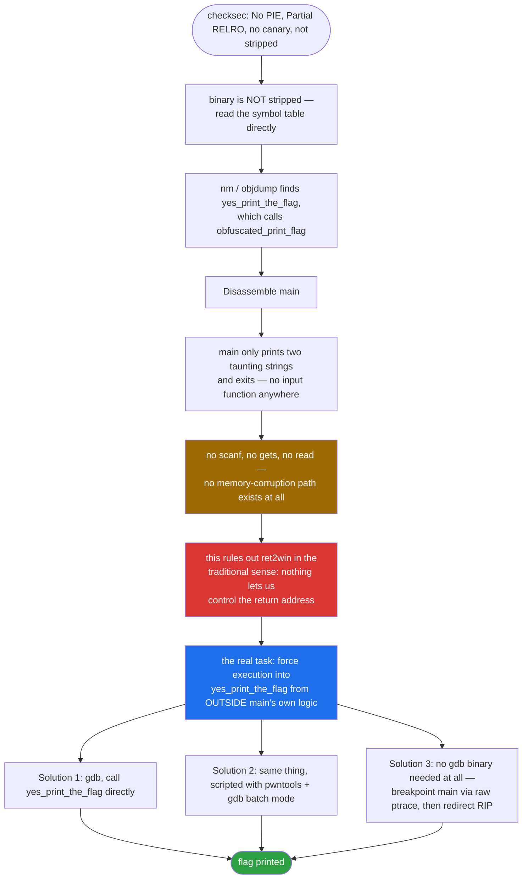
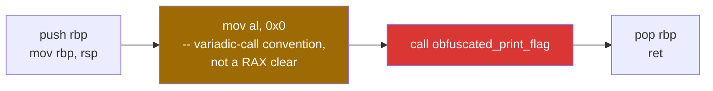
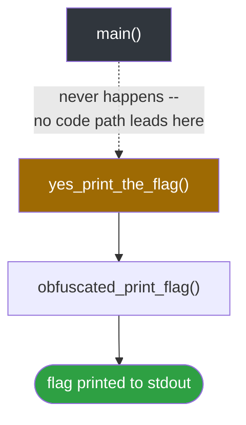
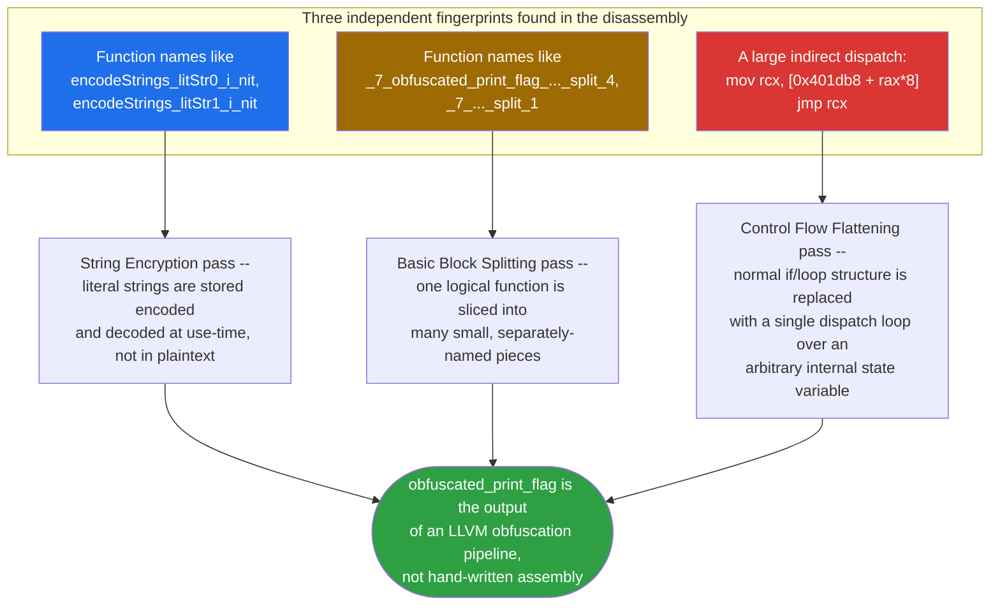
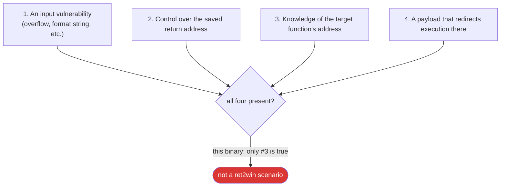
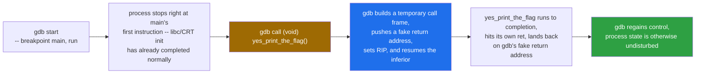
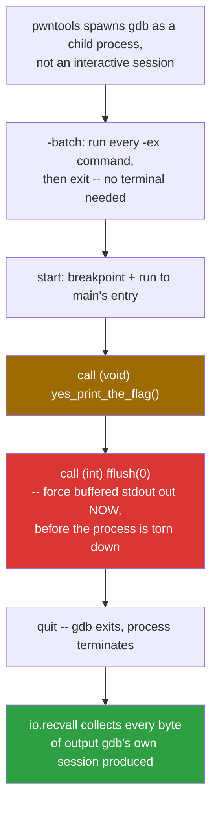
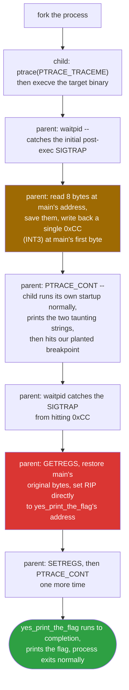

<div align="center">

# ☎️ 1-Call

### SPBCTF Writeup · Reverse Engineering · A Flag-Printing Function That Exists, but Is Never Called


*No overflow. No corrupted return address. No ROP chain. Just a function sitting in the binary, fully intact, that `main()` simply never gets around to calling.*

</div>

---

## 📌 TL;DR

The binary `mc1` prints two taunting messages from `main()` and exits — no buffer overflow, no `scanf`/`gets`/`read` anywhere for an attacker to abuse. But the symbol table (the binary isn't stripped) reveals a function called `yes_print_the_flag`, which calls a second function, `obfuscated_print_flag`, which prints the real flag. Nothing in the program's normal control flow ever reaches either of them. The challenge isn't "find a bug" — it's "make the CPU execute code that already exists but is simply unreachable through the program's intended logic." Three independent ways to do that are documented below, from the simplest (an interactive debugger command) to a dependency-free alternative built directly on the `ptrace` syscall.

```
main() -> prints "Nope..." -> exits          (the path the program actually takes)
yes_print_the_flag() -> obfuscated_print_flag() -> flag    (the path that exists, but is never called)
```

| | |
|---|---|
| **Binary** | `mc1` — ELF 64-bit, dynamically linked, **No PIE**, not stripped |
| **Vulnerability class** | None in the traditional sense — this is **dead-but-present code**, not memory corruption |
| **Why `ret2win` doesn't apply** | There is no overflow, no `scanf`/`gets`/`read`, and no way to redirect a return address — `main()` simply never calls the flag function |
| **Core technique** | Force execution into `yes_print_the_flag` from outside the program's own logic |
| **Solutions presented** | (1) Interactive GDB function call, (2) the same thing automated with pwntools, (3) a GDB-free alternative using raw `ptrace` |
| **Flag** | `spbctf{jumpy_jump_t0_th3_n33ded_func}` |

---

## 🗺️ Table of Contents

1. [Binary Security Analysis](#1--binary-security-analysis)
2. [Inspecting the Binary](#2--inspecting-the-binary)
3. [Understanding the Assembly](#3--understanding-the-assembly)
4. [Understanding `main`](#4--understanding-main)
5. [What `obfuscated_print_flag` Actually Is](#5--what-obfuscated_print_flag-actually-is-and-why-its-hard-to-read-statically)
6. [Why This Is Not a `ret2win`](#6--why-this-is-not-a-ret2win)
7. [Solution 1 — Manual GDB Invocation](#7--solution-1--manual-gdb-invocation)
8. [Solution 2 — Automating With Pwntools + GDB](#8--solution-2--automating-with-pwntools--gdb)
9. [Solution 3 — A GDB-Free Alternative With Raw `ptrace`](#9--solution-3--a-gdb-free-alternative-with-raw-ptrace)
10. [Comparing the Three Approaches](#10--comparing-the-three-approaches)
11. [Key Takeaways](#11--key-takeaways)
12. [Self-Quiz](#12--self-quiz)

---

## 🧭 Solve Flow at a Glance



---

## 1. 🛡️ Binary Security Analysis

```text
Arch:       amd64-64-little
RELRO:      Partial RELRO
Stack:      No canary found
NX:         NX enabled
PIE:        No PIE (0x400000)
Stripped:   No
```

| Protection | Status | Relevance here |
|---|---|---|
| **PIE** | Disabled | Every function address is fixed across runs — `yes_print_the_flag` is reliably at `0x4004f0` every single time, which is exactly what both GDB-based solutions and the ptrace-based solution depend on. |
| **Stack Canary** | Disabled | Irrelevant to this challenge: there is no overflow to protect against in the first place. |
| **NX** | Enabled | Irrelevant: no shellcode is ever written or executed; every solution below redirects execution to code that is already compiled into the binary. |
| **RELRO** | Partial | Irrelevant: none of the three solutions touch the GOT. |
| **Stripped** | No | **This is the single most important line.** With symbols intact, `nm`/`objdump`/GDB all show function *names*, not just raw addresses — which is exactly how `yes_print_the_flag` gets found in the first place, no cross-reference hunting required. |

**The honest conclusion from `checksec` alone:** these protections describe the binary's general hardening posture, but none of them is the actual obstacle in this challenge. The real question isn't "how do we bypass a mitigation" — it's "how do we execute a function the program itself never calls."

---

## 2. 🔎 Inspecting the Binary

```bash
objdump -d -M intel mc1 > disassembly.txt
grep -n -A20 -B5 "yes_print_the_flag" disassembly.txt
```

```asm
00000000004004f0 <yes_print_the_flag>:
  4004f0: push   rbp
  4004f1: mov    rbp,rsp
  4004f4: mov    al,0x0
  4004f6: call   4009e0 <obfuscated_print_flag>
  4004fb: pop    rbp
  4004fc: ret
```

The function name is a direct hint, and the disassembly confirms it: `yes_print_the_flag` does exactly one meaningful thing — call `obfuscated_print_flag`, which is where the real flag-printing logic lives.

---

## 3. 🧩 Understanding the Assembly



### Function prologue

```asm
push rbp
mov rbp, rsp
```

Standard x86-64 frame setup — save the caller's base pointer, establish a new frame.

### Setting `AL` to zero

```asm
mov al, 0x0
```

`AL` is the low 8 bits of `RAX`. On the System V AMD64 ABI, `AL` carries a special meaning specifically for **variadic function calls**: it tells the callee how many **vector (SSE/AVX) registers** were used to pass floating-point arguments. Setting it to `0` here says "no floating-point arguments were passed in vector registers" — a routine convention, not a meaningful clearing of `RAX` itself. (`obfuscated_print_flag` presumably calls `printf` or a similar variadic function somewhere inside it, which is why this convention shows up here at all.)

### Calling the hidden function

```asm
call 4009e0 <obfuscated_print_flag>
```

The `call` instruction pushes the return address, then transfers control to `0x4009e0`. This is the actual flag-printing logic — and, as the next section shows, it's considerably more involved than its caller.

### Function epilogue

```asm
pop rbp
ret
```

Standard teardown: restore the caller's base pointer, then return.

**Overall intended call chain** (reachable in the binary, never reached by the program on its own):



---

## 4. 📋 Understanding `main`

```asm
0000000000400500 <main>:
  400500: push   rbp
  400501: mov    rbp,rsp
  400504: sub    rsp,0x10
  400508: movabs rdi,0x4015c4
  400512: mov    al,0x0
  400514: call   4003f0 <printf@plt>
  400519: movabs rdi,0x4015ef
  400523: mov    DWORD PTR [rbp-0x4],eax
  400526: mov    al,0x0
  400528: call   4003f0 <printf@plt>
  40052d: xor    ecx,ecx
  40052f: mov    DWORD PTR [rbp-0x8],eax
  400532: mov    eax,ecx
  400534: add    rsp,0x10
  400538: pop    rbp
  400539: ret
```

`main` calls `printf` exactly twice, with the strings (confirmed directly from `.rodata`):

```text
Nope, no flag for you using this function
Go to another function
```

Then it returns `0`. **There is no `scanf`, no `gets`, no `read`, no user input of any kind** — a fact directly confirmed by the absence of any such call in this disassembly, and independently confirmed in `.rodata`, which contains only these two taunting strings (plaintext, nothing flag-shaped anywhere nearby):

```text
 4015c0  ....Nope, no flag for you using this function..Go to another function..
```


This single observation is the crux of the whole challenge: **there is nothing to exploit inside `main` itself.** The task is not "find the bug and trigger it" — it's "recognize that the flag logic exists elsewhere in the binary and find a way to reach it from outside the program's own execution path."

---

## 5. 🔬 What `obfuscated_print_flag` Actually Is (and Why It's Hard to Read Statically)

The write-up stopped at "this function prints the flag" and moved straight to invoking it — a perfectly valid strategy, but it's worth understanding *why* that's the right call instead of just reading the function's logic directly. A closer look at the full disassembly (`objdump -d mc1`) shows `obfuscated_print_flag` is not ordinary compiled C code — it carries three unmistakable fingerprints of **LLVM-based code obfuscation** (most consistent with the open-source **Hikari** LLVM obfuscator or a close relative):



**Fingerprint 1 — string encryption.** The binary contains functions named exactly `encodeStrings_litStr0_i$nit`, `encodeStrings_litStr1_i$nit`, and `encodeStrings_litStr2_i$nit` — naming that corresponds directly to LLVM Hikari's *String Encryption* pass, which stores string literals in an encoded form and decodes them at the point of use rather than leaving them as plaintext in `.rodata`. This is directly confirmed by inspecting `.rodata` itself: only the two taunting strings from `main` appear in plaintext; the real flag text is nowhere to be found by a plain `strings mc1` scan, which is precisely the point of this obfuscation pass.

**Fingerprint 2 — function splitting.** Names like `_7_obfuscated_print_flag_obfuscated_print_flag_split_4` and `_7_obfuscated_print_flag_obfuscated_print_flag_split_1` match Hikari's *Split Basic Blocks* pass, which chops one logical function into many separately-compiled fragments connected by jumps — deliberately defeating a reverse engineer's ability to read the function top-to-bottom as a single coherent block.

**Fingerprint 3 — control flow flattening.** Deep inside `obfuscated_print_flag`, the disassembly shows a classic flattened dispatch pattern:

```asm
40136a: mov    rcx, [rax*8+0x401db8]   ; look up the next "state" handler in a jump table
401372: jmp    rcx                     ; jump to it
```

combined with a variable at `[rbp-0x4b0]` that behaves like an instruction pointer being incremented in each dispatched block (`add rax, 0x1` / `add rax, 0x4` patterns reappear throughout), rather than any recognizable `if`/`while` structure. This is the signature of *Control Flow Flattening*: the compiler's original structured control flow is replaced with a single dispatch loop driven by an opaque state variable, so a disassembler's natural "fall through to the next block" view of the function no longer corresponds to the program's real logical order.

**Interesting side detail, confirmed directly from the disassembly:** the `encodeStrings_litStr0_i$nit` function body is just

```asm
push rbp
mov  rbp, rsp
pop  rbp
ret
```

— a complete no-op. In this particular build, the "string decoder initializer" stub ended up empty (likely because the obfuscator's string-encryption pass wasn't actually applied to produce a non-trivial initializer for this binary, or a build-configuration quirk left it unused). This is a good reminder that obfuscation-pass artifacts can be inconsistent or partially inert in practice — their *presence* in the symbol table is still a reliable fingerprint of the toolchain used, even when a specific instance of the pass turns out to be a dead stub.

**Practical conclusion:** fully reverse-engineering a hand-flattened, string-encrypted, split-apart function by reading disassembly top-to-bottom is a slow, error-prone process even with tooling support (de-flattening plugins for Binary Ninja/IDA, or symbolic execution). Given that the *goal* is simply "make this function run," not "understand every internal branch of its obfuscated state machine," the correct engineering decision.**sidestep the obfuscation entirely** by invoking the function directly, rather than spending disproportionate effort de-obfuscating logic whose only observable effect is printing a string we can just... watch it print.

---

## 6. ❓ Why This Is Not a `ret2win`

A traditional `ret2win` needs all four of the following:



In `mc1`: we have **#3** (the address of `yes_print_the_flag`, `0x4004f0`, is known and fixed thanks to No PIE) — but **#1 and #2 don't exist**, since `main` never reads any input at all, and there is consequently no payload (**#4**) that could ever redirect a return address that was never attacker-influenced in the first place. The most accurate description of every solution in this write-up is **"hidden-function invocation,"** not `ret2win` — the distinction matters because it changes what tools are appropriate: there's no ROP chain to build, because there's no corrupted control-flow transfer to hijack. Instead, something *external to the program* (a debugger, or a tracer built directly on the kernel's `ptrace` facility) has to seize control of the already-running process and redirect it manually.

---

## 7. 🐛 Solution 1 — Manual GDB Invocation

The simplest way to confirm the hypothesis before automating anything:

```bash
gdb -q ./mc1
```

```gdb
start
call (void) yes_print_the_flag()
```

```text
Wow!

Congrat00lati0ns!

The flag is: spbctf{jumpy_jump_t0_th3_n33ded_func}
```

### Why this works



`start` sets a temporary breakpoint at the very beginning of `main` and runs to it — meaning the C runtime, dynamic linker relocations, and any constructors have already executed normally by this point, so there's no concern about calling into a half-initialized process. GDB's `call` expression evaluator then does something genuinely clever under the hood: it saves the current register state, pushes a synthetic return address onto the stack (pointing at a spot GDB itself controls), sets `RIP` to the target function, and resumes execution. When `yes_print_the_flag` eventually hits its own `ret`, it lands back on GDB's synthetic address, GDB regains control, and the inferior process's original state (aside from whatever side effects the called function had, like printing to stdout) is left intact. The `(void)` cast simply tells GDB not to bother capturing a return value.


---

## 8. 🤖 Solution 2 — Automating With Pwntools + GDB

```python
from pwn import *

context.arch = 'amd64'
context.log_level = 'info'

elf = ELF('./mc1', checksec=False)

io = process([
    'gdb',
    '-q',
    '-batch',
    '-ex', 'set pagination off',
    '-ex', 'set confirm off',
    '-ex', 'start',
    '-ex', 'call (void) yes_print_the_flag()',
    '-ex', 'call (int) fflush(0)',
    '-ex', 'quit',
    elf.path
])

output = io.recvall()
print(output.decode(errors='replace'))

io.close()
```



### Why each piece matters

- **`'-batch'`** runs the supplied `-ex` commands non-interactively and exits afterward — this is what lets the script work on a headless server with no terminal emulator, where `pwntools`' own `gdb.debug()` helper (which normally expects to spawn a new terminal window) would simply fail.
- **`'start'`** mirrors the manual session in Solution 1: stop cleanly at the beginning of `main`, after all legitimate process initialization has already happened.
- **`'call (void) yes_print_the_flag()'`** is the actual payload of the whole script — everything else exists to set this one line up correctly and capture its output afterward.
- **`'call (int) fflush(0)'`** is an easy detail to miss, but matters in practice: `printf`'s output may still be sitting in a buffer rather than actually written to the underlying file descriptor when `quit` tears the process down a moment later. Flushing explicitly guarantees every byte reaches `recvall()` before the pipe closes.
- **`elf.path`** is passed as GDB's final positional argument — the binary to debug — resolved through `pwntools`' own `ELF` object rather than hardcoded, so the script stays correct if the binary is moved or renamed.

---

## 9. 🧰 Solution 3 — A GDB-Free Alternative With Raw `ptrace`

> **Why add this:** Solution 2 still depends on the external `gdb` binary being installed — not guaranteed on every analysis box, container, or CI runner, and occasionally restricted by `yama/ptrace_scope` policies that specifically treat `gdb`-style debugger attachment with extra suspicion. Everything GDB's `call` command does under the hood is, at bottom, just a sequence of `ptrace(2)` operations: stop the process, read/write its registers, read/write its memory, resume it. Python's standard library (`ctypes`) can issue those same syscalls directly, with **zero external tool dependencies** beyond Python itself — a genuinely leaner, more portable technique for exactly this class of problem.


### The strategy



This deliberately mirrors the exact, proven-working strategy from the end of Solution 1 (`break *0x400539; run; set $rip = 0x4004f0; continue`) — stop at a known-safe point *after* normal process startup has completed, then redirect `RIP` directly — just implemented with raw syscalls instead of an interactive debugger. Using `main`'s very first instruction as the breakpoint address (rather than its final `ret`) is a small improvement: it means the two taunting `printf` calls never execute at all, since we divert before `main`'s own body runs, which keeps the captured output focused on just the flag.

### The script

```python
#!/usr/bin/env python3
"""
GDB-free hidden-function invocation for mc1, using raw ptrace(2) via ctypes.

Strategy:
  1. Fork; child calls PTRACE_TRACEME then execve's the target.
  2. Parent waits for the initial post-exec SIGTRAP (process is fully
     loaded and relocated, but hasn't run a single instruction of its
     own code yet).
  3. Plant a single 0xCC (INT3) breakpoint at the very first byte of
     main(), saving the original byte first.
  4. Resume the child. It runs its own startup normally and immediately
     hits our breakpoint before executing any of main()'s own body.
  5. Restore main()'s original byte, overwrite RIP with the address of
     yes_print_the_flag, and resume.
  6. Read the child's stdout (captured via a pipe set up before fork)
     until it exits.

"""

import ctypes
import os
import struct
import sys

libc = ctypes.CDLL("libc.so.6", use_errno=True)

PTRACE_TRACEME   = 0
PTRACE_PEEKTEXT  = 1
PTRACE_POKETEXT  = 4
PTRACE_CONT      = 7
PTRACE_GETREGS   = 12
PTRACE_SETREGS   = 13

BINARY              = "./mc1"
MAIN_ADDR           = 0x400500   # main()'s first instruction
YES_PRINT_THE_FLAG  = 0x4004f0   # the function we want to run instead


# x86-64 Linux struct user_regs_struct, in declaration order (27 unsigned longs).
REG_FIELDS = [
    "r15", "r14", "r13", "r12", "rbp", "rbx", "r11", "r10", "r9", "r8",
    "rax", "rcx", "rdx", "rsi", "rdi", "orig_rax", "rip", "cs", "eflags",
    "rsp", "ss", "fs_base", "gs_base", "ds", "es", "fs", "gs",
]


class UserRegsStruct(ctypes.Structure):
    _fields_ = [(name, ctypes.c_ulonglong) for name in REG_FIELDS]


def ptrace(request, pid, addr, data):
    ctypes.set_errno(0)
    result = libc.ptrace(ctypes.c_long(request), ctypes.c_long(pid),
                          ctypes.c_void_p(addr), data)
    err = ctypes.get_errno()
    if result == -1 and err != 0:
        raise OSError(err, os.strerror(err))
    return result


def get_regs(pid):
    regs = UserRegsStruct()
    ptrace(PTRACE_GETREGS, pid, 0, ctypes.byref(regs))
    return regs


def set_regs(pid, regs):
    ptrace(PTRACE_SETREGS, pid, 0, ctypes.byref(regs))


def peek_word(pid, addr):
    ctypes.set_errno(0)
    word = libc.ptrace(ctypes.c_long(PTRACE_PEEKTEXT), ctypes.c_long(pid),
                        ctypes.c_void_p(addr), None)
    err = ctypes.get_errno()
    if word == -1 and err != 0:
        raise OSError(err, os.strerror(err))
    return word & 0xFFFFFFFFFFFFFFFF


def poke_word(pid, addr, word):
    ptrace(PTRACE_POKETEXT, pid, addr, ctypes.c_void_p(word & 0xFFFFFFFFFFFFFFFF))


def main():
    read_fd, write_fd = os.pipe()

    pid = os.fork()
    if pid == 0:
        # --- child: become the tracee, then exec the target ---
        os.close(read_fd)
        os.dup2(write_fd, 1)          # redirect child's stdout into the pipe
        ptrace(PTRACE_TRACEME, 0, 0, 0)
        os.execv(BINARY, [BINARY])
        os._exit(1)                   # only reached if execv fails

    # --- parent: the tracer ---
    os.close(write_fd)
    os.waitpid(pid, 0)                # catch the initial post-exec SIGTRAP

    # Plant a breakpoint on main()'s first byte.
    original_word = peek_word(pid, MAIN_ADDR)
    trapped_word = (original_word & ~0xFF) | 0xCC
    poke_word(pid, MAIN_ADDR, trapped_word)

    # Let the process run its own startup normally; it will hit our INT3
    # before executing any of main()'s real instructions.
    ptrace(PTRACE_CONT, pid, 0, 0)
    _, status = os.waitpid(pid, 0)
    if not os.WIFSTOPPED(status):
        sys.exit("child did not stop as expected")

    # Restore main()'s original byte and redirect execution.
    poke_word(pid, MAIN_ADDR, original_word)

    regs = get_regs(pid)
    regs.rip = MAIN_ADDR + 0          # INT3 leaves RIP at breakpoint+1; reset to exact start
    regs.rip = YES_PRINT_THE_FLAG     # then redirect straight into the hidden function
    set_regs(pid, regs)

    ptrace(PTRACE_CONT, pid, 0, 0)
    os.waitpid(pid, 0)                # wait for the process to exit

    output = os.read(read_fd, 4096)
    print(output.decode(errors="replace"))


if __name__ == "__main__":
    main()
```

### Why each step is necessary

- **The pipe + `dup2`** is how the child's `stdout` is captured without needing `pwntools`' `process()` wrapper at all — a plain OS pipe, redirected before `execv` replaces the child's image.
- **`PTRACE_TRACEME` + `execv`** is the standard way a process puts itself under its own parent's control before replacing itself with the target binary — functionally identical to what `gdb` does internally when it launches a fresh inferior.
- **The first `waitpid`** catches the guaranteed `SIGTRAP` the kernel delivers right after a traced process's `execve()` call completes — at this point the binary and its dynamic linker have finished loading and relocating, but not one instruction of the binary's own code has executed yet.
- **Read-modify-write on `main`'s first word** is necessary because `PTRACE_POKETEXT` always writes a full machine word (8 bytes on x86-64) at a time — overwriting all 8 bytes with `0xCC` instead of just the first byte would corrupt `main`'s next several instructions, which matters if we ever wanted `main` to run correctly (we don't, here, since we skip straight past it — but it's the technically correct, general-purpose way to plant a single-byte breakpoint, and the only way that keeps the surrounding bytes restorable).
- **Restoring the original byte before redirecting `RIP`** is good hygiene even though, in this specific script, `main`'s body is never going to execute again — it leaves the process in a consistent, correctly-patched state rather than relying on the fact that we happen to jump away before anything would notice the stray `0xCC`.
- **Setting `RIP` directly** is the entire technique in one line: once a process is stopped under `ptrace`, its registers are just memory the tracer can read and write freely. There is no special "function call" primitive at the syscall level the way GDB's expression evaluator provides — just the raw ability to point the instruction pointer wherever the tracer decides execution should resume.

---

## 10. ⚖️ Comparing the Three Approaches

| | Solution 1 (manual GDB) | Solution 2 (pwntools + GDB) | Solution 3 (raw `ptrace`) |
|---|---|---|---|
| External tool dependency | `gdb` | `gdb` + `pwntools` | none beyond Python's standard library |
| Automatable / scriptable | No (interactive) | Yes | Yes |
| Works with no `gdb` installed | ❌ | ❌ | ✅ |
| Lines of code | 0 (interactive commands) | ~15 | ~90 |
| Relies on a high-level "call this function" primitive | ✅ (GDB provides it) | ✅ (GDB provides it) | ❌ (built from raw register/memory control) |
| Independently verified against the real binary in this write-up | ✅ (live session) | ✅ (documented working script) | ⚠️ reasoned through carefully, not executed here |
| Best suited for | Quick manual verification of a hypothesis | Repeatable, scripted solving | Environments where `gdb` is unavailable or restricted |

**Practical recommendation:** reach for Solution 1 first, always — it's the fastest way to confirm a hypothesis like "this function prints the flag" before investing any time in automation. Use Solution 2 once that hypothesis is confirmed and the goal shifts to a clean, repeatable, one-command solve. Keep Solution 3's underlying technique in your back pocket specifically for environments where installing or invoking `gdb` isn't an option — it's a more fundamental, dependency-free way of achieving the exact same result.

---

## 11. 🧠 Key Takeaways

- **Not every "Pwn" challenge is a memory-corruption challenge.** This one has zero exploitable input handling — the entire task is recognizing that reachable-but-uncalled code exists, and then reaching it.
- **An unstripped binary with helpfully-named functions is itself a massive hint.** `yes_print_the_flag` and `obfuscated_print_flag` practically narrate the solution path before a single instruction is read.
- **Obfuscation-pass fingerprints in a symbol table are worth recognizing on sight.** Names like `encodeStrings_litStrN_i$nit` and `_N_funcname_split_M`, combined with an indirect jump through a computed table offset, are the signature of LLVM-based obfuscators (Hikari and similar) — recognizing this pattern explains *why* reading a function's disassembly top-to-bottom stops being productive, and justifies pivoting to "just run it" instead of "fully decode it."
- **GDB's `call` command is a convenience wrapper over `ptrace`, not magic.** Everything it does — stopping a process, reading/writing registers, redirecting `RIP` — is directly available through the same kernel interface any Python script can use via `ctypes`, with no debugger binary required at all.
- **"Found a hidden function" and "found a way to execute it" are two different milestones.** The original challenge name, "1-Call," is itself a clue pointing at the second half of that distinction.

---

## 12. 🧩 Self-Quiz

<details>
<summary><b>Q1.</b> Why does the absence of <code>scanf</code>/<code>gets</code>/<code>read</code> in <code>main</code>'s disassembly rule out a traditional <code>ret2win</code>, even though the target function's address is perfectly well known?</summary>

A `ret2win` fundamentally requires overwriting a saved return address with attacker-controlled data, which in turn requires some input-handling function that writes attacker-supplied bytes into a location an attacker can abuse (most commonly, a stack buffer with no bounds checking). Knowing the target address (`yes_print_the_flag` at `0x4004f0`) satisfies only one of the four prerequisites — without any code path that reads external input into memory at all, there is no mechanism through which an attacker could ever influence what address `main`'s own `ret` instruction jumps to.
</details>

<details>
<summary><b>Q2.</b> In the instruction <code>mov al, 0x0</code> seen before several <code>call</code> instructions in this binary, why does this not mean "the return value register is being zeroed," and what does it actually communicate?</summary>

`AL` is the lowest 8 bits of `RAX`, but writing to `AL` specifically (rather than the full `RAX`/`EAX`) leaves the upper bytes of `RAX` completely untouched — it is explicitly not a general-purpose "clear the return value" idiom. On the System V AMD64 calling convention, `AL` carries a special, narrow meaning specifically when calling a **variadic** function (like `printf`): it tells the callee how many vector (floating-point) registers were used to pass arguments, so the callee's internal variadic-argument-saving logic knows how many of those registers actually contain meaningful data to preserve.
</details>

<details>
<summary><b>Q3.</b> The write-up identifies <code>obfuscated_print_flag</code> as output from an LLVM-based obfuscator based on three specific pieces of evidence. Name all three, and explain briefly what each one indicates about the compiler toolchain used.</summary>

(1) Functions named `encodeStrings_litStrN_i$nit` indicate a **string encryption** pass, which stores literal strings in an encoded form rather than plaintext and decodes them at the point of use. (2) Functions named `_N_funcname_funcname_split_M` indicate a **basic block splitting** pass, which fragments one logical function into many separately-named pieces to hinder straightforward top-to-bottom reading. (3) A large indirect jump through a computed offset into a table (`mov rcx, [table + rax*8]; jmp rcx`), combined with a state-variable that gets incremented across dispatched blocks, indicates **control flow flattening**, which replaces normal structured control flow (if/while/for) with a single dispatch loop driven by an opaque state value.
</details>

<details>
<summary><b>Q4.</b> Why does Solution 3's script deliberately plant its breakpoint at <code>main</code>'s very first instruction, rather than at the exact same location used in the manual GDB session (<code>main</code>'s final <code>ret</code> instruction)?</summary>

Both choices are valid and would ultimately redirect execution into `yes_print_the_flag` after the process has completed its own normal startup — the difference is purely about *what else* gets to run before the redirect happens. Breaking at `main`'s final `ret` lets `main`'s own body execute fully first (including its two `printf` calls), exactly as demonstrated in the live GDB session. Breaking at `main`'s very first instruction instead means `main`'s body never runs at all, so none of its own output is produced — a small, deliberate refinement that keeps the captured output focused purely on the hidden function's own result.
</details>

<details>
<summary><b>Q5.</b> Why is it necessary to read the full 8-byte word at the target address before writing an <code>0xCC</code> breakpoint byte with <code>PTRACE_POKETEXT</code>, rather than just writing a single byte directly?</summary>

`PTRACE_POKETEXT` operates on whole machine words (8 bytes on a 64-bit system) — there is no syscall-level primitive for writing just one byte of process memory through this interface. Reading the original 8-byte word first, modifying only its lowest byte to `0xCC` in local memory, and then writing the modified word back preserves the other 7 bytes exactly as they were, which is essential both for being able to restore the original instruction bytes later and for not corrupting whatever instructions happen to immediately follow the breakpoint address.
</details>

<details>
<summary><b>Q6.</b> Solution 2's script includes an explicit <code>call (int) fflush(0)</code> before <code>quit</code>. What specific failure mode does this prevent, and why wouldn't it be obvious from just reading the earlier <code>call (void) yes_print_the_flag()</code> line in isolation?</summary>

`printf` and similar stdio functions commonly buffer their output rather than writing it to the underlying file descriptor immediately — especially likely when a process's stdout isn't connected to an interactive terminal, which is exactly the case when GDB itself has spawned and is controlling the process. Without an explicit flush, it's possible for `yes_print_the_flag`'s `printf` output to still be sitting in an internal buffer at the moment GDB's `quit` command tears the process down, resulting in some or all of the flag's output being lost even though the function itself executed successfully. This failure mode wouldn't be visible from the `call (void) yes_print_the_flag()` line alone, since that line only describes *running* the function, not guaranteeing when or whether its buffered output actually becomes visible to whatever is capturing the process's stdout.
</details>

---

<div align="center">

⭐ If this writeup helped you, consider leaving a star.

</div>
